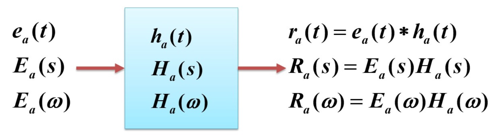
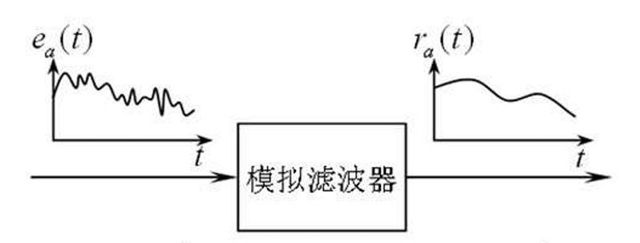
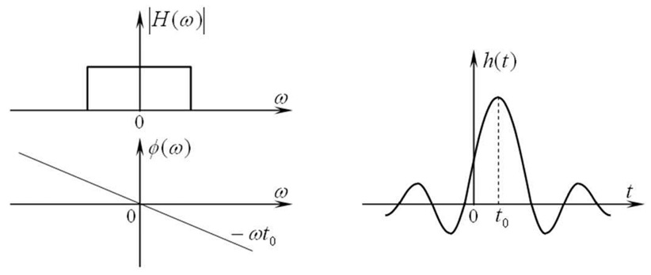
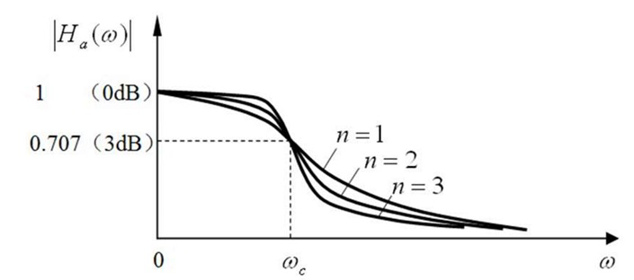
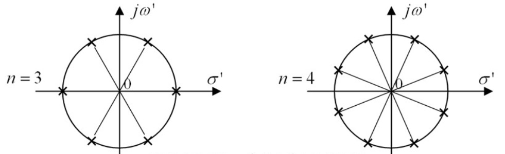
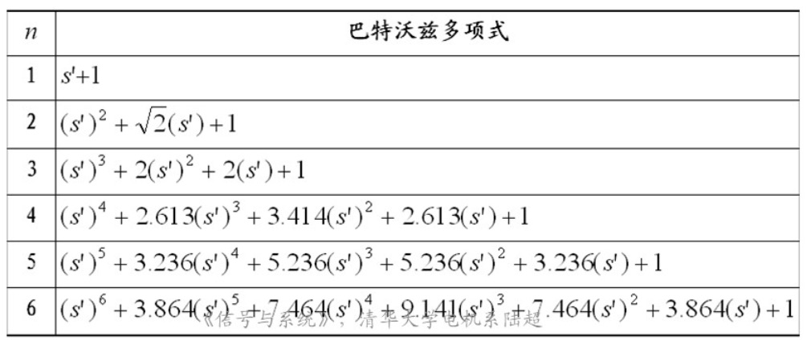
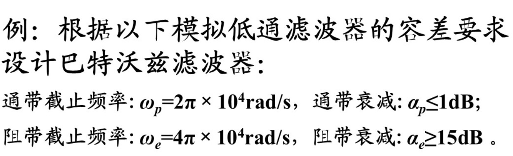
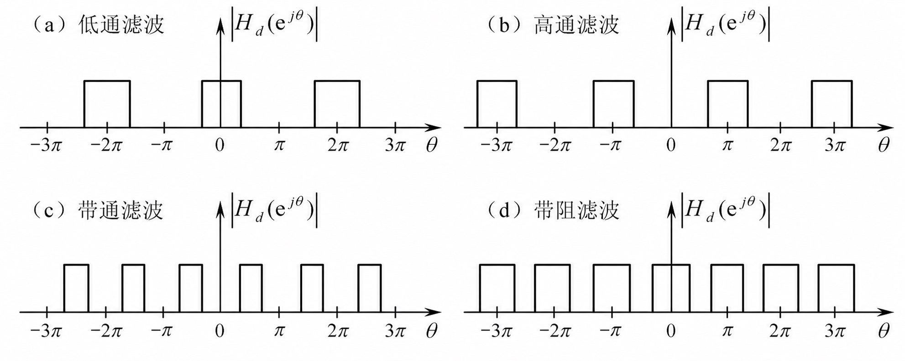
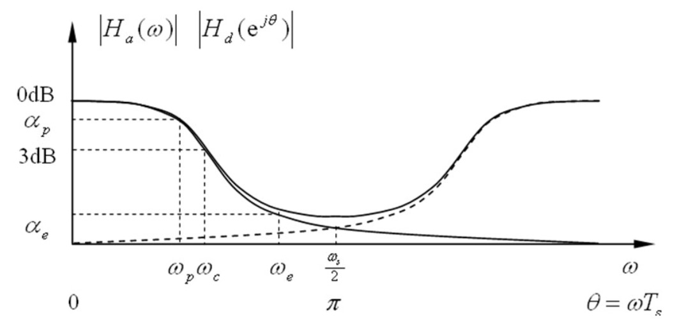
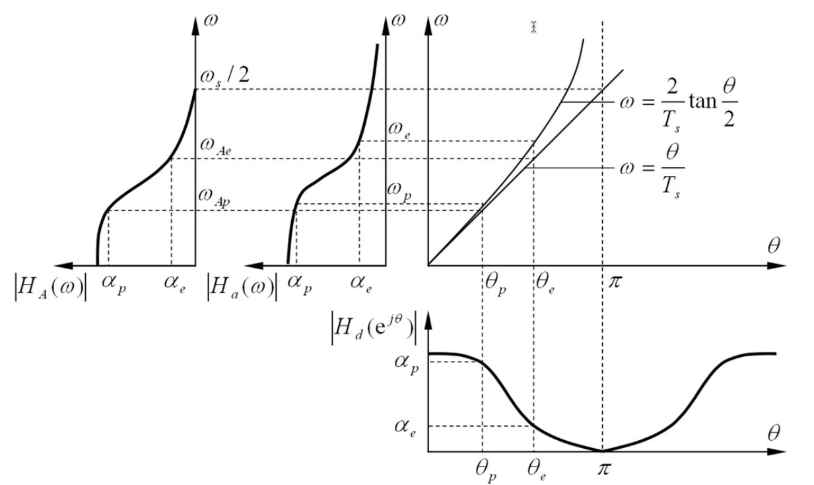

## 1. 滤波器概念与不失真传输

滤波器是一个系统，信号经过该系统后，各个频率分量的幅值按特定规律放大或缩小，相位按特定规律移位。  
根据处理信号的不同，滤波器分为**模拟滤波器**与**数字滤波器**。  

**信号的无失真传输条件**：  
对于连续系统，为实现无失真传输（输出 $r_a(t)$ 仅是输入 $e_a(t)$ 乘以常数增益并延迟时间 $t_0$，其波形形状不发生改变），有：  
$$r_a(t) = K e_a(t - t_0)$$  
对两边取傅里叶变换：  
$$R_a(\omega) = K E_a(\omega) e^{-j\omega t_0}$$  
所以系统传输函数（频率响应）必须为：  
$$H_a(\omega) = K e^{-j\omega t_0}$$  
由此可见，实现信号无失真传输的条件是：  
*   系统的幅频特性为常数：$|H_a(\omega)| = K$  
*   系统的相频特性为一条穿过原点的直线：$\varphi(\omega) = -\omega t_0$（线性相位）  

  

## 2. 理想模拟滤波器与物理可实现性

理想的滤波器在频域具有垂直的过渡带边沿，通带内幅频响应为常数，阻带内幅频响应为 0。  

**物理可实现性（因果性限制）**：  
理想低通滤波器的频率响应在频域中是矩形窗，其对应的冲激响应为非因果的 $Sa(t)$ 函数（即在 $t < 0$ 时也有值），这意味着在激励加入之前系统就会产生输出。因此，==理想滤波器物理上是不可实现的==。  

**佩利-维纳 (Paley-Wiener) 准则**：  
从频域判断一个系统物理可实现的充要条件为：  
$$\int_{-\infty}^{\infty} \frac{|\ln |H_a(\omega)||}{1 + \omega^2} d\omega < \infty$$  
以及必要条件（能量有限）：  
$$\int_{-\infty}^{\infty} |H_a(\omega)|^2 d\omega < \infty$$  
这导致了物理可实现系统在频域上的两个限制：  
1.  幅频特性 $|H_a(\omega)|$ 不能在任何一个有限的连续频率段上恒为零（否则对数积分为 $-\infty$）。  
2.  幅频特性的衰减速度不能超过指数阶。  

  
  

**希尔伯特 (Hilbert) 变换**：  
物理可实现的因果系统，其频率响应的实部 $H_{ar}(\omega)$ 与虚部 $H_{ai}(\omega)$ 存在相互约束关系（通过希尔伯特变换约束）。这表明**幅频和相频特性是不可能独立设计的**，在设计时必须进行取舍。  

## 3. 巴特沃兹 (Butterworth) 滤波器

巴特沃兹滤波器是一种幅频特性在通带内最大平坦的滤波器。  
*   **幅频特性**：  
    $$|H_a(j\omega)| = \frac{1}{\sqrt{1 + \left( \frac{\omega}{\omega_c} \right)^{2n}}}$$  
    其以分贝表示的衰减为：  
    $$\alpha = -20 \lg |H_a(j\omega)| = 10 \lg \left[ 1 + \left( \frac{\omega}{\omega_c} \right)^{2n} \right]$$  
*   **特点**：无论滤波器阶数 $n$ 取何值，在截止频率 $\omega_c$ 处的衰减均为 $3\text{ dB}$。  

为了构造稳定的系统函数 $H_a(s)$：  
$$H_a(s) H_a(-s) = \frac{1}{1 + \left( \frac{s}{j\omega_c} \right)^{2n}}$$  
对其进行频率归一化，设 $s' = s/\omega_c$。极点分布为 $2n$ 个在单位圆上均匀分布的根：  
$$p_k = e^{j \frac{2k - 1 + n}{2n}\pi} \quad , \quad k = 1, 2, \dots, 2n$$  
为了保证滤波器 $H_a(s)$ 的稳定性，只取复平面**左半平面的极点**作为系统函数的极点。  

  
  
  
  

*   **设计实例**：  
    已知设计指标为：通带截止频率 $\omega_p$，通带最大衰减 $\alpha_p$；阻带截止频率 $\omega_s$，阻带最小衰减 $\alpha_s$。  
    1.  建立方程组：  
        $$\alpha_p = 10 \lg \left[ 1 + \left( \frac{\omega_p}{\omega_c} \right)^{2n} \right] \quad , \quad \alpha_s = 10 \lg \left[ 1 + \left( \frac{\omega_s}{\omega_c} \right)^{2n} \right]$$  
    2.  求得滤波器阶数：  
        $$n = \frac{\lg \sqrt{\frac{10^{\alpha_s/10} - 1}{10^{\alpha_p/10} - 1}}}{\lg \left( \frac{\omega_s}{\omega_p} \right)}$$  
        向上取整得到整数阶数 $n$。  
    3.  计算截止频率 $\omega_c$ 的可选范围，选择左半平面极点构建归一化系统函数 $H_{an}(s')$，再进行去归一化（将 $s'$ 替换为 $s/\omega_c$）求得 $H_a(s)$。  

## 4. 数字滤波器

对于模拟信号，频率 $\omega$ 可以从 $-\infty$ 变化到 $+\infty$。而对于数字信号，复指数序列 $e^{j\theta n}$ 的频率具有以 $2\pi$ 为周期的周期性：  
*   $\theta = 2k\pi$ 对应于数字信号的**最低频**（直流）；  
*   $\theta = (2k+1)\pi$ 时，序列为 $e^{j\pi n} = (-1)^n$，对应信号交替变化最快的**最高频**。  

因此，数字滤波器分类为：  
*   **低通**：让 $\theta = 2k\pi$ 附近的低频成分通过，阻断高频。  
*   **高通**：让 $\theta = (2k+1)\pi$ 附近的高频成分通过，阻断低频。  
*   **带通**：阻断低频和高频，仅保留中间的特定频段。  
*   **带阻**：通过低频和高频，滤去中间的特定频段。  

数字滤波器主要分为两类：  
1.  **无限冲激响应 (IIR) 滤波器**：  
    采用递归结构（包含反馈项，输出不仅与当前及过去的输入有关，还与过去的输出有关）。  
    其差分方程为后向递归形式：  
    $$y(n) = \sum_{i=0}^{M} b_i e(n-i) - \sum_{k=1}^{N} a_k y(n-k)$$  
    系统函数为：  
    $$H(z) = \frac{\sum_{i=0}^{M} b_i z^{-i}}{1 + \sum_{k=1}^{N} a_k z^{-k}}$$  
2.  **有限冲激响应 (FIR) 滤波器**：  
    采用非递归结构（仅与当前及过去的输入有关，系统不含反馈环路）。  
    系统函数只在原点 $z = 0$ 处有极点：  
    $$H(z) = \sum_{i=0}^{M} b_i z^{-i}$$  
    时域单位样值响应 $h(n)$ 是有限长的。FIR 滤波器本质是对理想低通滤波器（其 $h_a(t)$ 是无限长的 $Sa$ 函数）进行截断，即用**窗函数法**（如矩形窗、汉宁窗）乘上无限长脉冲，并移动时轴保证因果性。  

  

## 5. IIR 滤波器设计方法 (s 域到 z 域映射)

利用模拟原型滤波器设计 IIR 数字滤波器，即寻找复频域从 s 域到 z 域的转换关系。  

### 5.1 冲激响应不变法

将模拟滤波器的冲激响应 $h_a(t)$ 按等间隔抽样作为数字滤波器的样值响应：  
$$h(n) = h_a(n T_s)$$  
若将模拟滤波器部分分式展开：$H_a(s) = \sum_{i=1}^{M} \frac{A_i}{s - p_i}$，则对应的 Z 域系统函数为：  
$$H(z) = \sum_{i=1}^{M} \frac{A_i}{1 - e^{p_i T_s} z^{-1}}$$  
*   **本质**：它是将 s 平面的极点 $s = p_i$ 直接映射为 z 平面的极点 $z = e^{p_i T_s}$。  
*   **缺点**：S 平面到 Z 平面是**多值映射**，这会导致频域在以 $\omega_s$ 为周期的延拓上产生**频率混叠**。对于高通、带阻等滤波器，由于高频成分丰富，此方法无法使用。  

  

### 5.2 双线性变换法

双线性变换是通过一个单值映射关系，将整个左半 s 平面单值地保角映射到 z 平面的单位圆内部，彻底解决了频率混叠的问题：  
$$s = \frac{2}{T_s} \frac{1 - z^{-1}}{1 + z^{-1}} \iff z = \frac{1 + \frac{T_s}{2}s}{1 - \frac{T_s}{2}s}$$  

代入 $s = j\Omega$ 与 $z = e^{j\theta}$，可得模拟角频率与数字角频率的映射联系：  
$$\Omega = \frac{2}{T_s} \tan\left( \frac{\theta}{2} \right) \iff \theta = 2 \arctan\left( \frac{\Omega T_s}{2} \right)$$  

*   **缺点**：双线性变换使得模拟角频率与数字角频率之间存在高度非线性的映射关系（**频率畸变**）。因此，在设计中必须先进行**频率预校正**。  

  

**双线性变换法的数字滤波器设计步骤**：  
1.  给定数字滤波器的容差指标（如通带截止频率 $\theta_p$，阻带截止频率 $\theta_s$）。  
2.  通过频率预校正公式，将数字指标映射为模拟滤波器指标：  
    $$\Omega_p = \frac{2}{T_s} \tan\left( \frac{\theta_p}{2} \right) \quad , \quad \Omega_s = \frac{2}{T_s} \tan\left( \frac{\theta_s}{2} \right)$$  
3.  根据模拟指标 $\Omega_p, \Omega_s$ 设计出模拟原型滤波器 $H_a(s)$。  
4.  代入双线性变换关系式，求得数字滤波器系统函数 $H(z)$：  
    $$H(z) = \left. H_a(s) \right|_{s = \frac{2}{T_s} \frac{1 - z^{-1}}{1 + z^{-1}}}$$  
