## 1. Fourier 变换的引出

信号在区间 $(t_1, t_2)$ 上的复指数形式 Fourier 级数：  
$$f(t) = \sum_{k=-\infty}^{\infty} F(k\omega_1) e^{jk\omega_1 t} \quad , \quad t_1 < t < t_2$$
$$F(k\omega_1) = \frac{1}{t_2-t_1} \int_{t_1}^{t_2} f(t) e^{-jk\omega_1 t} dt$$
$$\omega_1 = \frac{2\pi}{t_2-t_1}$$
若非周期信号 $f(t)$ 在区间 $(-\infty, \infty)$ 上满足 Dirichlet 条件，则当 $(t_1, t_2) \to (-\infty, \infty)$ 时：  
1) $\omega_1 = \Delta\omega \to 0$ ；  
2) $f(t)$ 在区间 $(-\infty, \infty)$ 上绝对可积，即 $\int_{-\infty}^{\infty} |f(t)| dt < \infty$ 。  

此时，有：  
$$\lim_{(t_1, t_2) \to (-\infty, \infty)} \int_{t_1}^{t_2} f(t) e^{-jk\omega_1 t} dt = \int_{-\infty}^{\infty} f(t) e^{-j\omega t} dt$$  

引入**信号频谱密度** $F(\omega)$：  
$$F(k\omega_1) \cdot (t_2 - t_1) = F(k\omega_1) \frac{2\pi}{\omega_1} = F(\omega) \implies F(k\omega_1) = F(\omega) \frac{\omega_1}{2\pi}$$  

代入级数和公式，有：  
$$f(t) = \lim_{\omega_1 \to 0} \sum_{k=-\infty}^{\infty} F(k\omega_1) e^{jk\omega_1 t} = \lim_{\omega_1 \to 0} \sum_{k=-\infty}^{\infty} F(k\omega_1) \frac{\omega_1}{2\pi} e^{jk\omega_1 t} = \frac{1}{2\pi} \int_{-\infty}^{\infty} F(\omega) e^{j\omega t} d\omega$$  

由此得到傅里叶正、反变换。  

## 2. 物理过程理解

**为什么需要 Fourier 变换？**  
*   周期信号的 Fourier 级数是离散的，而==非周期信号的频谱是连续的==！  
*   非周期信号 $f(t)$ 可以等效为周期 $T \to \infty$ 的周期信号。  
*   当 $T \to \infty$ 时，各分量角频率差值 $\omega_1 \to 0$，谱线趋于连续。  
*   由于谱线无限密集且每一谱线的幅值 $F(k\omega_1)$ 都几乎为 0，直接用谱线幅值来表示频谱不再合适，因此引入==频谱密度函数==来描述。  

$$\lim_{\omega_1 \to 0} \frac{F(k\omega_1)}{\omega_1 / 2\pi} = F(\omega)$$  

**Fourier 正变换、逆变换：**  

*   **正变换**：  
    $$F(\omega) = \mathcal{F}[f(t)] = \int_{-\infty}^{\infty} f(t) e^{-j\omega t} dt$$  
*   **逆变换**：  
    $$f(t) = \mathcal{F}^{-1}[F(\omega)] = \frac{1}{2\pi} \int_{-\infty}^{\infty} F(\omega) e^{j\omega t} d\omega$$  

$F(\omega)$ 一般为复函数，可表示为：  
$$F(\omega) = |F(\omega)| e^{j\varphi(\omega)}$$  
其中 $|F(\omega)|$ 为幅频特性，$\varphi(\omega)$ 为相频特性。  

## 3. 直观理解 F(w) 与 f(t) 的关系

**1) $F(\omega)|_{\omega=0}$（零频值）：**  
*   直流分量的总权重，即信号的面积：  
    $$F(0) = \int_{-\infty}^{\infty} f(t) dt = S$$  

**2) 全频积分与 $f(0)$ 的关系：**  
*   由于 $e^{j\omega t}|_{t=0} = 1$，说明所有频域分量在 $t=0$ 处以初相位同相叠加：  
    $$f(0) = \frac{1}{2\pi} \int_{-\infty}^{\infty} F(\omega) d\omega \implies \int_{-\infty}^{\infty} F(\omega) d\omega = 2\pi f(0)$$  

## 4. 典型信号的 Fourier 变换

### 4.1 矩形脉冲信号

设 $f(t) = E [u(t + \tau/2) - u(t - \tau/2)]$，即宽度为 $\tau$，幅值为 $E$ 的门函数（或称矩形脉冲）。  

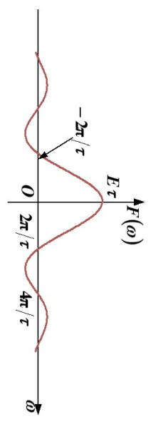  

其傅里叶变换为：  
$$F(\omega) = \int_{-\tau/2}^{\tau/2} E e^{-j\omega t} dt = \left. E \frac{e^{-j\omega t}}{-j\omega} \right|_{-\tau/2}^{\tau/2} = E \frac{e^{j\omega \tau/2} - e^{-j\omega \tau/2}}{j\omega} = E\tau \frac{\sin(\omega \tau/2)}{\omega \tau/2} = E\tau Sa\left(\frac{\omega\tau}{2}\right)$$  

*   **幅频特性**：  
    $$|F(\omega)| = E\tau \left| Sa\left(\frac{\omega\tau}{2}\right) \right|$$  
*   **相频特性**：  
    由于 $Sa\left(\frac{\omega\tau}{2}\right)$ 可正可负，相角在它为负值时会突变 $\pi$（或 $-\pi$）：  
    $$\varphi(\omega) = \begin{cases} 0 , & Sa\left(\frac{\omega\tau}{2}\right) > 0 \\ \pm\pi , & Sa\left(\frac{\omega\tau}{2}\right) < 0 \end{cases}$$  

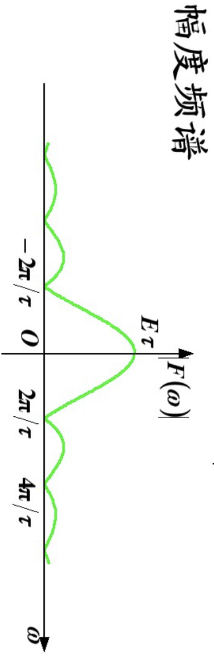  
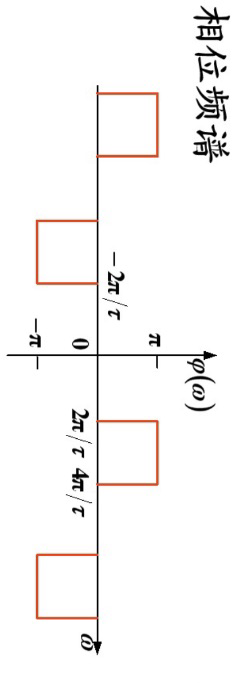  

### 4.2 单边指数信号

设 $f(t) = E e^{-at} u(t)$，其中 $a > 0$。  

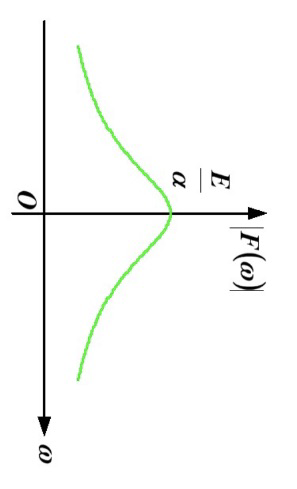  

其傅里叶变换为：  
$$F(\omega) = \int_{0}^{\infty} E e^{-at} e^{-j\omega t} dt = E \int_{0}^{\infty} e^{-(a+j\omega)t} dt = \left. E \frac{e^{-(a+j\omega)t}}{-(a+j\omega)} \right|_{0}^{\infty} = \frac{E}{a+j\omega}$$  

*   **幅频特性**：  
    $$|F(\omega)| = \frac{E}{\sqrt{a^2 + \omega^2}}$$  
*   **相频特性**：  
    $$\varphi(\omega) = -\arctan\left(\frac{\omega}{a}\right)$$  

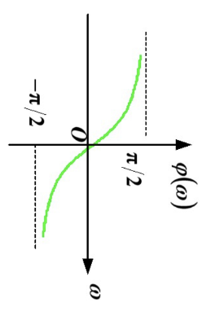  

### 4.3 双边衰减指数信号

设 $f(t) = E e^{-a|t|}$，其中 $a > 0$。  

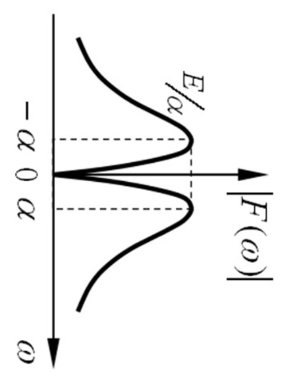  

其傅里叶变换为：  
$$F(\omega) = \int_{-\infty}^{\infty} E e^{-a|t|} e^{-j\omega t} dt = \int_{-\infty}^{0} E e^{at} e^{-j\omega t} dt + \int_{0}^{\infty} E e^{-at} e^{-j\omega t} dt$$  
$$= \frac{E}{a-j\omega} + \frac{E}{a+j\omega} = \frac{2aE}{a^2 + \omega^2}$$  

*   **幅频特性**：  
    $$|F(\omega)| = \frac{2aE}{a^2 + \omega^2}$$  
*   **相频特性**：  
    $$\varphi(\omega) = 0$$  

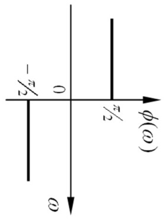  

### 4.4 单位冲激信号

$$f(t) = \delta(t)$$  
其傅里叶变换为：  
$$F(\omega) = \int_{-\infty}^{\infty} \delta(t) e^{-j\omega t} dt = e^{-j\omega \cdot 0} = 1$$  

*   **物理意义**：单位冲激信号包含所有频率分量，且各分量强度相等（幅值为 1），相角为 0。常被称为==“白噪声”频谱==。  
*   冲激信号 $\delta(t)$ 也可看作脉宽 $\tau \to 0$ 的矩形脉冲的极限。  

### 4.5 直流信号

$$f(t) = E \quad (-\infty < t < \infty)$$  

由于直流信号在 $(-\infty, \infty)$ 上不满足绝对可积条件，不能直接用积分定义计算其傅里叶变换。我们利用冲激函数进行扩充定义：  
$$F(\omega) = \lim_{\tau \to \infty} \int_{-\tau/2}^{\tau/2} E e^{-j\omega t} dt = \lim_{\tau \to \infty} E\tau Sa\left(\frac{\omega\tau}{2}\right) = 2\pi E \delta(\omega)$$  

*   **物理意义**：直流信号只有 $\omega = 0$ 的分量，其傅里叶变换在 $\omega = 0$ 处是一个强度为 $2\pi E$ 的冲激。  

### 4.6 符号信号

设 $f(t) = \operatorname{sgn}(t) = \begin{cases} 1 , & t > 0 \\ -1 , & t < 0 \end{cases}$  

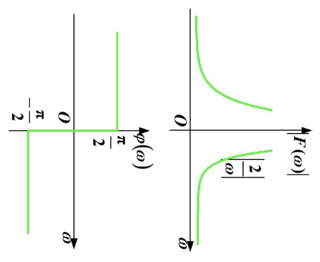  

其傅里叶变换可以视作两个单边指数信号的极限：  
$$\operatorname{sgn}(t) = \lim_{a \to 0} \left[ e^{-at} u(t) - e^{at} u(-t) \right]$$  
$$F(\omega) = \lim_{a \to 0} \left[ \frac{1}{a+j\omega} - \frac{1}{a-j\omega} \right] = \lim_{a \to 0} \frac{-2j\omega}{a^2 + \omega^2} = \frac{2}{j\omega}$$  

*   **幅频特性**：  
    $$|F(\omega)| = \frac{2}{|\omega|}$$  
*   **相频特性**：  
    $$\varphi(\omega) = \begin{cases} -\pi/2 , & \omega > 0 \\ \pi/2 , & \omega < 0 \end{cases}$$  

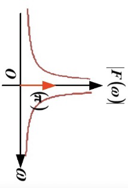  

### 4.7 阶跃信号

设 $f(t) = u(t)$。  

我们可以将单位阶跃信号分解为直流分量与符号信号之和：  
$$u(t) = \frac{1}{2} + \frac{1}{2}\operatorname{sgn}(t)$$  

利用线性性质，可得其傅里叶变换：  
$$F(\omega) = \mathcal{F}\left[\frac{1}{2}\right] + \mathcal{F}\left[\frac{1}{2}\operatorname{sgn}(t)\right] = \pi \delta(\omega) + \frac{1}{j\omega}$$  

## 5. Fourier 变换的性质

### 5.1 线性性质

若 $\mathcal{F}[f_1(t)] = F_1(\omega)$，$\mathcal{F}[f_2(t)] = F_2(\omega)$，则：  
$$\mathcal{F}[a f_1(t) + b f_2(t)] = a F_1(\omega) + b F_2(\omega)$$  

*   **例**：求 $u(t) = \frac{1}{2} + \frac{1}{2}\operatorname{sgn}(t)$ 的傅里叶变换。  
    $$F(\omega) = \pi\delta(\omega) + \frac{1}{j\omega}$$  

### 5.2 奇偶虚实特性

若 $f(t)$ 是实函数，其傅里叶变换为 $F(\omega) = R(\omega) + jX(\omega)$，则：  
$$R(\omega) = \operatorname{Re}[F(\omega)] = \int_{-\infty}^{\infty} f(t) \cos(\omega t) dt \quad (\text{偶函数})$$  
$$X(\omega) = \operatorname{Im}[F(\omega)] = -\int_{-\infty}^{\infty} f(t) \sin(\omega t) dt \quad (\text{奇函数})$$  

因此有共轭对称性：  
$$F(-\omega) = F^*(\omega)$$  
$$|F(-\omega)| = |F(\omega)| \quad , \quad \varphi(-\omega) = -\varphi(\omega)$$  

*   若 $f(t)$ 是**实偶函数**，则 $F(\omega)$ 是**实偶函数**（$F(\omega) = R(\omega)$）。  
*   若 $f(t)$ 是**实奇函数**，则 $F(\omega)$ 是**虚奇函数**（$F(\omega) = jX(\omega)$）。  
*   **总结**：实信号变换后，实部为偶，虚部为奇，幅频为偶，相频为奇。  

### 5.3 对称性质

若 $\mathcal{F}[f(t)] = F(\omega)$，则：  
$$\mathcal{F}[F(t)] = 2\pi f(-\omega)$$  

若 $f(t)$ 为偶函数，则：  
$$\mathcal{F}[F(t)] = 2\pi f(\omega)$$  

*   **例 1**：因为 $\mathcal{F}[\delta(t)] = 1$，由对称性得 $\mathcal{F}[1] = 2\pi \delta(-\omega) = 2\pi \delta(\omega)$。  
*   **例 2**：求抽样信号 $f(t) = E Sa(\omega_c t)$ 的傅里叶变换。  
    已知 $g(t) = \begin{cases} E , & |t| < \tau/2 \\ 0 , & |t| > \tau/2 \end{cases} \iff G(\omega) = E\tau Sa\left(\frac{\omega\tau}{2}\right)$。  
    令 $\frac{\tau}{2} = \omega_c \implies \tau = 2\omega_c$，则 $g(t) = E [u(t+\omega_c) - u(t-\omega_c)] \iff G(\omega) = 2E\omega_c Sa(\omega\omega_c)$。  
    由对称性质 $\mathcal{F}[G(t)] = 2\pi g(-\omega)$，有：  
    $$\mathcal{F}\left[2E\omega_c Sa(\omega_c t)\right] = 2\pi E [u(-\omega + \omega_c) - u(-\omega - \omega_c)]$$  
    $$\implies \mathcal{F}[Sa(\omega_c t)] = \frac{\pi}{\omega_c} [u(\omega + \omega_c) - u(\omega - \omega_c)]$$  
    因此：  
    $$\mathcal{F}[E Sa(\omega_c t)] = \frac{\pi E}{\omega_c} [u(\omega + \omega_c) - u(\omega - \omega_c)]$$  

### 5.4 尺度特性

若 $\mathcal{F}[f(t)] = F(\omega)$，则：  
$$\mathcal{F}[f(at)] = \frac{1}{|a|} F\left(\frac{\omega}{a}\right)$$  

*   **物理意义**：  
    1) 当 $0 < |a| < 1$ 时，时域扩展，频带压缩，信号幅度减小；  
    2) 当 $|a| > 1$ 时，时域压缩，频域扩展 $|a|$ 倍，信号幅度增大。  

**等效脉宽与等效频宽**：  
定义等效脉冲宽度 $\tau$ 与等效频带宽度 $B_\omega$ 分别为：  
$$\tau = \frac{\int_{-\infty}^{\infty} f(t) dt}{f(0)} = \frac{F(0)}{f(0)}$$  
$$B_\omega = \frac{\int_{-\infty}^{\infty} F(\omega) d\omega}{F(0)} = \frac{2\pi f(0)}{F(0)}$$  
则有：  
$$B_\omega \cdot \tau = 2\pi$$  
该式子表明时域的脉宽与频域的频带宽度乘积为常数。尺度变换性质也体现了这一对立统一关系。  

### 5.5 时移特性

若 $\mathcal{F}[f(t)] = F(\omega)$，则：  
$$\mathcal{F}[f(t - t_0)] = F(\omega) e^{-j\omega t_0}$$  

*   **物理意义**：时域的位移仅使频域的相位改变（初相位加上 $-\omega t_0$），而其幅频特性 $|F(\omega)|$ 保持不变。  
*   **例**：求如图所示的三个相同方波信号叠加后的傅里叶变换，方波间隔为 $T$。  
    设单个方波信号为 $f_0(t) \iff F_0(\omega) = E\tau Sa\left(\frac{\omega\tau}{2}\right)$。  
    总信号为：  
    $$f(t) = f_0(t) + f_0(t - T) + f_0(t + T)$$  
    利用时移性质：  
    $$F(\omega) = F_0(\omega) [1 + e^{-j\omega T} + e^{j\omega T}] = F_0(\omega) (1 + 2\cos\omega T)$$  
    即：  
    $$F(\omega) = E\tau Sa\left(\frac{\omega\tau}{2}\right) (1 + 2\cos\omega T)$$  

### 5.6 频移特性（调制）

若 $\mathcal{F}[f(t)] = F(\omega)$，则：  
$$\mathcal{F}[f(t) e^{\pm j\omega_0 t}] = F(\omega \mp \omega_0)$$  

*   **物理意义**：频移特性的本质是==频谱搬移==（调制）。时域信号乘以 $e^{j\omega_0 t}$，对应频域中所有频率成分向右移动 $\omega_0$。  
*   **例 1**：求余弦信号 $\cos\omega_0 t$ 和正弦信号 $\sin\omega_0 t$ 的傅里叶变换。  
    根据 Euler 公式：  
    $$\cos\omega_0 t = \frac{1}{2}(e^{j\omega_0 t} + e^{-j\omega_0 t}) \quad , \quad \sin\omega_0 t = \frac{1}{2j}(e^{j\omega_0 t} - e^{-j\omega_0 t})$$  
    由频移性质和 $\mathcal{F}[1] = 2\pi\delta(\omega)$，可得：  
    $$\mathcal{F}[\cos\omega_0 t] = \pi [\delta(\omega - \omega_0) + \delta(\omega + \omega_0)]$$  
    $$\mathcal{F}[\sin\omega_0 t] = -j\pi [\delta(\omega - \omega_0) - \delta(\omega + \omega_0)]$$  
*   **例 2**：已知 $\mathcal{F}[f(t)] = F(\omega)$，求 $f(t)\cos\omega_0 t$ 的傅里叶变换。  
    $$\mathcal{F}[f(t)\cos\omega_0 t] = \mathcal{F}\left[f(t) \cdot \frac{1}{2}(e^{j\omega_0 t} + e^{-j\omega_0 t})\right] = \frac{1}{2} [F(\omega - \omega_0) + F(\omega + \omega_0)]$$  
*   **例 3（性质综合）**：若 $F(\omega) = \mathcal{F}[f(t)]$，求 $F(3\omega - 1) e^{j2\omega}$ 的傅里叶逆变换。  
    由于傅里叶反变换与正变换的对称性，我们由基本性质逐步推导：  
    已知 $f(t) \iff F(\omega)$。  
    由尺度特性：$f(t/3) \iff 3F(3\omega) \implies \frac{1}{3}f(t/3) \iff F(3\omega)$。  
    由频移特性：$e^{j\omega_0 t} f(t) \iff F(\omega - \omega_0)$。由于反变换对称性，我们对 $\omega$ 的位移在时域乘上相位移动：  
    位移 $\omega - 1/3$：$\frac{1}{3}f(t/3) e^{j t/3} \iff F(3(\omega - 1/3)) = F(3\omega - 1)$。  
    由时移特性：$f(t - t_0) \iff F(\omega) e^{-j\omega t_0}$。  
    这里乘以 $e^{j2\omega}$ 相当于 $t_0 = -2$，所以：  
    $$\mathcal{F}^{-1}[F(3\omega - 1) e^{j2\omega}] = \frac{1}{3} f\left(\frac{t+2}{3}\right) e^{j \frac{t+2}{3}}$$  

### 5.7 时域微分特性

若 $\mathcal{F}[f(t)] = F(\omega)$，则：  
$$\mathcal{F}\left[\frac{df(t)}{dt}\right] = j\omega F(\omega)$$  
并可推广到 $n$ 阶微分：  
$$\mathcal{F}\left[\frac{d^n f(t)}{dt^n}\right] = (j\omega)^n F(\omega)$$  

*   **物理意义**：时域的求导相当于对其所有频率分量乘以 $j\omega$，在频域中即为幅值乘以 $\omega$ 且相位旋转 $90^\circ$（乘以 $j$）。  
*   **例**：利用微分性质求单位冲激信号 $\delta(t)$ 的傅里叶变换。  
    我们已知 $\delta(t) = \frac{du(t)}{dt}$。  
    $$\mathcal{F}[\delta(t)] = j\omega \mathcal{F}[u(t)] = j\omega \left[ \pi \delta(\omega) + \frac{1}{j\omega} \right] = j\omega \pi \delta(\omega) + 1$$  
    根据冲激函数性质 $\omega \delta(\omega) = 0$，上式化简为：  
    $$\mathcal{F}[\delta(t)] = 1$$  
    这与前文直接积分得到的结果一致。  
    > [!WARNING]  
    > **注意**：信号微分会丢失直流分量，微分后的信号无法反映原信号中的直流偏置。  

### 5.8 频域微分特性

若 $\mathcal{F}[f(t)] = F(\omega)$，则：  
$$\mathcal{F}[(-jt)^n f(t)] = \frac{d^n F(\omega)}{d\omega^n} \implies \mathcal{F}[t^n f(t)] = j^n \frac{d^n F(\omega)}{d\omega^n}$$  
对于 $n=1$：  
$$\mathcal{F}[t f(t)] = j \frac{dF(\omega)}{d\omega}$$  

*   **例**：求 $t$ 的傅里叶变换。  
    已知 $\mathcal{F}[1] = 2\pi\delta(\omega)$。  
    由频域微分性质：  
    $$\mathcal{F}[t] = j \frac{d}{d\omega}(2\pi\delta(\omega)) = j 2\pi \delta'(\omega)$$  

### 5.9 时域积分特性

若 $\mathcal{F}[f(t)] = F(\omega)$，则：  
$$\mathcal{F}\left[\int_{-\infty}^{t} f(\tau) d\tau\right] = \frac{F(\omega)}{j\omega} + \pi F(0) \delta(\omega)$$  

*   **物理意义**：时域积分是微分的逆运算，因此频域中对应除以 $j\omega$，并且由于积分可能引入直流分量（即信号在整个时间轴上的面积 $F(0)$），所以式中包含了一项直流成分项 $\pi F(0) \delta(\omega)$。  
*   **例**：利用时域积分性质求矩形脉冲信号的傅里叶变换。  
    设 $g(t) = E [u(t + \tau/2) - u(t - \tau/2)]$ 为矩形波。  
    其导数为：  
    $$g'(t) = E \delta(t + \tau/2) - E \delta(t - \tau/2)$$  
    对其求傅里叶变换：  
    $$\mathcal{F}[g'(t)] = E e^{j\omega \tau/2} - E e^{-j\omega \tau/2} = 2jE \sin\left(\frac{\omega\tau}{2}\right)$$  
    由于 $g'(t)$ 是奇函数，且 $g(t)$ 的直流面积 $G(0) = E\tau$，我们利用积分性质：  
    $$g(t) = \int_{-\infty}^{t} g'(\tau) d\tau$$  
    得：  
    $$G(\omega) = \frac{\mathcal{F}[g'(t)]}{j\omega} + \pi \mathcal{F}[g'(t)]|_{\omega=0} \delta(\omega) = \frac{2jE \sin(\omega\tau/2)}{j\omega} + 0 = E\tau Sa\left(\frac{\omega\tau}{2}\right)$$  
    这与用定义计算的结果完全一致。  

### 5.10 时域卷积性质

若 $\mathcal{F}[f_1(t)] = F_1(\omega)$，$\mathcal{F}[f_2(t)] = F_2(\omega)$，则：  
$$\mathcal{F}[f_1(t) * f_2(t)] = F_1(\omega) \cdot F_2(\omega)$$  

*   **物理意义**：==时域相卷，频域相乘==。对于线性时不变系统，若其单位冲激响应为 $h(t) \iff H(\omega)$，输入激励为 $e(t) \iff E(\omega)$，系统零状态响应为 $r(t) = e(t) * h(t)$，则频域响应为：  
    $$R(\omega) = E(\omega) \cdot H(\omega)$$  
    其中 $H(\omega)$ 称为系统的==网络函数（或系统函数）==。  

### 5.11 频域卷积性质

若 $\mathcal{F}[f_1(t)] = F_1(\omega)$，$\mathcal{F}[f_2(t)] = F_2(\omega)$，则：  
$$\mathcal{F}[f_1(t) \cdot f_2(t)] = \frac{1}{2\pi} F_1(\omega) * F_2(\omega)$$  

*   **物理意义**：时域相乘，频域相卷（乘以 $1/2\pi$）。  

## 6. 周期信号的傅里叶变换

**傅里叶变换存在的充分条件**（Dirichlet 条件）：  
*   在任一周期内，信号有有限个第一类间断点和有限个极值点；  
*   信号在任一周期内绝对可积。  

严格来说，周期信号在 $(-\infty, \infty)$ 上是不满足绝对可积条件的。但在引入冲激函数后，可以将周期信号的傅里叶变换加以推广。  

*   **回顾**：连续周期信号 $f_p(t)$ 周期为 $T$，基频 $\omega_1 = 2\pi/T$，其指数形式的傅里叶级数为：  
    $$f_p(t) = \sum_{k=-\infty}^{\infty} F(k\omega_1) e^{jk\omega_1 t}$$  
*   对该式两边进行傅里叶变换，利用频移性质：  
    $$\mathcal{F}[e^{jk\omega_1 t}] = 2\pi \delta(\omega - k\omega_1)$$  
    可得周期信号的傅里叶变换为：  
    $$F_p(\omega) = 2\pi \sum_{k=-\infty}^{\infty} F(k\omega_1) \delta(\omega - k\omega_1)$$  
*   **物理意义**：  
    1.  周期函数的傅里叶变换是一个==冲激序列==。  
    2.  冲激脉冲均位于各谐波频率 $k\omega_1$ 处。  
    3.  各冲激的强度是相应傅里叶级数系数的 $2\pi$ 倍。  

*   **例**：求周期冲激序列信号（又称冲激梳状函数） $\delta_p(t) = \sum_{n=-\infty}^{\infty} \delta(t - nT)$ 的傅里叶变换。  
    首先求其傅里叶级数系数：  
    $$F(k\omega_1) = \frac{1}{T} \int_{-T/2}^{T/2} \delta(t) e^{-jk\omega_1 t} dt = \frac{1}{T}$$  
    因此：  
    $$\delta_p(t) = \frac{1}{T} \sum_{k=-\infty}^{\infty} e^{jk\omega_1 t}$$  
    对其进行傅里叶变换：  
    $$\mathcal{F}[\delta_p(t)] = \frac{2\pi}{T} \sum_{k=-\infty}^{\infty} \delta(\omega - k\omega_1) = \omega_1 \sum_{k=-\infty}^{\infty} \delta(\omega - k\omega_1)$$  
    其中 $\omega_1 = \frac{2\pi}{T}$。  
*   **结论**：时域 of 冲激序列变换到频域，依然是频域的冲激序列。  

### 6.1 任意周期信号的傅里叶变换

若已知非周期信号 $f(t) \iff F(\omega)$，由它延拓成的周期信号 $f_p(t) = \sum_{n=-\infty}^{\infty} f(t - nT)$，可以看作是 $f(t)$ 与周期冲激脉冲序列 $\delta_p(t)$ 的时域卷积：  
$$f_p(t) = f(t) * \delta_p(t) = f(t) * \sum_{n=-\infty}^{\infty} \delta(t - nT)$$  

利用时域卷积性质，其傅里叶变换为：  
$$F_p(\omega) = F(\omega) \cdot \mathcal{F}[\delta_p(t)] = F(\omega) \cdot \left[ \frac{2\pi}{T} \sum_{k=-\infty}^{\infty} \delta(\omega - k\omega_1) \right] = \frac{2\pi}{T} \sum_{k=-\infty}^{\infty} F(k\omega_1) \delta(\omega - k\omega_1)$$  
其中 $\omega_1 = \frac{2\pi}{T}$。  

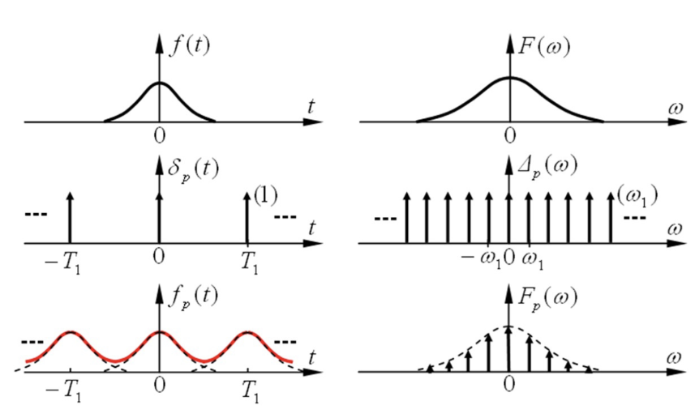  

### 6.2 周期信号 Fourier 变换与 Fourier 级数的关系

对于周期信号 $f_p(t)$：  
*   其傅里叶变换为：  
    $$F_p(\omega) = 2\pi \sum_{k=-\infty}^{\infty} F_n \delta(\omega - k\omega_1)$$  
    其中 $F_n$ 是指数形式傅里叶级数系数。  
*   同时，利用单周期信号的傅里叶变换 $F(\omega)$ 表示为：  
    $$F_n = \frac{1}{T} F(k\omega_1) \implies F_p(\omega) = \omega_1 \sum_{k=-\infty}^{\infty} F(k\omega_1) \delta(\omega - k\omega_1)$$  
*   由此可得：  
    $$F_n = \frac{1}{T} F(\omega) \Big|_{\omega = k\omega_1}$$  
*   **总结**：==时域周期延拓 $\iff$ 频域离散抽样==。  

*   **例**：求周期矩形波信号的傅里叶变换。  
    周期矩形波 $f_p(t)$ 可以看作单脉冲 $g(t)$（宽度 $\tau$，幅值 $E$）的周期延拓。  
    单脉冲的频谱为：  
    $$G(\omega) = E\tau Sa\left(\frac{\omega\tau}{2}\right)$$  
    其周期延拓信号的傅里叶变换为：  
    $$G_p(\omega) = \frac{2\pi}{T} \sum_{k=-\infty}^{\infty} G(k\omega_1) \delta(\omega - k\omega_1) = \frac{2\pi}{T} \sum_{k=-\infty}^{\infty} E\tau Sa\left(\frac{k\omega_1\tau}{2}\right) \delta(\omega - k\omega_1)   
   = 2\pi \sum_{k=-\infty}^{\infty} \frac{E\tau}{T} Sa\left(\frac{k\omega_1\tau}{2}\right) \delta(\omega - k\omega_1)$$  

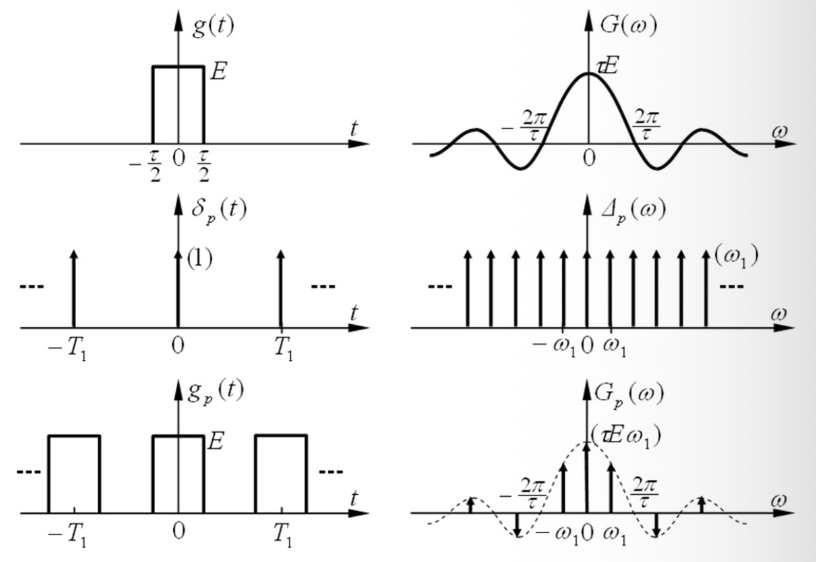  
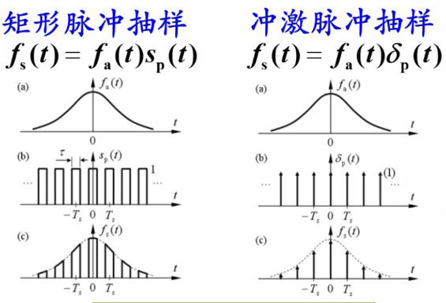  

### 7. 信号的抽样

抽样是将连续信号在时域或频域转换为离散信号的过程。  

#### 7.1 时域矩形脉冲序列抽样

时域抽样相当于将连续信号 $f(t)$ 乘以一个周期矩形脉冲序列 $p(t)$。  
*   当抽样间隔 $T_s$ 减小时，频域重复间隔 $\omega_s$ 增大，混叠减小；  
*   当抽样间隔 $T_s$ 增大时，频域重复间隔 $\omega_s$ 减小，可能产生混叠。  

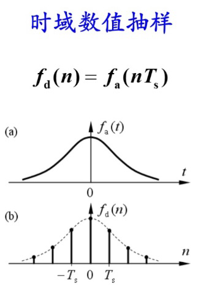  
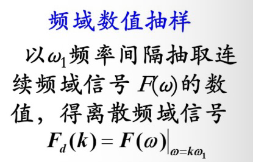  
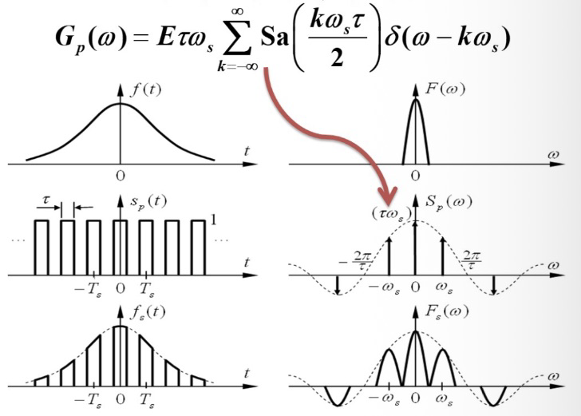  

#### 7.2 时域冲激脉冲序列抽样

时域抽样也可以简化为乘上一个冲激序列 $\delta_p(t) = \sum_{n=-\infty}^{\infty} \delta(t - nT_s)$。  
抽样后信号为：  
$$f_s(t) = f(t) \cdot \delta_p(t)$$  
根据频域卷积定理，抽样后信号的频谱为：  
$$F_s(\omega) = \frac{1}{2\pi} F(\omega) * \mathcal{F}[\delta_p(t)] = \frac{1}{2\pi} F(\omega) * \left[ \omega_s \sum_{k=-\infty}^{\infty} \delta(\omega - k\omega_s) \right] = \frac{1}{T_s} \sum_{k=-\infty}^{\infty} F(\omega - k\omega_s)$$  
其中 $\omega_s = \frac{2\pi}{T_s}$。  

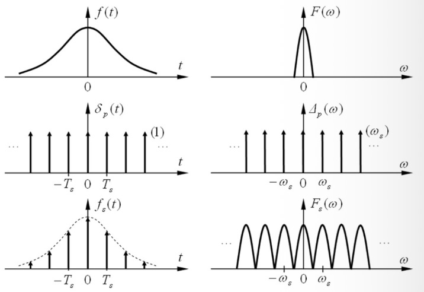  
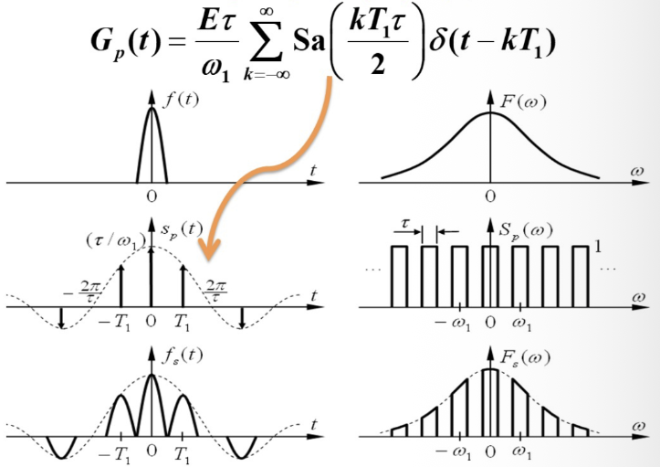  

#### 7.3 频域矩形脉冲序列抽样

频域抽样将频域连续 of $F(\omega)$ 乘上一个频域的矩形脉冲序列，使得频域在时域的投影产生周期延拓。  
*   频域抽样间隔减小，时域重复间隔增大。  

#### 7.4 频域冲激脉冲序列抽样

类似地，将 $F(\omega)$ 乘以频域冲激脉冲序列。  
*   频域抽样间隔减小 $\iff$ 时域重复间隔增大。  

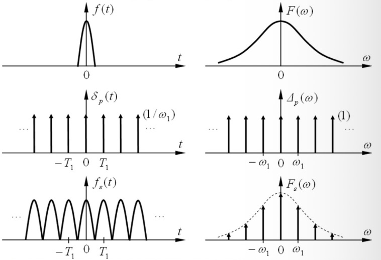  

### 8. 抽样定理 (Sampling Theorem)

#### 8.1 时域抽样定理 (Nyquist 抽样定理)

若连续信号 $f(t)$ 的频带是有限的，其最高频率为 $\omega_m$（即当 $|\omega| > \omega_m$ 时，$F(\omega) = 0$），则它可以用等间隔的时域样值信号 $f(nT_s)$ 唯一地表示。  
只要时域抽样角频率 $\omega_s$ 满足：  
$$\omega_s = \frac{2\pi}{T_s} \ge 2\omega_m \implies T_s \le \frac{\pi}{\omega_m}$$  
对应的抽样频率称为奈奎斯特频率：$f_s \ge 2f_m$。  
*   **物理意义**：为了无失真地恢复原连续信号，对信号最高频率分量进行有效抽样时，在一个周期内至少要抽取 2 个点。  

#### 8.2 频域抽样定理

若时域信号 $f(t)$ 的时间范围是有限的，只在区间 $(-t_m, t_m)$ 内有值，则它的频谱函数 $F(\omega)$ 可以用等间隔的频域抽样值唯一表示。  
只要频域抽样间隔 $\omega_s$ 满足：  
$$\omega_s = \frac{2\pi}{T_1} \le \frac{\pi}{t_m} \implies T_1 \ge 2t_m$$  
即频域抽样对应的时域周期 $T_1$ 必须大等于信号时域长度 $2t_m$。  

*   **例：三角信号抽样**  
    时域三角信号的抽样，如果在临界抽样时（$\omega_s = 2\omega_m$），其频谱刚好无重叠地拼接在一起。  

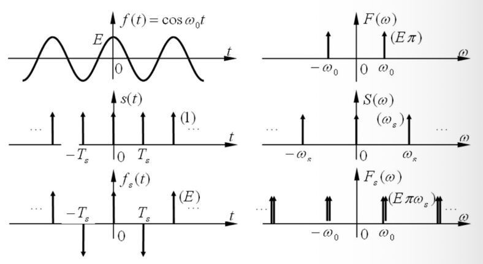  
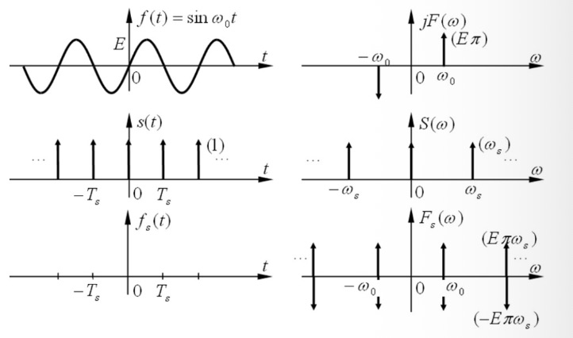  

### 9. 时域信号的恢复

在满足抽样定理（$\omega_s \ge 2\omega_m$）的条件下，可以通过一个低通滤波器将原信号无失真地恢复出来。  
理想低通滤波器的频率响应为：  
$$H(\omega) = \begin{cases} T_s , & |\omega| < \omega_c \\ 0 , & |\omega| > \omega_c \end{cases} \quad (\omega_m < \omega_c < \omega_s - \omega_m)$$  

恢复出来的时域信号为：  
$$f(t) = f_s(t) * h(t) = \left[ \sum_{n=-\infty}^{\infty} f(nT_s)\delta(t - nT_s) \right] * Sa(\omega_c t) = \sum_{n=-\infty}^{\infty} f(nT_s) Sa(\omega_c(t - nT_s))$$  

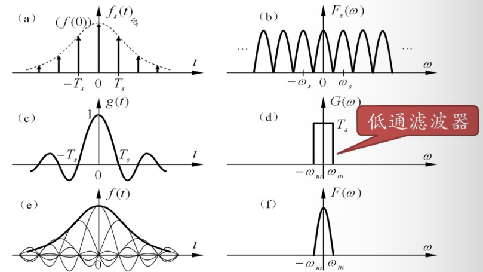
