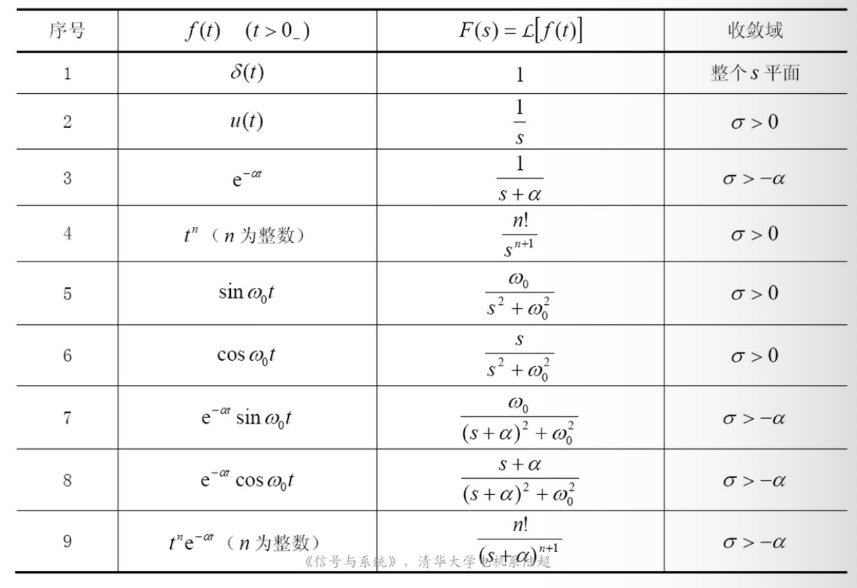
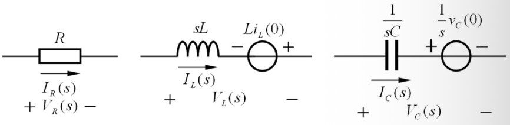
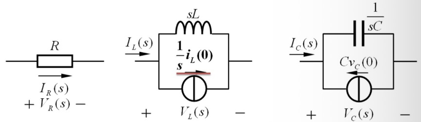
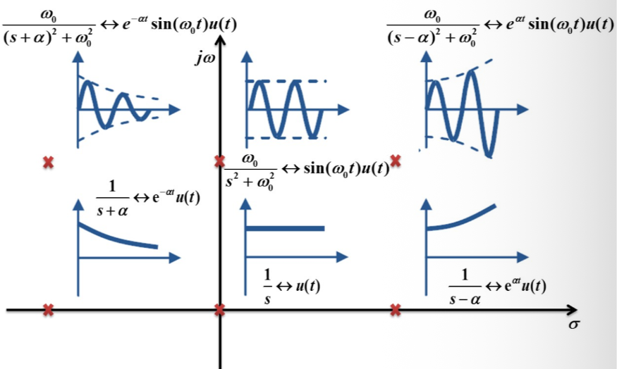
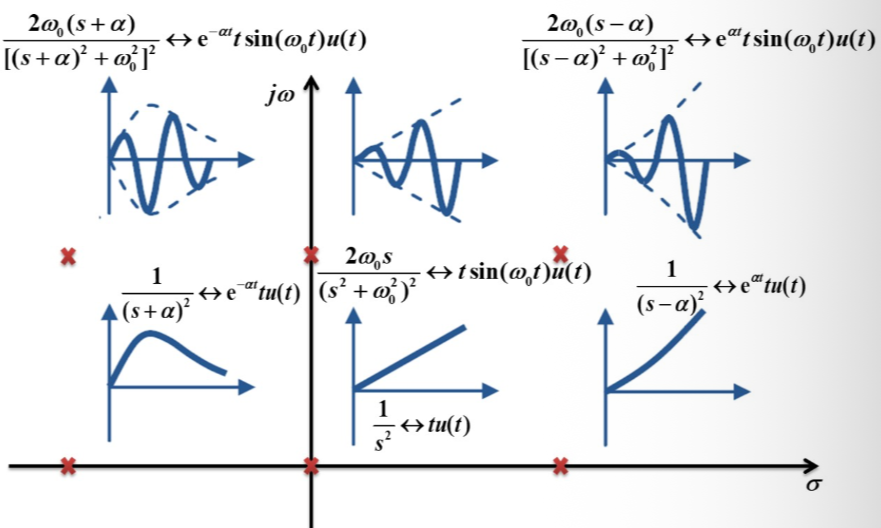

## 1. Laplace 变换的引出

傅里叶变换要求信号满足绝对可积等 Dirichlet 条件，对于随时间指数增长的信号（如 $e^{at}$，$a > 0$），傅里叶变换将无法直接应用。  

拉普拉斯变换的解决思路是：在原信号 $f(t)$ 上乘上一个指数衰减因子 $e^{-\sigma t}$，使其满足绝对可积条件，然后再进行傅里叶变换。  

对 $f(t) e^{-\sigma t}$ 进行傅里叶变换：  
$$\mathcal{F}[f(t) e^{-\sigma t}] = \int_{-\infty}^{\infty} f(t) e^{-\sigma t} e^{-j\omega t} dt = \int_{-\infty}^{\infty} f(t) e^{-(\sigma + j\omega)t} dt$$  

令复变量 $s = \sigma + j\omega$（其中复变量 $s$ 的取值范围称为 **s 平面**），得到**双边拉普拉斯变换**（象函数）：  
$$F(s) = \mathcal{L}[f(t)] = \int_{-\infty}^{\infty} f(t) e^{-st} dt$$  

其对应的**逆变换**（反变换）为：  
$$f(t) = \mathcal{L}^{-1}[F(s)] = \frac{1}{2\pi j} \int_{\sigma - j\infty}^{\sigma + j\infty} F(s) e^{st} ds$$  
这里称时域的 $f(t)$ 为**原函数**。  

对于因果信号（即 $t < 0$ 时 $f(t) = 0$ 的信号），通常采用从 $0^-$ 开始积分的**单边拉普拉斯变换**：  
$$F(s) = \mathcal{L}[f(t)] = \int_{0^-}^{\infty} f(t) e^{-st} dt$$  

## 2. 双边 Laplace 变换的收敛域 (ROC)

衰减因子 $e^{-\sigma t}$ 并不能在整个复平面上都起到衰减作用。  
*   当 $\sigma > 0$ 时，对于 $t > 0$ 的部分起到衰减作用，但对于 $t < 0$ 的部分反而是发散的；  
*   当 $\sigma < 0$ 时，情况刚好相反。  

为了使积分收敛，必须将积分区间划分为两部分讨论：  
$$F_{\text{bilateral}}(s) = \int_{-\infty}^{0} f(t) e^{-st} dt + \int_{0}^{\infty} f(t) e^{-st} dt$$  

对于 $(-\infty, 0)$ 区间，只要信号不以高于指数阶的速度发散，必存在一个实数 $\sigma_2$，当 $\sigma < \sigma_2$ 时，该部分积分绝对可积；  
对于 $(0, \infty)$ 区间，同理必存在一个实数 $\sigma_1$，当 $\sigma > \sigma_1$ 时，该部分积分绝对可积。  

In s 平面，双边拉普拉斯变换的**收敛域 (ROC)** 应该同时满足这两个区间收敛：  
$$\sigma_1 < \operatorname{Re}(s) < \sigma_2$$  
在 s 平面上，这表现为一个平行于虚轴的带状区域。若 $\sigma_1 > \sigma_2$，则两个区间的收敛域没有重叠，此时该信号的双边拉普拉斯变换不存在。  

## 3. 常见信号的 Laplace 变换

以下均假设信号为因果信号，采用单边拉普拉斯变换：  

**1) 单位阶跃信号 $u(t)$**  
$$\mathcal{L}[u(t)] = \int_{0^-}^{\infty} e^{-st} dt = \left. \frac{e^{-st}}{-s} \right|_{0}^{\infty} = \frac{1}{s} \quad (\operatorname{Re}(s) > 0)$$  

**2) 指数信号 $e^{-at} u(t)$**  
$$\mathcal{L}[e^{-at} u(t)] = \int_{0^-}^{\infty} e^{-(s+a)t} dt = \frac{1}{s+a} \quad (\operatorname{Re}(s) > -a)$$  

**3) 单位冲激信号 $\delta(t)$**  
$$\mathcal{L}[\delta(t)] = \int_{0^-}^{\infty} \delta(t) e^{-st} dt = e^{-s \cdot 0} = 1 \quad (\text{全平面收敛})$$  
对于有时延的冲激信号：  
$$\mathcal{L}[\delta(t - t_0)] = e^{-s t_0} \quad (\text{全平面收敛})$$  

**4) $t$ 的整数次幂 $t^n u(t)$**  
已知 $\mathcal{L}[t u(t)] = \frac{1}{s^2}$，递推可得：  
$$\mathcal{L}[t^n u(t)] = \frac{n!}{s^{n+1}} \quad (\operatorname{Re}(s) > 0)$$  

## 4. Laplace 变换的零极点

一般来说，实际信号的拉普拉斯变换可以写为有理分式形式：  
$$F(s) = \frac{N(s)}{D(s)} = K \frac{(s - z_1)(s - z_2) \dots (s - z_m)}{(s - p_1)(s - p_2) \dots (s - p_n)}$$  
其中：  
*   $s = z_j$ 为 $F(s)$ 的**零点**；  
*   $s = p_i$ 为 $F(s)$ 的**极点**。  

  

## 5. 收敛域与极点的关系

*   拉普拉斯变换 of 收敛域中**不含任何极点**。  
*   收敛域的边界必定平行于虚轴，且通过距离收敛域最近的极点。对于因果信号（右边信号），其收敛域为最右边极点的右侧区域：  
    $$\operatorname{Re}(s) > \operatorname{Re}(p_{\text{max}})$$  

## 6. 由 Laplace 变换求 Fourier 变换

对于一个信号，如果其单边拉普拉斯变换为 $F(s)$：  
*   若 $F(s)$ 的收敛域**包含虚轴**（即包含 $\operatorname{Re}(s) = 0$），则可直接通过变量替换 $s = j\omega$ 求得其傅里叶变换：  
    $$F(\omega) = F(s)\Big|_{s = j\omega}$$  
*   若 $F(s)$ 的收敛域**不包含虚轴**，则其经典的傅里叶变换不存在。  
*   若 $F(s)$ 的收敛域边界恰好是虚轴（即在虚轴上有单极点），则需要加入冲激函数项求得推广的傅里叶变换：  
    $$F(\omega) = F(s)\Big|_{s = j\omega} + \pi \sum_k \operatorname{Res}[F(s), p_k] \delta(\omega - \omega_k)$$  

## 7. Laplace 变换的性质

### 7.1 线性性质

$$\mathcal{L}[A f_1(t) + B f_2(t)] = A F_1(s) + B F_2(s)$$  

### 7.2 时移性质

$$\mathcal{L}[f(t - t_0) u(t - t_0)] = F(s) e^{-s t_0} \quad (t_0 > 0)$$  

### 7.3 s 域平移性质 (复频移性质)

$$\mathcal{L}[f(t) e^{\mp s_0 t}] = F(s \pm s_0)$$  

*   **例**：求 $f(t) = t u(t-1)$ 的拉普拉斯变换。  
    我们将 $f(t)$ 变形为：  
    $$f(t) = (t-1)u(t-1) + u(t-1)$$  
    由于 $\mathcal{L}[t u(t)] = \frac{1}{s^2}$，$\mathcal{L}[u(t)] = \frac{1}{s}$，利用时移性质可得：  
    $$F(s) = \frac{1}{s^2} e^{-s} + \frac{1}{s} e^{-s} = \frac{s+1}{s^2} e^{-s}$$  

### 7.4 尺度变换性质

$$\mathcal{L}[f(at)] = \frac{1}{a} F\left(\frac{s}{a}\right) \quad (a > 0)$$  

*   **例**：已知 $\mathcal{L}[f(t)] = F(s)$，求 $\mathcal{L}[f(at-b) u(at-b)]$ ($a > 0, b > 0$)。  
    先利用时移性质：  
    $$\mathcal{L}[f(t - b) u(t - b)] = F(s) e^{-bs}$$  
    再根据尺度变换性质（注意把时间变量 $t$ 替换为 $at$，对应的时延变为 $b/a$）：  
    $$\mathcal{L}[f(at - b) u(at - b)] = \mathcal{L}\left[ f\left( a\left( t - \frac{b}{a} \right) \right) u\left( a\left( t - \frac{b}{a} \right) \right) \right] = \frac{1}{a} F\left(\frac{s}{a}\right) e^{-\frac{b}{a} s}$$  

### 7.5 时域微分性质

若 $\mathcal{L}[f(t)] = F(s)$，则：  
$$\mathcal{L}[f'(t)] = s F(s) - f(0^-)$$  
$$\mathcal{L}[f''(t)] = s^2 F(s) - s f(0^-) - f'(0^-)$$  
推广至 $n$ 阶微分：  
$$\mathcal{L}[f^{(n)}(t)] = s^n F(s) - s^{n-1} f(0^-) - s^{n-2} f'(0^-) - \dots - f^{(n-1)}(0^-)$$  

### 7.6 时域积分性质

若 $\mathcal{L}[f(t)] = F(s)$，则：  
$$\mathcal{L}\left[ \int_{0^-}^{t} f(\tau) d\tau \right] = \frac{F(s)}{s}$$  
若积分的下限为 $-\infty$，则需要考虑 $0^-$ 时刻之前的历史积分积累量（直流偏置）：  
$$\mathcal{L}\left[ \int_{-\infty}^{t} f(\tau) d\tau \right] = \frac{F(s)}{s} + \frac{\int_{-\infty}^{0^-} f(\tau) d\tau}{s}$$  

### 7.7 时域卷积性质

时域相卷，频域相乘。  
$$\mathcal{L}[f_1(t) * f_2(t)] = F_1(s) \cdot F_2(s)$$  

### 7.8 初值定理

如果 $f(t)$ 不含冲激项，则有：  
$$\lim_{t \to 0^+} f(t) = \lim_{s \to \infty} s F(s)$$  
> [!WARNING]  
> **注意**：如果 $F(s)$ 不是真分式（即分子最高次数 $\ge$ 分母最高次数），说明时域含有冲激项。在使用初值定理前，必须先利用长除法分离出多项式（冲激项），再对真分式部分应用初值定理。  

*   **例**：已知 $F(s) = \frac{2s^2 + 4s + 1}{(s+1)(s+2)}$，求 $f(0^+)$。  
    由于分子分母最高次数相同，先用长除法分离：  
    $$F(s) = 2 - \frac{2s + 3}{s^2 + 3s + 2}$$  
    这里常数项 2 对应时域的 $2\delta(t)$。对真分式部分求极限：  
    $$\lim_{s \to \infty} s \left( F(s) - 2 \right) = \lim_{s \to \infty} \frac{-2s^2 - 3s}{s^2 + 3s + 2} = -2$$  
    因此，除了冲激部分外，时域信号在 $0^+$ 时的初值为 $-2$。  

### 7.9 终值定理

如果 $s F(s)$ 的所有极点都位于左半 s 平面（即时域信号在 $t \to \infty$ 时是收敛的），则有：  
$$\lim_{t \to \infty} f(t) = \lim_{s \to 0} s F(s)$$  

### 7.10 s 域微积分性质

$$\mathcal{L}[-t f(t)] = \frac{dF(s)}{ds}$$  
$$\mathcal{L}\left[ \frac{f(t)}{t} \right] = \int_{s}^{\infty} F(u) du$$  

## 8. Laplace 逆变换的求解方法（部分分式展开法）

若 $F(s) = \frac{N(s)}{D(s)}$ 是有理真分式。我们将其分解为部分分式来求解反变换：  

### 8.1 极点均为单根（简单极点）

设 $D(s) = (s - p_1)(s - p_2) \dots (s - p_n)$，其中各极点 $p_i$ 互不相同。则可以展开为：  
$$F(s) = \sum_{k=1}^{n} \frac{A_k}{s - p_k}$$  
其中系数为：  
$$A_k = \left. (s - p_k) F(s) \right|_{s = p_k}$$  
对应的时域信号为：  
$$f(t) = \sum_{k=1}^{n} A_k e^{p_k t} u(t)$$  

*   **若含有共轭复极点**：  
    设有一对共轭复根 $p_{1,2} = \alpha \pm j\beta$，其对应的部分分式系数也必定共轭：  
    $$A_{1,2} = C \pm jD$$  
    这一对共轭极点对应的时域分量为：  
    $$f_{\text{complex}}(t) = 2 e^{\alpha t} [C \cos\beta t - D \sin\beta t] u(t)$$  

*   **例**：求 $F(s) = \frac{s+3}{(s+2)(s^2 + 2s + 5)}$ 的逆变换 $f(t)$。  
    其极点为 $p_1 = -2$，以及共轭复极点 $p_{2,3} = -1 \pm j2$。  
    展开为部分分式：  
    $$F(s) = \frac{K_0}{s+2} + \frac{A}{s+1-j2} + \frac{A^*}{s+1+j2}$$  
    
    $$K_0 = \left. (s+2) F(s) \right|_{s=-2} = \left. \frac{s+3}{s^2+2s+5} \right|_{s=-2} = \frac{1}{5}$$  
    $$A = \left. (s+1-j2) F(s) \right|_{s=-1+j2} = \left. \frac{s+3}{(s+2)(s+1+j2)} \right|_{s=-1+j2} = \frac{2+j2}{(1+j2)(j4)} = -0.1 - j0.3$$  
    这里 $C = -0.1$，$D = -0.3$。代入公式得时域信号为：  
    $$f(t) = \left\{ \frac{1}{5} e^{-2t} + 2 e^{-t} [-0.1 \cos(2t) - (-0.3) \sin(2t)] \right\} u(t)$$  
    $$= \left\{ \frac{1}{5} e^{-2t} - \frac{1}{5} e^{-t} \cos(2t) + \frac{3}{5} e^{-t} \sin(2t) \right\} u(t)$$  

### 8.2 极点含有重根

若 $D(s)$ 含有 $r$ 重极点 $p_1$，则可以展开为：  
$$F(s) = \sum_{j=1}^{r} \frac{A_{1j}}{(s-p_1)^j} + \dots$$  
其中重根系数为：  
$$A_{1j} = \frac{1}{(r-j)!} \left. \frac{d^{r-j}}{ds^{r-j}} \left[ (s-p_1)^r F(s) \right] \right|_{s = p_1}$$  
对应的时域信号为：  
$$\mathcal{L}^{-1}\left[ \frac{A}{(s-p)^k} \right] = \frac{A}{(k-1)!} t^{k-1} e^{pt} u(t)$$  

### 8.3 特殊非真分式及非有理式情况

**1) 非真分式**  
先用长除法分离出多项式，分子最高次数比分母大多少，时域就会出现多少阶的冲激偶项：  
*   **例**：求 $F(s) = \frac{s^3 + 5s^2 + 9s + 7}{s^2 + 3s + 2}$ 的逆变换。  
    用长除法分离：  
    $$F(s) = s + 2 + \frac{s+3}{s^2+3s+2} = s + 2 + \frac{2}{s+1} - \frac{1}{s+2}$$  
    对其求逆变换，得：  
    $$f(t) = \delta'(t) + 2\delta(t) + (2e^{-t} - e^{-2t}) u(t)$$  

**2) 含有延迟项 $e^{-as}$ 的非有理分式**  
将 $e^{-as}$ 提出，只对有理分式求逆变换，最后应用时移性质：  
*   **例**：求 $F(s) = \frac{e^{-2s}}{(s+1)(s+2)}$ 的逆变换。  
    设 $F_1(s) = \frac{1}{(s+1)(s+2)} = \frac{1}{s+1} - \frac{1}{s+2} \iff f_1(t) = (e^{-t} - e^{-2t}) u(t)$。  
    利用时移性质可得：  
    $$f(t) = f_1(t-2) = [e^{-(t-2)} - e^{-2(t-2)}] u(t-2)$$  
*   **例**：求 $F(s) = \frac{e^{-(s+3)}}{s+3}$ 的逆变换。  
    变形为 $F(s) = e^{-3} \frac{e^{-s}}{s+3}$。  
    已知 $\mathcal{L}^{-1}\left[ \frac{1}{s+3} \right] = e^{-3t} u(t)$，利用时移性质可得：  
    $$f(t) = e^{-3} e^{-3(t-1)} u(t-1) = e^{-3t} u(t-1)$$  

## 9. Laplace 变换求解线性常系数微分方程

对于线性时不变系统：  
$$\frac{d^n r(t)}{dt^n} + a_{n-1}\frac{d^{n-1}r(t)}{dt^{n-1}} + \dots + a_0r(t) = b_m\frac{d^m e(t)}{dt^m} + \dots + b_0e(t)$$  

两边取单边拉普拉斯变换，利用时域微分性质，可得：  
$$D(s) R(s) - B(s) = N(s) E(s)$$  
$$R(s) = \frac{N(s)}{D(s)} E(s) + \frac{B(s)}{D(s)} = H(s) E(s) + \frac{B(s)}{D(s)}$$  
其中：  
*   $H(s) = \frac{N(s)}{D(s)}$ 称为**系统函数**。  
*   $R_{zs}(s) = H(s) E(s)$ 对应系统的**零状态响应**。  
*   $R_{zi}(s) = \frac{B(s)}{D(s)}$ 对应系统的**零输入响应**。  

*   **例**：用拉普拉斯变换求解下列方程：  
    $$i''(t) + 7i'(t) + 10i(t) = e''(t) + 6e'(t) + 4e(t)$$  
    初始状态：$i(0^-) = 0.8\text{ A}$，$i'(0^-) = 0\text{ A/s}$。激励信号在 $t < 0$ 时为 $2\text{ V}$ 稳态，在 $t > 0$ 时突变为 $4\text{ V}$（即 $e(t) = 4u(t)$）。  
    代入初始条件，取拉普拉斯变换：  
    $$[s^2 I(s) - 0.8s] + 7[s I(s) - 0.8] + 10 I(s) = [s^2 E(s) - 2s] + 6[s E(s) - 2] + 4 E(s)$$  
    由于 $e(t) = 4u(t) \iff E(s) = \frac{4}{s}$，代入化简可得：  
    $$(s^2 + 7s + 10) I(s) = (s^2 + 6s + 4)\frac{4}{s} - 2s - 12 + 0.8s + 5.6 = \frac{2.8s^2 + 17.6s + 16}{s}$$  
    $$I(s) = \frac{2.8s^2 + 17.6s + 16}{s(s+2)(s+5)} = \frac{1.6}{s} + \frac{4/3}{s+2} - \frac{2/15}{s+5}$$  
    求逆变换得到系统全响应：  
    $$i(t) = \left( 1.6 + \frac{4}{3} e^{-2t} - \frac{2}{15} e^{-5t} \right) u(t)$$  

## 10. Laplace 变换求解线性时不变电路

利用电路元件的 s 域模型，可以避免列写微分方程，直接进行代数运算求解电路。  

**电路元件的 s 域模型**：  
*   **电阻 $R$**：  
    $$V_R(s) = R I_R(s)$$  
*   **电感 $L$**：  
    $$V_L(s) = sL I_L(s) - L i_L(0^-)$$  
    （等效为阻抗 $sL$ 与一个方向与 $i_L$ 一致的电压源 $L i_L(0^-)$ 串联）  
*   **电容 $C$**：  
    $$V_C(s) = \frac{1}{sC} I_C(s) + \frac{v_C(0^-)}{s}$$  
    （等效为阻抗 $\frac{1}{sC}$ 与一个方向相同的电压源 $\frac{v_C(0^-)}{s}$ 串联）  

  
  

## 11. 系统函数及其应用

**系统函数 $H(s)$** 定义为零状态下系统响应的拉普拉斯变换与激励的拉普拉斯变换之比：  
$$H(s) = \frac{R_{zs}(s)}{E(s)} = \mathcal{L}[h(t)]$$  
即系统函数为系统单位冲激响应的拉普拉斯变换。  

## 12. 系统函数的零点与极点

$$H(s) = K \frac{\prod_{j=1}^{M} (s - z_j)}{\prod_{i=1}^{N} (s - p_i)}$$  
*   **极点 $p_i$**：为系统微分方程的特征根，决定了系统特征响应分量（自然模）的频率与衰减速度。  
*   **零点 $z_j$**：影响各特征响应分量的幅值与初相位。  

**单阶极点位置与单位冲激响应关系**：  

  

*   极点在左半平面：时域响应指数衰减，系统是稳定的；  
*   极点在右半平面：时域响应指数增长，系统发散不稳定；  
*   单极点在虚轴（含原点）：时域响应为等幅振荡或常数，系统临界稳定。  

**二阶极点位置与单位冲激响应关系**：  

  

## 13. 由极点分布判断系统稳定性

**BIBO 稳定（有界输入有界输出稳定）**的定义：  
若激励信号满足 $|e(t)| \le M_e$，产生的零状态响应满足 $|r_{zs}(t)| \le M_r < \infty$。  

**稳定性的充要条件**：  
1.  系统函数 $H(s)$ 的所有极点均位于 s 平面的**左半平面**（即极点的实部均小于 0）；或者说 $H(s)$ 的收敛域包含虚轴。  
2.  系统单位冲激响应 $h(t)$ 满足**绝对可积**：  
    $$\int_{-\infty}^{\infty} |h(t)| dt < \infty$$  

**必要条件**：  
$$\lim_{t \to \infty} h(t) = 0$$  

## 14. 系统频率响应特性

对于一个稳定的因果系统，当输入正弦激励 $e(t) = E_m \sin(\omega_0 t) u(t)$ 时，随着 $t \to \infty$，系统响应的暂态分量衰减为 0，仅保留**稳态响应**：  
$$r_{ss}(t) = E_m |H(j\omega_0)| \sin(\omega_0 t + \varphi(\omega_0))$$  

这里，系统的**频率响应函数 $H(j\omega)$** 恰好是系统函数 $H(s)$ 在虚轴上的取值：  
$$H(j\omega) = \left. H(s) \right|_{s = j\omega} = |H(j\omega)| e^{j\varphi(\omega)}$$  
其中 $|H(j\omega)|$ 为幅频特性，$\varphi(\omega)$ 为相频特性。  
