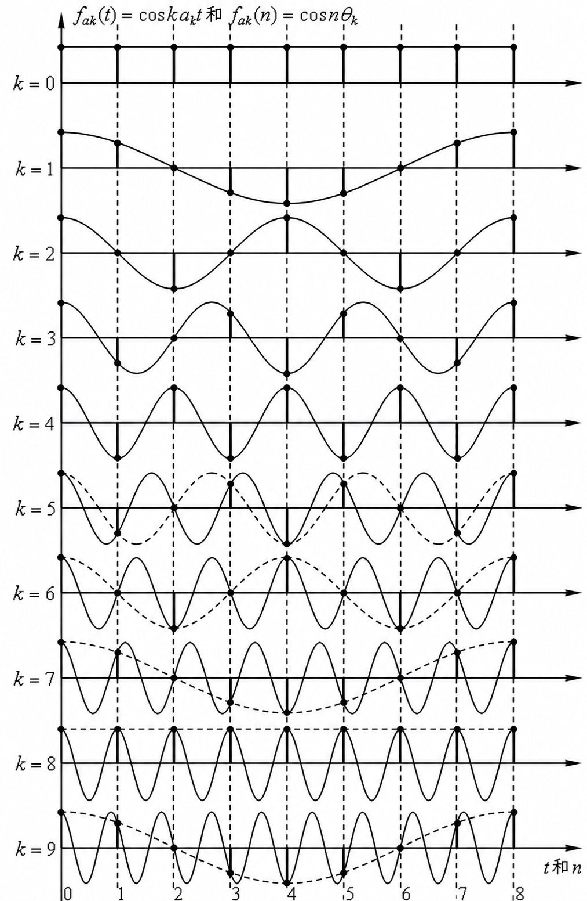
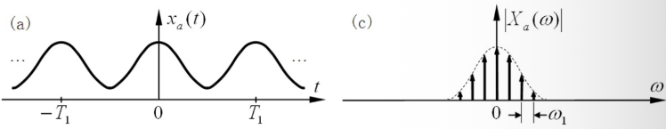
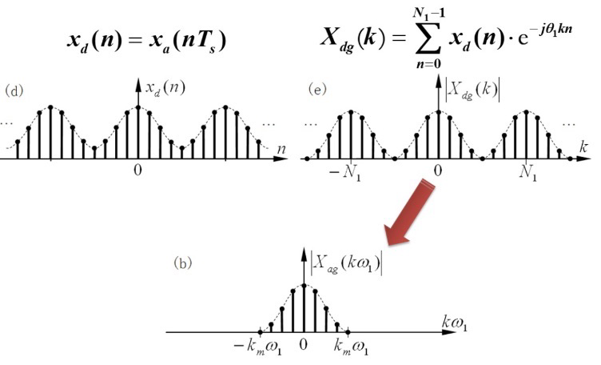
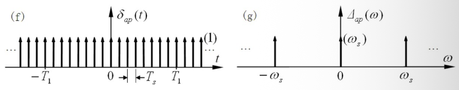
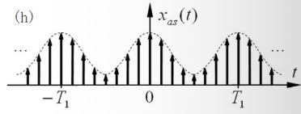
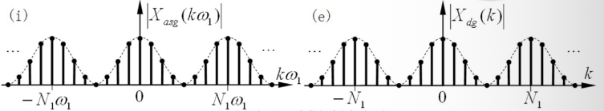
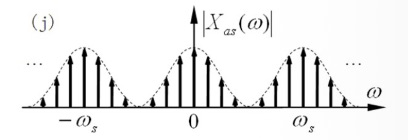
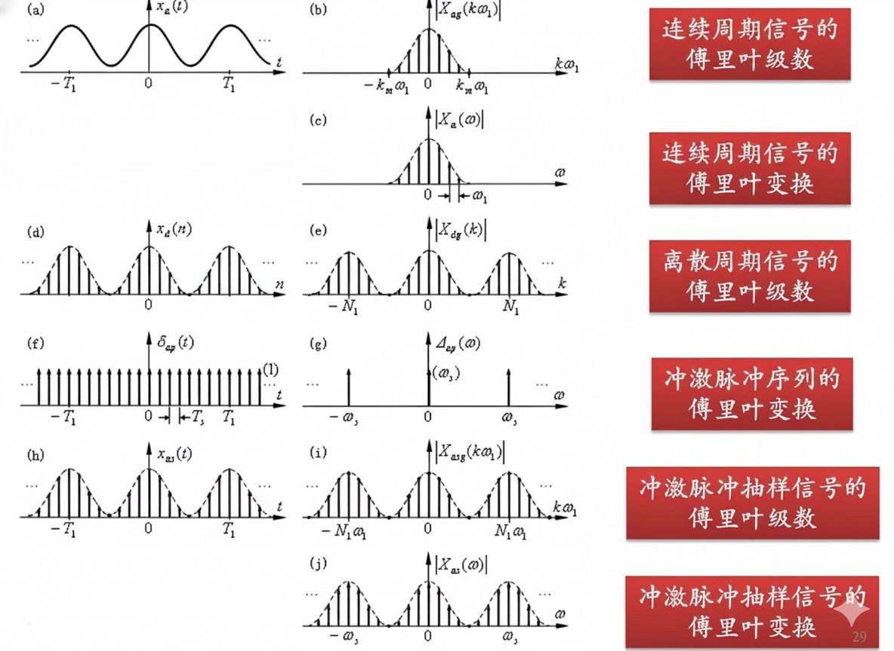
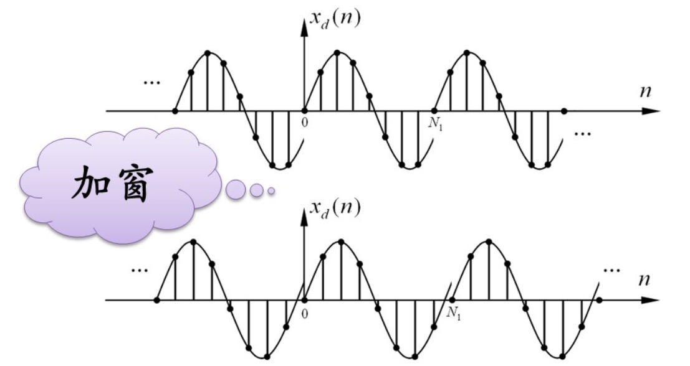
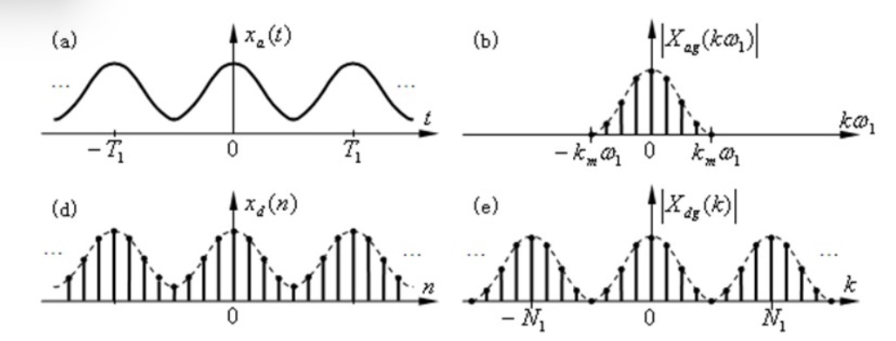

## 1. 离散信号的正交分解

在离散时间区间 $n_0 \le n \le n_0 + N - 1$ 上，如果两个离散信号 $\varphi_{di}(n)$ 与 $\varphi_{dj}(n)$ 满足：  
$$\langle \varphi_{di}(n), \varphi_{dj}(n) \rangle = \sum_{n=n_0}^{n_0+N-1} \varphi_{di}(n) \varphi_{dj}^*(n) = \begin{cases} A_i , & i = j \\ 0 , & i \neq j \end{cases}$$  
则称其在该区间上是**正交**的。  

定义用函数 $c \varphi_{dj}(n)$ 近似表示 $x_d(n)$ 的均方误差为：  
$$\varepsilon = \sum_{n=n_0}^{n_0+N-1} |x_d(n) - c \varphi_{dj}(n)|^2$$  
当误差最小时，有：  
$$c = \frac{\langle x_d(n), \varphi_{dj}(n) \rangle}{\langle \varphi_{dj}(n), \varphi_{dj}(n) \rangle} = \frac{\sum_{n=n_0}^{n_0+N-1} x_d(n) \varphi_{dj}^*(n)}{\sum_{n=n_0}^{n_0+N-1} |\varphi_{dj}(n)|^2}$$  

这与连续信号的内积 $\langle \varphi_i(t), \varphi_j(t) \rangle = \int_{t_0}^{t_0+T} \varphi_i(t) \varphi_j^*(t) dt$ 构成一一对应。  

一个正交函数集如果除该集合内的函数外，不再存在任何与集合内所有函数都正交的非零信号，则称其为**完备正交函数集**。  

任何在周期内绝对可和的离散周期信号 $x_d(n)$ 均可以用完备正交函数集 $\varphi_{dk}(n)$ 展开：  
$$x_d(n) = \sum_{k} c_k \varphi_{dk}(n) \quad , \quad n_0 \le n \le n_0 + N - 1$$  

在完备正交分解的情况下，离散周期信号的能量满足**巴塞瓦尔 (Parseval) 定理**：  
$$\sum_{n=n_0}^{n_0+N-1} |x_d(n)|^2 = \sum_k |c_k|^2 \sum_{n=n_0}^{n_0+N-1} |\varphi_{dk}(n)|^2$$  

## 2. 正交离散复指数函数集

考虑离散复指数序列集 $e^{j k \Omega_1 n}$，其中 $\Omega_1 = \frac{2\pi}{N}$ 为基本角频率，$N$ 为基本周期。  

该集合中的每个元素都是 $n$ 的周期函数。不同于连续复指数信号，==离散复指数信号的频率具有周期重复性==。即当 $k$ 增加 $N$ 的整数倍时，信号是完全相同的：  
$$e^{j(k+N)\Omega_1 n} = e^{j k \Omega_1 n} e^{j N \frac{2\pi}{N} n} = e^{j k \Omega_1 n} e^{j 2\pi n} = e^{j k \Omega_1 n}$$  

因此，离散复指数函数集中只有 $N$ 个互不相同的元素。  

*   **物理现象说明**：  
    以离散余弦序列为例，在时域对连续余弦信号 $\cos(\omega t)$ 进行抽样（抽样间隔 $T_s$），得到离散序列：  
    $$f_{dk}(n) = \cos(k \omega_1 n T_s) = \cos(k \Omega_1 n)$$  
    其中 $\Omega_1 = \omega_1 T_s$。由于：  
    $$\cos(n(2\pi m + \theta)) = \cos(n\theta) \quad , \quad \sin(n(2\pi m + \theta)) = \sin(n\theta) \quad , \quad e^{jn(2\pi m + \theta)} = e^{jn\theta}$$  
    当频率增加 $2\pi$ 的整数倍时，离散序列会完全重合。  

  

在基本周期 $N$ 内，离散复指数序列集满足正交性：  
$$\langle e^{j k_1 \Omega_1 n}, e^{j k_2 \Omega_1 n} \rangle = \sum_{n=0}^{N-1} e^{j k_1 \Omega_1 n} e^{-j k_2 \Omega_1 n} = \sum_{n=0}^{N-1} e^{j(k_1 - k_2)\frac{2\pi}{N}n} = \begin{cases} N , & k_1 - k_2 = mN \\ 0 , & k_1 - k_2 \neq mN \end{cases}$$  
（其中 $m$ 为任意整数）  

因此，这 $N$ 个互不相同的复指数序列构成了一个**完备正交离散函数集**。  

## 3. 离散傅里叶级数 (DFS)

给定任意离散周期信号 $x_d(n)$，其周期为 $N$，基本角频率 $\Omega_1 = \frac{2\pi}{N}$。因为正交复指数序列只有 $N$ 个，所以在进行级数展开时，只需累加 $N$ 项：  

*   **正变换 (DFS)**：  
    $$X_d(k) = \operatorname{DFS}[x_d(n)] = \sum_{n=0}^{N-1} x_d(n) e^{-j k \Omega_1 n}$$  
*   **逆变换 (IDFS)**：  
    $$x_d(n) = \operatorname{IDFS}[X_d(k)] = \frac{1}{N} \sum_{k=0}^{N-1} X_d(k) e^{j k \Omega_1 n}$$  

**特点**：  
1.  时域周期 $\iff$ 频域离散。  
2.  时域离散 $\iff$ 频域周期（频域的重复周期也是 $N$）。  
3.  因为频域 $X_d(k)$ 是周期的，虽然它在形式上存在无数个谐波分量，但真正独立的分量只有 $N$ 个，我们只需任取一个周期（如 $k = 0 \sim N-1$）即可完成信号的正交分解。  

*   **奇偶虚实性**：  
    $$X_d(k) = \sum_{n=0}^{N-1} x_d(n) \cos(k\Omega_1 n) - j \sum_{n=0}^{N-1} x_d(n) \sin(k\Omega_1 n)$$  
*   **频谱特性**：  
    $$X_d(k) = |X_d(k)| e^{j\varphi_d(k)}$$  

## 4. 离散与连续周期信号傅里叶级数的关系

*   **回顾**：连续周期信号 $x_a(t)$ 周期为 $T_1$，基频 $\omega_1 = 2\pi/T_1$，其展开及傅里叶变换为：  
    $$x_a(t) = \sum_{k=-\infty}^{\infty} X_{as}(k\omega_1) e^{j k \omega_1 t} \iff X_a(\omega) = 2\pi \sum_{k=-\infty}^{\infty} X_{as}(k\omega_1) \delta(\omega - k\omega_1)$$  
*   离散周期信号 $x_d(n)$ 周期为 $N$，其级数展开为：  
    $$x_d(n) = \frac{1}{N} \sum_{k=0}^{N-1} X_d(k) e^{j k \Omega_1 n}$$  

在实际应用中，计算机只能采集并处理离散的数据 $x_d(n)$，其对应的频谱 $X_d(k)$ 是周期的；而真实的连续信号 $x_a(t)$ 的频谱 $X_a(\omega)$ 则是非周期的。  

我们利用**冲激序列抽样**建立起两者之间的联系。  
设抽样周期为 $T_s$，连续周期信号 $x_a(t)$ 经冲激序列 $s_p(t) = \sum_{n=-\infty}^{\infty} \delta(t - nT_s)$ 抽样后得到：  
$$x_{as}(t) = x_a(t) \cdot s_p(t) = \sum_{n=-\infty}^{\infty} x_a(n T_s) \delta(t - nT_s)$$  

可以证明，时域冲激抽样后的连续信号 $x_{as}(t)$ 在频域上与时域离散信号 $x_d(n)$ 具有完全对应的形式。  
对 $x_{as}(t)$ 计算傅里叶级数系数 $X_{asg}(k\omega_1)$：  
$$X_{asg}(k\omega_1) = \frac{1}{T_1} \int_{0}^{T_1} x_{as}(t) e^{-j k \omega_1 t} dt = \frac{1}{N T_s} \int_{0^-}^{N T_s^-} \left[ \sum_{n=0}^{N-1} x_a(n T_s) \delta(t - n T_s) \right] e^{-j k \omega_1 t} dt$$  
$$= \frac{1}{N T_s} \sum_{n=0}^{N-1} x_d(n) e^{-j k \omega_1 n T_s} = \frac{1}{N T_s} \sum_{n=0}^{N-1} x_d(n) e^{-j k \Omega_1 n}$$  
$$\implies X_{asg}(k\omega_1) = \frac{1}{N T_s} X_d(k)$$  

这表明抽样信号的傅里叶级数系数与离散信号 of DFS 系数之间仅相差一个常数比例。  

  
  
  
  
  

而在频域中，时域乘以冲激序列等效于频域的积分，相当于将原信号频谱按 $\omega_s = \frac{2\pi}{T_s}$ 进行周期延拓：  
$$X_{as}(\omega) = \frac{1}{T_s} \sum_{m=-\infty}^{\infty} X_a(\omega - m\omega_s)$$  

  

因此，离散周期信号的傅里叶级数在物理上就是==原连续信号的级数按抽样频率进行周期延拓并乘上比例常数==的结果。  

## 5. 抽样的充分条件

为了使离散频谱无失真地代表连续频谱，必须满足：  
1.  **满足奈奎斯特抽样定理**：$f_s > 2 f_{\text{max}}$，以防止频域周期延拓时产生混叠；  
2.  **整周期抽样**：一个信号周期内必须包含整数个抽样点。即 $N = T_1 / T_s$ 必须为正整数。  

## 6. 参数汇总

*   时域映射：$t = n T_s$  
*   频域映射：$\theta = \omega T_s \implies \Omega_1 = \omega_1 T_s$  
*   周期映射：$N = \frac{T_1}{T_s}$  
*   抽样定理：$f_s > 2 f_{\text{max}}$  

  

## 7. 误差分析

如果抽样时不满足抽样的充分条件，用离散周期信号的级数 $X_d(k)$ 来逼近原信号的谱将引入以下误差：  
1.  **泄露误差 (Leakage Error)**：由于非整周期截断（$N T_s \neq m T_1$），导致本来是单频的谱线泄露到旁边的频率上。  
2.  **混叠误差 (Aliasing Error)**：由于抽样频率过低（$f_s < 2 f_{\text{max}}$），导致高频成分重叠到低频处。  

  
  
