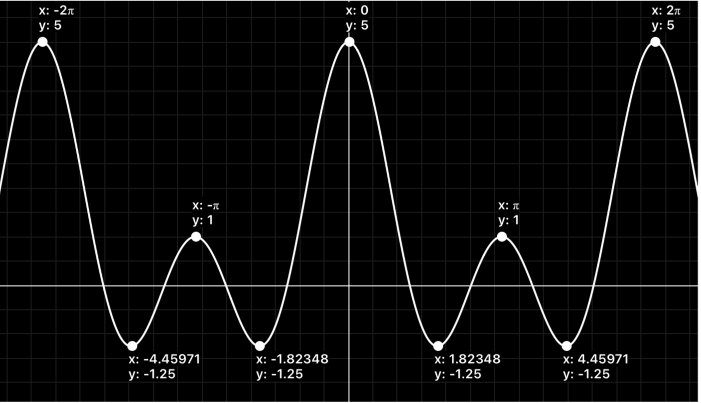
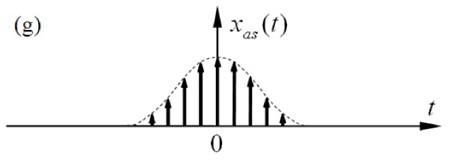
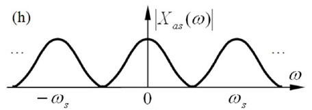
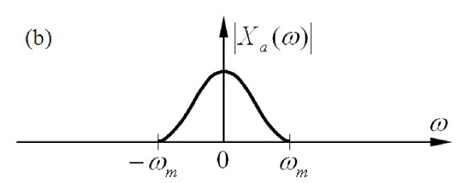
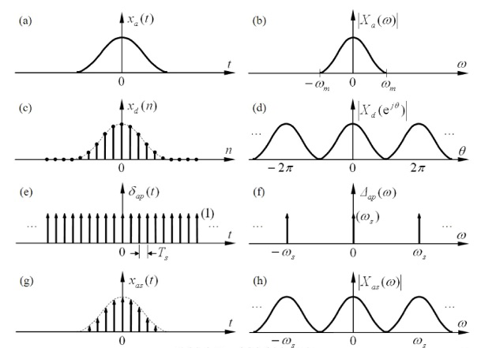

## 1. DTFT 的引出

与连续信号傅里叶变换的引出类似，我们将离散非周期信号 $x_d(n)$ 视作周期 $N \to \infty$ 的离散周期信号的极限情况。  

当 $N \to \infty$ 时，谱线间隔 $\Omega_1 = \frac{2\pi}{N} \to d\theta$，离散谱线趋于连续，离散周期傅里叶级数退化为连续的频谱密度函数。  

由此得到**离散时间傅里叶变换 (DTFT)**：  

*   **正变换 (DTFT)**：  
    $$X(e^{j\theta}) = \operatorname{DTFT}[x_d(n)] = \sum_{n=-\infty}^{\infty} x_d(n) e^{-j\theta n}$$  
*   **逆变换 (IDTFT)**：  
    $$x_d(n) = \operatorname{IDTFT}[X(e^{j\theta})] = \frac{1}{2\pi} \int_{-\pi}^{\pi} X(e^{j\theta}) e^{j\theta n} d\theta$$  

## 2. DTFT 的物理特性

*   **时域离散 $\iff$ 频域周期**：DTFT 的频谱密度函数 $X(e^{j\theta})$ 是关于角频率 $\theta$ 连续的，且是以 $2\pi$ 为周期的周期函数。  
*   正因为频域是周期性的，在进行逆变换（重构时域信号）时，积分区间只需取一个周期（如 $-\pi \sim \pi$）即可。  

## 3. DTFT 的特殊值

**1) 零频值 (直流分量)**  
$$X(e^{j0}) = \sum_{n=-\infty}^{\infty} x_d(n) \quad (\text{时域样值累加和})$$  

**2) 全频积分与 $x_d(0)$**  
$$\frac{1}{2\pi} \int_{-\pi}^{\pi} X(e^{j\theta}) d\theta = x_d(0)$$  

## 4. 例题

*   **例**：求离散非周期矩形序列的 DTFT。  
    设 $x_d(n) = \begin{cases} 1 , & |n| \le M \\ 0 , & |n| > M \end{cases}$。  
    
    其 DTFT 为：  
    $$X(e^{j\theta}) = \sum_{n=-M}^{M} 1 \cdot e^{-j\theta n} = 1 + 2\sum_{n=1}^{M} \cos(n\theta) = \frac{\sin\left((M + 1/2)\theta\right)}{\sin(\theta/2)}$$  
    
    该谱是连续的，以 $2\pi$ 为周期。  

  
  
  
  
  

## 5. DFS 与 DTFT 的关系

若 $x_d(n)$ 是长度为 $N$ 的有限长离散序列（仅在 $0 \le n \le N-1$ 内有值）。  
*   对其进行 **DTFT**，得到连续周期谱 $X(e^{j\theta})$；  
*   若将其以 $N$ 为周期进行周期延拓得到 $x_p(n) = \sum_{i=-\infty}^{\infty} x_d(n - iN)$，再对其进行 **DFS**，得到离散周期谱 $X_p(k)$。  

比较两者的公式：  
$$X(e^{j\theta}) = \sum_{n=0}^{N-1} x_d(n) e^{-j\theta n}$$  
$$X_p(k) = \sum_{n=0}^{N-1} x_p(n) e^{-j k \frac{2\pi}{N} n}$$  
可以发现，DFS 的系数 $X_p(k)$ 恰好是在一个周期内对连续的 DTFT 谱 $X(e^{j\theta})$ 进行等间隔抽样的结果：  
$$X_k = X(e^{j\theta})\Big|_{\theta = k \frac{2\pi}{N}}$$  
