## 1. Z 变换的引出

离散时间傅里叶变换 (DTFT) 要求信号满足绝对可值等条件。对于随时间指数增长的信号（如 $a^n u_d(n)$，其中 $|a| > 1$），DTFT 将发散而无法直接应用。  

与拉普拉斯变换思路类似，我们对离散信号 $x_d(n)$ 乘以一个实指数衰减因子 $r^{-n}$（其中 $r > 0$），使其强制满足绝对可和条件：  
$$x_d(n) r^{-n}$$  

在收敛区域内，对 $x_d(n) r^{-n}$ 求 DTFT：  
$$X_{\text{temp}}(e^{j\theta}) = \sum_{n=-\infty}^{\infty} x_d(n) r^{-n} e^{-j\theta n} = \sum_{n=-\infty}^{\infty} x_d(n) (r e^{j\theta})^{-n}$$  

定义复变量 $z = r e^{j\theta}$（复变量 $z$ 的取值范围称为 **z 平面**），得到 **Z 变换**（象函数）：  
$$X(z) = \mathcal{Z}[x_d(n)] = \sum_{n=-\infty}^{\infty} x_d(n) z^{-n}$$  

其对应的**逆 Z 变换**（反变换）为：  
由于 $z = r e^{j\theta} \implies dz = j r e^{j\theta} d\theta = j z d\theta \implies d\theta = \frac{dz}{jz}$，代入反变换公式可得：  
$$x_d(n) = \frac{1}{2\pi j} \oint_{c} X(z) z^{n-1} dz$$  
其中 $c$ 为在收敛域内围绕原点的闭合逆时针积分曲线。  

## 2. Z 变换的收敛域 (ROC)

Z 变换是关于 $z^{-1}$ 的幂级数。级数的收敛性取决于 $z$ 的模值 $|z| = r$。  

1.  **右边序列**（即在 $n \ge n_1$ 时信号有值）：  
    为了保证级数在 $n \to \infty$ 时收敛，需要模值 $|z|$ 足够大。  
    其收敛域为圆外区域：  
    $$|z| > r_1$$  
    其中 $r_1$ 为最外侧极点的半径。  
2.  **左边序列**（即在 $n \le n_2$ 时信号有值）：  
    为了保证级数在 $n \to -\infty$ 时收敛，需要模值 $|z|$ 足够小。  
    其收敛域为圆内区域：  
    $$|z| < r_2$$  
    其中 $r_2$ 为最内侧极点的半径。  
3.  **双边序列**：  
    收敛域为两者的交集，表现为 s 平面上的一个圆环：  
    $$r_1 < |z| < r_2$$  
    如果 $r_1 > r_2$，则收敛域不存在，说明该信号的 Z 变换不存在。  
4.  **有限长序列**：  
    仅在有限个离散点上有值，其 Z 变换是有限项求和，除了 $z = 0$ 和 $z = \infty$ 可能会发散外，其余区域均收敛。其收敛域为整个 z 平面（可能排除 0 或 $\infty$）。  

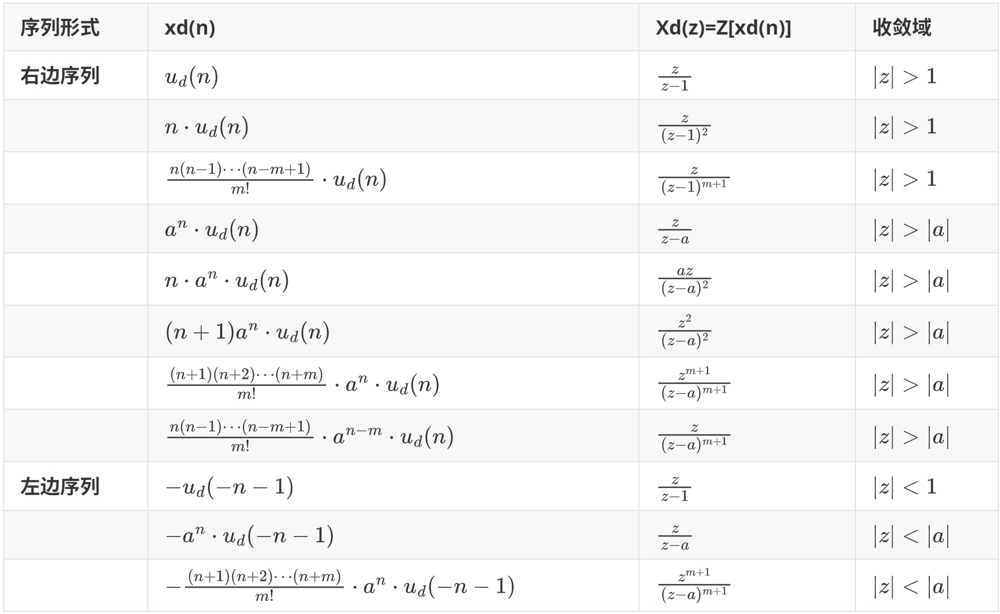  
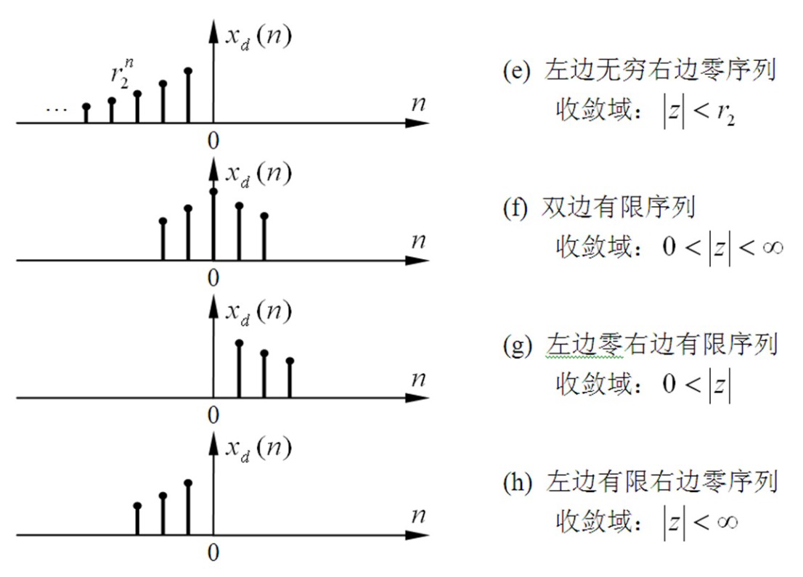  
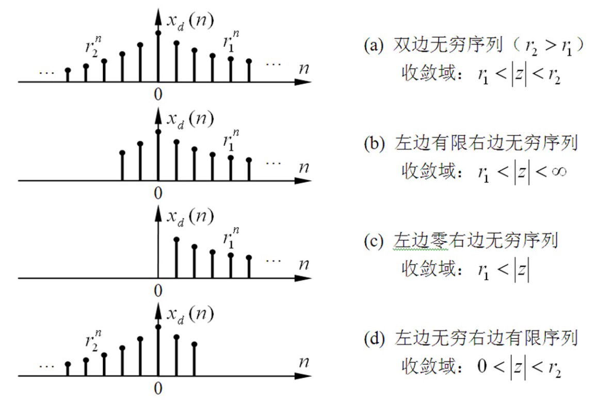  

## 3. Z 变换的零极点

有理分式形式的 Z 变换可以写作：  
$$X(z) = \frac{N(z)}{D(z)} = K \frac{\prod_{j=1}^{M} (z - z_j)}{\prod_{i=1}^{N} (z - p_i)}$$  
其中：  
*   $z = z_j$ 为 $X(z)$ 的**零点**；  
*   $z = p_i$ 为 $X(z)$ 的**极点**。  

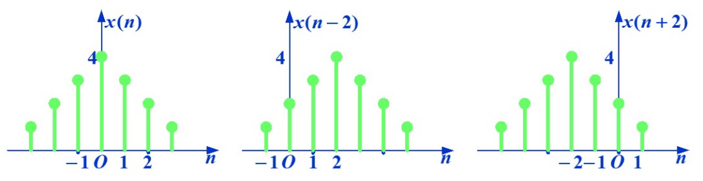  

## 4. 常见信号的 Z 变换

**1) 单位样值序列 $\delta_d(n)$**  
$$\mathcal{Z}[\delta_d(n)] = 1 \quad (\text{全平面收敛})$$  
对于有时延的样值序列：  
$$\mathcal{Z}[\delta_d(n - m)] = z^{-m} \quad (\text{除 } 0 \text{ 或 } \infty \text{ 外的整个平面})$$  

**2) 单位阶跃序列 $u_d(n)$**  
$$\mathcal{Z}[u_d(n)] = \sum_{n=0}^{\infty} z^{-n} = \frac{1}{1 - z^{-1}} = \frac{z}{z - 1} \quad (|z| > 1)$$  

**3) 指数序列**  
*   **右边指数序列 $a^n u_d(n)$**：  
    $$\mathcal{Z}[a^n u_d(n)] = \sum_{n=0}^{\infty} a^n z^{-n} = \frac{1}{1 - a z^{-1}} = \frac{z}{z - a} \quad (|z| > |a|)$$  
*   **左边指数序列 $-a^n u_d(-n-1)$**：  
    $$\mathcal{Z}[-a^n u_d(-n-1)] = -\sum_{n=-\infty}^{-1} a^n z^{-n} = -\sum_{m=1}^{\infty} a^{-m} z^m = \frac{1}{1 - a z^{-1}} = \frac{z}{z - a} \quad (|z| < |a|)$$  
> [!IMPORTANT]  
> **注意**：$a^n u_d(n)$ 与 $-a^n u_d(-n-1)$ 的 Z 变换代数表达式完全一致，但它们的**收敛域 (ROC) 不同**。因此，必须同时指出代数式和收敛域才能唯一确定原序列。  

## 5. Z 变换的性质

### 5.1 线性性质

$$\mathcal{Z}[a x_1(n) + b x_2(n)] = a X_1(z) + b X_2(z) \quad (\text{收敛域至少为两者交集})$$  

*   **例**：求 $\delta_d(n) = u_d(n) - u_d(n-1)$ 的 Z 变换。  
    $$\mathcal{Z}[\delta_d(n)] = \frac{z}{z-1} - z^{-1} \frac{z}{z-1} = \frac{z}{z-1}(1 - z^{-1}) = 1$$  

### 5.2 时移性质

*   **双边 Z 变换**：  
    $$\mathcal{Z}[x(n - k)] = z^{-k} X(z)$$  
*   **单边 Z 变换**（时移会导致信号边界溢出，需考虑初值）：  
    *   **左移（超前）**：  
        $$\mathcal{Z}[x(n + m)] = z^m \left[ X(z) - \sum_{k=0}^{m-1} x(k) z^{-k} \right]$$  
        例如：  
        $$\mathcal{Z}[x(n+1)] = z X(z) - z x(0)$$  
        $$\mathcal{Z}[x(n+2)] = z^2 X(z) - z^2 x(0) - z x(1)$$  
    *   **右移（延迟）**：  
        $$\mathcal{Z}[x(n - m)] = z^{-m} \left[ X(z) + \sum_{k=-m}^{-1} x(k) z^{-k} \right]$$  
        例如：  
        $$\mathcal{Z}[x(n-1)] = z^{-1} X(z) + x(-1)$$  
        $$\mathcal{Z}[x(n-2)] = z^{-2} X(z) + z^{-1} x(-1) + x(-2)$$  

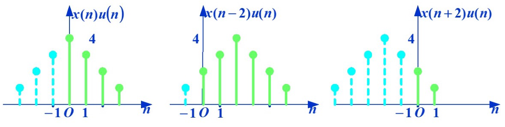  

### 5.3 线性加权 (z 域求导)

$$\mathcal{Z}[n x(n)] = -z \frac{dX(z)}{dz}$$  

### 5.4 指数加权 (z 域尺度变换)

$$\mathcal{Z}[a^n x(n)] = X\left( \frac{z}{a} \right)$$  

### 5.5 时域卷积定理

时域卷积，频域相乘。  
$$\mathcal{Z}[x_1(n) * x_2(n)] = X_1(z) \cdot X_2(z)$$  

### 5.6 时域反转

$$\mathcal{Z}[x(-n)] = X(z^{-1})$$  

### 5.7 初值定理

若 $x(n)$ 为因果序列，则：  
$$x(0) = \lim_{z \to \infty} X(z)$$  

### 5.8 终值定理

若 $(z-1) X(z)$ 的所有极点都在单位圆内（包括单位圆上，但至多在 $z=1$ 处有单极点），则：  
$$\lim_{n \to \infty} x(n) = \lim_{z \to 1} (z-1) X(z)$$  

## 6. 逆 Z 变换的部分分式展开法

如果 $X(z)$ 是有理真分式。由于常用公式形式多为 $\frac{z}{z-a}$，因此我们通常对 $\frac{X(z)}{z}$ 进行部分分式展开：  

### 6.1 极点均为单根

将 $\frac{X(z)}{z}$ 展开为：  
$$\frac{X(z)}{z} = \sum_{k=1}^{n} \frac{A_k}{z - p_k} \implies X(z) = \sum_{k=1}^{n} A_k \frac{z}{z - p_k}$$  
其中系数为：  
$$A_k = \left. (z - p_k) \frac{X(z)}{z} \right|_{z = p_k}$$  

然后结合收敛域 (ROC)，查反变换表确定是右边序列（$|z| > |p_k| \implies A_k p_k^n u_d(n)$）还是左边序列（$|z| < |p_k| \implies -A_k p_k^n u_d(-n-1)$）。  

*   **例**：已知 $X(z) = \frac{z^2}{(z-1)(z-2)}$，收敛域为 $|z| > 2$，求 $x(n)$。  
    部分分式展开：  
    $$\frac{X(z)}{z} = \frac{z}{(z-1)(z-2)} = \frac{-1}{z-1} + \frac{2}{z-2}$$  
    $$X(z) = -\frac{z}{z-1} + \frac{2z}{z-2}$$  
    由于收敛域 $|z| > 2$ 是在外侧，表示各项均为右边序列。查表可得：  
    $$x(n) = \left[ -1^n + 2 \cdot 2^n \right] u_d(n) = (2^{n+1} - 1) u_d(n)$$  

### 6.2 极点含有重根

对 $\frac{X(z)}{z}$ 展开，重根极点 $p_1$ 的系数求解公式与拉普拉斯展开类似，逆变换查表项为：  
$$\mathcal{Z}^{-1}\left[ \frac{A z}{(z-p)^k} \right] = \text{查表形式}$$  

## 7. 逆 Z 变换的长除法 (幂级数展开法)

长除法是将有理分式进行多项式除法直接展开为关于 $z$ 的幂级数形式，各幂次项前对应的系数即为时域样值。  

*   **右边序列**（收敛域为圆外）：应将分子、分母均按 $z$ 的**降幂排列**再相除，得到关于 $z^{-1}$ 的多项式。  
*   **左边序列**（收敛域为圆内）：应将分子、分母均按 $z$ 的**升幂排列**再相除，得到关于 $z$ 的多项式。  

*   **例**：已知 $X(z) = \frac{z}{z-1}$，分别在收敛域为 $|z| > 1$ 和 $|z| < 1$ 时求其逆变换 $x(n)$。  
    *   **当 $|z| > 1$ 时**（降幂排列）：  
        $$z \div (z-1) = 1 + z^{-1} + z^{-2} + \dots \implies x(n) = u_d(n)$$  
    *   **当 $|z| < 1$ 时**（升幂排列，即 $z \div (-1+z)$）：  
        $$z \div (-1+z) = -z - z^2 - z^3 - \dots \implies x(n) = -u_d(-n-1)$$  

## 8. Z 变换与 DTFT、Laplace 变换的关系

**1) 与 DTFT 的关系**  
若 Z 变换的收敛域包含单位圆 $|z| = 1$，则 Z 变换在单位圆上的取值（即代入 $z = e^{j\theta}$）恰好就是离散时间傅里叶变换：  
$$\operatorname{DTFT}[x(n)] = \left. X(z) \right|_{z = e^{j\theta}}$$  

**2) 与 Laplace 变换的关系**  
对连续信号的冲激抽样信号 $x^*(t) = \sum_{k=-\infty}^{\infty} x(k T_s) \delta(t - k T_s)$ 求解拉普拉斯变换：  
$$X^*(s) = \sum_{k=-\infty}^{\infty} x(k T_s) e^{-s k T_s}$$  
令变量关系为 $z = e^{s T_s}$，即为标准 Z 变换的代数式。  

**3) S 平面到 Z 平面的映射关系**  
由 $z = e^{s T_s} = e^{(\sigma + j\omega)T_s} = e^{\sigma T_s} e^{j\omega T_s} = r e^{j\theta}$：  
*   **s 平面左半平面** ($\sigma < 0$) $\implies$ 映射到 **z 平面单位圆内** ($|z| < 1$)；  
*   **s 平面虚轴** ($\sigma = 0$) $\implies$ 映射到 **z 平面单位圆上** ($|z| = 1$)；  
*   **s 平面右半平面** ($\sigma > 0$) $\implies$ 映射到 **z 平面单位圆外** ($|z| > 1$)。  
*   决定映射角为 $\theta = \omega T_s$。由于其周期性，虚轴上每隔 $\omega_s = \frac{2\pi}{T_s}$ 的区间都会重复映射到单位圆上一整圈。  

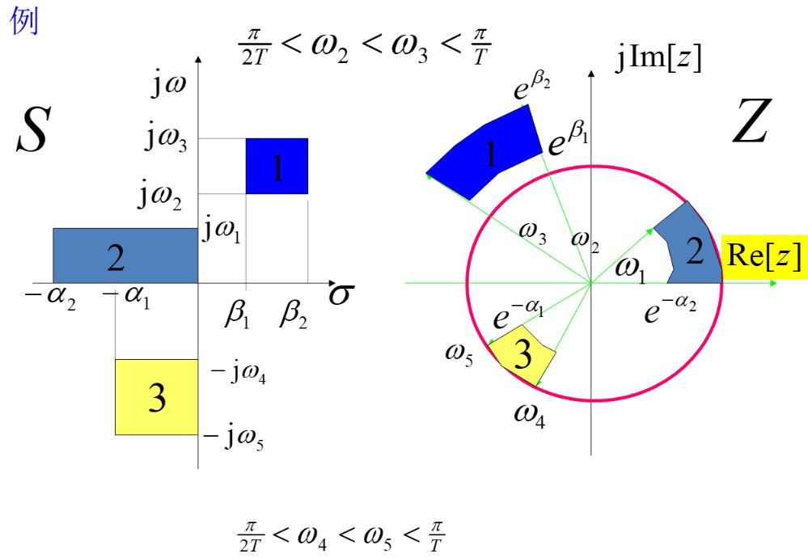  

## 9. 由 Laplace 变换求 Z 变换

已知连续信号的拉普拉斯变换为 $X_a(s)$：  
1.  对 $X_a(s)$ 进行部分分式展开：$X_a(s) = \sum_{i=1}^{M} \frac{A_i}{s - p_i}$；  
2.  求时域原信号：$x_a(t) = \sum_{i=1}^{M} A_i e^{p_i t} u(t)$；  
3.  对时域进行抽样 $t = n T_s$：$x_d(n) = \sum_{i=1}^{M} A_i e^{p_i T_s n} u_d(n)$；  
4.  取 Z 变换：  
    $$X(z) = \sum_{i=1}^{M} \frac{A_i z}{z - e^{p_i T_s}}$$  

## 10. Z 变换求解线性常系数差分方程

对于后向形式的差分方程：  
$$\sum_{k=0}^{N} a_k y(n-k) = \sum_{m=0}^{M} b_m e(n-m)$$  

两边取单边 Z 变换，并利用单边移位性质，可得：  
$$D(z) Y(z) - B(z) = N(z) E(z)$$  
$$Y(z) = \frac{N(z)}{D(z)} E(z) + \frac{B(z)}{D(z)} = Y_{zs}(z) + Y_{zi}(z)$$  
*   $Y_{zs}(z) = H(z) E(z)$ 为零状态响应；  
*   $Y_{zi}(z) = \frac{B(z)}{D(z)}$ 为零输入响应。  

*   **例**：已知差分方程为 $y(n) + 3y(n-1) + 2y(n-2) = e(n) + e(n-1)$。  
    已知初始状态为 $y(-1) = -1/2$，$y(-2) = 1/4$。输入激励为 $e(n) = u_d(n)$。  
    两边取单边 Z 变换：  
    $$Y(z) + 3[z^{-1}Y(z) + y(-1)] + 2[z^{-2}Y(z) + z^{-1}y(-1) + y(-2)] = E(z) + z^{-1}E(z)$$  
    代入初始值：  
    $$Y(z) (1 + 3z^{-1} + 2z^{-2}) - 1.5 - z^{-1} + 0.5 = E(z)(1 + z^{-1})$$  
    $$Y(z) (1 + 3z^{-1} + 2z^{-2}) - (1 + z^{-1}) = E(z)(1 + z^{-1})$$  
    由于 $e(n) = u_d(n) \iff E(z) = \frac{1}{1-z^{-1}}$。  
    
    1.  **零状态响应 $Y_{zs}(z)$**（令初始项为 0）：  
        $$Y_{zs}(z) (1 + 3z^{-1} + 2z^{-2}) = E(z)(1 + z^{-1})$$  
        $$Y_{zs}(z) = \frac{1+z^{-1}}{(1-z^{-1})(1+z^{-1})(1+2z^{-1})} = \frac{1}{(1-z^{-1})(1+2z^{-1})} = \frac{z^2}{(z-1)(z+2)}$$  
        部分分式展开后求逆变换得：  
        $$y_{zs}(n) = \left[ \frac{1}{3} \cdot 1^n + \frac{2}{3} \cdot (-2)^n \right] u_d(n)$$  
        
    2.  **零输入响应 $Y_{zi}(z)$**（令右侧输入项为 0）：  
        $$Y_{zi}(z) (1 + 3z^{-1} + 2z^{-2}) = 1 + z^{-1}$$  
        $$Y_{zi}(z) = \frac{1+z^{-1}}{(1+z^{-1})(1+2z^{-1})} = \frac{1}{1+2z^{-1}} = \frac{z}{z+2}$$  
        逆变换得：  
        $$y_{zi}(n) = (-2)^n u_d(n)$$  
        
    3.  **全响应 $y(n)$**：  
        $$y(n) = y_{zs}(n) + y_{zi}(n) = \left[ \frac{1}{3} + \frac{5}{3}(-2)^n \right] u_d(n)$$  

## 11. 系统函数

对于离散系统，零状态下系统响应的 Z 变换与激励的 Z 变换之比定义为**系统函数**：  
$$H(z) = \frac{R_{zs}(z)}{E(z)} = \mathcal{Z}[h(n)]$$  
即系统函数为单位样值响应 $h(n)$ 的 Z 变换。  

*   **离散系统与连续系统的对应关系**：  
    为离散模拟连续系统，通常取 $h_d(n) = T_s h_a(nT_s)$，这使得离散系统函数比连续系统函数多乘了一个 $T_s$ 因子。  

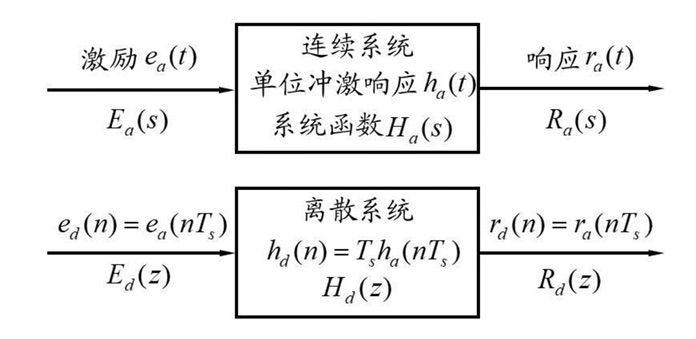  

## 12. 系统函数的零点与极点

$$H(z) = K \frac{\prod_{j=1}^{M} (z - z_j)}{\prod_{i=1}^{N} (z - p_i)}$$  
*   **极点 $p_i$**：决定自然响应的频率和衰减规律。  
*   **零点 $z_j$**：影响各响应分量的幅值和初相。  

**单阶极点与单位样值响应关系**：  

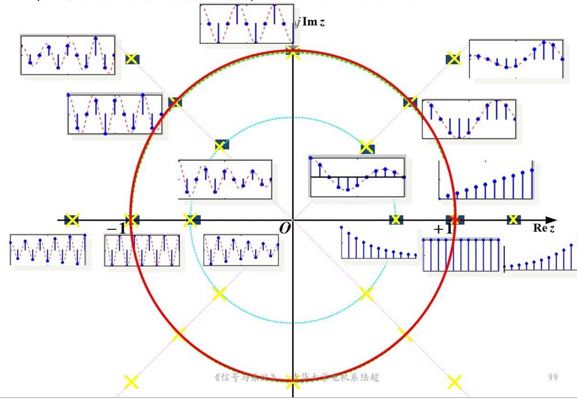  

*   极点在单位圆内 ($|p_i| < 1$) $\implies$ 时域自然响应指数衰减，系统是稳定的；  
*   极点在单位圆外 ($|p_i| > 1$) $\implies$ 时域自然响应指数增长，系统发散不稳定；  
*   极点在单位圆上 ($|p_i| = 1$) $\implies$ 临界稳定（等幅振荡或常数）。  

## 13. 系统稳定性判断

**BIBO 稳定充要条件**：  
1.  系统函数 $H(z)$ 的所有极点都必须位于**单位圆内**（即 $|p_i| < 1$）；或者说其收敛域包含单位圆。  
2.  系统单位样值响应绝对可和：  
    $$\sum_{n=-\infty}^{\infty} |h(n)| < \infty$$  

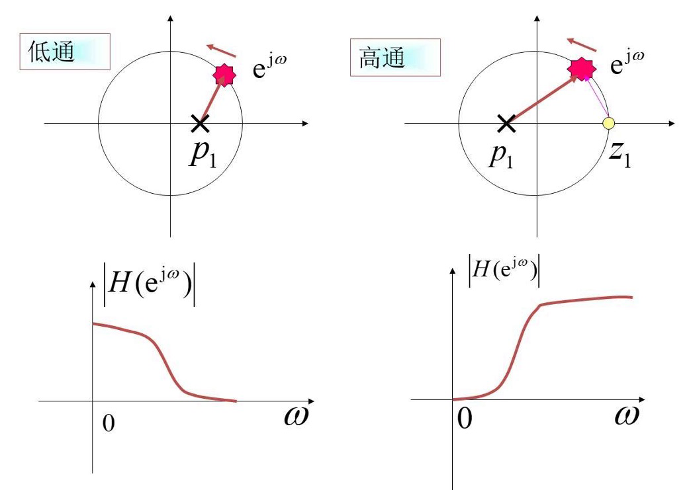  
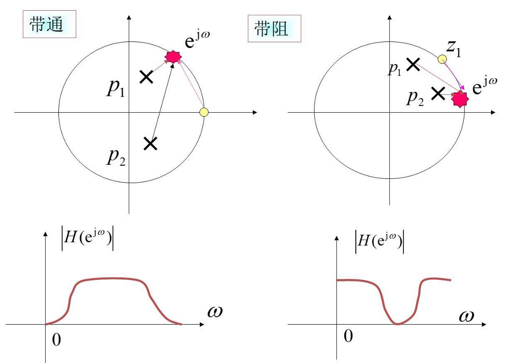  

## 14. 频域系统响应特性与矢量分析法

当系统稳定且包含单位圆时，令 $z = e^{j\theta}$ 得到频率响应函数：  
$$H(e^{j\theta}) = \left. H(z) \right|_{z = e^{j\theta}} = |H(e^{j\theta})| e^{j\varphi(\theta)}$$  

幅频特性可以几何表示为：  
$$|H(e^{j\theta})| = K \frac{\prod_{j=1}^{M} |V_{zj}|}{\prod_{i=1}^{N} |V_{pi}|}$$  
其中 $V_{zj}$ 和 $V_{pi}$ 分别是零点和极点指向单位圆上该点 $e^{j\theta}$ 的矢量。  

*   **物理特性规律**：==极点造峰，零点造谷==！  
    随着 $z = e^{j\theta}$ 在单位圆上逆时针移动，靠近零点时分母较小，产生波谷；靠近极点时，分母较小，产生波峰。由此可以直观地通过零极点分布设计出低通、高通、带通、带阻等各类滤波器。  

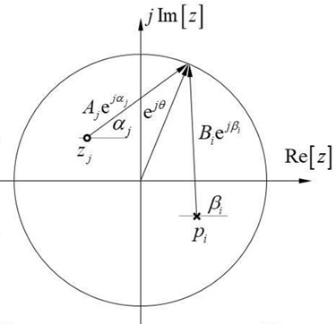  
