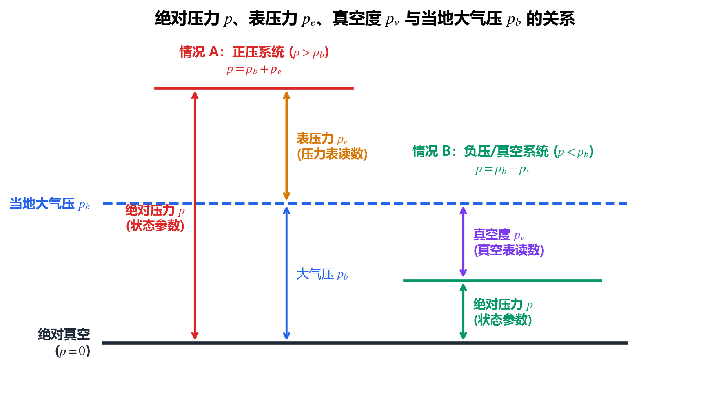
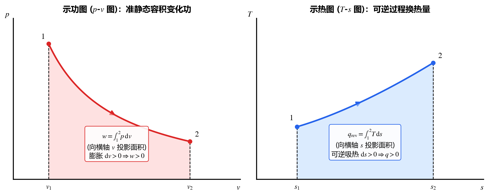

## 1.1 热力系统（Thermodynamic System）的选取与分类

### 1. 基本定义
* **热力系统（简称系统）**：人为分割出来作为热力学研究对象的有限物质区域。
* **外界（Surroundings）**：系统以外、与系统发生相互作用的一切周边物体或环境。
* **边界（Boundary）**：分隔系统与外界的分界面。
  * 边界可以是**真实的物理界面**（如气缸内壁），也可以是**假想的几何面**（如管道进出口截面）；
  * 边界可以是**固定的**（刚性容器壁），也可以是**移动/变形的**（移动活塞表面、气球薄膜）。

> [!TIP]
> **具体方法：工程中如何正确选取热力系统？**
> 同一个热力问题，选取不同的系统边界，求解难度可能天差地别。选取系统应遵循以下三条实操原则：
> 1. **突出主要矛盾，消去未知内力/内热**：若两个子系统之间的传热或做功过程复杂且题目不要求求解，直接将两者**合并为一个复合系统**，使复杂的相互作用变成系统内部过程而自动抵消。
> 2. **边界上的能量交换易于计算**：边界应尽量选在压力、温度、流速已知或为零的位置（例如把真空腔包含进系统内，边界上膨胀功直接为 $0$）。
> 3. **满足宏观连续性**：系统内部必须包含足够多的微观粒子，使宏观统计平均参数（$p, T$）有意义。

### 2. 热力系统的核心分类

按**边界上是否有质量、热量和功量的穿过**，系统可分为以下五大类：

| 系统类型 | 质量交换 $\delta m$ | 热量交换 $\delta Q$ | 功量交换 $\delta W$ | 典型工程实例与分析方法 |
| :--- | :---: | :---: | :---: | :--- |
| **闭口系（Closed System / 控制质量 CM）** | **无** | 可有 | 可有 | 活塞-气缸封存气体；系统质量 $m = \text{const}$，追踪固定物质团。 |
| **开口系（Open System / 控制容积 CV）** | **有** | 可有 | 可有 | 汽轮机、压气机、喷管、充放气容器；关注固定空间区域的进出质量流。 |
| **绝热系（Adiabatic System）** | 可有 | **无（$Q=0$）** | 可有 | 保温良好的设备，或过程极快（如声波传播、瞬间爆震）来不及传热的系统。 |
| **绝功系（Zero-Work System）** | 可有 | 可有 | **无（$W=0$）** | 刚性密闭容器内的传热过程、无轴功的换热器。 |
| **孤立系（Isolated System）** | **无** | **无** | **无** | 与外界完全没有任何相互作用（$\delta m = 0, \delta Q = 0, \delta W = 0$）。 |

> [!IMPORTANT]
> **孤立系构造法则（第二定律分析的“万能钥匙”）**
> 自然界中没有绝对孤立的工程设备，但我们可以人为扩大边界：
> $$\text{任意非孤立系统} + \text{所有与之发生相互作用的相关外界} = \text{孤立系统}$$
> 当我们需要判断某个复杂过程是否可能发生、或者计算不可逆损失时，立刻将“系统 + 热源 + 功源”打包成一个**孤立系**，即可无条件套用孤立系能量守恒与孤立系熵增原理（$\Delta S_{\text{iso}} \ge 0$）。

此外，按内部性质与成分还可分为：
* **均匀系 vs 非均匀系**：系统内各处物理化学性质是否完全均匀一致（如单相气体为均匀系，冰水混合物为非均匀系）。
* **单元系 vs 多元系**：由一种化学成分组成（如纯水 + 水蒸气两相共存，虽然是**两相非均匀系**，但化学成分只有 $\text{H}_2\text{O}$，仍属于**单元系**！）还是多种化学成分组成（如湿空气、燃气）。

> [!IMPORTANT]
> **简单可压缩系统（Simple Compressible System）**
> 这是本课程最核心的研究对象。指由单一化学成分或固定成分组成、不发生化学反应、忽略重力/电磁力/表面张力影响，**与外界只交换热量和准静态容积变化功（膨胀/压缩功）**的系统。

---

## 1.2 平衡状态与状态参数（State Properties）

### 1. 状态参数的三大数学特征与判定方法

描述系统宏观热力状态的物理量称为**状态参数**。判断一个物理量 $z$ 是否为状态参数，有且仅有以下三个等价判据：

> [!IMPORTANT]
> **具体方法：状态参数（点函数） vs 过程量（路径函数）的判定法则**
> 1. **点函数（态函数）特征**：状态参数仅由系统当前所处的状态唯一决定，与系统如何到达该状态的历史路径无关。
> 2. **积分特征（路径无关与环积分为零）**：
>    * 任意两点间的变化量只取决于初、终态，与积分路径无关：
>      $$\int_1^2 \mathrm{d}z = z_2 - z_1 = \Delta z$$
>    * 经历任意一个热力循环回到初态，状态参数的循环积分恒等于零：
>      $$\oint \mathrm{d}z = 0$$
> 3. **微分特征（全微分充要判据）**：
>    * 状态参数的微小变化量是**全微分（Exact Differential）**，记作 $\mathrm{d}z$；而功和热等过程量的微小量不是全微分，必须记作 $\delta W, \delta Q$（且决不能写成 $\Delta W = W_2 - W_1$）。
>    * **数学定量判据**：若 $z = f(x, y)$ 的微分形式写为 $\mathrm{d}z = M(x,y)\,\mathrm{d}x + N(x,y)\,\mathrm{d}y$，则 $z$ 为状态参数的**充要条件**是混合二阶偏导相等：
>      $$\left(\frac{\partial M}{\partial y}\right)_x = \left(\frac{\partial N}{\partial x}\right)_y \quad \Longleftrightarrow \quad \frac{\partial^2 z}{\partial x \partial y} = \frac{\partial^2 z}{\partial y \partial x}$$

### 2. 广延量、强度量与比参数

工程热力学最常用的 **6 个状态参数** 为：
* **3 个基本状态参数（可直接用仪表测量）**：压力 $p$、温度 $T$、体积 $V$（或比体积 $v$）；
* **3 个导出状态参数（需通过热力学定律计算或查表）**：热力学能（内能）$U$、焓 $H$、熵 $S$。

| 参数类别 | 核心特征 | 典型代表 |
| :--- | :--- | :--- |
| **强度量（Intensive Properties）** | 与系统质量 $m$ 无关，**不具有可加性**；系统分割后各子系统强度量保持不变。 | 压力 $p$、温度 $T$ |
| **广延量（Extensive Properties）** | 与系统质量 $m$ 成正比，**具有可加性**（$Z = \sum Z_i$）。 | 质量 $m$、总体积 $V$、总内能 $U$、总焓 $H$、总熵 $S$ |
| **比参数（Specific Properties）** | 单位质量的广延量（$z = Z / m$，用小写字母表示），**具有强度量的性质**，摆脱了系统质量的干扰。 | 比体积 $v = V/m$、比内能 $u = U/m$、比焓 $h = H/m$、比熵 $s = S/m$ |

---

### 3. 三大基本状态参数详解与换算

#### （1）压力（Pressure，$p$）
* **定义**：流体垂直作用于单位容器壁面上的力（单位：$\text{Pa} = \text{N/m}^2$）。
* **常用工程单位换算**：
  $$\begin{aligned}
  1\text{ MPa} &= 10^6\text{ Pa}, \qquad 1\text{ bar} = 10^5\text{ Pa} = 0.1\text{ MPa} \\
  1\text{ atm（标准大气压）} &= 1.01325 \times 10^5\text{ Pa} = 760\text{ mmHg} \\
  1\text{ at（工程大气压）} &= 1\text{ kgf/cm}^2 = 9.80665 \times 10^4\text{ Pa} = 735.6\text{ mmHg} = 10\text{ mH}_2\text{O}
  \end{aligned}$$
* **绝对压力 $p$、表压力 $p_e$ 与真空度 $p_v$**：
  压力表或真空表测量的是系统内部绝对压力 $p$ 与当地环境大气压 $p_b$ 之间的**差值**：
  * 当系统压力高于大气压（$p > p_b$）时，采用压力表测量**表压力（Gauge Pressure，$p_e$）**：
    $$p = p_b + p_e$$
  * 当系统压力低于大气压（$p < p_b$）时，采用真空表测量**真空度（Vacuum，$p_v$）**：
    $$p = p_b - p_v$$

> [!CAUTION]
> **高频易错点：表压力 $p_e$ 和真空度 $p_v$ 不是状态参数！**
> 1. 即使容器内气体的真实状态没有任何改变，只要端着容器从平原走到高原（当地大气压 $p_b$ 下降），压力表的读数 $p_e = p - p_b$ 就会变大。因此，$p_e$ 和 $p_v$ 取决于外界大气压，**不是状态参数**，唯有**绝对压力 $p$** 才是状态参数！
> 2. **解题铁律**：看到题目给出“表压力”或“真空度”，第一步必须先用 $p = p_b + p_e$ 或 $p = p_b - p_v$ 换算为**绝对压力 $p$**，才能代入状态方程（如 $pv = R_g T$）或查热力性质表。

#### （2）温度（Temperature，$T$）与热力学第零定律
* **微观本质**：分子热运动平均平动动能的量度（$T \propto \frac{1}{2}m\overline{w^2}$）。
* **热力学定义——热力学第零定律（Zeroth Law of Thermodynamics, Fowler 1931）**：
  > 如果物体 $A$ 与物体 $B$ 分别与处于同一状态的物体 $C$（如温度计）达到热平衡，则物体 $A$ 与物体 $B$ 之间也必然处于热平衡。
  * **核心意义**：确立了热平衡的**传递性**，证明处于热平衡的所有热力系统必然具有同一个共同的宏观状态参数——**温度 $T$**。这是定义温度概念和**一切测温技术的理论基础**。
* **温标换算**：
  * **热力学温标（开氏温标，单位 $\text{K}$）与摄氏温标（单位 $^\circ\text{C}$）**：
    $$T\text{ [K]} = t\text{ [}^\circ\text{C]} + 273.15, \qquad \Delta T\text{ [K]} = \Delta t\text{ [}^\circ\text{C]}$$
    （注：国际温标固定水三相点温度为 $T_{\text{tr}} = 273.16\text{ K} = 0.01^\circ\text{C}$）。
  * **华氏温标（$^\circ\text{F}$）与兰金温标（$\text{R}$）**：
    $$t\text{ [}^\circ\text{C]} = \frac{5}{9}\left(t\text{ [}^\circ\text{F]} - 32\right), \qquad T\text{ [R]} = t\text{ [}^\circ\text{F]} + 459.67$$

> [!CAUTION]
> 在一切热力学公式（如 $pv = R_g T$、$\eta_t = 1 - T_2/T_1$、$\mathrm{d}s = \delta q_{\text{rev}}/T$）中，单独出现的温度 $T$ **必须使用绝对温标 $\text{K}$**！只有在计算温度差 $\Delta T = T_2 - T_1 = t_2 - t_1$ 时，才可以直接用摄氏度相减。

#### （3）比体积（Specific Volume，$v$）
* **定义**：单位质量物质所占有的容积，与密度 $\rho$ 互为倒数：
  $$v = \frac{V}{m} = \frac{1}{\rho} \quad \left[\text{m}^3/\text{kg}\right]$$

---

### 4. 平衡态（Equilibrium State）的本质与概念辨析

* **定义**：系统在**没有外界影响**（重力场除外）的条件下，宏观热力性质不随时间发生任何变化的状态。
* **物理本质**：系统内部达到了热平衡（无温差 $\Delta T = 0$）、力平衡（无压差 $\Delta p = 0$）、相平衡与化学平衡——即**系统内部不存在任何不平衡势差**。

> [!WARNING]
> **三大核心概念辨析（判断题与简答题必考）**
> 1. **平衡态 vs 稳定态（Steady State）：“平衡必稳定，稳定未必平衡”**
>    * **典型反例**：一根金属棒左端接触 $100^\circ\text{C}$ 沸水，右端接触 $0^\circ\text{C}$ 冰水，侧面绝热。足够长时间后，棒上各点温度不再随时间变化，达到了**稳定态**。
>    * **判据（撤去外界法）**：将该金属棒从冷热源移开并完全孤立，棒内温差会驱动热量自发从高温端流向低温端，各点温度随之改变。因此该稳定态依赖外界持续传热来维持，属于**非平衡态**！
> 2. **平衡态 vs 均匀态（Uniform State）：“单相平衡态必均匀，平衡态未必均匀”**
>    * 若系统处于单相（如纯气相），达到平衡态时各处 $p, T, v$ 必然处处均匀。
>    * 但若系统处于多相共存（如密闭容器内达到热平衡与相平衡的**汽水两相混合物**），或是受重力场影响的极高气柱，系统完全处于**平衡态**，但液相与气相的密度、比体积截然不同，属于**非均匀态**。
> 3. **平衡态的“死态”矛盾**：
>    * 唯有处于**平衡态**的系统，其内部各处才有唯一确定的状态参数 $(p, T, v)$，才能在热力坐标图上标为一个确定的**状态点**。
>    * 然而，平衡态内部没有任何势差，本身是一个无法自发变化的“死态”；一旦发生实际过程（必有压差或温差），系统就偏离了平衡态，状态参数顿时失去唯一性。为了能够用状态参数描述热力过程，热力学引入了**准平衡过程**。

---

## 1.3 状态公理、状态方程与热力坐标图

### 1. 状态公理（State Postulate）
一个成分固定的闭口系统，要唯一确定其平衡状态，所需的**独立状态参数个数 $N$** 为：
$$N = n + 1$$
其中：
* $n$ 为系统与外界交换的**准静态功的种类数**（如容积功、拉伸功、表面张力功、电磁功等）；
* $1$ 代表与热现象（热量交换）对应的独立变量（如温度 $T$ 或熵 $s$）。

> [!IMPORTANT]
> **简单可压缩系统的状态公理结论：$N = 2$**
> 对于简单可压缩系统，只存在准静态容积变化功一种做功方式（$n = 1$），因此：
> $$N = 1 + 1 = 2$$
> **核心推论**：
> 1. 简单可压缩系统的平衡态只需**任意 2 个相互独立的强度量（或比参数）**即可完全确定！只要确定了 $(p, T)$、$(p, v)$ 或 $(T, s)$ 中的任意一对，其余所有状态参数 $u, h, s, v$ 就全部唯一确定。
> 2. 任意三个状态参数之间必然存在函数制约关系 $f(x, y, z) = 0$。其中基本状态参数之间的关系式 $f(p, v, T) = 0$ 称为**状态方程（Equation of State）**（如理想气体 $pv = R_g T$）。
> 3. **例外警示**：在气液两相共存区（湿蒸汽区），饱和压力与饱和温度一一对应（$p_s = f(T_s)$），此时 **$p$ 与 $T$ 不再相互独立**！必须改用 $(p, v)$、$(T, v)$ 或引入干度 $x$ 作为第二个独立参数。

### 2. 热力坐标图（$p\text{-}v$ 图与 $T\text{-}s$ 图）的绘制规范
因为简单可压缩系统 $N = 2$，所以二维平面坐标系（如 $p\text{-}v$ 图、$T\text{-}s$ 图、$h\text{-}s$ 图）与平衡态之间具有严格的一一对应关系：
* **图上的一个点** $\Longleftrightarrow$ 一个确定的**平衡状态**；
* **图上的一条连续实线** $\Longleftrightarrow$ 一个由连续平衡态组成的**准平衡过程（或可逆过程）**；
* **图上的虚线** $\Longleftrightarrow$ **非准平衡过程（不可逆过程）**（由于中间状态不均匀，无法用单一状态点表示，只能标出初、终平衡态并用虚线示意连接）。

---

## 1.4 准平衡过程与可逆过程

### 1. 准平衡过程（Quasi-Equilibrium / Quasi-Static Process）
* **定义**：过程进行得无限缓慢，系统在偏离平衡态的每一瞬间都无限接近于平衡态，即整个过程是由一连串连续的平衡态所组成的过程。
* **工程判定准则（弛豫时间判据）**：
  $$\text{外界破坏平衡的特征时间 } \tau_{\text{外}} \gg \text{系统内部恢复平衡的弛豫时间 } \tau_{\text{弛}}$$
  * **工程实例**：汽车内燃机气缸活塞的往复运动速度约为 $u \approx 10\sim 20\text{ m/s}$，看似极快；但气缸内气体靠压力波（声速 $c \approx 350\sim 500\text{ m/s}$）抹平内部压差的弛豫时间仅需 $10^{-4}\text{ s}$ 量级。因为活塞速度远小于声速（$u \ll c$），气体内部随时能恢复均匀，故工程上完全可以当作**准平衡过程**处理！

### 2. 可逆过程（Reversible Process）
* **定义**：系统完成某一热力过程后，如果能使系统沿原路径逆行回到初态，并且**系统和外界都完全恢复原状而不留下任何变化（痕迹）**，则称该过程为可逆过程。
* **五大典型不可逆过程（自然界一切自发过程皆不可逆）**：
  1. **有限温差下的传热**（热量不能自发从低温回到高温）；
  2. **有限压差下的自由膨胀与节流过程**（气体向真空自由膨胀、通过阀门节流降压）；
  3. **存在耗散效应的过程**（机械摩擦生热、流体粘性耗散、电阻焦耳热、非弹性形变）；
  4. **不同气体的自发混合与扩散**；
  5. **非平衡化学反应与燃烧**。

> [!IMPORTANT]
> **核心公式：准平衡过程与可逆过程的逻辑关系**
> $$\boxed{\text{可逆过程} = \text{准平衡过程（无不平衡势差）} + \text{无耗散效应（无摩擦/粘性/电阻耗散）}}$$
> * **可逆过程 $\implies$ 必为准平衡过程**；
> * **准平衡过程 $\centernot\implies$ 可逆过程**！
> * **经典反例（有摩擦的准平衡过程）**：气缸内气体极缓慢地推动粗糙活塞膨胀，气体内部时刻均匀无压差，因此对气体而言是**准平衡过程**；但由于活塞与气缸壁之间存在摩擦耗散（机械能不可逆地转化为摩擦热），外界无法无代价地恢复原状，故该过程是**准平衡但不可逆过程**。

---

## 1.5 功量（Work）与热量（Heat）及具体计算方法

### 1. 热力学对功与热的严格定义
* **功（Work，$W$）**：系统与外界之间通过宏观有序运动传递的能量，其对参考外界的**唯一效果可以归结为举起重物**（如膨胀功、轴功、电功、搅拌功）。
* **热（Heat，$Q$）**：系统与外界之间**仅仅由于温差 $\Delta T$** 的存在，通过微观分子无序热运动跨越边界传递的能量。

### 2. 准静态容积变化功（膨胀功/压缩功）的计算方法

对于简单可压缩系统的**准平衡过程**，系统内部压力 $p$ 处处均匀且等于作用于活塞内表面的压力，微元容积变化功与过程总功为：
$$\delta W = p\,\mathrm{d}V, \qquad W = \int_1^2 p\,\mathrm{d}V \quad [\text{J 或 kJ}]$$
写成单位质量的比功形式：
$$\delta w = p\,\mathrm{d}v, \qquad w = \int_1^2 p\,\mathrm{d}v \quad [\text{J/kg 或 kJ/kg}]$$

* **正负号规定（全书统一）**：
  * **膨胀过程（$\mathrm{d}v > 0$）**：$w > 0$，表示**系统对外界做正功**；
  * **压缩过程（$\mathrm{d}v < 0$）**：$w < 0$，表示**外界对系统做功**（系统对外做负功）；
  * **定容过程（$\mathrm{d}v = 0$）**：$w = 0$，容积变化功为零。
* **几何意义——示功图（$p\text{-}v$ 图）**：
  在 $p\text{-}v$ 图上，准平衡过程曲线 $1\text{-}2$ 下方**向横轴（$v$ 轴）投影所围成的面积**，在数值上等于该过程的比容积变化功 $w = \int_1^2 p\,\mathrm{d}v$。因此，$p\text{-}v$ 图又称为**示功图**。
  * 循环过程（顺时针闭合曲线）：净功 $w_{\text{net}} = \oint p\,\mathrm{d}v > 0$，等于**闭合环线所围成的面积**（正循环，对外输出净功）；
  * 逆时针闭合曲线：$w_{\text{net}} = \oint p\,\mathrm{d}v < 0$（逆循环，需外界输入净功）。

> [!CAUTION]
> **具体方法与避坑指南：何时能用 $W = \int p\,\mathrm{d}V$？有活塞摩擦时怎么算？**
> 1. **必须满足准平衡条件**：式中的 $p$ 是**系统内部工质自身的压力**，而不是外界阻力！只有当过程准静态进行时，工质压力 $p$ 才有确定值并可用于积分。若容器隔板抽去、气体向真空腔**自由膨胀**，虽然体积从 $V_1$ 增大到 $V_2$，但这是剧烈的非准平衡过程，**绝不能积分 $\int p\,\mathrm{d}V$**，实际对外做功 $W = 0$！
> 2. **活塞存在摩擦力 $F_f$ 时的功量核算**：
>    * 若以**气缸内的气体**为系统：只要过程足够缓慢（气体内部准平衡），气体推活塞的力始终等于 $pA$，因此**气体付出的容积变化功依然严格等于 $W = \int_1^2 p\,\mathrm{d}V$**！
>    * 摩擦力 $F_f$ 发生在活塞与缸壁界面（系统边界之外），摩擦耗功 $W_f = \int F_f\,\mathrm{d}x > 0$ 的作用是：**膨胀时削减了传递给外界的有用功**（$W_{\text{外}} = \int p\,\mathrm{d}V - W_f$），**压缩时增加了外界必须输入的功**（$|W_{\text{外}}| = \left|\int p\,\mathrm{d}V\right| + W_f$）。

### 3. 热量与状态参数“熵（Entropy）”的引出

为了使热量 $Q$ 也拥有与容积功 $\delta w = p\,\mathrm{d}v$ 类似的积分计算公式与图形面积表示，热力学定义了状态参数 **熵 $S$**（比熵 $s = S/m$，单位 $\text{J/(kg}\cdot\text{K)}$ 或 $\text{kJ/(kg}\cdot\text{K)}$，中文“熵”字由清华大学刘仙洲教授于 1934 年按“火 + 商 = 热量与温度之商”首创）：

$$\mathrm{d}s = \frac{\delta q_{\text{rev}}}{T} \quad \Longleftrightarrow \quad \delta q_{\text{rev}} = T\,\mathrm{d}s, \qquad q_{\text{rev}} = \int_1^2 T\,\mathrm{d}s$$

* **正负号规定（全书统一）**：
  * **系统吸热**：$Q > 0$（在**可逆过程**中，吸热必对应熵增 $\mathrm{d}s > 0$）；
  * **系统放热**：$Q < 0$（在**可逆过程**中，放热必对应熵减 $\mathrm{d}s < 0$）；
  * **可逆绝热过程**：$\delta q_{\text{rev}} = 0 \iff \mathrm{d}s = 0$，即**定熵过程（Isentropic Process）**。
* **几何意义——示热图（$T\text{-}s$ 图）**：
  在 $T\text{-}s$ 图上，**可逆过程**曲线 $1\text{-}2$ 下方**向横轴（$s$ 轴）投影所围成的面积**，等于该过程的可逆换热量 $q_{\text{rev}} = \int_1^2 T\,\mathrm{d}s$。因此，$T\text{-}s$ 图又称为**示热图**。

> [!IMPORTANT]
> **容积变化功 $\delta w$ 与热量 $\delta q$ 的对偶关系总结表**
>
> | 对比项 | 容积变化功 $w$ | 热量 $q$ |
> | :--- | :--- | :--- |
> | **函数性质** | 过程量（路径函数），微元记作 $\delta w$ | 过程量（路径函数），微元记作 $\delta q$ |
> | **微分表达式** | $\delta w = p\,\mathrm{d}v$ | $\delta q_{\text{rev}} = T\,\mathrm{d}s$ |
> | **推动势（强度量）** | 绝对压力 $p$ | 热力学温度 $T$ |
> | **广延量（比参数）微分** | 比体积微分 $\mathrm{d}v$ | 比熵微分 $\mathrm{d}s$ |
> | **公式适用前提** | **准静态（准平衡）过程**（允许有摩擦） | **可逆过程**（既要准静态，又必须无耗散！） |
> | **对应坐标图与几何意义** | **示功图（$p\text{-}v$ 图）**：曲线向 $v$ 轴投影面积 | **示热图（$T\text{-}s$ 图）**：曲线向 $s$ 轴投影面积 |
> | **正负号判据** | $\mathrm{d}v > 0 \implies w > 0$（膨胀对外做功） | $\mathrm{d}s > 0 \implies q_{\text{rev}} > 0$（可逆吸热） |
