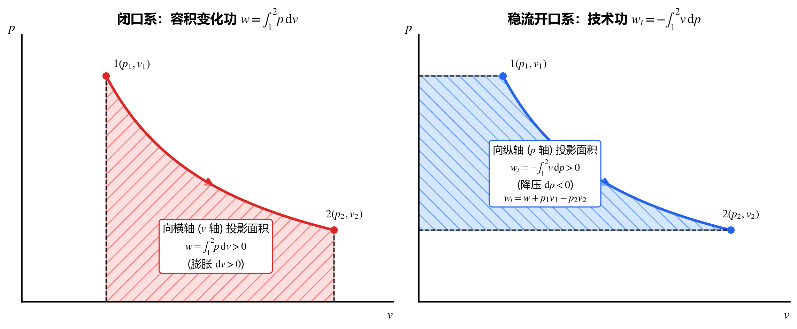

## 2.1 热力学第一定律的本质与能量收支通式

1. **物理本质**：自然界一切物质都具有能量，能量既不能凭空产生，也不能凭空消灭，只能从一种形式转化为另一种形式，或从一个系统传递给另一个系统，在转化和传递过程中**能量的总量保持恒定**（即能量守恒与转换定律在热现象领域的表达）。
2. **第一类永动机（Perpetual Motion Machine of the First Kind）**：不消耗任何能量却能持续对外做功的机器。热力学第一定律直接宣判：**第一类永动机绝对不可能实现**。
3. **热功当量**：焦耳（Joule）实验证明热与功具有严格的定量转换关系（$1\text{ cal} = 4.1868\text{ J}$）。
4. **任何热力系统的通用能量平衡收支式**：
   $$\boxed{\text{进入系统的总能量 } E_{\text{in}} - \text{离开系统的总能量 } E_{\text{out}} = \text{系统储存能的增量 } \Delta E_{\text{sys}}}$$

---

## 2.2 热力系统的储存能与热力学能（内能 $U$）

### 1. 热力学能（Internal Energy，$U$）的引出與物理意义
对任意经历循环的闭口系统，实验定律给出循环热功相等：
$$\oint \delta Q = \oint \delta W \quad \Longrightarrow \quad \oint (\delta Q - \delta W) = 0$$
由第一章的状态参数环积分判据可知，组合量 $(\delta Q - \delta W)$ 必然是某个**状态参数的全微分**！当忽略系统整体的宏观动能和位能变化时，定义该状态参数为系统的**热力学能（简称内能，$U$，比内能 $u = U/m$）**：
$$\mathrm{d}U = \delta Q - \delta W$$

* **内能 $U$ 的微观构成**：
  1. **分子热运动内动能 $U_k$**（平动、转动、振动动能）：仅取决于分子热运动剧烈程度，即**仅是温度 $T$ 的函数**；
  2. **分子间相互作用内位能 $U_p$**：取决于分子间距，即**是比体积 $v$（及温度 $T$）的函数**；
  3. **化学能与原子核能**（在无化学反应与核反应的简单可压缩系统中保持常数）。
* **一般工质内能的函数形式**：对于简单可压缩系统，$u = f(T, v)$（选两个独立状态参数即可唯一确定）。

> [!IMPORTANT]
> **焦耳自由膨胀实验结论：理想气体的内能仅是温度的函数！**
> 焦耳（1843）将装有高压空气的容器与真空容器放入绝热水槽中，打开阀门让气体向真空自由膨胀：
> * 取整个双联容器为闭口绝热刚性系统：$Q = 0, W = 0 \implies \Delta U = Q - W = 0$；
> * 实验测得膨胀前后水温几乎不变（$\Delta T = 0$），尽管比体积 $v$ 大幅增大，但内能 $U$ 不随 $v$ 改变！
> * **核心结论**：理想气体忽略分子间作用力（内位能 $U_p = 0$），因此**理想气体的热力学能 $u$ 仅仅是温度 $T$ 的单值函数**：
>   $$u = f(T) \quad \text{（仅限理想气体！）}$$

### 2. 热力系统的总储存能 $E$
系统的总储存能 $E$ 等于微观**热力学能 $U$** 与宏观**机械能（宏观动能 $E_k$ + 重力位能 $E_p$）**之和：
$$E = U + E_k + E_p = U + \frac{1}{2}mc^2 + mgz \quad [\text{J 或 kJ}]$$
写成单位质量的比储存能形式（注意此处 $c$ 代表宏观流速，勿与比热容混淆）：
$$e = u + \frac{1}{2}c^2 + gz \quad [\text{J/kg 或 kJ/kg}]$$

---

## 2.3 闭口系能量方程（Closed System Energy Equation）

闭口系边界上无质量进出（$\delta m = 0$），能量跨越边界的唯一方式是热量 $Q$ 和功量 $W$。

### 1. 闭口系第一定律的四套常用形式与适用条件

| 方程形式 | 宏观通用形式（忽略 $\Delta E_k, \Delta E_p$） | 微元形式 | 适用条件（极其重要！） |
| :--- | :---: | :---: | :--- |
| **基本定义式** | $Q = \Delta U + W$ $q = \Delta u + w$ | $\delta Q = \mathrm{d}U + \delta W$ $\delta q = \mathrm{d}u + \delta w$ | **无任何限制！**适用于**任何工质**（理想/实际气体、液体、固液两相）、**任何过程**（可逆或不可逆、准静态或非准静态）。 |
| **第一解析式** | $q = \Delta u + \int_1^2 p\,\mathrm{d}v$ | $\delta q = \mathrm{d}u + p\,\mathrm{d}v$ | 简单可压缩闭口系 + **准静态过程**（且无其他形式功，只有容积变化功 $\delta w = p\,\mathrm{d}v$）。 |
| **热力学基本恒等式 I** | — | $T\,\mathrm{d}s = \mathrm{d}u + p\,\mathrm{d}v$ | 推导时用了可逆条件（$\delta q_{\text{rev}} = T\,\mathrm{d}s, \delta w_{\text{rev}} = p\,\mathrm{d}v$），但因方程中**全都是状态参数**，故对**连接任意两平衡态的微元过程（无论可逆与否）恒成立**！ |

> [!CAUTION]
> **具体方法：面对闭口系问题如何选公式？**
> 1. **有电加热丝、搅拌桨（叶轮）或向真空自由膨胀时**：绝不能直接写 $W = \int p\,\mathrm{d}V$！必须回到最根本的通用式 $Q = \Delta U + W_{\text{总}}$。
>    * 其中 $W_{\text{总}} = W_{\text{容积}} + W_{\text{电/搅拌}}$。
>    * **符号铁律**：电热丝通电做功或搅拌桨对系统做功属于**外界对系统输入功**，故 $W_{\text{电/搅拌}} < 0$（负值）！例如绝热刚性容器内搅拌桨输入功 $10\text{ kJ}$，则 $Q = 0, W = -10\text{ kJ} \implies \Delta U = Q - W = +10\text{ kJ}$（内能增加）。
> 2. **只有确认过程是准静态且无电功/轴功时**，才能把 $w$ 替换为 $\int_1^2 p\,\mathrm{d}v$。

---

## 2.4 开口系能量方程：推动功与状态参数“焓（Enthalpy）”

### 1. 推动功（流动功，Flow Work，$w_{\text{推}}$）
开口系（控制容积 CV）与闭口系的最大区别在于：**有质量 $\delta m$ 跨越边界进出系统**。当微元流体团 $\delta m$ 在截面压力 $p$ 的推动下流入或流出控制容积时，后面的流体必须推着前面的流体移动，从而在进出口截面上传递了机械功——称为**推动功（或流动功）**：
$$\delta W_{\text{推}} = (pA)\,\mathrm{d}l = p\,\mathrm{d}V = p(v\,\delta m) \quad \Longrightarrow \quad w_{\text{推}} = pv = \frac{p}{\rho} \quad [\text{J/kg}]$$
* **流入截面（状态 $1$）**：外界把质量 $\delta m_1$ 推入系统，外界对系统做功 $w_{\text{推}1} = p_1 v_1$；
* **流出截面（状态 $2$）**：系统把质量 $\delta m_2$ 推出外界，系统对外界做功 $w_{\text{推}2} = p_2 v_2$；
* **单位质量流体的净推动功差**：$\Delta(pv) = p_2 v_2 - p_1 v_1$。

> [!WARNING]
> **概念辨析：推动功 $pv$ vs 容积变化功 $\int p\,\mathrm{d}v$**
> * **推动功 $w_{\text{推}} = pv$**：是两个状态参数的乘积，因此 **$pv$ 本身是一个状态参数**！但只有当工质**流动跨越开口系边界**时，乘积 $pv$ 才具有“单位质量推动功”的物理意义；对于闭口系静止工质，不存在推动功。
> * **容积变化功 $w = \int p\,\mathrm{d}v$**：是与路径密切相关的**过程量**。

### 2. 状态参数“焓（Enthalpy，$H$）”的定义与物理意义
当单位质量工质跨越开口系边界时，它不仅自身携带着热力学能 $u$，还必然伴随着进出边界的推动功 $pv$。由于 $u$ 和 $pv$ 总是成对出现，定义组合状态参数 **焓 $H$（比焓 $h = H/m$）**：
$$\boxed{H \equiv U + pV, \qquad h \equiv u + pv \quad [\text{J/kg 或 kJ/kg}]}$$

> [!IMPORTANT]
> **比焓 $h = u + pv$ 的三大核心结论**
> 1. **无条件的状态参数**：因为 $u, p, v$ 全是状态参数，所以无论闭口系还是开口系、无论静止还是流动，**焓 $H$ 永远是状态参数**（全微分 $\mathrm{d}h = \mathrm{d}u + \mathrm{d}(pv) = \mathrm{d}u + p\,\mathrm{d}v + v\,\mathrm{d}p$）。
> 2. **物理意义的双重性**：
>    * 在**开口系流动过程**中，$h = u + pv$ 具有明确的物理意义——代表**随单位质量流体跨越边界带入或带出系统的总热力能量（引出能量 = 内能 + 推动功）**；
>    * 在**闭口系静止工质**中，没有流动也就没有推动功 $pv$，此时 $h$ 只是一个数学组合状态参数（但在定压准静态过程中 $\Delta h = q_p$ 依然极有用）。
> 3. **理想气体的焓仅是温度的函数**：对于理想气体，$u = f(T)$ 且 $pv = R_g T$，因此：
>    $$h = u + pv = f(T) + R_g T = F(T) \quad \text{（理想气体的焓仅取决于温度 } T\text{！）}$$

### 3. 一般开口系（非稳态）能量微分方程
根据“进入控制体的能量 $-$ 离开控制体的能量 $=$ 控制体内部储存能增量 $\mathrm{d}E_{\text{cv}}$”，一般开口系的能量方程为：
$$\delta Q = \mathrm{d}E_{\text{cv}} + \delta W_{\text{net}} + \sum_{\text{out}} \left(h + \frac{1}{2}c^2 + gz\right)_{\text{out}} \delta m_{\text{out}} - \sum_{\text{in}} \left(h + \frac{1}{2}c^2 + gz\right)_{\text{in}} \delta m_{\text{in}}$$
其中 $\delta W_{\text{net}}$（或记作轴功 $\delta W_s$）是除进出口推动功之外，系统通过叶轮轴等对外输出的净功。

---

## 2.5 稳定流动能量方程（SFEE）与四种功的转换关系

### 1. 稳定流动（Steady Flow）的四大条件
工程上绝大多数连续运行的动力与化工设备（汽轮机、压气机、喷管、换热器、节流阀）均工作在**稳定流动**状态，满足：
1. **质量守恒（连续性方程）**：流入与流出质量流量相等且不随时间变化：
   $$\dot{m}_1 = \dot{m}_2 = \dot{m} = \frac{A_1 c_1}{v_1} = \frac{A_2 c_2}{v_2} = \text{const}$$
2. **进出口状态稳定**：进出口截面上工质的状态参数 $(p, T, v, h, c, z)$ 不随时间改变；
3. **热功率与轴功率恒定**：$\dot{Q} = \text{const}, \dot{W}_s = \text{const}$；
4. **控制体内储存能不变**：$\frac{\mathrm{d}E_{\text{cv}}}{\mathrm{d}\tau} = 0$。

### 2. 稳定流动能量方程（Steady-Flow Energy Equation, SFEE）
将稳定流动条件代入开口系方程，对单位质量工质（$1\text{ kg}$）得到工程热力学中应用最广的 **稳定流动能量方程**：
$$\boxed{q = \Delta h + \frac{1}{2}\Delta c^2 + g\Delta z + w_s = (h_2 - h_1) + \frac{1}{2}(c_2^2 - c_1^2) + g(z_2 - z_1) + w_s}$$

引入 **技术功（Technical Work，$w_t$）**——即工程上可以直接加以利用的所有宏观机械能项之和：
$$\boxed{w_t \equiv w_s + \frac{1}{2}\Delta c^2 + g\Delta z}$$
则稳定流动能量方程简化为与闭口系完美对称的形式：
$$\boxed{q = \Delta h + w_t, \qquad \delta q = \mathrm{d}h + \delta w_t}$$

> [!IMPORTANT]
> **闭口系 vs 稳流开口系能量方程的黄金对偶**
> - **闭口系（无流动）**：$q = \Delta u + w$ （用**内能 $\Delta u$** 搭配 **容积变化功 $w$**）；
> - **稳流开口系（有流动）**：$q = \Delta h + w_t$ （因为焓 $\Delta h = \Delta u + \Delta(pv)$ 已经把进出口推动功差吃进去了，所以搭配的是扣除了推动功之后的 **技术功 $w_t$**！）。
> - 上述两个宏观方程**适用于任何工质、任何可逆或不可逆过程**！

### 3. 四种功（$w, w_{\text{推}}, w_s, w_t$）的完整转换关系与图形意义

将 $q = \Delta u + w$ 与 $q = \Delta h + w_t = \Delta u + \Delta(pv) + w_t$ 联立，立即得到四种功之间的普适转换关系：

$$\boxed{\begin{aligned}
w &= \Delta(pv) + w_t = (p_2 v_2 - p_1 v_1) + w_t \\
w_t &= w_s + \frac{1}{2}\Delta c^2 + g\Delta z \quad \left(\text{当忽略动位能差时，} w_t \approx w_s\right)
\end{aligned}}$$

若过程为**准静态（准平衡）过程**，将 $\delta w = p\,\mathrm{d}v$ 代入 $\delta w = \mathrm{d}(pv) + \delta w_t = p\,\mathrm{d}v + v\,\mathrm{d}p + \delta w_t$， immediately 得到**准静态技术功的计算公式**与**第一定律第二解析式**：

$$\boxed{\delta w_t = -v\,\mathrm{d}p, \qquad w_t = -\int_1^2 v\,\mathrm{d}p}$$
$$\boxed{\delta q = \mathrm{d}h - v\,\mathrm{d}p, \qquad T\,\mathrm{d}s = \mathrm{d}h - v\,\mathrm{d}p}$$

> [!TIP]
> **具体方法：在 $p\text{-}v$ 图（示功图）上一眼区分容积功 $w$ 与技术功 $w_t$**
> 对于准静态过程曲线 $1\text{-}2$：
> * **容积变化功 $w = \int_1^2 p\,\mathrm{d}v$**：是曲线向 **横轴（$v$ 轴）** 投影所围成的面积；**膨胀（$v \uparrow$）时 $w > 0$**，定容（$\mathrm{d}v = 0$）时 $w = 0$。
> * **技术功 $w_t = -\int_1^2 v\,\mathrm{d}p$**：是曲线向 **纵轴（$p$ 轴）** 投影所围成的面积；**降压（$p \downarrow, \mathrm{d}p < 0$）时 $w_t > 0$（对外输出技术功）**，升压（$p \uparrow, \mathrm{d}p > 0$）时 $w_t < 0$（消耗技术功），定压（$\mathrm{d}p = 0$）时 $w_t = 0$。

---

## 2.6 稳定流动能量方程的五大典型工程应用

在实际工程分析中，面对具体设备只需根据其功能特征**划掉次要项**，即可从通式 $q = \Delta h + \frac{1}{2}\Delta c^2 + g\Delta z + w_s$ 直接写出设备工作方程：

| 典型设备 | 工程特征与简化条件 | 简化能量方程 | 核心物理结论 |
| :--- | :--- | :---: | :--- |
| **1. 动力机** （汽轮机、燃气轮机） | 高速绝热流动（$q \approx 0$），进出动位能差远小于焓降（$\Delta c^2 \approx 0, g\Delta z \approx 0$） | $w_s = -\Delta h = h_1 - h_2 > 0$ | 靠工质的**绝热焓降**对外输出轴功。若为可逆绝热（定熵），则 $w_{s,\text{rev}} = -\int_1^2 v\,\mathrm{d}p$。 |
| **2. 压气机 / 泵 / 风机** | 绝热过程（$q \approx 0$，除非特意气缸水冷），忽略动位能差 | $w_s = -\Delta h = h_1 - h_2 < 0$ $|w_{\text{in}}| = h_2 - h_1$ | 外界输入的轴功转化为工质的**焓升**（压力与温度升高）。 |
| **3. 换热器** （锅炉、凝汽器、蒸发器） | 无旋转轴做功（$w_s = 0$），定压低速流动（$\Delta c^2 \approx 0, g\Delta z \approx 0$） | $q = \Delta h = h_2 - h_1$ | 工质定压吸/放热量严格等于其**进出口焓差**。若取整个冷热流体换热器为绝热系，则 $\dot{m}_{\text{热}}(h_1 - h_2) = \dot{m}_{\text{冷}}(h_2' - h_1')$。 |
| **4. 绝热节流装置** （膨胀阀、毛细管、多孔塞） | 局部缩口产生剧烈涡流摩擦降压；绝热（$q = 0$）、无轴功（$w_s = 0$）、远端流速近似相等（$\Delta c^2 \approx 0$） | $\Delta h = 0 \implies h_1 = h_2$ | **节流前后比焓相等**！（注意：节流是高度不可逆非平衡过程，中间状态比焓并不恒定，因此只能说“节流前后焓相等”，不能画成实线等焓过程）。 |
| **5. 喷管与扩压管** （Nozzle & Diffuser） | 绝热（$q = 0$）、无轴功（$w_s = 0$）、水平流动（$g\Delta z = 0$），**专门用于转换动能** | $\frac{1}{2}(c_2^2 - c_1^2) = h_1 - h_2$ $c_2 = \sqrt{c_1^2 + 2(h_1 - h_2)}$ | **喷管（Nozzle）**：降压加速（$p \downarrow, h \downarrow \implies c \uparrow$，技术功全体现为动能增量 $w_t = \frac{1}{2}\Delta c^2$）； **扩压管（Diffuser）**：减速增压（$c \downarrow \implies h \uparrow, p \uparrow$）。 |

> [!WARNING]
> **高频概念陷阱排查（四大定式思维纠偏）**
> 1. **“气体膨胀就一定对外做功”？—— 错！** 向真空自由膨胀体积增大，但 $W = 0$。
> 2. **“定容过程就一定不做功”？—— 错！** 闭口系无其他功源时定容容积功 $w = \int p\,\mathrm{d}v = 0$；但在**稳流开口系**中（如水轮机内不可压缩液态水流动，$v = \text{const}$），技术功 $w_t = -\int_1^2 v\,\mathrm{d}p = v(p_1 - p_2) > 0$，靠压降对外做大功！此外闭口系定容也可以有电功或搅拌功输入。
> 3. **“等温过程就一定不吸热/不放热（$Q=0$）”？—— 错！** 温差是传热的驱动力（指系统与外界有微小温差），而系统自身完全可以在保持温度 $T$ 不变的同时大量吸热（如理想气体等温膨胀 $q = w > 0$，或水在 $100^\circ\text{C}$ 定温沸腾吸热汽化）。
> 4. **“对气体加热（$Q>0$），气体温度就一定升高”？—— 错！** 根据 $\Delta U = Q - W$，若气体边吸热边剧烈膨胀对外做功，且做功量大于吸热量（$W > Q > 0$），则 $\Delta U < 0$，气体边吸热温度反而下降！

---

## 2.7 典型例题与具体方法：充放气问题的“双系统选取法”

充气与放气问题是检验热力学第一定律理解深度的最经典题型。下面通过两个典型例题展示**开口系（控制容积法）**与**闭口系（控制质量法）**的完整建模套路。

### 典型例题 1：刚性绝热容器充气问题

**【题目】** 一刚性绝热容器容积为 $V$，初始存有质量为 $m_0$、比内能为 $u_0$ 的某种气体。现打开阀门，从状态恒定（压力 $p$、温度 $T_{\text{in}}$、比体积 $v$、比内能 $u$、比焓 $h = u + pv$ 均保持不变）的输气主管向容器内充气，直到容器内气体质量达到 $m$ 时关闭阀门。忽略充气动能与位能，求充气结束时容器内气体的比内能 $u'$。若工质为比热容恒定的理想气体且容器初始为真空（$m_0 = 0$），求终态温度 $T'$ 与管道气温 $T_{\text{in}}$ 的关系。

**【具体方法讲解】**

#### 方法一：取容器内部空间为【开口系（控制容积 CV）】
1. **分析边界项**：
   * 刚性绝热且无旋转轴：$Q = 0, W_{\text{net}} = 0$；
   * 只有流入没有流出：总流入质量 $\Delta m_{\text{in}} = m - m_0$，流入工质的比焓恒为 $h$；
   * 控制体内部储存能（内能）初态为 $U_1 = m_0 u_0$，终态为 $U_2 = m u'$。
2. **列开口系积分能量方程**：
   $$\Delta U_{\text{cv}} = \Delta m_{\text{in}} \cdot h \quad \Longrightarrow \quad m u' - m_0 u_0 = (m - m_0) h$$
3. **直接解出终态比内能**：
   $$u' = \frac{m_0 u_0 + (m - m_0) h}{m}$$

#### 方法二：取“容器原有气体 $m_0$ $+$ 即将进入容器的那部分管道气体 $(m - m_0)$”为【闭口系（控制质量 CM）】
1. **分析边界项**：
   * 闭口系总质量恒为 $m$，绝热 $Q = 0$；
   * 在充气过程中，主管后方的气体像一个无形活塞一样，把管道中那团体积为 $\Delta V_{\text{in}} = (m - m_0) v$ 的气体在恒定压力 $p$ 下全部推入容器！因此**外界（后方主管气体）对闭口系做了压缩功**：
     $$W = -p \Delta V_{\text{in}} = -(m - m_0) pv$$
2. **列闭口系能量方程 $Q - W = \Delta U$**：
   $$0 - \big[-(m - m_0) pv\big] = m u' - \big[m_0 u_0 + (m - m_0) u\big]$$
   整理得 $m u' - m_0 u_0 = (m - m_0)(u + pv) = (m - m_0) h$，结果与方法一完全一致！

> [!IMPORTANT]
> **真空绝热充气的惊人结论：$T' = k T_{\text{in}}$（温度显著升高！）**
> 当容器初始为**真空（$m_0 = 0$）**时，上式直接简化为：
> $$\boxed{u' = h_{\text{in}}}$$
> **物理本质**：主管气体携带的内能 $u_{\text{in}}$ 和推动功 $p_{\text{in}}v_{\text{in}}$（合起来即比焓 $h_{\text{in}}$）进入刚性容器后停止流动，推动功无处释放，全部转化为容器内气体的热力学能 $u'$！
> 对于定比热理想气体，代入 $u' = c_v T'$ 与 $h_{\text{in}} = c_p T_{\text{in}}$，立即得到：
> $$c_v T' = c_p T_{\text{in}} \quad \Longrightarrow \quad \boxed{T' = \frac{c_p}{c_v} T_{\text{in}} = k T_{\text{in}}}$$
> 例如双原子气体（空气 $k = 1.4$）从 $T_{\text{in}} = 300\text{ K}$（$27^\circ\text{C}$）的大气向真空绝热罐充气，充气结束瞬间罐内气温高达 $T' = 1.4 \times 300 = 420\text{ K}$（$147^\circ\text{C}$），且该终温与充入多少质量无关！

---

### 典型例题 2：高压储气罐放气驱动气轮机

**【题目】** 一绝热刚性储气罐内贮有压缩空气，初态压力 $p_1 = 35\text{ bar}$，温度 $t_1 = 16^\circ\text{C}$。打开阀门让空气经过小型气轮机对外做功，当罐内压力降至 $p_2 = 3.5\text{ bar}$ 时停止放气。已知气轮机输出功率为 $\dot{W} = 4\text{ kW}$，持续工作了 $\Delta \tau = 30\text{ s}$。若折合在 $0^\circ\text{C}$ 时空气的内能与焓均为零，且气轮机排气的温度极接近 $0^\circ\text{C}$（即排气比焓 $h_{\text{out}} \approx 0$），空气定容比热容 $c_v = 0.717\text{ kJ/(kg}\cdot\text{K)}$，气体常数 $R_g = 0.287\text{ kJ/(kg}\cdot\text{K)}$。求储气罐的容积 $V$。

**【解答与方法技巧】**
1. **巧妙选取系统**：不要把储气罐和气轮机拆开算！直接取**“储气罐 + 气轮机”整体为一个开口系**（或者取全部初始空气 $m_1$ 为闭口系）。
2. **列开口系能量方程**：
   * 整个系统绝热：$Q = 0$；
   * 流出系统的废气比焓 $h_{\text{out}} \approx 0$，忽略动能后流出气体带走的能量 $\int h_{\text{out}}\,\delta m_{\text{out}} = 0$；
   * 系统对外输出的总轴功：$W = \dot{W} \Delta \tau = 4\text{ kW} \times 30\text{ s} = 120\text{ kJ}$；
   * 因此，系统对外输出的轴功完全来自储气罐内气体总内能的减少：
     $$W = U_1 - U_2 = m_1 u_1 - m_2 u_2$$
3. **利用理想气体状态方程消去未知终温 $T_2$（核心计算技巧！）**：
   很多人会卡在不知道放气结束时罐内温度 $T_2$ 是多少。实际上，结合 $m = \frac{pV}{R_g T}$ 和 $u = c_v T$，质量与温度的乘积直接等于压力与体积的乘积：
   $$m u = \left(\frac{pV}{R_g T}\right) (c_v T) = \frac{c_v}{R_g} p V$$
   可以看到**未知温度 $T_1, T_2$ 直接被约掉了**！代入能量方程得：
   $$W = \frac{c_v}{R_g} (p_1 - p_2) V$$
4. **代入数值求解**：
   $$V = \frac{W \cdot R_g}{c_v (p_1 - p_2)} = \frac{120\text{ kJ} \times 0.287\text{ kJ/(kg}\cdot\text{K)}}{0.717\text{ kJ/(kg}\cdot\text{K)} \times (35 - 3.5) \times 10^2\text{ kPa}} = 0.0152\text{ m}^3$$

> [!TIP]
> **技巧提炼：理想气体定容容器内总内能的“免温度公式”**
> 在任何容积恒为 $V$ 的刚性容器中，定比热理想气体的总内能 $U = m c_v T$ 永远可以直接写为：
> $$U = \frac{c_v}{R_g} p V = \frac{1}{k - 1} p V \quad \Longrightarrow \quad \Delta U = U_2 - U_1 = \frac{c_v}{R_g} V (p_2 - p_1) = \frac{V (p_2 - p_1)}{k - 1}$$
> 只要知道初终态压力 $p_1, p_2$ 和容器体积 $V$，无需计算温度 $T$ 和质量 $m$，一步即可算出容器内总内能的变化量！
