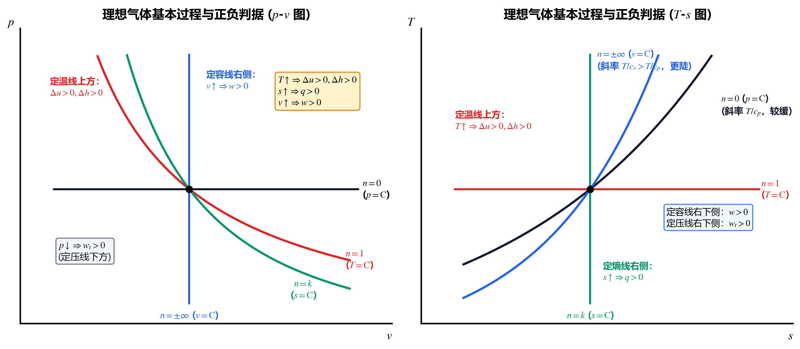
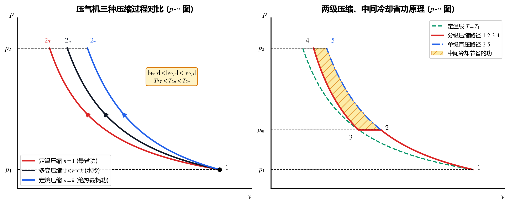

## 3.1 理想气体模型与状态方程

### 1. 理想气体（Ideal Gas）的微观假定与工程适用范围
* **微观假定**：① 分子本身不占体积（视为弹性质点）；② 分子之间除碰撞瞬间外无相互作用力（无内位能）。
* **工程适用条件**：处于**远离液化状态的低压、高温（或常温）**区域（即 $p \to 0, v \to \infty$）。
  * 在工程热力学中，常温或更高温度、压力低于 $5\text{ MPa}$ 下的双原子气体（如 **空气、$\text{O}_2$、$\text{N}_2$、$\text{CO}$、$\text{H}_2$**）以及燃气轮机中的烟气，均可直接作为理想气体处理，误差小于 $1\%$。
  * **不可当作理想气体的工质**：水蒸气（Steam，除极低压如大气中的水蒸气分压外）、制冷剂蒸汽（如 R134a）、高压二氧化碳等实际气体（必须查热力性质表或使用实际气体状态方程）。

### 2. 理想气体状态方程（Clapeyron 方程）的四种形式

| 质量/摩尔基准 | 状态方程形式 | 符号与单位说明 |
| :--- | :---: | :--- |
| **1. 单位质量（$1\text{ kg}$）** | $pv = R_g T$ | $v$：比体积 $[\text{m}^3/\text{kg}]$；$R_g$：气体常数 $[\text{J/(kg}\cdot\text{K)}]$ |
| **2. 任意质量（$m\text{ kg}$）** | $pV = m R_g T$ | $V = mv$：总体积 $[\text{m}^3]$ |
| **3. 单位摩尔（$1\text{ mol}$ 或 $1\text{ kmol}$）** | $p V_m = R T$ | $V_m = M v$：摩尔体积 $[\text{m}^3/\text{mol}$ 或 $\text{m}^3/\text{kmol}]$ |
| **4. 任意摩尔（$n\text{ mol}$ 或 $n\text{ kmol}$）** | $pV = n R T$ | $n = m / M$：物质的量 $[\text{mol}$ 或 $\text{kmol}]$ |

* **通用气体常数 $R$ 与气体常数 $R_g$ 的关系**：
  $$\boxed{R = 8.3145\text{ J/(mol}\cdot\text{K)} = 8.3145\text{ kJ/(kmol}\cdot\text{K)}, \qquad R_g = \frac{R}{M}}$$
  * **必记常数（干空气）**：空气平均摩尔质量 $M_{\text{air}} \approx 28.97\text{ kg/kmol}$，故空气的气体常数为：
    $$R_{g,\text{air}} = \frac{8.3145}{28.97} \approx 0.287\text{ kJ/(kg}\cdot\text{K)} = 287\text{ J/(kg}\cdot\text{K)}$$

---

## 3.2 比热容、迈耶公式与理想气体的 $\Delta u, \Delta h, \Delta s$

### 1. 比热容（Specific Heat）的概念辨析
* **一般定义**：单位物量的物体温度升高 $1\text{ K}$ 所吸收或放出的热量：
  $$c = \frac{\delta q}{\mathrm{d}T} \quad \left[\text{J/(kg}\cdot\text{K) 或 kJ/(kg}\cdot\text{K)}\right]$$
  由于热量 $\delta q$ 是过程量，所以**一般的比热容 $c$ 是过程量（随过程路径而变，取值可从 $-\infty$ 到 $+\infty$）**！
* **定容比热容 $c_v$ 与定压比热容 $c_p$**：一旦指定了过程为定容（$\mathrm{d}v = 0 \implies \delta q_v = \mathrm{d}u$）或定压（$\mathrm{d}p = 0 \implies \delta q_p = \mathrm{d}h$），比热容就完全由状态参数偏导数决定，**$c_v$ 和 $c_p$ 变成了纯粹的状态参数**：
  $$c_v \equiv \left(\frac{\partial u}{\partial T}\right)_v, \qquad c_p \equiv \left(\frac{\partial h}{\partial T}\right)_p$$

### 2. 理想气体的内能、焓与迈耶公式（Mayer's Formula）

因为理想气体的内能和焓**仅是温度 $T$ 的单值函数**（$u = f(T), h = F(T)$），偏导数直接退化为常微分！由此得到理想气体最核心的性质：

> [!IMPORTANT]
> **核心铁律：理想气体的 $\mathrm{d}u = c_v\,\mathrm{d}T$ 和 $\mathrm{d}h = c_p\,\mathrm{d}T$ 适用于【任何过程】！**
> 对于理想气体，无论经历的是定容、定压、定温、绝热、多变过程，甚至**无论是可逆过程还是向真空自由膨胀、节流等剧烈不可逆过程**，永远无条件成立：
> $$\boxed{\begin{aligned}
> \mathrm{d}u &= c_v\,\mathrm{d}T, \qquad \Delta u = u_2 - u_1 = \int_{T_1}^{T_2} c_v\,\mathrm{d}T \\
> \mathrm{d}h &= c_p\,\mathrm{d}T, \qquad \Delta h = h_2 - h_1 = \int_{T_1}^{T_2} c_p\,\mathrm{d}T
> \end{aligned}}$$
> * **常见误区纠偏**：“只有定容过程才能用 $\Delta u = c_v \Delta T$，只有定压过程才能用 $\Delta h = c_p \Delta T$”——**彻底错误**！只要是理想气体，$u$ 和 $h$ 只认初终态温度 $T_1, T_2$，与中间过程是否定容、定压毫无关系！

对 $h = u + pv = u + R_g T$ 两边对 $T$ 求导，即得**迈耶公式（Mayer's Formula）**与**比热容比（绝热指数 $k$）**关系式：
$$\boxed{c_p - c_v = R_g \quad (\text{摩尔形式：} C_{p,m} - C_{v,m} = R)}$$
$$\boxed{k \equiv \frac{c_p}{c_v}, \qquad c_v = \frac{R_g}{k - 1}, \qquad c_p = \frac{k R_g}{k - 1}}$$

### 3. 理想气体比熵变 $\Delta s$ 的三大通用公式
将 $\mathrm{d}u = c_v\,\mathrm{d}T$、$\mathrm{d}h = c_p\,\mathrm{d}T$ 和状态方程 $pv = R_g T$（取对数微分 $\frac{\mathrm{d}p}{p} + \frac{\mathrm{d}v}{v} = \frac{\mathrm{d}T}{T}$）代入热力学基本恒等式 $T\,\mathrm{d}s = \mathrm{d}u + p\,\mathrm{d}v = \mathrm{d}h - v\,\mathrm{d}p$，得到**理想气体比熵微分的三个等价恒等式**：

$$\boxed{\begin{aligned}
\mathrm{d}s &= c_v \frac{\mathrm{d}T}{T} + R_g \frac{\mathrm{d}v}{v} \qquad \text{（已知 } T, v \text{ 时用）} \\
\mathrm{d}s &= c_p \frac{\mathrm{d}T}{T} - R_g \frac{\mathrm{d}p}{p} \qquad \text{（已知 } T, p \text{ 时用，工程最常用！）} \\
\mathrm{d}s &= c_p \frac{\mathrm{d}v}{v} + c_v \frac{\mathrm{d}p}{p} \qquad \text{（已知 } p, v \text{ 时用）}
\end{aligned}}$$

> [!CAUTION]
> **适用条件注意**：因为熵 $s$ 是状态参数，上述三个 $\mathrm{d}s$（及其积分 $\Delta s$）公式**适用于理想气体的【任何可逆或不可逆过程】**！只要知道理想气体初、终平衡态的 $(T, v)$、$(T, p)$ 或 $(p, v)$，直接代入积分即可求出真实熵变 $\Delta s$。

---

## 3.3 具体方法：计算理想气体 $\Delta u, \Delta h, \Delta s$ 的三种工程方法

理想气体的比热容 $c_v(T), c_p(T)$ 随温度升高而增大（高温下分子振动自由度被激发）。根据精度要求，工程上有三种计算方法：

### 方法一：定比热容法（Constant Specific Heat，最常用）
当温度变化范围不大（如常温附近 $\Delta T < 200\text{ K}$）或做定性/常规计算时，将比热容视为常数。由气体分子运动论能量均分定理（分子自由度为 $i$），摩尔定容比热容为 $C_{v,m} = \frac{i}{2}R$：

| 气体分子类型 | 自由度 $i$ | $C_{v,m} = \frac{i}{2}R$ | $C_{p,m} = \frac{i+2}{2}R$ | 绝热指数 $k = \frac{i+2}{i}$ | 典型气体与空气常用定值 |
| :--- | :---: | :---: | :---: | :---: | :--- |
| **单原子气体** | $3$ | $\frac{3}{2}R \approx 12.47$ | $\frac{5}{2}R \approx 20.79$ | $1.67$ | $\text{He}, \text{Ar}, \text{Ne}$ |
| **双原子气体** | $5$ | $\frac{5}{2}R \approx 20.79$ | $\frac{7}{2}R \approx 29.10$ | **$1.40$** | **空气**：$c_p = 1.005\text{ kJ/(kg}\cdot\text{K)}$，$c_v = 0.718\text{ kJ/(kg}\cdot\text{K)}$ |
| **多原子气体** | $6$（或近似取 $7$） | $\frac{7}{2}R \approx 29.10$ | $\frac{9}{2}R \approx 37.42$ | **$1.29 \sim 1.33$** | $\text{CO}_2, \text{H}_2\text{O(g)}, \text{SO}_2, \text{CH}_4$ |

* **定比热下的积分计算公式**：
  $$\Delta u = c_v (T_2 - T_1), \qquad \Delta h = c_p (T_2 - T_1)$$
  $$\Delta s = c_v \ln\frac{T_2}{T_1} + R_g \ln\frac{v_2}{v_1} = c_p \ln\frac{T_2}{T_1} - R_g \ln\frac{p_2}{p_1} = c_p \ln\frac{v_2}{v_1} + c_v \ln\frac{p_2}{p_1}$$

### 方法二：真实比热容多项式积分法（True Specific Heat）
已知经验多项式 $c_p(T) = a_0 + a_1 T + a_2 T^2 + a_3 T^3 + \dots$，直接代入积分：
$$\Delta h = \int_{T_1}^{T_2} (a_0 + a_1 T + a_2 T^2 + \dots)\,\mathrm{d}T, \qquad \Delta s = \int_{T_1}^{T_2} \frac{c_p(T)}{T}\,\mathrm{d}T - R_g \ln\frac{p_2}{p_1}$$

### 方法三：平均比热容查表法（Mean Specific Heat）
工程手册通常给出从 $0^\circ\text{C}$ 到 $t^\circ\text{C}$ 的平均比热容 $c\big|_0^t$。计算任意两个摄氏温度 $t_1 \to t_2$ 之间的过程时，先按热量守恒折算 $t_1 \sim t_2$ 的平均比热容：
$$c\big|_{t_1}^{t_2} = \frac{c\big|_0^{t_2}\cdot t_2 - c\big|_0^{t_1}\cdot t_1}{t_2 - t_1} \quad \Longrightarrow \quad \Delta h = c_p\big|_{t_1}^{t_2}(t_2 - t_1) = c_p\big|_0^{t_2} t_2 - c_p\big|_0^{t_1} t_1$$
（或者直接查《理想气体热力性质表》，读取对应温度下的 $u(T), h(T), s^\circ(T)$，其中 $\Delta s = s^\circ(T_2) - s^\circ(T_1) - R_g \ln\frac{p_2}{p_1}$）。

---

## 3.4 理想气体的四大基本热力过程与多变过程（Polytropic Process）

工程上将理想气体的定容、定压、定温、定熵（可逆绝热）四个基本准静态过程，统一归纳为过程方程满足 **$pv^n = \text{const}$** 的 **多变过程（Polytropic Process）**，其中 $n$ 称为**多变指数**（$-\infty < n < +\infty$）。

### 1. 定熵过程方程 $pv^k = \text{const}$ 的三大前提条件

> [!CAUTION]
> **高频考点：何时才能写 $pv^k = \text{const}$ 及 $\frac{T_2}{T_1} = \left(\frac{v_1}{v_2}\right)^{k-1} = \left(\frac{p_2}{p_1}\right)^{\frac{k-1}{k}}$？**
> 该组公式绝不是对所有绝热过程都成立，它必须同时满足以下 **3 个严苛前提**：
> 1. **理想气体**（状态方程满足 $pv = R_g T$，内能/焓仅取决于温度）；
> 2. **可逆绝热过程（即定熵过程 $\mathrm{d}s = 0$）**（若为有摩擦的不可逆绝热过程，熵增加 $\Delta s > 0$，不满足 $pv^k = \text{const}$！）；
> 3. **定比热容（$k = c_p / c_v = \text{const}$）**（若比热随温度变化，$k$ 不是常数，此时定熵过程只能列 $\Delta s = \int_{T_1}^{T_2} c_p \frac{\mathrm{d}T}{T} - R_g \ln\frac{p_2}{p_1} = 0$ 求解）。

### 2. 四大基本过程与多变过程计算公式总表（定比热理想气体，准静态）

在多变过程 $pv^n = \text{const}$ 中，引入**多变比热容 $c_n$**：
$$\boxed{c_n \equiv \frac{\delta q}{\mathrm{d}T} = c_v \frac{n - k}{n - 1}}$$
所有的状态参数关系、功量和热量均可通过赋予 $n$ 特定值而一键导出：

| 过程名称 | 多变指数 $n$ | 过程特征与 $p, v, T$ 关系 | 容积变化功 $w = \int_1^2 p\,\mathrm{d}v$ | 技术功 $w_t = -\int_1^2 v\,\mathrm{d}p$ | 换热量 $q = \Delta u + w$ | 比熵变 $\Delta s$（定比热） |
| :--- | :---: | :---: | :---: | :---: | :---: | :---: |
| **多变过程** （通用母公式） | 任意 $n$ （$n \neq 1$） | $pv^n = \text{const}$ $\frac{T_2}{T_1} = \left(\frac{v_1}{v_2}\right)^{n-1} = \left(\frac{p_2}{p_1}\right)^{\frac{n-1}{n}}$ | $\frac{p_1 v_1 - p_2 v_2}{n - 1} = \frac{R_g(T_1 - T_2)}{n - 1}$ | $n w = \frac{n}{n-1}R_g(T_1 - T_2)$ | $c_n(T_2 - T_1) = \frac{n - k}{n - 1}c_v(T_2 - T_1)$ $= \frac{k - n}{k - 1} w$ | $c_n \ln\frac{T_2}{T_1} = c_v \frac{n-k}{n-1}\ln\frac{T_2}{T_1}$ |
| **1. 定压过程** （$p = \text{const}$） | $n = 0$ | $\frac{v_2}{v_1} = \frac{T_2}{T_1}$ | $p(v_2 - v_1) = R_g(T_2 - T_1)$ | $0$ | $\Delta h = c_p(T_2 - T_1)$ | $c_p \ln\frac{T_2}{T_1} = c_p \ln\frac{v_2}{v_1}$ |
| **2. 定温过程** （$T = \text{const}$） | $n = 1$ | $pv = \text{const}$ $\frac{p_2}{p_1} = \frac{v_1}{v_2}$ | $p_1 v_1 \ln\frac{v_2}{v_1} = R_g T \ln\frac{p_1}{p_2}$ | $w = R_g T \ln\frac{p_1}{p_2}$ （因 $\Delta(pv)=0$） | $w = T \Delta s = R_g T \ln\frac{v_2}{v_1}$ （因 $\Delta u = 0$） | $R_g \ln\frac{v_2}{v_1} = R_g \ln\frac{p_1}{p_2}$ |
| **3. 定熵过程** （$s = \text{const}$） | $n = k$ | $pv^k = \text{const}$ $\frac{T_2}{T_1} = \left(\frac{v_1}{v_2}\right)^{k-1} = \left(\frac{p_2}{p_1}\right)^{\frac{k-1}{k}}$ | $-\Delta u = c_v(T_1 - T_2)$ $= \frac{R_g(T_1 - T_2)}{k - 1}$ | $-\Delta h = k w = c_p(T_1 - T_2)$ $= \frac{k R_g(T_1 - T_2)}{k - 1}$ | $0$ | $0$ |
| **4. 定容过程** （$v = \text{const}$） | $n = \pm\infty$ | $\frac{p_2}{p_1} = \frac{T_2}{T_1}$ | $0$ | $v(p_1 - p_2) = R_g(T_1 - T_2)$ | $\Delta u = c_v(T_2 - T_1)$ | $c_v \ln\frac{T_2}{T_1} = c_v \ln\frac{p_2}{p_1}$ |

> [!TIP]
> **多变过程的三个秒杀级结论**
> 1. **技术功与容积功的倍数关系**：对任意理想气体多变过程，恒有 $\Delta(pv) = R_g(T_2 - T_1) = -(n-1)w$，因此：
>    $$\boxed{w_t = n \cdot w}$$
>    （特别地：定温过程 $n=1 \implies w_t = w$；定熵过程 $n=k \implies w_t = k w$；定压过程 $n=0 \implies w_t = 0$）。
> 2. **热量与功量的比例关系**：
>    $$\boxed{q = \frac{k - n}{k - 1} w = \frac{k - n}{n(k - 1)} w_t}$$
> 3. **“负比热容”区间（$1 < n < k$）**：
>    当多变指数 $1 < n < k$ 时，$c_n = c_v \frac{n - k}{n - 1} < 0$！这意味着：**气体吸热（$q > 0$）时温度反而降低（$\Delta T < 0$）**（因为剧烈膨胀对外做功 $w > q$，透支了自身内能）；反之，在气缸水冷压气机中（$1 < n < k$），**气体被压缩边放热（$q < 0$）温度却依然升高（$\Delta T > 0$）**（因为输入的压缩功大于散热量）。

---

## 3.5 具体方法：$p\text{-}v$ 图与 $T\text{-}s$ 图的定性绘图与“四象限判据”

在考试与工程分析中，经常要求在 $p\text{-}v$ 图和 $T\text{-}s$ 图上画出各基本过程的相对位置，并判断任意过程的 $\Delta u, \Delta h, w, w_t, q$ 的正负。掌握以下两步法即可百发百中：

### 第一步：掌握过程曲线的斜率对比规律

1. **在 $p\text{-}v$ 图上（对比定温线 $n=1$ 与定熵线 $n=k$）**：
   对 $pv^n = \text{const}$ 求导得曲线斜率：
   $$\left(\frac{\mathrm{d}p}{\mathrm{d}v}\right)_n = -n \frac{p}{v} \quad \Longrightarrow \quad \begin{cases} \text{定温线 }(n=1): & \left(\dfrac{\mathrm{d}p}{\mathrm{d}v}\right)_T = -\dfrac{p}{v} \\[8pt] \text{定熵线 }(n=k): & \left(\dfrac{\mathrm{d}p}{\mathrm{d}v}\right)_s = -k\dfrac{p}{v} \end{cases}$$
   * **结论**：因为 $k > 1$，所以在 $p\text{-}v$ 图的同一点上，**定熵线（绝热线）比定温线更陡峭**！沿顺时针方向，多变指数 $n$ 从定压线（水平 $n=0$）$\to$ 定温线（$n=1$）$\to$ 定熵线（$n=k$）$\to$ 定容线（竖直 $n=\pm\infty$）依次增大。

2. **在 $T\text{-}s$ 图上（对比定压线 $p=\text{C}$ 与定容线 $v=\text{C}$）**：
   分别令 $\mathrm{d}p = 0$ 和 $\mathrm{d}v = 0$ 代入 $\mathrm{d}s$ 公式求斜率：
   $$\begin{cases} \text{定压线 }(p=\text{C}, n=0): & \left(\dfrac{\mathrm{d}T}{\mathrm{d}s}\right)_p = \dfrac{T}{c_p} \\[8pt] \text{定容线 }(v=\text{C}, n=\pm\infty): & \left(\dfrac{\mathrm{d}T}{\mathrm{d}s}\right)_v = \dfrac{T}{c_v} \end{cases}$$
   * **结论**：因为 $c_p > c_v > 0$，所以在 $T\text{-}s$ 图上，定压线与定容线都是向右上方弯曲的指数上升曲线，且在同一点上 **定容线比定压线更陡峭**！（定温线为水平线 $n=1$，定熵线为竖直线 $n=k$）。

### 第二步：过初态点画四条基本线——“四象限趋势判据”

> [!IMPORTANT]
> **判断任意可逆过程正负号的“四条分界线法则”**
> 过初态点 $1$ 画出 **定压（$p=\text{C}$）、定容（$v=\text{C}$）、定温（$T=\text{C}$）、定熵（$s=\text{C}$）** 四条基准线，它们把平面划分为多个扇区。任意过程 $1 \to 2$ 的能量正负完全取决于终态点 $2$ 落在哪条分界线的哪一侧：
> 1. **内能与焓变（$\Delta u, \Delta h$）看【定温线 $T=\text{C}$】**：
>    * 终态在 $T=\text{C}$ 线的高温侧（$T \uparrow$） $\Longleftrightarrow \Delta u > 0, \Delta h > 0$；反之 $\Delta u < 0, \Delta h < 0$。
> 2. **容积变化功（$w$）看【定容线 $v=\text{C}$】**：
>    * 终态在 $v=\text{C}$ 线的大比体积侧（膨胀 $v \uparrow$） $\Longleftrightarrow w > 0$（对外做功）；反之压缩 $w < 0$。
> 3. **技术功（$w_t$）看【定压线 $p=\text{C}$】**：
>    * 终态在 $p=\text{C}$ 线的低压侧（降压 $p \downarrow$） $\Longleftrightarrow w_t > 0$（输出技术功）；反之升压 $w_t < 0$。
> 4. **换热量（$q$）看【定熵线 $s=\text{C}$】**：
>    * 终态在 $s=\text{C}$ 线的大熵侧（熵增 $s \uparrow$） $\Longleftrightarrow q > 0$（过程吸热）；反之熵减 $q < 0$（过程放热）。

### 典型例题：多变过程参数求解与图像区域定位

**【题目】** $1\text{ kg}$ 空气经历某多变过程，对外做容积功 $w = 300\text{ kJ/kg}$。若过程中分别向空气供热：（1）$q_1 = 380\text{ kJ/kg}$；（2）$q_2 = 210\text{ kJ/kg}$。已知空气 $c_v = 0.717\text{ kJ/(kg}\cdot\text{K)}$，$R_g = 0.287\text{ kJ/(kg}\cdot\text{K)}$。试求两种情况下的内能变化 $\Delta u$、温度变化 $\Delta T$、多变指数 $n$，并指出过程曲线在 $p\text{-}v$ 图和 $T\text{-}s$ 图上位于哪两条基准线之间。

**【解答】**
1. **利用第一定律求内能变化 $\Delta u$ 与温差 $\Delta T$**：
   * 情况（1）：$\Delta u_1 = q_1 - w = 380 - 300 = +80\text{ kJ/kg} > 0 \implies \Delta T_1 = \frac{\Delta u_1}{c_v} = \frac{80}{0.717} = +111.6\text{ K}$（膨胀吸热且升温）；
   * 情况（2）：$\Delta u_2 = q_2 - w = 210 - 300 = -90\text{ kJ/kg} < 0 \implies \Delta T_2 = \frac{\Delta u_2}{c_v} = \frac{-90}{0.717} = -125.5\text{ K}$（虽然吸热 $q_2 > 0$，但因对外做功 $w > q_2$，温度反而下降！）。
2. **求多变指数 $n$**：
   由 $w = \frac{R_g(T_1 - T_2)}{n - 1} = -\frac{R_g \Delta T}{n - 1} = -\frac{R_g \Delta u}{(n - 1)c_v}$，解得通用公式：
   $$n = 1 - \frac{R_g \Delta u}{w c_v} = 1 - (k - 1)\frac{\Delta u}{w}$$
   * 情况（1）：$n_1 = 1 - \frac{0.287 \times 80}{300 \times 0.717} = 0.89$。因为 $0 < n_1 < 1$ 且膨胀（$v \uparrow$），过程线位于**定压膨胀线（$n=0$）与定温膨胀线（$n=1$）之间**。
   * 情况（2）：$n_2 = 1 - \frac{0.287 \times (-90)}{300 \times 0.717} = 1.12$。因为 $1 < n_2 < k=1.4$ 且膨胀（$v \uparrow$），过程线位于**定温膨胀线（$n=1$）与定熵膨胀线（$n=k$）之间**（正处于负比热容区间 $1 < n < k$，故边吸热边降温）。

---

## 3.6 活塞式压气机的压缩过程分析（单级与多级中间冷却）

压气机是消耗轴功将低压气体（$p_1, T_1$）升压至高压（$p_2$）的开口系设备。一个完整的往复工作循环包括 **吸气 $0\text{-}1$ $\to$ 压缩 $1\text{-}2$ $\to$ 排气 $2\text{-}3$**，其消耗的单位质量轴功严格等于压缩过程 $1\text{-}2$ 的**技术功 $w_t = -\int_1^2 v\,\mathrm{d}p$**（即 $p\text{-}v$ 图上过程线向纵轴 $p$ 轴投影的面积）。

### 1. 三种典型压缩路径的耗功与终温对比
要将气体从同一初态 $(p_1, T_1)$ 压缩到相同的终压 $p_2$，工程上存在三种典型过程：
1. **定温压缩（$n = 1$，理想极限）**：气缸冷却极其完美，压缩热瞬间全部散出，$T_{2T} = T_1$；
2. **多变压缩（$1 < n < k$，水冷气缸实际过程）**：气缸外有水套或散热片冷却，散出部分热量；
3. **定熵压缩（$n = k$，绝热不冷却）**：气缸完全不冷却或压缩极快，热量全部留在气体内。

在 $p\text{-}v$ 图上画出从点 $1$ 出发的三条压缩曲线（斜率依次变陡），向纵轴 $p$ 投影比较面积，立即得出：

> [!IMPORTANT]
> **压气机三种压缩过程的核心结论**
> 1. **耗功大小关系（定温压缩最省功，绝热压缩最耗功）**：
>    $$\boxed{|w_{t,T}| < |w_{t,n}| < |w_{t,s}|}$$
> 2. **排气终温关系（定温压缩终温最低，绝热压缩终温最高）**：
>    $$\boxed{T_{2T} (= T_1) < T_{2n} < T_{2s}}$$
> 3. **压气机耗功计算公式**（注意代入计算时 $p_2 > p_1$，$w_t < 0$ 表示外界输入功）：
>    * **定温压缩耗功（$n=1$）**：
>      $$w_{t,T} = R_g T_1 \ln\frac{p_1}{p_2} < 0$$
>    * **多变压缩耗功（$1 < n < k$）**：
>      $$w_{t,n} = \frac{n}{n - 1} R_g (T_1 - T_2) = \frac{n}{n - 1} R_g T_1 \left[1 - \left(\frac{p_2}{p_1}\right)^{\frac{n-1}{n}}\right] < 0$$
>    * **定熵压缩耗功（$n=k$）**：
>      $$w_{t,s} = \frac{k}{k - 1} R_g (T_1 - T_2) = \frac{k}{k - 1} R_g T_1 \left[1 - \left(\frac{p_2}{p_1}\right)^{\frac{k-1}{k}}\right] < 0$$

### 2. 工程改进措施：分级压缩、中间冷却（Multi-Stage Compression with Intercooling）
当需要的增压比 $p_2 / p_1$ 很高时，若采用单级压缩：
* 一方面过程曲线远离定温线，**耗功极大**；
* 另一方面排气温度 $T_2 = T_1 (p_2/p_1)^{\frac{n-1}{n}}$ 会急剧升高，**导致气缸内润滑油碳化变质甚至引发油气爆炸**（工程上要求空气终温一般不超过 $140 \sim 160^\circ\text{C}$）。

**解决方案**：采用 **多级压缩 + 级间中间冷却器（Intercooler）**（通常为 $2 \sim 4$ 级）：
1. 第一级将气体从 $p_1$ 多变压缩至中间压力 $p_{\text{m}}$；
2. 送入定压中间冷却器，定压冷却使气体温度重新降回初温 $T_1$（比体积大幅缩小，状态点回到定温线上！）；
3. 再进入第二级气缸从 $p_{\text{m}}$ 压缩至终压 $p_2$。
* **两大工程收益**：① **显著降低最高排气温度**，保障润滑安全；② **大幅节省压缩机耗功**（在 $p\text{-}v$ 图上，节省的功恰好等于中间冷却缩回定温线所削去的那块阴影面积；当各级增压比相等且冷却回初温 $T_1$ 时，总耗功最小，且各级耗功相等）。

