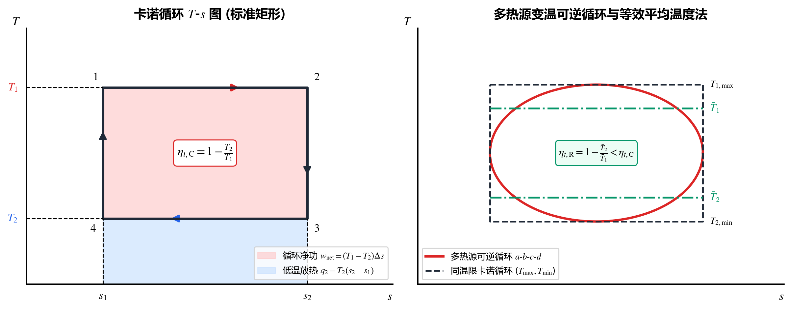
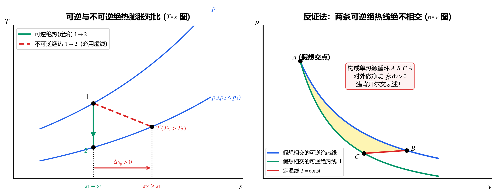

## 4.1 热力学第二定律的实质与两大经典表述

### 1. 自发过程的方向性与第一定律的局限
热力学第一定律只指出了能量转换在**数量上的守恒关系**，但无法判断一个满足能量守恒的过程在自然界中**能否自发进行**。大量自然现象表明，一切自发过程都具有明确的**方向性（不可逆性）**：
* **传热**：热量总是自发地从高温物体传向低温物体，绝不会自发反流；
* **功热转换**：机械功可以通过摩擦、电阻**$100\%$ 无条件地全部转化为热**；但热能却无法无条件地 $100\%$ 转化为机械功；
* **膨胀与混合**：气体向真空自发自由膨胀、不同气体自发均匀混合，绝不会自发收缩或分离。

### 2. 热力学第二定律的两大经典表述

| 表述名称 | 严格表述内容 | 工程意义与否定对象 |
| :--- | :--- | :--- |
| **1. 开尔文-普朗克表述** （Kelvin-Planck, 1851， 从**功热转换**角度） | **不可能从单一热源取热，并使之完全转变为有用功而不产生其他任何影响。** | 1. 宣判**第二类永动机（单热源热机，$\eta_t = 100\%$）**绝对不可能制造成功（尽管它完全不违背第一定律！）。 2. 持续对外做功的热机（循环）**至少需要两个不同温度的热源**（高温热源吸热 $Q_1$，必须向低温冷源排热 $Q_2 > 0$），因此热机热效率恒有：$$\eta_t = \frac{W_{\text{net}}}{Q_1} = 1 - \frac{Q_2}{Q_1} < 100\%$$ |
| **2. 克劳修斯表述** （Clausius, 1850， 从**热量传递方向**角度） | **不可能把热量从低温物体传到高温物体而不引起其他变化。** | 热量从低温移向高温（制冷机/热泵）绝不可能自发进行，**必须由外界输入机械功/电能（$W_{\text{in}} > 0$）**作为代价。 |

> [!IMPORTANT]
> **辨析陷阱：“理想气体定温膨胀过程吸热全部转化为功（$q = w$），是否违背开尔文表述？”**
> **绝不违背！** 开尔文表述中有极其关键的限定词——**“不产生其他任何影响”**。理想气体定温膨胀虽然只从单一恒温热源吸热并 $100\%$ 转化为膨胀功 $w$，但膨胀结束后**气体的比体积变大了、压力降低了（系统自身状态发生了改变，留下了“其他影响”）**，且无法持续循环做功。若要让气体回到初态形成循环热机，在压缩回原状时就必须向低温热源放热！

### 3. 具体方法：两大表述等价性的“反证法”证明套路
开尔文表述与克劳修斯表述完全等价（违背其一必违背其二）。热力学第二定律的所有核心定理（包括卡诺定理、绝热线不相交等）均采用同一套 **反证法（Proof by Contradiction）** 逻辑：
1. **证“违背克劳修斯 $\implies$ 必违背开尔文”**：假设存在一台不耗功就能把热量 $Q_2$ 从低温 $T_2$ 传到高温 $T_1$ 的“克氏假想机”。让它与一台在 $T_1, T_2$ 间正常工作的热机（吸热 $Q_1$、向 $T_2$ 放热 $Q_2$、输出功 $W = Q_1 - Q_2$）组成复合系统。此时低温热源 $T_2$ 收支恰好抵消，复合系统变成了**只从单一高温热源 $T_1$ 净吸热 $(Q_1 - Q_2)$ 并全部转化为功 $W$ 的单热源热机**，直接违背开尔文表述！
2. **证“违背开尔文 $\implies$ 必违背克劳修斯”**：假设存在一台从高温 $T_1$ 吸热 $Q_1$ 全部转化为功 $W = Q_1$ 的“开氏假想热机”。用它输出的功 $W$ 直接驱动一台正常制冷机（从低温 $T_2$ 吸热 $Q_2$，向高温 $T_1$ 放热 $Q_1 + Q_2$）。将两者打包为复合系统，净效果是**外界未输入任何功，热量 $Q_2$ 却自动从低温 $T_2$ 转移到了高温 $T_1$**，直接违背克劳修斯表述！

### 4. 热力学第二定律的本质：能量的品质与贬质
不同形式的能量不仅有“数量”之分，更有**“品质（品位/做功能力）”的高低之分**：
* **最高品位能量**：机械能、电能、水能（可 $100\%$ 转化为任何其他形式能量）；
* **低品位能量**：热能（受环境温度 $T_0$ 限制，只有一部分能转化为功，且温度越接近环境温度品位越低）。
* **能量贬质原理**：在一切不可逆自发过程（如温差传热、摩擦耗散、节流）中，虽然能量的总数量守恒，但**能量的品质必然发生不可逆的降阶（贬质），系统的做功能力遭受永久损失**。

---

## 4.2 卡诺循环（Carnot Cycle）与卡诺定理

### 1. 卡诺循环的构成与热效率
法国工程师卡诺（Sadi Carnot, 1824）提出工作在两个恒温热源（高温热源 $T_1$、低温冷源 $T_2$）之间的理想可逆循环。
* **为什么卡诺循环必须由“两个定温过程 + 两个定熵（可逆绝热）过程”组成？**
  要使循环完全可逆，工质与恒温热源 $T_1, T_2$ 传热时**绝不能有温差**，故吸热过程 $1\text{-}2$（$T_1 = \text{const}$）和放热过程 $3\text{-}4$（$T_2 = \text{const}$）必须是**可逆定温过程**；而在不与热源接触的升降温阶段（$2\text{-}3$ 膨胀降温、$4\text{-}1$ 压缩升温），必须不传热且无耗散，故必须是**可逆绝热（定熵）过程**！
* **卡诺循环在 $T\text{-}s$ 图上的几何形状**：一个标准**矩形**！
  * 吸热量：$q_1 = T_1 (s_2 - s_1)$；
  * 放热量：$q_2 = T_2 (s_2 - s_1)$；
  * 循环净功：$w_{\text{net}} = q_1 - q_2 = (T_1 - T_2)(s_2 - s_1)$（即矩形面积）。

$$\boxed{\begin{aligned}
\text{卡诺正循环（热机）热效率：} \quad \eta_{t,\text{C}} &= 1 - \frac{q_2}{q_1} = 1 - \frac{T_2}{T_1} \\
\text{逆卡诺制冷循环制冷系数：} \quad \varepsilon_{\text{C}} &= \frac{q_2}{w_{\text{in}}} = \frac{T_2}{T_1 - T_2} \\
\text{逆卡诺热泵循环供热系数：} \quad \varepsilon'_{\text{C}} &= \frac{q_1}{w_{\text{in}}} = \frac{T_1}{T_1 - T_2} = \varepsilon_{\text{C}} + 1
\end{aligned}}$$

> [!IMPORTANT]
> **卡诺循环效率的三大核心推论**
> 1. $\eta_{t,\text{C}} = 1 - \frac{T_2}{T_1}$ **仅仅取决于高温热源温度 $T_1$ 和低温冷源温度 $T_2$，与采用什么工质毫无关系**！
> 2. **提高热效率的根本工程方向**：**提高吸热初温 $T_1$**（受限于耐热材料极限，如燃气轮机叶片冷却技术）和 **降低排热终温 $T_2$**（受限于自然环境温度 $T_0$，如火电厂凝汽器抽真空降温）。
> 3. 因为现实中不可能存在 $T_1 \to \infty$ 或绝对零度冷源 $T_2 = 0\text{ K}$，所以卡诺效率永远 $\eta_{t,\text{C}} < 100\%$。

### 2. 卡诺定理（Carnot's Theorem）及其推论
* **定理一**：在相同的高温热源 $T_1$ 和相同的低温热源 $T_2$ 之间工作的一切**可逆热机**，其热效率都相等，皆等于卡诺循环热效率：
  $$\eta_{t,\text{R}} = \eta_{t,\text{C}} = 1 - \frac{T_2}{T_1}$$
* **定理二**：在相同的高温热源 $T_1$ 和低温热源 $T_2$ 之间工作的任何**不可逆热机**，其热效率必然小于可逆热机的热效率：
  $$\eta_{t,\text{IR}} < \eta_{t,\text{R}} = 1 - \frac{T_2}{T_1}$$

> [!TIP]
> **具体方法：用反证法证明热力学命题的三大经典范例**
> 1. **证明卡诺定理（$\eta_{t,\text{IR}} \le \eta_{t,\text{R}}$）**：假设不可逆热机 $\text{IR}$ 效率高于可逆热机 $\text{R}$（$\eta_{\text{IR}} > \eta_{\text{R}}$）。令两者从 $T_1$ 吸收相同的热量 $Q_1$，则 $W_{\text{IR}} > W_{\text{R}}$。将可逆热机 $\text{R}$ **逆向运行**变成可逆制冷机，并用 $\text{IR}$ 输出的功驱动它。此时高温热源 $T_1$ 一吸一放恰好抵消，复合机器变成了**仅从单一低温冷源 $T_2$ 净吸热并对外输出净正功 $\Delta W = W_{\text{IR}} - W_{\text{R}} > 0$ 的第二类永动机**，违背开尔文表述！
> 2. **证明“两条可逆绝热线（定熵线）绝不可能相交”**：假设两条可逆绝热线在点 $A$ 相交，则可再画一条定温线 $T = \text{const}$ 与这两条绝热线分别交于 $B, C$ 两点，从而构成一个由“两条绝热线 + 一条定温线”围成的循环 $A\text{-}B\text{-}C\text{-}A$。该循环在 $p\text{-}v$ 图上围成非零面积（对外做净功 $W > 0$），但却**只与单一恒温热源 $T$ 交换热量**，违背开尔文表述！
> 3. **证明“一条定温线与一条可逆绝热线不可能相交两次”**：若相交两次，两点间将围成单热源做功循环，同样违背开尔文表述。

### 3. 多热源（变温热源）可逆热机与“等效卡诺循环平均温度法”
若一个可逆循环在吸热过程中温度随热量变化（与一系列不同温度的热源接触，最高温度为 $T_{1,\max}$），放热过程温度也变化（最低温度为 $T_{2,\min}$），如何求其热效率并比较大小？
* **具体方法（平均温度法）**：在 $T\text{-}s$ 图上，按“面积相等（即吸/放热量相等）且熵变跨度 $\Delta s$ 相同”的原则，定义吸热过程与放热过程的**热力学平均温度** $\bar{T}_1, \bar{T}_2$：
  $$\bar{T}_1 = \frac{q_1}{\Delta s_1} < T_{1,\max}, \qquad \bar{T}_2 = \frac{q_2}{\Delta s_2} > T_{2,\min}$$
* **多热源可逆热机的热效率**：
  $$\boxed{\eta_{t,\text{R多}} = 1 - \frac{\bar{T}_2}{\bar{T}_1} < 1 - \frac{T_{2,\min}}{T_{1,\max}} = \eta_{t,\text{C}}}$$
  **核心结论**：在相同最高温限 $T_{\max}$ 与最低温限 $T_{\min}$ 之间，任何多热源变温可逆循环的热效率，**必然小于**工作在极端温限 $T_{\max}, T_{\min}$ 之间的卡诺循环热效率！（除非采用**完全回热构成的概括性卡诺循环**——即让两个多变指数相同 $n$ 的变温过程在系统内部完全等温差回热，只在 $T_1, T_2$ 定温过程与外界换热，此时效率恢复为 $\eta_t = 1 - T_2/T_1$）。

---

## 4.3 克劳修斯不等式、熵流与熵产

### 1. 克劳修斯不等式（Clausius Inequality, 1865）——针对【循环】
任意工作在若干热源（热源温度为 $T_i$ 或连续热源温度 $T_r$）下的循环，其微元换热量 $\delta Q$ 与热源温度 $T$ 之比的循环积分恒满足：

$$\boxed{\oint \frac{\delta Q}{T} \le 0 \quad \begin{cases} = 0, & \text{可逆循环（Reversible Cycle）} \\ < 0, & \text{不可逆循环（Irreversible Cycle）} \\ > 0, & \text{不可能实现的循环（违背第二定律）} \end{cases}}$$

> [!CAUTION]
> **符号铁律**：在计算克劳修斯积分 $\oint \frac{\delta Q}{T} = \sum \frac{Q_i}{T_i}$ 时，**必须以工质（循环系统）为基准确定 $Q_i$ 的正负**——工质从高温热源吸热 $Q_1 > 0$，向低温冷源放热 $Q_2 < 0$！即：
> $$\text{热机循环：}\quad \frac{|Q_1|}{T_1} - \frac{|Q_2|}{T_2} \le 0, \qquad \text{制冷循环：}\quad \frac{|Q_2|}{T_2} - \frac{|Q_1|}{T_1} \le 0$$

### 2. 任意过程的熵不等式、熵流（$S_f$）与熵产（$S_g$）——针对【过程】
由克劳修斯不等式可严格导出：连接平衡态 $1$ 和 $2$ 的任意过程（可逆或不可逆），系统状态参数熵的变化量 $\Delta S = S_2 - S_1$ 恒满足：
$$\boxed{\mathrm{d}S \ge \frac{\delta Q}{T_r}, \qquad \Delta S_{12} = S_2 - S_1 \ge \int_1^2 \frac{\delta Q}{T_r}}$$
（等号对应可逆过程，严格大于号对应不可逆过程）。为了把不等式化为等式，引入 **熵流（Entropy Flow，$\mathrm{d}S_f$）** 与 **熵产（Entropy Generation，$\mathrm{d}S_g$）**：

$$\boxed{\mathrm{d}S = \mathrm{d}S_f + \mathrm{d}S_g, \qquad \Delta S = \Delta S_f + \Delta S_g}$$

| 物理量 | 定义表达式 | 函数性质 | 取值正负与物理意义 |
| :--- | :---: | :---: | :--- |
| **系统熵变 $\Delta S$** | $S_2 - S_1 = \int_{1\text{ (可逆)}}^2 \frac{\delta Q_{\text{rev}}}{T}$ | **状态参数差** （只取决于初终态） | 可正、可负、可为零。 |
| **熵流 $\Delta S_f$** | $\int_1^2 \frac{\delta Q}{T_r}$ | **过程量** （伴随热流跨越边界） | **由传热方向唯一决定**： • 吸热（$\delta Q > 0$）$\implies \mathrm{d}S_f > 0$； • 放热（$\delta Q < 0$）$\implies \mathrm{d}S_f < 0$； • **绝热（$\delta Q = 0$）$\implies \mathrm{d}S_f = 0$（绝热无熵流！）**。 |
| **熵产 $\Delta S_g$** | $\Delta S - \Delta S_f$ | **过程量** （内部不可逆性产生） | **永远非负（$\Delta S_g \ge 0$）**！ • 可逆过程：$\Delta S_g = 0$； • 不可逆过程：$\Delta S_g > 0$（定量度量不可逆程度）。 |

> [!WARNING]
> **高频判断题陷阱辨析（关于绝热过程与定熵过程）**
> 1. $\text{可逆} + \text{绝热} \implies \text{必然是定熵过程（}\mathrm{d}S = 0 + 0 = 0\text{）}$；
> 2. $\text{不可逆} + \text{绝热} \implies \text{必然是熵增过程（}\mathrm{d}S_f = 0, \mathrm{d}S_g > 0 \implies \Delta S = \Delta S_g > 0\text{）}$！因此，**绝热过程不一定是定熵过程**（只有可逆绝热才是定熵）！
> 3. **“初终态熵相等（$\Delta S = 0$）的过程就一定是可逆绝热过程吗？”—— 错！** 若系统在不可逆过程中存在内部耗散（熵产 $\Delta S_g > 0$），同时又向外界散热（负熵流 $\Delta S_f < 0$），只要散走的熵流恰好抵消了内部产生的熵产（$\Delta S_f + \Delta S_g = 0$），系统完全可以做到在**不可逆且非绝热**的条件下实现 $\Delta S = 0$！

---

## 4.4 具体方法：四类热力对象的熵变 $\Delta S$ 计算模型

> [!TIP]
> **计算熵变 $\Delta S$ 的最高准则：“移花接木，虚构可逆路径”**
> 哪怕实际过程是极其剧烈的不可逆过程（如自由膨胀、节流、温差混合、摩擦冲击），由于 **熵 $S$ 是状态参数，其变化量 $\Delta S = S_2 - S_1$ 与中间路径完全无关**！
> 因此，计算任何不可逆过程的系统熵变时，**绝对不能把不可逆过程的真实热量代入 $\int \frac{\delta Q}{T}$**，而是只需确定系统的初态 $(p_1, T_1, v_1)$ 和终态 $(p_2, T_2, v_2)$，然后**人为虚构一条连接初终态的任意可逆路径**，直接套用以下四类标准公式：

### 1. 理想气体（质量为 $m$，定比热）
无论经历何种可逆或不可逆过程，直接根据已知的初终态参数三选一：
$$\begin{aligned}
\Delta S_{\text{gas}} &= m \left(c_v \ln\frac{T_2}{T_1} + R_g \ln\frac{v_2}{v_1}\right) \\
&= m \left(c_p \ln\frac{T_2}{T_1} - R_g \ln\frac{p_2}{p_1}\right) \\
&= m \left(c_p \ln\frac{v_2}{v_1} + c_v \ln\frac{p_2}{p_1}\right)
\end{aligned}$$

### 2. 固体与不可压缩液体（质量为 $m$，比热容 $c_p \approx c_v = c$）
固体和液体比体积几乎不变（$\mathrm{d}v \approx 0$），温度从 $T_1$ 变为 $T_2$ 时：
$$\boxed{\Delta S_{\text{solid/liq}} = \int_{T_1}^{T_2} \frac{m c\,\mathrm{d}T}{T} = m c \ln\frac{T_2}{T_1}}$$

### 3. 恒温热源（Thermal Reservoir，温度恒为 $T_r$，如大气环境、海洋、大恒温槽）
恒温热源热容量无穷大，吸收或放出有限热量 $Q_r$ 时自身温度 $T_r$ 保持不变，且内部无耗散，可视为内部可逆定温过程：
$$\boxed{\Delta S_r = \frac{Q_r}{T_r}}$$
* **符号注意**：此处 $Q_r$ 是**以恒温热源自身为研究对象**的热量！若系统向环境放热 $|Q|$，则环境**吸热**，$Q_r = +|Q| > 0 \implies \Delta S_r = +\frac{|Q|}{T_r} > 0$；若系统从热源吸热 $|Q|$，则热源**放热**，$Q_r = -|Q| < 0 \implies \Delta S_r = -\frac{|Q|}{T_r} < 0$。

### 4. 纯机械功源（Work Reservoir，如升降重物、理想无摩擦弹簧、飞轮）
功源只与系统交换有序的机械功，不交换热量（$\delta Q = 0$）且无内部耗散（$\delta S_g = 0$），因此**纯功源的熵变恒为零**：
$$\boxed{\Delta S_{\text{work}} = 0}$$

---

## 4.5 孤立系熵增原理与作功能力损失（Gouy-Stodola 定理）

### 1. 孤立系统熵增原理（Principle of Entropy Increase）
将所研究的系统与所有与之发生热、功交换的相关外界（热源、冷源、功源）打包成一个**孤立系统**。因为孤立系边界绝热（$\Delta S_{f,\text{iso}} = 0$），故孤立系的总熵变严格等于内部的总熵产 $\Delta S_g$：

$$\boxed{\Delta S_{\text{iso}} = \Delta S_{\text{sys}} + \Delta S_{\text{surr}} = \Delta S_g \ge 0 \quad \begin{cases} = 0, & \text{可逆过程} \\ > 0, & \text{不可逆（自发）过程} \\ < 0, & \text{不可能发生的过程} \end{cases}}$$

> [!IMPORTANT]
> **核心辨析：“熵增原理”只对【孤立系】或【绝热闭口系】成立！**
> 一个普通的非绝热闭口系（如一杯热水向空气自然冷却变成冷水），其自身的熵变是**负值（$\Delta S_{\text{水}} < 0$，熵减！）**。但这绝不违背熵增原理，因为周围空气吸收了热量，空气的熵增 $\Delta S_{\text{air}} = \frac{|Q|}{T_0}$ 大于水减少的熵 $|\Delta S_{\text{水}}|$，把“水 + 空气”合成孤立系后，总熵变 $\Delta S_{\text{iso}} = \Delta S_{\text{水}} + \Delta S_{\text{air}} > 0$！

### 2. 作功能力损失（Irreversibility / Loss of Work Potential，$I$ 或 $\pi$）
系统在环境温度为 $T_0$ 的条件下经历不可逆过程时，由于孤立系产生了熵增 $\Delta S_{\text{iso}} = \Delta S_g > 0$，导致系统对外做出的最大有用功比完全可逆过程减少了，这一永久损失的最大有用功称为**作功能力损失（$\pi$ 或 $I$）**：

$$\boxed{\pi = W_{\max,\text{R}} - W_{\text{IR}} = T_0 \Delta S_{\text{iso}} = T_0 \Delta S_g \ge 0}$$

* **工程节能核心指导原则——能量的梯级利用（Cascade Utilization of Energy）**：
  因为作功能力损失与孤立系熵增成正比（$\pi = T_0 \Delta S_g$），而有限温差传热的熵产为 $\Delta S_g = Q\left(\frac{1}{T_{\text{低}}} - \frac{1}{T_{\text{高}}}\right)$——**传热温差越大，熵产越大，作功能力损失越惨重**！
  因此，绝不能把高温燃气（$1500^\circ\text{C}$）直接用来烧几十度的采暖热水（这属于“高品位热能直接降阶贱用”），而应实行**热电联产、燃气-蒸汽联合循环**：先让高温燃气在燃气轮机中做功，排出的中温余热再产生蒸汽推汽轮机，最后的低温乏汽余热再用于居民供暖，从而将传热温差与熵产 $\Delta S_g$ 压到最低。

---

## 4.6 典型例题精讲：第二定律与熵增原理的四大实战场景

### 典型例题 1：可逆定温膨胀 vs 绝热自由膨胀的对比（经典必考）

**【题目】** 质量为 $m$ 的理想气体从同一初态 $(T_1, V_1)$ 膨胀到终态体积 $V_2 = 2V_1$，分别经历以下两个过程：
* **过程 A**：与恒温热源 $T_1$ 接触，进行**可逆定温膨胀**；
* **过程 B**：隔板抽去，在绝热刚性容器内向真空进行**不可逆自由膨胀**。
试分别求两个过程中：（1）气体自身的熵变 $\Delta S_{\text{gas}}$；（2）外界（热源）的熵变 $\Delta S_{\text{surr}}$；（3）孤立系总熵变 $\Delta S_{\text{iso}}$、熵流 $\Delta S_f$ 与熵产 $\Delta S_g$。

**【解析与方法示范】**
1. **先确定两个过程的终态温度**：
   * 过程 A（可逆定温）：终温 $T_{2\text{A}} = T_1$，终态为 $(T_1, 2V_1)$；
   * 过程 B（绝热自由膨胀）：$Q = 0, W = 0 \implies \Delta U = 0 \implies$ 理想气体终温 $T_{2\text{B}} = T_1$，终态同样为 $(T_1, 2V_1)$！
2. **因为两过程的初、终平衡态完全相同，而熵 $S$ 是状态参数，所以两个过程中【气体自身的熵变 $\Delta S_{\text{gas}}$ 完全相等】**：
   $$\Delta S_{\text{gas, A}} = \Delta S_{\text{gas, B}} = m\left(c_v \ln\frac{T_1}{T_1} + R_g \ln\frac{2V_1}{V_1}\right) = m R_g \ln 2 > 0$$
3. **但外界熵变、熵流与熵产截然不同（列表对比）**：

| 物理量 | 过程 A：可逆定温膨胀 | 过程 B：绝热向真空自由膨胀 |
| :--- | :---: | :---: |
| **气体换热量 $Q$ 与做功 $W$** | $W_{\text{A}} = Q_{\text{A}} = m R_g T_1 \ln 2 > 0$ | $W_{\text{B}} = 0, \quad Q_{\text{B}} = 0$ |
| **气体自身熵变 $\Delta S_{\text{gas}}$** | $+m R_g \ln 2$ | $+m R_g \ln 2$ |
| **气体熵流 $\Delta S_f = \frac{Q}{T_1}$** | $+m R_g \ln 2$（完全来自吸热熵流） | $0$（绝热无熵流） |
| **气体内部熵产 $\Delta S_g = \Delta S_{\text{gas}} - \Delta S_f$** | $0$（可逆无熵产） | $+m R_g \ln 2 > 0$（完全来自内部耗散熵产） |
| **外界（热源）熵变 $\Delta S_{\text{surr}} = \frac{-Q}{T_1}$** | $-m R_g \ln 2$（热源放热熵减） | $0$（与外界无热交换） |
| **孤立系总熵变 $\Delta S_{\text{iso}} = \Delta S_{\text{gas}} + \Delta S_{\text{surr}}$** | **$0$（可逆）** | **$+m R_g \ln 2 > 0$（不可逆）** |
| **作功能力损失 $\pi = T_0 \Delta S_{\text{iso}}$** | $0$ | $m R_g T_0 \ln 2$（若 $T_0 = T_1$，恰好损失了 $W_{\text{A}}$！） |

---

### 典型例题 2：在 $T\text{-}s$ 图上分析可逆与不可逆绝热膨胀（汽轮机模型）

**【题目】** 理想气体从同一初态 $(p_1, T_1)$ 出发，分别经 **可逆绝热膨胀（$1 \to 2$）** 和 **不可逆绝热膨胀（$1 \to 2'$）** 膨胀到相同的终态压力 $p_2$。试在 $T\text{-}s$ 图上标出状态点 $2$ 和 $2'$ 的位置，并比较终温 $T_2$ 与 $T_{2'}$ 以及输出技术功（或闭口系膨胀功）$w_{\text{R}}$ 与 $w_{\text{IR}}$ 的大小。

**【具体方法与结论】**
1. **利用熵增原理确定 $T\text{-}s$ 图位置**：
   * 两个过程均绝热（$\Delta s_f = 0$）：可逆绝热过程 $1 \to 2$ 为定熵线（竖直向下交 $p_2$ 定压线于点 $2$，$s_2 = s_1$）；
   * 不可逆绝热过程 $1 \to 2'$ 必有内部摩擦熵产，故 **$s_{2'} > s_1 = s_2$**！
   * 因为 $T\text{-}s$ 图上的定压线 $p_2 = \text{const}$ 是向右上方倾斜上升的曲线，点 $2'$ 同样落在 $p_2$ 线上且位于点 $2$ 的**右侧（大熵侧）**，所以点 $2'$ 必然位于点 $2$ 的**右上方**（注意：$1 \to 2'$ 必须用**虚线**连接！）。
2. **核心结论**：
   * **终态温度对比**：不可逆绝热膨胀的排气温度更高（摩擦耗散将部分机械功重新转换成了摩擦热留在工质中）：
     $$\boxed{T_{2'} > T_2}$$
   * **输出功量对比**：对绝热稳流汽轮机，$w_s = -\Delta h = c_p(T_1 - T_{\text{终}})$（对绝热闭口系，$w = -\Delta u = c_v(T_1 - T_{\text{终}})$）。因为 $T_{2'} > T_2$，所以**不可逆绝热膨胀对外输出的功必然小于可逆绝热膨胀**：
     $$\boxed{w_{\text{IR}} < w_{\text{R}}}$$

---

### 典型例题 3：不同温度液体的绝热定压混合熵增证明

**【题目】** 两股质量均为 $m$、比热容均为常数 $c$、初温分别为 $T_1$ 和 $T_2$（$T_1 > T_2$）的同种液体，在绝热容器内定压混合。求混合后的终温 $T_m$ 及孤立系总熵变 $\Delta S_{\text{iso}}$，并证明该过程必不可逆。

**【解答】**
1. **先用第一定律求混合终温 $T_m$**：
   取两股液体整体为绝热定压系统（$\Delta H = Q_p = 0$）：
   $$m c (T_m - T_1) + m c (T_m - T_2) = 0 \quad \Longrightarrow \quad T_m = \frac{T_1 + T_2}{2} \quad \text{（算术平均温度）}$$
2. **再用液体熵变公式求孤立系总熵变 $\Delta S_{\text{iso}}$**：
   $$\Delta S_{\text{iso}} = \Delta S_1 + \Delta S_2 = m c \ln\frac{T_m}{T_1} + m c \ln\frac{T_m}{T_2} = m c \ln\frac{T_m^2}{T_1 T_2} = 2 m c \ln\left(\frac{\dfrac{T_1 + T_2}{2}}{\sqrt{T_1 T_2}}\right)$$
3. **由均值不等式证明不可逆**：
   因为 $T_1 \neq T_2$，算术平均数恒严格大于几何平均数（$\frac{T_1 + T_2}{2} > \sqrt{T_1 T_2}$），故对数项恒正：
   $$\Delta S_{\text{iso}} > 0$$
   证毕，温差混合过程必然是不可逆的自发过程！

---

### 典型例题 4：具体方法——检验热机/制冷机方案可行性的“一题三法”

**【题目】** 某发明家声称设计了一台工作在高温热源 $t_1 = 700^\circ\text{C}$（$T_1 = 973\text{ K}$）和低温冷源 $t_2 = 30^\circ\text{C}$（$T_2 = 303\text{ K}$）之间的热机，每循环从高温热源吸热 $Q_1 = 2000\text{ kJ}$，向低温冷源放热 $Q_2 = 800\text{ kJ}$，对外输出净功 $W = 1200\text{ kJ}$。试用三种方法判断该热机是否可能实现，若可行是可逆还是不可逆？

**【三种标准判定方法示范】**
首先验证第一定律：$Q_1 - Q_2 = 2000 - 800 = 1200\text{ kJ} = W$，满足能量守恒。接着用第二定律的三种等价判据检验：

* **方法一：卡诺定理（热效率对比法）**
  * 该热机的实际热效率：$\eta_t = \frac{W}{Q_1} = \frac{1200}{2000} = 60.0\%$；
  * 同温限下卡诺热机的最高极限效率：$\eta_{t,\text{C}} = 1 - \frac{T_2}{T_1} = 1 - \frac{303}{973} = 68.86\%$；
  * **判据结论**：因为 $\eta_t (60.0\%) < \eta_{t,\text{C}} (68.86\%)$，所以该热机**可以实现，且属于不可逆热机**。

* **方法二：克劳修斯不等式法（对循环积分）**
  * 以热机工质为基准，吸热 $+2000\text{ kJ}$，放热 $-800\text{ kJ}$：
    $$\oint \frac{\delta Q}{T} = \frac{Q_1}{T_1} - \frac{Q_2}{T_2} = \frac{2000}{973} - \frac{800}{303} = 2.0555 - 2.6403 = -0.5848\text{ kJ/K} < 0$$
  * **判据结论**：因为 $\oint \frac{\delta Q}{T} < 0$，满足克劳修斯不等式，**可以实现，且为不可逆循环**。

* **方法三：孤立系熵增原理法（系统 + 高低温热源）**
  * 热机工质完成一个循环回到初态，工质自身熵变 $\Delta S_{\text{cycle}} = 0$；
  * 高温热源放出 $2000\text{ kJ}$ 热量：$\Delta S_{r1} = \frac{-2000}{973} = -2.0555\text{ kJ/K}$；
  * 低温冷源吸收 $800\text{ kJ}$ 热量：$\Delta S_{r2} = \frac{+800}{303} = +2.6403\text{ kJ/K}$；
  * 孤立系总熵变：
    $$\Delta S_{\text{iso}} = \Delta S_{\text{cycle}} + \Delta S_{r1} + \Delta S_{r2} = 0 - 2.0555 + 2.6403 = +0.5848\text{ kJ/K} > 0$$
  * **判据结论**：因为 $\Delta S_{\text{iso}} > 0$（注意 $\Delta S_{\text{iso}}$ 与 $-\oint \frac{\delta Q}{T}$ 数值完全相等、符号相反！），满足孤立系熵增原理，**该热机可行且不可逆**；若环境温度为 $T_0 = T_2 = 303\text{ K}$，则每循环的作功能力损失恰好为 $\pi = T_0 \Delta S_{\text{iso}} = 303 \times 0.5848 = 177.2\text{ kJ}$。
