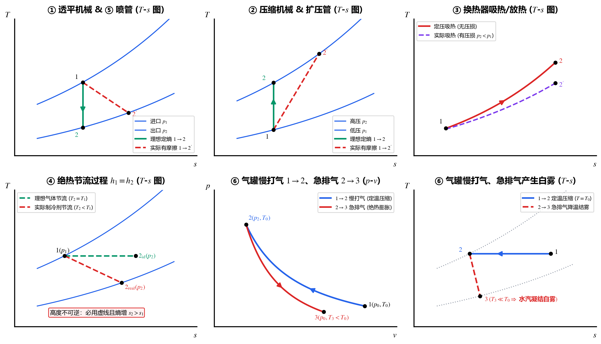
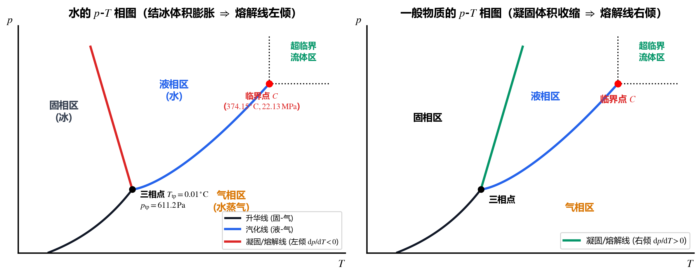
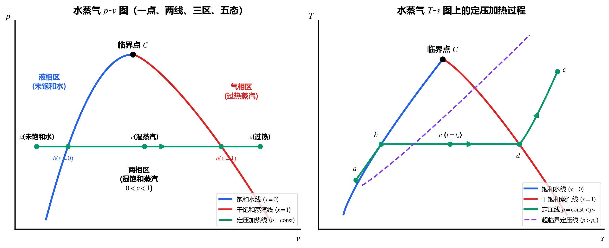

## 5.1 常见工程设备热力过程的 $p\text{-}v$ 图与 $T\text{-}s$ 图画法总结

在进入实际气体（水蒸气）之前，先将前四章所学的五大稳流热力设备及充放气过程在 $p\text{-}v$ 图和 $T\text{-}s$ 图上的**标准绘制方法（含可逆理想过程与不可逆实际过程对比）**总结如下：

| 工程设备 / 过程                            | 核心方程与特征                                             | $p\text{-}v$ 图特征                                                              | $T\text{-}s$ 图特征（重中之重！）                                                                                                                      |                                          |                                                                                                                                            |
| :----------------------------------- | :-------------------------------------------------- | :---------------------------------------------------------------------------- | :------------------------------------------------------------------------------------------------------------------------------------------- | ---------------------------------------- | ------------------------------------------------------------------------------------------------------------------------------------------ |
| **1. 透平机械** （汽轮机、燃气轮机）            | 绝热膨胀输出轴功： $w_s = h_1 - h_2 > 0$                  | 从高压小比体积 $(p_1, v_1)$ 向右下方膨胀至低压大比体积 $(p_2, v_2)$。                              | • **可逆（无摩擦）**：竖直向下定熵实线 $1 \to 2$（$s_2 = s_1$）； • **不可逆（有叶片摩擦）**：向右下方倾斜的**虚线** $1 \to 2'$（落到同一条 $p_2$ 定压线上，$s_{2'} > s_1$，$T_{2'} > T_2$）。 |                                          |                                                                                                                                            |
| **2. 压缩机械** （压气机、给水泵）             | 绝热压缩消耗轴功： $                                      | w_s                                                                           | = h_2 - h_1 > 0$                                                                                                                             | 从低压 $(p_1, v_1)$ 向左上方压缩至高压 $(p_2, v_2)$。 | • **可逆（无摩擦）**：竖直向上定熵实线 $1 \to 2$（$s_2 = s_1$）； • **不可逆（有摩擦）**：向右上方倾斜的**虚线** $1 \to 2'$（落到同一条 $p_2$ 定压线上，$s_{2'} > s_1$，$T_{2'} > T_2$）。 |
| **3. 换热设备** （锅炉、凝汽器、蒸发器）          | 无轴功定压换热： $q = h_2 - h_1$                         | • **理想（无压损）**：水平实线（$p = \text{const}$）； • **实际（有流动阻力）**：压力微降（$p_2 < p_1$）。 | • **理想吸热**：沿定压线向右上方走（$T \uparrow, s \uparrow$）； • **理想放热**：沿定压线向左下方走（$T \downarrow, s \downarrow$）； • **有压损时**：终态跨到更低压力的定压线上。          |                                          |                                                                                                                                            |
| **4. 绝热节流部件** （膨胀阀、毛细管、阀门）        | 绝热无功降压： $h_1 = h_2, \; p_2 < p_1$                | 初终态用**虚线**连接（高度不可逆非平衡过程），压力骤降、比体积增大。                                          | 初终态用**虚线**连接，且必然**向右偏移（熵增 $s_2 > s_1$）**。理想气体节流前后温度不变（$T_2 = T_1$，水平虚线）；实际气体/湿蒸汽节流后通常显著降温（$T_2 < T_1$，向右下虚线）。                                |                                          |                                                                                                                                            |
| **5. 喷管与扩压管** （Nozzle & Diffuser） | 绝热转换动能： $\frac{1}{2}(c_2^2 - c_1^2) = h_1 - h_2$ | 喷管降压膨胀（与透平相同）；扩压管减速增压（与压气机相同）。                                                | • **喷管**：定熵竖直向下 $1 \to 2$（可逆）或向右下虚线 $1 \to 2'$（有摩擦）； • **扩压管**：定熵竖直向上或向右上虚线。                                                              |                                          |                                                                                                                                            |

> [!TIP]
> **经典现象分析：往气罐里“慢慢打气”，随后“突然打开阀门排气”，会发生什么现象？**
> 1. **慢慢打气阶段（$1 \to 2$）**：由于过程缓慢，打入气罐的气体与环境充分换热，温度基本维持在环境温度 $T_2 \approx T_1 = T_0$（近似**定温压缩**，$p \uparrow, v \downarrow, s \downarrow$）。
> 2. **突然排气阶段（$2 \to 3$）**：打开大口径阀门瞬间，罐内气体来不及与外界传热，经历**绝热膨胀**（对外推开大气做功，$p \downarrow, v \uparrow$）。在 $T\text{-}s$ 图上，状态点从高压点 $2$ 沿定熵线（或向右下微倾的不可逆绝热虚线）急剧跌落至大气压 $p_0$，导致**罐内气体温度 $T_3$ 大幅低于环境温度 $T_0$**！
> 3. **宏观物理现象**：由于温度骤降到空气露点甚至冰点以下，空气中所含的水蒸气瞬间凝结成微小水滴，在罐内和排气口形成**浓密的白雾（云雾现象）**，罐壁外侧甚至会结霜！

---

## 5.2 水的热力学面与 $p\text{-}T$ 相图（实际气体的代表）

水蒸气是火力发电、核电、供暖与化工中最重要的工质。因为水蒸气在工程工作区间内接近或处于液化相变区，分子间作用力极强，**属于典型的实际气体（Real Gas），绝不能套用理想气体状态方程**（唯一例外：大气环境中的湿空气里水蒸气分压力极低，可近似视为理想气体），必须借助**热力学图表**进行计算。

### 1. 水的 $p\text{-}v\text{-}T$ 热力学面：“六个区、四条线、一个点”
将纯物质（水）在所有平衡状态下的 $(p, v, T)$ 描绘在三维空间中，形成一个连续曲折的**热力学面（Thermodynamic Surface）**：
* **六个区**：
  * **3 个单相区**：固相区（冰 Ice）、液相区（水 Water）、气相区（蒸汽 Steam）；
  * **3 个两相共存区**：固-液区（熔解/凝固）、液-气区（汽化/凝结）、固-气区（升华/凝华）。
  * **几何特征**：因为两相共存时定压即定温（$p_s = f(T_s)$），所以三个两相区在三维曲面上都是**平行于比体积 $v$ 轴的“规则柱面”**；当沿着 $v$ 轴方向将三维曲面投影到 **$p\text{-}T$ 相图**上时，**所有的两相共存面都退化投影成了曲线**！
* **四条线**：
  * **3 条饱和边界线**：饱和固线、饱和液线、饱和气线（在 $p\text{-}T$ 相图上分别投影为：**熔解/凝固线**、**汽化线**、**升华线**）；
  * **1 条三相共存线（Triple Line）**：固、液、气三相同时平衡共存的状态线，在 $p\text{-}T$ 相图上投影为一个固定点——**水的三相点（Triple Point）**：
    $$\boxed{T_{\text{tp}} = 273.16\text{ K} \; (t_{\text{tp}} = 0.01^\circ\text{C}), \qquad p_{\text{tp}} = 611.2\text{ Pa} \; (0.006112\text{ bar})}$$
* **一个点——临界点（Critical Point，$C$）**：
  饱和液线与饱和气线在高温高压端的交汇顶点，即**气液两相能够平衡共存的最高温度与最高压力极限**。
  * **数学拐点条件**：临界定温线在 $p\text{-}v$ 图上经过点 $C$ 时斜率为零且为拐点：
    $$\left(\frac{\partial p}{\partial v}\right)_{T_c} = 0, \qquad \left(\frac{\partial^2 p}{\partial v^2}\right)_{T_c} = 0$$
  * **水的临界点参数（必记常数）**：
    $$\boxed{p_c = 22.129\text{ MPa} \; (221.29\text{ bar}), \qquad T_c = 647.30\text{ K} \; (t_c = 374.15^\circ\text{C}), \qquad v_c = 0.00326\text{ m}^3/\text{kg}}$$
  * **超临界流体区**：当 $T > T_c$ 且 $p > p_c$ 时，液相与气相的界限彻底消失（比体积、焓、熵在饱和液与饱和气之间不再有跃变，汽化潜热 $r = 0$），统称为**超临界流体（Supercritical Fluid）**。

> [!IMPORTANT]
> **水的 $p\text{-}T$ 相图反常特性与两个经典概念辨析**
> 1. **为什么水的熔解/凝固线向左上方倾斜（斜率 $\frac{\mathrm{d}p}{\mathrm{d}T} < 0$）？**
>    绝大多数物质由液态凝固为固态时体积收缩，其熔解线向右倾斜；但**水结冰时体积反常膨胀**（$v_{\text{冰}} > v_{\text{水}}$），高压会抑制结冰、促使冰融化（滑冰刀刃高压融冰润滑原理），因此水的凝固线在 $p\text{-}T$ 图上**向左倾斜**！
> 2. **思考题辨析**：
>    * **“自然界或工程中有没有 $500^\circ\text{C}$ 的液态水？” —— 没有！** 因为水的临界温度 $t_c = 374.15^\circ\text{C}$，一旦温度超过 $374.15^\circ\text{C}$，无论施加多高的压力，气液两相都已合二为一，不再存在具有自由液面的“液态水”，只存在过热蒸汽或超临界流体。
>    * **“有没有 $-3^\circ\text{C}$ 的水蒸气？” —— 有！** 在 $p\text{-}T$ 图的三相点（$0.01^\circ\text{C}, 611.2\text{ Pa}$）以下，只要水蒸气分压力低于 $-3^\circ\text{C}$ 对应的冰升华压力，气相的水蒸气完全可以稳定存在（例如寒冬零下气温时空气依然有湿度，冰雕也会直接升华变成 $-3^\circ\text{C}$ 的水蒸气）。

---

## 5.3 水蒸气的定压产生过程：“一点、两线、三区、五态”

在带活塞的气缸内对 $1\text{ kg}$ 低温液态水进行**定压加热（$p = \text{const}$，$q_p = \Delta h$）**，其产生过程依次经历 **三个阶段（水预热、定温汽化、蒸汽过热）** 与 **五种典型状态**。

### 1. 饱和状态的核心规律：定压即定温
当密闭容器内液体汽化速率与蒸汽凝结速率达到动态平衡时，系统处于**饱和状态（Saturation State）**。
* **铁律**：处于气液两相平衡的饱和状态下，**饱和温度 $t_s$ 与饱和压力 $p_s$ 严格一一对应**（$t_s = f(p_s)$，只有一个独立变量！），且**随饱和压力 $p_s$ 升高，饱和温度（沸点）$t_s$ 单调升高**：
  * 标准大气压 $p_s = 1.01325\text{ bar} \implies t_s = 100.0^\circ\text{C}$；
  * 青藏高原 $p_s = 0.6\text{ bar} \implies t_s = 85.95^\circ\text{C}$（水不到 $90^\circ\text{C}$ 就沸腾，普通锅煮不熟饭）；
  * 家用高压锅 $p_s = 1.6\text{ bar} \implies t_s = 113.32^\circ\text{C}$。

### 2. 定压发生过程的“五态”参数对照表
我们用上标 **$'$（一撇）** 专指 **饱和水（$x=0$）** 的状态参数，用上标 **$''$（两撇）** 专指 **干饱和蒸汽（$x=1$）** 的状态参数：

| 阶段 | 状态名称 | 温度特征 | 比体积 $v$ | 比焓 $h$ | 比熵 $s$ | 特征指标定义 |
| :--- | :--- | :---: | :---: | :---: | :---: | :--- |
| **一、水的预热** | **1. 未饱和水（过冷水）** | $t < t_s$ | $v < v'$ | $h < h'$ | $s < s'$ | **过冷度**：$\Delta t_{\text{过冷}} = t_s - t$ |
| *(分界线 I)* | **2. 饱和水（Saturated Liquid）** | $t = t_s$ | $v = v'$ | $h = h'$ | $s = s'$ | 干度 $x = 0$（刚开始产生第一个汽泡） |
| **二、定温汽化** | **3. 湿饱和蒸汽（湿蒸汽）** | **$t = t_s$（定温！）** | $v' < v < v''$ | $h' < h < h''$ | $s' < s < s''$ | **干度**：$0 < x < 1$（汽水两相共存） |
| *(分界线 II)* | **4. 干饱和蒸汽（Dry Sat. Vapor）** | $t = t_s$ | $v = v''$ | $h = h''$ | $s = s''$ | 干度 $x = 1$（最后一滴水刚汽化完） |
| **三、蒸汽过热** | **5. 过热蒸汽（Superheated）** | $t > t_s$ | $v > v''$ | $h > h''$ | $s > s''$ | **过热度**：$\Delta t_{\text{过热}} = t - t_s$ |

* **汽化潜热（Latent Heat of Vaporization，$r$ 或 $\gamma$）**：
  在定压汽化阶段（饱和水 $'$ $\to$ 干饱和蒸汽 $''$），虽然温度保持 $T = T_s$ 不变，但为了克服分子间引力并对外做膨胀功，必须吸收大量热量，等于干饱和蒸汽与饱和水的比焓之差：
  $$\boxed{r \equiv h'' - h' = T_s (s'' - s') \quad [\text{kJ/kg}]}$$
  * **重要规律**：随着压力 $p$（及对应 $T_s$）升高，饱和水线与干饱和蒸汽线向中间靠拢，**汽化潜热 $r$ 逐渐减小；到达临界点 $C$ 时，$v' = v'' = v_c$，$h' = h''$，汽化潜热降为零（$r_c = 0$）**！

> [!IMPORTANT]
> **全章核心骨架：如何在 $p\text{-}v$ 图和 $T\text{-}s$ 图上画出“一点、两线、三区、五态”？**
> 1. **一点**：顶部最高点为**临界点 $C$**（$22.129\text{ MPa}, 374.15^\circ\text{C}$）。
> 2. **两线**：从临界点 $C$ 向左下方延伸的曲线是**饱和水线（$x=0$）**；向右下方延伸的曲线是**干饱和蒸汽线（$x=1$）**。两条线合围成一个钟罩形区域。
> 3. **三区**：
>    * 饱和水线左侧：液相区（**未饱和水/过冷水区**）；
>    * 钟罩形内部：气液两相共存区（**湿饱和蒸汽区**）；
>    * 干饱和蒸汽线右侧：气相区（**过热蒸汽区**）。
> 4. **定压加热线（$p = \text{const} < p_c$）在两图上的走势对比**：
>    * 在 **$p\text{-}v$ 图**上：定压线自始至终是一条**水平直线**（穿过三区）；定温线在未饱和水区几乎竖直，进入湿蒸汽区后**与定压线重合为水平段**，进入过热蒸汽区后向右下方倾斜弯曲。
>    * 在 **$T\text{-}s$ 图**上：定压线在未饱和水区紧贴饱和水线右上方缓慢上升（因液体不可压缩，不同压力的定压线在液相区几乎与饱和水线重合！）；进入湿蒸汽区后，因为定压即定温，**定压线变成一条水平线段**；进入过热蒸汽区后，定压线再次向右上方陡峭爬升。

---

## 5.4 水和水蒸气状态参数的确定与查表法（具体实操方法）

### 1. 湿饱和蒸汽区的状态参数计算公式（干度 $x$）
在湿蒸汽区（两相区），$1\text{ kg}$ 湿蒸汽由 **$x\text{ kg}$ 干饱和蒸汽** 和 **$(1 - x)\text{ kg}$ 饱和水** 混合而成。定义干饱和蒸汽所占的质量分数为 **干度（Dryness Fraction / Quality，$x$）**：
$$\boxed{x \equiv \frac{m_v}{m_v + m_f} \quad (0 \le x \le 1)}$$

利用广延量的可加性，湿蒸汽的比体积 $v$、比焓 $h$、比熵 $s$、比内能 $u$ 均满足完全相同的**线性杠杆法则**：

$$\boxed{\begin{aligned}
v &= x v'' + (1 - x) v' = v' + x (v'' - v') \quad &\Longleftrightarrow \quad x &= \frac{v - v'}{v'' - v'} \\
h &= x h'' + (1 - x) h' = h' + x (h'' - h') = h' + x r \quad &\Longleftrightarrow \quad x &= \frac{h - h'}{h'' - h'} = \frac{h - h'}{r} \\
s &= x s'' + (1 - x) s' = s' + x (s'' - s') \quad &\Longleftrightarrow \quad x &= \frac{s - s'}{s'' - s'} \\
u &= x u'' + (1 - x) u' = h - pv
\end{aligned}}$$

> [!CAUTION]
> **干度 $x$ 的两大注意事项**
> 1. **干度 $x$ 仅在湿饱和蒸汽区（$0 \le x \le 1$）有意义**！在未饱和水区和过热蒸汽区，不存在气液两相比例，干度 $x$ 无物理意义（决不能算得 $x = 1.2$ 或 $x = -0.1$ 还代入公式，一旦算出 $x > 1$ 说明处于过热蒸汽区，算出 $x < 0$ 说明处于未饱和水区！）。
> 2. 工程简化：当干度 $x$ 较大且压力不太高时，由于饱和水比体积 $v' \approx 0.001\text{ m}^3/\text{kg} \ll v''$，有时可近似写为 $v \approx x v''$；但对于 $h$ 和 $s$，$h'$ 和 $s'$ 很大，**绝不能忽略 $(1-x)h'$ 和 $(1-x)s'$**！

---

### 2. 具体方法：水蒸气查表与状态判定的“标准三步法”

教材附录提供两类水蒸气表：
* **饱和水与干饱和蒸汽表**：按温度排列（附表 5）或按压力排列（附表 6），只需 **1 个参数（$t$ 或 $p$）** 即可直接查出对应的 $p_s$（或 $t_s$）以及 $v', v'', h', h'', r, s', s''$。
* **未饱和水与过热蒸汽表（附表 7）**：需要 **2 个独立参数（如 $p, t$）** 交叉查表。表中有一条**粗折线（阶梯分界线）**：**粗线上方为未饱和水，粗线下方为过热蒸汽**。

> [!TIP]
> **解题实操：任意给定两个参数，如何快速判定水蒸气处于哪一态并求出其余参数？**
> * **情形 A：已知压力 $p$ 和温度 $t$**
>   1. 先用压力 $p$ 查饱和表（或看附表 7 顶部的饱和参数栏），读出该压力下的饱和温度 $t_s(p)$；
>   2. **比大小判状态**：
>      * 若 $t < t_s(p) \implies$ **未饱和水**（查附表 7 粗线上方，或近似取温度 $t$ 下的饱和水参数 $h \approx h'(t), s \approx s'(t), v \approx v'(t)$）；
>      * 若 $t > t_s(p) \implies$ **过热蒸汽**（查附表 7 粗线下方）；
>      * 若 $t = t_s(p) \implies$ 处于饱和态（饱和水、湿蒸汽或干饱和蒸汽），**此时仅凭 $p$ 和 $t$ 无法确定具体状态**，必须补充第三个参数（如干度 $x$ 或比体积 $v$）！
> * **情形 B：已知压力 $p$（或温度 $t$）和另一个比参数 $z$（$z$ 代表 $v, h$ 或 $s$，如定熵过程已知 $p_2$ 和 $s_2 = s_1$）**
>   1. 先用 $p$（或 $t$）查饱和表，读出该压力（或温度）下的饱和水值 $z'$ 与干饱和蒸汽值 $z''$；
>   2. **比大小判状态**：
>      * 若 $z < z' \implies$ **未饱和水**（转查附表 7 粗线上方）；
>      * 若 $z = z' \implies$ **饱和水（$x = 0$）**；
>      * 若 $z' < z < z'' \implies$ **湿饱和蒸汽**！立即用 $x = \frac{z - z'}{z'' - z'}$ 算出干度 $x$，再代入 $h = h' + x(h'' - h')$ 等公式求出其余全部参数；
>      * 若 $z = z'' \implies$ **干饱和蒸汽（$x = 1$）**；
>      * 若 $z > z'' \implies$ **过热蒸汽**（转查附表 7 粗线下方，用线性内插法求温度及残余参数）。

### 3. 直线内插法（Linear Interpolation）与跨界禁忌
当待查参数 $c$ 落在表中相邻两档数据 $a$ 和 $b$（对应函数值为 $m$ 和 $n$）之间时，采用线性内插公式：
$$q = m + \frac{c - a}{b - a}(n - m)$$

> [!CAUTION]
> **查表内插的绝对禁区：严禁跨越附表 7 的粗折线（饱和线）进行内插！**
> 在《未饱和水和过热蒸汽表》（附表 7）中，粗线上方的最后一格是未饱和水，粗线下方的第一格是过热蒸汽，两者之间隔着整个发生相变的湿蒸汽区（包含巨大的汽化潜热 $r$ 跃变！）。如果待求温度恰好夹在粗线上下两档温度之间，说明中间跨越了饱和态，**绝对不能把粗线上下两个数直接拿来线性内插**，而必须先查饱和表确定 $t_s$ 属于哪一侧！

### 4. 概念陷阱：密闭刚性容器内充满液态水被太阳晒热，压力变化有多恐怖？
* **问题**：一刚性密闭容器内**完全充满** $p_1 = 0.1\text{ MPa}, t_1 = 20^\circ\text{C}$ 的未饱和液态水（无任何气相空间）。经太阳照射水温升至 $t_2 = 40^\circ\text{C}$，此时容器内水的压力约为多少？
* **解析**：由于容器刚性且完全充满水，这是一个**定容加热过程（$v_2 = v_1$）**！
  1. 初态查表：$p_1 = 0.1\text{ MPa}, t_1 = 20^\circ\text{C}$ 时，水的比体积为 $v_1 = 0.0010018\text{ m}^3/\text{kg}$；
  2. 终态温度升至 $t_2 = 40^\circ\text{C}$，如果压力保持 $0.1\text{ MPa}$ 不变，水热胀冷缩后的比体积本应膨胀到 $0.0010078\text{ m}^3/\text{kg}$；
  3. 但刚性容器强行把比体积锁死在 $v_2 = v_1 = 0.0010018\text{ m}^3/\text{kg}$！因为液态水几乎不可压缩，要把这區區 $0.6\%$ 的热膨胀体积硬生生压回去，查 $t_2 = 40^\circ\text{C}$ 的未饱和水表可知，**容器内的水压会从 $0.1\text{ MPa}$ 暴增至约 $14\text{ MPa}$（$140$ 个大气压）**，极易撑爆管道或容器！（这正是工程上热水锅炉、太阳能集热管和液化气罐严禁“满液密闭受热”、必须留出气相膨胀空间或安装安全泄压阀的根本原因）。

---

## 5.5 水蒸气的热力过程计算与典型例题

### 1. 水蒸气过程计算 vs 理想气体过程计算的核心区别

> [!WARNING]
> **水蒸气热力过程计算的“能用”与“禁用”清单**
> 1. **完全成立、必须使用的基本定律方程**：
>    * 闭口系第一定律：$q = \Delta u + w$，其中内能必须由定义式计算：
>      $$\boxed{u = h - pv \quad \Longrightarrow \quad \Delta u = u_2 - u_1 = (h_2 - h_1) - (p_2 v_2 - p_1 v_1)}$$
>    * 稳流开口系第一定律：$q = \Delta h + w_t$；
>    * 准静态功与可逆热：$\delta w = p\,\mathrm{d}v$，$\delta w_t = -v\,\mathrm{d}p$，$\delta q_{\text{rev}} = T\,\mathrm{d}s$。
> 2. **绝对禁止使用的理想气体专属公式**：
>    * ❌ 禁用 $pv = R_g T$（必须查表建立 $p, v, T$ 关系）；
>    * ❌ 禁用 $\Delta u = c_v \Delta T$ 和 $\Delta h = c_p \Delta T$（水蒸气的 $u, h$ 不仅是温度的函数，还强烈依赖压力！必须查表求 $h_1, h_2$）；
>    * ❌ 禁用定熵方程 $pv^k = \text{const}$ 和 $\frac{T_2}{T_1} = \left(\frac{p_2}{p_1}\right)^{\frac{k-1}{k}}$（水蒸气定熵过程必须用 **$s_2 = s_1$** 查表或查 $h\text{-}s$ 莫里尔图求解！）。

### 2. 水蒸气四大基本准静态过程的计算公式汇总

| 过程名称 | 终态确定方法（已知初态 $1$ 查出 $p_1, t_1, v_1, h_1, s_1$） | 容积功 $w$（闭口系） | 技术功 $w_t$（开口系） | 热量 $q$ |
| :--- | :--- | :---: | :---: | :---: |
| **1. 定压过程** （$p_2 = p_1$） | 由 $p_2 = p_1$ 和另一终态参数（如 $t_2$ 或 $x_2$）查表得 $v_2, h_2, s_2$ | $p_1 (v_2 - v_1)$ | $0$ | $q_p = h_2 - h_1$ |
| **2. 定熵过程** （$s_2 = s_1$） | 由 **$s_2 = s_1$** 和终压 $p_2$ 判定终态区域（通常落入湿蒸汽区，先算 $x_2 = \frac{s_1 - s_2'}{s_2'' - s_2'}$），再算出 $h_2, v_2$ | $w_s = u_1 - u_2$ $= (h_1 - h_2) - (p_1 v_1 - p_2 v_2)$ | $w_{t,s} = h_1 - h_2$ | $0$ |
| **3. 定容过程** （$v_2 = v_1$） | 由 **$v_2 = v_1$** 和终压 $p_2$（或 $t_2$）判定状态（若在湿区则 $x_2 = \frac{v_1 - v_2'}{v_2'' - v_2'}$），求得 $h_2, u_2$ | $0$ | $v_1 (p_1 - p_2)$ （近似） | $q_v = u_2 - u_1$ $= (h_2 - h_1) - v_1(p_2 - p_1)$ |
| **4. 定温过程** （$t_2 = t_1$） | 由 $t_2 = t_1$ 和终压 $p_2$ 查表得 $v_2, h_2, s_2$ | $w_T = q_T - (u_2 - u_1)$ | $w_{t,T} = q_T - (h_2 - h_1)$ | $q_T = T_1 (s_2 - s_1)$ |

---

### 3. 典型例题精讲

#### 典型例题 1：汽轮机内水蒸气的定熵膨胀过程（湿蒸汽干度计算标准模板）
**【题目】** 过热蒸汽以初压 $p_1 = 4\text{ MPa}$、初温 $t_1 = 450^\circ\text{C}$ 进入汽轮机，可逆绝热（定熵）膨胀至背压 $p_2 = 0.005\text{ MPa}$。求汽轮机对外输出的单位质量技术功（轴功）$w_t$。

**【标准解题步骤】**
1. **确定初态 $1$ 参数**：
   已知 $p_1 = 4\text{ MPa}, t_1 = 450^\circ\text{C}$，查附表 7（过热蒸汽表）得：
   $$h_1 = 3330.7\text{ kJ/kg}, \qquad s_1 = 6.9379\text{ kJ/(kg}\cdot\text{K)}$$
2. **利用定熵条件 $s_2 = s_1$ 判定终态 $2$ 所处区域**：
   以终压 $p_2 = 0.005\text{ MPa}$ 查附表 6（饱和表），读出该压力下的饱和水与干饱和蒸汽参数：
   $$\begin{aligned}
   h_2' &= 137.77\text{ kJ/kg}, \qquad &h_2'' &= 2561.2\text{ kJ/kg} \\
   s_2' &= 0.4762\text{ kJ/(kg}\cdot\text{K)}, \qquad &s_2'' &= 8.3952\text{ kJ/(kg}\cdot\text{K)}
   \end{aligned}$$
   因为定熵过程 $s_2 = s_1 = 6.9379\text{ kJ/(kg}\cdot\text{K)}$，比较大小发现 **$s_2' < s_2 < s_2''$**，故终态 $2$ 处于**湿饱和蒸汽区**！
3. **计算终态干度 $x_2$ 与终态比焓 $h_2$**：
   $$x_2 = \frac{s_2 - s_2'}{s_2'' - s_2'} = \frac{6.9379 - 0.4762}{8.3952 - 0.4762} = 0.8160$$
   $$h_2 = x_2 h_2'' + (1 - x_2) h_2' = 0.8160 \times 2561.2 + (1 - 0.8160) \times 137.77 = 2115.3\text{ kJ/kg}$$
4. **由稳流能量方程求汽轮机轴功 $w_t$**：
   $$w_t = h_1 - h_2 = 3330.7 - 2115.3 = 1215.4\text{ kJ/kg}$$

---

#### 典型例题 2：气缸（闭口系）内水蒸气的定压加热与定熵膨胀（例 5-2）
**【题目】** 将气缸内 $1\text{ kg}$、$p_1 = 0.6\text{ MPa}$、$t_1 = 200^\circ\text{C}$ 的水蒸气在定压下加热到 $t_2 = 300^\circ\text{C}$；随后让蒸汽在气缸中定熵膨胀到 $p_3 = 0.05\text{ MPa}$。求：（1）定压加热过程的吸热量 $q_p$ 和内能变化 $\Delta u_p$；（2）定熵膨胀过程的容积变化功 $w_s$。

**【解答与易错点剖析】**
1. **过程（1）定压加热 $1 \to 2$（$p_2 = p_1 = 0.6\text{ MPa}$）**：
   * 查表得初态 $1$（$0.6\text{ MPa}, 200^\circ\text{C}$ 过热蒸汽）：$h_1 = 2849.6\text{ kJ/kg}, \; v_1 = 0.35197\text{ m}^3/\text{kg}$；
   * 查表得状态 $2$（$0.6\text{ MPa}, 300^\circ\text{C}$ 过热蒸汽）：$h_2 = 3061.0\text{ kJ/kg}, \; v_2 = 0.43436\text{ m}^3/\text{kg}, \; s_2 = 7.372\text{ kJ/(kg}\cdot\text{K)}$；
   * 定压吸热量：$q_p = h_2 - h_1 = 3061.0 - 2849.6 = 211.4\text{ kJ/kg}$；
   * 内能变化量（注意单位统一：$p$ 代入 $\text{kPa} = 10^3\text{ Pa}$ 以匹配 $\text{kJ/kg}$！）：
     $$\Delta u_p = u_2 - u_1 = (h_2 - h_1) - p_1 (v_2 - v_1) = 211.4 - 600\text{ kPa} \times (0.43436 - 0.35197)\text{ m}^3/\text{kg} = 162.0\text{ kJ/kg}$$
2. **过程（2）气缸内定熵膨胀 $2 \to 3$（$s_3 = s_2, \; p_3 = 0.05\text{ MPa}$）**：
   * 由 $p_3 = 0.05\text{ MPa}$ 和 $s_3 = s_2$ 查表（通过干度 $x_3 = \frac{s_2 - s_3'}{s_3'' - s_3'}$ 计算）得终态 $3$ 参数：
     $$h_3 = 2566.8\text{ kJ/kg}, \qquad v_3 = 3.1305\text{ m}^3/\text{kg}$$
   * **求气缸内的容积变化功 $w_s$（避坑重点！）**：
     题目明确指出是“**在气缸中**定熵膨胀”（属于**闭口系**），要求的是**容积变化功 $w$** 而不是汽轮机技术功 $w_t$！对绝热闭口系，$q = 0 \implies w = -\Delta u = u_2 - u_3$，绝对不能直接写 $h_2 - h_3$：
     $$\begin{aligned}
     w_s &= u_2 - u_3 = (h_2 - h_3) - (p_2 v_2 - p_3 v_3) \\
     &= (3061.0 - 2566.8) - \left(600 \times 0.43436 - 50 \times 3.1305\right) = 494.2 - 104.1 = 390.1\text{ kJ/kg}
     \end{aligned}$$
