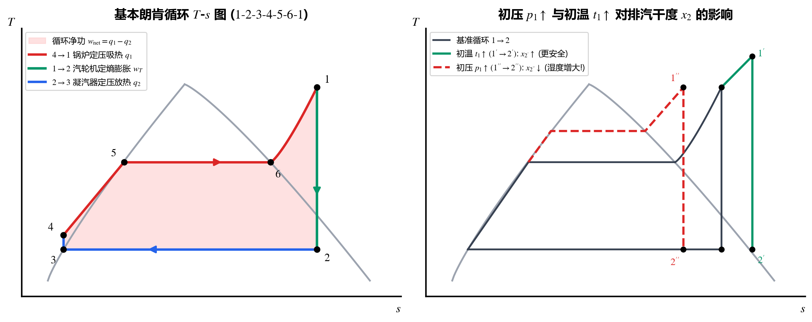
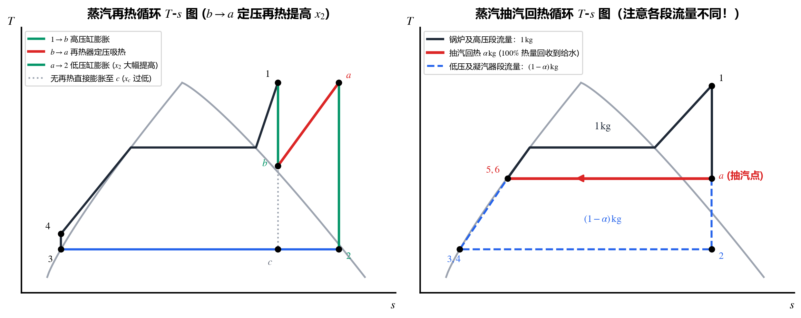
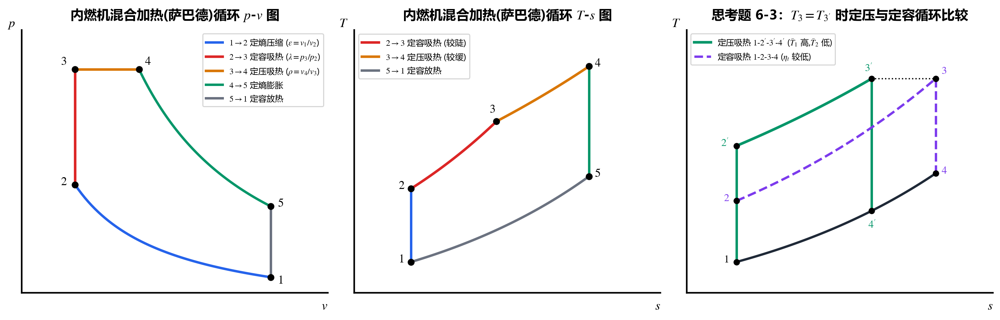
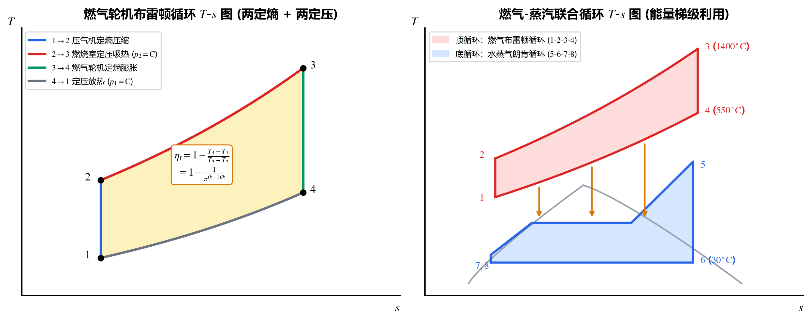

## 6.1 蒸汽动力装置循环（Vapor Power Cycles）

以水蒸气（或低沸点工质）为核心工质的动力循环广泛应用于火力发电、核电、太阳能热发电、地热与余热发电，其理论基础循环是 **朗肯循环（Rankine Cycle）**。

---

### 1. 基本朗肯循环（Simple Rankine Cycle）

#### （1）四大核心设备与四个理想过程
忽略管道散热与流动压损，将实际蒸汽动力装置理想化为由**两个定熵过程 + 两个定压过程**组成的**朗肯循环（$1\text{-}2\text{-}3\text{-}4\text{-}1$）**：

| 过程编号 | 所在设备 | 理想热力过程 | 稳流能量方程（单位质量 $1\text{ kg}$） | 工程说明 |
| :---: | :--- | :--- | :---: | :--- |
| **$1 \to 2$** | **汽轮机（Turbine）** | 可逆绝热（**定熵 $s_2 = s_1$**）膨胀 | $w_{s,T} = h_1 - h_2 > 0$ | 高温高压过热蒸汽膨胀至湿蒸汽区对外输出轴功。 |
| **$2 \to 3$** | **凝汽器（Condenser）** | **定压（$p_2 = \text{const}$）**放热凝结 | $q_2 = h_2 - h_3 = h_2 - h_2'$ | 乏汽定压定温凝结为状态 $3$ 的**饱和水**（$h_3 = h_2'$）。 |
| **$3 \to 4$** | **给水泵（Pump）** | 可逆绝热（**定熵 $s_4 = s_3$**）压缩 | $w_{p} = h_4 - h_3 \approx v_3(p_1 - p_2)$ | 将低压饱和水绝热加压至锅炉压力 $p_1$（变成未饱和水 $4$）。 |
| **$4 \to 1$** | **锅炉与过热器（Boiler）** | **定压（$p_1 = \text{const}$）**吸热汽化过热 | $q_1 = h_1 - h_4$ | 经历未饱和水预热 $\to$ 定温汽化 $\to$ 蒸汽过热三个阶段。 |

#### （2）朗肯循环的热效率 $\eta_t$ 与汽耗率 $d$
* **循环净功与精确热效率**：
  $$w_{\text{net}} = w_{s,T} - w_p = (h_1 - h_2) - (h_4 - h_3) = q_1 - q_2$$
  $$\eta_t = \frac{w_{\text{net}}}{q_1} = \frac{(h_1 - h_2) - (h_4 - h_3)}{h_1 - h_4}$$
* **工程忽略泵功的简化公式（最常用）**：
  因为液态水比体积 $v_3 \approx 0.001\text{ m}^3/\text{kg}$ 极小，水泵耗功 $w_p = h_4 - h_3$ 通常**仅占汽轮机做功的 $0.8\% \sim 1\%$**！当题目未给或声明忽略泵功时，直接取 $h_4 \approx h_3 = h_2'$：
  $$\boxed{w_{\text{net}} \approx w_{s,T} = h_1 - h_2, \qquad \eta_t \approx \frac{h_1 - h_2}{h_1 - h_3} = \frac{h_1 - h_2}{h_1 - h_2'}}$$
* **汽耗率（Specific Steam Consumption，$d$）**：
  工程上用**每输出 $1\text{ kW}\cdot\text{h}$（即 $3600\text{ kJ}$）净功所消耗的蒸汽质量（$\text{kg}$）**来衡量装置的经济性与设备尺寸大小：
  $$\boxed{d = \frac{3600}{w_{\text{net}}} \quad \left[\text{kg/(kW}\cdot\text{h)} \text{，注意 } w_{\text{net}} \text{ 代入单位为 kJ/kg}\right]}$$
  （若按国际单位制求每输出 $1\text{ J}$ 功消耗的蒸汽量，则为 $d = \frac{1}{w_{\text{net}}}\text{ [kg/J]}$）。

---

### 2. 为什么蒸汽动力装置采用朗肯循环而不采用卡诺循环？
在 $T\text{-}s$ 图上将朗肯循环与三个不同构型的卡诺循环进行对比，可知卡诺循环在工程上难以实现或性能更差：
1. **对比同最大温限的卡诺循环（过热温度 $T_1$ 与排汽温度 $T_2$ 之间）**：在过热蒸汽区要实现**定温吸热膨胀过程**，必须让蒸汽边在锅炉里加热边在气缸里大幅膨胀降压，工程设备上极难实现。
2. **对比饱和区内的完整卡诺循环（以饱和温度 $T_{s1}$ 为上限）**：
   * 一方面，最高温度被限制在临界温度 $374.15^\circ\text{C}$ 以下，未能利用高温过热段，导致**实际热效率与循环净功反而低于过热朗肯循环**（$\eta_{\text{卡诺}} < \eta_{\text{朗肯}}$）；
   * 另一方面，凝汽器排汽只能凝结到两相区的湿蒸汽状态，随后必须用压缩机对**气液两相混合物**进行定熵压缩，这不仅体积庞大、耗功极高，且气液两相压缩会产生严重水击，工程上极难可靠运行（朗肯循环将乏汽完全凝结为纯液态水，用小巧的给水泵即可轻松加压！）。
3. **对比高压小跨度的饱和卡诺循环**：汽轮机膨胀终点的**干度 $x_2$ 太小（湿度过大）**，高速水滴会严重冲蚀打坏汽轮机末级叶片，且循环净功 $w_{\text{net}}$ 极小。

---

### 3. 蒸汽初终参数（$p_1, t_1, p_2$）对朗肯循环热效率与安全性的影响规律

根据第四章的**等效卡诺循环平均温度法**（$\eta_t = 1 - \frac{\bar{T}_2}{\bar{T}_1}$），凡是能使**平均吸热温度 $\bar{T}_1$ 升高**或**放热温度 $T_2$ 降低**的措施，均能提高朗肯循环热效率 $\eta_t$：

| 调节措施 | 对热效率 $\eta_t$ 的影响 | 对汽轮机排汽干度 $x_2$ 的影响 | 工程优点 | 工程限制与缺点 |
| :--- | :---: | :---: | :--- | :--- |
| **1. 提高蒸汽初温 $t_1 \uparrow$** （保持 $p_1, p_2$ 不变） | $\bar{T}_1 \uparrow \implies \boldsymbol{\eta_t \uparrow}$ | 膨胀线右移 $\implies \boldsymbol{x_2 \uparrow}$ | **一举两得**：既提高热效率，又**提高了排汽干度 $x_2$**，保护汽轮机叶片安全！ | 受金属材料高温耐热强度（蠕变极限）限制，目前火电厂最高初温约为 **$600 \sim 620^\circ\text{C}$**。 |
| **2. 提高蒸汽初压 $p_1 \uparrow$** （保持 $t_1, p_2$ 不变） | $\bar{T}_1 \uparrow \implies \boldsymbol{\eta_t \uparrow}$ | 膨胀线左移 $\implies \boldsymbol{x_2 \downarrow}$ | 提高热效率；排汽比体积 $v_2 \downarrow$，有利于减小汽轮机出口尺寸。 | 1. 管道与承压部件强度要求高； 2. **排汽干度 $x_2$ 显著下降（湿度增大）**！工程上为防叶片水蚀，严格要求汽轮机出口干度 **$x_2 \ge 0.85 \sim 0.88$**（必须配合**再热循环**解决）。 |
| **3. 降低乏汽背压 $p_2 \downarrow$** （保持 $p_1, t_1$ 不变） | $T_2 \downarrow \implies \boldsymbol{\eta_t \uparrow}$ | 膨胀线向下延伸 $\implies \boldsymbol{x_2 \downarrow}$ | 显著提高热效率与循环净功（冬天冷却水温低，$p_2$ 更低，故火电厂冬天发电效率更高）。 | 1. **受自然环境冷却水温度 $T_0$ 限制**：凝汽器饱和温度必须比冷却水温高 $5 \sim 10^\circ\text{C}$，故极限背压约为 **$p_2 = 0.0035 \sim 0.005\text{ MPa}$**（对应 $t_2 \approx 27 \sim 33^\circ\text{C}$）； 2. $p_2$ 过低会导致末级比体积 $v_2$ 剧增、干度 $x_2$ 下降且真空系统漏气风险增大。 |

> [!TIP]
> **秒解技巧：$T\text{-}s$ 图上多个朗肯循环热效率排序题**
> 当题目给出多个朗肯循环的初温 $t_1$、沸腾饱和温度 $t_{s1}$（对应初压 $p_1$）和凝汽器温度 $t_2$（对应背压 $p_2$）要求排序 $\eta_t$ 时：
> 直接比较 **平均吸热温度 $\bar{T}_1$（由饱和温度 $t_{s1}$ 主导，兼顾过热温度 $t_1$）** 与 **放热温度 $t_2$**：$t_{s1}$ 和 $t_1$ 越高、$t_2$ 越低的循环，热效率 $\eta_t$ 越高！

---

### 4. 蒸汽再热循环（Steam Reheat Cycle）

* **核心目的**：为了突破“提高初压 $p_1$ 会导致排汽干度 $x_2$ 过低（$< 0.85$）”的瓶颈！
* **工作流程**：将高压过热蒸汽（状态 $1$）先送入汽轮机高压缸膨胀到某一中间再热压力 $p_b = p_a \approx (0.2 \sim 0.3) p_1$（状态 $b$）；然后抽回锅炉的**再热器（Reheater）**中进行**定压再热**至高温（状态 $a$，通常 $t_a \approx t_1$）；最后送入汽轮机中低压缸继续定熵膨胀至凝汽器背压 $p_2$（状态 $2$）。
* **定量计算公式（忽略泵功 $h_4 \approx h_3 = h_2'$）**：
  $$\boxed{\begin{aligned}
  \text{总吸热量：} \quad q_1 &= (h_1 - h_4) + (h_a - h_b) \\
  \text{总放热量：} \quad q_2 &= h_2 - h_3 \\
  \text{汽轮机总净功：} \quad w_{\text{net}} &= w_{\text{高压缸}} + w_{\text{低压缸}} = (h_1 - h_b) + (h_a - h_2) \\
  \text{再热循环热效率：} \quad \eta_{t,\text{RH}} &= \frac{w_{\text{net}}}{q_1} = \frac{(h_1 - h_b) + (h_a - h_2)}{(h_1 - h_4) + (h_a - h_b)}
  \end{aligned}}$$

> [!CAUTION]
> **高频考点：采用再热循环一定能提高热效率吗？**
> **不一定！** 再热循环相当于在基本朗肯循环的基础上“并联附加”了一个再热子循环。
> * 只有当附加再热过程的平均吸热温度 $\bar{T}_{\text{再热}}$ **高于** 原基本朗肯循环的平均吸热温度 $\bar{T}_{1,\text{基本}}$ 时，再热才能使总热效率提高（合理选取再热压力 $p_{rh} \approx 0.2 \sim 0.3 p_1$ 时，一次再热可提高热效率约 $2\% \sim 3.5\%$）；若再热压力选得过低，或像压水堆核电厂那样再热温度不高，**采用再热后热效率甚至会略微下降**！
> * **再热循环最根本的工程意义**：**大幅提高汽轮机末级排汽干度 $x_2$**，从而为采用超高初压（$p_1 > 13.5\text{ MPa}$ 一次再热，超超临界机组 $p_1 > 25\text{ MPa}$ 二次再热）扫清障碍，并且增大了单位质量蒸汽的做功量 $w_{\text{net}}$，降低了汽耗率 $d$！

---

### 5. 蒸汽抽汽回热循环（Steam Regenerative Cycle）

* **核心目的**：在基本朗肯循环中，给水从凝汽器低温 $T_4$ 进入锅炉被加热到沸点 $T_{s1}$ 的预热阶段（$4 \to 5$），平均吸热温度很低，且与高温烟气之间存在巨大的传热温差（产生极大不可逆熵产）。**回热循环**通过从汽轮机中间级**抽取一部分已经做过功的蒸汽（抽汽份额 $\alpha$）**去加热给水，砍掉了低温吸热段，从而**显著提高了循环在锅炉内的平均吸热温度 $\bar{T}_1$，必定提高循环热效率（$\eta_{t,\text{RG}} > \eta_t$）**！

#### 具体方法：混合式回热器的抽汽量 $\alpha$ 与回热效率计算
以进入汽轮机入口的 **$1\text{ kg}$ 主蒸汽（状态 $1$）** 为基准：
1. $1\text{ kg}$ 蒸汽在汽轮机内从状态 $1$ 膨胀到抽汽压力 $p_a$（状态 $a$，比焓 $h_a$）；
2. 从中抽出 **$\alpha\text{ kg}$ 蒸汽** 送入混合式回热器，其余 **$(1 - \alpha)\text{ kg}$ 蒸汽** 继续在汽轮机内膨胀至凝汽器背压 $p_2$（状态 $2$，比焓 $h_2$），并在凝汽器中凝结为 $(1 - \alpha)\text{ kg}$ 饱和水（状态 $3$，比焓 $h_3 = h_2'$）；
3. $(1 - \alpha)\text{ kg}$ 凝结水经低压水泵打入混合式回热器（状态 $4$，$h_4 \approx h_2'$），与 $\alpha\text{ kg}$ 抽汽直接混合，恰好被加热为 **$1\text{ kg}$ 抽汽压力 $p_a$ 下的饱和水**（状态 $5$，比焓 $h_5 = h_a'$），再由高压给水泵送入锅炉（状态 $6$，$h_6 \approx h_5 = h_a'$）。

> [!IMPORTANT]
> **抽汽回热循环的四大核心计算公式（忽略泵功：$h_4 \approx h_3 = h_2'$, $h_6 \approx h_5 = h_a'$）**
> 1. **对回热器列开口系第一定律求抽汽份额 $\alpha$（进出回热器的总焓守恒）**：
>    $$\alpha h_a + (1 - \alpha) h_4 = 1 \times h_5 \quad \Longrightarrow \quad \boxed{\alpha = \frac{h_5 - h_4}{h_a - h_4} \approx \frac{h_a' - h_2'}{h_a - h_2'}}$$
> 2. **锅炉定压吸热量 $q_{1,\text{RG}}$（流过锅炉的是完整的 $1\text{ kg}$ 给水！）**：
>    $$\boxed{q_{1,\text{RG}} = h_1 - h_6 \approx h_1 - h_a'}$$
> 3. **凝汽器定压放热量 $q_{2,\text{RG}}$（流过凝汽器的只有 $(1 - \alpha)\text{ kg}$ 乏汽！）**：
>    $$\boxed{q_{2,\text{RG}} = (1 - \alpha)(h_2 - h_3) = (1 - \alpha)(h_2 - h_2')}$$
> 4. **汽轮机输出净功 $w_{\text{RG}}$ 与回热循环热效率 $\eta_{t,\text{RG}}$**：
>    $$\boxed{w_{\text{RG}} = 1 \times (h_1 - h_a) + (1 - \alpha)(h_a - h_2) = q_{1,\text{RG}} - q_{2,\text{RG}}}$$
>    $$\boxed{\eta_{t,\text{RG}} = \frac{w_{\text{RG}}}{q_{1,\text{RG}}} = \frac{(h_1 - h_a) + (1 - \alpha)(h_a - h_2)}{h_1 - h_a'} = 1 - \frac{(1 - \alpha)(h_2 - h_2')}{h_1 - h_a'}}$$

* **为什么抽汽回热一定提高热效率的物理本质**：
  利用热平衡式消去 $h_a'$ 后，回热热效率可恒等变形为：
  $$\eta_{t,\text{RG}} = 1 - \frac{h_2 - h_2'}{(h_1 - h_2') + \dfrac{\alpha}{1 - \alpha}(h_1 - h_a)} > 1 - \frac{h_2 - h_2'}{h_1 - h_2'} = \eta_{t,\text{基本}}$$
  **物理图像**：在 $1\text{ kg}$ 总工质中，$(1 - \alpha)\text{ kg}$ 工质走完了完整朗肯循环，效率不变；而抽出的 **$\alpha\text{ kg}$ 蒸汽在汽轮机上半段做了功 $(h_1 - h_a)$ 后，剩余热量全部回收到锅炉给水中，没有任何热量排向凝汽器冷源，相当于这 $\alpha\text{ kg}$ 蒸汽实现了 $100\%$ 的热功转换效率**！
* **回热循环的优缺点**：
  * **优点**：显著提高热效率 $\eta_t$（现代大中型火电厂普遍采用 $4 \sim 8$ 级回热）；减少了进入汽轮机低压缸和凝汽器的蒸汽流量 $(1-\alpha)$，有利于减小汽轮机末级尺寸和凝汽器面积。
  * **缺点**：每 $1\text{ kg}$ 锅炉蒸汽做出的净功 $w_{\text{RG}}$ 减小，导致**汽耗率 $d$ 增大**，且增加了回热器设备投资与系统复杂性。（注意：在回热循环的 $T\text{-}s$ 图上，由于抽汽点之后工质质量流量变成了 $(1-\alpha)\text{ kg}$，**图下面积不再直接代表单位进入锅炉蒸汽的热和功**！）。

---

## 6.2 活塞式内燃机循环（Internal Combustion Engine Cycles）

汽车、摩托车、内燃机车与中小型船舶广泛采用活塞式内燃机（按燃料分为汽油机、柴油机；按点火方式分为点燃式 Spark Ignition 与压燃式 Compression Ignition）。

### 1. 实际内燃机循环的“六步理想化（空气标准假设）”
实际四冲程内燃机（吸气 $0\text{-}1 \to$ 压缩 $\to$ 燃烧膨胀 $\to$ 排气 $1'\text{-}0$）是含化学反应的开口不可逆过程。热力学分析时通过以下 **6 条理想化假设** 将其转化为闭口可逆循环：
1. **工质简化**：工质全部视为**定比热容的理想气体（纯空气）**，且质量恒定不变；
2. **开口变闭口**：吸气冲程 $0 \to 1$ 与排气冲程 $1' \to 0$ 相互抵消，开口换气过程简化为闭口系；
3. **内燃变外热**：燃料燃烧放热简化为气缸从外界高温热源吸热；
4. **排气变定容放热**：打开排气阀的排气降压过程简化为**定容向外界低温冷源放热（$5 \to 1$）**；
5. **多变变定熵**：压缩与膨胀过程简化为绝热过程；
6. **不可逆变可逆**：忽略一切摩擦与耗散，全过程可逆。

---

### 2. 理想混合加热循环（萨巴德循环 Sabathe Cycle）与三大内燃机循环统一公式

高速柴油机的理想循环为 **混合加热循环（萨巴德循环，$1\text{-}2\text{-}3\text{-}4\text{-}5\text{-}1$）**，由 **1 个定熵压缩（$1\text{-}2$）+ 1 个定容吸热（$2\text{-}3$）+ 1 个定压吸热（$3\text{-}4$）+ 1 个定熵膨胀（$4\text{-}5$）+ 1 个定容放热（$5\text{-}1$）** 组成。

#### （1）三个核心特征无量纲参数
1. **压缩比（Compression Ratio，$\varepsilon$）**：反映气缸几何结构（最大容积与最小余隙容积之比）：
   $$\boxed{\varepsilon \equiv \frac{v_1}{v_2} = \frac{v_5}{v_3}}$$
2. **定容升压比（Pressure Ratio，$\lambda$）**：反映定容燃烧阶段的压力跃升幅度：
   $$\boxed{\lambda \equiv \frac{p_3}{p_2} = \frac{T_3}{T_2}}$$
3. **定压预胀比（Cut-off Ratio，$\rho$）**：反映定压喷油燃烧阶段的膨胀规律：
   $$\boxed{\rho \equiv \frac{v_4}{v_3} = \frac{T_4}{T_3}}$$

#### （2）五个节点温度递推式（全以初温 $T_1$ 表示，解题极度好用！）
$$\boxed{\begin{aligned}
T_2 &= T_1 \varepsilon^{k-1} \qquad &\text{（由 } 1 \to 2 \text{ 定熵压缩）} \\
T_3 &= \lambda T_2 = \lambda T_1 \varepsilon^{k-1} \qquad &\text{（由 } 2 \to 3 \text{ 定容升温）} \\
T_4 &= \rho T_3 = \rho \lambda T_1 \varepsilon^{k-1} \qquad &\text{（由 } 3 \to 4 \text{ 定压膨胀）} \\
T_5 &= T_4 \left(\frac{v_4}{v_5}\right)^{k-1} = T_4 \left(\frac{\rho v_2}{v_1}\right)^{k-1} = T_4 \left(\frac{\rho}{\varepsilon}\right)^{k-1} = \rho^k \lambda T_1 \qquad &\text{（由 } 4 \to 5 \text{ 定熵膨胀）}
\end{aligned}}$$

#### （3）三大内燃机理想循环的热效率总表

| 循环名称与适用机型 | 吸热特征参数取值 | 吸热量 $q_1$ 与放热量 $q_2$ | 热效率 $\eta_t = 1 - \frac{q_2}{q_1}$ 表达式 |
| :--- | :---: | :---: | :---: |
| **1. 萨巴德循环** （混合加热，高速柴油机） | $\lambda > 1, \; \rho > 1$ | $q_1 = c_v(T_3 - T_2) + c_p(T_4 - T_3)$ $q_2 = c_v(T_5 - T_1)$ | $$\eta_{t,\text{混合}} = 1 - \frac{T_5 - T_1}{(T_3 - T_2) + k(T_4 - T_3)} = 1 - \frac{1}{\varepsilon^{k-1}} \cdot \frac{\lambda \rho^k - 1}{(\lambda - 1) + k\lambda(\rho - 1)}$$ |
| **2. 奥托循环（Otto）** （定容加热，**汽油机**） | **$\rho = 1$** （$T_4 = T_3$，无定压段） | $q_1 = c_v(T_3 - T_2)$ $q_2 = c_v(T_5 - T_1)$ | $$\boxed{\eta_{t,\text{Otto}} = 1 - \frac{T_5 - T_1}{T_3 - T_2} = 1 - \frac{1}{\varepsilon^{k-1}}}$$ |
| **3. 狄塞尔循环（Diesel）** （定压加热，低速柴油机） | **$\lambda = 1$** （$T_3 = T_2$，无定容段） | $q_1 = c_p(T_4 - T_2)$ $q_2 = c_v(T_5 - T_1)$ | $$\boxed{\eta_{t,\text{Diesel}} = 1 - \frac{T_5 - T_1}{k(T_4 - T_2)} = 1 - \frac{1}{\varepsilon^{k-1}} \cdot \frac{\rho^k - 1}{k(\rho - 1)}}$$ |

> [!IMPORTANT]
> **内燃机循环的参数影响规律与工程核心思考题**
> 1. **压缩比 $\varepsilon$ 与绝热指数 $k$ 的影响**：当 $\lambda, \rho$ 不变时，**$\varepsilon \uparrow \implies \eta_t \uparrow$**，**$k \uparrow \implies \eta_t \uparrow$**。
>    * 汽油机吸入的是油气混合物，压缩比过高会发生**爆震（Knock）**，故汽油机压缩比一般限制在 $\varepsilon = 8 \sim 12$；
>    * 柴油机吸入的是纯空气，不存在爆震问题，压缩比高达 **$\varepsilon = 14 \sim 22$**，因此实际柴油机的热效率显著高于汽油机！
> 2. **升压比 $\lambda$ 与预胀比 $\rho$ 的影响（当压缩比 $\varepsilon$ 固定时）**：
>    * **$\lambda \uparrow \implies \eta_t \uparrow$**；**$\rho \uparrow \implies \eta_t \downarrow$**！（在相同压缩比 $\varepsilon$ 下，$\eta_{t,\text{定容 Otto}} > \eta_{t,\text{混合 Sabathe}} > \eta_{t,\text{定压 Diesel}}$）。
> 3. **核心思考题：既然预胀比 $\rho$ 增大会降低热效率，为什么柴油机还要保留定压预胀过程（$\rho > 1$）？**
>    * **解答**：因为气缸缸体和曲轴连杆承受的**最高爆发压力 $p_{\max} = p_3$ 是有严格材料强度上限的**！如果把所有柴油都在上止点瞬间定容燃烧（$\rho = 1$），在柴油机极高的压缩比 $\varepsilon$ 下，最高压力 $p_3$ 会直接炸毁气缸。采用“先定容燃烧到最高允许压力 $p_3$，随后边喷油边定压膨胀（$\rho > 1$）”的混合加热方式，可以在**不突破气缸最高承压极限 $p_3$ 的前提下，喷入更多燃料、大幅增加循环净功输出**！

---

## 6.3 燃气动力循环 / 布雷顿循环（Brayton Cycle）

航空涡轮风扇/涡轮喷气发动机、大型舰船推进与移动电站广泛采用叶轮式燃气轮机，其理想循环为 **定压加热、定压放热的布雷顿循环（Brayton Cycle，$1\text{-}2\text{-}3\text{-}4\text{-}1$）**。

### 1. 四大过程与循环热效率
* **$1 \to 2$（压气机 Compressor）**：定熵压缩（$s_2 = s_1$），压力从 $p_1$ 升至 $p_2$；
* **$2 \to 3$（燃烧室 Combustor）**：定压吸热（$p_3 = p_2$），$q_1 = h_3 - h_2 = c_p(T_3 - T_2)$；
* **$3 \to 4$（燃气轮机 Gas Turbine）**：定熵膨胀（$s_4 = s_3$），压力从 $p_3$ 降至 $p_4 = p_1$；
* **$4 \to 1$（大气排热或冷却器）**：定压放热（$p_1 = \text{const}$），$q_2 = h_4 - h_1 = c_p(T_4 - T_1)$。

定义压气机的 **增压比（Pressure Ratio）** 为 $\pi$（或记作 $\lambda$）$\equiv \frac{p_2}{p_1} = \frac{p_3}{p_4}$，压气机定熵压缩比 $\varepsilon \equiv \frac{v_1}{v_2} = \pi^{\frac{1}{k}}$。由定熵关系 $\frac{T_2}{T_1} = \frac{T_3}{T_4} = \pi^{\frac{k-1}{k}} = \varepsilon^{k-1}$，得到**布雷顿循环热效率公式**：

$$\boxed{\eta_{t,\text{Brayton}} = 1 - \frac{q_2}{q_1} = 1 - \frac{T_4 - T_1}{T_3 - T_2} = 1 - \frac{T_1}{T_2} = 1 - \frac{1}{\pi^{\frac{k-1}{k}}} = 1 - \frac{1}{\varepsilon^{k-1}}}$$

---

## 6.4 新型动力循环：燃气-蒸汽联合循环（Combined Cycle）

* **单独循环的痛点**：
  * **燃气轮机（布雷顿循环）**：吸热初温极高（现代燃气轮机透平前温 $t_3$ 可达 $1300 \sim 1600^\circ\text{C}$），平均吸热温度高；但**燃气轮机排气温度依然高达 $t_4 = 400 \sim 600^\circ\text{C}$**，直接排入大气造成巨大的高温余热浪费，单机效率约为 $35\% \sim 41\%$。
  * **蒸汽轮机（朗肯循环）**：排汽温度极低（凝汽器 $t_2 \approx 30^\circ\text{C}$），冷源损失小；但受锅炉传热管耐温限制，蒸汽最高初温难以超过 $600^\circ\text{C}$，高温区存在巨大传热温差损失。
* **解决方案——燃气-蒸汽联合循环（Gas-Steam Combined Cycle）**：
  将高温区的**燃气轮机布雷顿循环（顶循环 Topping Cycle，$1\text{-}2\text{-}3\text{-}4$）**与中低温区的**水蒸气朗肯循环（底循环 Bottoming Cycle，$5\text{-}6\text{-}7\text{-}8$）**串联耦合：
  * 用一台 **余热锅炉（HRSG）** 取代传统燃煤锅炉，直接利用燃气轮机排出的 $500 \sim 600^\circ\text{C}$ 高温废气（过程 $4 \to 1$）去加热水蒸气产生过热蒸汽（过程 $8 \to 5$）推动汽轮机发电！
  * **核心物理本质**：完美践行了热力学第二定律的**“能量梯级利用（Cascade Utilization）”**原则——既保留了燃气轮机极高的吸热初温 $\bar{T}_1$，又保留了蒸汽凝汽器极低的排热终温 $T_2$，使全厂供电热效率一举突破 **$58\% \sim 64\%$**！

---

## 6.5 典型例题与概念深度辨析（必考经典题）

### 典型例题 1：压水堆核电厂蒸汽再热循环定量计算与对比（例 6-1）

**【题目】** 压水堆核电厂二回路产生的新蒸汽为干饱和蒸汽（状态 $1$：$p_1 = 6.69\text{ MPa}, t_1 = 282.2^\circ\text{C}$）。为保证汽轮机叶片安全，蒸汽在高压缸内定熵膨胀到 $p_a = 0.782\text{ MPa}$（状态 $a$）后抽出，经定压再热器加热到 $t_b = 265.1^\circ\text{C}$（状态 $b$），随后进入低压缸定熵膨胀至凝汽器压力 $p_2 = 0.007\text{ MPa}$（状态 $2$）。已知凝结水经水泵后比焓增加 $\Delta h_p = h_4 - h_3 = 9.3\text{ kJ/kg}$。
查水蒸气表已知各点状态参数如下：
* 初态 $1$（$6.69\text{ MPa}$ 饱和蒸汽）：$h_1 = 2772.5\text{ kJ/kg}, \; s_1 = 5.830\text{ kJ/(kg}\cdot\text{K)}$；
* 高压缸出口 $a$（$p_a = 0.782\text{ MPa}, s_a = s_1$）：$h_a = 2395.9\text{ kJ/kg}$；
* 再热器出口 $b$（$p_b = 0.782\text{ MPa}, t_b = 265.1^\circ\text{C}$）：$h_b = 2982.3\text{ kJ/kg}, \; s_b = 7.110\text{ kJ/(kg}\cdot\text{K)}$；
* 低压缸出口 $2$（$p_2 = 0.007\text{ MPa}, s_2 = s_b$）：**$h_2 = 2208.3\text{ kJ/kg}, \; x_2 = 0.85$**；
* 若不采用再热直接膨胀至 $p_c = 0.007\text{ MPa}$（状态 $c$，$s_c = s_1$）：**$h_c = 1808.7\text{ kJ/kg}, \; x_c = 0.68$**；
* 凝汽器出口饱和水 $3$（$p_3 = 0.007\text{ MPa}$）：$h_3 = 163.4\text{ kJ/kg} \implies h_4 = h_3 + 9.3 = 172.7\text{ kJ/kg}$。
试求采用再热与不采用再热时的循环热效率 $\eta_t$ 和汽耗率 $d$，并总结工程结论。

**【解答】**
1. **采用再热循环（$1\text{-}a\text{-}b\text{-}2\text{-}3\text{-}4\text{-}1$）**：
   * 总吸热量：$q_1 = (h_1 - h_4) + (h_b - h_a) = (2772.5 - 172.7) + (2982.3 - 2395.9) = 3186.2\text{ kJ/kg}$；
   * 循环净功：$w_{\text{net}} = (h_1 - h_a) + (h_b - h_2) - (h_4 - h_3) = (2772.5 - 2395.9) + (2982.3 - 2208.3) - 9.3 = 1141.3\text{ kJ/kg}$；
   * 热效率与汽耗率：
     $$\eta_{t,\text{再热}} = \frac{w_{\text{net}}}{q_1} = \frac{1141.3}{3186.2} = 35.82\%, \qquad d_{\text{再热}} = \frac{3600}{1141.3} = 3.154\text{ kg/(kW}\cdot\text{h)} \; (8.762 \times 10^{-7}\text{ kg/J})$$
2. **不采用再热的基本朗肯循环（$1\text{-}c\text{-}3\text{-}4\text{-}1$）**：
   * 吸热量：$q_1' = h_1 - h_4 = 2772.5 - 172.7 = 2599.8\text{ kJ/kg}$；
   * 循环净功：$w_{\text{net}}' = (h_1 - h_c) - (h_4 - h_3) = (2772.5 - 1808.7) - 9.3 = 954.5\text{ kJ/kg}$；
   * 热效率与汽耗率：
     $$\eta_{t,\text{无再热}}' = \frac{w_{\text{net}}'}{q_1'} = \frac{954.5}{2599.8} = 36.71\%, \qquad d_{\text{无再热}}' = \frac{3600}{954.5} = 3.772\text{ kg/(kW}\cdot\text{h)} \; (1.048 \times 10^{-6}\text{ kg/J})$$
3. **核心结论**：由于核电二回路再热温度（$265.1^\circ\text{C}$）比主蒸汽饱和温度（$282.2^\circ\text{C}$）还低，采用再热后**热效率反而从 $36.71\%$ 微降至 $35.82\%$**；但是，**汽轮机末级排汽干度由极其危险的 $x_c = 0.68$ 大幅提升到了安全线 $x_2 = 0.85$**，且汽耗率降低了 $16.4\%$！这完美印证了“再热的首要目的是提高排汽干度、保障汽轮机安全，而非单纯提高热效率”。

---

### 典型讨论题 2：为什么同压缩比 $\varepsilon$ 的奥托循环、布雷顿循环与卡诺循环热效率公式完全相同？（思考题 6-2）

**【问题】** 内燃机定容加热理想循环（奥托循环）与燃气轮机定压加热理想循环（布雷顿循环）的热效率分别为 $\eta_{t,\text{Otto}} = 1 - \frac{1}{\varepsilon^{k-1}}$ 和 $\eta_{t,\text{Brayton}} = 1 - \frac{1}{\pi^{\frac{k-1}{k}}}$。若两者初态 $1$ 相同、绝热压缩比 $\varepsilon = v_1 / v_2$ 相同，它们的热效率是否相同？若一卡诺循环的绝热压缩比也与它们相同，为什么三者热效率相等，这违背卡诺定理吗？

**【深度解析】**
1. **三者热效率数值完全相等**：
   因为三种理想循环的压缩过程 $1 \to 2$ **全都是从同一初态 $1$ 出发的可逆绝热（定熵）压缩过程**！在相同的绝热压缩比 $\varepsilon = v_1 / v_2$ 下，三者的压缩过程曲线 $1 \to 2$ 完全重合，压缩终温均为 $T_2 = T_1 \varepsilon^{k-1}$，增压比满足 $\pi = \frac{p_2}{p_1} = \varepsilon^k \implies \pi^{\frac{k-1}{k}} = \varepsilon^{k-1}$。因此：
   $$\eta_{t,\text{Otto}} = \eta_{t,\text{Brayton}} = \eta_{t,\text{Carnot}(T_1 \leftrightarrow T_2)} = 1 - \frac{T_1}{T_2} = 1 - \frac{1}{\varepsilon^{k-1}}$$
2. **绝不违背卡诺定理（画 $T\text{-}s$ 图一眼看穿）**：
   * 卡诺定理的前提是“工作在**相同最高温度和最低温度热源**之间”。
   * 这里的卡诺循环经过了定熵压缩 $1 \to 2$，意味着它的定温吸热温度仅仅是**压缩终温 $T_2$**（工作在 $T_2$ 与 $T_1$ 之间）；
   * 而奥托循环和布雷顿循环在到达状态点 $2$（温度 $T_2$）之后，才开始燃烧吸热，它们的**最高循环温度 $T_3 \gg T_2$**！如果构建一个工作在真正最高温度 $T_3$ 与最低温度 $T_1$ 之间的卡诺循环，其热效率 $\eta_{t,\text{C}(T_1 \leftrightarrow T_3)} = 1 - \frac{T_1}{T_3}$ 必然严格大于 $1 - \frac{T_1}{T_2}$！

---

### 典型讨论题 3：用“平均温度法”在 $T\text{-}s$ 图上比较循环热效率高低（思考题 6-3）

**【问题】** 已知定容加热循环 $1\text{-}2\text{-}3\text{-}4\text{-}1$（压缩 $1\text{-}2$、定容吸热 $2\text{-}3$、膨胀 $3\text{-}4$、定容放热 $4\text{-}1$）与定压加热循环 $1\text{-}2'\text{-}3'\text{-}4'\text{-}1$（压缩 $1\text{-}2'$、定压吸热 $2'\text{-}3'$、膨胀 $3'\text{-}4'$、定容放热 $4'\text{-}1$）具有相同的初态 $1$，且**最高温度相同（$T_3 = T_{3'}$）**。试把 $p\text{-}v$ 图转换成 $T\text{-}s$ 图，并判断哪个循环的热效率更高？

**【具体方法示范：平均温度比较法】**
1. **在 $T\text{-}s$ 图上画出两个循环**：
   * 从同一点 $1$ 出发定熵竖直向上压缩：$2'$ 的压力高于 $2$，故点 $2'$ 在点 $2$ 的正上方（$T_{2'} > T_2$）；
   * 从 $2'$ 沿定压线向右上走到 $3'$，从 $2$ 沿更陡的定容线向右上走到 $3$，且 $T_3 = T_{3'}$（同一水平高度）；由于定容线比定压线更陡峭，或者由 $p_3 < p_{3'}$ 可知，点 $3$ 必然位于点 $3'$ 的**右侧（大熵侧，$s_3 > s_{3'}$）**；
   * 从 $3$ 和 $3'$ 分别竖直向下定熵膨胀到同一条通过点 $1$ 的定容放热线 $v_1 = \text{const}$ 上，得到 $4$ 和 $4'$（点 $4$ 在点 $4'$ 的右上方，$T_4 > T_{4'}$）。
2. **用平均吸/放热温度一口断定效率高低**：
   * **看吸热过程**：定压循环吸热线 $2'\text{-}3'$ 整体位于定容循环吸热线 $2\text{-}3$ 的上方，且起点温度 $T_{2'} > T_2$、终点温度相等 $T_{3'} = T_3$，故**定压加热循环的平均吸热温度更高（$\bar{T}_{1,\text{定压}} > \bar{T}_{1,\text{定容}}$）**；
   * **看放热过程**：两者都沿同一条定容线回到点 $1$，但定压循环的放热起点 $4'$ 比点 $4$ 更低（$T_{4'} < T_4$），故**定压加热循环的平均放热温度更低（$\bar{T}_{2,\text{定压}} < \bar{T}_{2,\text{定容}}$）**；
   * **结论**：由 $\eta_t = 1 - \frac{\bar{T}_2}{\bar{T}_1}$ 立得：在初态 $1$ 与最高温限 $T_3 = T_{3'}$ 相同的条件下，**$\eta_{t,\text{定压加热循环}} > \eta_{t,\text{定容加热循环}}$**！
