## Idealized Characteristics

An ideal power switch, with on-state current $i_T$ and off-state voltage $v_T$:

1. Can be turned **on and/or off** by a control signal;
2. **Zero gate firing power**;
3. When on, $i_T$ flows only in the given direction;
4. **Zero conduction and switching losses** ($V_{on\text{-}state} = 0$, $I_{leak} = 0$);
5. **Unlimited** $i_T$ and $v_T$ ratings;
6. **Instant** switching;
7. Low cost.

## Real Characteristics

### Switch States

1. **On** (static): current rating; on-state voltage drop $V_{on}$ or on-resistance $R_{on}$. This gives the **conduction loss** $P_{cond} = V_{on} I$ (or $I^2 R_{on}$).
2. **Off** (static): voltage rating (plus a small leakage current).
3. **Commutation** (transient): limited $dv/dt$ and $di/dt$. During each transition $v_T$ and $i_T$ are both non-zero, which causes the **switching loss**.

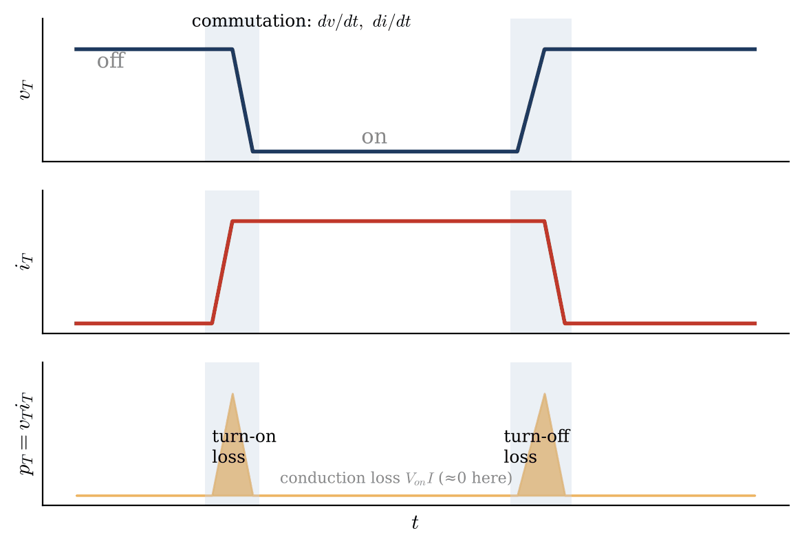

Approximating each transition linearly:

$$
P_{sw} \approx \frac{1}{2} V_d I_o \left(t_{c(on)} + t_{c(off)}\right) f_s
$$

so the switching loss grows in proportion to the switching frequency $f_s$.

### Rated Power vs. Switching Frequency

> [!IMPORTANT]
> **No free lunch!** Devices with a high power rating (thick drift layers, lots of stored charge) switch slowly, while fast devices have lower power ratings. Choosing a device is always a trade-off between power and switching frequency.

## Study Focuses

| Type | Devices | Control |
| --- | --- | --- |
| Uncontrolled | Power diode | Turned on/off by the circuit |
| Semi-controlled | SCR (thyristor) | Gate turns it on, but cannot turn it off |
| Fully controlled | BJT, MOSFET, IGBT | Gate/base turns it both on and off |

## 1-1 Power Diode

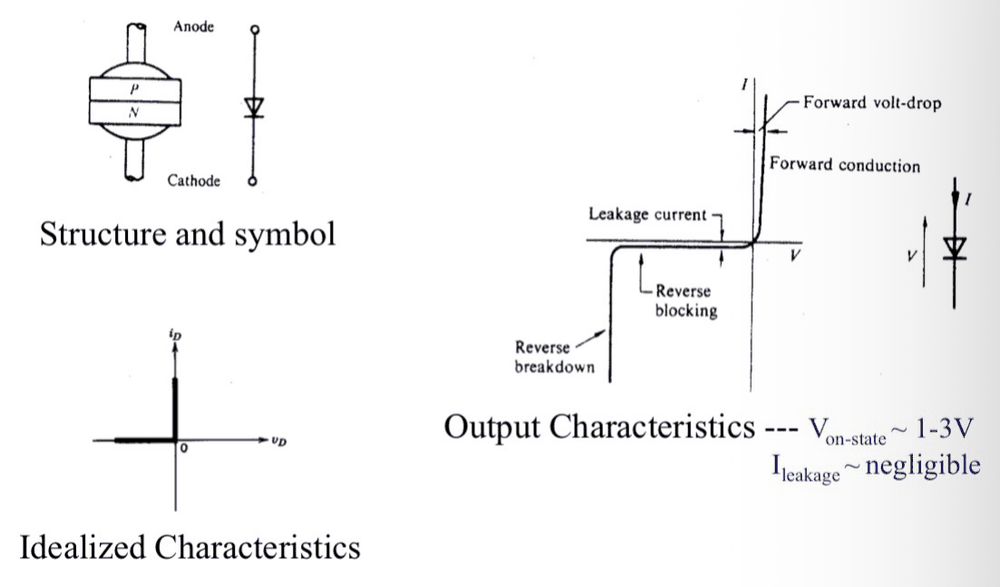

Output characteristics: $V_{on\text{-}state} \approx 1\sim3\ \text{V}$, $I_{leakage}$ is negligible.

Most power diodes are **PiN diodes**: $i$ is a lightly doped $n^-$ epitaxial layer (low carrier density) sandwiched between $p^+$ and $n^+$.

### Why PiN: Low Forward Voltage Drop, High Power

According to Poisson's equation

$$
\nabla^2 \varphi = -\frac{\rho}{\varepsilon}
$$

the field is linear in a doped depletion region and flat in the nearly intrinsic $i$ layer. For the **same voltage** $V$ (the area under $|E(x)|$), the field of a PN junction is triangular, while that of a PiN diode is trapezoidal, so

$$
E'_{max} < E_{max}
$$

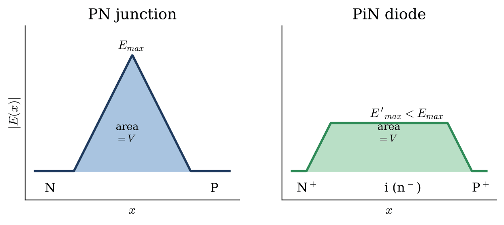

Breakdown happens when the peak field reaches the critical field $E_c$, so a PiN diode can block a much higher voltage for the same peak field.

### ★ Conductivity Modulation

A thick, lightly doped $n^-$ layer would normally mean a large resistance. Under forward bias, however, holes are injected from $p^+$ and electrons from $n^+$, and their density in the $n^-$ region becomes far higher than the background doping. **The on-state resistance is highly reduced due to carrier injection.**

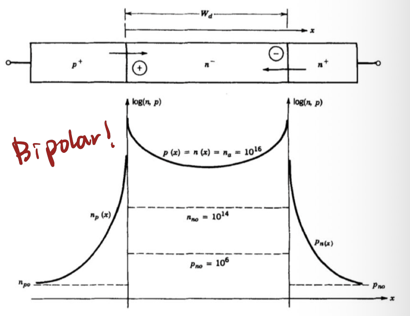

Both electrons and holes take part in conduction, so the device is **bipolar**.

> [!NOTE]
> The price of conductivity modulation is the **stored charge** in the $n^-$ region: it has to be built up at turn-on and removed at turn-off. Every bipolar device (diode, SCR, BJT, IGBT) pays this price in switching speed.

### Typical Diode Switching Transient

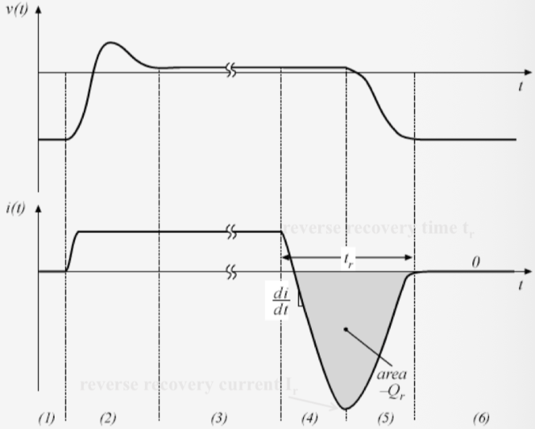

**Turn-on**: conductivity modulation needs time to establish, so the diode transiently has a high resistance and $v(t)$ shows a forward-recovery overshoot before settling to the low on-state drop. The on-state current itself is determined by the converter circuit.

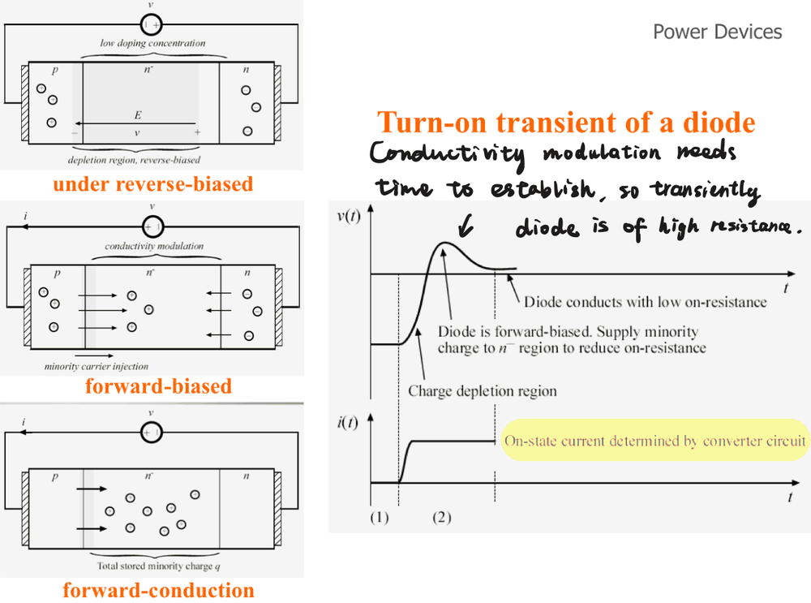

**Turn-off**:

- Interval (4): the current reverses but the diode remains forward-biased while the stored charge in the $n^-$ region is removed.
- Interval (5): the diode becomes reverse-biased and the depletion-region capacitance charges, so the reverse current decays to zero.

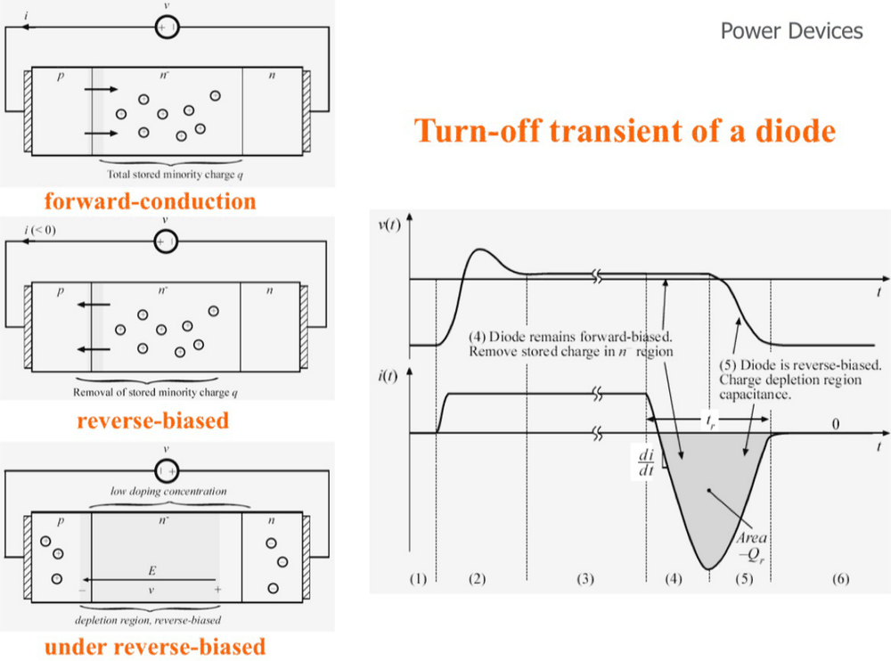

The reverse-recovery time $t_{rr}$ and the recovered charge $Q_r$ (the shaded area) describe this process. With a constant $di/dt$ and a triangular reverse current:

$$
Q_r \approx \frac{1}{2} I_{rr} t_{rr}, \qquad
t_{rr} \approx \sqrt{\frac{2 Q_r}{di/dt}}, \qquad
I_{rr} \approx \sqrt{2 Q_r \frac{di}{dt}}
$$

> [!WARNING]
> The reverse-recovery current flows through the switch that turns on at the same moment, adding to its turn-on loss and causing EMI. In high-frequency converters use **fast-recovery** diodes (or Schottky / SiC diodes, which have almost no $Q_r$).

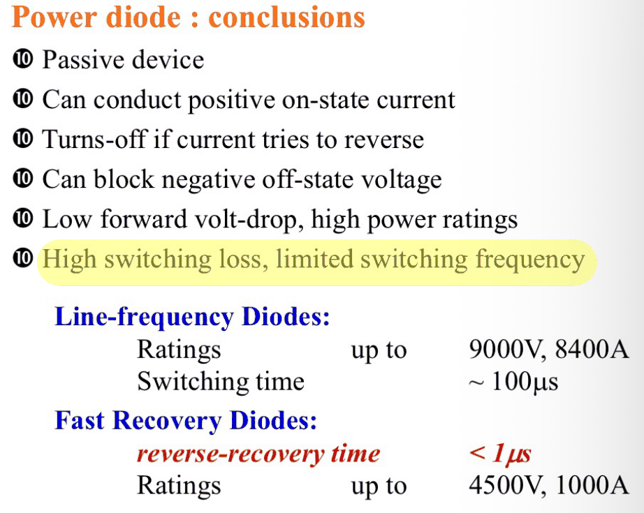

## 1-2 Thyristor (SCR)

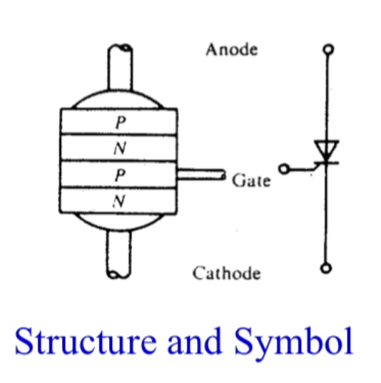 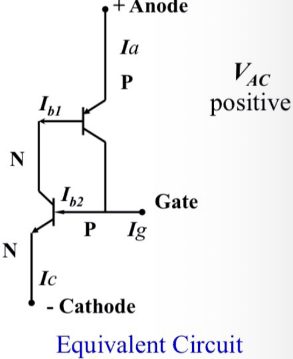

The P-N-P-N structure can be split into a PNP transistor ($P\,N^-P$) and an NPN transistor ($N^-P\,N$) that share the middle layers. The collector of each transistor drives the base of the other:

$$
I_g\,(I_{b2}) \uparrow \;\rightarrow\; I_{b1} \uparrow \;\rightarrow\; I_a \uparrow \;\rightarrow\; I_{b2} \uparrow
$$

This **positive feedback** loop latches the device on. With common-base gains $\alpha_1$, $\alpha_2$ of the two transistors,

$$
I_A = \frac{\alpha_2 I_G + I_{CBO1} + I_{CBO2}}{1 - (\alpha_1 + \alpha_2)}
$$

and the device turns on when $\alpha_1 + \alpha_2 \to 1$.

> [!CAUTION]
> Once latched, **the gate loses control**: the thyristor only turns off when the circuit forces the anode current below the holding current (for example by applying a reverse voltage). That is why it is **semi-controlled**.

When $I_g = 0$, the three junctions are PN, NP, PN. Under a forward anode voltage the middle NP junction is reverse-biased and has a high resistance, which means a very high forward **breakover voltage** is needed to turn the device on. A larger $I_g$ lowers this breakover voltage.

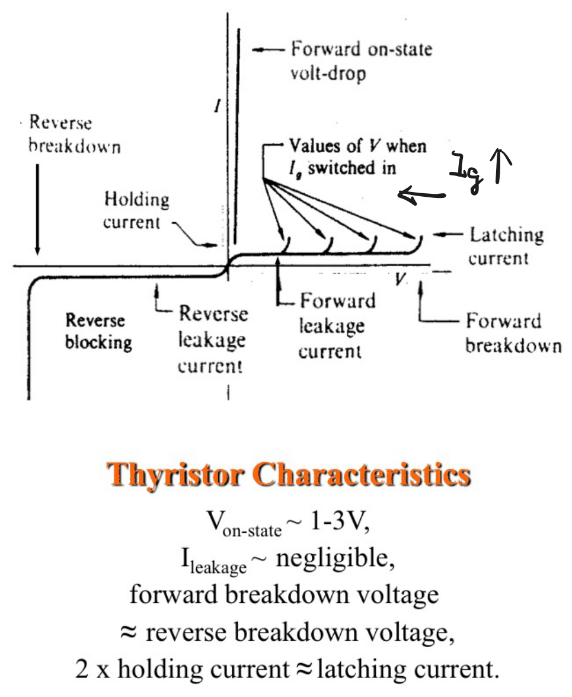

> [!TIP]
> - **Latching current** $I_L$: the minimum anode current that keeps the device on right after the gate pulse is removed.
> - **Holding current** $I_H$: the minimum anode current that keeps an already conducting device on.
>
> $I_L \approx 2 I_H$: the gate pulse must last until the anode current has risen above $I_L$.

### Thyristor in a Circuit

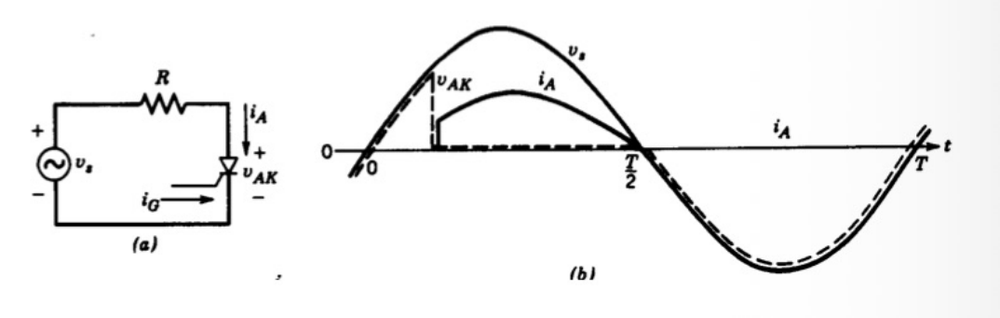

- $v_s > 0$ before the gate pulse: the thyristor blocks forward voltage, $v_{AK} = v_s$, $i_A = 0$.
- When fired: it conducts, $v_{AK} \approx 0$, $i_A = v_s / R$.
- At $T/2$: $i_A$ falls to zero and the thyristor turns off by itself (**line commutation**).
- $v_s < 0$: it blocks reverse voltage until the next gate pulse.

## 1-3 Power Transistor (GTR/BJT)

A power BJT (giant transistor, GTR) is normally an NPN device with an $n^-$ drift layer in the collector to block high voltage. It is **current-controlled**: in the active region $I_C = \beta I_B$.

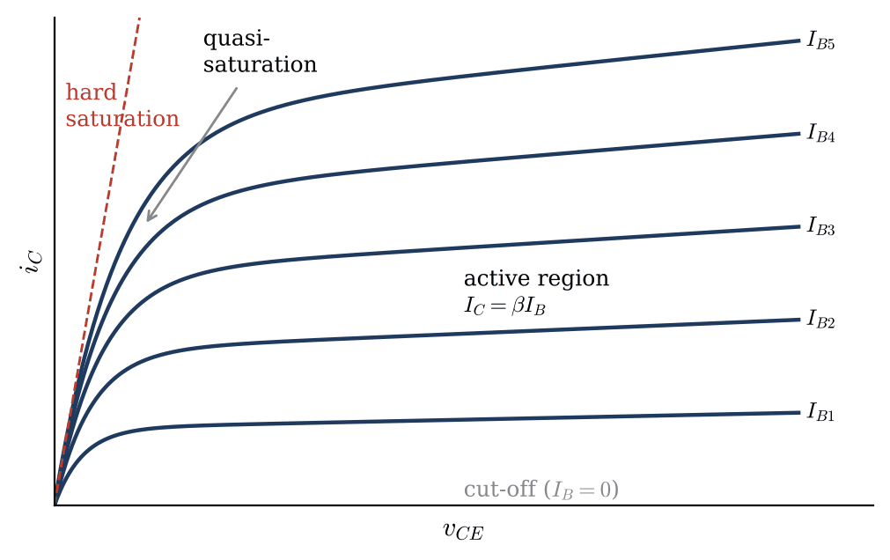

- As a switch it works between **cut-off** ($I_B = 0$) and **saturation** ($I_B > I_C/\beta$), avoiding the active region where $v_{CE} i_C$ is large.
- It is bipolar: the drift region is conductivity-modulated in (quasi-)saturation, so $V_{CE(sat)}$ is low.
- The current gain of a power BJT is small ($\beta \approx 5\sim10$), so a continuous, large base current is needed. Darlington connections are often used.
- Stored charge makes it slow to turn off, and it suffers from **second breakdown**.

Today it has largely been replaced by the MOSFET and the IGBT.

## 1-4 Power MOSFET

N-channel enhancement type, with three terminals: Drain, Gate and Source.

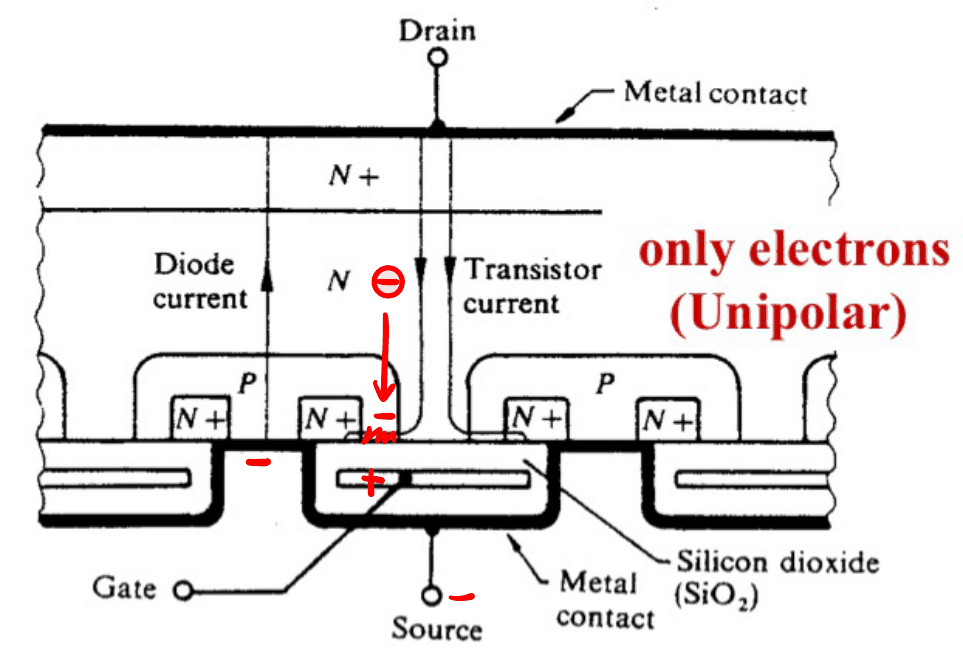

When $V_{GS}$ exceeds the threshold voltage $V_{GS(th)}$, electrons are attracted to the surface of the $P$ body under the gate oxide and form an inversion layer. This turns the $P$ region between $N^+$ (source) and $N^-$ (drift) into an equivalent $N$ channel, so the device acts as an $N$ conductor.

- Carrier: **electron** (unipolar).
> [!TIP]
> The $P$ body and $N^-$ drift region form an **intrinsic body diode**, so a MOSFET can always conduct reverse current. Bridge circuits often use it as the freewheeling diode.

There is **no conductivity modulation**, so $R \uparrow$ (unipolar). The drift-region resistance rises steeply with the blocking voltage, roughly $R_{DS(on)} \propto V_{BR}^{2.5}$.

- **Advantages**: high frequency (no stored minority charge); voltage-controlled with very small gate drive power; positive temperature coefficient of $R_{DS(on)}$, so devices are easy to parallel.
- **Disadvantages**: high on-resistance at high voltage, low power rating.

## 1-5 IGBT (Insulated Gate Bipolar Transistor)

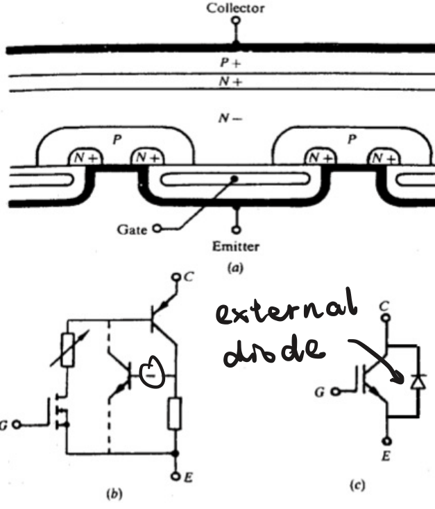

Structure from collector to emitter: $P^+ / N^+ / N^- / P / N^+$. It is a MOSFET with an extra $P^+$ injection layer on the collector side:

- The MOS channel supplies the base current of a **PNP** transistor ($P^+ N^- P$), so the gate is voltage-controlled like a MOSFET.
- Holes injected from $P^+$ **conductivity-modulate** the $N^-$ region, so the on-state drop is low like a BJT and the device handles high voltage and high current.
- At turn-off the stored holes cause a **tail current**, so an IGBT is slower than a MOSFET.

> [!CAUTION]
> - A parasitic NPN ($N^+ P N^-$) together with the PNP forms a thyristor. If it **latches up**, the gate loses control; the $P$-body shorting resistor in the equivalent circuit is designed to prevent this.
> - The $P^+$ collector blocks reverse current, so unlike a MOSFET there is **no body diode**: an external anti-parallel diode is packaged with it.
### Comparison

| Device | Control | Carriers | Typical frequency | Power level |
| --- | --- | --- | --- | --- |
| Diode | none | bipolar | line ~ fast recovery | very high |
| SCR | gate on only, current pulse | bipolar | line frequency | highest |
| BJT (GTR) | base current | bipolar | ~ kHz | medium |
| MOSFET | gate voltage | unipolar | up to MHz | low ~ medium |
| IGBT | gate voltage | bipolar | ~ tens of kHz | medium ~ high |
