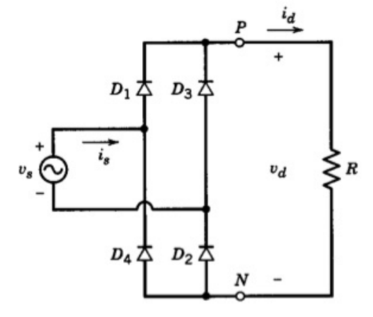
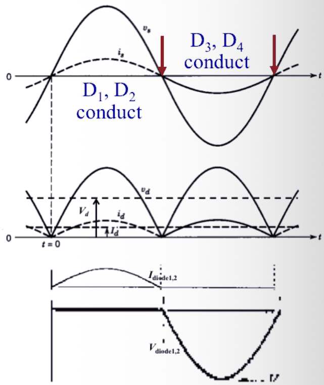
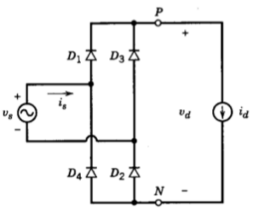
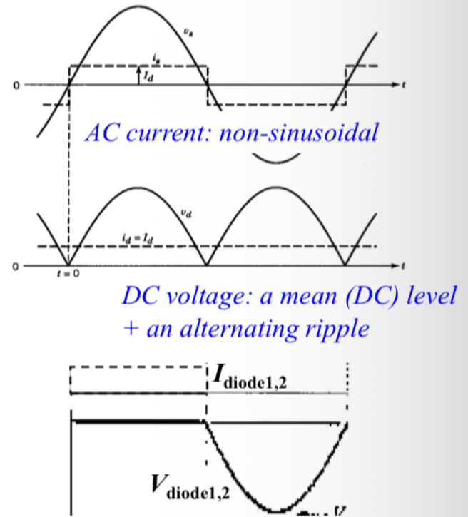
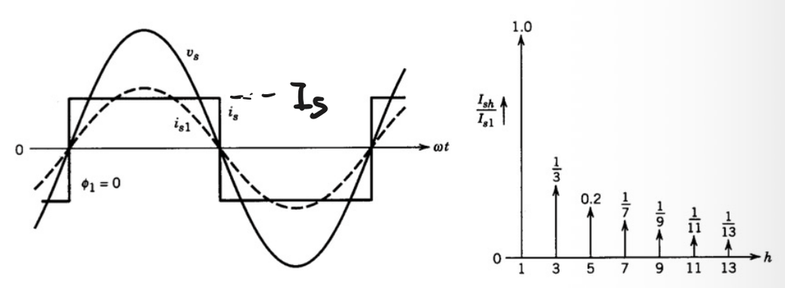
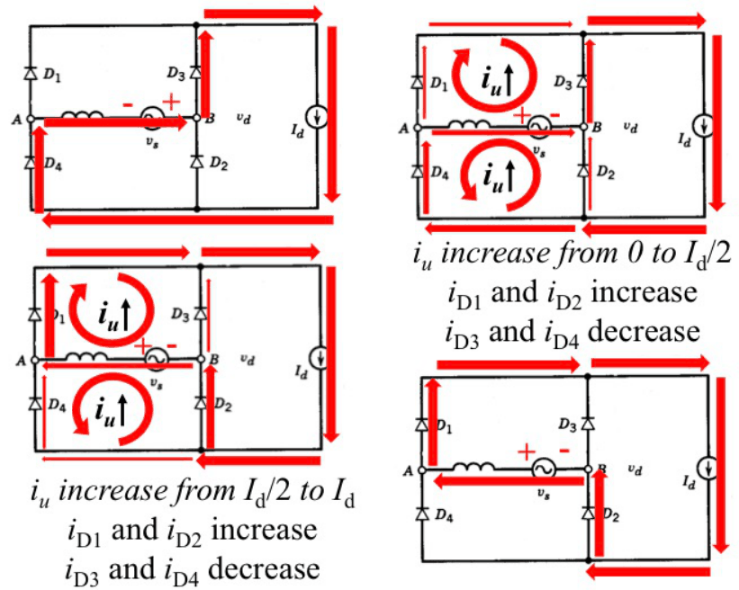
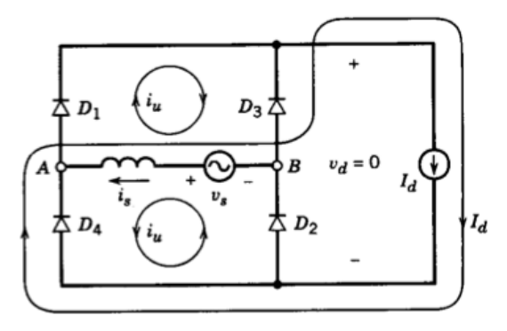
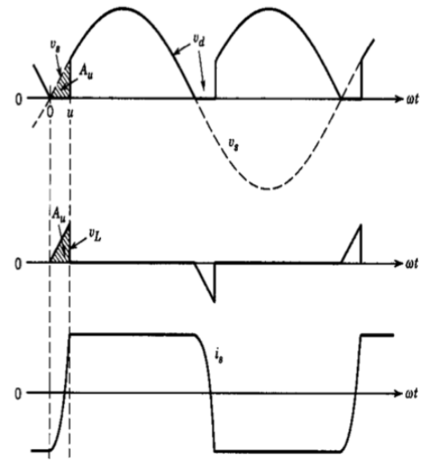
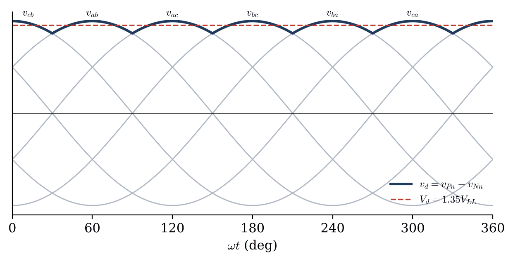

## Single-phase Bridge

### Pure Resistive Load

 

- AC input: $v_s$, $i_s$
- DC output: $v_d$, $i_d$

$$
\boxed{V_d = \frac{2}{\pi} V_{s,max} \approx 0.9\,V_s, \qquad I_d = \frac{V_d}{R}}
$$

where $V_s$ is the rms value of $v_s$.

### Idealized Inductive Load

A line-frequency uncontrolled rectifier usually feeds a large inductance, so the load (an $R$-$L$ load with very large $L$) is idealized as a constant current source $i_d = I_d$.

 

- AC input: $v_s$, $i_s$ (a square wave of amplitude $I_d$)
- DC output: $v_d$, $i_d$

$$
\boxed{V_d = \frac{2}{\pi} V_{max}, \qquad I_d = \frac{V_d}{R}}
$$

## Supplement: Harmonic Analysis

A periodic waveform can be written as its Fourier series:

$$
f = f_{mean} + \sum_{n} a_n \sin n\omega t + \sum_{n} b_n \cos n\omega t
$$

$$
f_{rms} = \left(f_{mean}^2 + \sum_{n} f_{n(rms)}^2\right)^{\frac{1}{2}}, \qquad
f_{R(rms)} = \left(\sum_{n} f_{n(rms)}^2\right)^{\frac{1}{2}}
$$

where $f_{R(rms)}$ is the rms value of the ripple (all AC components).

$$
\boxed{
\text{Ripple factor: } \gamma_f = \frac{f_{R(rms)}}{f_{mean}}, \qquad
\text{Distortion factor: } \xi_f = \frac{f_{1(rms)}}{f_{rms}}
}
$$

> [!NOTE]
> The ripple factor describes the **DC side** (how far $v_d$ is from pure DC), the distortion factor describes the **AC side** (how far $i_s$ is from a sine wave).

A related index is the total harmonic distortion:

$$
THD = \frac{\sqrt{f_{rms}^2 - f_{1(rms)}^2}}{f_{1(rms)}} = \sqrt{\frac{1}{\xi_f^2} - 1}
$$

## Power Factor

**Definition**:

$$
\lambda = \frac{P}{S}
$$

- $P$, active power:

$$
P = U_0 I_0 + \sum_n U_{n(rms)} I_{n(rms)} \cos\varphi_n
$$

- $S$, apparent power:

$$
S = U_{rms} I_{rms}
$$

With a **sinusoidal supply**, $U_{rms} = U_{1(rms)}$ and only the fundamental current carries active power:

$$
P = U_{1(rms)} I_{1(rms)} \cos\phi_1, \qquad S = U_{1(rms)} I_{rms}
$$

Thus:

$$
\boxed{\lambda = \xi_1 \cos\phi_1, \qquad \xi_1 = \frac{I_{1(rms)}}{I_{rms}}}
$$

- $\xi_1$: input current distortion factor
- $\cos\phi_1$: input displacement factor

> [!IMPORTANT]
> With non-sinusoidal current, $PF \neq \cos\phi$. A rectifier can have $\cos\phi_1 = 1$ and still a poor power factor because of its harmonic currents.

## Power Factor of the Single-phase Bridge

The input current is a square wave of amplitude $I_d$, so $I_s = I_d$ and its harmonics are $I_{sh} = I_{s1}/h$ for odd $h$:

$$
I_{s1} = \frac{4}{\pi} \times \frac{1}{\sqrt{2}} I_s \approx 0.9\,I_s
$$

$$
\xi = I_{s1} / I_s = 0.9
$$

$$
PF = \xi \cos\phi_1 = 0.9 \quad (\phi_1 = 0)
$$

## Considering AC-side Inductance

The supply has an inductance $L_s$, so $i_s$ cannot reverse instantly. The current transfers from $D_3, D_4$ to $D_1, D_2$ gradually.

During the commutation period, $D_1 \sim D_4$ are all on, so $v_d = 0$.

The whole supply voltage is across $L_s$:

$$
v_s = V_{s,max} \sin\omega t = L_s \frac{di_s}{dt}
$$

With the initial condition $[\,t = 0,\ i_s = -I_d\,]$:

$$
i_s = \frac{V_{s,max}}{\omega L_s} (1 - \cos\omega t) - I_d
$$

When $\omega t = u$ (the **overlap angle**), $i_s = I_d$:

$$
I_d = \frac{V_{s,max}}{\omega L_s} (1 - \cos u) - I_d
$$

Thus:

$$
\boxed{\cos u = 1 - \frac{2\omega L_s I_d}{V_{s,max}}}
$$

$$
\boxed{V_d = \frac{1}{\pi}\int_u^{\pi} V_{s,max}\sin\theta\, d\theta = \frac{V_{max}}{\pi}(1 + \cos u)}
$$

Substituting $\cos u$:

$$
V_d = \frac{2}{\pi}V_{s,max} - \frac{2\omega L_s}{\pi} I_d \approx 0.9\,V_s - \frac{2\omega L_s}{\pi} I_d
$$

> [!TIP]
> The lost volt-seconds $A_u$ make $V_d$ drop linearly with $I_d$, as if the rectifier had an internal resistance $\frac{2\omega L_s}{\pi}$. This "resistance" consumes no power: it only delays the current transfer.

## Three-phase Diode Bridge

Six diodes: the top group connects the most positive phase to $P$, the bottom group the most negative phase to $N$. So $v_d$ is the envelope of the six line-to-line voltages, a **six-pulse** waveform.

Each pulse lasts $60^\circ$ around the peak of a line voltage:

$$
\boxed{V_d = \frac{3}{\pi} V_{LL,max} = \frac{3\sqrt{2}}{\pi} V_{LL} \approx 1.35\,V_{LL}}
$$

With a constant-current load, each phase current is a $120^\circ$ quasi-square wave:

$$
I_s = \sqrt{\tfrac{2}{3}}\, I_d \approx 0.816\, I_d, \qquad
I_{s1} = \frac{\sqrt{6}}{\pi} I_d \approx 0.78\, I_d
$$

$$
PF = \frac{I_{s1}}{I_s}\cos 0 = \frac{3}{\pi} \approx 0.955
$$

Its harmonics are $h = 6k \pm 1$ (5, 7, 11, 13, …) with $I_{sh} = I_{s1}/h$. Including the AC-side inductance $L_s$:

$$
V_d = 1.35\,V_{LL} - \frac{3\omega L_s}{\pi} I_d
$$
