## A Simple Circuit

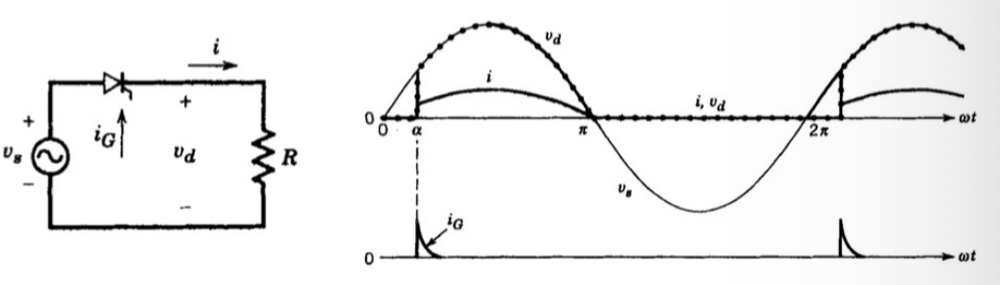

The output is **controlled by the firing delay angle** $\alpha$, measured relative to the zero crossing of the supply voltage:

$$
V_d = \frac{1}{2\pi}\int_{\alpha}^{\pi} V_{s,max}\sin\theta\, d\theta
= \frac{1}{2\pi} V_{s,max}(1 + \cos\alpha)
$$

★ **Significance**: by changing $\alpha$, we can control $V_d$ to the value we demand.

## How to Get the Gate-trigger Signal?

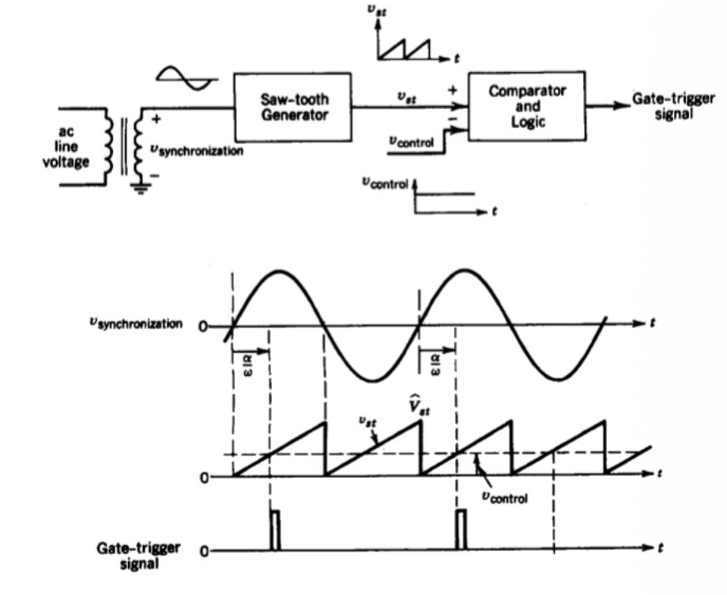

1. A synchronizing transformer takes $v_{synchronization}$ from the AC line, so the firing is locked to the supply.
2. A saw-tooth generator produces $v_{st}$, which starts from zero at every zero crossing of the supply.
3. A comparator compares $v_{st}$ with the control voltage $v_{control}$ and gives a gate pulse at the crossing point.

The delay angle is therefore proportional to the control voltage:

$$
\alpha^\circ = 180^\circ \times \frac{v_{control}}{\hat{V}_{st}}
$$

## Single-phase Bridge

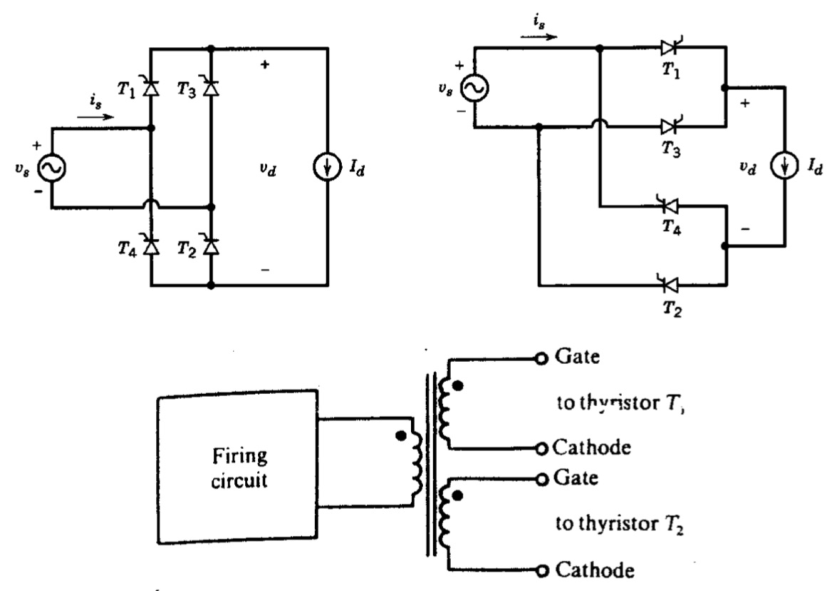

$T_1, T_2$ are fired at $\alpha$ and $T_3, T_4$ at $\pi + \alpha$. The cathodes of $T_1$ and $T_2$ are at different potentials, so the firing circuit drives them through an isolating pulse transformer.

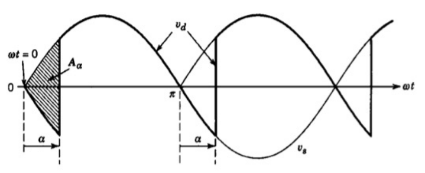

With a constant $I_d$, each pair of thyristors conducts for $180^\circ$:

$$
V_d = \frac{1}{\pi}\int_{\alpha}^{\pi + \alpha} V_{s,max}\sin\theta\, d\theta
$$

$$
\boxed{V_d = \frac{2}{\pi} V_{s,max}\cos\alpha \approx 0.9\,V_s\cos\alpha}
$$

- When $\alpha \in (0, \frac{\pi}{2})$: $V_d > 0$, **rectifier**;
- When $\alpha \in (\frac{\pi}{2}, \pi)$: $V_d < 0$, **inverter**;
- When $\alpha > \pi$: it can't work.

$I_d$ can only be positive while $V_d$ can take both signs: **two-quadrant** operation!

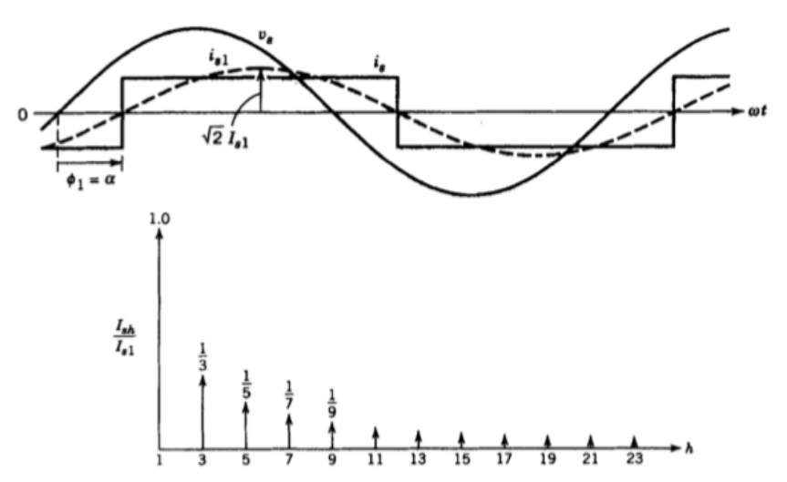

The input current is the same square wave as in the diode bridge, but shifted by $\alpha$, so $\phi_1 = \alpha$:

$$
\boxed{I_{s1} = 0.9\,I_d, \qquad PF = 0.9\cos\alpha}
$$

The converter therefore draws reactive power $Q_1 = V_s I_{s1}\sin\alpha$ from the supply, and a deep phase control means a poor power factor.

## Single-phase Bridge Considering AC-side Inductance

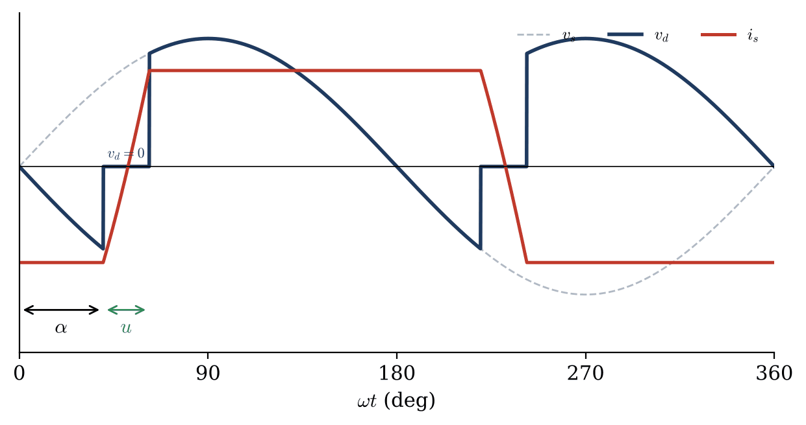

As in the diode bridge, all four thyristors conduct during the overlap $u$ and $v_d = 0$. The commutation now starts at $\alpha$ instead of $0$:

$$
\cos(\alpha + u) = \cos\alpha - \frac{2\omega L_s I_d}{\sqrt{2}\,V_s}
$$

$$
\boxed{V_d = \frac{\sqrt{2}\,V_s}{\pi}\left[\cos\alpha + \cos(\alpha + u)\right]
= 0.9\,V_s\cos\alpha - \frac{2\omega L_s}{\pi} I_d}
$$

where $\sqrt{2}\,V_s = V_{s,max}$.

## Inverting Mode (α > 90°)

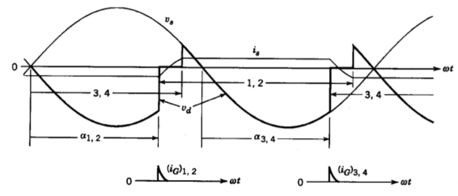

With $V_d < 0$ and $I_d > 0$, power flows from the DC side back to the AC supply (the DC side needs a source, e.g. a motor or a battery).

$$
\textbf{Extinction angle: } \gamma = 180^\circ - \alpha - u, \qquad \gamma_{min} > 5^\circ
$$

After commutation the outgoing thyristor needs a period of reverse voltage to regain its blocking ability, so $\gamma$ must be larger than $\omega t_q$ ($t_q$: turn-off time) plus a safety margin. Otherwise it conducts again and the inverter suffers a **commutation failure**, which limits the maximum $\alpha$.

## Three-phase Thyristor Bridge

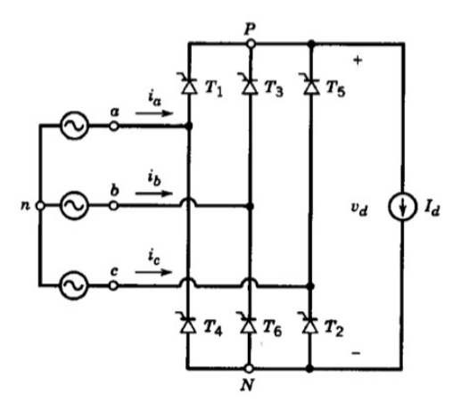

$$
\boxed{V_d = \frac{3}{\pi} V_{LL,max}\cos\alpha = 1.35\,V_{LL}\cos\alpha}
$$

where $V_{LL,max}$ is the peak line-to-line voltage.

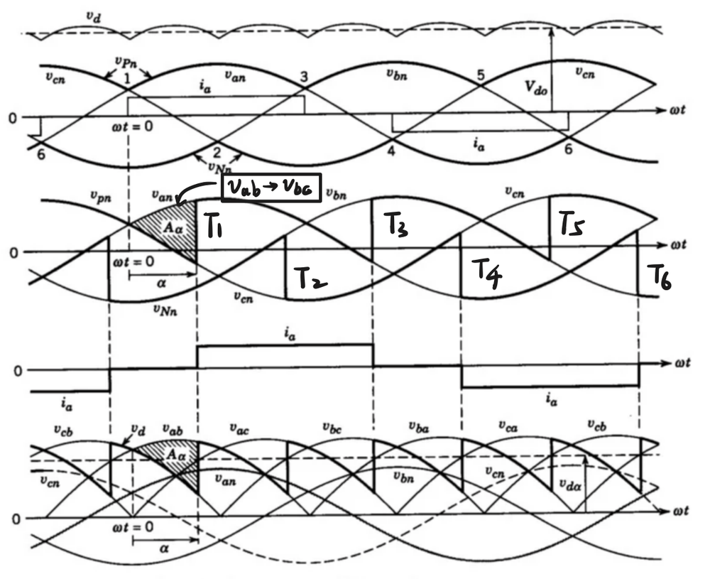

The thyristors are fired in the order $T_1 \to T_2 \to \cdots \to T_6$, one every $60^\circ$. The delay $\alpha$ is measured from the natural commutation point. At each firing $v_d$ moves to the next line voltage (e.g. $v_{ab} \to v_{ac}$ when $T_2$ takes over from $T_6$). Each thyristor conducts for $120^\circ$.

**Starting problem**: two thyristors (one in the upper group, one in the lower group) must be fired at the same time to start the current flow. In practice a double pulse or a wide pulse (> $60^\circ$) is used.

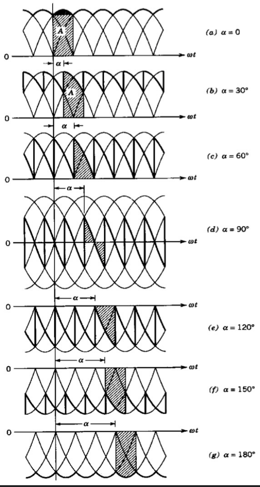

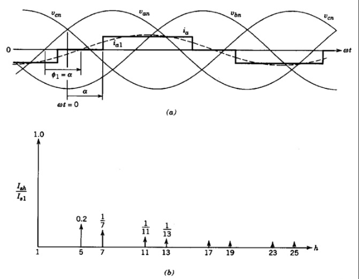

$$
\boxed{I_{s1} = 0.78\,I_d, \qquad PF = 0.955\cos\alpha}
$$

**Detail**:

$$
PF = \xi_1\cos\alpha, \qquad \xi_1 = \frac{I_{1(rms)}}{I_{(rms)}}
$$

$$
I_{1(rms)} = I_{s1} = 0.78\,I_d, \qquad I_{(rms)} = \sqrt{\tfrac{2}{3}}\, I_d
$$

Thus:

$$
PF = 0.955\cos\alpha, \qquad 0.955 = 0.78 \times \sqrt{\tfrac{3}{2}} = \frac{3}{\pi}
$$

## Three-phase Bridge Considering AC-side Inductance

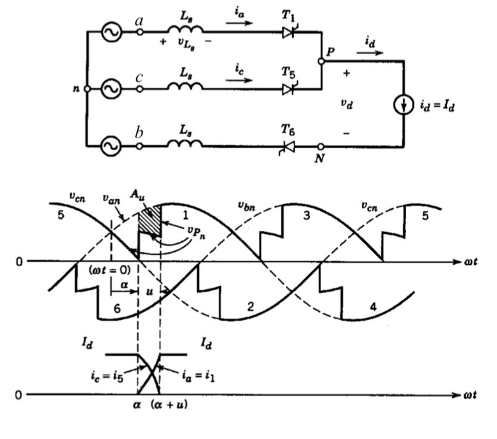

During the commutation from $T_5$ to $T_1$, both conduct, and $v_P$ equals the average of $v_{an}$ and $v_{cn}$. The lost area $A_u$ reduces the output voltage:

$$
\cos(\alpha + u) = \cos\alpha - \frac{2\omega L_s I_d}{\sqrt{2}\,V_{LL}}
$$

$$
V_d = 1.35\,V_{LL}\cos\alpha - \frac{3\omega L_s}{\pi} I_d
$$

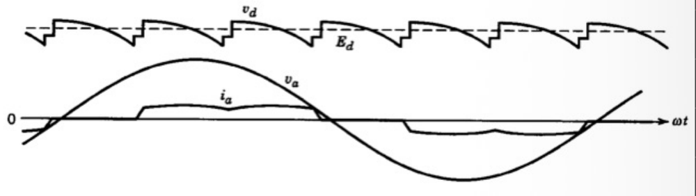

The commutation also produces **notches** in the line voltage, and the line current becomes a trapezoid instead of a quasi-square wave.
