## Basic Principle

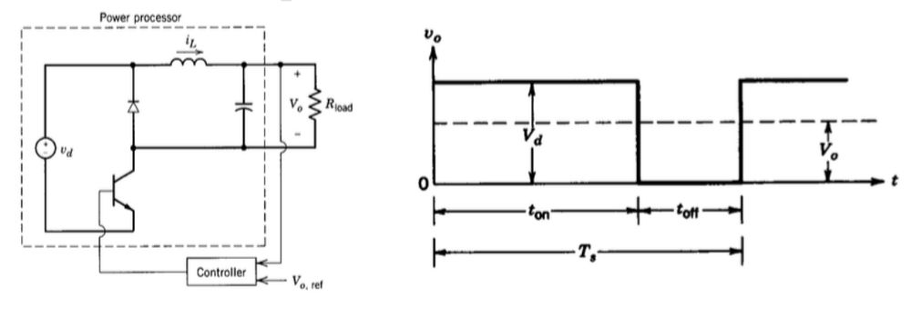

$$
V_o = \frac{1}{T_s}\int_0^{t_{on}} v_o\, dt = \frac{t_{on}}{T_s} V_d = f_s t_{on} V_d = D\,V_d
$$

where $D = t_{on}/T_s$ is the **duty ratio**.

Two methods to control $V_o$:

1. Frequency fixed, on-duration adjusted: **PWM** (pulse-width modulation);
2. Both frequency and on-duration adjusted.

PWM is the usual choice: with a fixed $f_s$ the harmonics sit at known frequencies, which makes the filter design much easier.

**Commutation**:

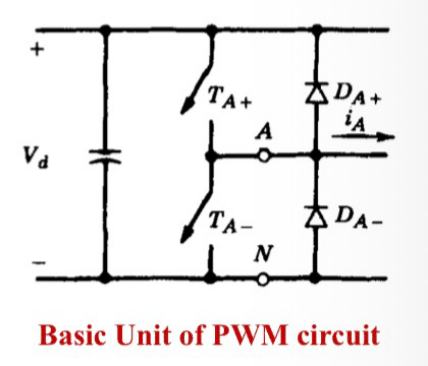

A controllable switch and a diode form one leg. Whichever way the current $i_A$ flows, either a switch or the diode of the same position carries it, so $v_{AN}$ is set only by the switching state:

- $T_{A+}$ on (or $D_{A+}$ conducting): $v_{AN} = V_d$
- $T_{A-}$ on (or $D_{A-}$ conducting): $v_{AN} = 0$

All the converters below are built from this unit.

## 1. Buck Regulators

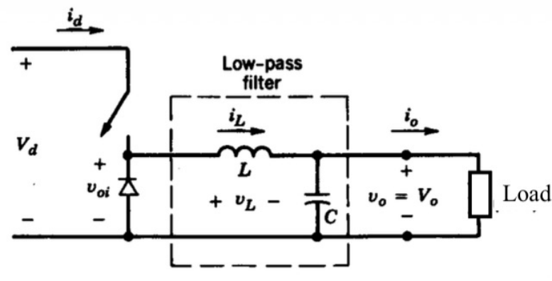

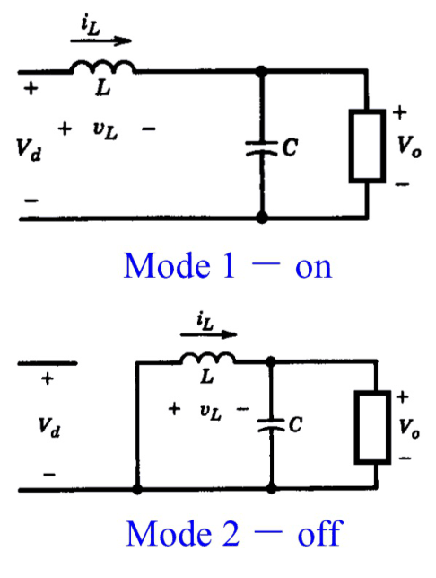

**Assumptions**:

1. Steady state: $I_C = 0$, $I_L = I_o$, $V_L = 0$ over a cycle (averages);
2. Continuous conduction: $i_L$ stays positive and continuous;
3. Large $C$: $V_C = \text{const}$.

The inductor current rises by $\Delta I_L$ while on and falls by the same amount while off:

$$
\begin{cases}
V_d - V_o = L\dfrac{\Delta I_L}{t_{on}} \\[2mm]
-V_o = -L\dfrac{\Delta I_L}{t_{off}}
\end{cases}
$$

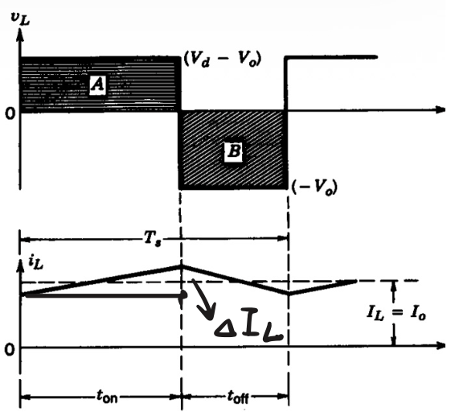

Together with the power balance $V_d I_d = V_o I_o$:

$$
\boxed{V_o = D\,V_d, \qquad I_d = D\,I_o}
$$

$$
\boxed{\Delta I_L = \frac{V_d D(1-D)}{f_s L}}
$$

### Output Voltage Ripple

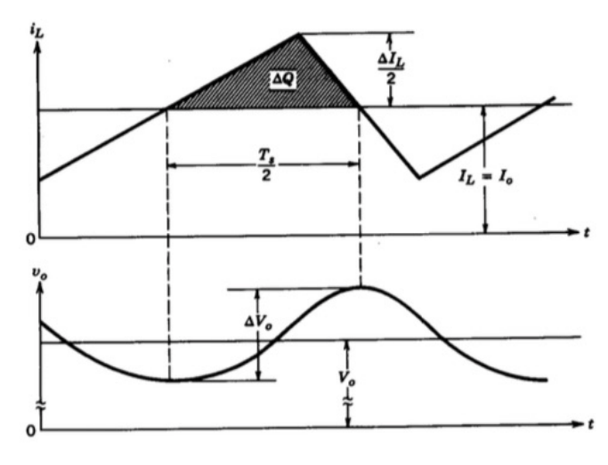

The ripple current of $i_L$ flows into $C$. The charge $\Delta Q$ is the triangle above $I_o$ over $T_s/2$:

$$
\Delta V_o = \frac{\Delta Q}{C} = \frac{1}{8C}\Delta I_L T_s = \boxed{\frac{V_d D(1-D)}{8LC f_s^2}}
$$

In relative terms, with the filter corner frequency $f_c = \frac{1}{2\pi\sqrt{LC}}$:

$$
\frac{\Delta V_o}{V_o} = \frac{(1-D)}{8LC f_s^2} = \frac{\pi^2}{2}(1-D)\left(\frac{f_c}{f_s}\right)^2
$$

so choosing $f_c \ll f_s$ keeps the ripple small.

### Discontinuous Conduction

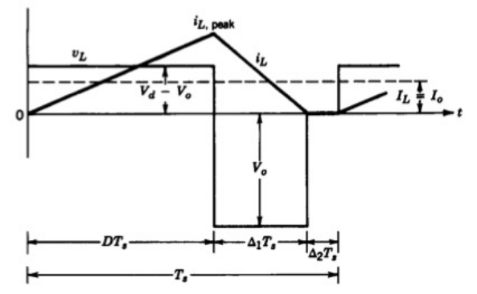

At light load $i_L$ falls to zero before the end of the period. **Boundary** between continuous and discontinuous conduction:

$$
I_{LB} = I_{oB} = \frac{1}{2}\Delta I_L, \qquad \Delta I_L = \frac{V_d D(1-D)}{f_s L}
$$

The period now has three intervals, $T_s = DT_s + \Delta_1 T_s + \Delta_2 T_s$, where $\Delta_2 T_s$ is the interval with $i_L = 0$.

Steady state still holds: average $V_L = 0$, $I_C = 0$, $I_L = I_o$, $V_C = \text{const}$. Then:

$$
(V_d - V_o)D = V_o \Delta_1 \;\Rightarrow\; \boxed{\frac{V_o}{V_d} = \frac{D}{D + \Delta_1}}
$$

$$
I_o = \frac{1}{2} i_{L,peak}(D + \Delta_1), \quad i_{L,peak} = \frac{V_o \Delta_1}{f_s L}
\;\Rightarrow\; \boxed{\Delta_1 = \frac{2 f_s L}{V_d D} I_o}
$$

In DCM the output voltage depends on the load current, not on $D$ alone.

**Conclusion of Buck**:

1. Step down ($D < 1$);
2. Simple, only one active device;
3. High efficiency.

The input current is pulsating, so an input filter is usually needed.

## 2. Boost Regulators

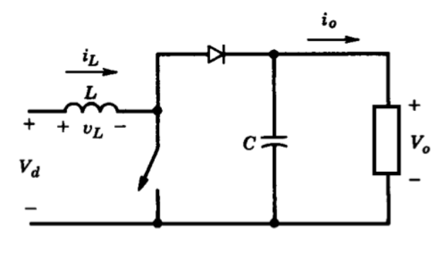

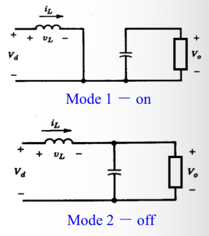

$$
\begin{cases}
V_d = L\dfrac{\Delta I_L}{t_{on}} \\[2mm]
V_d - V_o = -L\dfrac{\Delta I_L}{t_{off}}
\end{cases}
$$

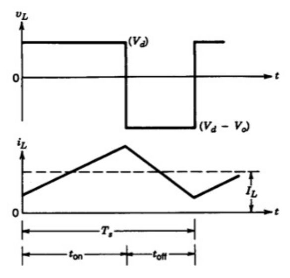

The average $V_L = 0$, so:

$$
\boxed{V_o = \frac{V_d}{1 - D}}
$$

With $V_d I_d = V_o I_o$:

$$
\boxed{I_d = \frac{I_o}{1 - D}}
$$

And:

$$
\boxed{\Delta I_L = \frac{V_d D}{f_s L}}
$$

### Output Voltage Ripple

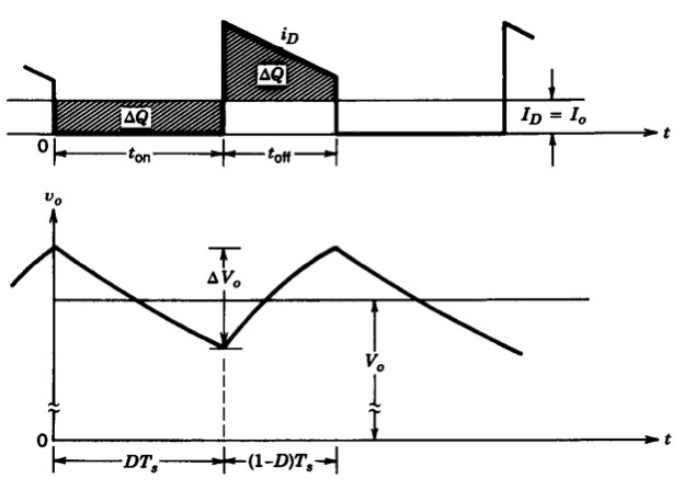

While the switch is on, the capacitor alone supplies $I_o$ for $DT_s$:

$$
\Delta V_o = \frac{\Delta Q}{C} = \frac{I_o D T_s}{C}
\;\Rightarrow\; \boxed{\Delta V_o = \frac{I_o D}{f_s C}}
$$

### Discontinuous Conduction

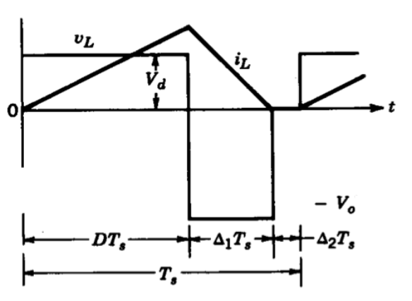

**Boundary**:

$$
I_{LB} = \frac{1}{2}\Delta I_L, \qquad I_{oB} = (1 - D) I_{LB}
$$

(the output current is the diode current, which flows only during $t_{off}$).

In DCM, the volt-second balance $V_d D = (V_o - V_d)\Delta_1$ gives:

$$
\boxed{\frac{V_o}{V_d} = \frac{D + \Delta_1}{\Delta_1}, \qquad \Delta_1 = \frac{2 f_s L}{V_d D} I_o}
$$

At light load $\Delta_1 \to 0$ and $V_o$ rises sharply, so a boost converter must never run without load unless the duty ratio is controlled.

## 3. Buck-Boost Regulators

**Cascade of Buck and Boost**:

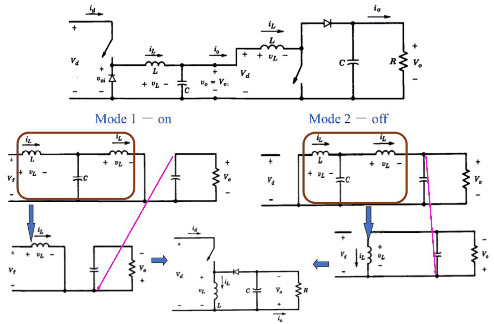

Merging the two stages and removing the redundant middle capacitor and switch leaves a single inductor that is charged from $V_d$ when on and discharged into the output when off. The output polarity is **reversed**.

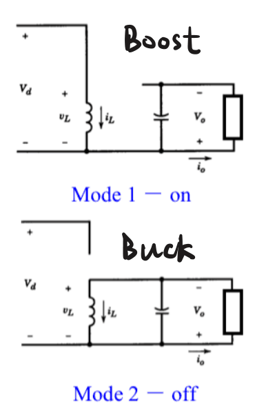

**CCM**: volt-second balance $V_d D = V_o(1 - D)$:

$$
\boxed{V_o = \frac{V_d D}{1 - D}}
$$

$D$ in the numerator comes from the buck stage, $1 - D$ in the denominator from the boost stage: $D < 0.5$ steps down, $D > 0.5$ steps up.

$$
\boxed{I_d = \frac{I_o D}{1 - D}}
$$

$\Delta I_L$ is the same as Boost:

$$
\boxed{\Delta I_L = \frac{V_d D}{f_s L}}
$$

$\Delta V_o$ is the same as Boost:

$$
\boxed{\Delta V_o = \frac{I_o D}{f_s C}}
$$

**DCM**:

$$
\text{Boundary: } I_{LB} = \frac{1}{2}\Delta I_L, \qquad I_{oB} = I_{LB}(1 - D), \qquad \Delta I_L = \frac{V_d D}{f_s L}
$$

$$
\Delta_1 = \frac{2 f_s L}{V_d D} \cdot I_o, \qquad \frac{V_o}{V_d} = \frac{D}{\Delta_1}
$$

(from the volt-second balance $V_d D = V_o \Delta_1$).

## 4. Ćuk Regulators

**Cascade of Boost and Buck**:

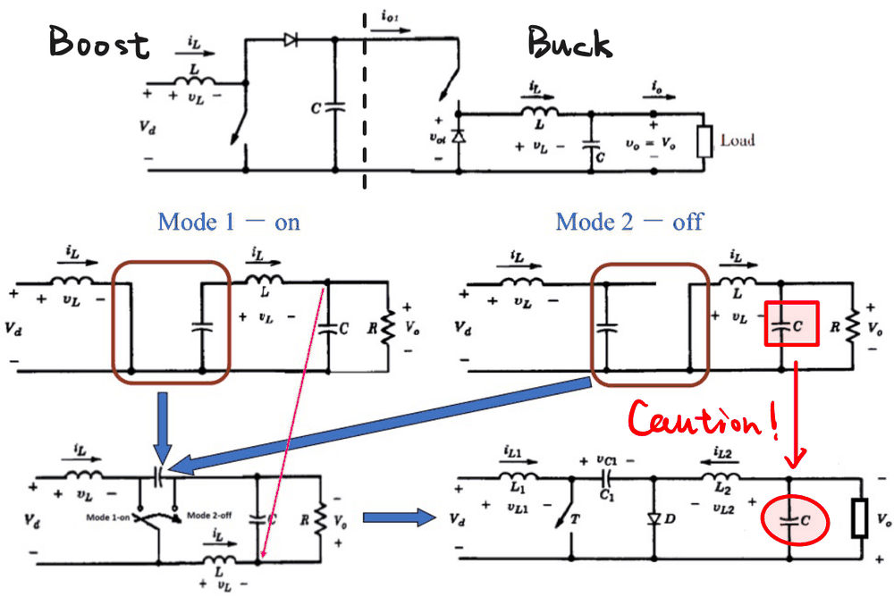

**Caution!** After the middle stage is replaced by the coupling capacitor $C_1$, the output capacitor and the load voltage are **reversed**.

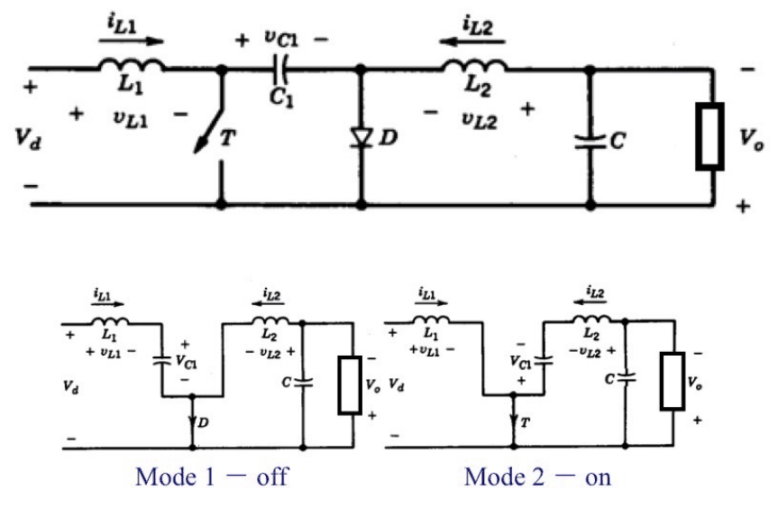

Energy is transferred from the input to the output through $C_1$. In steady state with large capacitors:

- Switch off: $i_{L1}$ charges $C_1$ through $D$, $v_{L1} = V_d - V_{C1}$; $L_2$ freewheels through $D$, $v_{L2} = -V_o$.
- Switch on: $C_1$ discharges into $L_2$ and the load through $T$, $v_{L2} = V_{C1} - V_o$; $v_{L1} = V_d$.

Volt-second balance on $L_1$ and $L_2$:

$$
V_d D + (V_d - V_{C1})(1 - D) = 0 \;\Rightarrow\; V_{C1} = \frac{V_d}{1 - D}
$$

$$
(V_{C1} - V_o) D - V_o (1 - D) = 0 \;\Rightarrow\; V_o = D\,V_{C1}
$$

$$
\boxed{\frac{V_o}{V_d} = \frac{D}{1 - D}}
$$

This is the same ratio as the buck-boost (also inverted). Inductors on both sides make both the **input and the output current continuous** with small ripple. The drawback is that $C_1$ carries a large ripple current.

## 5. Full-bridge Regulator

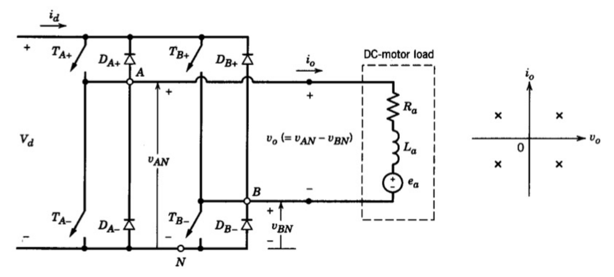

**Four-quadrant** operation is possible, in order to get $v_o\ \pm$ and $i_o\ \pm$.

**Basic principles**:

- $(T_{A+}, T_{A-}) = (1, 0)$ or $(0, 1)$: $v_{AN} = V_d$ or $0$. The same applies to $T_{B+}$, $T_{B-}$: $v_{BN} = V_d$ or $0$. Output $v_o = v_{AN} - v_{BN}$.
- $D_{A\pm}$ and $D_{B\pm}$ carry the current when it flows against the switch that is on, because $T_A$ and $T_B$ can't conduct in reverse.

| $(T_A, T_B)$ | $v_o$ | $i_o > 0$ | $i_o < 0$ | $i_d$ |
| --- | --- | --- | --- | --- |
| $(1, 0)$ | $+V_d$ | $T_{A+}$, $T_{B-}$ | $D_{A+}$, $D_{B-}$ | $i_o$ |
| $(0, 1)$ | $-V_d$ | $D_{A-}$, $D_{B+}$ | $T_{A-}$, $T_{B+}$ | $-i_o$ |
| $(1, 1)$ | $0$ | freewheel: $T_{A+}$, $D_{B+}$ | freewheel: $D_{A+}$, $T_{B+}$ | $0$ |
| $(0, 0)$ | $0$ | freewheel: $D_{A-}$, $T_{B-}$ | freewheel: $T_{A-}$, $D_{B-}$ | $0$ |

($T_A = 1$ means $T_{A+}$ on and $T_{A-}$ off. In the last two rows the current circulates inside the bridge and the DC source supplies nothing.)

### PWM with Bipolar Voltage Switching

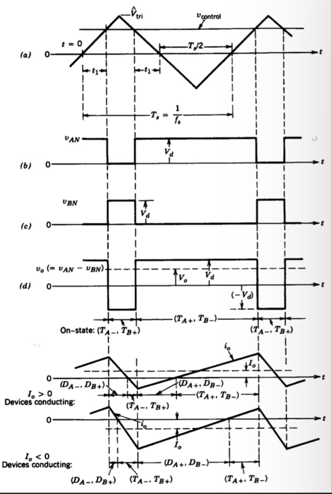

$v_{tri}$ is compared with $v_{control}$:

- $v_{control} > v_{tri}$: $T_{A+}$, $T_{B-}$ on, $v_{AN} = +V_d$, $v_{BN} = 0$, $v_o = +V_d$;
- $v_{control} < v_{tri}$: $T_{A-}$, $T_{B+}$ on, $v_{AN} = 0$, $v_{BN} = +V_d$, $v_o = -V_d$.

The output jumps between $+V_d$ and $-V_d$, hence "bipolar". With the duty ratio $D_1$ of the pair $(T_{A+}, T_{B-})$:

$$
D_1 = \frac{1}{2}\left(1 + \frac{v_{control}}{\hat{V}_{tri}}\right), \qquad
V_o = (2D_1 - 1)V_d = \boxed{\frac{V_d}{\hat{V}_{tri}}\, v_{control}}
$$

so the average output voltage is linear in $v_{control}$.

### PWM with Unipolar Voltage Switching

The two legs are controlled separately: leg A compares $v_{control}$ with $v_{tri}$, and leg B compares $-v_{control}$ with $v_{tri}$. Now $v_o$ switches between $+V_d$ and $0$ (or $0$ and $-V_d$).

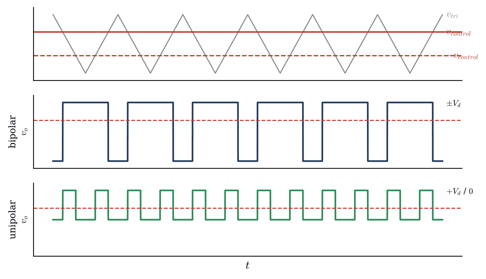

- The average $V_o = \dfrac{V_d}{\hat{V}_{tri}}\, v_{control}$ is the same as for bipolar switching;
- The voltage steps are only $V_d$ instead of $2V_d$, and the effective switching frequency of $v_o$ is **doubled**, so the output ripple is much smaller.
