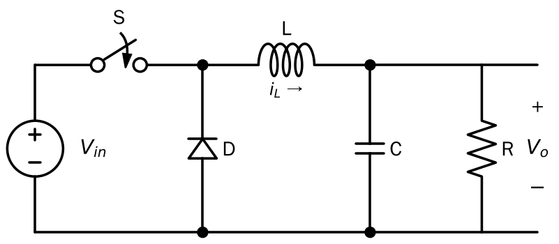
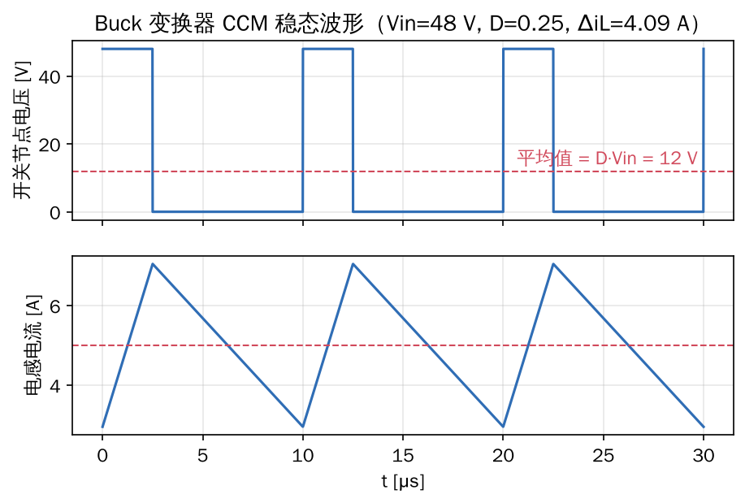
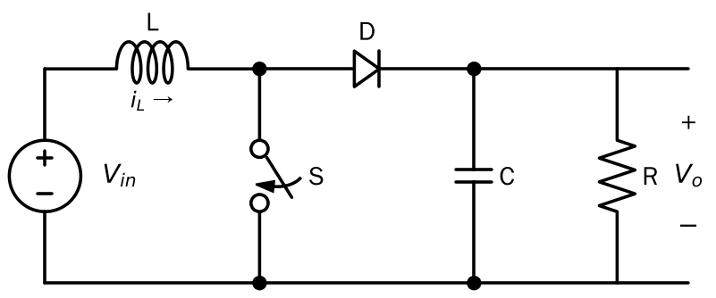
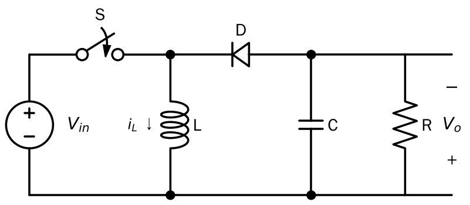

> 这一章对应课堂上正在学的 Buck/Boost。目标不是重复课本，而是把**两条定律**用熟：后面分析全桥、DAB、乃至固态变压器（SST），用的都是同一套方法。

## 1. 为什么要"开关"

线性稳压（比如 7805）是让晶体管工作在放大区，多余的电压直接变成热，效率 $\eta \approx V_o/V_{in}$。
开关变换器让器件只处于**全通或全断**两种状态：

- 导通时：电压≈0，电流不为零 → 损耗小
- 关断时：电流≈0，电压不为零 → 损耗小

器件本身几乎不耗能，靠**电感、电容储能 + 开关切换**来"搬运"能量。代价是输出有纹波、开关瞬间有损耗和 EMI。

**关键参数：**

- 开关频率 $f_s$，周期 $T_s = 1/f_s$
- 占空比 $D$：一个周期里主开关导通的时间比例，$0 < D < 1$

## 2. 两条基本定律（稳态分析的全部工具）

### 2.1 电感伏秒平衡（Inductor Volt-Second Balance）

$$v_L = L\frac{di_L}{dt} \;\Rightarrow\; i_L(T_s) - i_L(0) = \frac{1}{L}\int_0^{T_s} v_L\,dt$$

稳态下电感电流每个周期回到原值，所以

$$\boxed{\langle v_L \rangle = \frac{1}{T_s}\int_0^{T_s} v_L\,dt = 0}$$

**电感两端电压的周期平均值为零。**

### 2.2 电容电荷平衡（Capacitor Charge Balance）

同理，稳态下电容电压每周期回到原值：

$$\boxed{\langle i_C \rangle = 0}$$

### 2.3 小纹波近似（Small-Ripple Approximation）

计算平均值时，把电容电压、电感电流的纹波先忽略，当作直流：$v_C \approx V$，$i_L \approx I$。
这样每个开关状态下的电感电压都是**常数**，电感电流是**直线**。

## 3. Buck（降压）变换器

**电路状态（连续导通模式 CCM）：**

| 区间 | 开关 S | 二极管 | 电感电压 $v_L$ |
|---|---|---|---|
| $0 \sim DT_s$ | 导通 | 截止 | $V_{in} - V_o$ |
| $DT_s \sim T_s$ | 关断 | 续流 | $-V_o$ |

**伏秒平衡：**

$$(V_{in}-V_o)\,D T_s + (-V_o)(1-D)T_s = 0 \;\Rightarrow\; \boxed{V_o = D\,V_{in}}$$

**另一种理解：** 开关节点电压是幅值 $V_{in}$、占空比 $D$ 的方波，LC 是低通滤波器，只留下直流分量 $DV_{in}$。

**电感电流纹波（峰峰值）：**

$$\Delta i_L = \frac{(V_{in}-V_o)DT_s}{L} = \frac{V_{in}D(1-D)}{L f_s}$$

$D=0.5$ 时纹波最大。图中 $V_{in}=48\,\text{V}$、$D=0.25$、$L=22\,\mu\text{H}$、$f_s=100\,\text{kHz}$，算得 $\Delta i_L \approx 4.09\,\text{A}$。

**输出电压纹波：** 电感电流的交流部分流进电容，

$$\Delta v_o = \frac{\Delta i_L}{8 C f_s}$$

> **记住这个规律：** 纹波 $\propto 1/f_s$。频率越高，L、C 可以越小，这就是**提高开关频率 → 提高功率密度**的根本原因。后面讲固态变压器时，"用高频变压器替代工频变压器"是同一个逻辑。

## 4. Boost（升压）变换器

| 区间 | 开关 S | 二极管 | 电感电压 $v_L$ | 电容电流 $i_C$ |
|---|---|---|---|---|
| $0 \sim DT_s$ | 导通 | 截止 | $V_{in}$ | $-V_o/R$ |
| $DT_s \sim T_s$ | 关断 | 导通 | $V_{in}-V_o$ | $I_L - V_o/R$ |

**伏秒平衡：**

$$V_{in}D + (V_{in}-V_o)(1-D) = 0 \;\Rightarrow\; \boxed{V_o = \frac{V_{in}}{1-D}}$$

**电荷平衡：**

$$-\frac{V_o}{R}D + \left(I_L - \frac{V_o}{R}\right)(1-D) = 0 \;\Rightarrow\; I_L = \frac{V_o}{R(1-D)} = \frac{I_o}{1-D}$$

输入电流（= 电感电流）比输出电流大 $1/(1-D)$ 倍，与功率守恒 $V_{in}I_L = V_oI_o$ 一致。

**实际限制：** 理论上 $D\to1$ 时增益无穷大，但电感、开关的寄生电阻会让增益在 $D$ 较大时掉下来，效率也急剧下降。所以 **Boost 一般只做 2～4 倍升压**。要做很大的电压比（比如 10 kV → 800 V），就必须靠**变压器**，这正是下一章的主题。

## 5. Buck-Boost（升降压，反极性）

$$v_L: \; V_{in}\,(0\sim DT_s), \quad V_o\,(DT_s\sim T_s,\ V_o<0)$$

$$V_{in}D + V_o(1-D) = 0 \;\Rightarrow\; \boxed{V_o = -\frac{D}{1-D}V_{in}}$$

它的电感先从输入**储能**，再向输出**释能**，输入输出不同时连在电感上。把这个电感换成"带两个绕组的耦合电感"，就得到了**反激（Flyback）变换器**，下一章会讲。

## 6. CCM 与 DCM

当负载很轻时，电感电流在周期结束前就降到 0，进入**断续导通模式（DCM）**。临界条件是平均电流等于纹波的一半：

$$I_L = \frac{\Delta i_L}{2}$$

DCM 下增益和负载有关，上面的公式不再成立。本系列后面主要讨论 CCM。

## 7. 小结：一张表

| 拓扑 | 增益 $M(D)=V_o/V_{in}$ | 特点 |
|---|---|---|
| Buck | $D$ | 降压，输出电流连续 |
| Boost | $\dfrac{1}{1-D}$ | 升压，输入电流连续（适合 PFC、光伏） |
| Buck-Boost | $-\dfrac{D}{1-D}$ | 升降压，反极性，输入输出电流都断续 |

**方法论：** ① 列出每个开关状态的电路；② 写出 $v_L$、$i_C$；③ 伏秒平衡 + 电荷平衡；④ 解方程。
后面第 4 章分析 DAB，本质上也是这四步：只不过"电感"换成了变压器漏感，"占空比"换成了**移相角**。

## 参考资料

- R. W. Erickson, D. Maksimović, *Fundamentals of Power Electronics*, 3rd ed., Springer, 2020. 第 2 章（稳态分析）。国内外电力电子研究生的标准教材，建议对照阅读英文原版，顺便练英文。
- 王兆安、刘进军，《电力电子技术》（第 5 版），机械工业出版社。"直流斩波电路"一章。
