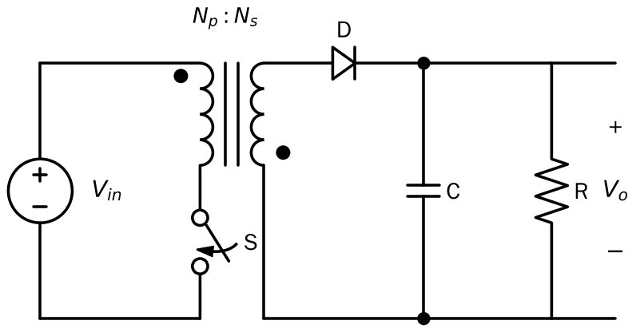
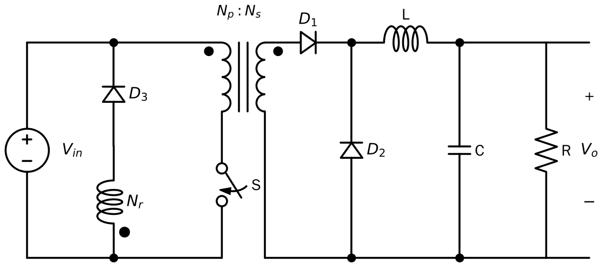
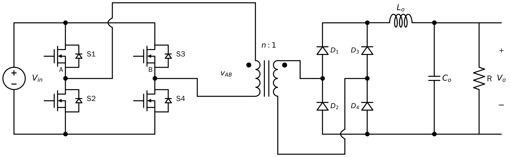

## 1. 为什么需要电气隔离

1. **安全**：输入接电网（几百伏到几十千伏），输出给人能碰到的设备或芯片，中间必须有绝缘屏障（galvanic isolation）。
2. **大变比**：第 1 章说过，Boost/Buck 只靠占空比很难做 10 倍以上的变比；变压器的匝比 $n$ 可以轻松提供。
3. **多路输出、电位浮地**：一个变压器可以绕多个副边。

但普通变压器只能传**交流**。所以隔离型 DC-DC 的套路都是：

$$\text{直流} \xrightarrow{\text{逆变（开关桥）}} \text{高频交流} \xrightarrow{\text{高频变压器}} \text{高频交流} \xrightarrow{\text{整流}} \text{直流}$$

## 2. 为什么要"高频"变压器

变压器绕组电压由法拉第定律决定，正弦激励下

$$V_{rms} = 4.44\, f\, N\, A_e\, B_{max}$$

在磁芯材料允许的最大磁密 $B_{max}$ 一定时，**频率 $f$ 越高，所需的匝数 × 截面积 $N A_e$ 越小**，变压器体积就越小。

| | 工频变压器 | 高频变压器 |
|---|---|---|
| 频率 | 50 Hz | 10 kHz ～ 几百 kHz |
| 磁芯 | 硅钢片 | 铁氧体、纳米晶、非晶 |
| 体积/重量 | 大 | 小一到两个数量级 |

> **这就是固态变压器（SST）的出发点：** 用"电力电子变换 + 高频变压器"替代笨重的 50 Hz 工频变压器，同时获得直流端口、可控潮流、电能质量调节等功能。高频变压器本身的绝缘、散热、损耗问题，就是 SST 研究中的重要课题。

## 3. 变压器的电路模型

实际分析时常用的等效电路：

- **理想变压器** $n_1 : n_2$：电压比等于匝比，电流反比
- **励磁电感 $L_m$**（magnetizing inductance）：并联在原边，代表建立磁通需要的电流。$L_m$ 两端同样要满足**伏秒平衡**，否则磁通一个周期一个周期累积 → **磁芯饱和**
- **漏感 $L_{lk}$**（leakage inductance）：串联，代表没有耦合到另一侧的磁通

**重要观念的转变：**

- 在反激、正激里，漏感是"坏东西"，会引起关断电压尖峰
- 在后面的全桥移相和 **DAB** 里，漏感反而被**当作功率传输的元件**，甚至专门做大，或额外串一个电感

## 4. 几种经典隔离拓扑

### 4.1 反激（Flyback）—— 由 Buck-Boost 演变

*黑点为同名端。原副边同名端位置相反：开关导通时副边二极管反偏，能量存在磁芯里；关断时再释放到输出。*

把 Buck-Boost 的电感换成耦合电感（原副边各一个绕组）：开关导通时原边储能，关断时能量从副边释放。

$$V_o = \frac{n_2}{n_1}\cdot\frac{D}{1-D}V_{in}$$

- 优点：器件最少，适合几十瓦以下（手机充电器）
- 缺点：变压器其实是"储能电感"，磁芯利用率低，功率上不去

### 4.2 正激（Forward）—— 由 Buck 演变

*$N_r$ 是绕在同一磁芯上的复位绕组。开关关断后，励磁电流转移到 $N_r$，经 $D_3$ 回馈到输入电源，磁芯完成复位；$D_2$ 是输出电感的续流二极管。*

开关导通时能量**直接**通过变压器传到副边，再经过 LC 滤波：

$$V_o = \frac{n_2}{n_1}D\,V_{in}$$

问题：励磁电流只朝一个方向，磁芯必须**复位**（加复位绕组，且 $D<0.5$），否则饱和。

### 4.3 推挽、半桥、全桥 —— 双向励磁

让变压器原边电压正负交替（±$V_{in}$），磁芯双向励磁，**自然满足伏秒平衡**，磁芯利用率翻倍。

**全桥（Full Bridge）** 用 4 个开关：

*原边全桥把直流逆变成高频方波 $v_{AB}$，副边二极管全桥整流后经 $L_o$、$C_o$ 滤波，本质上是隔离型 Buck。图中跨线处的小弧表示导线交叉但不相连。*

- S1、S4 同时导通 → 变压器原边 $+V_{in}$
- S2、S3 同时导通 → 变压器原边 $-V_{in}$
- 同一桥臂上下管（S1/S2、S3/S4）**绝不能同时导通**，否则直通短路，所以要加**死区时间**

全桥器件电压应力只有 $V_{in}$，适合千瓦级以上。服务器电源、充电桩、SST 的隔离级大多是全桥类结构。

## 5. 硬开关的问题 → 软开关

前面默认开关是理想的。实际 MOSFET/IGBT 在开通和关断的几十纳秒里，**电压和电流同时不为零**，产生开关损耗：

$$P_{sw} \approx \frac{1}{2} V I (t_{on}+t_{off}) f_s$$

开关损耗 $\propto f_s$。想通过提高频率缩小体积，就必须降低每次开关的损耗，这就引出了**软开关**：

- **ZVS（零电压开通，Zero-Voltage Switching）**：在开关管两端电压已经降到 0（体二极管已导通）时再给开通信号。MOSFET 的结电容能量 $\frac12 C_{oss}V^2$ 不再白白消耗掉。
- **ZCS（零电流关断，Zero-Current Switching）**：在电流为 0 时关断，对 IGBT 这类有拖尾电流的器件更有用。

> 下一章的全桥移相变换器和第 4 章的 DAB，核心卖点都是**利用漏感电流实现 ZVS**。

## 6. 小结

| 拓扑 | 由什么演变 | 励磁方式 | 典型功率 |
|---|---|---|---|
| 反激 | Buck-Boost | 单向，储能 | < 150 W |
| 正激 | Buck | 单向，需复位 | 100 W ～ 几百 W |
| 半桥/全桥 | Buck | 双向 | 几百 W ～ MW |

## 参考资料

- Erickson & Maksimović, *Fundamentals of Power Electronics*, 3rd ed., 第 6 章（Converter Circuits，含隔离型变换器）。
- 王兆安、刘进军，《电力电子技术》，"组合变流电路"一章中的"间接直流变流电路"一节，以及"软开关技术"一章。
