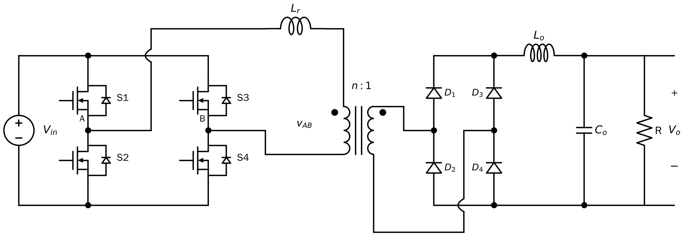

## 1. 电路结构

全桥移相（Phase-Shifted Full Bridge, PSFB）= 第 2 章的全桥 + 串联电感 $L_r$（可以就是变压器漏感）+ 副边二极管整流 + 输出 LC 滤波：

- 原边：两个桥臂 A（S1/S2）、B（S3/S4），每个开关并联体二极管和结电容 $C_{oss}$
- 变压器匝比 $n = N_p/N_s$
- 副边：全桥或中心抽头整流 + 滤波电感 $L_o$ + 电容 $C_o$

它在拓扑上是**隔离型 Buck**，所以增益形式和 Buck 一样。

*与第 2 章的全桥隔离变换器相比，只多了串联电感 $L_r$。S1/S2 组成 A 桥臂，S3/S4 组成 B 桥臂；每个开关都画出了体二极管，因为 ZVS 正是靠它先导通实现的。*

## 2. 移相控制（Phase-Shift Modulation）

不再调每个开关的占空比，而是：

1. **每个开关都固定 50% 占空比**（扣掉死区），同一桥臂上下管互补
2. 调节两个桥臂之间的**相位差**

两桥臂中点电压之差 $v_{AB}$：

- 两臂"同相"时：$v_{AB}$ 一直为 0（S1、S3 同时导通，或 S2、S4 同时导通，原边被短接）
- 两臂"反相"时：$v_{AB}$ 是 $\pm V_{in}$ 的方波
- 中间：$v_{AB}$ 是**三电平**波形 $+V_{in} \to 0 \to -V_{in} \to 0$，有效占空比 $D_{eff}$ 随移相角增大

输出电压（理想情况）：

$$V_o = \frac{D_{eff}\,V_{in}}{n}$$

**先导通、先关断的桥臂叫超前臂（leading leg），另一臂叫滞后臂（lagging leg）。**

## 3. 为什么能实现 ZVS

以 S1 关断、S2 开通为例：S1 关断瞬间，原边电流 $i_p$ 不能突变（有电感），只能转去给 S1 的结电容充电、给 S2 的结电容放电。只要电流够大、死区够长，S2 两端电压在它开通之前就降到 0，**体二极管先导通，S2 就是零电压开通**。

$$\text{ZVS 条件（简化）：}\quad \frac12 L\, I^2 \;\ge\; \frac12 (2C_{oss})V_{in}^2 = C_{oss}V_{in}^2$$

左边是电感储能，右边是要搬走的两个结电容能量。

| | 超前臂 | 滞后臂 |
|---|---|---|
| 换流时原边电流来源 | 输出滤波电感电流折算到原边（大） | **只有** $L_r$ 中的电流（副边此时短路） |
| ZVS 难度 | 容易 | 难，**轻载时容易丢失 ZVS** |

## 4. 占空比丢失（Duty-Cycle Loss）

原边电流从 $+I_o/n$ 换向到 $-I_o/n$ 需要时间，期间副边整流管全部导通、副边被短路，**原边加了电压，副边却没有输出**：

$$\Delta t = \frac{L_r \cdot 2I_o/n}{V_{in}}, \qquad \Delta D = \frac{\Delta t}{T_s/2} = \frac{4 L_r f_s I_o}{n V_{in}}$$

**矛盾：** $L_r$ 大 → 滞后臂 ZVS 范围宽，但占空比丢失多、副边二极管反向恢复振荡大。设计 PSFB 就是在这两者之间折中。

## 5. 应用与演进

PSFB 曾是服务器电源、通信电源、电动车充电机的主力拓扑。它的几个短板推动了后续拓扑的出现：

1. **轻载丢 ZVS** → 谐振变换器 **LLC**：利用 $L_r$–$C_r$ 谐振，从空载到满载都能 ZVS，副边还能 ZCS。现在数据中心电源（PSU）的 DC/DC 级基本都是 LLC。
2. **副边是二极管，只能单向传功率** → 把副边二极管也换成可控全桥，就得到 **双有源桥 DAB**（下一章）。
3. **固定变比的"直流变压器"** → LLC 或 CLLC 工作在谐振频率点、开环运行，称为 **DCX（DC transformer）**，在 SST 里常作隔离级。

> **路线图：** 全桥 → PSFB（移相 + 软开关）→ DAB（副边也有源，双向）/ LLC（谐振）→ SST 的隔离 DC-DC 级。
> 赵彪老师组的研究主线"直流变压器"，就是这条路线在中高压、大功率下的延伸。

## 参考资料

- Erickson & Maksimović, *Fundamentals of Power Electronics*, 3rd ed., 第 6 章（全桥），以及书后部的 Resonant Conversion、Soft Switching 两章。
- 王兆安、刘进军，《电力电子技术》，"软开关技术"一章（移相全桥 ZVS PWM 电路）。
