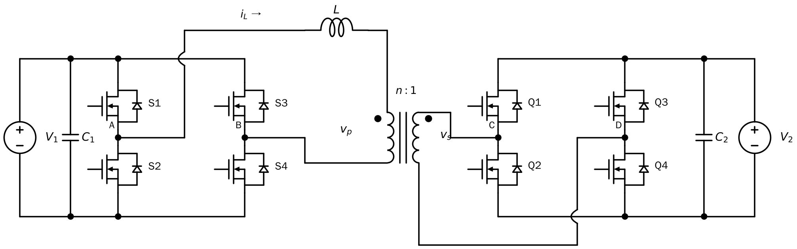
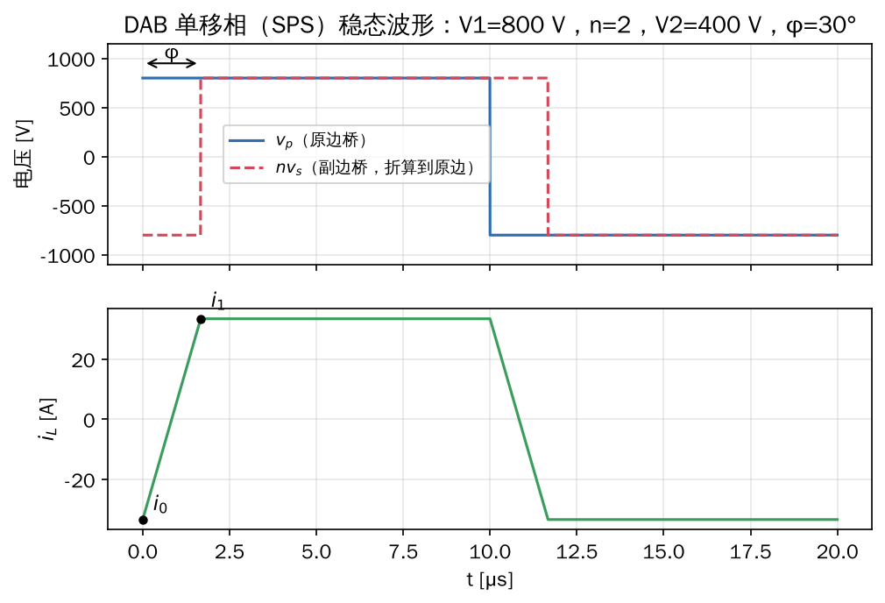
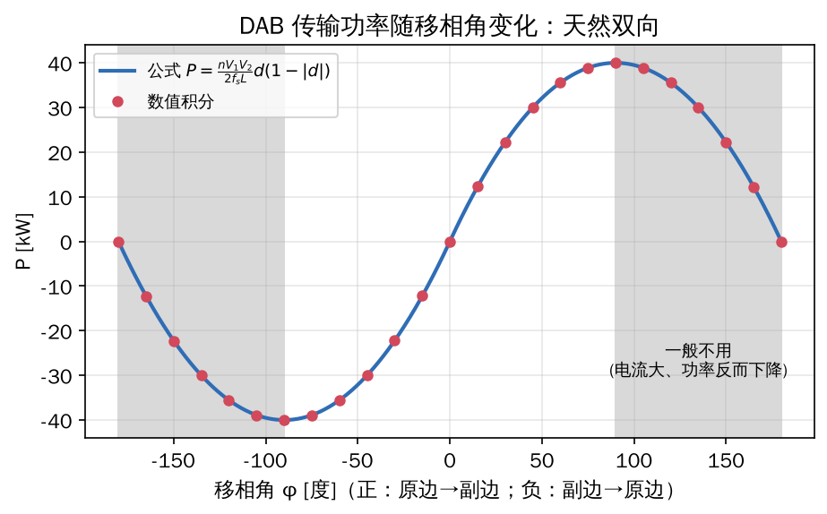
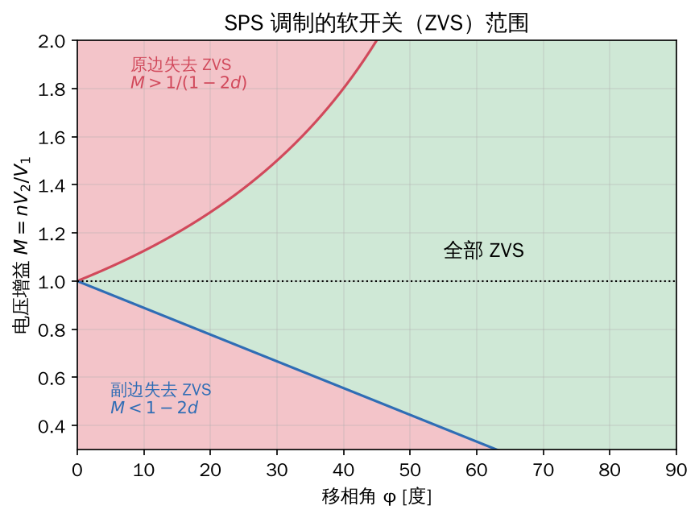
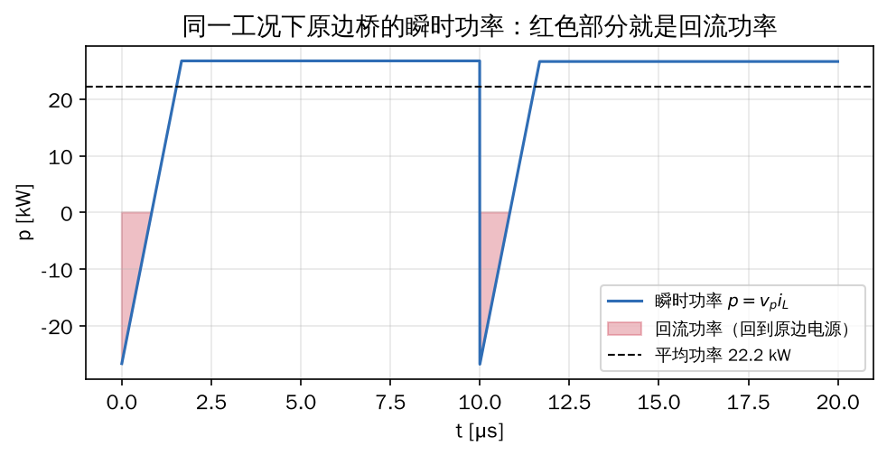
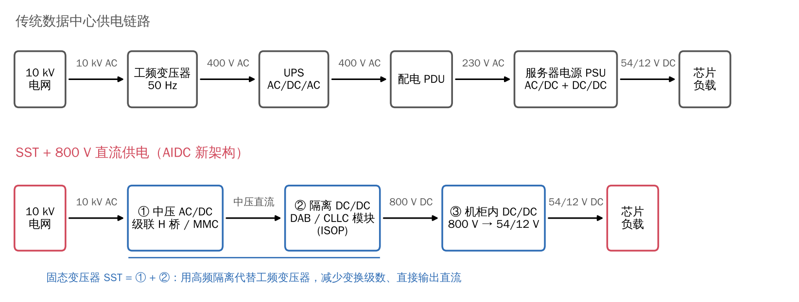
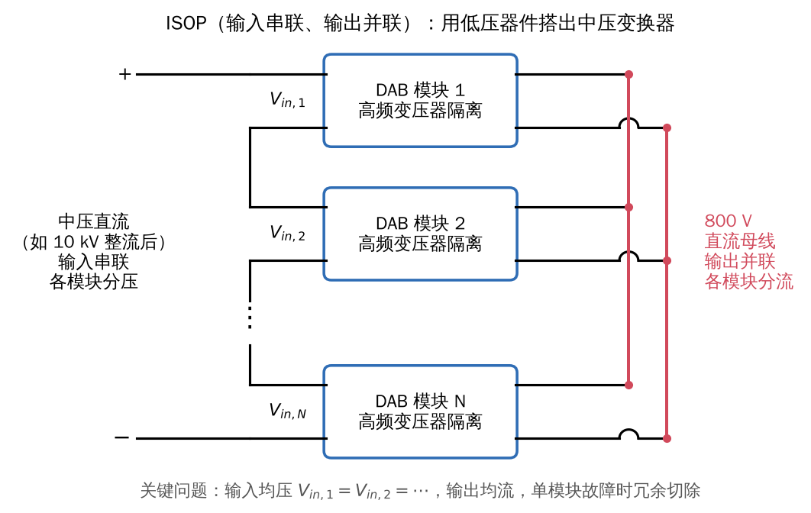

## 1. 结构：两个全桥夹一个电感

把 PSFB 副边的二极管整流桥换成**可控全桥**，就得到双有源桥（Dual Active Bridge, DAB）：

- 原边全桥 S1～S4，直流电压 $V_1$
- 高频变压器，匝比 $n:1$
- 串联电感 $L$（漏感 + 外加电感，**折算到原边**）
- 副边全桥 Q1～Q4，直流电压 $V_2$

它最早由 De Doncker 等人在 1991 年提出，用于大功率、高功率密度场合。

*原副边都是 MOSFET 全桥，$L$ 是漏感加外加电感（折算到原边）。和 PSFB 对比，唯一的结构差别是副边二极管 D1～D4 换成了可控开关 Q1～Q4，这让功率可以双向流动。*

**定义电压增益**（副边电压折算到原边与原边电压之比）：

$$M = \frac{nV_2}{V_1}$$

$M=1$ 叫**电压匹配**，这时 DAB 性能最好。

## 2. 单移相调制（SPS, Single Phase Shift）

最简单的控制：

1. 两个全桥都输出 50% 占空比的 $\pm$ 方波：$v_p = \pm V_1$，$v_s' = \pm nV_2$
2. 两个方波之间错开一个**移相角** $\varphi$（弧度），定义移相比 $d = \varphi/\pi \in [-1, 1]$

**电感就是"功率阀门"：** 两端电压差决定电流斜率，电流再决定功率。和电力系统里两个电压源经电抗传输功率 $P = \frac{V_1V_2}{X}\sin\delta$ 是同一个道理（你在电力系统分析里学过）。

## 3. 推导电感电流

设半个开关周期 $T_h = T_s/2 = \frac{1}{2f_s}$，$V_2' = nV_2$。取 $0<d<1$（原边超前，功率从原边流向副边）。

**区间 1：** $0 \le t < dT_h$，$v_p = +V_1$，$v_s' = -V_2'$

$$L\frac{di}{dt} = V_1 + V_2' \quad\Rightarrow\quad i(dT_h) = i_0 + \frac{(V_1+V_2')\,dT_h}{L}$$

**区间 2：** $dT_h \le t < T_h$，$v_p = +V_1$，$v_s' = +V_2'$

$$L\frac{di}{dt} = V_1 - V_2' \quad\Rightarrow\quad i(T_h) = i(dT_h) + \frac{(V_1-V_2')(1-d)T_h}{L}$$

**稳态半波对称：** 后半周期是前半周期取反，所以 $i(T_h) = -i_0$。联立解得：

$$\boxed{i_0 = -\frac{V_1}{4f_sL}\big[1 - M(1-2d)\big], \qquad i_1 = i(dT_h) = \frac{V_1}{4f_sL}\big(M + 2d - 1\big)}$$

**检查：** 图中 $V_1=800\,\text{V}$，$M=1$，$f_s=50\,\text{kHz}$，$L=40\,\mu\text{H}$，$d=1/6$：

$$\frac{V_1}{4f_sL} = 100\,\text{A}, \quad i_0 = -33.3\,\text{A}, \quad i_1 = 33.3\,\text{A}$$

与仿真一致（见第 5 章）。

## 4. 传输功率

半个周期内 $v_p = +V_1$ 不变，所以平均功率 = $V_1 \times$（电流在半周期内的平均值）。电流波形是两段梯形，算面积可得：

$$\boxed{P = \frac{nV_1V_2}{2f_sL}\,d\,(1-|d|) = \frac{nV_1V_2}{2\pi f_s L}\,\varphi\left(1-\frac{|\varphi|}{\pi}\right)}$$

**几个结论：**

1. **天然双向**：$\varphi>0$ 功率从原边到副边，$\varphi<0$ 反过来，**不用改电路，只改相位**。这正是储能、电动车 V2G、直流电网需要的。
2. $\varphi = \pm 90°$（$d=\pm 0.5$）时功率最大：$P_{max} = \frac{nV_1V_2}{8f_sL}$。
3. 实际只用 $|\varphi| < 90°$ 那一段，$|\varphi|$ 再大功率反而下降、电流更大。
4. **电感 $L$ 的选取**：$L$ 越小，同样功率需要的移相越小（软开关范围变化），但功率对 $\varphi$ 越敏感；$L$ 由最大功率和预留的控制裕度决定。

## 5. 软开关（ZVS）条件

沿用第 3 章的思路：开关管关断瞬间，电流方向要能把即将开通那个管子的结电容放完电。

- **原边 ZVS**：原边在 $t=0$ 换流，需要 $i_0 \le 0$
$$1 - M(1-2d) \ge 0 \quad\Longleftrightarrow\quad M \le \frac{1}{1-2d}$$
- **副边 ZVS**：副边在 $t=dT_h$ 换流，需要 $i_1 \ge 0$
$$M + 2d - 1 \ge 0 \quad\Longleftrightarrow\quad M \ge 1 - 2d$$

**读图：**

- $M = 1$ 时，任意 $d>0$ 两侧都能 ZVS（理想情况）
- $M$ 偏离 1 越远，**轻载（小 $\varphi$）时越容易丢失 ZVS**
- 实际还要考虑结电容能量 $C_{oss}V^2$：电流不仅要方向对，还要**足够大**，所以真实 ZVS 区域比图上更小

> **工程意义：** SST/直流变压器的输入、输出电压往往会波动（电网电压、电池电压），$M \ne 1$ 是常态，宽电压范围下保持高效率，是 DAB 研究的核心难题之一。

## 6. 回流功率与电流应力

在 $0 < t < t_z$ 这一小段，$v_p > 0$ 而 $i < 0$，瞬时功率为负，**能量从电感倒流回原边电源**，叫**回流功率（backflow power）**：

$$t_z = \frac{|i_0|\,L}{V_1+V_2'}, \qquad P_{bf} = \frac{f_s\,V_1\,L\,i_0^2}{V_1+V_2'}$$

上例 $P_{bf} \approx 1.1\,\text{kW}$，约占传输功率 22.2 kW 的 5%。

**回流功率本身不是"损耗"，但它让电流有效值和峰值变大，导通损耗、器件和变压器的电流应力都跟着变大。**

有意思的矛盾：

- 原边 ZVS 需要 $i_0 \le 0$，也就是**需要一点回流**
- 回流太多又增加损耗

所以"**最小回流功率**"与"**保持 ZVS**"之间的折中，是 DAB 调制策略研究的一条主线。赵彪老师 2023 年的论文 *An IGCT-Series-Based DC Transformer With Quasi-Zero Switching Loss Modulation by Minimum Backflow Power Injection* 就是这个思路在 IGCT 大功率直流变压器上的应用：只注入"刚好够用"的回流功率来实现软开关。

## 7. 更多自由度：EPS、DPS、TPS

SPS 只有一个控制量 $\varphi$，$M\ne1$ 时性能差。改进办法是让全桥输出**三电平**波形（类似 PSFB），在**桥内**也引入移相：

| 调制方式 | 控制自由度 | 说明 |
|---|---|---|
| SPS 单移相 | 1（桥间移相 $\varphi$） | 最简单，$M\ne1$ 时回流大、ZVS 范围窄 |
| EPS 扩展移相 | 2（$\varphi$ + 一侧桥内移相） | 赵彪等 2012 年在 IEEE TPEL 上系统提出，减小回流功率 |
| DPS 双重移相 | 2（$\varphi$ + 两侧相同的桥内移相） | 降低电流应力，改善动态 |
| TPS 三重移相 | 3（全部独立） | 统一框架，可以做电流有效值/损耗最优化 |

> 这一块是第 2 步"论文精读"的重点，届时会结合赵老师的综述逐篇读。

## 8. DAB 在固态变压器（SST）中的位置

典型**三级式 SST**（以 10 kV 交流电网 → 800 V 直流为例）：

$$\underbrace{\text{中压 AC/DC}}_{\text{级联 H 桥 / MMC 整流}} \;\to\; \underbrace{\text{隔离 DC/DC}}_{\text{DAB 或 CLLC 模块}} \;\to\; \underbrace{\text{低压 DC/AC 或 DC/DC}}_{\text{可选}}$$

- 单个功率器件耐压有限（常用 SiC MOSFET 1.2～3.3 kV），10 kV 级需要把很多个 DAB 模块**输入串联、输出并联（ISOP）**，模块间均压均流是关键问题

- **AI 数据中心**的新趋势是 800 V 高压直流配电：SST 直接从中压电网变成 800 VDC 送到机柜，省掉工频变压器和多级 AC/DC，效率和占地都更优
- 更高电压、更大功率时（如直流电网、海上风电），会用 IGCT、MMC 型的直流变压器，这正是赵彪老师组的研究范围

## 9. 小结

| 量 | 公式（SPS） |
|---|---|
| 初始电流 | $i_0 = -\frac{V_1}{4f_sL}[1-M(1-2d)]$ |
| 移相点电流 | $i_1 = \frac{V_1}{4f_sL}(M+2d-1)$ |
| 传输功率 | $P = \frac{nV_1V_2}{2f_sL}d(1-\lvert d\rvert)$ |
| 原边 ZVS | $M \le \frac{1}{1-2d}$ |
| 副边 ZVS | $M \ge 1-2d$ |
| 回流功率 | $P_{bf} = \frac{f_sV_1Li_0^2}{V_1+nV_2}$ |

## 参考资料

1. R. W. De Doncker, D. M. Divan, M. H. Kheraluwala, "A three-phase soft-switched high-power-density dc/dc converter for high-power applications," *IEEE Trans. Industry Applications*, 1991. —— DAB 的开山之作。
2. M. H. Kheraluwala, R. W. Gascoigne, D. M. Divan, E. D. Baumann, "Performance characterization of a high-power dual active bridge dc-to-dc converter," *IEEE Trans. Industry Applications*, 1992. —— 单相 DAB 的经典分析。
3. B. Zhao, Q. Song, W. Liu, Y. Sun, "Overview of dual-active-bridge isolated bidirectional DC–DC converter for high-frequency-link power-conversion system," *IEEE Trans. Power Electronics*, 2014. —— **赵彪老师的高被引综述，第 2 步必读。**
4. B. Zhao, Q. Yu, W. Sun, "Extended-phase-shift control of isolated bidirectional DC–DC converter for power distribution in microgrid," *IEEE Trans. Power Electronics*, 2012.
5. F. Krismer, J. W. Kolar, "Closed form solution for minimum conduction loss modulation of DAB converters," *IEEE Trans. Power Electronics*, 2012.
6. 赵彪 等，《双主动全桥 DC-DC 变换器的理论和应用技术》，2017。
