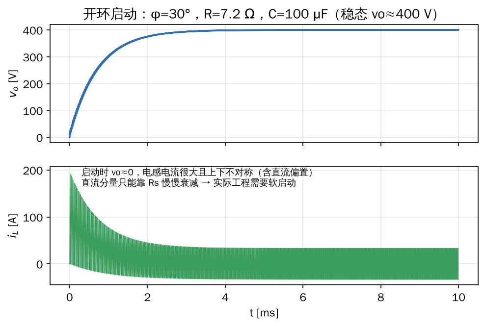

## 1. 目标

1. 用仿真验证第 4 章推出的电流、功率公式
2. 亲眼看到 ZVS、回流功率、启动直流偏置这些现象
3. 为以后复现论文（比如最小回流功率调制）准备一个可以改的模型

## 2. 参数

取一个 SiC 中压 SST 模块的量级：

| 参数 | 数值 |
|---|---|
| 原边电压 $V_1$ | 800 V |
| 匝比 $n$ | 2 : 1 |
| 副边额定电压 $V_2$ | 400 V（$M = 1$） |
| 开关频率 $f_s$ | 50 kHz |
| 串联电感 $L$（折算到原边） | 40 μH |
| 绕组等效电阻 $R_s$ | 0.05 Ω |
| 输出电容 $C$ | 100 μF |
| 移相角 $\varphi$ | 30° |
| 负载 $R$ | 7.2 Ω（让稳态输出正好 400 V） |

## 3. 方法一：MATLAB 脚本（推荐先跑这个）

脚本 `dab_sps.m` 放在博客仓库的 `src/post/电力电子进阶/仿真/` 目录下，只用基础 MATLAB，不需要 Simulink 或任何工具箱，在 GNU Octave 里也能跑。

::: details 展开完整代码

@[code matlab](./仿真/dab_sps.m)

:::

**模型思路：** 开关当作理想的 $\pm1$ 开关函数，只保留两个状态变量（电感电流 $i$、输出电压 $v_o$）：

$$L\frac{di}{dt} = s_p V_1 - n s_s v_o - R_s i, \qquad C\frac{dv_o}{dt} = n s_s i - \frac{v_o}{R}$$

其中 $s_p, s_s \in \{+1, -1\}$ 分别是原边、副边桥的开关函数，副边滞后 $dT_s/2$。用 Heun（改进欧拉）法积分，步长 $T_s/720$。

**运行结果**（已在 Octave 8.4 中验证）：

```text
移相 30 度, 理论功率 22.22 kW, 对应负载 R = 7.200 Ohm
仿真：Vo = 400.0 V, 原边功率 22.20 kW (理论 22.22 kW)
      电感电流峰值 33.5 A, 有效值 31.5 A
最大功率出现在 90 度: 40.00 kW
```

功率误差 0.1%，来自 $R_s$ 上的损耗；峰值 33.5 A 和第 4 章手算的 $i_1 = 33.3\,\text{A}$ 吻合。

### 3.1 启动过程



**看到了什么：**

- 输出电压约 3 ms 进入稳态
- 启动瞬间 $v_o \approx 0$，电感两端几乎是整个 $V_1$，电流冲到 200 A，**是稳态的 6 倍**
- 电流包络上下不对称，说明里面有**直流分量**。它只能靠 $R_s$ 以时间常数 $L/R_s = 0.8\,\text{ms}$ 慢慢衰减。真实变压器里，这个直流分量会造成**偏磁甚至饱和**

> **工程上的对策：** 软启动（移相角从 0 慢慢加大）、启动时第一个半周期用半宽脉冲、串隔直电容。这些都是以后读论文会遇到的"DAB 暂态直流偏置抑制"问题。

### 3.2 稳态波形与功率曲线

稳态波形和功率曲线就是第 4 章的图（[波形](./图片/dab-sps-waveform.png)、[功率曲线](./图片/dab-power-vs-phase.png)），图中的红点是脚本数值计算的结果，和公式完全重合。

博客里的图是用 Python 画的（同目录下的 `plot_figures.py`），和 MATLAB 脚本是同一个模型。

## 4. 方法二：在 Simulink 中搭建（用真实开关器件）

脚本模型的开关是理想的，看不到死区和 ZVS 换流细节。下面用 **Simscape Electrical → Specialized Power Systems** 搭一个器件级模型。

> 说明：这部分步骤我没有在 MATLAB 里实际搭建验证，模块名称以 R2023 前后版本为准，不同版本可能略有差别。如果卡住，把报错发给我。

**步骤：**

1. 新建模型，放入 `powergui`，仿真类型选 **Discrete**，采样时间 `Ts_sim = 1e-8`（开关周期 20 μs 的 1/2000）
2. **原边：** `DC Voltage Source`（800 V）→ `Universal Bridge`（2 桥臂，器件选 MOSFET/Diodes，即全桥）
3. **电感与变压器：** `Series RLC Branch`（只保留 L = 40 μH，R = 0.05 Ω）→ `Linear Transformer`（两绕组，额定电压比 2:1，频率填 50e3；励磁电阻和电感设大，近似理想）
4. **副边：** 另一个 `Universal Bridge`（全桥）→ `Capacitor` 100 μF 并联 `Resistor` 7.2 Ω
5. **驱动信号：** 4 个 `Pulse Generator`
   - 原边 A 臂：周期 `1/50e3`，占空比 50%，相位延时 0；B 臂延时半个周期
   - 副边两个桥臂同理，但**整体再延时** `(30/360)/50e3` 秒
   - 用 `NOT` 产生下管信号，各桥的 4 路信号用 `Mux` 送入 `Universal Bridge` 的 g 端
   - 进阶：在上下管之间加 200 ns **死区**（可用 `Transport Delay` + 逻辑与实现）
6. **测量：** `Voltage Measurement` 测两桥输出电压，`Current Measurement` 测电感电流，接 `Scope`
7. 仿真 10 ms，和第 3 节的脚本结果对比：稳态 $v_o$ 应接近 400 V，电感电流峰值约 33 A

## 5. 练习（建议做完再进入第 2 步）

1. **验证公式：** 把 $\varphi$ 改成 10°、45°、60°，记录仿真功率并和公式比较
2. **电压不匹配：** 把负载改到让 $V_2 = 300\,\text{V}$（$M=0.75$），看 $\varphi=15°$ 时 $i_1$ 是否变负（副边丢失 ZVS），对照 ZVS 区域图
3. **回流功率：** 在脚本里计算 $\int_{p<0} p\,dt$，验证 $P_{bf}$ 公式；再观察 $\varphi$ 越小，回流占比越大
4. **软启动：** 让 $\varphi$ 在前 2 ms 从 0 线性增加到 30°，对比启动冲击电流和直流偏置
5. **进阶（Simulink）：** 加死区，观察开关管电压在开通前是否已经降到 0（ZVS），减小负载看 ZVS 何时丢失
