> 本页整理第四章第 1 讲。P 为原课件印刷页码，与 PDF 页序一致；保留关键课件截图，并补充无功平衡交点、低压支撑能力与调压方式的代码绘图。  
> This page covers reactive-power balance, voltage regulation, compensation devices, pilot buses, and transformer taps.

## 1. 电压偏移与影响 / Voltage Deviation and Its Effects (P3–P7)

$$
\text{电压偏移 / voltage deviation}=\frac{U-U_N}{U_N}\times100\%
$$

- **负荷侧**：设备按额定电压设计。对需要维持机械负荷的异步电动机，电压下降可能引起电流增大、发热增加；过高电压增加绝缘应力。
- **系统侧**：对近似恒功率负荷，降压会增大电流及 $I^2R$ 损耗，严重时影响电压稳定；升压过多增加绝缘应力及电晕损耗。
- **偏移不可完全避免**：负荷、新能源出力与网络拓扑不断变化，运行控制的目标是维持合适电压范围。

**English:** Voltage deviations affect equipment performance, losses and operating security. The direction of current change also depends on the load model.

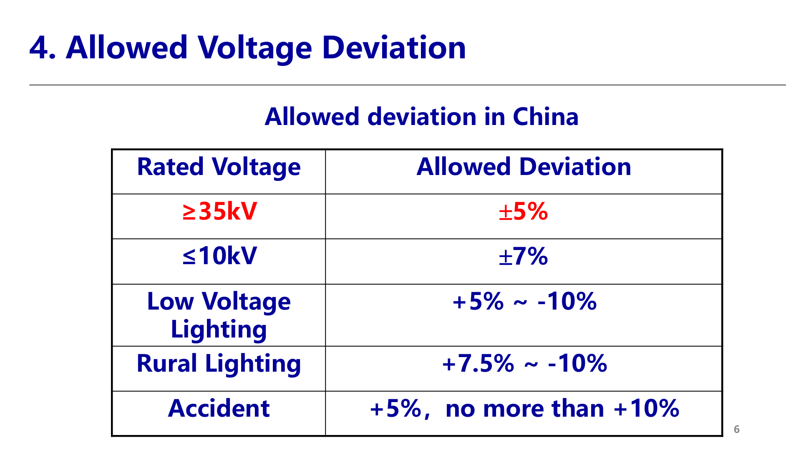

课件 P6 的学习口径为：35 kV 及以上 $\pm5\%$，10 kV 及以下 $\pm7\%$，低压照明 $+5\%\sim-10\%$，农村照明 $+7.5\%\sim-10\%$。这些数值按课件原表记录，表中的电压等级、照明及事故工况要分开理解。

## 2. 电压为什么与无功有关 / Why Voltage Is Coupled to Reactive Power (P8–P13)

### 由相量图得到 Q–U 关系 / Q–U Characteristic

将上级电网等效为电势 $\dot E$ 经电抗 $jX_\Sigma$ 向负荷端 $\dot U$ 送电。以负荷端电压为参考，令 $\delta$ 为 $\dot E$ 超前 $\dot U$ 的相角，则

$$
\dot E=\dot U+jX_\Sigma\dot I,\qquad
Q=UI\sin\varphi
$$

从相量图的实轴投影得 $X_\Sigma I\sin\varphi=E\cos\delta-U$，故

$$
\boxed{Q_{\mathrm{net}\to\mathrm{load}}=\frac{U(E\cos\delta-U)}{X_\Sigma}}
$$

此处 $Q>0$ 表示网络向负荷端送入无功，与潮流方程中“负荷节点净注入为负”的口径不同，代入时应先统一方向。若以 $E\cos\delta$ 为近似常量，电源侧 Q–U 特性是开口向下的抛物线；严格固定有功时 $\delta$ 也随状态变化，不能把两者都当作任意独立常量。

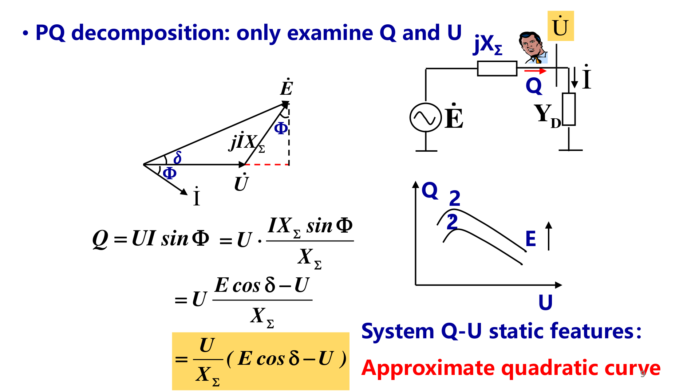

### 平衡点为何移动 / Movement of the Operating Point

运行点必须同时满足网络供给特性与负荷需求特性：

$$
Q_{\mathrm{supply}}(U)=Q_D(U)
$$

- 同一电源条件下，无功需求增加，常见高电压运行交点向较低电压移动。
- 提高励磁等效电势 $E$，供给特性上移，可提高电压。
- **任何实际稳态都满足无功平衡；“无功不足”是指在目标电压附近缺乏足够支撑能力**，不表示系统可以在稳态长期不平衡。

**English:** Voltage is determined by the intersection of supply and load characteristics. Reactive-power adequacy must be assessed at the desired voltage.

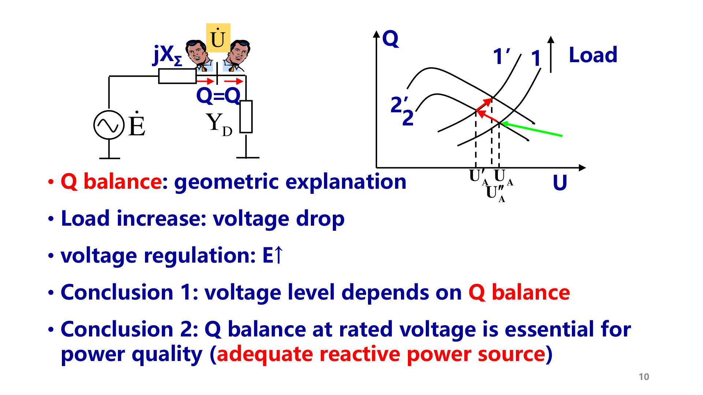

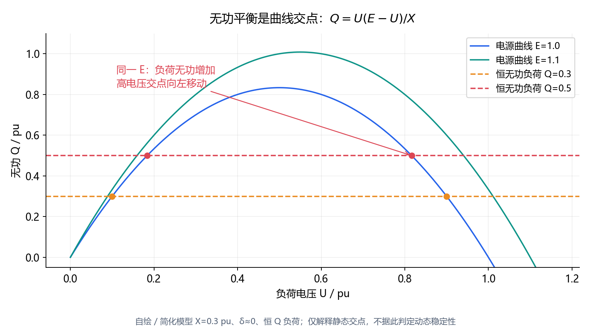

**读图 / Reading the figure**：取 $X=0.3$ pu、$\delta\approx0$，将负荷简化为恒 $Q$。$Q_D$ 从 0.3 增至 0.5 时，$E=1$ 的右侧交点电压下降；$E$ 增至 1.1 时，同一负荷可对应更高电压。这张图仅解释静态交点，多解的动态稳定性还取决于负荷和控制动态。

### 全网平衡与就地平衡 / Global and Local Balance

采用统一无功方向，可写

$$
\sum Q_G+\sum Q_C=\sum Q_D+\sum Q_{\mathrm{series}}+\sum Q_{\mathrm{reactor}}
$$

$Q_C$ 包括并联电容器及线路充电无功；也可将这些统一计入带符号的网络净无功损耗 $Q_L$，写成课件的 $\sum Q_G=\sum Q_D+\sum Q_L$。**净无功损耗不必总为正**。

无功远送会增大电流及压降：

$$
\Delta P\approx\frac{P^2+Q^2}{U^2}R,\qquad
\Delta U\approx\frac{PR+QX}{U}\approx\frac{QX}{U}\quad(X\gg R)
$$

因此“无功不宜远距离传输”是损耗、电压约束下的工程原则，并非物理上不能传输。应同时满足全网容量充足与局部支撑充足。  
**English:** Local compensation reduces reactive flow, current, losses and voltage drop; global adequacy alone is insufficient.

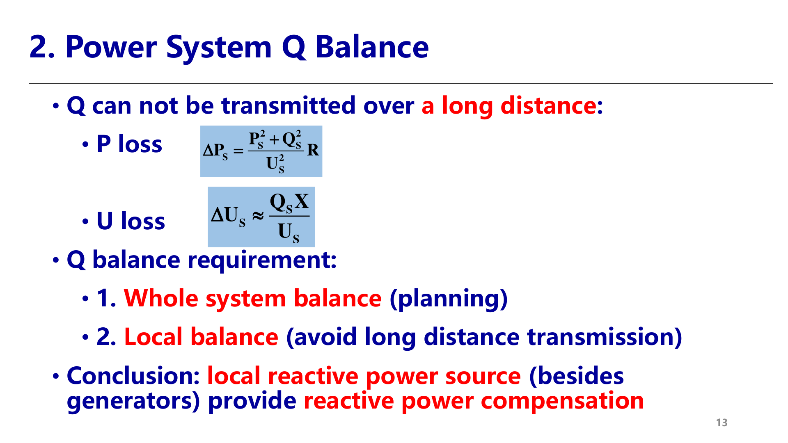

课件 P12 用线路和多级变压器的经验无功消耗，说明发电机无功可能不足；“所需无功源约为负荷无功的两倍”是该页的经验估计，不是所有网络通用等式。实际应由线路、变压器、充电电容和负荷模型共同计算。

## 3. 无功电源与补偿设备 / Reactive Sources and Compensation (P14–P24)

### 同步发电机：P 与 Q 共用能力边界 / Synchronous Generator Capability

同步发电机通过励磁调节无功，但 $P,Q$ 不能任意独立增大。以忽略定子电阻的圆转子模型为例：

$$
P_G=\frac{EU}{X_d}\sin\delta,\qquad
Q_G=\frac{EU}{X_d}\cos\delta-\frac{U^2}{X_d}
$$

- **定子电流约束**：$P_G^2+Q_G^2\le S_N^2$，给定视在容量时增加有功会挤占无功空间。
- **励磁约束**：转子励磁电流、发热限制可供无功；欠励运行也有专门边界。
- **机械约束**：原动机最大功率限制有功。

若系统有其他有功电源承担出力，可降低某台机组 $P_G$，释放其无功裕度，但仍须检查整个能力曲线。课件以同步机为主要电源模型，不能把“只有发电机能供有功”的简化表述推广到储能或变流器电源。

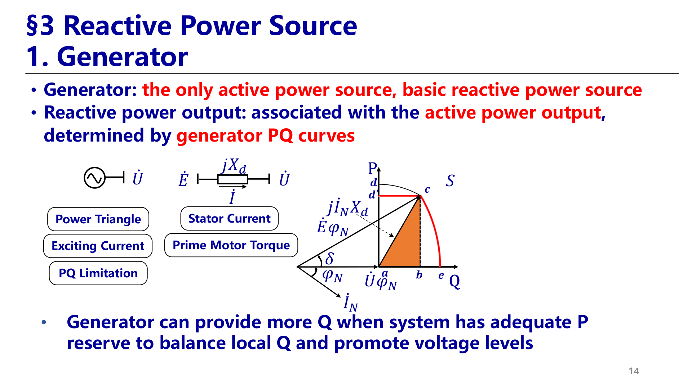

### 同步调相机 / Synchronous Condenser

调相机可视为主要用于无功交换的同步机；有功仅覆盖自身损耗，不能理解为实际运行有功严格等于零。

| 运行方式 | 向电网的无功交换 | 调压作用 |
|---|---|---|
| 过励 / Overexcited | 发出无功，$Q_G>0$ | 支撑电压 |
| 欠励 / Underexcited | 吸收无功，$Q_G<0$ | 抑制过高电压 |

- 无功可平滑双向调节，强励可提供故障期间的电压支撑。
- 旋转设备投资、维护和自身损耗较大；课件给出损耗约为额定容量的 $1.5\%\sim5\%$。
- 课件 P15 的 “Unexcited” 应结合上下文理解为**欠励**，而非完全没有励磁。

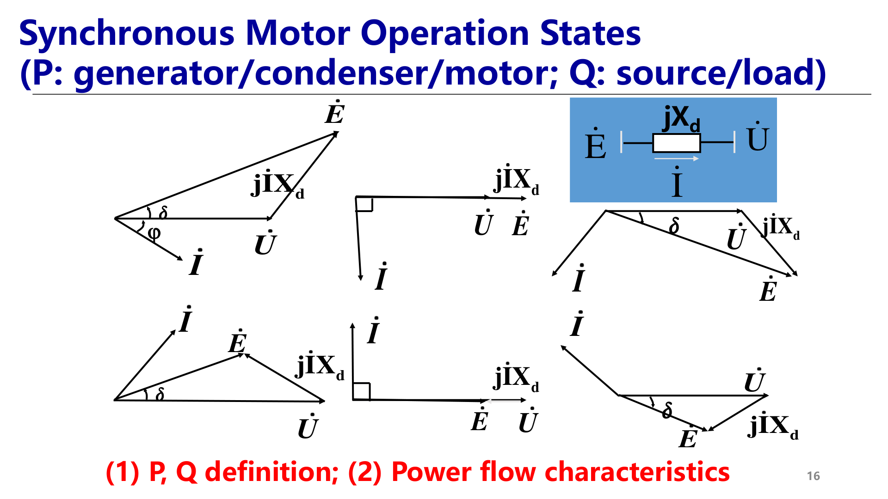

**相量图判读补充**：统一取“向网络注入为正”，发电机 $P>0$、电动机 $P<0$、理想调相机 $P\approx0$；无论哪种机械工况，$Q>0$ 为向网供无功，$Q<0$ 为从网吸无功。先写明电流参考方向再读相角，避免把电动机与发电机电流约定混用。

### 并联电容器 / Shunt Capacitor

$$
Q_C=U^2B_C=\frac{U^2}{X_C}=U^2\omega C
$$

式中电压及参数须采用匹配的单相、三相或标幺口径；例如对称三相用线电压与每相等效电纳时，总无功为 $U_{LL}^2B_C$。

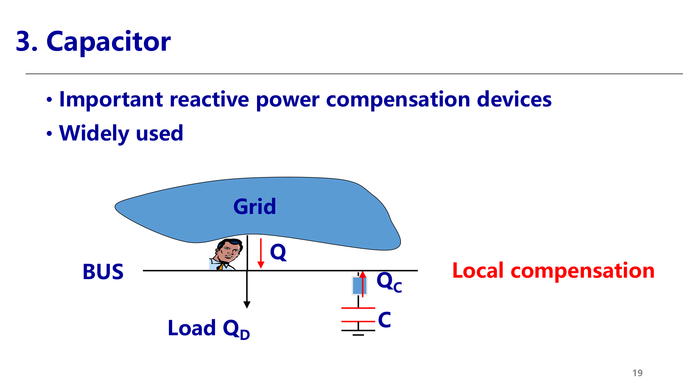

- **优点**：无旋转部分，投资和损耗较小，可分散、集中配置，分组投切。
- **限制**：分组调节是离散动作；$Q_C\propto U^2$，电压低时能力明显下降。
- 例如电压降至额定的 70%，同一电容器仅供给额定无功的 $0.7^2=49\%$。这会削弱低电压支撑，但不能仅由平方关系断言系统一定失稳。

### 静止无功补偿器 SVC / Static Var Compensator

以可控电抗器与电容器组合，改变等效电纳。若 $Q_D,Q_L$ 为吸收、$Q_C$ 为发出，则上级网络供给

$$
Q=Q_D+Q_L-Q_C
$$

为了在负荷变化时保持上级无功需求近似不变：

$$
\Delta Q=0\ \Rightarrow\ \Delta Q_C-\Delta Q_L=\Delta Q_D
$$

课件 P22 进一步假定电容部分固定，即 $\Delta Q_C=0$，才得到 $\Delta Q_L=-\Delta Q_D$：负荷增加时减小电抗器吸收，向负荷释放更多净无功。

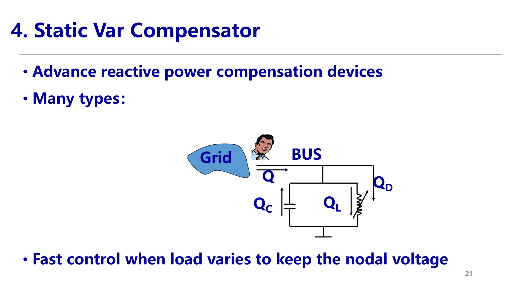

- 调节较快且平滑，可用于动态无功支撑；需关注谐波。
- 到达容性电纳上限后，最大容性无功仍近似随 $U^2$ 下降；不能把额定电压下的 Mvar 能力视为低电压时仍恒定。

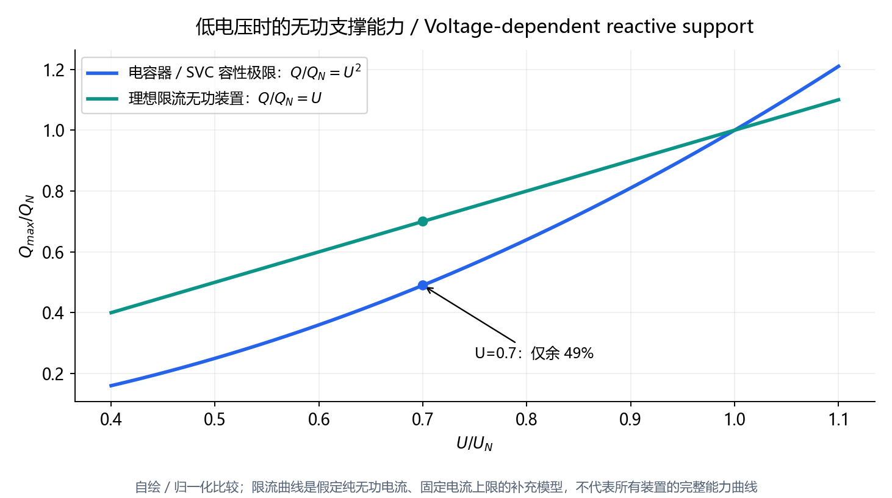

**补充比较 / Supplementary comparison**：蓝线为固定最大电纳模型 $Q_{max}\propto U^2$；绿线是假定纯无功电流受固定上限约束的理想模型 $Q_{max}=UI_{max}$，用于解释限流型无功装置与电纳型装置的差异。真实装置还受有功占用、直流侧和控制保护限制，该图不替代完整能力曲线。

> [!TIP]
> **交互实验指引（Q-U 静态平衡与并联电容/限流无功对比）**：拖动电源电势 $E$、系统电抗 $X_\Sigma$、无功负荷 $Q_D$ 与并联电容电纳 $B_C$：
> - 左侧对比无功供给曲线 $Q_{\text{net}}(U) + Q_C(U)$ 与负荷需求线 $Q_D$ 的两个交点（高电压稳定解与低电压不稳定解），增大 $Q_D$ 至切点即可直观看到**无功极限与电压崩溃**。
> - 右侧对比固定电容（$Q \propto U^2$）与限流型装置（$Q \propto U$）在电压跌落时的支撑能力衰减差异，理解“低压时并联电容出力急剧缩水”的物理根源。

<PsVoltageReactiveLab />

### 线路充电无功与并联电抗器 / Line Charging and Shunt Reactors

线路分布电容发出无功：$Q_{\mathrm{charging}}=U^2B_L$。高电压、长线路的充电无功较大，轻载时可能使电压升高，需要并联电抗器吸收多余无功。

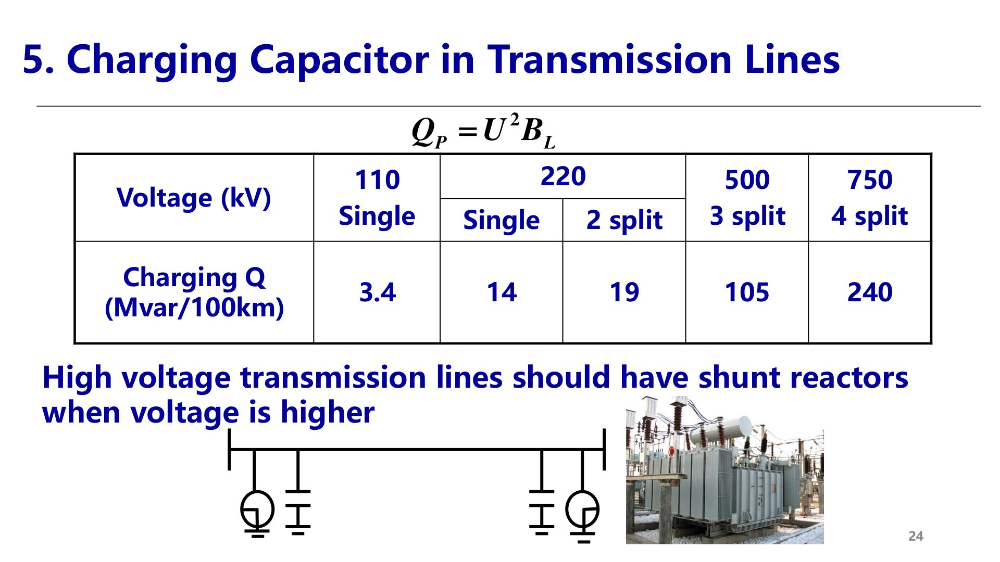

| 装置 / Device | 主要控制对象 | 主要特点 |
|---|---|---|
| 发电机励磁 | 内电势、无功出力 | 连续调节，受 P–Q 能力限制 |
| 同步调相机 | 励磁及双向无功 | 支撑能力强，有旋转损耗 |
| 并联电容器 | 电纳/投切组数 | 经济、离散，低压能力随 $U^2$ 下降 |
| SVC | 可控等效电纳 | 快速平滑，到限后仍受 $U^2$ 约束 |
| 并联电抗器 | 感性无功吸收 | 吸收轻载线路充电无功 |

## 4. 中枢点与三种调压方式 / Pilot Buses and Regulation Strategies (P25–P33)

### 为什么选中枢点 / Why Pilot Buses

全网负荷点数量大，逐点独立控制并不方便。选择有代表性的**电压中枢点 pilot bus**，通过控制其电压，间接维持同一区域负荷电压。

$$
U_A\approx U_O-\Delta U_{OA},\qquad U_B\approx U_O-\Delta U_{OB}
$$

前提是中枢点至各受控负荷点的压降不能过大且变化可预期。可按电气距离、无功电压灵敏度划分区域；地理上近不一定电气上近。中枢点电压合格也不自动保证所有末端合格，仍需校核。

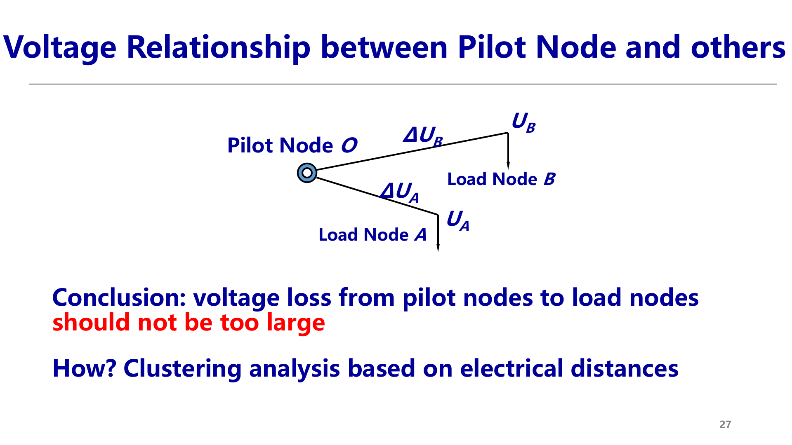

### 逆调压、顺调压、恒调压 / Inverse, Forward and Constant Regulation

这里比较的是**负荷变化时中枢点的电压设定**。

| 方式 | 重载时 | 轻载时 | 目的与适用情况 |
|---|---|---|---|
| 逆调压 / Inverse | 提高中枢点电压；课件约 $1.05U_N$ | 降低，约 $U_N$ | 抵消重载压降；线路长、负荷变化大 |
| 顺调压 / Forward | 电压较低；课件要求高于约 $1.025U_N$ | 电压较高；课件要求低于约 $1.075U_N$ | 允许电压随负荷自然变化；线路短、变化小 |
| 恒调压 / Constant | 维持给定水平 | 维持同一水平 | 课件给出约 $1.02\sim1.05U_N$ 的中枢点设定范围 |

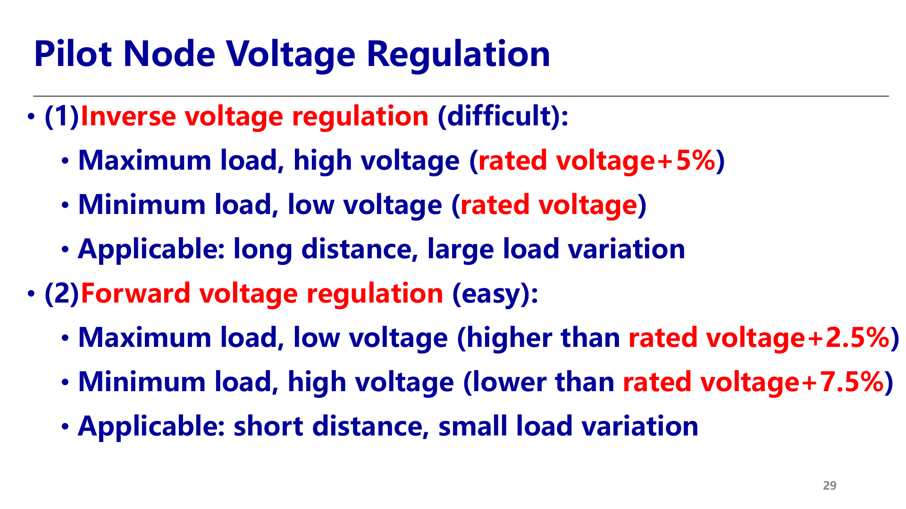

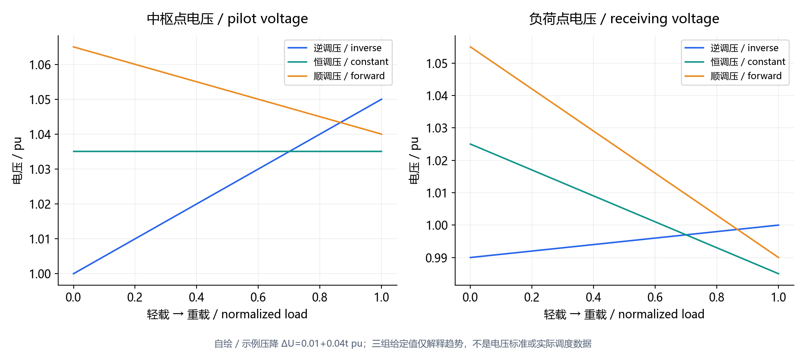

**读图 / Reading the figure**：示例压降随负荷由 0.01 增至 0.05 pu。逆调压在重载时抬高中枢点，末端电压变化较小；恒定中枢点电压仍会导致末端电压随负荷下降；顺调压会把中枢点下降与线路压降叠加，因此只能在压降变化较小等条件下采用。图中设定值是解释趋势的自选数据。

### AVC 案例 / Automatic Voltage Control

AVC 综合调整励磁、分接头和补偿设备，使中枢点接近目标，同时兼顾其他节点、设备动作与无功分配。

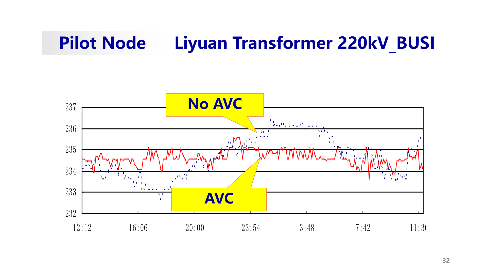

课件 P32–P33 对比了有/无 AVC 的电压曲线。应关注波动范围与目标跟踪，不能只比较某一时刻电压高低，也不能把课件展示曲线当作本次绘图生成的数据。

## 5. 四类调压手段 / Four Voltage-Regulation Levers (P34–P41)

### 统一关系式 / A Common Relationship

按课件变比方向：升压变压器 $1:K_1$，降压变压器 $K_2:1$，则

$$
U_D=\frac{U_GK_1-\Delta U}{K_2}
\approx\frac{1}{K_2}\left(U_GK_1-\frac{Q_DX}{U_N}\right)
$$

其中 $Q_D$ 应理解为相应输电路径承担的无功，电压和电抗须折算至同一侧。由此得到四种手段：调 $U_G$、调变比 $K_1/K_2$、改无功流 $Q$、改等效电抗 $X$。

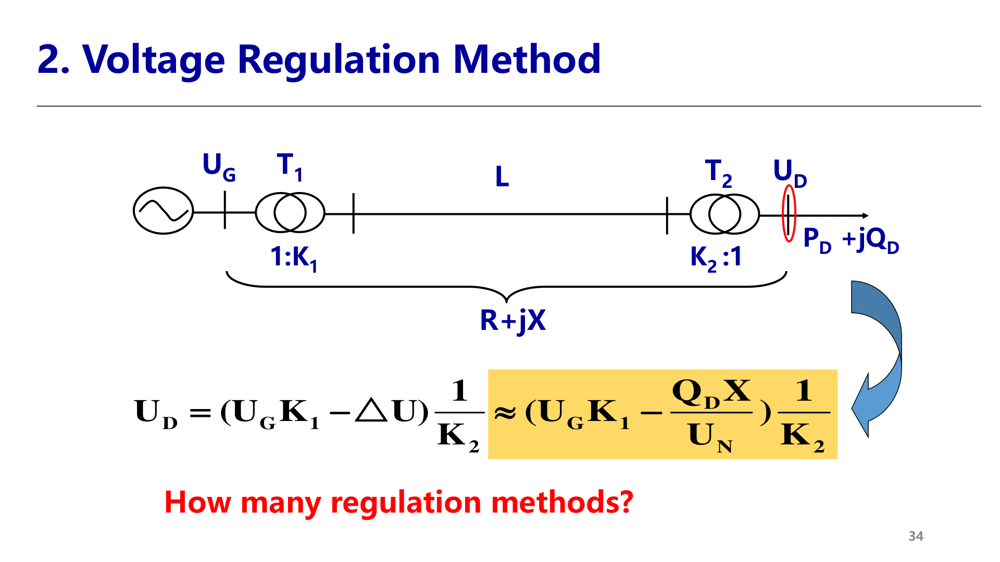

### 发电机励磁 / Generator Excitation

改变励磁可调整端电压和无功，适于连续调节；但一台机组难以同时满足近、远端不同负荷要求，多机无功分配还影响损耗。需联合设备及网络约束，不能无限提高励磁。

### 变压器分接头 / Transformer Taps (P37–P38)

分接头改变绕组有效匝数，进而改变变比。在高压侧输入电压固定、变比定义为 $K=U_H/U_L$ 时，$U_L\approx U_H/K$：

- **减少高压侧有效匝数、减小 $K$**，低压侧电压升高。
- **增加高压侧有效匝数、增大 $K$**，低压侧电压降低。

“升档/降档”的机械标号未必统一，应按绕组位置与变比定义判断方向。变比调压本身不创造无功，负荷恢复电压后的无功需求仍要由系统供给。

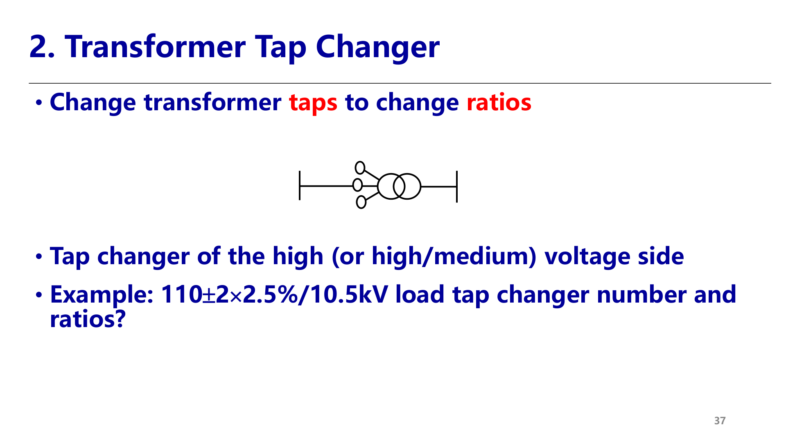

**课堂例题 / Worked example**：$110\pm2\times2.5\%/10.5$ kV，有 $2\times2+1=5$ 档。每步高压额定抽头电压相差 $2.75$ kV：

| 高压抽头电压 / kV | 低压额定电压 / kV | $K=U_{Ht}/U_{Lt}$ |
|---|---|---|
| 104.50 | 10.5 | 9.95238 |
| 107.25 | 10.5 | 10.21429 |
| 110.00 | 10.5 | 10.47619 |
| 112.75 | 10.5 | 10.73810 |
| 115.50 | 10.5 | 11.00000 |

**注意**：表中是额定抽头电压与变比。实际高压侧始终为 110 kV 时，低压空载电压应算 $110/K$，不能把抽头标称高压直接当作实时母线电压。

无励磁分接开关需按要求停电切换；有载分接开关 OLTC 可在带负荷运行时切换。二者的调压作用相似，允许操作条件不同。

### 调压变压器的相量方向 / Regulating-Transformer Phasors (P39)

向原电压叠加 $\mathrm d\dot U$：纵向分量主要改幅值，横向分量主要改相角，混合调压两者兼有。这与第 6 讲电压降纵横分量的物理意义相呼应。

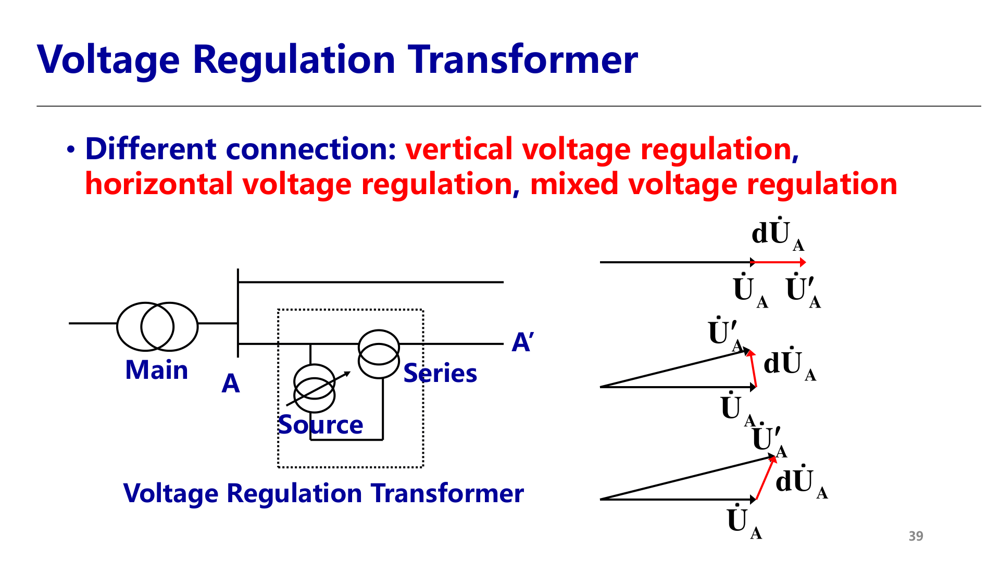

### 并联补偿与串联补偿 / Shunt versus Series Compensation

| 比较对象 | 并联电容器 | 串联电容器 |
|---|---|---|
| 直接改变 | 路径净无功 $Q_{\mathrm{up}}\approx Q_D-Q_C$ | 等效电抗 $X_{eff}=X_L-X_C$ |
| 降压降的机理 | 减少 $QX/U$ 中的 $Q$ | 减少 $QX/U$ 中的 $X$ |
| 对损耗的作用 | 可直接减小上级无功电流及 $I^2R$ | 主要改变电压/潮流，不能认为串入电容直接抵消 $R$ |
| 轻重载操作 | 重载投电容，轻载防过补偿 | 需结合线路与保护条件设计 |

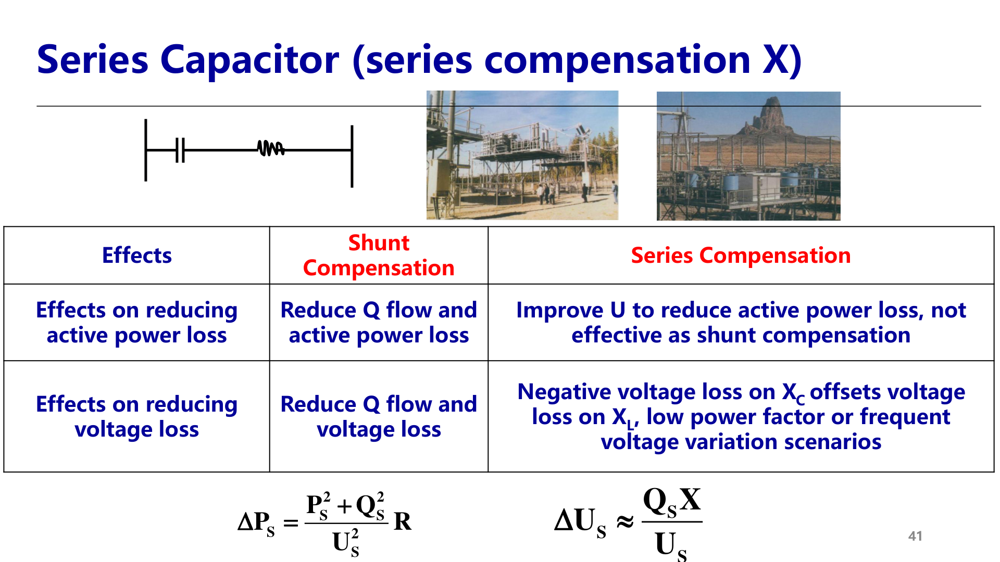

若同步调相机用于补偿，重载时可发无功、轻载时吸无功。并联电容器轻载不退出可能反向向上级送无功，使电压偏高；“补得越多越好”不成立。

**English:** Shunt compensation changes reactive flow; series compensation changes reactance. Tap changes transform voltage but do not supply reactive power.

## 源与范围 / Source and Scope

- 源文件 / Source: `10-EN第四章电力系统稳态运行与控制.pdf`，Chapter 4, Lecture 1。
- 范围 / Scope: P1–P41；覆盖电压偏移、Q–U 特性、无功设备、中枢点及全部调压方法；纯照片、重复图和地区案例不逐页复述。
- 课件截图 / Original slides: 89–104，原页码见各图说明及 [slide_sources.json](./绘图/slide_sources.json)。
- 自绘 / Supplementary figures: Q–U 交点、无功能力随电压变化、三种调压策略；均为图注所列简化模型。
- 复现 / Reproduction: [generate_figures.py](./绘图/generate_figures.py)，运行 `python 绘图/generate_figures.py`。

相关 / Related: [第6讲 简单系统潮流计算](./第6讲-简单电力系统潮流计算.md) · [第9讲 极坐标牛顿法与PQ分解法](./第9讲-极坐标牛顿法与PQ分解法.md) · [第11讲 有功功率与频率调节](./第11讲-有功功率与频率调节.md)
