> 本页整理第四章第 2 讲。P 为课件印刷页码，与 PDF 页序一致；自绘图分别解释稳态交点与动态响应，所用聚合模型和参数明确列出。  
> This page covers active-power balance, governor droop, primary/secondary/tertiary frequency control, and inertia.

## 1. 有功失衡为什么改变频率 / Why Active-Power Imbalance Changes Frequency (P3–P8)

### 从转子能量理解 / Rotor-Energy Perspective

同步机转速与电频率满足 $f=pn/60$，其中 $p$ 为极对数，$n$ 为机械转速（r/min）。忽略损耗的瞬时转子能量关系为

$$
\frac{\mathrm d}{\mathrm dt}\left(\frac12J\omega_m^2\right)=P_M-P_E
$$

| 瞬时情况 | 转子能量变化 | 频率趋势 |
|---|---|---|
| $P_M>P_E$ | 动能增加 | 加速、频率上升 |
| $P_M<P_E$ | 动能减少 | 减速、频率下降 |
| $P_M=P_E$ | 动能不再改变 | 频率不再继续变化，但未必恢复额定值 |

负荷突然增加时，电磁功率 $P_E$ 先增大，原动机功率 $P_M$ 暂时来不及增加，缺额暂由转子动能支撑，所以频率下降。随后调速、负荷频率效应等形成新的平衡。

**English:** A power deficit is initially supplied by stored kinetic energy. Restoring power balance stops the frequency drift but does not automatically restore nominal frequency.

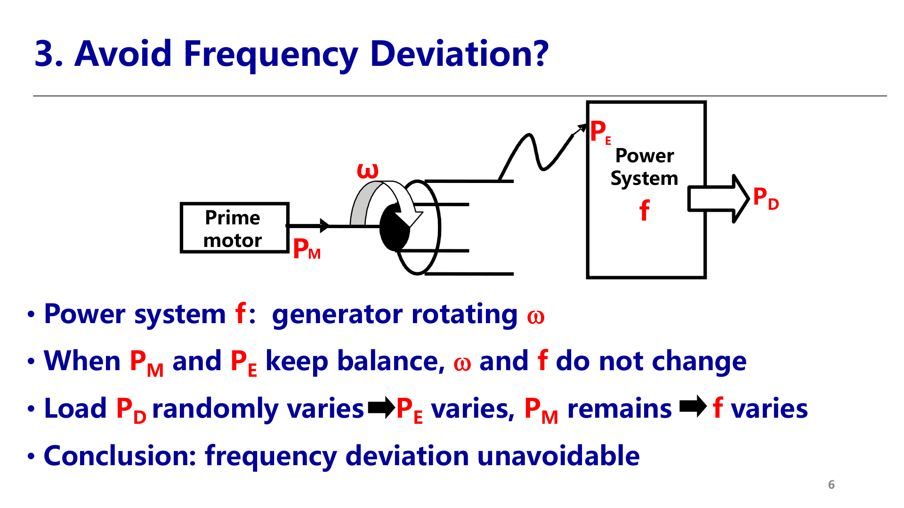

### 偏移影响与范围 / Effects and Operating Range

- 用电设备：电机转速与性能变化，部分设备对频率偏差敏感。
- 电厂：辅机能力、汽轮机叶片振动与运行寿命可能受影响。
- $f$ 降低而 $U$ 近似不变时，电机、变压器的 $U/f$ 增大，可能加重励磁及无功需求，使频率与电压问题相互影响。
- 课件 P7 以 $50\pm0.2$ Hz 等数值说明频率质量；这里按课程口径理解，后续算例以 $f_N=50$ Hz 为基准。

正常运行的同步区域可用共同频率近似分析；暂态过程中不同节点仍可能存在局部频率差异，本讲聚合模型不描述这些空间细节。

## 2. 负荷频率静态特性 / Load Frequency Characteristic (P9, P24)

### 负荷调节效应 / Frequency-Sensitive Demand

课件写成频率多项式：

$$
P_D(f)=P_{DN}\left[a_0+a_1\left(\frac f{f_N}\right)+a_2\left(\frac f{f_N}\right)^2+\cdots\right],\qquad
\sum a_k=1
$$

在原运行点附近线性化，定义

$$
K_D=\frac{\partial P_D}{\partial f}\quad(\mathrm{MW/Hz}),\qquad
\Delta P_D\approx K_D\Delta f
$$

通常 $K_D>0$：频率降低，一部分负荷的实际功率随之降低，这就是**负荷频率调节效应 load damping**。恒功率部分不提供这一效应，不能把所有负荷都当作随频率同比例变化。

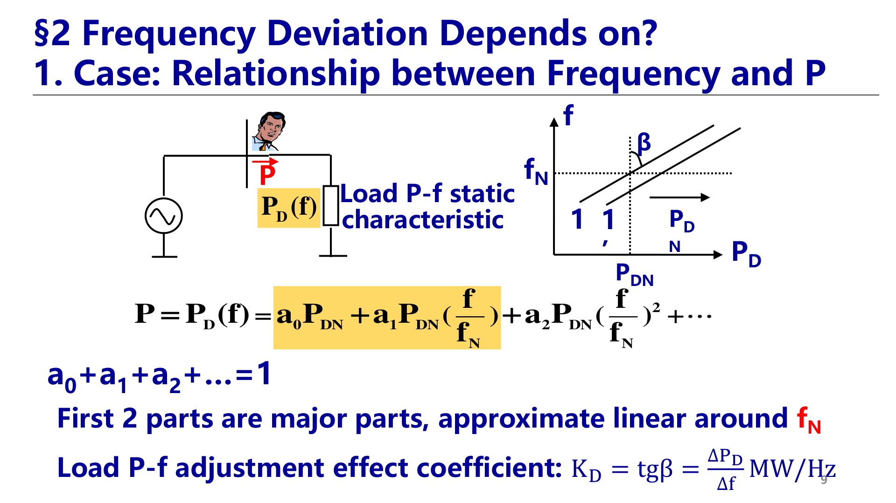

### 三个“负荷增量”不能混用 / Three Different Demand Changes

设不改变频率时的外部负荷增加为 $\Delta P_{D0}>0$，则新频率下的实际增加量为

$$
\boxed{\Delta P_{Df}=\Delta P_{D0}+K_D\Delta f}
$$

| 符号 | 含义 | 增载、降频时的符号 |
|---|---|---|
| $\Delta P_{D0}$ | 外部负荷变化，按原频率计 | 正 |
| $K_D\Delta f$ | 频率变化引起的负荷自调节 | 负 |
| $\Delta P_{Df}$ | 最终运行点的实际负荷变化 | 通常为正，但小于 $\Delta P_{D0}$ |

**English:** The imposed demand step and the final demand increase differ because some load is frequency sensitive.

## 3. 调速器与发电机静态特性 / Governor and Generator Droop (P10–P16, P25)

### 液压调速器的控制链 / Hydraulic Governor

课件机构依次完成：飞摆检测转速 → 杠杆及先导阀放大偏差 → 油压伺服活塞动作 → 改变汽门/导叶开度 → 改变原动机功率。机械反馈使控制机构在新的功率和频率下重新停止动作。

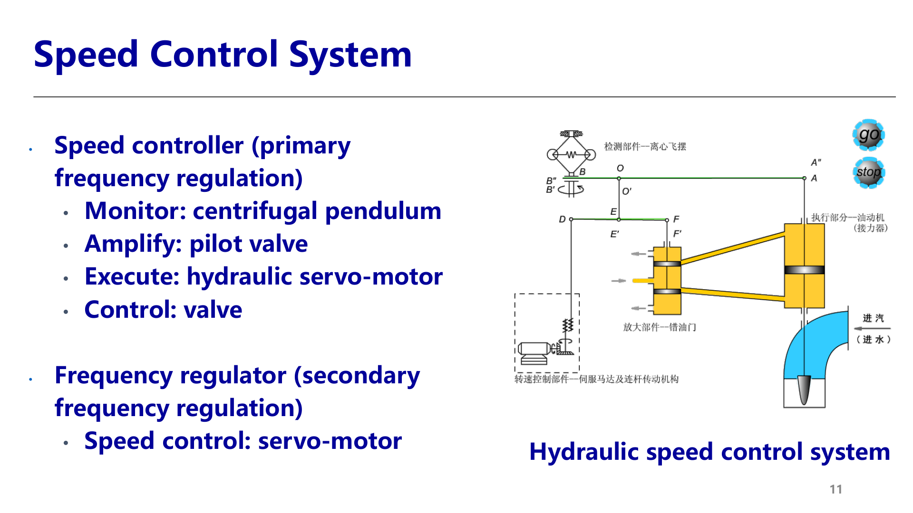

**一次调频过程**：增载降频，飞摆位置改变，先导阀使活塞动作，汽门开大、机械功率增加。最终阀门不再继续动作，但与原状态相比，汽门开度更大，转速仍偏低。

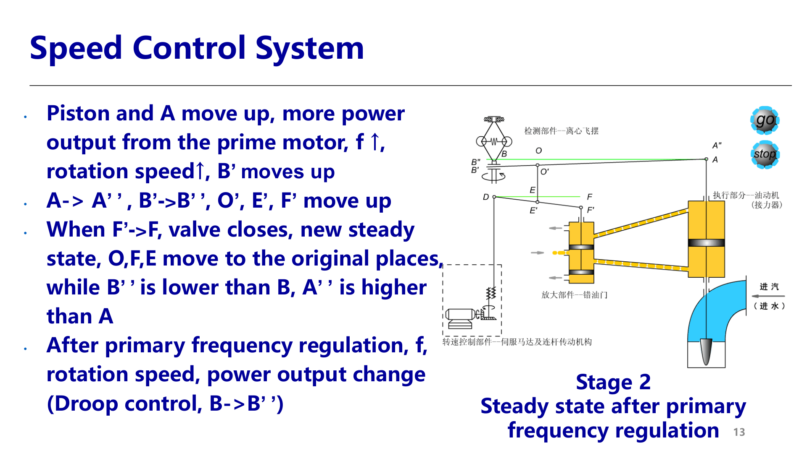

**二次调频过程**：通过附加调节机构移动功率/转速设定，继续改变汽门开度；最终可以恢复原转速，同时保留较高的机械功率输出。

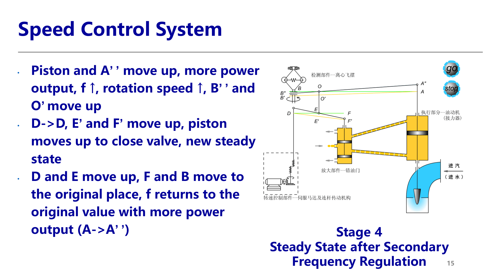

### 下垂特性与符号 / Droop Characteristic and Signs

固定功率设定时：

$$
\boxed{\Delta P_G=-K_G\Delta f},\qquad K_G>0
$$

若定义有名值调差系数 $\delta_G=-\Delta f/\Delta P_G$（Hz/MW），则 $K_G=1/\delta_G$（MW/Hz）。$K_G$ 越大，同一频差引起的出力变化越大；调差系数越小，频率响应越强。

**不要将“有差调节”译作微分控制。** 课件 P16 的 differential control 在本讲语境中指有稳态频差的下垂调节，并非控制理论中的 D 环节。

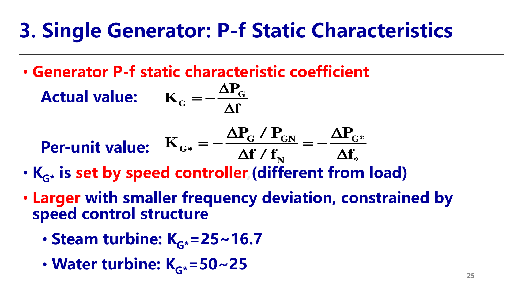

**English:** Droop is a steady-state frequency-to-power characteristic. A lower droop setting means a larger power response to the same frequency deviation.

## 4. 一次调频：求新平衡点 / Primary Frequency Control (P17–P18)

### 平衡公式推导 / Derivation

忽略网损增量，稳态增发功率等于实际负荷增量：

$$
\Delta P_G=\Delta P_{Df}
\ \Rightarrow\ -K_G\Delta f=\Delta P_{D0}+K_D\Delta f
$$

$$
\boxed{\Delta f=-\frac{\Delta P_{D0}}{K_G+K_D}},\qquad
K=K_G+K_D
$$

增载后 $\Delta f<0$；机组增发和负荷自减小共同消除初始功率缺额。新的平衡通常存在频差，所以一次调频是**有差调节**。

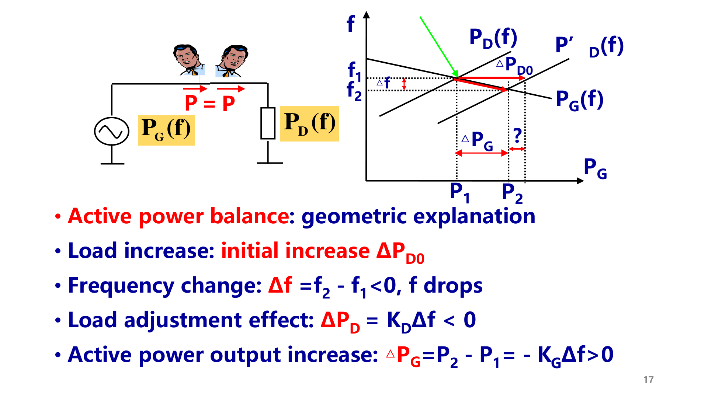

### 数值例子 / Numerical Example（补充）

取 $\Delta P_{D0}=100$ MW，$K_G=400$ MW/Hz，$K_D=20$ MW/Hz：

$$
\Delta f=-\frac{100}{420}=-0.238095\ \mathrm{Hz}
$$

$$
\Delta P_G=95.2381\ \mathrm{MW},\qquad
K_D\Delta f=-4.7619\ \mathrm{MW}
$$

机组增发 95.2381 MW，负荷因降频少用 4.7619 MW，两者合计抵消 100 MW 原始冲击。频率为 $49.761905$ Hz，**并不是机组必须增发整整 100 MW 后才可能达到稳态**。

这里的负荷“少用”是对原频率下新负荷水平而言，最终总负荷仍比扰动前增加 95.2381 MW。

## 5. 二次调频：移动特性恢复频率 / Secondary Frequency Control (P19–P20)

引入二次调频造成的功率特性平移量 $\Delta P_{GS}$：

$$
\Delta P_{G,\mathrm{total}}=\Delta P_{GS}-K_G\Delta f
$$

由功率平衡得

$$
\boxed{\Delta f=-\frac{\Delta P_{D0}-\Delta P_{GS}}{K_G+K_D}}
$$

| 二次调节量 | 结果 |
|---|---|
| $\Delta P_{GS}<\Delta P_{D0}$ | 仍低于原频率 |
| $\Delta P_{GS}=\Delta P_{D0}$ | 恢复原频率，$\Delta f=0$ |
| $\Delta P_{GS}>\Delta P_{D0}$ | 高于原频率 |

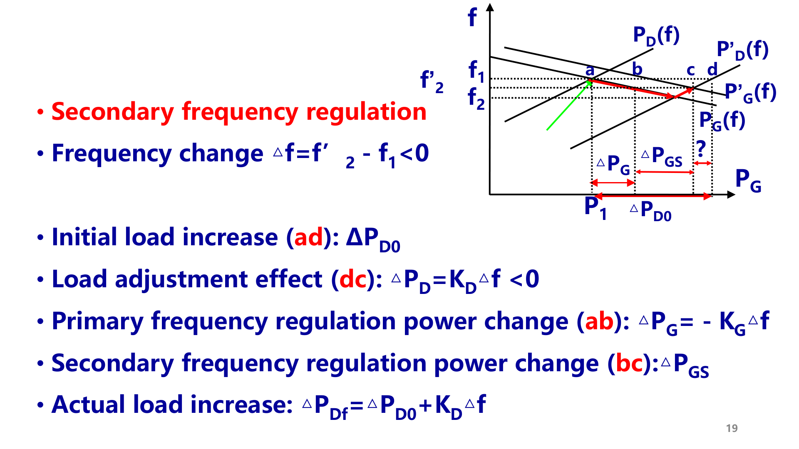

**最易混淆处**：恢复额定频率后，纯频差引起的一次调频增量 $-K_G\Delta f$ 回到零，但机组的**总出力不会回到原值**，因为功率设定已通过二次调频抬高。

对上一节 100 MW 增载，最终二次设定平移为 100 MW，总增发也为 100 MW；它不是在原一次增发 95.2381 MW 的基础上再永久叠加 100 MW。频率恢复过程中，一次增量逐渐退出，负荷自减小也逐渐消失。

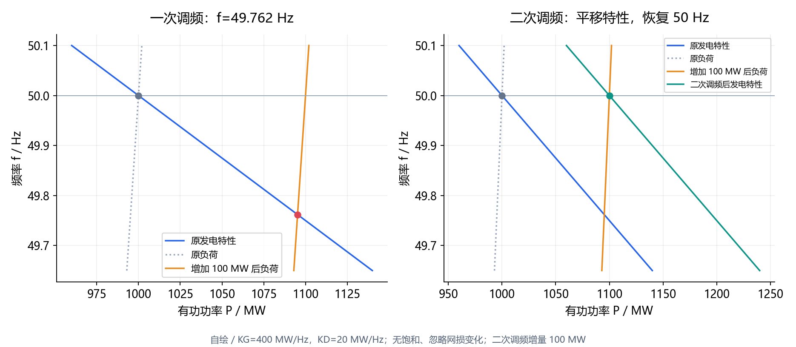

**读图 / Reading the figure**：左图通过沿原发电特性移动获得有差平衡；右图平移整个发电特性，使新负荷曲线与发电特性在 50 Hz 相交。二次调频改变的是设定，不能仅靠沿同一条下垂线移动实现无差恢复。

**English:** Secondary control shifts the generation reference. As frequency recovers, the primary droop contribution decreases while the reference increase remains.

## 6. 多机聚合与标幺系数 / Aggregation and Per-Unit Coefficients (P24–P27)

### 先统一有名值再求和 / Sum on a Common Physical Basis

对未受出力上下限限制、实际参与调频的机组：

$$
\Delta P_{Gi}=-K_{Gi}\Delta f,\quad
\Delta P_G=-\left(\sum_iK_{Gi}\right)\Delta f,\quad
\boxed{K_G=\sum_iK_{Gi}}
$$

同一频差下，各机组按 $K_{Gi}$ 比例分担一次调频：

$$
\frac{\Delta P_{Gi}}{\Delta P_{Gj}}=\frac{K_{Gi}}{K_{Gj}}
$$

机组已达上限、没有上调余量时，不能再按同一线性关系无限增发；需分段处理并从可用增量系数中移除饱和部分。课件 P26 的关系应在**有调节裕度**的前提下使用。

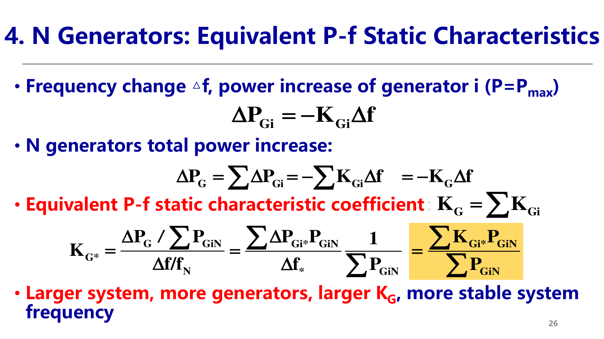

### 不同功率基准不可直接相加 / Different Power Bases

对单机额定功率 $P_{GiN}$：

$$
K_{Gi*}=-\frac{\Delta P_{Gi}/P_{GiN}}{\Delta f/f_N}
=K_{Gi}\frac{f_N}{P_{GiN}}
$$

总机组基准取 $P_{GN}=\sum_iP_{GiN}$ 时：

$$
\boxed{K_{G*}=\frac{\sum_iK_{Gi*}P_{GiN}}{\sum_iP_{GiN}}}
$$

这是容量加权平均，不是把各机组按自身容量定义的标幺系数直接相加。

负荷基准为 $P_{DN}$ 时，$K_{D*}=K_Df_N/P_{DN}$。若系统系数统一到负荷功率基准：

$$
K_*=K\frac{f_N}{P_{DN}}=K_{G*}\underbrace{\frac{P_{GN}}{P_{DN}}}_{\rho}+K_{D*},\qquad
\boxed{\Delta f_*=-\frac{\Delta P_{D0*}}{K_*}}
$$

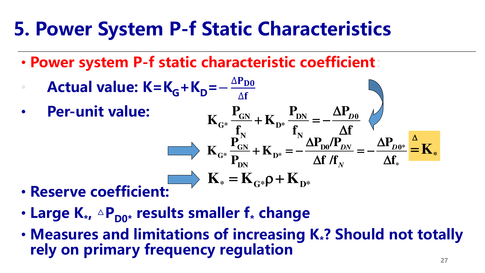

课件给出 $K_{D*}\approx1\sim3$；汽轮机 $K_{G*}\approx16.7\sim25$，水轮机约 $25\sim50$，用于课程量级理解。无量纲下垂率 $R_*=1/K_{G*}$，例如 $K_{G*}=20$ 对应 $R_*=5\%$。其有名值仍需通过各自容量基准换算。

**English:** Physical MW/Hz coefficients add directly. Per-unit coefficients defined on different machine ratings require capacity weighting.

## 7. 备用与三级频率控制 / Reserves and Three Control Levels (P21–P23, P28, P30)

### 运行平衡与备用 / Balance and Reserves

$$
\sum P_G=\sum P_D+\sum P_L
$$

- **旋转备用 spinning reserve**：运行机组可用最大出力与当前出力之间的差；响应还受爬坡和执行机构限制。
- **非旋转备用 non-spinning reserve**：待启动或待投入设备的可用容量，需考虑启动时间。
- 备用按用途可分负荷、事故、检修及规划中的负荷增长不确定性备用。

课件 P22 给出负荷备用约最大负荷的 $0\%\sim5\%$、事故备用约 $5\%\sim10\%$、国民经济备用约 $3\%\sim5\%$ 的课程经验量级。备用 MW 大小与能否在要求时间内到位是不同问题。

### 一次、二次、三次调频 / Primary, Secondary and Tertiary Control

| 层级 | 主要作用 | 控制对象 | 典型结果 |
|---|---|---|---|
| 一次 / Primary | 分散抑制频率偏移 | 调速器/频率下垂，有功增量 | 形成有差平衡，分担扰动 |
| 二次 / Secondary | 恢复频率及计划交换 | 部分具备条件的机组，AGC 功率设定 | 移动发电特性，消除稳态偏差 |
| 三次 / Tertiary | 经济分配、恢复调节裕度 | 调度计划和机组出力安排 | 使后续运行更经济且保留备用 |

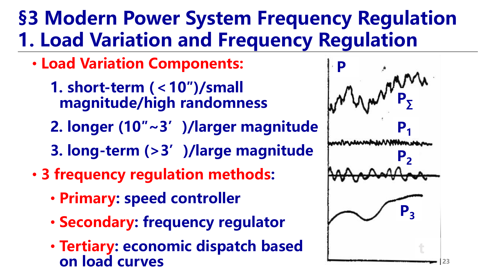

课件用小于 10 s、10 s 至 3 min、大于 3 min 的负荷分量解释不同时间尺度；实际控制响应会重叠，不能理解为前一级结束后才允许后一级动作。

AGC 参与机组需具备足够备用、调节速度，并满足安全和经济要求；一次调频通常由更多具备条件的机组共同承担。

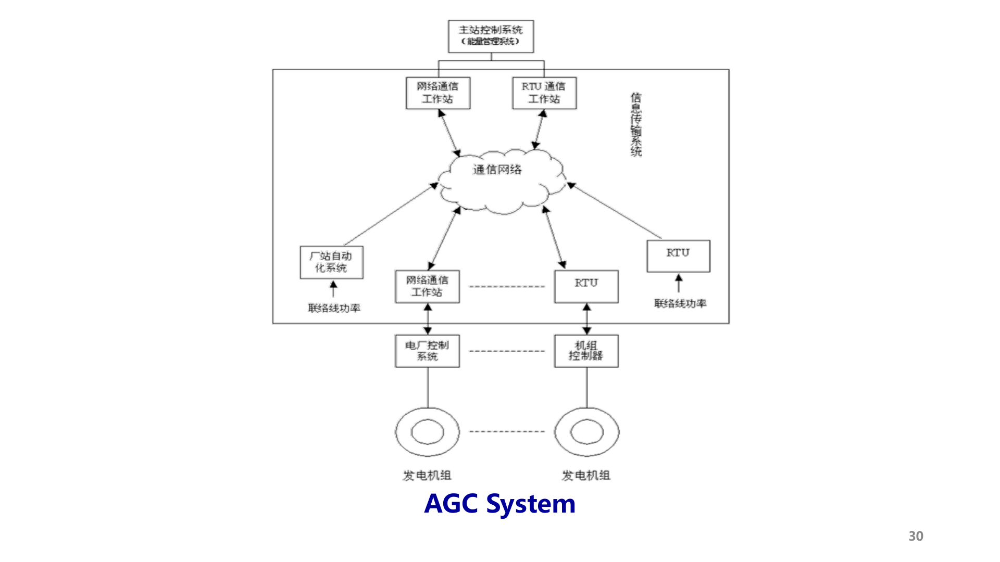

## 8. 惯量与调频能力的区别 / Inertia versus Frequency Response (P29，补充绘图)

### 静态系数没有回答初始下降速度 / A Static Formula Does Not Give RoCoF

$$
\Delta f_{\mathrm{steady}}=-\frac{\Delta P_{D0}}{K_G+K_D}
$$

上式没有 $J$ 或惯性常数 $H$，因为它描述的是**稳态**。惯量主要影响扰动刚发生时的频率变化率；在同一调频系数、同一扰动且均能稳定到达平衡的模型中，不同惯量可对应相同最终频差。

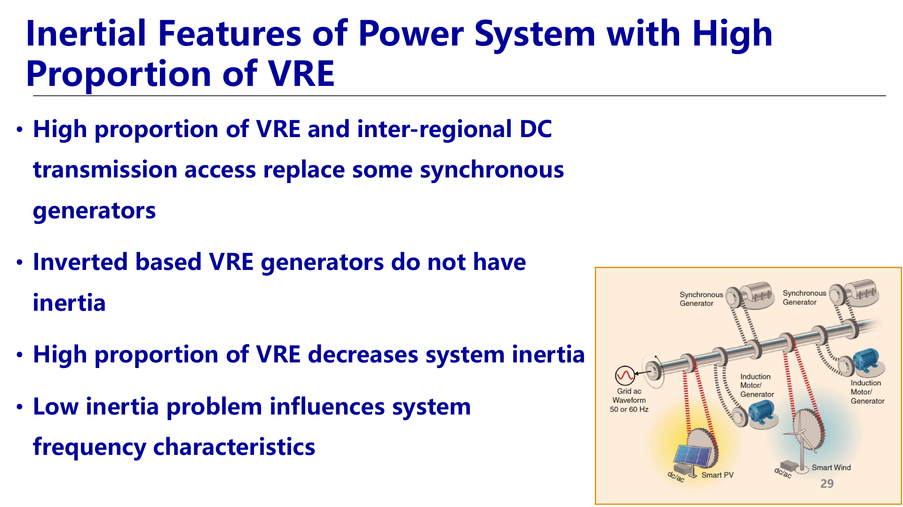

课件“逆变器电源没有惯量”的表述，应理解为不天然具备与同步机直接并网相同的机械惯性响应；受控变流器可在能量与容量允许时提供频率支撑，不能把所有新能源控制方式视为相同。

### 自绘动态模型 / Supplementary Dynamic Model

取 $x=\Delta f/f_N$，所有增量功率按同一 $S_B$ 标幺化：

$$
\begin{aligned}
2H\dot x&=p_m-p_d-Dx\\
T_g\dot p_m&=-p_m-K_{G*}x+p_s\\
\dot p_s&=-K_ix\quad\text{（启用二次调频后）}
\end{aligned}
$$

其中 $p_m$ 是机械功率增量，$p_d$ 是外部负荷阶跃，$Dx$ 是负荷频率响应，$p_s$ 是二次调节设定。忽略空间差异、汽轮机细分环节、死区、限幅和爬坡限制。

图中 $S_B=1000$ MW、$f_N=50$ Hz，5 s 时增载 100 MW，$D=1$、$K_{G*}=20$、$T_g=0.5$ s；二次积分 $K_i=2$ 从 40 s 启用。

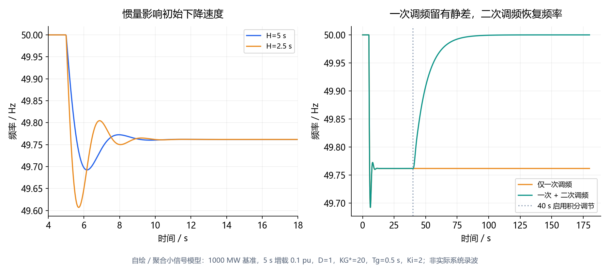

- **左图**：$H=2.5$ s 的初始下降更快；扰动瞬间若机械功率尚未变化，$\dot f(0^+)=-f_Np_d/(2H)$，$H=5$ s 时约 $-0.5$ Hz/s，$H=2.5$ s 时约 $-1$ Hz/s。
- **右图**：仅一次调频最终停在 $50-50\times0.1/(20+1)=49.761905$ Hz；加入积分调节后接近 50 Hz。
- **不能混用的指标**：初始变化率、最低频率、最终频差分别反映不同过程，不能用一个 $K$ 或一个 $H$ 包办。

**English:** Inertia controls the initial rate of change; droop and load damping determine the primary steady-state offset; secondary integral action restores nominal frequency in this simplified model.

## 9. 课堂讨论 / Further Discussion (P31)

- **“地球一小时”与集中开关灯**：对电网有意义的不仅是总电量变化，还有集中切换产生的功率阶跃和爬坡。统一时间的大幅开、关负荷都应有可预测安排。
- **“负荷响应电源”**：除发电跟随负荷，也可通过可调负荷、储能充放电等调整净负荷；把需求响应增量纳入功率平衡即可分析频差和备用变化。需区分用户主动响应与 $K_D\Delta f$ 描述的自然频率效应。

## 源与范围 / Source and Scope

- 源文件 / Source: `11-EN第四章电力系统稳态运行与控制.pdf`，Chapter 4, Lecture 2。
- 范围 / Scope: P1–P31；覆盖主要静态推导、调速机构、备用、三级控制、惯量及课堂讨论。历史事故页用于说明问题背景，不扩展其事故调查结论。
- 课件截图 / Original slides: 105–117，原页码见图注及 [slide_sources.json](./绘图/slide_sources.json)。
- 自绘 / Supplementary figures: 一次/二次静态平衡、惯量与调频动态比较。动态图为上述小信号模型仿真，不是实测波形。
- 复现 / Reproduction: [generate_figures.py](./绘图/generate_figures.py)，采用固定步长四阶 Runge-Kutta；数值记录见 [calculated_results.json](./绘图/calculated_results.json)。

相关 / Related: [第10讲 无功功率与电压调节](./第10讲-无功功率与电压调节.md) · [第12讲 经济运行与最优负荷分配](./第12讲-经济运行与最优负荷分配.md)
