> 本页整理第四章第 3 讲。P 为原课件印刷页码：PDF 第 1–29 页对应 P1–P29，最后一页对应 P31。保留原课件截图，补充等微增率、边界分配和网损影响的绘图，并核正含网损算例的功率平衡。  
> This page covers economic dispatch, incremental costs, generator limits, loss penalty factors, and independently checked examples.

## 1. 经济运行要解决什么 / What Economic Dispatch Solves (P3–P4)

满足同一负荷的发电组合通常不唯一。**经济调度 economic dispatch, ED** 在满足负荷需求、安全和电能质量的前提下，选择更低成本的机组出力分配。

| 问题 | 主要给定量 | 主要待求量 | 目标 |
|---|---|---|---|
| 潮流计算 / Power flow | 网络、节点类型和功率/电压边界 | 电压、平衡功率、支路功率 | 找到满足物理方程的运行点 |
| 经济调度 / ED | 负荷、网络、成本与运行限制 | 各机组出力 | 在可行运行点中降低成本 |
| 机组组合 / Unit commitment | 跨时段负荷、启停与运行约束 | 哪些机组开机、何时启停 | 联合考虑启停与出力成本 |

本讲传统 ED 默认参与机组的开机状态已定，重点求连续出力。不能将“把某台开机机组出力调小”直接等同于“关掉该机组并省去全部固定费用”。

**English:** Power flow checks physical consistency. Economic dispatch chooses among feasible operating points; commitment adds on/off decisions.

## 2. 不同电厂如何分担负荷 / Allocation among Plant Types (P5–P10)

| 电源 / Resource | 本讲经济特征 | 调度中的主要约束 |
|---|---|---|
| 火电 / Thermal | 燃料成本明显，效率与蒸汽参数及负荷率有关 | 最小稳定出力、调节速度；热电联产还受供热约束 |
| 水电 / Hydro | 无燃料成本，调节较快 | 来水、水头、水量及防洪、灌溉、航运等综合需求 |
| 核电 / Nuclear | 投资高，运行边际成本较低 | 调节需考虑机组运行与安全要求 |
| 风光 / Wind and PV | 燃料边际成本近零，可用出力受天气限制 | 出力上限时变；向上调节需要预留可用功率或配合储能 |
| 储能 / Storage | 可移动负荷和供电时段 | 功率、能量、效率、荷电状态及后续时段需求 |

课件强调：尽量利用可用水能、减少弃水，优先安排高效火电，促进新能源消纳，发挥储能调峰调频作用。水电在丰、枯水期的安排会变化，不能简单按“无燃料成本”就认为水在任意时段都没有机会成本。

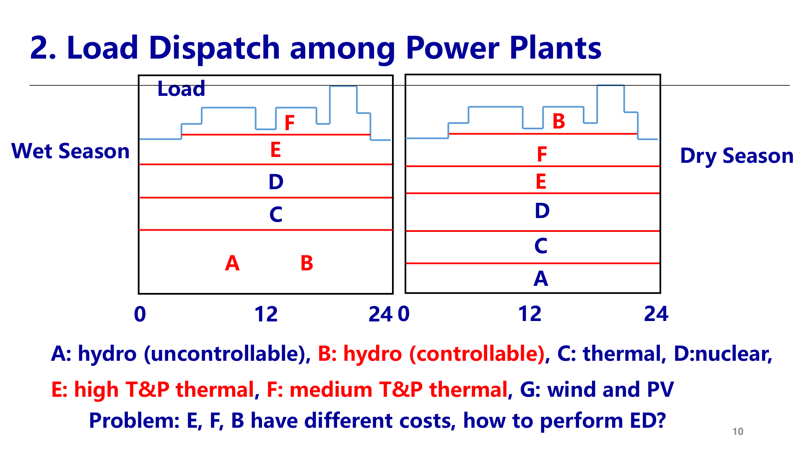

图中底部与顶部安排是特定教学场景。实际顺序还依赖水量、供热、运行约束和可用容量，不能仅按机组名称建立固定的通用排序。

## 3. 成本特性与微增率 / Cost Curves and Incremental Cost (P11–P13)

### 煤耗到发电成本 / From Fuel Consumption to Cost

若燃料消耗特性为 $F(P_G)$（t/h），燃料单价为 $K$（元/t）：

$$
C(P_G)=KF(P_G)\quad(\text{元/h})
$$

本讲用可微二次函数近似开机机组的成本：

$$
\boxed{C_i(P_{Gi})=a_i+b_iP_{Gi}+c_iP_{Gi}^2},\qquad
\boxed{IC_i=\frac{\mathrm dC_i}{\mathrm dP_{Gi}}=b_i+2c_iP_{Gi}}
$$

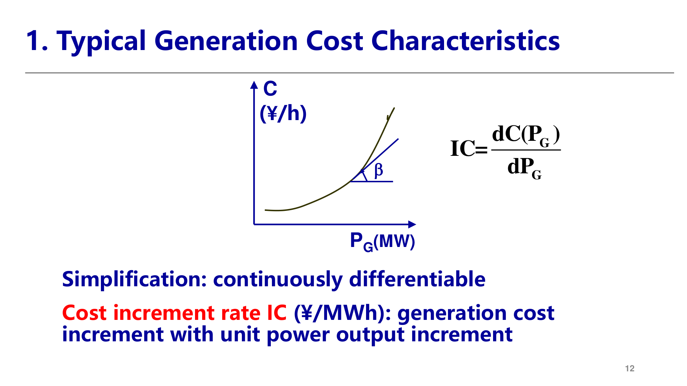

| 量 | 单位 | 含义 |
|---|---|---|
| $C_i$ | 元/h | 当前出力下每小时成本 |
| $P_{Gi}$ | MW | 当前发电功率 |
| $IC_i$ | 元/MWh | 出力增加 1 MW 时，小时成本的局部增加量 |
| $C_i/P_{Gi}$ | 元/MWh | 当前平均发电成本，与微增率不同 |

### a、b、c 的理解 / Interpreting the Coefficients

- $c_i>0$：$C_i''=2c_i>0$，成本曲线凸；是本讲等微增率给出全局最优解的重要条件。
- $b_i>0$：物理运行区 $P_{Gi}\ge0$ 上微增率为正；二次曲线的无约束顶点 $-b_i/(2c_i)<0$ 在通常运行区外，不需要把机组调到负出力。
- $a_i>0$：表示开机成本曲线的常数项/空载消耗。已开机时，$a_i$ 不影响最优连续出力的边际条件；是否停机则是另一个问题。

这些系数是模型拟合和运行范围下的参数，并不是所有电源成本都必须满足同一二次形式。

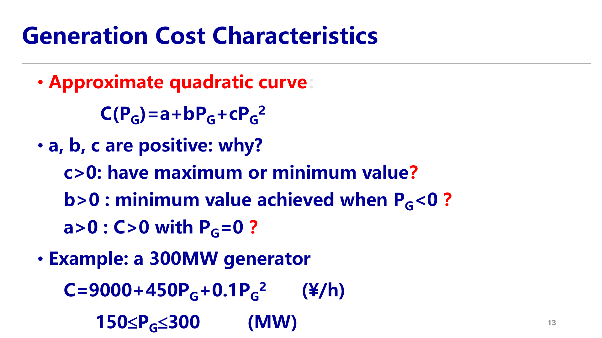

## 4. 经济调度模型与潮流的关系 / ED Model and Power Flow (P14–P17)

### 带网络约束的思路 / Network-Constrained Formulation

$$
\min\ C_T=\sum_{i=1}^{m}C_i(P_{Gi})
$$

课件有功调度模型要求：

- 满足各节点有功潮流方程与负荷需求。
- $P_{Gi}^{min}\le P_{Gi}\le P_{Gi}^{max}$。
- 支路有功限制 $|P_{ij}|\le P_{ij}^{max}$。

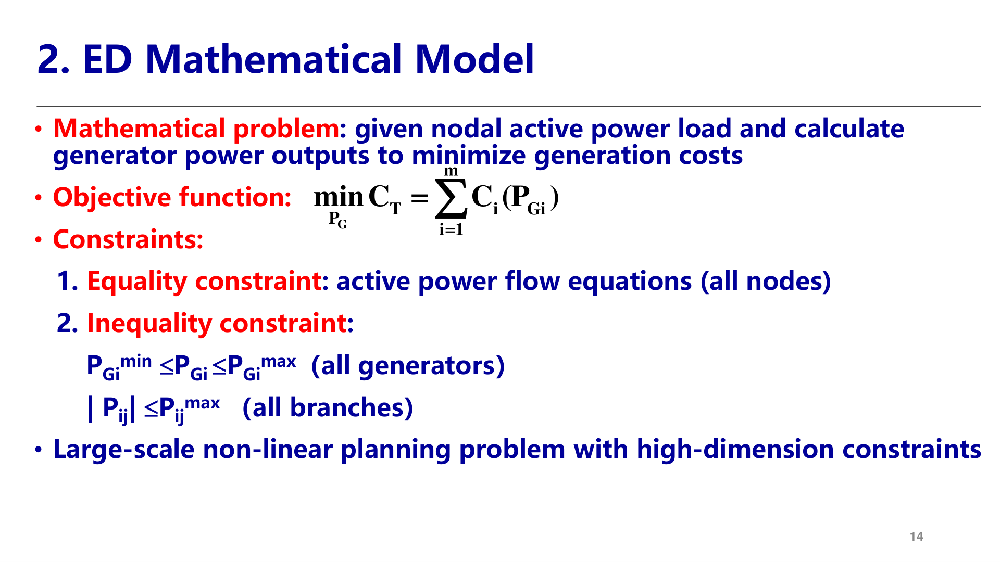

若采用完整交流网络模型，还应同时满足对应无功方程、电压边界和设备无功/容量约束；只满足总有功平衡，不能保证线路不过载或电压合格。

三节点教学例中，若节点 1 给定 $U_1,\delta_1$，节点 2、3 的电压幅值可控并暂给定 $P_{G2},P_{G3}$，则内层潮流可取节点 1 平衡、2 和 3 为 PV。每选一组 $P_{G2},P_{G3}$，潮流解出 $P_{G1}$ 及支路功率，再判断约束、计算成本；外层调度改变出力寻找更低成本。

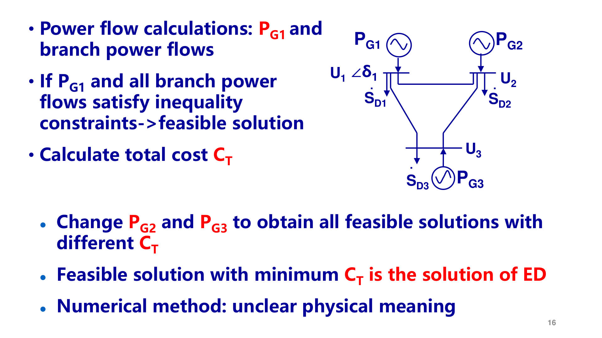

### 传统 ED 的三项简化 / Traditional Simplifications

P17 忽略线路功率约束、网损及机组出力不等式，只保留

$$
\min\sum_iC_i(P_{Gi}),\qquad \sum_iP_{Gi}=P_D
$$

这相当于从优化中省略网络输送限制，只求“总量如何分给机组”。在该简化模型里不需要逐节点潮流方程；但不能声称这样求出的分配自动满足真实网络条件。

**English:** Traditional lossless ED uses one aggregate balance. Network feasibility must be included or checked when the simplifications are removed.

## 5. 等微增率准则 / Equal Incremental Cost Criterion (P18–P20)

### Lagrange 推导 / Lagrange Derivation

$$
\mathcal L=\sum_iC_i(P_{Gi})-\lambda\left(\sum_iP_{Gi}-P_D\right)
$$

驻点条件为

$$
\frac{\partial\mathcal L}{\partial P_{Gi}}=C_i'(P_{Gi})-\lambda=0,\qquad
\sum_iP_{Gi}=P_D
$$

$$
\boxed{IC_1=IC_2=\cdots=IC_m=\lambda}
$$

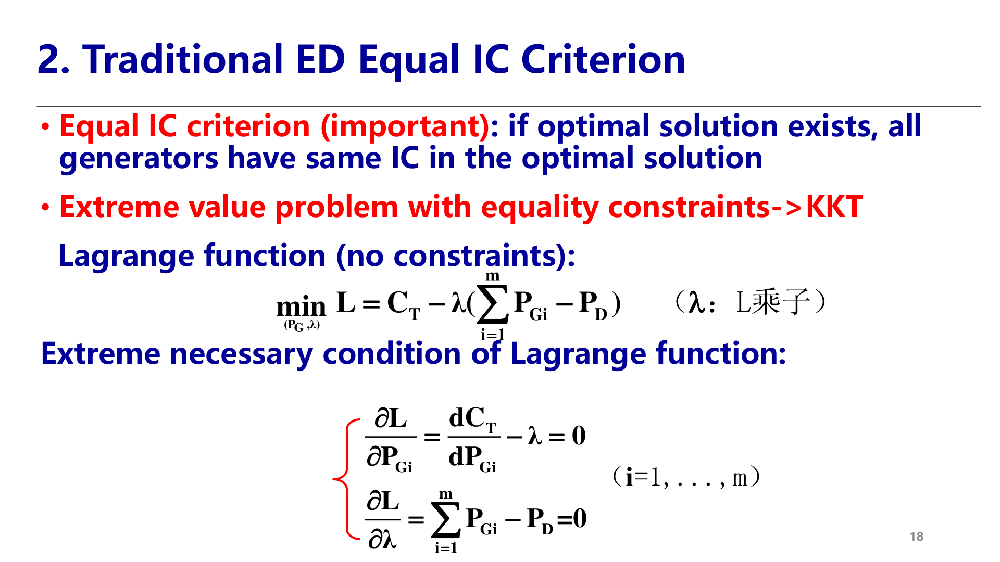

约束仿射、成本严格凸时，满足平衡和上述条件的解是唯一最优解。一般非凸成本下，驻点条件本身不保证全局最优。Lagrange 乘子法是在求约束问题的驻点，不能把 $\lambda$ 当普通变量进行无约束联合最小化。

### 为什么等的是边际成本 / Exchange Argument

若两台都可自由调节的机组满足 $IC_1>IC_2$，把 $\varepsilon$ MW 从机组 1 转给机组 2，总出力不变，成本变化近似为

$$
\Delta C_T\approx-IC_1\varepsilon+IC_2\varepsilon<0
$$

所以原分配不可能最优。应继续转移，直到两者边际成本相等或某台到达边界。**不是让总成本、平均成本或出力相等。**

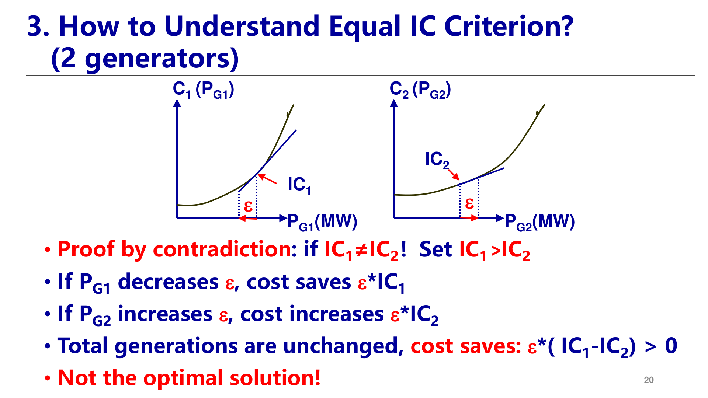

### λ 的含义 / Meaning of Lambda

令优化后的最小小时成本为 $C_T^*(P_D)$，则在可微处

$$
\lambda=\frac{\mathrm dC_T^*}{\mathrm dP_D},\qquad
C_T^*(P_D+\varepsilon)-C_T^*(P_D)\approx\lambda\varepsilon
$$

$\lambda$ 是系统边际供电成本（元/MWh），不是最优总成本。负荷增加 $\varepsilon$ MW 并持续 1 小时，附加费用约为 $\lambda\varepsilon$ 元；这里只在相同模型、局部小变化下成立。

**English:** Equalize the cost of the next MW, not average cost. Lambda is the marginal value of serving additional demand in the specified model.

## 6. 两机 700 MW 算例 / Two-Generator 700 MW Example (P21–P22)

给定

$$
\begin{aligned}
C_1&=9000+450P_{G1}+0.1P_{G1}^2\\
C_2&=25000+430P_{G2}+0.03P_{G2}^2\\
P_D&=700\ \mathrm{MW}
\end{aligned}
$$

等微增率与平衡联立：

$$
450+0.2P_{G1}=430+0.06P_{G2},\qquad P_{G1}+P_{G2}=700
$$

$$
\boxed{P_{G1}=84.61538\ \mathrm{MW},\quad P_{G2}=615.38462\ \mathrm{MW},\quad
\lambda=466.92308\ \mathrm{元/MWh}}
$$

$$
C_T=348769.23077\ \mathrm{元/h}
$$

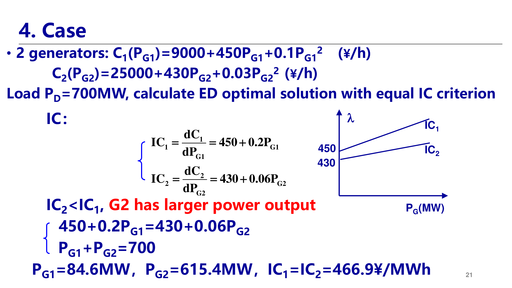

该结果是**未考虑出力上下限**的最优解。不能把 P13 对机组 1 展示的 $150\sim300$ MW 运行区间忽略后，又宣称 84.6 MW 是其实际可行出力；如沿用该区间，必须加约束重算。

### 补充：加入明确的边界 / Explicit Bound-Constrained Extension

为解释 P22 提问，取

$$
150\le P_{G1}\le300,\qquad100\le P_{G2}\le900\quad(\mathrm{MW})
$$

其中机组 1 区间沿用 P13，机组 2 区间为**本页补充假设**。无约束解违反机组 1 下限，应固定 $P_{G1}=150$，再由平衡求 $P_{G2}=550$：

$$
IC_1=480,\qquad IC_2=463\quad(\mathrm{元/MWh}),\qquad C_T=349325\ \mathrm{元/h}
$$

这仍然是该边界模型的最优解。虽然机组 1 边际成本更高，但已到下限，无法再向机组 2 转移出力。

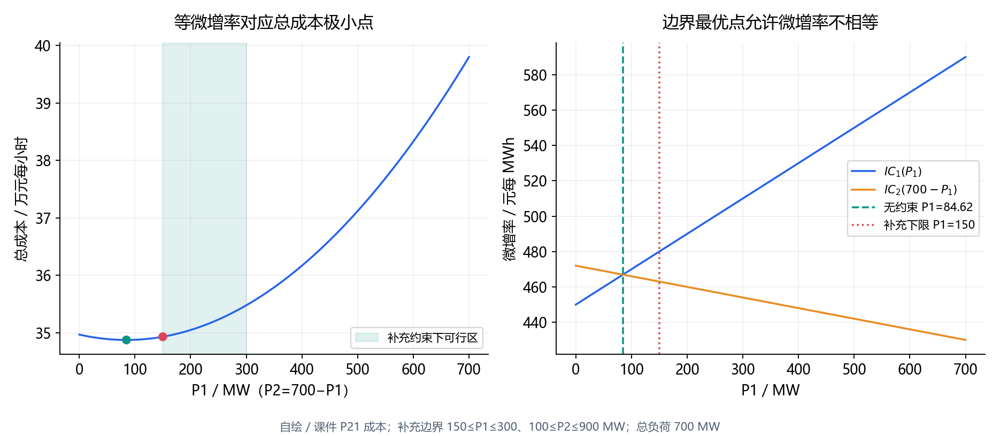

**读图 / Reading the figure**：左图沿 $P_2=700-P_1$ 扫描总成本，阴影是补充约束下的可行区；无约束极小点在区外，约束最优点落在左边界。右图中横坐标统一为 $P_1$，第二条线表示 $IC_2(700-P_1)$，因此斜率为负。

## 7. 有上下限时的最优分配 / Optimal Dispatch with Bounds (P23–P25)

### KKT 条件 / KKT Conditions

考虑同一个无网损、单总量平衡模型，最优时：

| 机组状态 | 最优条件 |
|---|---|
| $P_{Gi}^{min}<P_{Gi}<P_{Gi}^{max}$ | $IC_i=\lambda$ |
| $P_{Gi}=P_{Gi}^{min}$ | $IC_i\ge\lambda$ |
| $P_{Gi}=P_{Gi}^{max}$ | $IC_i\le\lambda$ |

下限机组“较贵但不能再减”，上限机组“较便宜但不能再增”。上下限机组不必满足相同微增率；等微增率只作用于仍可自由调节的机组。

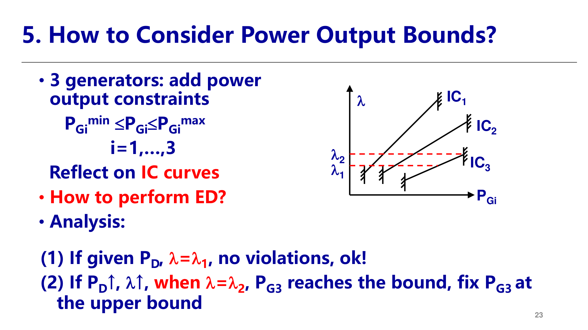

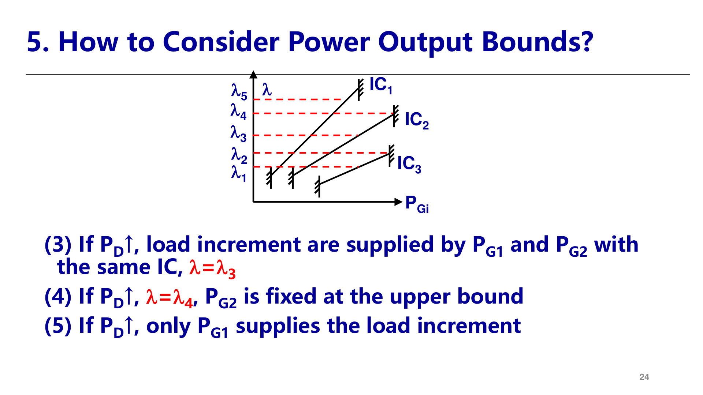

### λ 迭代 / Lambda Iteration

对二次凸成本，给定 $\lambda$ 后的出力为

$$
\boxed{P_{Gi}(\lambda)=\operatorname{clip}\left(\frac{\lambda-b_i}{2c_i},P_{Gi}^{min},P_{Gi}^{max}\right)}
$$

1. 先检查 $\sum P_{Gi}^{min}\le P_D\le\sum P_{Gi}^{max}$，否则此开机组合不可行。
2. 给定 $\lambda$，按上式求出力，达到边界的机组固定在相应边界。
3. 若 $\sum P_{Gi}<P_D$，提高 $\lambda$；若大于 $P_D$，降低 $\lambda$。
4. 利用总出力对 $\lambda$ 单调不减，可用二分法，直到平衡误差满足容差。

**不要先求无约束解、逐台截断后直接结束**：截断会破坏总功率平衡，必须重新分配其余机组。

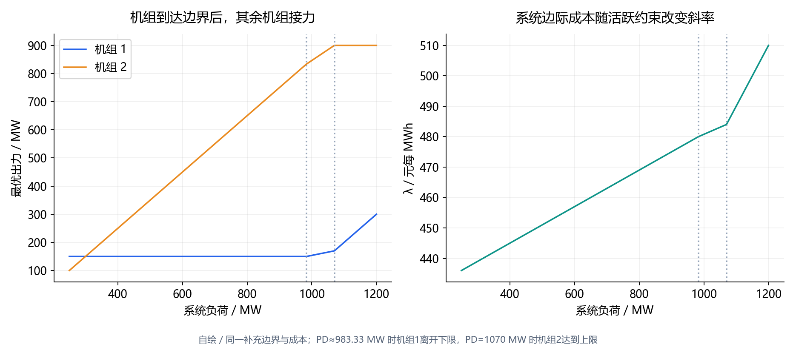

使用上一节明确的边界：

- $250\le P_D\le983.33333$ MW：机组 1 在 150 MW 下限，新增负荷由机组 2 承担。
- $983.33333<P_D<1070$ MW：两台均在内部，按等微增率共同增加。
- $1070\le P_D\le1200$ MW：机组 2 到 900 MW 上限，剩余增量由机组 1 承担。

在转折点，最优出力连续，系统边际成本曲线的斜率改变。图中是自选边界下的可复现示例，不是课件三台机组曲线的数字化复原。

**English:** Equal incremental cost applies to unconstrained units. Units at limits satisfy inequalities, and the remaining units must restore balance.

## 8. 计及网损：修正等微增率 / Including Transmission Losses (P26–P27)

### 损耗改变“送达成本” / Delivered Marginal Cost

给定有功网损函数 $P_L(\mathbf P_G)$，平衡改为

$$
\sum_iP_{Gi}-P_L(\mathbf P_G)-P_D=0
$$

$$
\mathcal L=\sum_iC_i(P_{Gi})-\lambda\left[\sum_iP_{Gi}-P_L(\mathbf P_G)-P_D\right]
$$

对未达出力边界的机组：

$$
C_i'-\lambda\left(1-\frac{\partial P_L}{\partial P_{Gi}}\right)=0
$$

定义**网损修正系数/惩罚因子 penalty factor**

$$
\alpha_i=\frac{1}{1-\partial P_L/\partial P_{Gi}},\qquad
\boxed{\alpha_iIC_i=\lambda}
$$

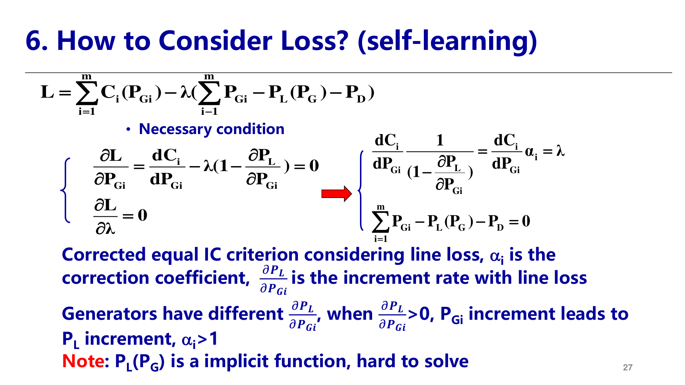

- 机组增发 1 MW，若增量网损为 $l_i=\partial P_L/\partial P_{Gi}$ MW，则负荷侧只多收到约 $1-l_i$ MW。
- 当 $0<l_i<1$ 时，每送达 1 MW 需发 $1/(1-l_i)$ MW，因此边际发电成本乘以 $\alpha_i>1$。
- 不同机组即使有相同的本机成本曲线，也可能因送达网损不同而最优出力不同。
- $l_i$ 取决于网络与运行点，不必处处为正；不能把所有惩罚因子都固定设为大于 1。

实际 $P_L$ 依赖潮流，模型和边际损耗的定义必须与所选平衡方式一致。本讲下一节用明确的简化函数演示，无需假定网损为负荷的固定百分比。

## 9. 含网损两机算例与勘误 / Loss Example and Numerical Correction (P28–P29)

### 原题条件 / Given Model

$$
IC_1=0.07P_{G1}+41,\qquad IC_2=0.07P_{G2}+41\quad(\mathrm{元/MWh})
$$

$$
P_{D1}=300,\quad P_{D2}=50,\quad P_D=350\ \mathrm{MW},\qquad
P_L=0.001(P_{G2}-50)^2\ \mathrm{MW}
$$

不设机组出力上下限。机组 2 先供本地 50 MW，余量经线路向负荷较大的节点 1 送电；$P_{G2}=50$ 时该模型线路网损为零。

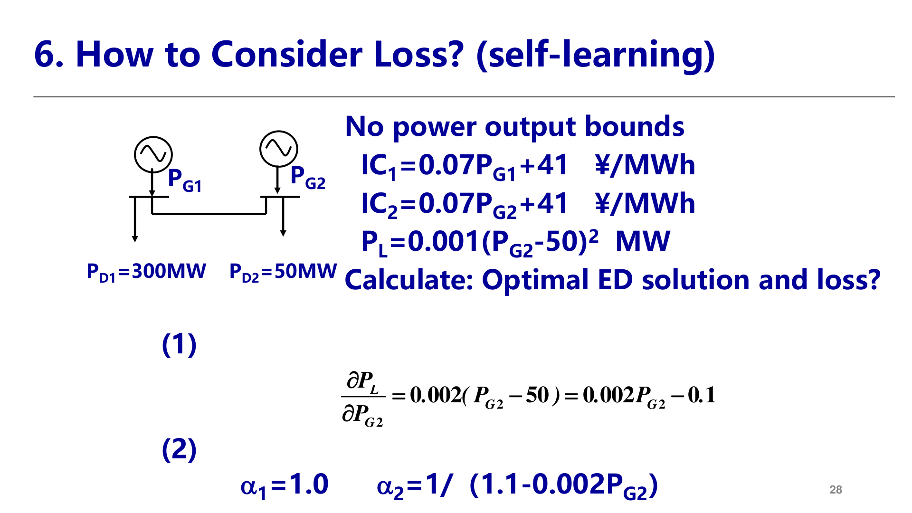

### 化为单参数求解 / Solve with One Parameter

$$
\frac{\partial P_L}{\partial P_{G1}}=0,\qquad
\frac{\partial P_L}{\partial P_{G2}}=0.002(P_{G2}-50)
$$

$$
\alpha_1=1,\qquad\alpha_2=\frac{1}{1.1-0.002P_{G2}}
$$

由修正等微增率得

$$
0.07P_{G1}+41=\lambda,\qquad
\frac{0.07P_{G2}+41}{1.1-0.002P_{G2}}=\lambda
$$

可直接写成

$$
P_{G1}(\lambda)=\frac{\lambda-41}{0.07},\qquad
P_{G2}(\lambda)=\frac{1.1\lambda-41}{0.07+0.002\lambda}
$$

再求 $F(\lambda)=P_{G1}+P_{G2}-0.001(P_{G2}-50)^2-350=0$。

### 原课件数值不满足平衡 / Original Numerical Inconsistency

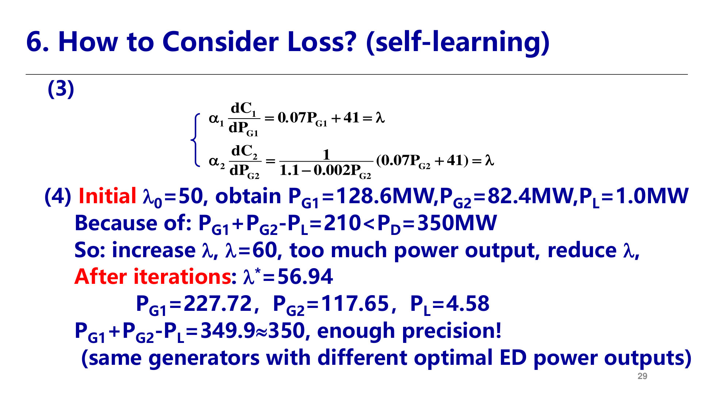

P29 给出 $\lambda\approx56.94$、$P_{G1}=227.72$、$P_{G2}=117.65$、$P_L=4.58$，并写供给约为 349.9 MW；但直接相加是

$$
227.72+117.65-4.58=340.79\ne350
$$

原图保留用于对照；这不是小数舍入就能解释的误差，应继续提高 $\lambda$ 并求解。按原题函数重新核算：

$$
\boxed{\begin{aligned}
P_{G1}^*&=234.89643875\ \mathrm{MW}\\
P_{G2}^*&=120.00414101\ \mathrm{MW}\\
P_L^*&=4.90057976\ \mathrm{MW}\\
\lambda^*&=57.44275071\ \mathrm{元/MWh}
\end{aligned}}
$$

两项独立回代：

$$
234.89643875+120.00414101-4.90057976=350.00000000
$$

$$
IC_1=57.44275071,\qquad IC_2\approx49.40028987,\qquad
\alpha_2IC_2=57.44275071
$$

机组 1 靠近主要负荷，不承担该简化模型的增量送电损耗，因此出力更大。等的是**修正后的**微增率，本机 $IC_1$ 与 $IC_2$ 不相等。

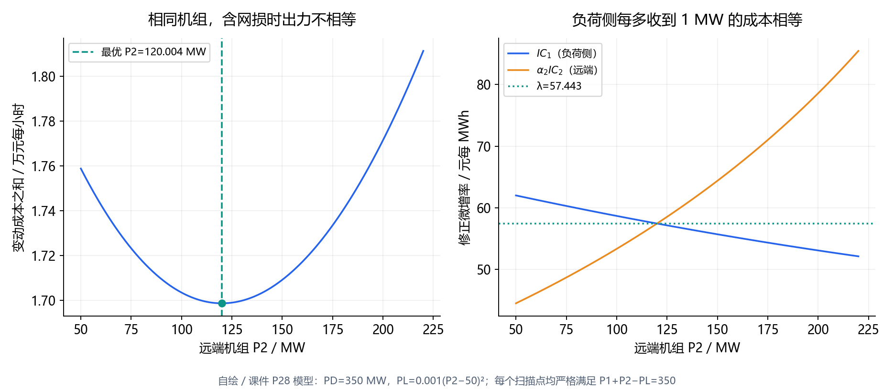

自绘图以 $P_{G2}$ 为横轴，并逐点令 $P_{G1}=350+P_L-P_{G2}$，保证扫描点都满足平衡；成本由对 $IC$ 积分得到的 $41P+0.035P^2$ 计算，未给定的常数成本不影响极小点位置。

**English:** The slide's final values under-supply demand by about 9.21 MW. The corrected result satisfies both power balance and equal delivered marginal cost.

> [!TIP]
> **交互实验指引（有界等微增率与含网损惩罚因子调度）**：提供本讲两个核心算例的实时求解器：
> - **有界两机分配**：拖动总负荷 $P_D$ 跨过机组 1 上限（300 MW）或下限（150 MW），观察自由机组继续按微增率 $\lambda$ 跟踪，而被钳位机组按 KKT 互补松弛条件脱离等微增率线。
> - **含网损调度**：调节网损系数 $B_{22}$ 与负荷 $P_D$，对比无网损解与精确网损解，验证最优解满足**修正微增率相等** $\alpha_2 IC_2 = IC_1 = \lambda$ 而非本机 $IC_1 = IC_2$。

<PsEconomicDispatchLab />

## 10. 专题思考：为什么可能出现负电价 / Why Can Electricity Prices Be Negative? (P31)

本讲正系数凸成本、可自由调节、没有跨时段约束的简化模型，**不会凭空推出负边际价格**。若要解释负价，应扩展模型，考虑最低出力、启停代价、跨时段限制、弃电代价或特定收入机制。

**补充假设例子，不是实际市场报价**：某运行机组若继续保持 1 MW 出力一小时，增加燃料费用 100 元；若此时停机，之后恢复运行需承担归属于该决策的额外启停成本 1000 元，且假设没有更便宜的降出力方案。即使当小时价格是 $-50$ 元/MWh，继续发电的该项净支出为 $100+50=150$ 元，仍低于停机方案的 1000 元。因而机组可能愿意支付一定费用让电被接纳。

这个例子说明“局部报价可为负”的动机；真正市场出清价格还取决于需求、其他报价、规则和网络约束，不能由单台机组的两方案比较直接算出。

## 源与范围 / Source and Scope

- 源文件 / Source: `12-EN第四章电力系统稳态运行与控制.pdf`，Chapter 4, Lecture 3。
- 范围 / Scope: PDF 共 30 页，对应课件 P1–P29 及 P31；包括经济特性、模型、无约束与有界分配、网损及专题讨论。源 PDF 末页印刷为 P31，按实际页码引用。
- 课件截图 / Original slides: 118–130；P29 原数值保留，正文另作核算。页码映射见 [slide_sources.json](./绘图/slide_sources.json)。
- 自绘 / Supplementary figures: 成本极小点、机组边界分担、网损与修正微增率；成本取课件值，额外上下限均已显式标注。
- 复现 / Reproduction: [generate_figures.py](./绘图/generate_figures.py)，计算记录见 [calculated_results.json](./绘图/calculated_results.json)。脚本校验两节点潮流残差、调度功率平衡和含网损边际条件。

相关 / Related: [第11讲 有功功率与频率调节](./第11讲-有功功率与频率调节.md) · [第8讲 潮流解与可行性](./第8讲-实数潮流方程与求解方法.md)
