> 本页只保留课程知识点与直接衍生结论，省略介绍性科普内容。页码对应原 PPT 页码。  
> This page keeps course knowledge points and immediate extensions only; introductory popular-science content is omitted. Page numbers refer to the original PPT.

## 1. 电力网络 / Power Network

### 主要组成 / Main Components

- **研究对象 Scope**：不包含发电机与负荷的高压输电子系统；配电系统可视为负荷侧的一部分。  
- **主设备 Main equipment**：输电线路以及变电站设备——变压器、断路器、母线。  
- **GIS / GIL**：气体绝缘输电线路和电缆适用于特殊空间或高可靠性场景。  

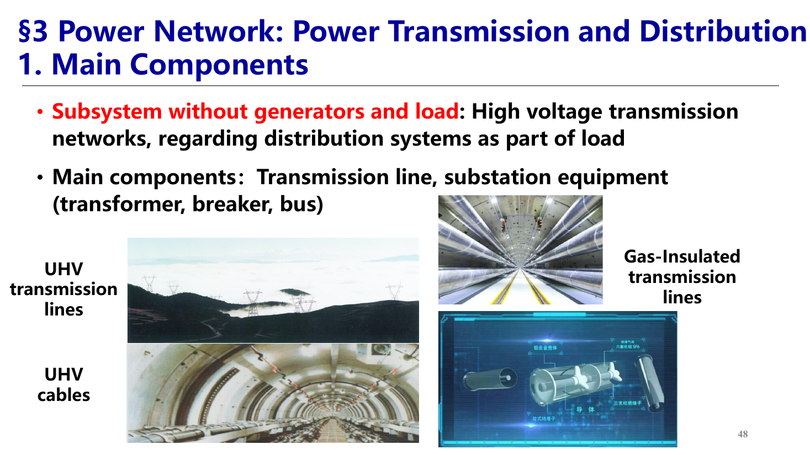

### 接线方式 / Connection Modes

- **两类图 Two diagrams**：电气接线图表示设备电气连接；地理接线图表示电厂、变电站和负荷的空间位置与连接。  
- **开环 / Open loop**：单向供电，常用在配电系统；结构分为放射式、干线式、链式，可有备用或无备用。  
  **English:** Open-loop connections provide one-direction supply and are common in distribution systems. Forms include radial, trunk, and chain connections, with or without backup.
- **闭环 / Closed loop**：双向供电，常用在输电网络；包括单电源环网、多电源闭环和两端供电。  
  **English:** Closed-loop connections provide bi-directional supply and are common in transmission networks, including single-source loops, closed loops with multiple sources, and two-end supply.
- **评价标准 Criteria**：可靠性、运行灵活性、安全性与经济性。  

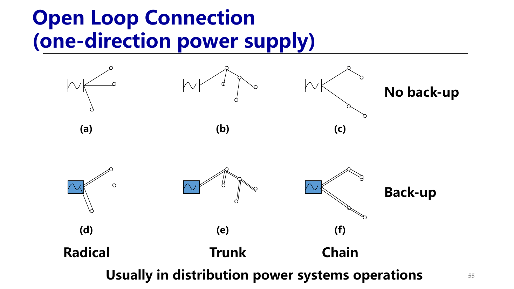

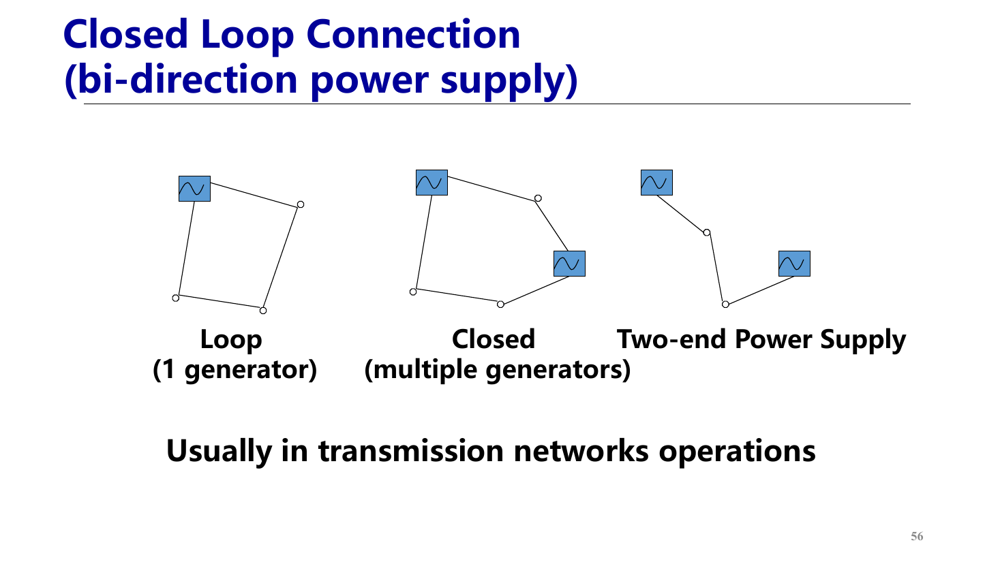

### 为什么高压输电 / Why High-Voltage Transmission

- **核心公式 Core relations**：容量 $S=UI$；电压降 $\Delta V=IZ$；线路有功损耗 $P_L=I^2R$。  
  **English:** Capacity is $S=UI$, voltage drop is $\Delta V=IZ$, and line active loss is $P_L=I^2R$.
- **结论 Conclusion**：在传输功率和线路阻抗一定时，提高电压可降低电流，从而降低电压降和损耗；高压线路输电，变压器降压配电。  
  **English:** For given transferred power and line impedance, raising voltage reduces current, voltage drop, and loss. High-voltage lines transmit power, while transformers step voltage down for distribution.
- **设备电压 Device voltages**：发电机端电压常为 10-30 kV；升压后输电电压可达 110-1000 kV；重负荷可用 6-110 kV；居民负荷常用单相 110/220 V。  

### 电压等级与距离 / Voltage Levels, Capacity, and Distance
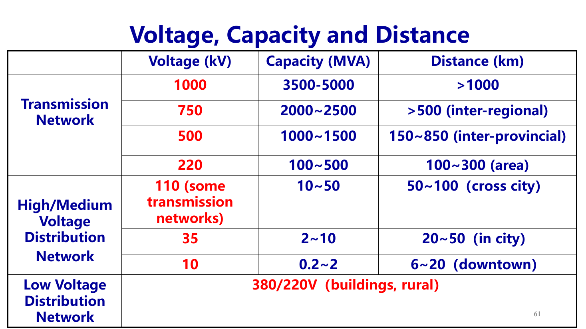

### 额定电压 / Rated Voltage

- **设置原因 Reason**：电压等级过多会增加设备连接难度；标准额定电压便于获得最优技术与经济性能。  
  **English:** Too many voltage levels make connections difficult; standard rated voltages give better technical and economic performance.
- **线路与用电设备 Lines and load devices**：采用同一额定电压 $U_N$。  
- **发电机 Generators**：==额定电压取线路额定电压的 105%==。  
- **升压变压器 Step-up transformer**：==一次侧为线路电压，若直接接发电机则取发电机电压；二次侧取线路电压的 110%==。  
  **English:** The primary side uses line voltage, or generator voltage when directly connected; the secondary side uses 110% of line voltage.
- **降压变压器 Step-down transformer**：==一次侧为线路电压；二次侧取线路电压的 110% 或 105%==。  
  **English:** The primary side uses line voltage; the secondary side uses 110% or 105% of line voltage.
- **典型电压示例 Typical voltage cases**：6 kV 网络配 6.3 kV 发电机与 6.3/6.6 kV 变压器二次侧；10 kV 网络配 10.5 kV 发电机与 10.5/11 kV 变压器二次侧。  

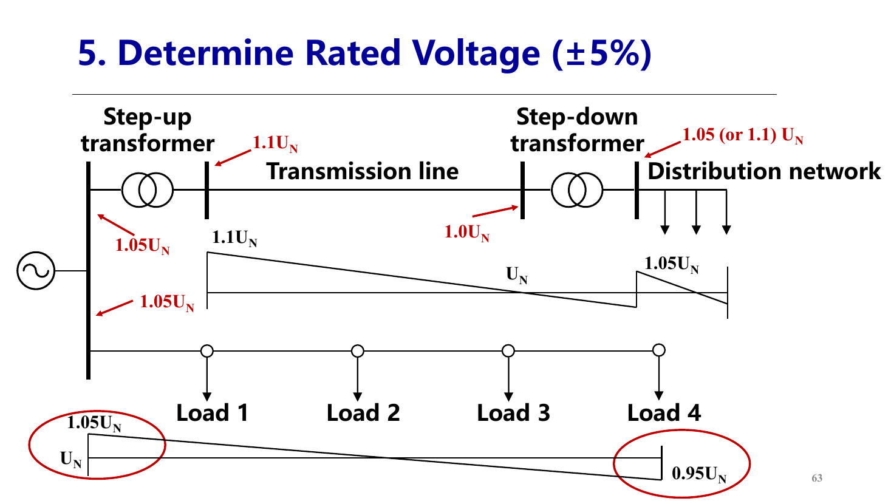

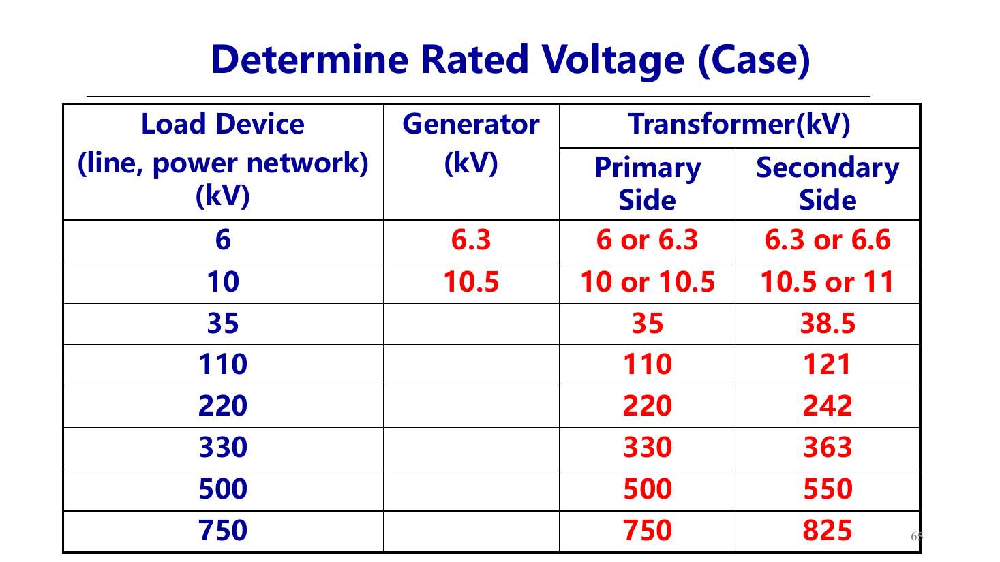

### 高压直流 / HVDC

- **基本结构 Basic structure**：交流电源 → 变压器 → 整流器 → 直流线路 → 逆变器 → 变压器 → 交流负荷。  
- **优点 Advantages**：可连接非同步交流系统，无频率同步要求和稳定性耦合问题；线路成本低、损耗小、控制快；相同成本下直流与交流输电容量约为 3:2，电缆优势更大。  
  **English:** HVDC can connect nonsynchronous AC systems without frequency/stability coupling, has lower line cost and loss, and controls quickly. At equal cost, DC:AC line capacity is about 3:2, with a higher cable advantage.
- **缺点 Disadvantages**：换流站成本高；谐波降低电能质量，需要滤波；直流无自然过零点，直流断路器开断困难。  
  **English:** Converter stations are costly; harmonics degrade power quality and require filters; DC lacks natural current zero crossings, making DC breakers difficult.
- **经济距离 Break-even distance**：PPT 给出经验量级为架空线约 500 km、电缆约 50 km。  

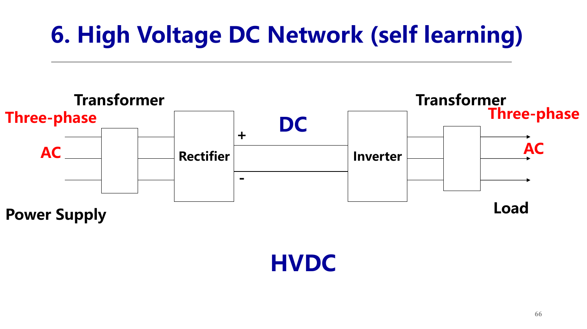

## 2. 交流功率与复功率 / AC Power and Complex Power

### 瞬时功率分解 / Instantaneous-Power Decomposition

- **电压电流 Voltage and current**：设 $u(t)=\sqrt{2}U\cos(\omega t)$，$i(t)=\sqrt{2}I\cos(\omega t-\varphi)$。  
  **English:** Let $u(t)=\sqrt{2}U\cos(\omega t)$ and $i(t)=\sqrt{2}I\cos(\omega t-\varphi)$.
- **瞬时功率 Instantaneous power**：$p(t)=u(t)i(t)=p_R(t)+p_X(t)$。  
  **English:** Instantaneous power is $p(t)=u(t)i(t)=p_R(t)+p_X(t)$.
- **电流分解 Current decomposition**：电流可分为与电压同相的有功分量和滞后/超前 90° 的无功分量。  
  **English:** Current separates into an in-phase active component and a quadrature reactive component.

### 有功功率 / Active Power

- **定义 Definition**：$P=UI\cos\varphi$，是等效电阻消耗能量的平均速率。  
  **English:** $P=UI\cos\varphi$ is the average rate of energy dissipation in the equivalent resistance.
- **特征 Features**：$p_R(t)$ 周期为 $2\omega t$，始终非负，平均值为 $UI\cos\varphi$。  
  **English:** $p_R(t)$ has period $2\omega t$, is always nonnegative, and has average value $UI\cos\varphi$.
- **单位与意义 Unit and meaning**：单位为 W/kW/MW，代表实际做功与能量消耗。  

### 无功功率 / Reactive Power

- **定义 Definition**：$Q=UI\sin\varphi$，是等效电抗与外源之间能量交换的幅值。  
  **English:** $Q=UI\sin\varphi$ is the magnitude of energy exchange between the equivalent reactance and external sources.
- **特征 Features**：$p_X(t)$ 平均值为 0，幅值为 $UI\sin\varphi$；不表示净能量消耗。  
  **English:** $p_X(t)$ has zero average value and magnitude $UI\sin\varphi$; it is not net energy consumption.
- **感性/容性 Inductive/capacitive**：感性网络 $Q>0$，吸收感性无功；容性网络 $Q<0$，发出感性无功。吸收感性无功等价于发出容性无功。  
  **English:** An inductive network has $Q>0$ and absorbs inductive reactive power; a capacitive network has $Q<0$ and supplies inductive reactive power. Absorbing inductive Q is equivalent to supplying capacitive Q.
- **为什么需要 Q Why Q is required**：交流系统需要建立和维持电场/磁场，电感与电容周期性储存并释放场能；有功输送通常伴随无功流动。  
  **English:** AC operation requires establishing and maintaining electric/magnetic fields. Inductors and capacitors periodically store and release field energy, and active-power transfer is usually accompanied by reactive-power flow.

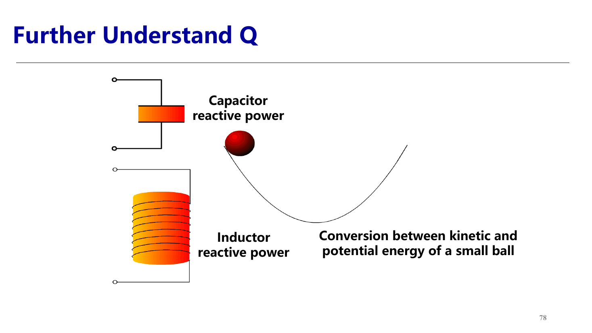

### 视在功率与复功率 / Apparent and Complex Power

- **视在功率 Apparent power**：$S=UI$，且 $S^2=P^2+Q^2$。  
  **English:** Apparent power is $S=UI$ with $S^2=P^2+Q^2$.
- **复功率 Complex power**：$\dot S=\dot U\dot I^*=P+jQ=UI\angle\varphi$。  
  **English:** $\dot S=\dot U\dot I^*=P+jQ=UI\angle\varphi$.
- **功率三角形 Power triangle**：实部为 $P$，虚部为 $Q$，幅值为 $S$，夹角为功率因数角 $\varphi$。  
  **English:** The real part is $P$, imaginary part is $Q$, magnitude is $S$, and the angle is the power-factor angle $\varphi$.
- **计算优势 Calculation advantage**：复功率可直接相加；视在功率一般不能直接相加，除非各支路功率因数角相同。  
  **English:** Complex powers add directly; apparent powers generally do not add unless their power-factor angles are equal.

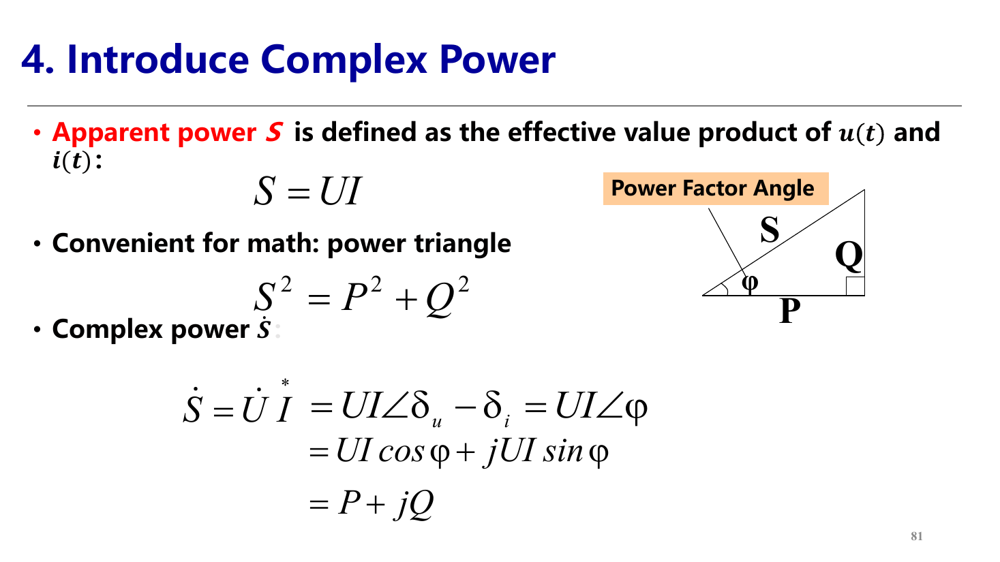

### 三相功率 / Three-Phase Power

- **相量表示 Phase quantities**：$P=3U_P I_P\cos\varphi$，$Q=3U_P I_P\sin\varphi$，$S=3U_P I_P$，$\dot S=3\dot U_P\dot I_P^*$。  
  **English:** In phase quantities, $P=3U_P I_P\cos\varphi$, $Q=3U_P I_P\sin\varphi$, $S=3U_P I_P$, and $\dot S=3\dot U_P\dot I_P^*$.
- **线量表示 Line quantities**：对 Y 或 Δ 连接均有 $P=\sqrt{3}U_L I_L\cos\varphi$，$Q=\sqrt{3}U_L I_L\sin\varphi$，$S=\sqrt{3}U_L I_L$。  
  **English:** For both Y and Δ connections using line quantities, $P=\sqrt{3}U_L I_L\cos\varphi$, $Q=\sqrt{3}U_L I_L\sin\varphi$, and $S=\sqrt{3}U_L I_L$.
- **复功率 Line-quantity form**：$\dot S=3\dot U_L\dot I_L^*e^{-j30^\circ}$；$\varphi$ 是每相功率因数角。  
  **English:** $\dot S=3\dot U_L\dot I_L^*e^{-j30^\circ}$; $\varphi$ is the per-phase power-factor angle.

## 4. 电力系统负荷 / Power System Load

### 负荷定义 / Load Definition

- **综合负荷 Integrated load**：电力系统负荷是全部用电客户功率的总和，也称为系统综合负荷。  
- **设备构成 Equipment mix**：包括工业、农业、交通和生活用电设备；主要是同步/异步电动机、电炉、电加热、照明和整流设备，其中异步电动机占比最大。  
- **研究口径 Study scope**：这里的高压输电系统负荷常指城镇、大工厂或配电网络的总负荷。  

### 负荷关系与损耗 / Load Relationships and Losses

- **链条 Chain**：发电厂负荷 = 用户综合负荷 + 网损 + 厂用电；供电负荷送向客户之前，需先覆盖发电机负荷、厂用电与网损。  
  **English:** Plant load equals customer integrated load plus network loss plus station service. Generator and plant loads cover auxiliary consumption and network losses before delivery to customers.
- **厂用电 Station service**：火电约 5-8%，水电约 0.1-1%，核电约 4-5%。  
- **网损 Network loss**：输配电过程中消耗的功率，通常约 5-10%。  

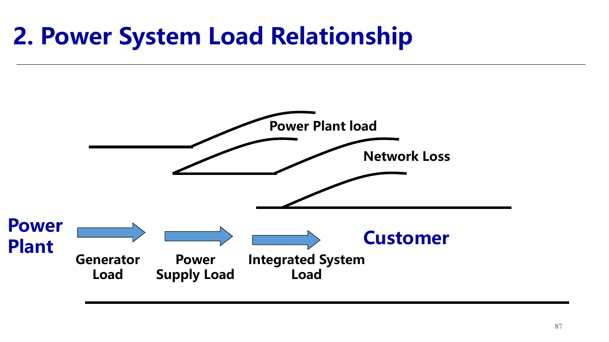

### 负荷曲线 / Load Curves

- **作用 Purpose**：用数学曲线描述负荷随时间变化，用于预测负荷趋势和安排运行方式。  
- **分类 Classification by quantity**：有功负荷曲线与无功负荷曲线。  
- **分类 Classification by time**：日、周、月、年负荷曲线。  
- **对象 Objects**：发电厂、变电站、线路、客户均可分别统计。  

### 日负荷曲线 / Daily Load Curve

- **24 小时特征 24-hour behavior**：负荷随季节和地区变化；有最大负荷 $P_{\max}$、最小负荷 $P_{\min}$、平均负荷 $P_a$ 和日最大负荷差。  
- **日电量 Daily energy**：$A=\int_0^{24}P_d\,dt$，单位 kWh。  
- **三段划分 Three zones**：基荷（谷）、腰荷（中间）、峰荷（峰）。  
  **English:** Divide into basic load at the valley, medium load at the waist, and peak load at the peak.
- **应用 Applications**：编制日调度计划并计算日电量。  

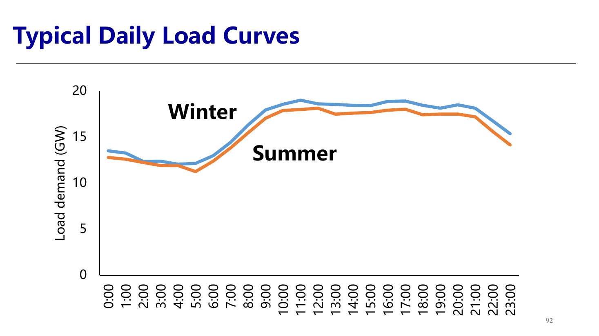

### 年最大负荷曲线 / Annual Maximum Load Curve

- **定义 Definition**：描述一年中各月或各日最大负荷的变化。  
- **应用 Applications**：安排发电机检修、扩建或新建电源、确定负荷备用、事故备用、检修备用和国民经济备用。  
- **图上关键量 Key quantities**：装机容量、最大年负荷曲线、备用容量、检修容量和新增容量。  

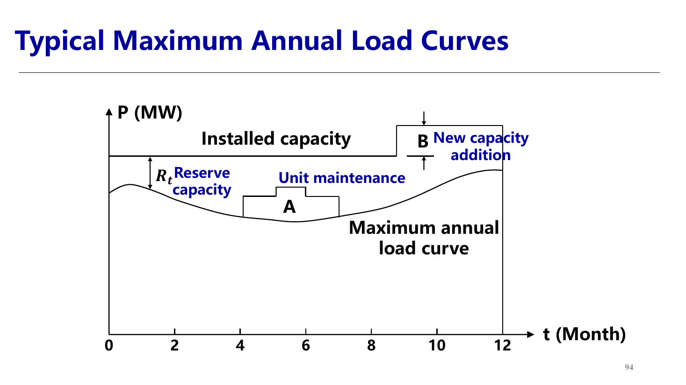

### 年负荷持续时间曲线 / Annual Load Duration Curve

- **定义 Definition**：把一年内负荷按大小和累计持续时间排列得到的曲线。  
- **年电量 Annual energy**：$A_y=\int_0^{8760}P_y\,dt$。  
- **最大负荷利用小时数 Utilization hours**：  
  $T_{\max}=\dfrac{A_y}{P_{\max}}=\dfrac{\int_0^{8760}P_y\,dt}{P_{\max}}$。  
  **English:** Maximum load utilization hours are annual energy divided by annual maximum load.
- **中国量级 China magnitude**：$T_{\max}$ 约为 5000 小时，且呈下降趋势。  
- **应用 Applications**：调度计划、可靠性计算和规划。  

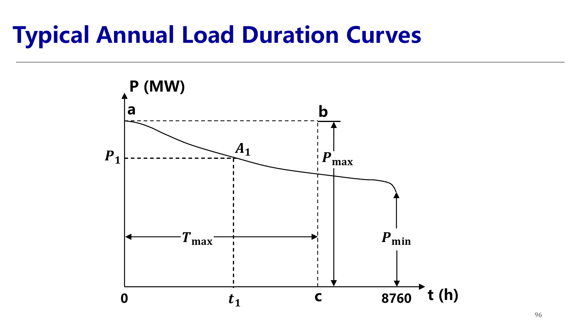

### 负荷预测 / Load Forecast

- **定义 Definition**：利用历史负荷、气象信息和人的经验预测未来负荷变化。  
- **重要性 Importance**：电能难以大规模即时存储，发电、输电和用电必须实时平衡。  
  **English:** Electricity cannot be stored in bulk at the same time scale, so generation, transmission, and consumption must balance in real time.
- **影响因素 Influencing factors**：工农业生产、地理位置、气候气象、节假日和生活习惯。  
- **衍生判断 Derived point**：对电力系统更友好的负荷曲线通常更平坦、峰谷差小、可预测性强；削峰填谷和需求响应可改变负荷曲线。  
  **English:** A power-system-friendly curve is flatter, has a smaller peak-valley difference, and is more predictable. Peak shaving, valley filling, and demand response can reshape load curves.

## 源与范围 / Source and Scope

- 源文件 / Source: `2025310537_KJ_178926872754309d44aea62-89d6-43a2-9983-0e623c7b441f.pdf`
- 范围 / Scope: PPT pages 3-89, excluding the final assignment slide and non-knowledge photos.
- 图片 / Images: Cropped page screenshots generated from the source PDF.
