> 本页整理第 3 讲（电力线路参数和等值电路）与第 4 讲（变压器参数、等值电路与负荷模型），只保留课程知识点与直接衍生结论，省略介绍性科普内容。页码对应原 PPT 页码。  
> This page covers Lecture 3 (transmission line parameters and equivalent circuits) and Lecture 4 (transformer parameters, equivalent circuits, and load model), keeping course knowledge points and immediate extensions only. Page numbers refer to the original PPT.

## 1. 电力线路结构与特殊问题 / Power Line Structure and Special Problems

### 导线结构与型号 / Conductor Structure and Types

- 单股导线：铜或铝单根实心导线，很少使用。
- 多股同材质绞线：TJ（铜绞线）、LJ（铝绞线）、GJ（钢绞线）。
- 多股双材质绞线：钢芯铝绞线 ACSR，分为 LGJ（普通型）、LGJQ（轻型）、LGJJ（加强型）。
- 型号含义：字母 + 数字，数字为主要载流部分的额定截面积（mm²）；如 LGJ-150 表示铝部额定截面 150 mm²。

### 三相整循环换位 / Three-Phase Circular Transposition

- **问题 Problem**：三相导线不对称排列时，各相电感、电容参数不相等。  
  **English:** Asymmetrical arrangement gives unequal per-phase parameters.
- **方法 Method**：整循环换位把全长分为三段（每段 l/3），三相导线位置逐段轮换，使每相在三个位置各占 l/3，参数平均后三相对称。  
  **English:** The line is divided into three l/3 segments with phases rotated once per segment, so averaged parameters become symmetrical.

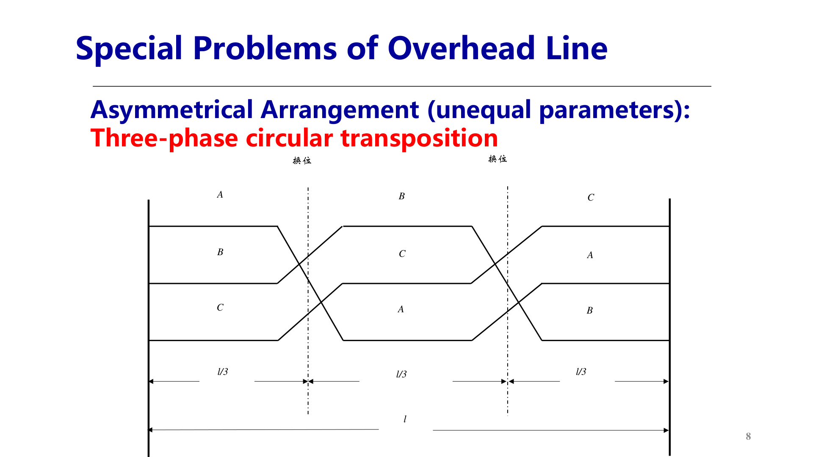

### 分裂导线 / Split Conductors

- **目的 Purpose**：减小线路电抗、减小电晕损耗；500/750/1000 kV 线路广泛采用。  
  **English:** Split conductors reduce reactance and corona loss, widely used at 500/750/1000 kV.

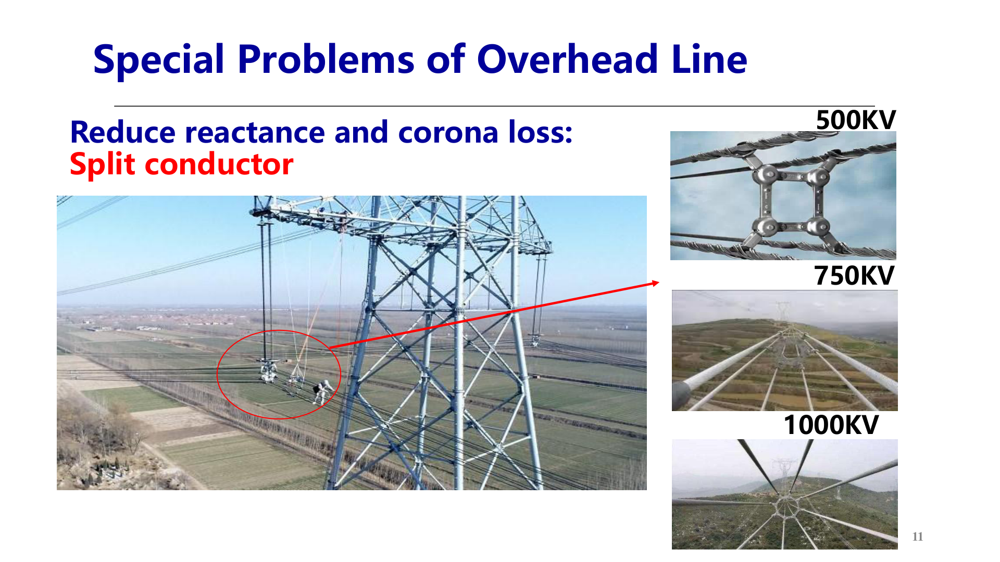

## 2. 线路单位长度参数 / Per-Unit-Length Line Parameters

### 电磁现象与参数 / Electromagnetic Phenomena and Parameters

- **电流效应（串联参数）Current effects**：电流发热消耗有功 → 电阻 r；交流电流产生交变磁场，感应反电动势阻碍电流 → 电抗 x。  
  **English:** Current heating gives series resistance r; the alternating magnetic field induces an EMF opposing the current, giving reactance x.
- **电压效应（并联参数）Voltage effects**：绝缘泄漏与电晕放电 → 电导 g；线间及对地电容在交变电压下产生电容电流 → 电纳 b。  
  **English:** Insulation leakage and corona give conductance g; line-to-line and line-to-ground capacitance gives susceptance b.
- **分布参数 Distributed parameters**：用单位长度 r, x, g, b（Ω/km、S/km）描述；标准电缆参数受环境影响小、基本不变，架空线参数随气象和地理条件变化。  
  **English:** Quantities are per-unit-length; cable parameters stay stable while overhead-line parameters vary with weather and geography.

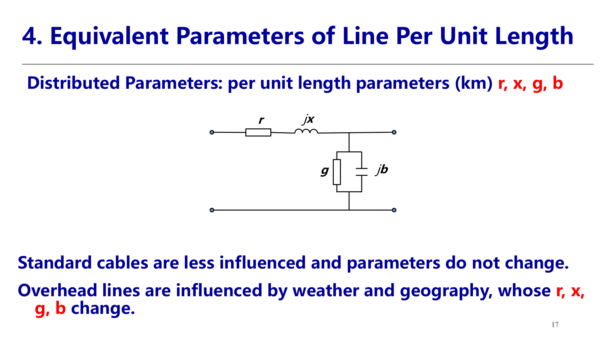

### 电阻 / Resistance

- 计算公式：$r=\dfrac{\rho}{nS}$ (Ω/km)。
- 电阻率 ρ：铜 18.8、铝 31.5 Ω·mm²/km（20 ℃），随温度变化。
- S 为主要载流额定截面积（mm²），n 为单相分裂根数。
- ρ 略大于直流电阻率：趋肤效应、多股绞线、S 大于实际截面。

### 电抗 / Reactance

- **推导思路 Derivation**：安培环路定律求磁场强度 H → B = μH → 磁通与磁链 ψ → L = ψ/I → x = ωL；需计及自感与互感、导体内磁链的分数匝效应。  
  **English:** Ampere's law gives H, then B and flux linkage ψ, inductance L = ψ/I, and x = ωL, including self/mutual inductance and fractional internal flux linkage.
- **单相二线回路 Single-phase loop**：$L=2\times10^{-7}\ln\dfrac{D_{12}}{r'}$ (H/m)；r′ = e^(−1/4)·r0 = 0.779 r0，为计及导体内磁链的等效半径。  
  **English:** r′ is the equivalent radius considering internal flux linkage.
- **三相对称或整循环换位 Three-phase**：$L=2\times10^{-7}\ln\dfrac{D_{eq}}{r'}$ (H/m)；$D_{eq}=\sqrt[3]{D_{12}D_{23}D_{31}}$ 为三相导线间几何均距，不对称排列经换位后公式相同。
- **分裂导线 Split conductors**：$L=2\times10^{-7}\ln\dfrac{D_{eq}}{D_s'}$ (H/m)；$D_s'=\sqrt[n]{n\,r'\,R^{\,n-1}}$，R 为分裂圆半径；n=1 时 Ds′=r′。
- **电抗公式 Formula**：$x=0.1445\lg\dfrac{D_{eq}}{D_s'}$ (Ω/km)。
- 经验值：非分裂导线 110/220 kV 线路 x ≈ 0.4 Ω/km。
- r′ 取值：单股导线 0.779r0；多股绞线略小；GJ 钢绞线大于 0.779r0。
- **与电流无关 Current-independent**：L 由 Deq 与 Ds′(r′) 决定，与电流大小无关；前提是三相平衡电流（ia+ib+ic=0），不平衡时 L 改变。  
  **English:** L depends on Deq and Ds′(r′), not on current magnitude, provided the three-phase currents are balanced.

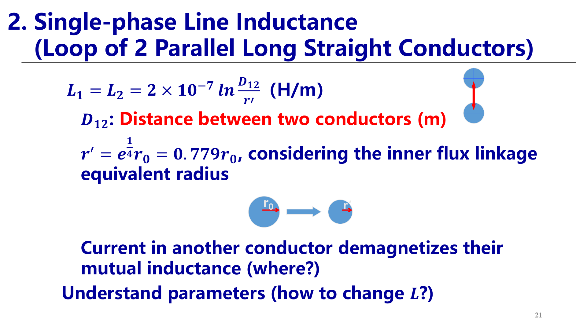

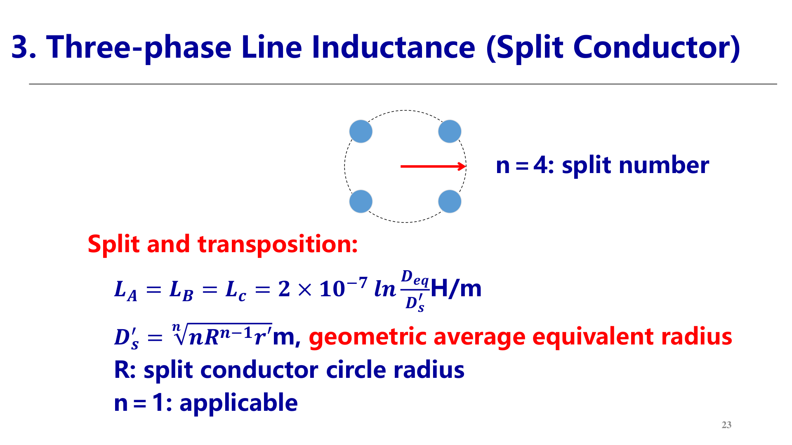

### 电导 / Conductance

- 起因：电晕放电，难以建模、只能实测。
- 计算：$g=\dfrac{\Delta P_g}{U^2}\times10^{-3}$ (S/km)；U 为线电压（kV），ΔPg 为三相电晕有功损耗（kW/km）。
- Ucr 为起始电晕电压，与天气、材料、导线半径、分裂方式、空气密度有关。
- 晴天通常不发生电晕，一般近似取 g = 0。

### 电纳 / Susceptance

- **推导思路 Derivation**：高斯定理 q→D，E = D/ε，积分得 U12，C = q/U12，b = ωC。  
  **English:** Gauss's law gives electric displacement D, field intensity E, then voltage U12, capacitance C = q/U12, and b = ωC.
- **单相回路 Single-phase loop**：线间电容 $C_{12}=\dfrac{0.012}{\lg(D_{12}/r_0)}\times10^{-6}$ (F/km)；对中性点 $C_{1n}=2C_{12}=\dfrac{0.0241}{\lg(D_{12}/r_0)}\times10^{-6}$ (F/km)。
- **三相 Three-phase**：$C=\dfrac{0.0241}{\lg(D_{eq}/D_s)}\times10^{-6}$ (F/km)；$D_s=\sqrt[n]{n\,r_0\,R^{\,n-1}}$；n=1 时 Ds=r0。
- **电纳公式 Formula**：$b=\dfrac{7.58}{\lg(D_{eq}/D_s)}\times10^{-6}$ (S/km)。
- 经验值：非分裂导线 b = 2.6~2.85×10⁻⁶ S/km。
- **r0 与 r′ 的区别 Key distinction**：电感计算用 r′（计及内磁链），电容计算用 r0（电场只存在于导体表面以外）。  
  **English:** Inductance uses r′ because of internal flux linkage; capacitance uses r0 because the electric field exists only outside the conductor surface.
- **与电压无关 Voltage-independent**：C 由 Deq 与 Ds(r0) 决定；前提是三相电压平衡（qa+qb+qc=0），不平衡时 C 改变。

## 3. 线路等值电路 / Line Equivalent Circuit

### 参数汇总与端口等效 / Parameters and Port Equivalence

- 单位长度参数汇总：r = ρ/(nS)；x = 0.1445 lg(Deq/Ds′)；g ≈ 0；b = 7.58/lg(Deq/Ds)×10⁻⁶。
- **端口等效思想 Port equivalence**：关注线路两端口之间的电气参数关系，而非沿线分布 → 用集中参数等值电路表示分布参数线路。  
  **English:** Focus on relationships between the two ports rather than along the line, turning distributed parameters into lumped ones.
- 推导路径：分布参数电路 → 微分方程 dU = İ·z·dl、dI = U̇·y·dl → 双曲函数解得两端口电压电流关系。

### π 型等值电路与修正系数 / π Equivalent Circuit and Correction Factors

- **双曲函数精确解 Exact solution**（Z = zL、Y = yL 为全线总串联阻抗与总并联导纳）：  
  $\dot U_1=\dot U_2\cosh\sqrt{ZY}+\dot I_2\sqrt{\dfrac{Z}{Y}}\sinh\sqrt{ZY}$  
  $\dot I_1=\dot I_2\cosh\sqrt{ZY}+\dot U_2\sqrt{\dfrac{Y}{Z}}\sinh\sqrt{ZY}$
- **L > 750 km**：直接用上述方程精确计算。
- **π 型修正系数 Correction factors**：  
  $Z'=Z\cdot\dfrac{\sinh\sqrt{ZY}}{\sqrt{ZY}}$，$Y'=Y\cdot\dfrac{\tanh(\sqrt{ZY}/2)}{\sqrt{ZY}/2}$

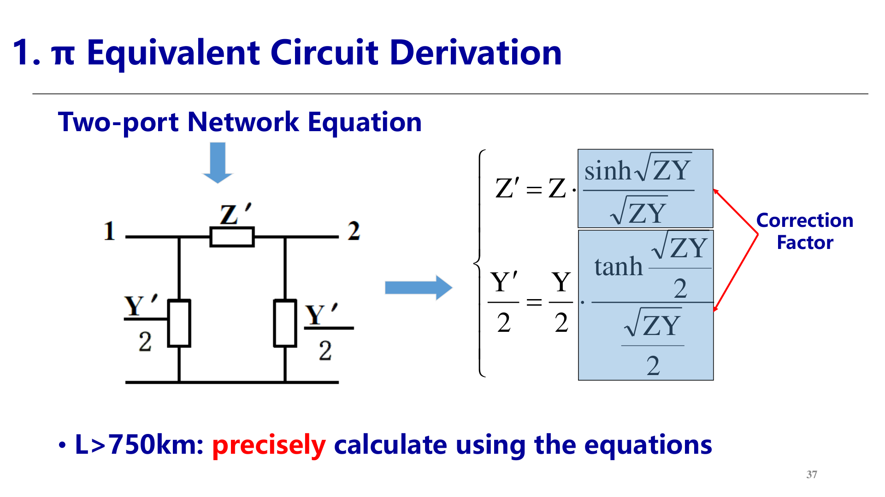

- **近似分级 Approximation by length**：
  - 750 km ≥ L ≥ 300 km：Taylor 级数取前两项，Z′ = Z(1+ZY/6)，Y′ = Y(1+ZY/12)。
  - L ≤ 300 km：Z′ = Z，Y′ = Y，即普通 π 型等值电路，不考虑分布参数影响（最常用）。
  - L ≤ 100 km 且电压 ≤ 35 kV：忽略并联导纳。

## 4. 双绕组变压器等值电路与参数 / Double-Winding Transformer

### 等值电路 / Equivalent Circuit

- **建模假设 Modeling assumption**：稳态分析只考虑电气参数的幅值关系，不考虑相位关系；按 Y/Y 连接建立单相等值电路，与实际接线方式无关；2′ 表示折算到一次侧的二次侧。  
  **English:** Only magnitude relationships matter; a Y/Y single-phase equivalent circuit is used regardless of actual connections, with 2′ denoting the referred secondary.
- **电路化简 Reduction**：R1+jX1 与折算后的 R2′+jX2′ 串联，励磁特性用 Rm+jXm 表示；绕组合并后得串联阻抗 RT+jXT；励磁支路最终用 GT−jBT 表示。  
  **English:** Series windings merge into RT+jXT; the magnetizing branch becomes GT−jBT.

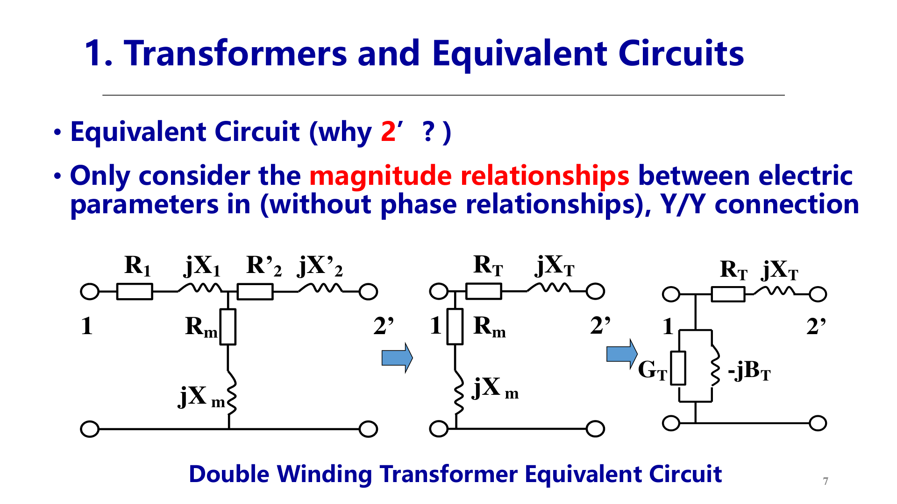

### 两个试验 / Two Tests

- 电磁场分析困难，工程上用两个试验的 4 个铭牌参数求等值参数：短路损耗 ΔPs（kW）、短路电压 Us%（%）、空载损耗 ΔP0（kW）、空载电流 I0%（%）。
- **短路试验 Short-circuit test**：二次侧短路，一次侧电流加至 IN；电压低、铁耗可忽略，ΔPs ≈ 铜耗 → 求 RT、XT。
- **空载试验 Open-circuit test**：二次侧开路，一次侧加额定电压 UN；电流小、铜耗可忽略，ΔP0 ≈ 铁耗 → 求 GT、BT。

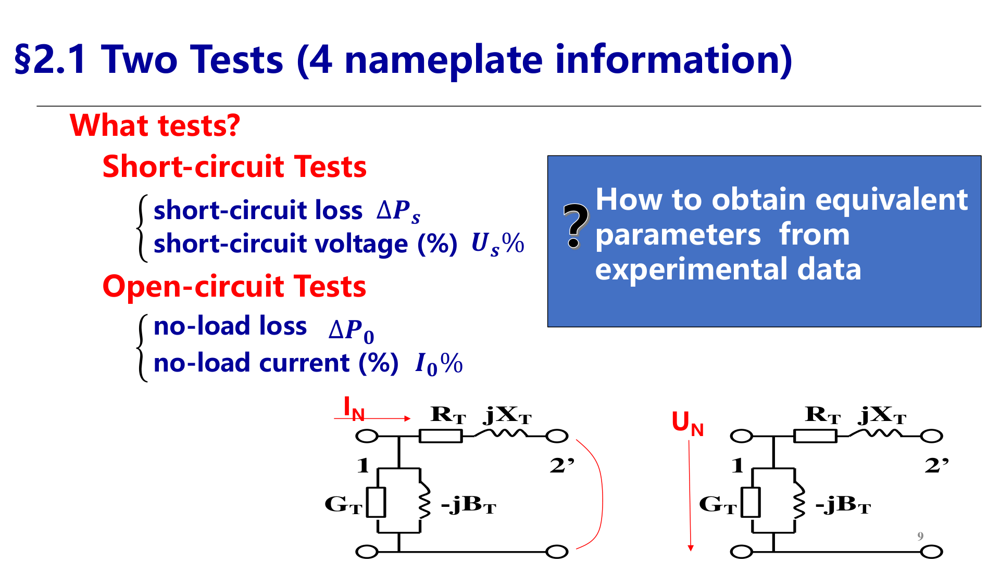

### 参数计算 / Parameter Calculation

单位：UN 用 kV，ΔP 用 kW，SN 用 kVA。

- 串联电阻：$R_T=\dfrac{\Delta P_S\,U_N^2}{S_N^2}\times10^3$ (Ω)
- 串联电抗：$X_T=\dfrac{U_S\%}{100}\cdot\dfrac{U_N^2}{S_N}$ (Ω)，S_N 用 kVA 时等价于 $X_T=\dfrac{U_S\%\,U_N^2}{S_N}\times10$ (Ω)
- 励磁电导：$G_T=\dfrac{\Delta P_0}{U_N^2}\times10^{-3}$ (S)
- 励磁电纳：$B_T=\dfrac{I_0\%\,S_N}{U_N^2}\times10^{-5}$ (S)
- 励磁无功：$\Delta Q_0=\dfrac{I_0\%}{100}S_N$ (kvar)

### 变比与注意事项 / Ratio and Notes

- **变比 Ratio**：kT = UN1/UN2，空载时两侧绕组线电压之比；用 kT 将 2′ 侧参数折算到实际电压等级。多电压等级网络逐级折算困难，引出 π 型等值电路。  
  **English:** kT is the no-load line-voltage ratio; multi-voltage-level conversion motivates the π equivalent circuit.
- **导纳符号对比 Sign contrast**：变压器 YT = GT − jBT 虚部为负（感性）；线路 Y2 = jBL/2 虚部为正（容性）。  
  **English:** Transformer admittance has a negative imaginary part (inductive); line shunt admittance is positive (capacitive).
- 励磁支路位置在电源侧（一次侧）。

## 5. 三绕组变压器等值参数 / Three-Winding Transformer Parameters

### 等值电路与试验 / Equivalent Circuit and Tests

- 等值电路：R1+jX1、R2+jX2、R3+jX3 三支路星形连接，励磁支路 GT−jBT 接于电源侧。
- **短路试验 3 次 Short-circuit tests**：每次一侧加 IN、一侧短路、另一侧开路，测得 Us(1-2)%、Us(1-3)%、Us(2-3)% 与 ΔPs(1-2)、ΔPs(1-3)、ΔPs(2-3)。
- **空载试验 Open-circuit test**：一侧加 UN、其余两侧开路；GT、BT 求法与双绕组相同。

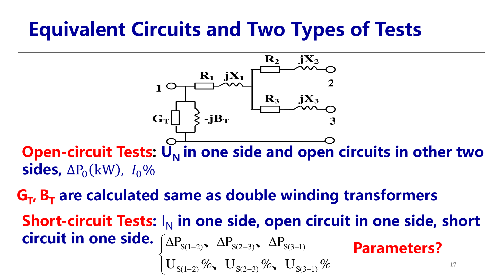

### 电阻 / Resistances

- **容量 100/100/100**：  
  $\Delta P_{S1}=\dfrac{1}{2}\left[\Delta P_{S(1\text{-}2)}+\Delta P_{S(1\text{-}3)}-\Delta P_{S(2\text{-}3)}\right]$，ΔPs2、ΔPs3 类推；  
  $R_i=\dfrac{\Delta P_{Si}\,U_N^2}{S_N^2}\times10^3$ (Ω)，与双绕组公式形式相同。
- **容量不等（如 100/50/100）Unequal capacity**：小容量绕组限制试验电流，实测损耗按电流平方放大到额定电流。100/50/100 例：  
  $\Delta P_{S(1\text{-}2)}=\Delta P'_{S(1\text{-}2)}\left(\dfrac{I_N}{I_N/2}\right)^2=4\Delta P'_{S(1\text{-}2)}$，ΔPs(2-3) 同理 ×4，ΔPs(1-3) 直接实测；  
  一般放大系数为 $\left(S_N/\min\{S_{Na},S_{Nb}\}\right)^2$。  
  **English:** Measured losses are amplified by the squared current ratio to rated current.
- SN 是变压器额定容量，不等于各绕组容量；绕组容量常见组合 100/100/100、100/100/50、100/50/100。

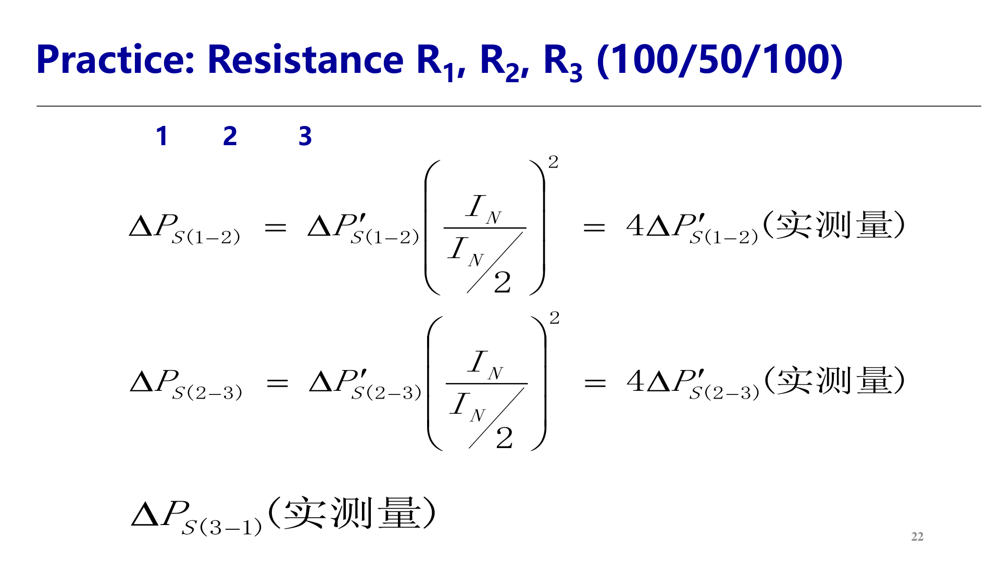

### 电抗 / Reactances

- 每个绕组的短路电压：$U_{S1}\%=\dfrac{1}{2}\left[U_{S(1\text{-}2)}\%+U_{S(1\text{-}3)}\%-U_{S(2\text{-}3)}\%\right]$，Us2%、Us3% 类推。
- 电抗：$X_i=\dfrac{U_{Si}\%}{100}\cdot\dfrac{U_N^2}{S_N}$ (Ω)。
- **国标规定 National standard**：三绕组变压器铭牌短路电压已对应额定容量，普通三绕组无需折算。  
  **English:** Nameplate short-circuit voltages already correspond to rated capacity; no conversion for ordinary three-winding transformers.
- **自耦变压器 Autotransformer**：第三绕组容量通常小于变压器容量，短路电压须折算：  
  $U'_{S(ab)}\%=U_{S(ab)}\%\cdot\dfrac{S_N}{\min\{S_{Na},S_{Nb}\}}$（电压降与电流成正比，放大系数为一次方）。

### 注意事项 / Notes

- X1、X2、X3 是各绕组的等值电抗（包含自感与互感），不是漏抗；Xi < 0 不表示该绕组呈容性。
- SN 为变压器容量而非绕组容量；UN 取同一侧，参数向所选 UN 侧折算。

## 6. 变压器 π 型等值电路 / Transformer π Equivalent Circuit

- **动机 Motivation**：含理想变压器 K:1 的等值电路仍有磁耦合；多电压等级网络希望化为纯电路，避免逐级折算。  
  **English:** The ideal transformer still couples magnetically; a pure circuit avoids repeated ratio conversions.
- **二端口方程 Two-port equations**：$\dot U_1=K\dot U_2$，$\dot I_1=\dot I_2/K$，与串联 ZT 联立消去理想变压器，得 π 电路。

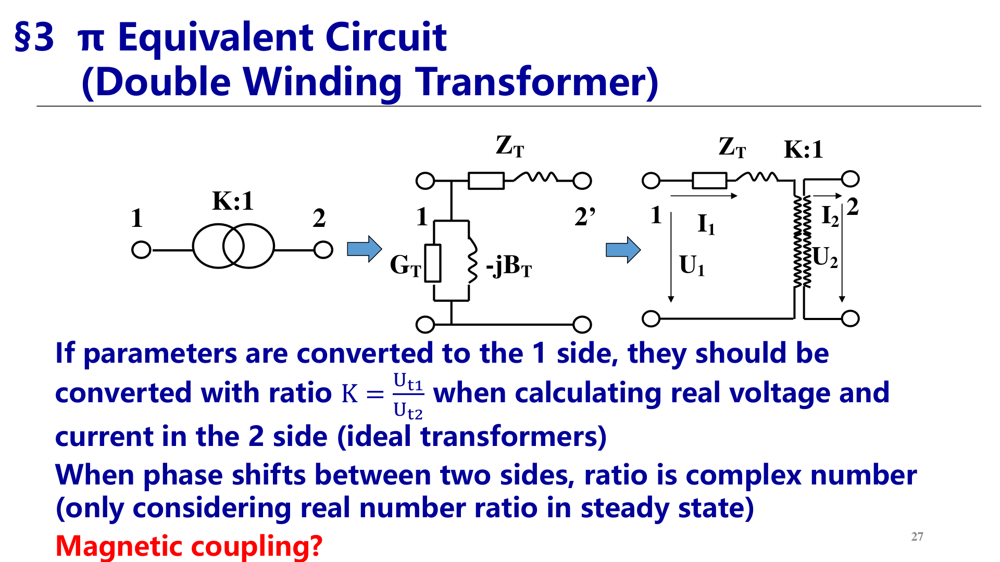

- **π 电路参数 Parameters**：  
  $Z=\dfrac{Z_T}{K}$，$Z_1=\dfrac{Z_T}{1-K}$，$Z_2=\dfrac{Z_T}{K(K-1)}$

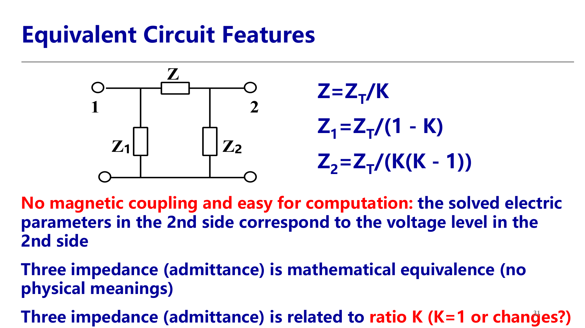

- **特点 Features**：
  - 无磁耦合，2 侧解得的电量直接对应 2 侧电压等级；三个阻抗只是数学等值、无物理意义，且都与变比 K 有关（如调压分接头改变 K 时阻抗随之改变）。  
    **English:** No magnetic coupling; the three impedances are mathematical equivalents depending on K.
  - 两条并联阻抗符号相反，负号位于高电压等级侧；一侧空载时，从另一侧看入的等值阻抗为无穷大（等值导纳为 0）。
  - 复数变比 K̇ 下二端口方程仍适用，但 π 型等值电路无法做出（无源阻抗不能实现非互易耦合）。
- **三绕组 π 等值 Three-winding**：用两组 π 电路，K12 = U1t/U2t，K13 = U1t/U3t。

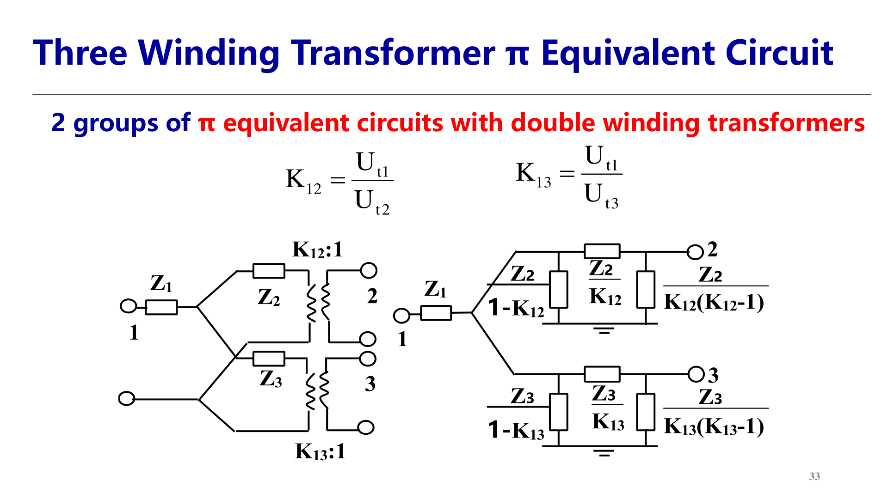

## 7. 负荷模型 / Load Model

### 静态负荷模型 / Static Load Model

- 负荷分类：动态模型与静态模型；有功与无功分别建模。
- 静态特性：电压静态特性与频率静态特性；负荷成分随时间变化，需实时量测。
- **调节系数 Coefficients**：  
  有功电压调节系数 $K_{PV}=\dfrac{dP}{dU}$；无功电压调节系数 $K_{QV}=\dfrac{dQ}{dU}$；有功频率调节系数 $K_{Pf}=\dfrac{dP}{df}$。

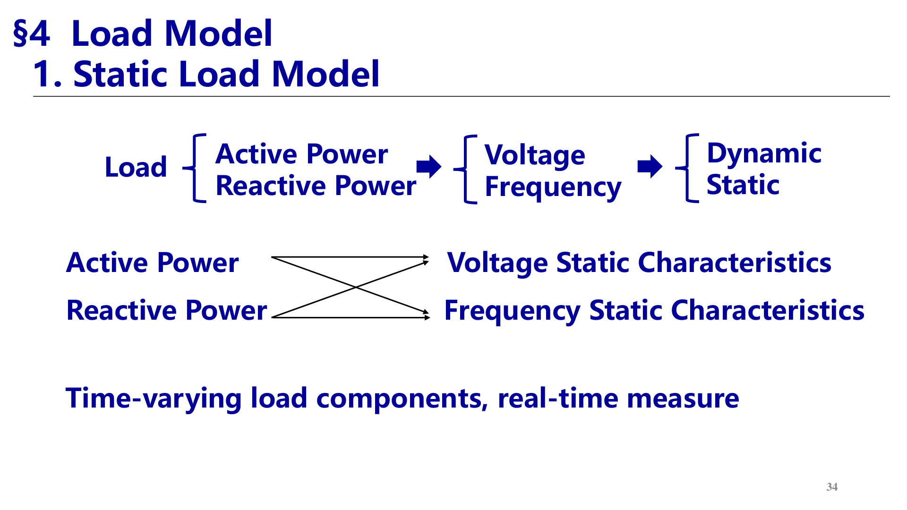

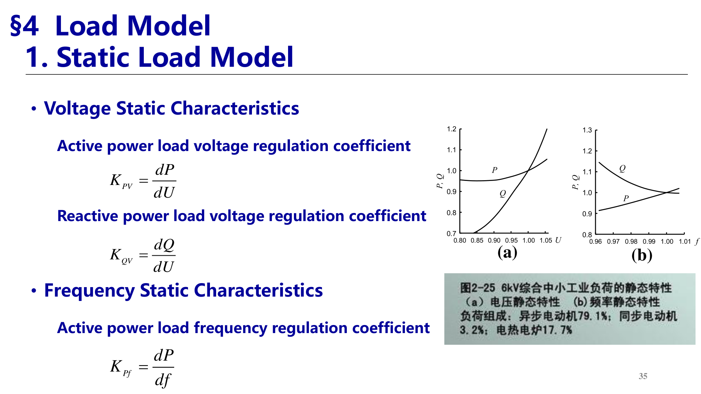

### 恒定参数模型 / Constant Models

- 恒功率：$\dot S_D=P_D+jQ_D$（额定电压、额定频率下的功率）。
- 恒阻抗：$Z_D=R_D+jX_D$，$\dot S_D=\dfrac{U_D^2}{\dot Z_D^*}=\dfrac{U_D^2}{R_D-jX_D}$。
- 恒电流：$G_D+jB_D$。

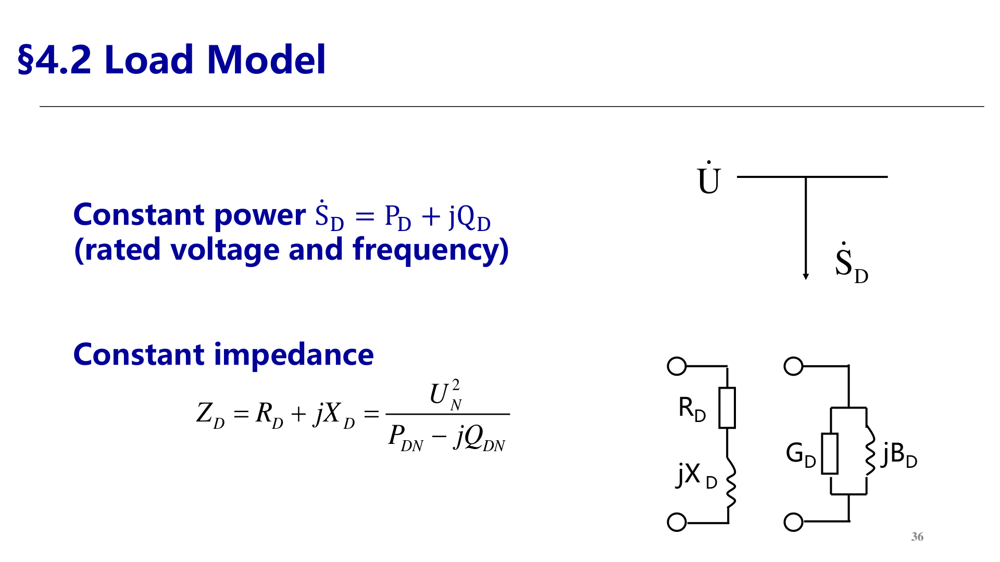

### 静态特性函数 / Static Characteristic Functions

- **线性函数（2 项）Linear**：  
  $P_D=P_{DN}+(U-U_N)K_{PV}$，$Q_D=Q_{DN}+(U-U_N)K_{QV}$
- **二次函数（3 项）Quadratic**：  
  $P_D=P_{DN}\left[a_P\left(\dfrac{U}{U_N}\right)^2+b_P\left(\dfrac{U}{U_N}\right)+c_P\right]$，Q_D 同理（aQ、bQ、cQ）；  
  三部分分别对应恒阻抗 Z(Y)、恒电流 I、恒功率 P，且 a+b+c=1。

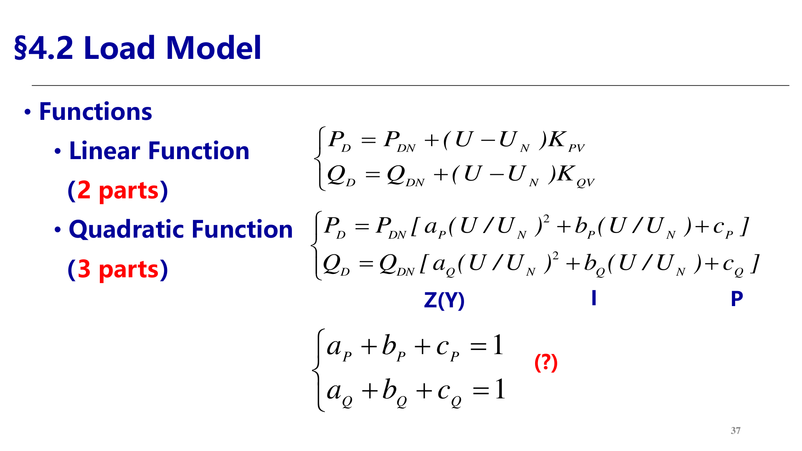

## 源与范围 / Source and Scope

- 源文件 / Sources:
  - `03-EN第二章电力系统稳态模型(第3讲电力线路参数和等值电路)20260920.pdf`
  - `04-EN第二章电力系统稳态模型(第4讲变压器参数和等值电路)20260927.pdf`
- 范围 / Scope: 第 3 讲 PPT 全部 38 页、第 4 讲 PPT 全部 37 页，省略页首提问页与纯照片页的复述。
- 图片 / Images: 从源 PDF 页面截图生成；编号 17-22 对应线路内容，23-33 对应变压器与负荷内容。
