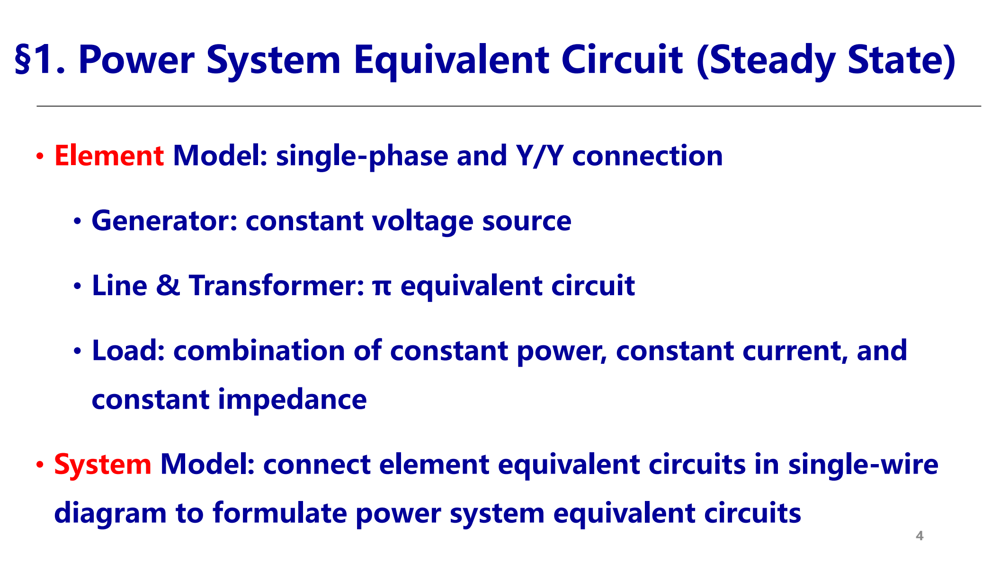
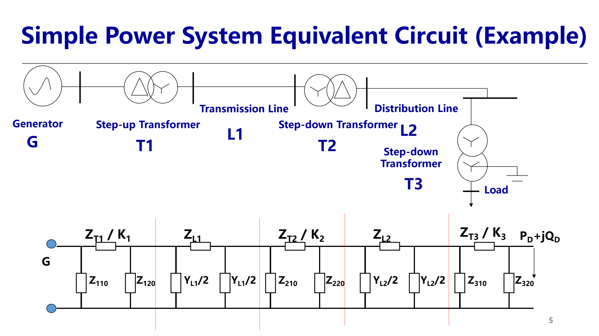
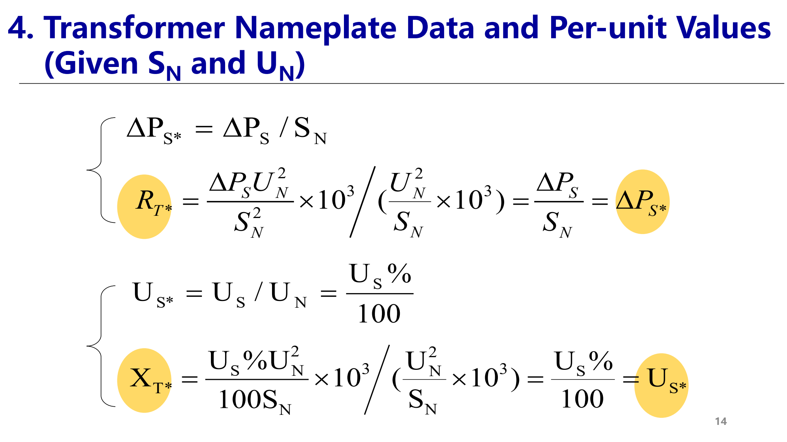
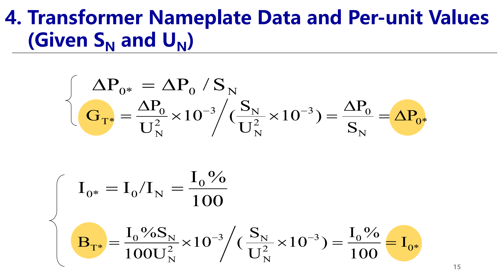
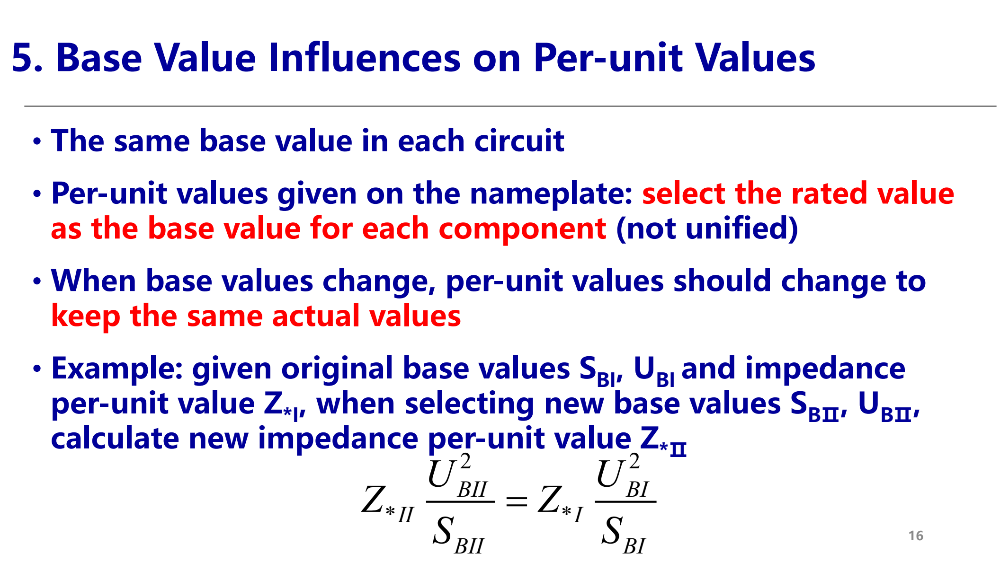
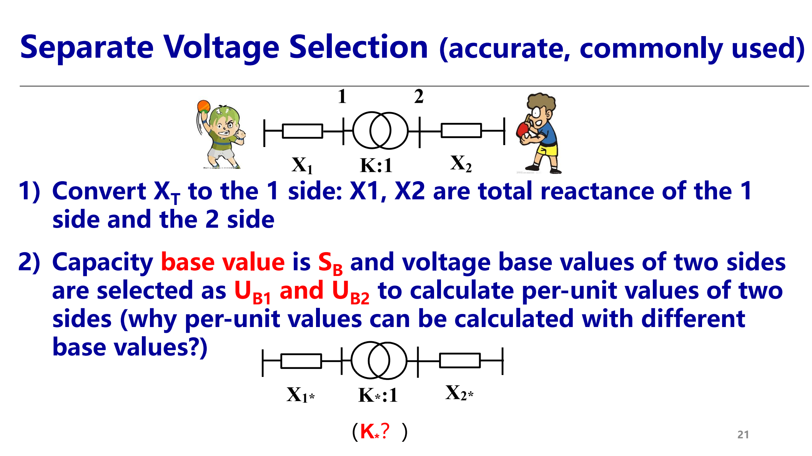
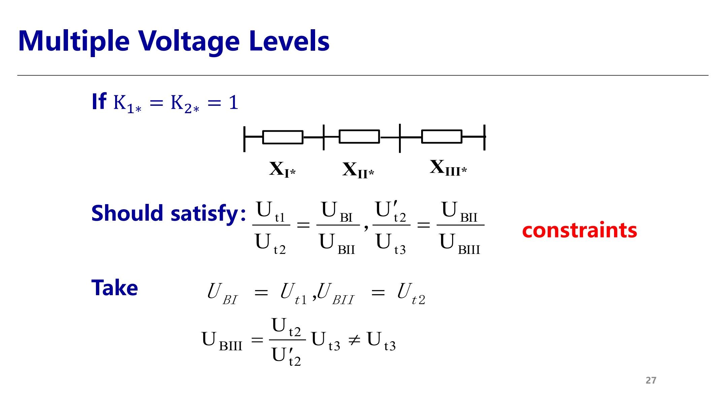
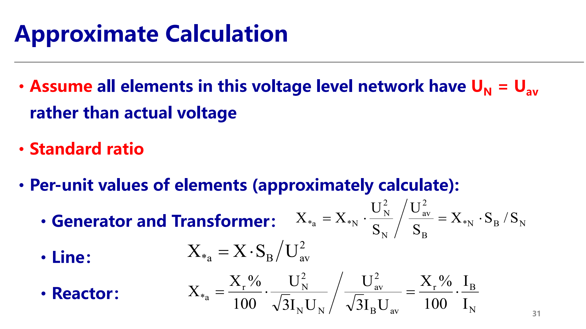

> 本页整理第 5 讲（标幺制与电力系统等值电路）的核心公式与工程处理方法，页码对应原 PPT 页码。  
> This page covers Lecture 5 (normalization system and power-system equivalent circuit). Page numbers refer to the original PPT.

## 1. 系统等值与标幺化动机 / System Equivalent and Motivation

- **建模口径 Modeling conventions**：稳态分析用单相、Y/Y 连接建立元件等值电路；发电机用恒定电压源，线路和变压器用 π 型等值电路，负荷用恒功率、恒电流、恒阻抗的组合。  
  **English:** Use single-phase Y/Y equivalents. Generators are constant voltage sources; lines and transformers use π equivalents; loads combine constant power, current, and impedance.
- **系统等值 System equivalent**：在单线图中连接各元件等值电路。三相直接计算复杂，不同电压等级、容量和设备参数可比性差，因此引入标幺制。  
  **English:** Connect the equivalents in a single-wire diagram. Per-unit normalization reduces cumbersome three-phase calculation and improves comparability.

## 2. 基准值选取 / Base-Value Selection

- **定义 Definition**：标幺值 = 同单位实际值 / 同单位基准值。标幺值无量纲、不唯一，必须说明基准。  
  **English:** A per-unit value is an actual value divided by a base value of the same unit. It is dimensionless and nonunique, so bases must be stated.
- **单相 Single phase**：独立选取 $S_{\phi B},U_{\phi B}$，再由约束得到  
  $I_{\phi B}=\dfrac{S_{\phi B}}{U_{\phi B}}$，$Z_{\phi B}=\dfrac{U_{\phi B}}{I_{\phi B}}=\dfrac{U_{\phi B}^2}{S_{\phi B}}$。  
  取 $P_B=Q_B=S_B$、$R_B=X_B=Z_B$ 后，标幺电路方程与有名值方程形式相同。
- **对称三相 Symmetrical three phase**：独立选取三相功率基准 $S_{3B}$ 和线电压基准 $U_{LB}$，则  
  $I_B=\dfrac{S_{3B}}{\sqrt3 U_{LB}}$，$Z_B=\dfrac{U_{LB}}{\sqrt3 I_B}=\dfrac{U_{LB}^2}{S_{3B}}$。  
  **结论 Conclusion:** 线电压与相电压的标幺值相等；三相功率与单相功率的标幺值相等；公式中不再出现 $\sqrt3$ 或 3。  
  **English:** With line-voltage and three-phase-power bases, line/phase voltage per-unit values and three-phase/per-phase power per-unit values coincide.
- **多元件 Uniform bases**：同一电压等级内用统一基准。设备铭牌标幺值若以自身额定值为基准，必须先换算到系统基准，再参与同一电路计算。

## 3. 变压器铭牌参数 / Transformer Nameplate Data

以变压器自身 $S_N,U_N$ 为基准：

- 串联阻抗：$R_T^*=\dfrac{\Delta P_S}{S_N}$，$X_T^*=\dfrac{U_S\%}{100}$。
- 励磁导纳：$G_T^*=\dfrac{\Delta P_0}{S_N}$，$B_T^*=\dfrac{I_0\%}{100}$；因励磁支路是感性导纳，实际复导纳写作 $Y_T^*=G_T^*-jB_T^*$。
- 说明：$\Delta P_S,\Delta P_0,S_N$ 必须用一致功率单位；$U_S\%$、$I_0\%$ 用百分数除以 100。

## 4. 基准值换算 / Base Conversion

- **一般换算 General conversion**：实际阻抗不变，基准值变化时  
  $Z_{*II}=Z_{*I}\dfrac{S_{BII}}{S_{BI}}\left(\dfrac{U_{BI}}{U_{BII}}\right)^2$。  
  **English:** Keep the physical impedance unchanged and rescale its per-unit value to the new $S_B,U_B$.
- **由额定基准换算 From rated bases**：铭牌标幺值 $Z_{*N}$ 换算到系统基准 $S_B,U_B$：  
  $Z_{*B}=Z_{*N}\dfrac{S_B}{S_N}\left(\dfrac{U_N}{U_B}\right)^2$。
- **电抗器 Reactor**：若已知额定电压、额定电流下的标幺值，  
  $Z_{*B}=Z_{*N}\dfrac{U_N I_B}{U_B I_N}$。

## 5. 多电压等级处理 / Multiple Voltage Levels

### 逐级折算法 / Level-by-Level Conversion

- 先用实际变比把元件阻抗折算到同一电压等级：$X_2'=K^2X_2$，$K=U_{t1}/U_{t2}$。  
- 再选同一 $S_B,U_B$ 计算标幺值。方法精确，但多级网络重复折算繁琐。  
  **English:** Convert impedances to one voltage level with $K^2$ factors, then normalize. It is accurate but cumbersome for multilevel networks.

### 分段选基准法 / Separate Voltage Bases

- 全网取同一 $S_B$，各电压等级分别取 $U_B$；元件先按本侧基准标幺化。  
- 理想变压器标幺变比为  
  $K_*=K\dfrac{U_{B2}}{U_{B1}}$。  
- 若取 $U_{B1}=U_{t1}$、$U_{B2}=U_{t2}$，则 $K_*=1$，理想变压器消失；若 $K_*\ne1$，保留非标准变比或改用 π 型等值。  
  **English:** Separate voltage bases convert a standard ratio to 1 pu. Nonstandard ratios either remain or become π equivalents.

- **三绕组约束 Three-winding constraints**：两个变压器标幺变比同时为 1 要求  
  $\dfrac{U_{t1}}{U_{t2}}=\dfrac{U_{BI}}{U_{BII}}$，$\dfrac{U_{t2}'}{U_{t3}}=\dfrac{U_{BII}}{U_{BIII}}$。  
  三个电压基准只有两个独立；抽头不匹配时不能总消去所有理想变压器。  
  **English:** Only two of the three voltage bases are independent; unmatched tap ratios may require retaining ideal ratios or π equivalents.

## 6. 工程近似 / Practical Approximate Method

- 常取 $S_B=100\mathrm{MVA}$；各电压等级取平均额定电压 $U_{av}$ 作为电压基准，并近似认为同级元件 $U_N=U_{av}$，因而变比视为标准变比。
- 近似电抗标幺值：
  - 发电机/变压器：$X_{a*}=X_{*N}\dfrac{S_B}{S_N}$。
  - 线路：$X_{a*}=X\dfrac{S_B}{U_{av}^2}$。
  - 电抗器：$X_{a*}=\dfrac{X_r\%}{100}\dfrac{I_B}{I_N}$。
- 常用平均额定电压：500→525 kV，220→230 kV，110→115 kV，10→10.5 kV。  
  **English:** Use average nominal voltages as voltage bases and assume standard transformer ratios.

## 7. 优缺点 / Advantages and Disadvantages

- **优点 Advantages**：便于比较元件参数；不同电压等级的电压标幺值接近 1；对称三相可化为单相；部分暂态方程更简洁。  
  **English:** It improves comparability, keeps voltage magnitudes near 1.0 pu, reduces balanced three-phase analysis to one phase, and simplifies some equations.
- **缺点 Disadvantages**：无量纲且物理意义不直观；还原有名值时必须记住基准。  
  **English:** Physical meaning becomes less direct, and bases must be tracked when restoring actual values.

## 源与范围 / Source and Scope

- 源文件 / Source: `05-EN第二章电力系统稳态模型(第5讲标幺制与等值电路)20261011.pdf`
- 范围 / Scope: 第 5 讲 PPT 全部 32 页，省略页首提问页与纯图片页的重复复述。
- 图片 / Images: 从源 PDF 页面截图生成；编号 34-41 对应本讲内容。
