> 本页整理第 6 讲（潮流概念、电压降落与损耗、开环和环网功率分布），页码对应原 PPT 页码。  
> This page covers Lecture 6 (power-flow concept, voltage drop, power loss, and manual flow distribution). Page numbers refer to the original PPT.

## 1. 潮流概念 / Power Flow Concept

- **定义 Definition**：潮流是电力系统稳态运行时各节点电压和各支路功率的分布。  
  **English:** Power flow, also called load flow, is the steady-state distribution of node voltages and branch powers.
- **用途 Importance**：定量分析电网安全性、经济性和电能质量，支撑规划与调度。简单系统可手算；复杂系统用计算机算法。  
  **English:** It quantitatively evaluates safety, economy, and quality for planning and dispatch; simple systems may be solved manually, complex systems computationally.

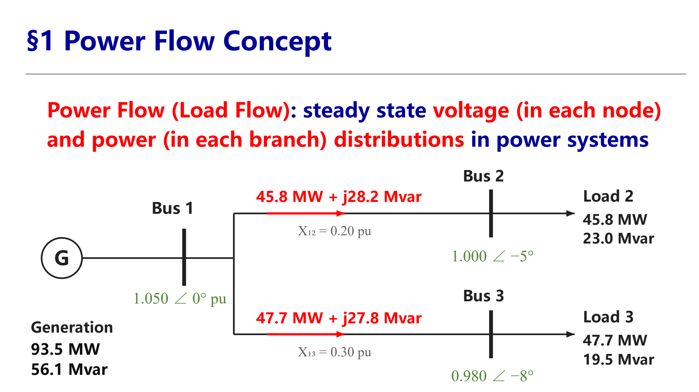

- **与电路分析的区别 Differences from circuit analysis**：
  - 边界条件由复电流变为复功率；基本物理依据是任意时刻、任意位置的功率平衡。
  - 潮流方程是非线性方程，需要数值方法和专门算法。
  - 结果不只是电流，而是节点复电压和支路复功率的分布。  
    **English:** Boundary conditions use complex power instead of current; power balance is fundamental; equations are nonlinear and solved by dedicated numerical methods.

## 2. 电压降落 / Voltage Drop

### 已知末端量 / Known Receiving End

设元件串联阻抗为 $R+jX$，末端功率为 $\dot S_2=P_2+jQ_2$、末端电压为 $\dot U_2$。以 $\dot U_2$ 为参考：

$$
\Delta\dot U_2=\dot U_1-\dot U_2
=\frac{P_2R+Q_2X}{U_2}
+j\frac{P_2X-Q_2R}{U_2}
$$

- 实部为**纵分量 longitudinal component** $\Delta U_2$。
- 虚部为**横分量 transverse component** $\delta U_2$。
- 相角：$\delta_1=\operatorname{arctan}\dfrac{\delta U_2}{U_2+\Delta U_2}$。

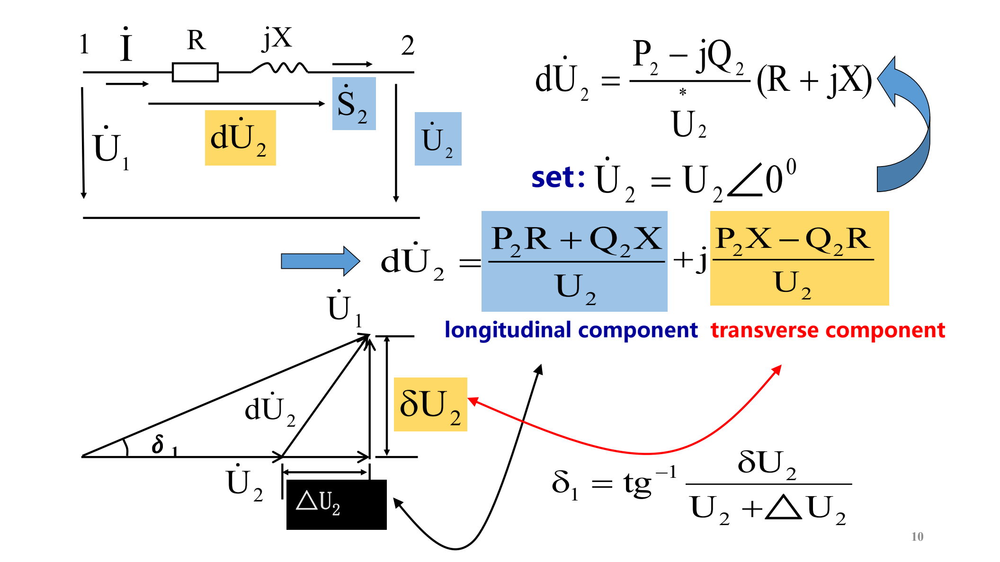

### 已知首端量 / Known Sending End

若已知首端功率和电压 $\dot S_1,\dot U_1$，以 $\dot U_1$ 为参考：

$$
\Delta\dot U_1
=\frac{P_1R+Q_1X}{U_1}
+j\frac{P_1X-Q_1R}{U_1}
$$

相角方向与参考端有关，通常写作  
$\delta_2=-\operatorname{arctan}\dfrac{\delta U_1}{U_1-\Delta U_1}$。

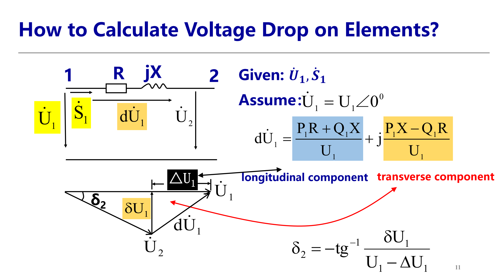

### 使用注意 / Key Notes

- $\dot S$ 和 $\dot U$ 必须取元件同一侧的值。三相量配线电压、单相量配相电压、标幺量配标幺电压，计算结果分别对应相应口径的电压差。  
  **English:** Complex power and voltage must refer to the same side and the same quantity convention.
- 两个参考轴下，$\Delta U_1+j\delta U_1$ 与 $\Delta U_2+j\delta U_2$ 的相量本身相同，但纵、横分量数值不同；因此 $\Delta U_1\ne\Delta U_2$、$\delta U_1\ne\delta U_2$。

### 电压损耗与偏移 / Voltage Loss and Offset

- **电压降 Voltage drop**：相量差 $\mathrm d\dot U=\dot U_1-\dot U_2$。
- **电压损耗 Voltage loss**：两端幅值差 $U_1-U_2$。高压网络中通常 $U_2+\Delta U_2\gg\delta U_2$，因此  
  $U_1\approx U_2+\Delta U_2$，即电压损耗近似等于纵分量。  
- **电压偏移 Voltage offset**：  
  $\dfrac{U_1-U_N}{U_N}\times100\%$。

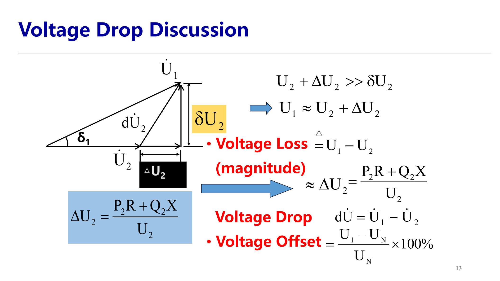

### 高压网络规律 / High-Voltage Network Pattern

高压输电网络 $X\gg R$，有：

$$
\Delta U_2\approx\frac{Q_2X}{U_2},\qquad
\delta U_2\approx\frac{P_2X}{U_2}
$$

- 电压幅值差主要由无功传输决定：$V$-$Q$ 强耦合，$V$-$P$ 弱耦合；无功从高电压节点流向低电压节点。
- 相角差主要由有功传输决定：$\delta$-$P$ 强耦合，$\delta$-$Q$ 弱耦合；有功从相位超前节点流向相位滞后节点。  
  **English:** Voltage magnitude is strongly coupled with reactive power; phase angle is strongly coupled with active power. This P-Q decomposition is central to power-flow understanding.

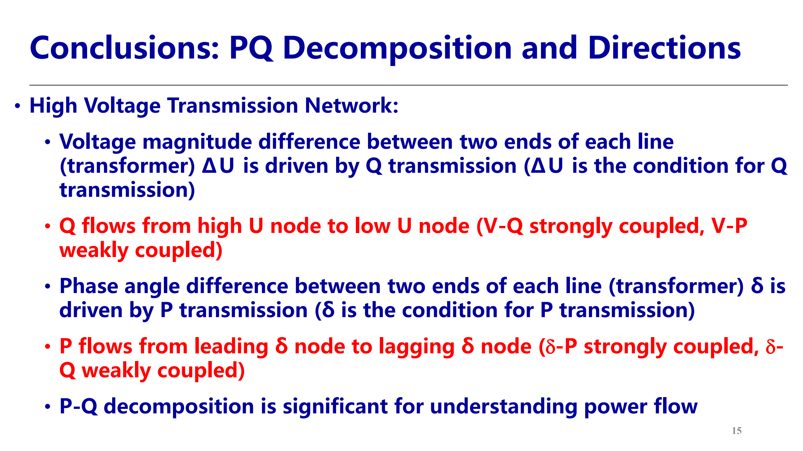

## 3. 功率损耗 / Power Loss

### 串联支路 / Series Branch

若支路电流由同侧 $\dot S_S,\dot U_S$ 计算：

$$
\Delta\dot S_S=I_S^2(R+jX)
=\frac{P_S^2+Q_S^2}{U_S^2}(R+jX)
$$

$$
\Delta P_S=\frac{P_S^2+Q_S^2}{U_S^2}R,\qquad
\Delta Q_S=\frac{P_S^2+Q_S^2}{U_S^2}X
$$

- 有功损耗与 $R$ 有关，无功损耗与 $X$ 有关；两者都随视在功率平方增大。
- 优化无功分布可降低电流，从而降低有功损耗。  
  **English:** Series real and reactive losses scale with the square of apparent power through $R$ and $X$.

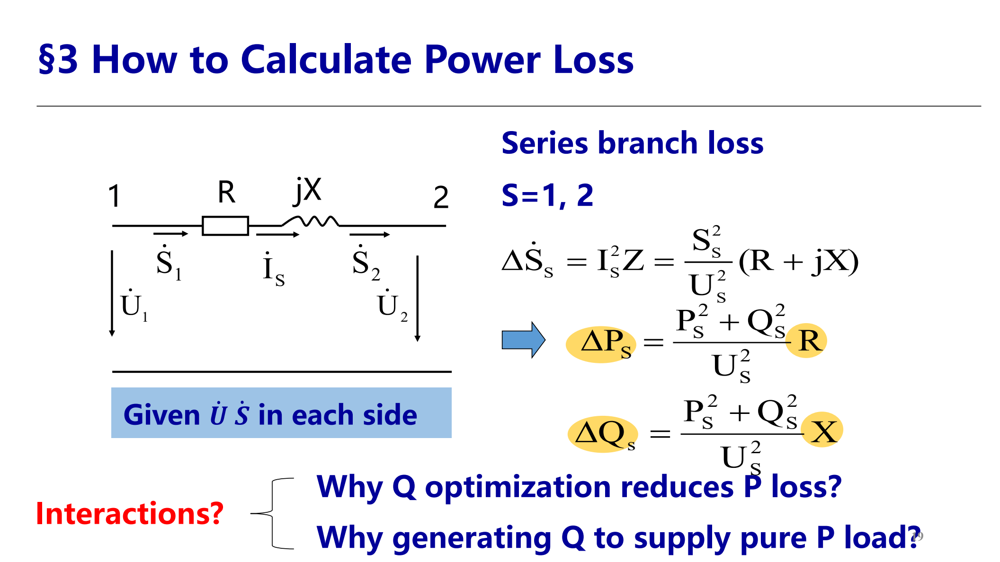

### 并联支路 / Shunt Branch

线路 π 型等值两端各有一半电纳 $B/2$。并联电容支路发出感性无功：

$$
\Delta\dot S_P=-j\frac{U^2B}{2},\qquad
\Delta Q_P=-\frac{U^2B}{2},\qquad
\Delta P_P=0
$$

负号表示该支路向网络提供感性无功，不是消耗感性无功。  
**English:** Shunt capacitive susceptance supplies reactive power and has no ideal real-power loss.

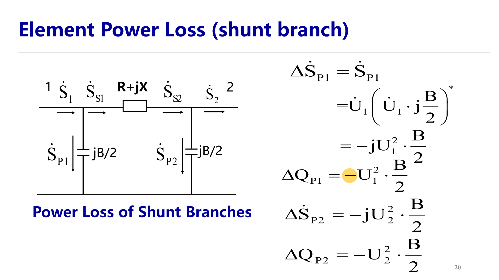

- 线路总损耗：$\Delta\dot S_L=\Delta\dot S_S+\Delta\dot S_{P1}+\Delta\dot S_{P2}$。
- 输电效率：$\eta_L=\dfrac{P_2}{P_1}\times100\%<1$。

## 4. 开环网络手算 / Open-Loop Manual Calculation

- **已知同一节点电压和功率 Given $U,S$ at the same node**：可直接从已知端逐段计算功率损耗、电流和电压降落，称为递推精确计算。  
  **English:** When voltage and power are known at the same node, compute each section recursively and accurately.

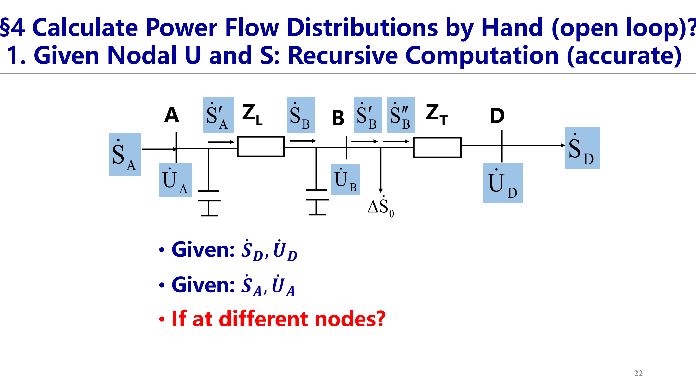

- **已知电压和功率在不同节点 Given $U,S$ at different nodes**：例如已知首端 $\dot U_A$、末端负荷 $\dot S_D$，采用两步近似并迭代：
  1. 全网先按额定电压 $U_N$ 计算功率损耗和功率分布；
  2. 用求得的功率分布和已知电压计算电压降落，得到各节点电压；
  3. 用新电压重复上述过程，直到误差满足容差。  
     **English:** Assume rated voltage to calculate power distribution, then calculate voltage drops from the computed powers, and iterate until convergence.

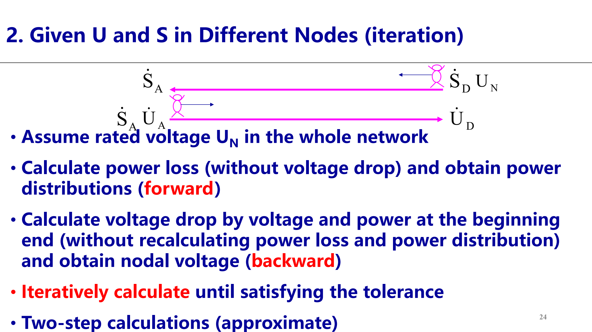

## 5. 两端供电与环网 / Two-End Supply and Loops

### 基本功率分布 / Basic Distribution

对两端供电链式网络，设总阻抗 $Z_\Sigma=\sum Z_i$，负荷 $\dot S_m$ 到对侧电源 $A_2$ 的路径阻抗为 $Z_m$，则：

$$
\dot S_{A1}
=\frac{\sum_m \dot S_m Z_m^*}{Z_\Sigma^*}
+\frac{\dot U_N(\dot U_{A1}-\dot U_{A2})^*}{Z_\Sigma^*}
$$

第二端 $\dot S_{A2}$ 用负荷到 $A_1$ 的路径阻抗 $Z_m'$，并带相反方向的电压差项。

- 若两端电压相等 $\dot U_{A1}=\dot U_{A2}$，只剩第一项，称为**自然功率分布 natural power distribution**。
- 该项可用杠杆原理理解：负荷越靠近某端、或其对侧路径阻抗越大，则该端供给比例越大。  
  **English:** With equal source voltages, load power divides inversely according to the conjugate path impedances, analogous to a lever.

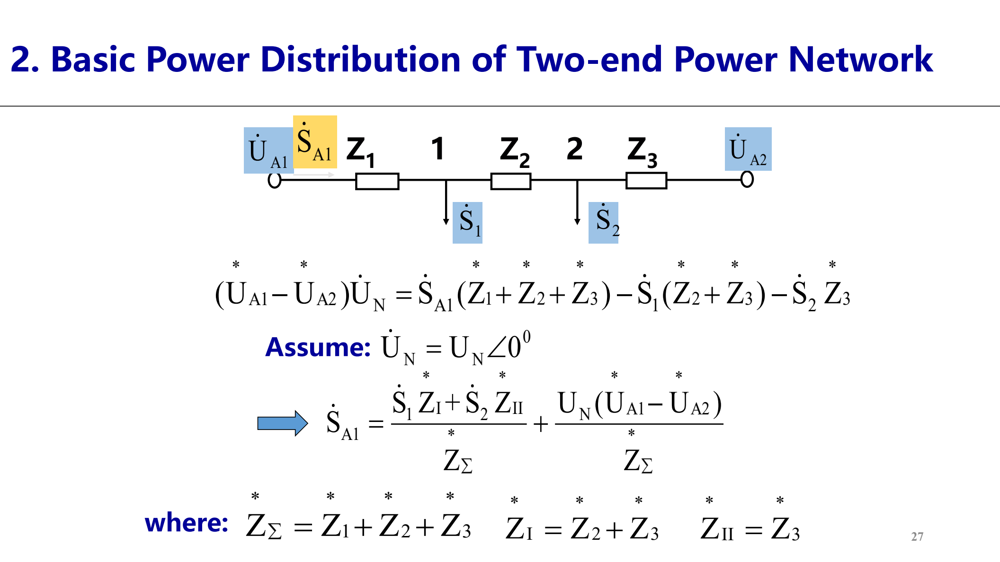

- **功率分点 Power-splitting point**：同时从两侧吸收功率的负荷节点。有功功率分点和无功功率分点可以不重合。  
  **English:** A splitting point receives power from both sides; P and Q splitting points need not coincide.

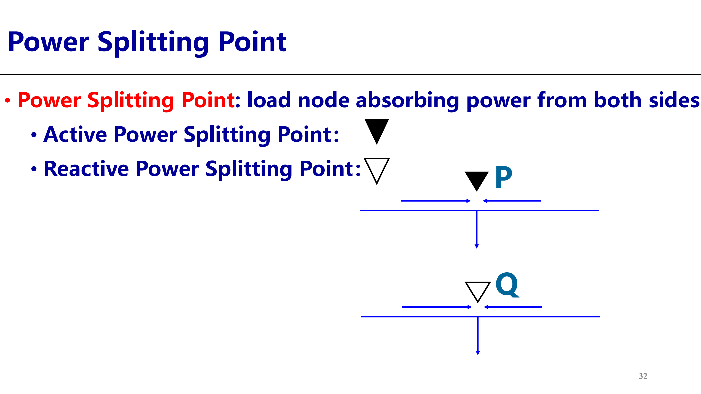

### 环网环流 / Circulating Power in Loops

电压差引起的环流功率为：

$$
\dot S_C
=\frac{\dot U_N(\dot U_{A1}-\dot U_{A2})^*}{Z_\Sigma^*}
$$

在环网中，若 $d\dot U$ 来自变压器变比不匹配，例如 $K_1\ne K_2$，可等价为环路电势 $\Delta\dot E=d\dot U=\dot U_A(K_1-K_2)$。环流与 $d\dot U$ 呈线性关系；实际比较时 $U$ 与 $Z$ 必须折算到同一电压等级。  
**English:** Unmatched ratios create a loop EMF; circulating power is linear in that EMF, and voltages and impedances must use one voltage level.

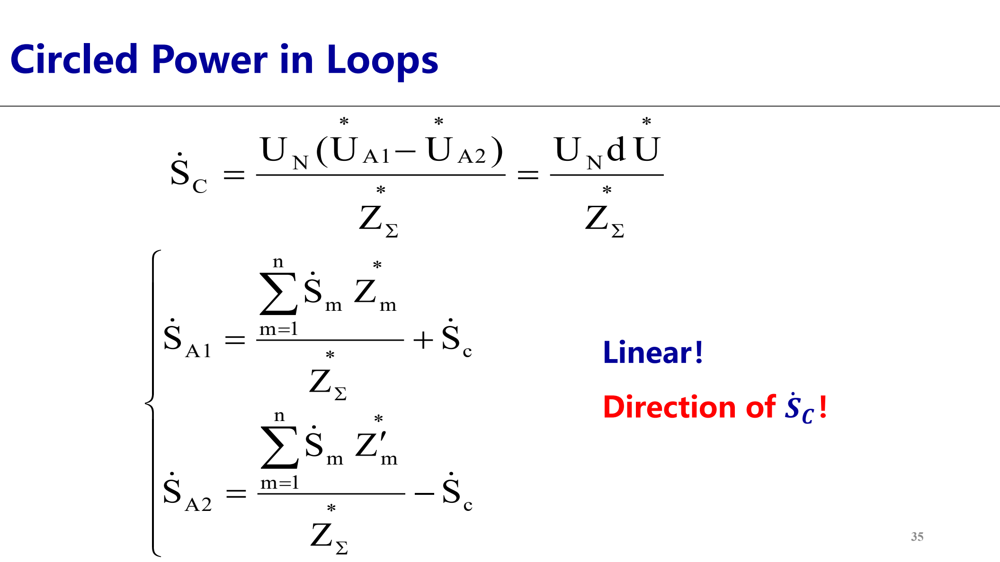

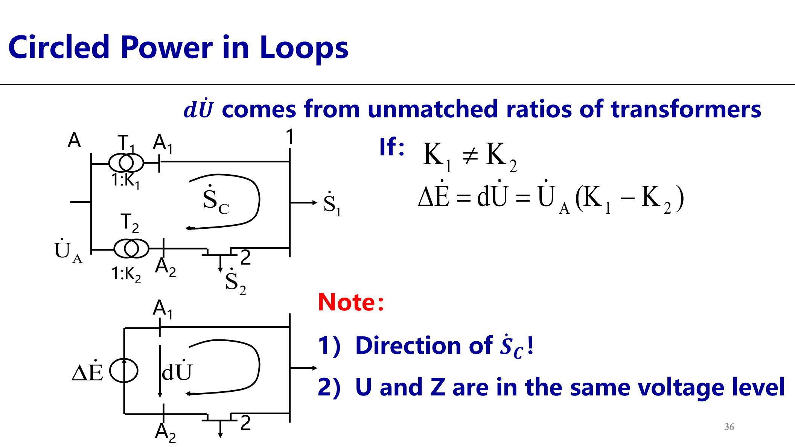

- **优点 Pros**：可以强制改变功率分布，用于潮流控制。  
- **缺点 Cons**：环流通常增加损耗、降低经济性。工程上可选择功率分点或控制环节处理。  
  **English:** Circulating power can force a desired distribution but usually increases losses.

## 源与范围 / Source and Scope

- 源文件 / Source: `06-EN第三章电力系统潮流分析与计算(第6讲简单电力系统潮流计算)20261011.pdf`
- 范围 / Scope: 第 6 讲 PPT 全部 40 页，省略页首提问页与纯案例截图的重复复述。
- 图片 / Images: 从源 PDF 页面截图生成；编号 42-54 对应本讲内容。
