> 本页整理第 7 讲（第三章第 2 讲：节点电压方程、节点导纳矩阵 $Y_n$、节点阻抗矩阵 $Z_n$、潮流方程的推导），页码对应原 PPT 页码。  
> This page covers Lecture 7 (Chapter 3, Lecture 2: network equations, nodal admittance/impedance matrices, and power-flow equations). Page numbers refer to the original PPT.

本讲要回答四个问题 (P2)：

1. 如何把物理网络写成数学模型（网络方程）？
2. 如何形成网络矩阵（便于编程）？
3. 如何推导功率方程（潮流方程）？
4. 潮流方程的物理本质是什么？

## 1. 网络方程的建立 / Formulating Network Equations

### 两类约束 / Two Constraints (P3–P4)

电力网络 = **元件 element** + **连接 connection**，对应两类相互独立的约束：

- **元件特性约束 Element characteristic constraint**：无源线性元件满足欧姆定律 $\dot U_b=Z_b\dot I_b$，与元件如何连接无关。  
  **English:** Each passive linear branch obeys Ohm's law regardless of how it is connected.
- **网络拓扑约束 Network topology constraint**：把元件看作支路，只考察连接关系，满足基尔霍夫定律  
  $\text{KCL: }\sum_{k\in j} i_k=0$（节点），$\text{KVL: }\sum_{k\in l} u_k=0$（回路），与元件参数无关。  
  **English:** Treating elements as branches, KCL/KVL describe connectivity only and do not depend on element characteristics.

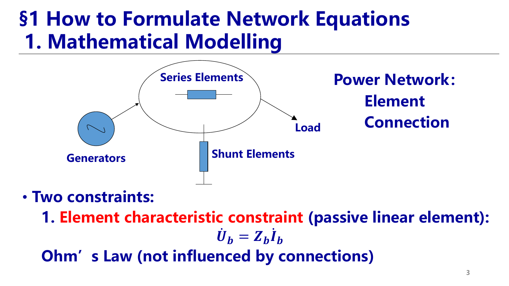

### 等值电路 / Equivalent Circuit (P5–P6)

- 线路、变压器均用 **π 型标幺等值电路**（见第二章稳态模型）。
- 定义**节点注入功率 nodal injected power**（净功率）：发电机注入为“+”，负荷吸收为“−”，即 $\dot S_i=\dot S_{Gi}-\dot S_{Di}$。
- 把节点注入功率暂时看作**注入电流源 $\dot I_i$**，网络就成为“线性无源网络 + 节点电流源”，可以用电路原理中的节点电压法求解。  
  **English:** Nodal net injections are temporarily modeled as current sources, giving a linear network solvable by nodal analysis.

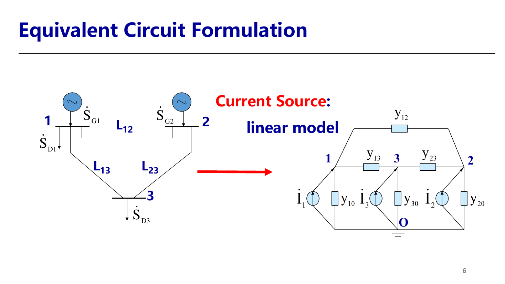

### 节点电压方程 / Nodal Voltage Equations (P7–P8)

**节点电压法 Nodal voltage method**：已知节点注入电流，求节点电压。以三节点网络为例，对每个节点列 KCL：

$$
\begin{cases}
\dot I_1=\dot U_1y_{10}+(\dot U_1-\dot U_2)y_{12}+(\dot U_1-\dot U_3)y_{13}\\
\dot I_2=\dot U_2y_{20}+(\dot U_2-\dot U_1)y_{12}+(\dot U_2-\dot U_3)y_{23}\\
\dot I_3=\dot U_3y_{30}+(\dot U_3-\dot U_1)y_{13}+(\dot U_3-\dot U_2)y_{23}
\end{cases}
$$

整理成矩阵形式：

$$
\dot{\mathbf I}_n=\mathbf Y_n\dot{\mathbf U}_n
$$

- $\dot{\mathbf I}_n$：节点注入电流列向量；$\dot{\mathbf U}_n$：节点电压列向量（相对参考节点 O，通常为大地）；$\mathbf Y_n$：**节点导纳矩阵 nodal admittance matrix**。
- 独立方程数 = $n$ = 除参考节点 O 以外的节点数。
- 定义**节点阻抗矩阵** $\mathbf Z_n=\mathbf Y_n^{-1}$，则 $\dot{\mathbf U}_n=\mathbf Z_n\dot{\mathbf I}_n$。
- **核心思想**：支路特性（元件约束）与拓扑信息（连接约束）全部“打包”进网络矩阵 $\mathbf Y_n$ 或 $\mathbf Z_n$ 中。  
  **English:** Both branch characteristics and topology are contained in the network matrix.

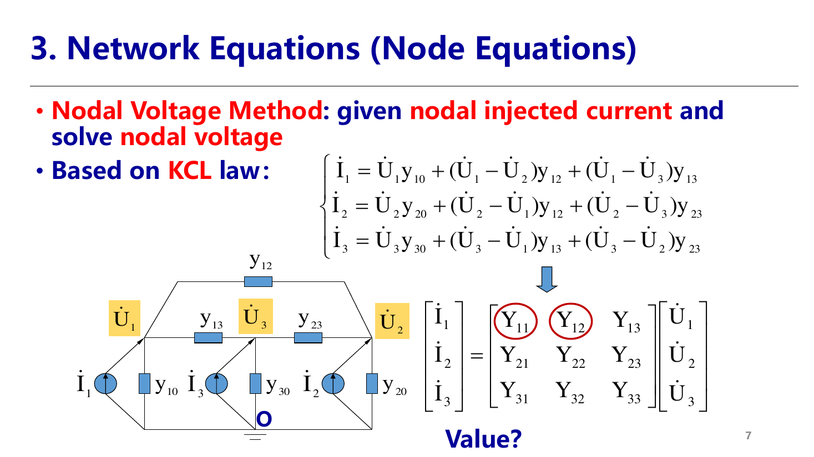

## 2. 节点导纳矩阵 / Nodal Admittance Matrix $Y_n$

### 定义与元素取值 / Definition (P9)

- **自导纳 Self-admittance** $Y_{ii}$：与节点 $i$ 相连的所有支路导纳之和（含对地支路）。
- **互导纳 Mutual-admittance** $Y_{ij}$：节点 $i$、$j$ 之间支路导纳的负值，$Y_{ij}=-y_{ij}$。
- **若 $i$、$j$ 之间无支路**：$Y_{ij}=0$。实际电网每个节点只与少数几个节点相连，所以 $Y_n$ 中绝大多数元素为零。

三节点网络的 $Y_n$ (P13)：

$$
\mathbf Y_n=
\begin{bmatrix}
y_{10}+y_{12}+y_{13} & -y_{12} & -y_{13}\\
-y_{12} & y_{20}+y_{12}+y_{23} & -y_{23}\\
-y_{13} & -y_{23} & y_{30}+y_{13}+y_{23}
\end{bmatrix}
$$

### 物理意义：短路参数 / Physical Meaning: Short-Circuit Parameters (P10–P11)

令 $\dot U_j=1$、其余节点电压全为 0（即其余节点全部**短路接地**），则

$$
\begin{bmatrix}Y_{1j}\\ \vdots\\ Y_{nj}\end{bmatrix}=\mathbf Y_n\,\mathbf e_j
\quad\Longrightarrow\quad
Y_{ij}=\left.\frac{\dot I_i}{\dot U_j}\right|_{\dot U_k=0,\ k\ne j}
$$

- $Y_{jj}$：在节点 $j$ 加单位电压、其余节点短路时，**从节点 $j$ 注入网络的电流**。例：$Y_{11}=y_{12}+y_{13}+y_{10}$。
- $Y_{ij}$：此时**节点 $i$ 的注入电流**。因为电流是从节点 $i$ 流向地（流出网络），所以为负：$Y_{21}=-y_{12}$，$Y_{31}=-y_{13}$。
- 只有与 $j$ 直接相连的节点才有电流，这正是 $Y_n$ 稀疏的物理原因：**$Y_n$ 只反映局部（相邻）信息**。  
  **English:** $Y_{ij}$ is the current injected at node $i$ when a unit voltage is applied at node $j$ and all other nodes are short-circuited; only adjacent nodes respond.

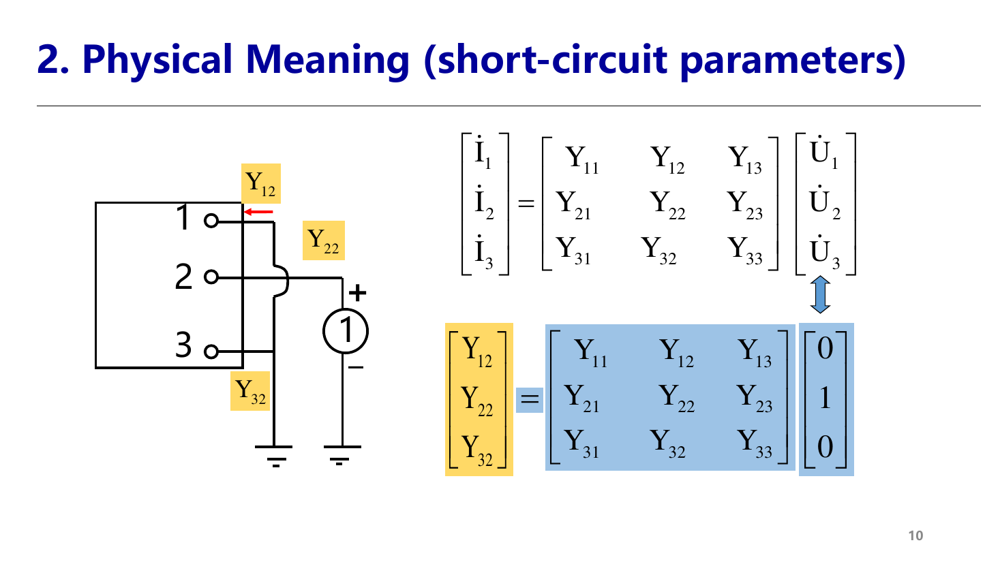

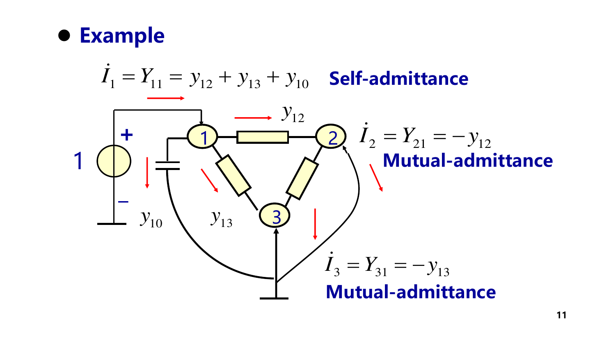

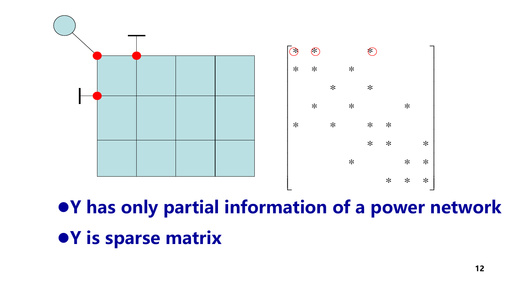

### 支路贡献与形成方法 / Branch Contribution (P13–P14)

一条连接 $i$、$j$ 的支路 $l$（导纳 $y_l$）只影响 $Y_n$ 中 $i,j$ 行列交叉的 4 个元素：

$$
\Delta\mathbf Y_l=
\begin{bmatrix} y_l & -y_l\\ -y_l & y_l\end{bmatrix}_{(i,j)}
,\qquad
\mathbf Y_n=\sum_{l=1}^{b}\Delta\mathbf Y_l
$$

对地支路 $y_{i0}$ 只贡献到 $Y_{ii}$。这就是编程时“逐条支路累加”形成 $Y_n$ 的方法，也给出了**网络变化时的修正方法**：

| 网络变化 Change | $Y_n$ 的修正 Correction |
|---|---|
| 增加支路 $i$-$j$ | 在 $(i,i),(j,j)$ 加 $y_l$，在 $(i,j),(j,i)$ 加 $-y_l$ |
| 删除支路 $i$-$j$（如删去 1-3） | 相当于并联一条 $-y_l$ 的支路：上述四个元素反向修正 |
| 支路参数变化 $y_l\to y_l'$ | 先删去原支路，再加入新支路，即按 $\Delta y=y_l'-y_l$ 修正 |
| 变压器变比变化 | 删去原 π 型等值，加入新变比下的 π 型等值（涉及 $Y_{ii},Y_{jj},Y_{ij}$） |
| 增加节点 | 矩阵阶数加 1，新增行列按新支路填写 |
| 合并节点 $i,j$ | 将 $j$ 的行、列分别加到 $i$ 的行、列上，再删去 $j$ 行列 |

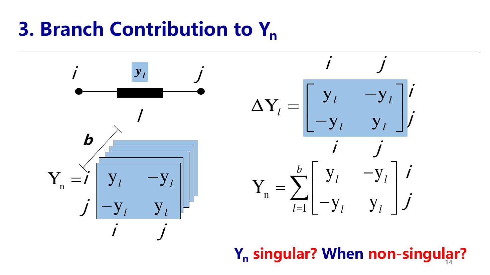

### $Y_n$ 的性质 / Features of $Y_n$ (P14–P16)

1. **$n\times n$ 对称复数方阵**：$Y_{ij}=Y_{ji}$（网络无源、互易）。若含移相变压器，对称性被破坏。
2. **稀疏 Sparse**：大量零元素。大规模电网需采用稀疏存储（只存非零元及其位置）和稀疏矩阵技术，否则存储量与计算量按 $n^2$ 增长。
3. **奇异性 Singularity**：
   - 若**没有对地支路**，由 $\Delta\mathbf Y_l$ 的结构，$Y_n$ 每一行元素之和为 0，即 $\mathbf Y_n\mathbf 1=\mathbf 0$，所以 $Y_n$ **奇异**——物理上，所有节点电压同时抬高一个常数，不会产生任何电流，电压没有“参考”。
   - 只要连通网络中**存在对地支路**（如线路充电电容、并联电抗器），$Y_n$ 一般**非奇异**。
4. **对角占优 Diagonally dominant**：当各支路阻抗性质相同时（如都是感性），
   $$
   |Y_{ii}|\ge\Big|\sum_{j\ne i}Y_{ij}\Big|
   $$
   - **含线路充电电容时**：对地电纳 $jB/2$ 为容性，与感性串联导纳 $-j/x$ 符号相反，会抵消 $Y_{ii}$ 的一部分，因此对角占优可能不再严格成立；不过高压线路充电电纳远小于串联电纳，通常仍近似成立。  
   **English:** Shunt charging capacitance has opposite sign to inductive series admittance, so strict diagonal dominance may fail.

## 3. 节点阻抗矩阵 / Nodal Impedance Matrix $Z_n$

### 定义 / Definition (P17)

$$
\mathbf Z_n=\mathbf Y_n^{-1},\qquad \dot{\mathbf U}_n=\mathbf Z_n\dot{\mathbf I}_n
$$

$Z_{ii}$：节点 $i$ 的**自阻抗 self-impedance**；$Z_{ij}$：节点 $i$、$j$ 之间的**互阻抗 mutual-impedance**。

### 物理意义：开路参数 / Physical Meaning: Open-Circuit Parameters (P18)

令 $\dot I_j=1$、其余节点注入电流全为 0（即其余节点全部**开路**），则

$$
Z_{ij}=\left.\frac{\dot U_i}{\dot I_j}\right|_{\dot I_k=0,\ k\ne j}
$$

- **自阻抗 $Z_{jj}$**：从节点 $j$ 与参考节点看进去的**网络等值总阻抗（戴维南等值阻抗）**——这也是短路计算中节点短路电流 $\dot I_f\approx \dot U_j^{(0)}/Z_{jj}$ 的来源。
- **互阻抗 $Z_{ij}$**：单位电流从 $j$ 注入时，在节点 $i$ 产生的电压，是总阻抗 $Z_{jj}$ 上“分压”得到的一部分，可写为 $Z_{ij}=\dfrac{1}{\eta}Z_{jj}$（$\eta\ge1$ 为分压比）。
- 在连通网络中，单位电流注入任一节点，**所有节点电压都会变化**，所以 $Z_n$ 一般是**满阵**，反映的是**全局**信息。  
  **English:** $Z_{jj}$ is the Thevenin impedance seen at node $j$; $Z_{ij}$ is the open-circuit voltage at node $i$ for a unit current at $j$.

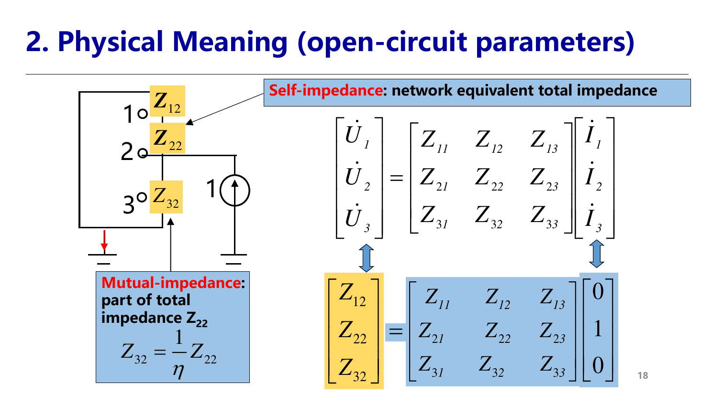

### 按定义求 $Z_n$ 的例子 / Example by Definition (P19)

网络：节点 1 经 $jx_1$ 接节点 3；节点 3 经 $jx_2$ 接 $2'$，再经理想变压器 $1:k$ 接节点 2；节点 3 经 $jx_3$ 接地；节点 4 经 $jx_4$ 接地。

**开路试验做法**：只在一个节点注入 1 A，其他节点开路（注入为 0），沿电流实际流经的路径算各点电压。

- 在节点 1 注入 1 A：电流只能经 $x_1\to x_3$ 入地，$x_2$ 中无电流。  
  $Z_{11}=j(x_1+x_3)$，$Z_{31}=jx_3$，$Z_{21}=k\cdot jx_3$（$2'$ 电压等于 $\dot U_3$，经变比放大 $k$ 倍），$Z_{41}=0$。
- 在节点 2 注入 1 A：折算到 $2'$ 侧电流为 $k$，流经 $x_2\to x_3$：  
  $Z_{22}=k\cdot k\,j(x_2+x_3)=jk^2(x_2+x_3)$，$Z_{32}=jkx_3$，$Z_{42}=0$。
- 在节点 3 注入 1 A：$Z_{33}=jx_3$；节点 4 注入 1 A：$Z_{44}=jx_4$。

$$
\mathbf Z_n=
\begin{bmatrix}
j(x_1+x_3) & jkx_3 & jx_3 & 0\\
jkx_3 & jk^2(x_2+x_3) & jkx_3 & 0\\
jx_3 & jkx_3 & jx_3 & 0\\
0&0&0&jx_4
\end{bmatrix}
$$

- **对称性**：由互易定理 reciprocity theorem，$Z_{ij}=Z_{ji}$（如 $Z_{12}=Z_{21}=jkx_3$）。
- 节点 4 与其他部分不连通，所以 $Z_n$ 呈**分块对角**：不连通部分之间的互阻抗为 0。

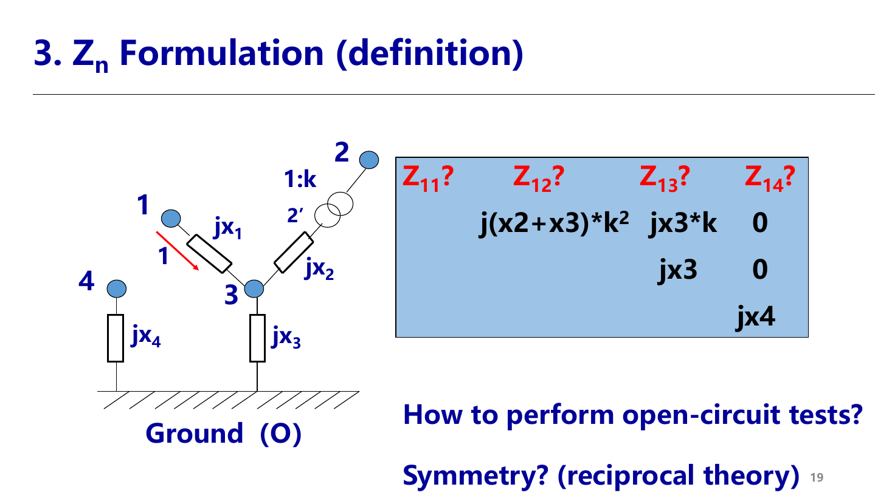

### $Z_n$ 的性质 / Features of $Z_n$ (P20–P21)

1. **有对地支路时**是 $Y_n$ 的逆，为 $n\times n$ 对称复数方阵；**无对地支路时** $Y_n$ 不可逆，$Z_n$ 不存在。
   - 此时需指定一个**参考节点**（给定其电压），把它从未知量中去掉，$Y$ 和 $Z$ 都降为 $(n-1)\times(n-1)$ 阶。  
     数学上：去掉一行一列后矩阵满秩；物理上：电压必须有参考点才有确定值。这与后面潮流计算中的**平衡节点**是同一思想。
2. **连通网络为满阵 Full matrix**；不连通网络为分块对角矩阵。
3. **对角元最大**：无源网络中 $|Z_{ii}|\ge|Z_{ij}|$。对元件的要求：网络无源，且各元件阻抗性质相同（例如全为感性），否则可能出现 LC 谐振式的电压放大，使互阻抗大于自阻抗。

### 形成方法 / Formulation Methods (P21)

- **求逆法**：$\mathbf Z_n=\mathbf Y_n^{-1}$。
- **支路追加法 Add-branch method**：从 1 个节点 1 条支路开始，逐条追加支路并修正 $Z$，直至形成整个网络（不作考试要求）。
- **基本要求**：会用**定义（开路试验）**求简单网络的 $Z_n$。

### $Y_n$ 与 $Z_n$ 对比 / Comparison

| 项目 | $Y_n$ 节点导纳矩阵 | $Z_n$ 节点阻抗矩阵 |
|---|---|---|
| 物理意义 | 短路参数（其余节点短路） | 开路参数（其余节点开路） |
| 稀疏性 | 稀疏，仅相邻节点非零 | 满阵（连通网络） |
| 反映信息 | 局部拓扑 | 全局等值 |
| 形成 | 逐支路累加，简单 | 求逆或支路追加，计算量大 |
| 网络变化时修正 | 只改少数元素 | 几乎所有元素都要改 |
| 典型用途 | 潮流计算 | 短路计算、灵敏度分析 |

IEEE 14 节点系统中 $Y_n$ 的非零元集中在对角线附近，$Z_n$ 则几乎处处非零 (P22)：

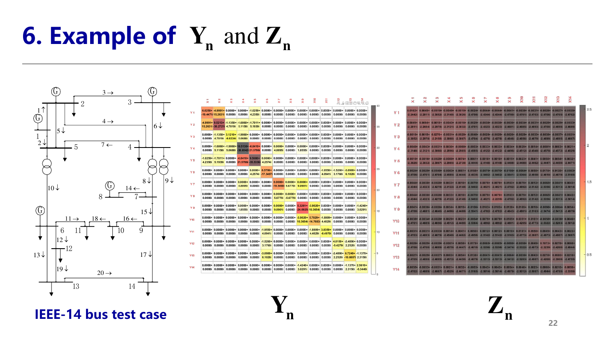

## 4. 功率方程（潮流方程）/ Power-Flow Equations

### 为什么需要潮流方程 / Why (P23–P24)

潮流计算 = **电力网络 + 给定边界条件 → 潮流分布**。

- 节点电压方程 $\dot{\mathbf I}_n=\mathbf Y_n\dot{\mathbf U}_n$ 要求已知节点注入**电流**。
- 但实际边界条件是**复功率**：发电机按功率出力调度，负荷按功率消耗；注入电流事先并不知道（它依赖于待求电压）。
- 所以要把方程中的已知量由电流换成功率，建立“功率（已知）—电压（待求）”的关系，即**潮流方程**。  
  **English:** Actual boundary conditions are complex powers, not currents, so the nodal equations must be rewritten in terms of power.

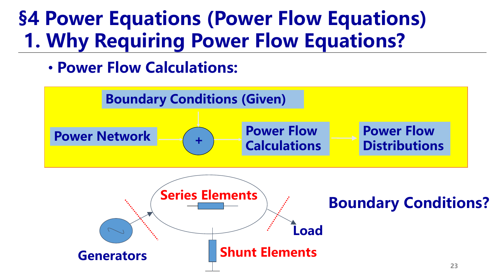

### 推导：变量替换 / Derivation by Variable Replacement (P25)

节点注入复功率 $\dot S_i=P_i+jQ_i=\dot U_i\dot I_i^{*}$，所以

$$
\dot I_i=\frac{P_i-jQ_i}{\dot U_i^{*}}
$$

代入第 $i$ 行节点电流平衡 $\dot I_i=\sum_{j=1}^{n}Y_{ij}\dot U_j$：

$$
P_i-jQ_i=\dot U_i^{*}\sum_{j=1}^{n}Y_{ij}\dot U_j\qquad(i=1,2,\dots,n)
$$

- **物理本质**：由“节点电流平衡（线性）”变为“**节点功率平衡**”——每个节点注入的功率等于经各支路流出的功率之和。
- 方程含 $\dot U_i^{*}\dot U_j$ 乘积项，是**非线性复数方程**，必须迭代求解。  
  **English:** The power-flow equation is a nodal power balance; it is nonlinear because of the products of voltages.

### 直角坐标形式 / Rectangular Form (P26–P27)

设 $Y_{ij}=G_{ij}+jB_{ij}$，$\dot U_i=e_i+jf_i$：

$$
P_i-jQ_i=(e_i-jf_i)\sum_{j=1}^{n}(G_{ij}+jB_{ij})(e_j+jf_j)=(e_i-jf_i)(a_i+jb_i)
$$

$$
a_i=\sum_{j=1}^{n}(G_{ij}e_j-B_{ij}f_j),\qquad
b_i=\sum_{j=1}^{n}(G_{ij}f_j+B_{ij}e_j)
$$

其中 $a_i+jb_i$ 恰为节点 $i$ 的注入电流 $\dot I_i$。分开实部、虚部：

$$
\begin{aligned}
\Delta P_i&=P_i-(e_ia_i+f_ib_i)=0 &&\text{（有功平衡 P balance）}\\
\Delta Q_i&=Q_i-(f_ia_i-e_ib_i)=0 &&\text{（无功平衡 Q balance）}
\end{aligned}
$$

未知量 $\mathbf x=[e_1,\dots,e_n,f_1,\dots,f_n]^T$ 共 $2n$ 个，方程 $\mathbf f(\mathbf x)=\mathbf 0$ 共 $2n$ 个（$n$ 个 $\Delta P$ + $n$ 个 $\Delta Q$），**未知量数 = 方程数**。

### 极坐标形式 / Polar Form (P28–P30)

工程上更关心电压**幅值**和**相角**（与电压质量、稳定性直接相关），因此常用极坐标。设 $\dot U_i=U_i e^{j\delta_i}$，$\delta_{ij}=\delta_i-\delta_j$：

$$
P_i-jQ_i=U_i\sum_{j=1}^{n}U_j(G_{ij}+jB_{ij})e^{-j\delta_{ij}}
$$

$$
(G_{ij}+jB_{ij})e^{-j\delta_{ij}}=(G_{ij}\cos\delta_{ij}+B_{ij}\sin\delta_{ij})+j(B_{ij}\cos\delta_{ij}-G_{ij}\sin\delta_{ij})
$$

$$
\begin{aligned}
\Delta P_i&=P_i-U_i\sum_{j=1}^{n}U_j(G_{ij}\cos\delta_{ij}+B_{ij}\sin\delta_{ij})=0\\
\Delta Q_i&=Q_i+U_i\sum_{j=1}^{n}U_j(B_{ij}\cos\delta_{ij}-G_{ij}\sin\delta_{ij})=0
\end{aligned}
$$

- 未知量 $\mathbf x=[\delta_1,\dots,\delta_n,U_1,\dots,U_n]^T$，同样 $2n$ 个未知量、$2n$ 个方程。
- **方程只依赖相角差 $\delta_{ij}$**：所有相角同时加一个常数，方程不变。因此如果没有**相角参考节点**，解不唯一（Jacobian 奇异）。这是下一讲引入平衡节点（$V\delta$ 节点，$\delta=0$）的原因之一。  
  **English:** The equations depend only on angle differences, so an angle reference node is required for a unique solution.

### 潮流方程的特点小结 / Summary of Features

| 特点 | 说明 |
|---|---|
| 物理本质 | 每个节点的功率平衡 |
| 非线性 | 含电压乘积 / 三角函数，必须迭代求解 |
| 稀疏 | 第 $i$ 个方程只含与 $i$ 相邻节点的电压（继承自 $Y_n$） |
| 相角平移不变 | 需要相角参考 |
| 功率不能全给定 | 网损由电压决定、事先未知，所以全网至少要留一个节点的功率作为未知量（下一讲：节点分类与平衡节点） |

## 5. 专题思考 / Special Topic (P32)

**问题**：交流电网为何采用 50/60 Hz？低频输电有何影响及其价值？

以下为思考提纲（非课件原文）：

- **频率偏高的代价**：线路电抗 $X=\omega L$ 与充电无功 $Q_C\propto\omega C U^2$ 都随频率增大，线路传输极限 $P_{\max}\approx\dfrac{U_1U_2}{X}$ 下降，集肤效应、涡流损耗增大，长距离输电不利。
- **频率偏低的代价**：变压器、电机铁芯截面与 $1/f$ 成正比（$U\approx4.44fNB_mA$），设备体积、用材增大；照明闪烁明显。50/60 Hz 是设备成本与输电能力之间的历史折中。
- **低频输电 LFAC**（如 50/3 Hz）：电抗降为 1/3，输送容量和距离提高；电缆充电电流显著减小，适合海上风电送出和城市电缆网。代价是两端需变频换流设备、低频侧变压器体积增大。国内已建成柔性低频交流输电示范工程。

## 源与范围 / Source and Scope

- 源文件 / Source: `07-EN第三章电力系统潮流分析与计算(第7讲).pdf`（Chapter 3, Lecture 2: Power System Network Equations, Matrix and Power Equations）
- 范围 / Scope: 第 7 讲 PPT 全部页（P1–P30 及专题页 P32），省略页首提问页的重复复述；P19 例题、P9/P16 的课堂提问已补全解答。
- 图片 / Images: 从源 PDF 页面截图生成；编号 55-65 对应本讲内容。

相关 / Related: [第6讲 简单电力系统潮流计算](./第6讲-简单电力系统潮流计算.md) · [第8讲 实数潮流方程与求解方法](./第8讲-实数潮流方程与求解方法.md) · [第二章 稳态模型（π 型等值）](./第3-4讲-稳态模型.md)
