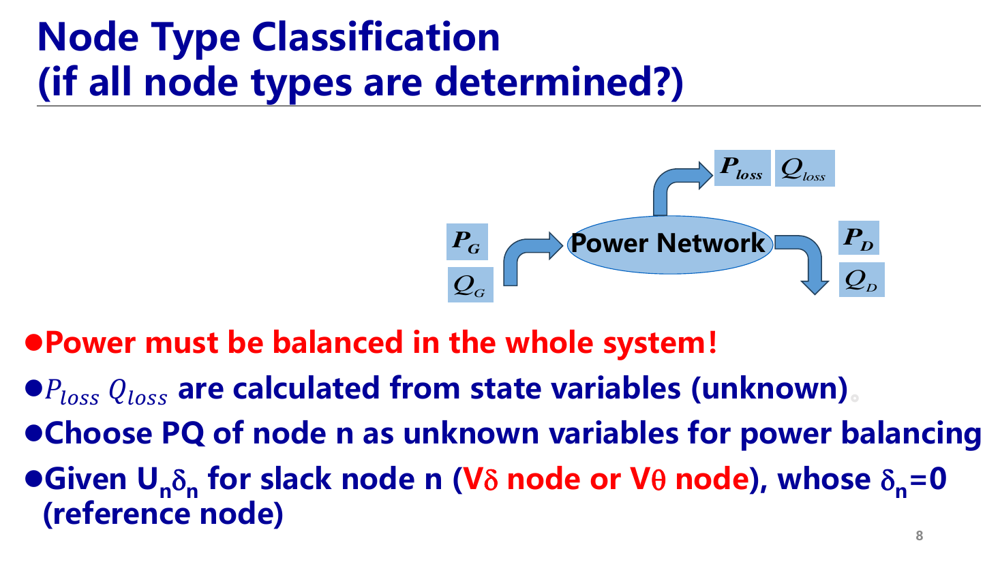
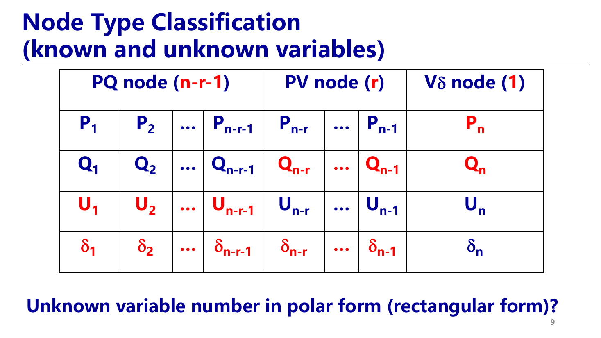
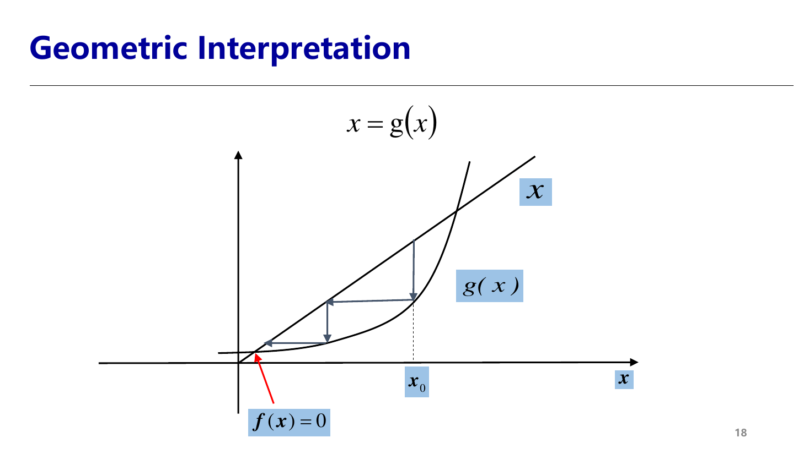
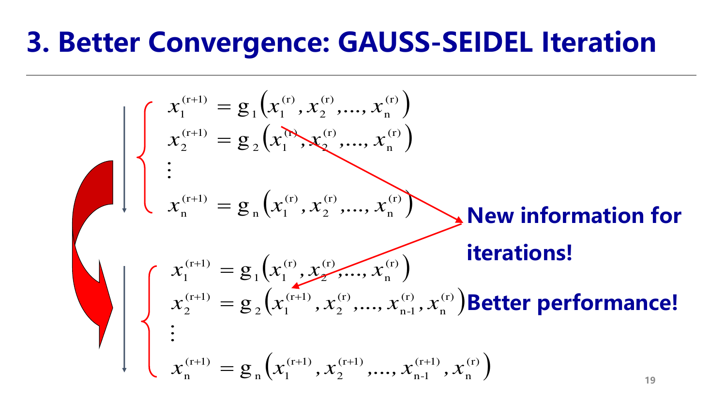
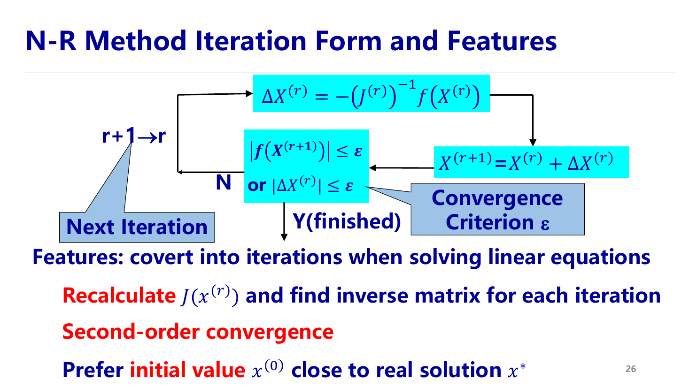
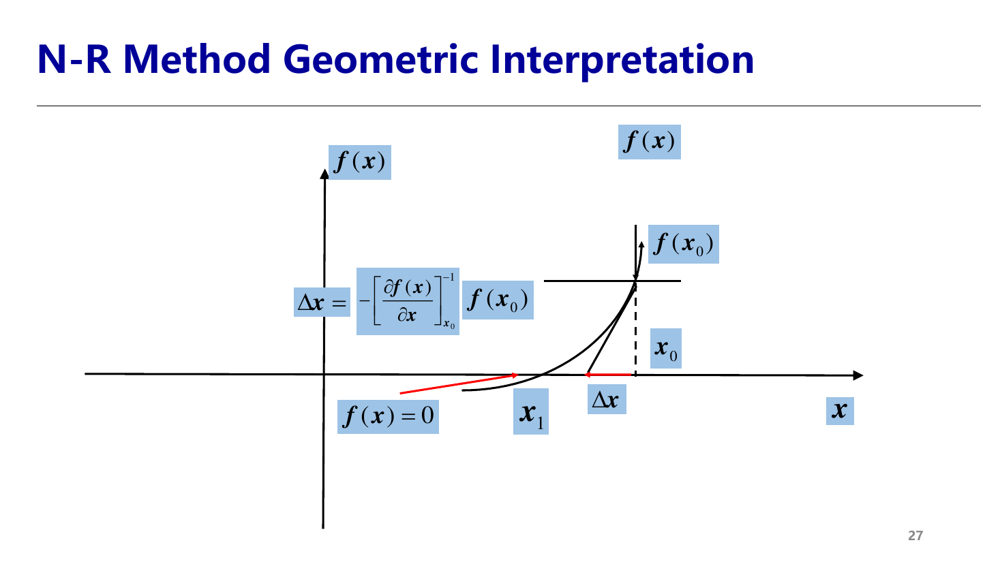
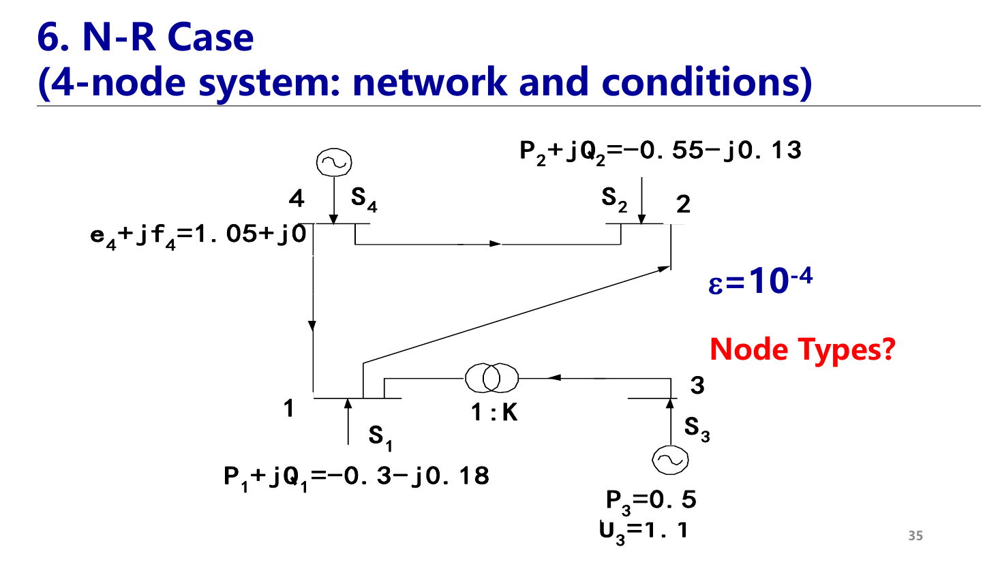
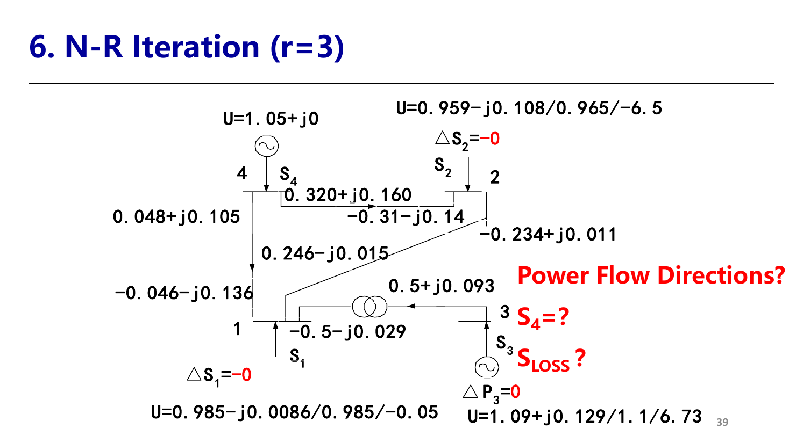

> 本页整理第 8 讲（第三章第 3 讲：节点分类与实数潮流方程、潮流解的可行性、Gauss-Seidel 迭代法、Newton-Raphson 法及算例），页码对应原 PPT 页码。  
> This page covers Lecture 8 (Chapter 3, Lecture 3: real power-flow equations, node types, feasibility, Gauss-Seidel and Newton-Raphson methods). Page numbers refer to the original PPT.

本讲要回答五个问题 (P2)：潮流方程的特殊性？物理上可行的潮流解？计算机求解方法的发展？如何构造 Gauss 迭代法（自学）？如何构造 N-R 法？

## 1. 实数潮流方程 / Real Power-Flow Equations

### 回顾：两种坐标形式 / Recap (P3–P4)

上一讲由 $P_i-jQ_i=\dot U_i^{*}\sum_j Y_{ij}\dot U_j$ 得到（上标 $sp$ 表示给定值 specified）：

**直角坐标 Rectangular**，$\dot U_i=e_i+jf_i$：

$$
\begin{aligned}
\Delta P_i&=P_i^{sp}-(e_ia_i+f_ib_i)=0\\
\Delta Q_i&=Q_i^{sp}-(f_ia_i-e_ib_i)=0
\end{aligned}
\qquad
a_i=\sum_{j=1}^{n}(G_{ij}e_j-B_{ij}f_j),\ \ b_i=\sum_{j=1}^{n}(G_{ij}f_j+B_{ij}e_j)
$$

**极坐标 Polar**，$\dot U_i=U_i\angle\delta_i$：

$$
\begin{aligned}
\Delta P_i&=P_i^{sp}-U_i\sum_{j=1}^{n}U_j(G_{ij}\cos\delta_{ij}+B_{ij}\sin\delta_{ij})=0\\
\Delta Q_i&=Q_i^{sp}+U_i\sum_{j=1}^{n}U_j(B_{ij}\cos\delta_{ij}-G_{ij}\sin\delta_{ij})=0
\end{aligned}
$$

形式上 $2n$ 个未知量、$2n$ 个方程。但**哪些量已知、哪些量未知**还没有说清楚——这就是本讲的第一个问题。

### 确定变量 / Determining Variables (P5–P6)

- 每个节点有 **4 个变量**：$P_i(=P_{Gi}-P_{Di})$、$Q_i(=Q_{Gi}-Q_{Di})$、$U_i$、$\delta_i$（或 $e_i,f_i$）。
- 选复电压 $U_i,\delta_i$ 为**状态变量 state variables**：它是确定系统状态、计算全部潮流的最小变量集——电压一旦求出，任一支路功率、网损都能算出。
- 全系统 $4n$ 个变量、$2n$ 个方程 → 需给定 $2n$ 个、求解另外 $2n$ 个，通常**每个节点给定 2 个**。给定哪两个，由节点类型决定。  
  **English:** Each bus has four variables; with $2n$ equations, two variables per bus must be specified. The choice defines the bus type.

### 节点分类 / Node Types (P7–P9)

按给定量分为三类：**PQ、PV、Vδ**。

| 类型 | 给定 Known | 待求 Unknown | 典型节点 |
|---|---|---|---|
| **PQ 节点** | $P_i,Q_i$ | $U_i,\delta_i$ | 负荷节点（功率由用户需求决定、不可控）；联络节点 $P_i=Q_i=0$；部分出力固定的发电机 |
| **PV 节点** | $P_i,U_i$ | $Q_i,\delta_i$ | 有足够无功调节能力、维持端电压恒定的发电机；有调相机/SVC 的变电站 |
| **Vδ 节点（平衡节点 slack）** | $U_n,\delta_n(=0)$ | $P_n,Q_n$ | 全网只有 1 个，通常选主调频电厂 |

**为什么必须有平衡节点 (P8)**：

- 全系统功率必须平衡：$\sum P_G=\sum P_D+P_{loss}$，$\sum Q_G=\sum Q_D+Q_{loss}$。
- 网损 $P_{loss},Q_{loss}$ 由状态变量决定，**潮流算出之前是未知的**，所以不可能事先给定所有节点的 $P,Q$。
- 因此留出节点 $n$ 的 $P_n,Q_n$ 作为未知量来“兜底”平衡功率，并给定其 $U_n\delta_n$；令 $\delta_n=0$，它同时充当**相角参考节点**（呼应上一讲：方程只依赖相角差）。  
  **English:** Losses are unknown before solving, so one slack bus absorbs the mismatch; its angle also serves as the reference.

设共 $n$ 个节点，其中 PV 节点 $r$ 个、PQ 节点 $n-r-1$ 个、平衡节点 1 个（编号在最后）：

**未知状态变量个数 (P9 问题)**：

- **极坐标**：$\delta_1\sim\delta_{n-1}$ 共 $n-1$ 个，PQ 节点电压幅值 $U_1\sim U_{n-r-1}$ 共 $n-r-1$ 个，合计 $\mathbf{2n-2-r}$。
- **直角坐标**：PV 节点的幅值约束无法直接“去掉”一个变量，$e_i,f_i$ 都未知，所以 $e,f$ 共 $\mathbf{2(n-1)}$ 个，需补充电压约束方程。

PQ 与 PV 节点可以**相互转换**：PV 节点算出的 $Q$ 越限时，令 $Q$ 固定在限值，转为 PQ 节点；PQ 节点若电压越限且有无功调节能力，可转为 PV 节点（见下文“进一步思考”）。

### 直角坐标：$2n-2$ 个未知量与方程 / Rectangular Form (P10–P11)

$$
\begin{aligned}
&\Delta P_i=P_i^{sp}-(e_ia_i+f_ib_i)=0 && \text{PQ 和 PV 节点，}n-1\text{ 个}\\
&\Delta Q_i=Q_i^{sp}-(f_ia_i-e_ib_i)=0 && \text{PQ 节点，}n-1-r\text{ 个}\\
&\Delta U_i^2=(U_i^{sp})^2-(e_i^2+f_i^2)=0 && \text{PV 节点，}r\text{ 个}
\end{aligned}
$$

$$
\mathbf x=[e_1,\dots,e_{n-1},f_1,\dots,f_{n-1}]^T,\qquad
\mathbf f(\mathbf x)=[\Delta P_1,\dots,\Delta P_{n-1},\Delta Q_1,\dots,\Delta Q_m,\Delta U_{m+1}^2,\dots,\Delta U_{n-1}^2]^T=\mathbf 0,\quad m=n-r-1
$$

- PV 节点的 $Q_i$ 未知，不能列 $\Delta Q_i$，改用电压幅值约束 $\Delta U_i^2$。
- **平衡节点在哪里？** 它不单独列方程；其已知电压 $e_n,f_n$ 作为常数出现在其他节点的 $a_i,b_i$ 求和中。
- 解出电压后再计算 $P_n$、$Q_{n-r}\sim Q_{n}$（PV 节点无功和平衡节点功率）。

### 极坐标：$2n-2-r$ 个未知量与方程 / Polar Form (P12)

$$
\begin{aligned}
&\Delta P_i=0, && i=1,2,\dots,n-1\\
&\Delta Q_i=0, && i=1,2,\dots,n-1-r
\end{aligned}
\qquad
\mathbf x=[\delta_1,\dots,\delta_{n-1},U_1,\dots,U_{n-1-r}]^T
$$

PV 节点的 $U_i$ 直接作为已知数代入，不需要额外的电压方程，所以极坐标比直角坐标**少 $r$ 个方程**。

| 形式 | 未知量 | 方程数 | 特点 |
|---|---|---|---|
| 直角坐标 | $e,f$（$n-1$ 个节点） | $2n-2$ | 方程是二次多项式，求导简单，无三角函数 |
| 极坐标 | $\delta$（$n-1$）、$U$（PQ 节点） | $2n-2-r$ | 物理意义直观，PV 节点处理自然，是 PQ 分解法的基础 |

## 2. 潮流解的可行性 / Feasibility of Power-Flow Solutions (P13–P14)

数学上解出方程，不代表运行上可行。求出潮流后要**校验约束**：

| 对象 | 约束 | 适用节点 |
|---|---|---|
| 发电机有功 | $P_{Gi\min}\le P_{Gi}\le P_{Gi\max}$ | 平衡节点（其 $P$ 是算出来的） |
| 发电机无功 | $Q_{Gi\min}\le Q_{Gi}\le Q_{Gi\max}$ | PV 节点、平衡节点 |
| 所有节点电压 | $U_{i\min}\le U_i\le U_{i\max}$ | 电压质量 |
| 重要线路相角差 | $\lvert\delta_i-\delta_j\rvert<\lvert\delta_i-\delta_j\rvert_{\max}$ | 静态稳定裕度 |
| 线路/变压器容量 | $S_{ij}\le S_{ij\max}$ | 热稳定 |

**若越限，需改变边界条件（发电出力、电压设定、负荷）或网络结构（$Y_n$）后重新计算。**  
**English:** If constraints are violated, modify boundary conditions or network structure and recompute.

### 进一步思考 / Further Thinking (P14)

- **系统网损是否全部由平衡节点承担？** 是的。在计算模型中，其他节点 $P$ 已给定，网损只能体现在平衡节点的 $P_n$、$Q_n$ 上。实际系统中网损由调频机组（甚至全网按调差系数）分担，于是有“分布式平衡节点 distributed slack”的改进模型。
- **平衡节点算出的 P/Q 不可行怎么办？** 说明该机组承担不了全部不平衡功率：调整其他发电机出力重新分配，或更换平衡节点、采用分布式平衡。
- **Vθ 节点选取原则**：容量大、调节能力强、有足够有功/无功裕度的发电厂（通常是主调频厂）；电气位置靠近系统中心，使相角分布合理；运行中电压可控。
- **PV 节点算出的 Q 越限怎么办？** 说明发电机已无法维持给定电压：令 $Q_i=Q_{\lim}$，该节点**转为 PQ 节点**，放弃电压约束继续迭代；之后若电压回到合适范围，可再恢复为 PV 节点。
- **能否有其他类型节点（Qδ / PQV / P）？** 可以，前提是：全网给定量总数仍为 $2n$、方程可解（Jacobian 非奇异），且至少有一个节点给定相角作为参考。例如 PQV 节点（多给定 1 个量）必须与 P 节点（少给定 1 个量）**成对出现**。这就是“节点类型扩展潮流”的思路，常用于电压控制与连续潮流。

## 3. 计算机求解方法的发展 / Development of Solving Methods (P15)

| 年代 | 方法 | 评价 |
|---|---|---|
| 1956 | Gauss 迭代（基于 $Y$） | 原理、编程简单，内存少，收敛性差 |
| 1960 | Gauss 迭代（基于 $Z$） | 收敛性好，内存大 |
| 1960s | Newton-Raphson 法 | 二阶收敛，单次计算量大 |
| 1960s | Tinney 将**稀疏技术**引入 N-R 法 | 计算量大幅下降（重要） |
| 1974 | Stott 提出 **PQ 分解法** | 速度快得多，可在线应用（重要） |

## 4. Gauss 迭代法 / Gauss Method (self-learning)

### 基本思路 / Formulation (P16–P18)

把 $f(x)=0$ 改写为不动点形式 $x=g(x)$（例如 $g(x)=x+f(x)$）：

1. 猜初值 $x^{(0)}$；若 $x^{(0)}=g(x^{(0)})$，即为解；
2. 否则迭代 $x^{(r+1)}=g(x^{(r)})$；
3. 当 $\lvert x^{(r+1)}-x^{(r)}\rvert<\varepsilon$ 时收敛。

**几何解释**：解是曲线 $y=g(x)$ 与直线 $y=x$ 的交点，迭代在两条线之间“走台阶”逼近交点。收敛条件是在解附近 $\lvert g'(x)\rvert<1$（压缩映射），否则会发散。  
**English:** The fixed point is where $y=g(x)$ meets $y=x$; convergence requires $|g'(x)|<1$ near the solution.

**Jacobi 迭代 (P17)**：每轮全部用上一轮的旧值，形式简单但收敛差。

### Gauss-Seidel 迭代 / Better Convergence (P19)

在同一轮中，算出 $x_1^{(r+1)}$ 后**立即用新值**算 $x_2^{(r+1)}$，以此类推：

$$
x_i^{(r+1)}=g_i\big(x_1^{(r+1)},\dots,x_{i-1}^{(r+1)},x_i^{(r)},\dots,x_n^{(r)}\big)
$$

新信息被及时利用，收敛更快。

### 基于 $Y$ 的 Gauss-Seidel / G-S with $Y$ (P20)

把平衡节点 $s$ 分离出来：

$$
\begin{bmatrix}\mathbf Y_n&\mathbf Y_s\\ \mathbf Y_s^T&Y_{ss}\end{bmatrix}
\begin{bmatrix}\dot{\mathbf U}_n\\ \dot U_s\end{bmatrix}
=\begin{bmatrix}\dot{\mathbf I}_n\\ \dot I_s\end{bmatrix}
\ \Rightarrow\ 
\mathbf Y_n\dot{\mathbf U}_n=\dot{\mathbf I}_n-\mathbf Y_s\dot U_s
$$

将 $\mathbf Y_n=\mathbf L+\mathbf D+\mathbf U$（下三角 + 对角 + 上三角），得 $\dot{\mathbf U}_n=\mathbf D^{-1}(\dot{\mathbf I}_n-\mathbf Y_s\dot U_s-\mathbf L\dot{\mathbf U}_n-\mathbf U\dot{\mathbf U}_n)$。再用 $\dot I_i=\dot S_i^{*}/\dot U_i^{*}$ 代入：

$$
\dot U_i^{(r+1)}=\frac{1}{Y_{ii}}\left(\frac{\dot S_i^{*}}{\dot U_i^{*(r)}}-Y_{is}\dot U_s-\sum_{j=1}^{i-1}Y_{ij}\dot U_j^{(r+1)}-\sum_{j=i+1}^{n-1}Y_{ij}\dot U_j^{(r)}\right)
$$

- **优点**：只用稀疏的 $Y$，内存少、每步计算量小。
- **缺点**：收敛差，可能需要上百次迭代。原因是 $Y$ 只含**局部信息**，一个节点电压的修正要很多轮才能“传播”到远处节点。

### 基于 $Z$ 的 Gauss 迭代 / Gauss with $Z$ (P21)

给定平衡节点电压后，$\dot{\mathbf U}_n=\tilde{\mathbf Z}_n(\dot{\mathbf I}_n-\mathbf Y_s\dot U_s)$，$\tilde{\mathbf Z}_n=\mathbf Y_n^{-1}$：

$$
\dot U_i^{(r+1)}=\sum_{j=1}^{n-1}\tilde Z_{ij}\left(\frac{\dot S_j^{*}}{\dot U_j^{*(r)}}-Y_{js}\dot U_s\right)
$$

右边分母全用旧值是 Gauss 迭代；把 $j<i$ 的部分换成新值 $\dot U_j^{*(r+1)}$ 即为 Gauss-Seidel 形式。$Z$ 是满阵，包含**全局信息**，每一步修正都作用于全网，所以**收敛好但内存和计算量大**。

### 讨论 / Discussion (P22)

1. $Y$ 法收敛差，$Z$ 法收敛好；
2. $Y$ 法省内存、计算少，$Z$ 法内存和计算量大；
3. **难以处理 PV 节点**：PV 节点的 $Q_i$ 未知，每轮需先用当前电压估算  
   $Q_i^{(r)}=-\operatorname{Im}\big[\dot U_i^{*(r)}\sum_j Y_{ij}\dot U_j\big]$，用它更新电压后，再把幅值强行拉回 $U_i^{sp}$、保留相角。这种“调 Q 凑 V”的做法会进一步拖慢收敛。

## 5. Newton-Raphson 法 / Newton-Raphson Method

### 基本原理 / Principle (P23–P25)

对 $f(x)=0$：猜初值 $x^{(0)}$，若 $f(x^{(0)})\ne0$，找一个修正量 $\Delta x^{(0)}$，希望 $x^{(0)}+\Delta x^{(0)}=x^{*}$，即 $f(x^{(0)}+\Delta x^{(0)})=0$。

在 $x^{(0)}$ 处 Taylor 展开、只保留线性部分：

$$
f(x^{(0)})+\left.\frac{\partial f}{\partial x}\right|_{0}\Delta x^{(0)}=0
$$

多元情形写成**修正方程 correction equations**：

$$
\underbrace{\mathbf f(\mathbf X^{(r)})}_{\text{误差向量 error}}
=-\underbrace{\mathbf J^{(r)}}_{\text{Jacobi 矩阵}}\ \underbrace{\Delta\mathbf X^{(r)}}_{\text{修正向量 correction}},
\qquad
J_{ij}=\left.\frac{\partial f_i}{\partial x_j}\right|_{\mathbf X^{(r)}}
$$

解这组**线性**方程得 $\Delta\mathbf X^{(r)}$，修正 $\mathbf X^{(r+1)}=\mathbf X^{(r)}+\Delta\mathbf X^{(r)}$，完成一次迭代。

### 迭代流程与特点 / Iteration and Features (P26–P27)

$$
\Delta\mathbf X^{(r)}=-\big(\mathbf J^{(r)}\big)^{-1}\mathbf f(\mathbf X^{(r)})
\ \rightarrow\ 
\mathbf X^{(r+1)}=\mathbf X^{(r)}+\Delta\mathbf X^{(r)}
\ \rightarrow\ 
\text{判断 }\lVert\mathbf f(\mathbf X^{(r+1)})\rVert\le\varepsilon\ \text{或}\ \lVert\Delta\mathbf X^{(r)}\rVert\le\varepsilon
$$

- **本质**：把非线性方程求解转化为**反复求解线性方程**。
- 每次迭代都要**重新计算 $\mathbf J(\mathbf x^{(r)})$** 并求解（求逆/LU 分解），单次计算量大。
- **二阶收敛 second-order convergence**：接近解时，误差约按平方减小（$10^{-2}\to10^{-4}\to10^{-8}$）。
- 要求初值 $x^{(0)}$ 足够接近真解 $x^{*}$，否则可能不收敛。
- **几何解释**：在 $(x_0,f(x_0))$ 处作切线，切线与横轴的交点作为下一个近似解 $x_1$，即 $\Delta x=-\big[f'(x_0)\big]^{-1}f(x_0)$。

## 6. N-R 法潮流计算（直角坐标）/ N-R Power Flow in Rectangular Form

### 方程组 / Equations (P28)

未知量 $2(n-1)$ 个，需 $2(n-1)$ 个方程：

$$
\text{PQ 节点 } (i=1,\dots,n-1-r):\ 
\begin{cases}
\Delta P_i=P_i^{sp}-(e_ia_i+f_ib_i)=0\\
\Delta Q_i=Q_i^{sp}-(f_ia_i-e_ib_i)=0
\end{cases}
$$

$$
\text{PV 节点 } (i=n-r,\dots,n-1):\ 
\begin{cases}
\Delta P_i=P_i^{sp}-(e_ia_i+f_ib_i)=0\\
\Delta U_i^2=(U_i^{sp})^2-(e_i^2+f_i^2)=0
\end{cases}
$$

### 修正方程 / Correction Equations (P29)

$$
\begin{bmatrix}\Delta\mathbf P\\ \Delta\mathbf Q\\ \Delta\mathbf U^2\end{bmatrix}
=-\begin{bmatrix}
\dfrac{\partial\Delta\mathbf P}{\partial\mathbf e^T}&\dfrac{\partial\Delta\mathbf P}{\partial\mathbf f^T}\\[2mm]
\dfrac{\partial\Delta\mathbf Q}{\partial\mathbf e^T}&\dfrac{\partial\Delta\mathbf Q}{\partial\mathbf f^T}\\[2mm]
\dfrac{\partial\Delta\mathbf U^2}{\partial\mathbf e^T}&\dfrac{\partial\Delta\mathbf U^2}{\partial\mathbf f^T}
\end{bmatrix}
\begin{bmatrix}\Delta\mathbf e\\ \Delta\mathbf f\end{bmatrix}
=-\begin{bmatrix}\mathbf H&\mathbf N\\ \mathbf M&\mathbf L\\ \mathbf R&\mathbf S\end{bmatrix}
\begin{bmatrix}\Delta\mathbf e\\ \Delta\mathbf f\end{bmatrix}
$$

**子矩阵维数 (P29 问题)**：列方向 $\Delta\mathbf e,\Delta\mathbf f$ 各 $n-1$；$\mathbf H,\mathbf N$ 为 $(n-1)\times(n-1)$，$\mathbf M,\mathbf L$ 为 $(n-1-r)\times(n-1)$，$\mathbf R,\mathbf S$ 为 $r\times(n-1)$。

### Jacobi 矩阵元素 / Jacobian Elements (P30–P31)

利用 $\dfrac{\partial a_i}{\partial e_j}=G_{ij}$、$\dfrac{\partial a_i}{\partial f_j}=-B_{ij}$、$\dfrac{\partial b_i}{\partial e_j}=B_{ij}$、$\dfrac{\partial b_i}{\partial f_j}=G_{ij}$ 求导：

| 子阵 | 对角元 $j=i$ | 非对角元 $j\ne i$ |
|---|---|---|
| $H=\dfrac{\partial\Delta P_i}{\partial e_j}$ | $-a_i-(G_{ii}e_i+B_{ii}f_i)$ | $-(G_{ij}e_i+B_{ij}f_i)$ |
| $N=\dfrac{\partial\Delta P_i}{\partial f_j}$ | $-b_i+(B_{ii}e_i-G_{ii}f_i)$ | $B_{ij}e_i-G_{ij}f_i$ |
| $M=\dfrac{\partial\Delta Q_i}{\partial e_j}$ | $b_i+(B_{ii}e_i-G_{ii}f_i)$ | $B_{ij}e_i-G_{ij}f_i=N_{ij}$ |
| $L=\dfrac{\partial\Delta Q_i}{\partial f_j}$ | $-a_i+(G_{ii}e_i+B_{ii}f_i)$ | $G_{ij}e_i+B_{ij}f_i=-H_{ij}$ |
| $R=\dfrac{\partial\Delta U_i^2}{\partial e_j}$ | $-2e_i$ | $0$ |
| $S=\dfrac{\partial\Delta U_i^2}{\partial f_j}$ | $-2f_i$ | $0$ |

记忆要点：

- 非对角元只含 $G_{ij},B_{ij}$ 和节点 $i$ 自身电压，所以 **$Y_{ij}=0\Rightarrow$ 对应 Jacobi 元素为 0**；
- 非对角元满足 $M_{ij}=N_{ij}$、$L_{ij}=-H_{ij}$，编程时可少算一半；
- 对角元比非对角元多出 $\mp a_i,\pm b_i$ 项（来自节点 $i$ 注入电流本身）。

### Jacobi 矩阵的特点 / Features (P32)

- $2(n-1)$ 阶方阵；
- **不对称**，且元素是电压的函数，**每次迭代都要重算**，计算量大（考验编程技巧）；
- 各子阵的稀疏结构与 $Y_n$ 相同，可用稀疏技术（Tinney 的节点优化编号 + 稀疏 LU 分解）大幅减少计算。

### 编程步骤 / Programming Procedure (P33)

1. 设定电压初值 $e^{(0)},f^{(0)}$；
2. 计算误差 $\Delta P^{(0)},\Delta Q^{(0)},\Delta U^{2(0)}$；
3. 置迭代次数 $r=0$；
4. 计算 $\mathbf J^{(r)}$；
5. 解修正方程，得 $\Delta e^{(r)},\Delta f^{(r)}$；
6. 修正电压 $e^{(r+1)}=e^{(r)}+\Delta e^{(r)}$，$f^{(r+1)}=f^{(r)}+\Delta f^{(r)}$；
7. 计算 $\Delta P^{(r+1)},\Delta Q^{(r+1)},\Delta U^{2(r+1)}$；
8. 判断收敛 $\max\lvert\Delta P^{(r+1)},\Delta Q^{(r+1)}\rvert<\varepsilon$：不收敛则 $r+1\to r$ 返回第 4 步；收敛则计算**平衡节点功率、PV 节点无功、支路功率和网损**。

### 编程注意 / Programming Notes (P34)

- **初值要求严格**：取“平启动 flat start” $e_i^{(0)}=1,\ f_i^{(0)}=0$。标幺制下正常运行电压都接近 1，相角差不大，平启动离真解很近——这正是标幺制的优势。
- **收敛精度** $\varepsilon$ 一般取 $10^{-3}\sim10^{-5}$：取大了结果不准，取小了迭代次数增加，过小还可能因舍入误差无法达到。
- $\mathbf J^{(r)}$ 及其求解计算量大，但通常 **6~7 次迭代内**就快速收敛。
- 迭代中要处理 PV/PQ 节点转换（无功越限）。

## 7. N-R 算例：4 节点系统 / 4-Bus Case (P35–P39)

### 节点类型判断 / Node Types

| 节点 | 给定条件 | 类型 |
|---|---|---|
| 1 | $P_1+jQ_1=-0.3-j0.18$ | PQ（负荷） |
| 2 | $P_2+jQ_2=-0.55-j0.13$ | PQ（负荷） |
| 3 | $P_3=0.5$，$U_3=1.1$ | PV（发电机，经 $1:K$ 变压器接节点 1） |
| 4 | $e_4+jf_4=1.05+j0$ | Vδ（平衡节点） |

$n=4$、$r=1$：直角坐标未知量 $e_1,f_1,e_2,f_2,e_3,f_3$ 共 6 个；方程 $\Delta P_1,\Delta P_2,\Delta P_3,\Delta Q_1,\Delta Q_2,\Delta U_3^2$ 共 6 个。收敛精度 $\varepsilon=10^{-4}$。

### 迭代过程 / Iterations

| 迭代 | $\dot U_1$ | $\dot U_2$ | $\dot U_3$ | $\Delta\dot S_1$ | $\Delta\dot S_2$ | $\Delta P_3$ |
|---|---|---|---|---|---|---|
| $r=0$（平启动） | $1+j0$ | $1+j0$ | $1+j0$ | $-0.277-j0.417$ | $-0.526+j0.0196$ | $0.5$ |
| $r=1$ | $0.996-j0.0094$ | $0.978-j0.108$ | $1.11+j0.127$ | $-0.029+j0.042$ | $-0.013-j0.055$ | $0.002$ |
| $r=2$ | $0.985-j0.0086$ | $0.959-j0.108$ | $1.09+j0.129$ | $-0.00001+j0.00007$ | $-0.0003-j0.001$ | $0.00005$ |
| $r=3$ | $0.985\angle-0.05^\circ$ | $0.965\angle-6.5^\circ$ | $1.1\angle6.73^\circ$ | $\approx0$ | $\approx0$ | $\approx0$ |

最大误差 $0.5\to0.055\to0.001\to\approx0$，3 次迭代收敛，体现**二阶收敛**。

### 收敛后的潮流 / Converged Flow (P39)

各支路两端功率（流出该端节点为正）：

| 支路 | 首端功率 | 末端功率 |
|---|---|---|
| 4→2 | $0.320+j0.160$（节点 4） | $-0.31-j0.14$（节点 2） |
| 4→1 | $0.048+j0.105$（节点 4） | $-0.046-j0.136$（节点 1） |
| 1→2 | $0.246-j0.015$（节点 1） | $-0.234+j0.011$（节点 2） |
| 3→1（变压器） | $0.5+j0.093$（节点 3） | $-0.5-j0.029$（节点 1） |

**课堂问题解答**（由 P39 数据计算，取小数点后 2~3 位）：

- **$S_4=?$** 平衡节点注入 = 流出节点 4 的支路功率之和：  
  $\dot S_4\approx(0.320+0.048)+j(0.160+0.105)=0.368+j0.265$。
- **PV 节点无功**：$Q_3\approx0.093$（变压器首端无功）。
- **$S_{loss}=?$** 全网注入之和：  
  $\dot S_{loss}=\dot S_1+\dot S_2+\dot S_3+\dot S_4\approx(-0.3-0.55+0.5+0.368)+j(-0.18-0.13+0.093+0.265)\approx0.02+j0.05$。  
  其中变压器只有无功损耗（$0.093-0.029=0.064$）；线路 4-1 的无功“损耗”为负，说明其充电无功大于电抗消耗。（各支路逐项相加与节点注入相加有约 0.005 的差，来自图中数据的舍入。）
- **潮流方向**：相角 $\delta_3=6.73^\circ>\delta_4=0^\circ>\delta_1=-0.05^\circ>\delta_2=-6.5^\circ$，有功从 3、4 流向 1，再由 1、4 流向 2——**有功从相角超前节点流向滞后节点**；无功主要从高电压节点（4：1.05，3：1.1）流向低电压节点（2：0.965），与第 6 讲 $V$-$Q$、$\delta$-$P$ 耦合规律一致。1-2 支路无功很小，受线路充电电容影响，方向不严格按电压幅值。

## 8. 专题思考 / Special Topic (P41)

**问题**：新型电力系统的潮流计算是否会引入新的节点类型？如有，在求解中如何应对？

思考提纲（非课件原文）：

- 新能源经逆变器并网，控制方式多样：恒功率因数控制（P 给定、$Q=P\tan\varphi$）、下垂控制（$P$-$f$、$Q$-$U$ 关系）、电压源型构网控制等，不再是简单的 PQ/PV 节点。
- 柔性直流换流站可定 $P$ 定 $Q$、定 $U_{dc}$ 定 $Q$ 等；储能可在充/放电之间切换。
- 应对：在方程中加入对应控制约束（如 $Q_i-k(U_i^{ref}-U_i)=0$）代替原 $\Delta Q_i$ 或 $\Delta U_i^2$，并保证给定量总数为 $2n$、Jacobi 矩阵非奇异；多个新能源/储能共同承担不平衡功率时采用分布式平衡节点。
- 参考资料：  
  [1] 赵晋泉, 周超, 陈刚. 节点类型扩展连续潮流及其应用[J]. 电力系统自动化, 2013, 37(12): 38-43.  
  [2] 郭烨, 张伯明, 吴文传. 节点类型扩展潮流计算及其可解性研究[J]. 中国电机工程学报, 2011, 31(13): 79-85.

## 源与范围 / Source and Scope

- 源文件 / Source: `08-EN第三章电力系统潮流分析与计算(第8讲).pdf`（Chapter 3, Lecture 3: Real Power Flow Equations and Solving Methods）
- 范围 / Scope: 第 8 讲 PPT 全部页（P1–P39 及专题页 P41）；P9、P10、P29、P39 的课堂提问与 P14 的“进一步思考”已补充解答。
- 图片 / Images: 从源 PDF 页面截图生成；编号 66-73 对应本讲内容。

相关 / Related: [第7讲 网络方程、网络矩阵与功率方程](./第7讲-网络方程网络矩阵与功率方程.md) · [第6讲 简单电力系统潮流计算（V-Q、δ-P 耦合）](./第6讲-简单电力系统潮流计算.md)
