> 本页接续第 8 讲，整理极坐标 N-R 法与 PQ 分解法。P 为原课件印刷页码，本讲与 PDF 页序一致。课件截图保留原貌；“自绘/补充推导/核算”是基于明确模型的解释。  
> This page covers polar Newton-Raphson and the fast decoupled method. Original slides and supplementary calculations are identified separately.

## 1. 极坐标潮流方程 / Polar Power-Flow Equations (P3–P5)

### 未知量与边界条件 / Unknowns and Boundary Conditions

沿用第 7–8 讲：$Y_{ij}=G_{ij}+jB_{ij}$，$\delta_{ij}=\delta_i-\delta_j$，$P_i,Q_i$ 以**注入网络为正**。设总节点数为 $n$，PV 节点数为 $r$，PQ 节点数为 $m=n-1-r$，另有一个平衡节点。

$$
P_i=U_i\sum_{j=1}^{n}U_j(G_{ij}\cos\delta_{ij}+B_{ij}\sin\delta_{ij})
$$

$$
Q_i=U_i\sum_{j=1}^{n}U_j(G_{ij}\sin\delta_{ij}-B_{ij}\cos\delta_{ij})
$$

| 节点类型 / Type | 给定量 / Specified | 未知量 / Unknown | 列入残差 / Mismatch |
|---|---|---|---|
| PQ | $P_i^{sp},Q_i^{sp}$ | $\delta_i,U_i$ | $\Delta P_i,\Delta Q_i$ |
| PV | $P_i^{sp},U_i^{sp}$ | $\delta_i,Q_i$ | $\Delta P_i$ |
| 平衡节点 / Slack | $U_s,\delta_s$ | $P_s,Q_s$ | 不列功率残差 |

$$
\mathbf x=[\boldsymbol\delta_{n-1}^T,\mathbf U_{PQ}^T]^T,\qquad
\mathbf f(\mathbf x)=
\begin{bmatrix}\Delta\mathbf P\\\Delta\mathbf Q\end{bmatrix}
=\begin{bmatrix}\mathbf P^{sp}-\mathbf P(\mathbf x)\\\mathbf Q^{sp}-\mathbf Q(\mathbf x)\end{bmatrix}
=\mathbf0
$$

未知量和方程数都是 $(n-1)+m=2n-2-r$。PV 节点电压幅值直接代入，**不再额外列电压幅值方程**。  
**English:** There are $n-1$ unknown angles and $m$ unknown PQ-bus voltage magnitudes; PV magnitudes are fixed.

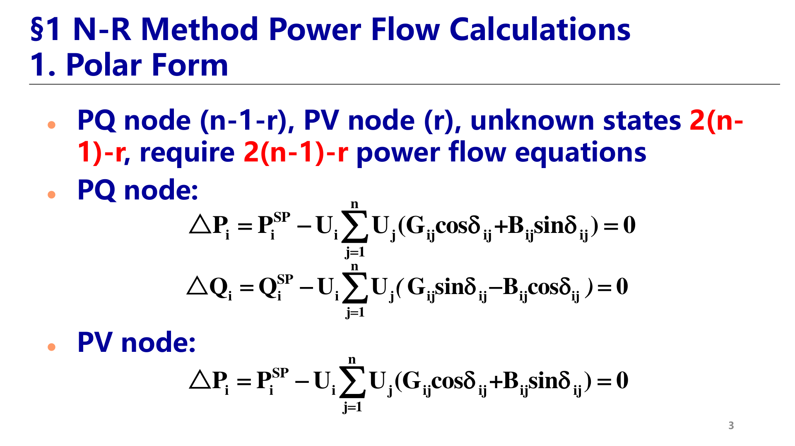

### 为什么使用相对电压修正 / Relative Voltage Corrections

Newton 线性化：$\mathbf f(\mathbf x)+\mathbf J_f\Delta\mathbf x\approx0$。课件将电压列乘以对应的 $U_j$，同时把未知修正改写成 $\Delta U_j/U_j$：

$$
\begin{bmatrix}\Delta\mathbf P\\\Delta\mathbf Q\end{bmatrix}
=-\begin{bmatrix}\mathbf H&\mathbf N\\\mathbf M&\mathbf L\end{bmatrix}
\begin{bmatrix}\Delta\boldsymbol\delta\\\Delta\mathbf U/\mathbf U\end{bmatrix}
$$

这里 $\Delta\mathbf U/\mathbf U$ 表示逐元素相除，不能把它当成矩阵除法。

$$
H_{ij}=\frac{\partial\Delta P_i}{\partial\delta_j},\quad
N_{ij}=U_j\frac{\partial\Delta P_i}{\partial U_j},\quad
M_{ij}=\frac{\partial\Delta Q_i}{\partial\delta_j},\quad
L_{ij}=U_j\frac{\partial\Delta Q_i}{\partial U_j}
$$

- **这是等价缩放**，尚未引入 PQ 分解近似。
- 因为这里对“给定值减计算值”的残差求导，修正方程前有负号。若改用计算功率的 Jacobian，矩阵符号整体相反。
- 解出 $\boldsymbol\eta=\Delta\mathbf U/\mathbf U$ 后，应先恢复 $\Delta U_i=U_i\eta_i$，再更新 $U_i$；相角修正按**弧度**计算。

**English:** Scaling the voltage columns is exact. Keep the residual convention and the leading minus sign consistent.

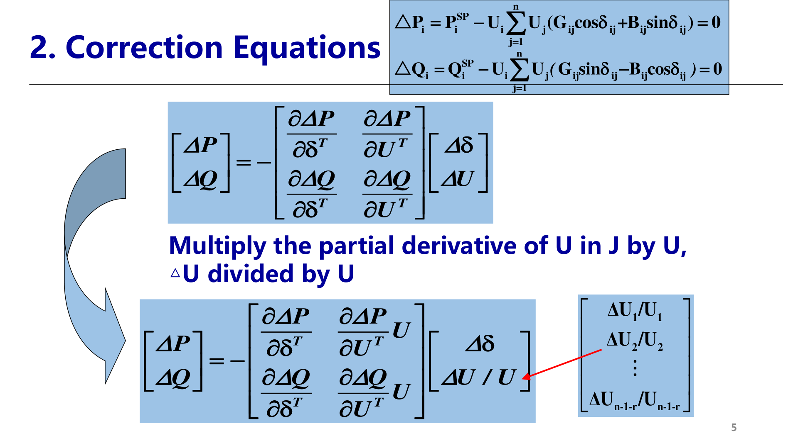

## 2. 极坐标 Jacobian / Polar Jacobian (P6–P8)

### 子矩阵维数 / Block Dimensions

| 子阵 / Block | 维数 / Dimension | 耦合关系 / Coupling |
|---|---|---|
| $H$ | $(n-1)\times(n-1)$ | $P$–$\delta$ |
| $N$ | $(n-1)\times m$ | $P$–$U$ |
| $M$ | $m\times(n-1)$ | $Q$–$\delta$ |
| $L$ | $m\times m$ | $Q$–$U$ |

### 元素公式 / Element Formulas

下表的 $P_i,Q_i$ 都是**本轮电压下的计算注入功率**，不是给定量；$N,L$ 已计入列缩放 $U_j$。

| 子阵 | 对角元 $j=i$ | 非对角元 $j\ne i$ |
|---|---|---|
| $H$ | $Q_i+U_i^2B_{ii}$ | $-U_iU_j(G_{ij}\sin\delta_{ij}-B_{ij}\cos\delta_{ij})$ |
| $N$ | $-P_i-U_i^2G_{ii}$ | $-U_iU_j(G_{ij}\cos\delta_{ij}+B_{ij}\sin\delta_{ij})$ |
| $M$ | $-P_i+U_i^2G_{ii}$ | $U_iU_j(G_{ij}\cos\delta_{ij}+B_{ij}\sin\delta_{ij})$ |
| $L$ | $-Q_i+U_i^2B_{ii}$ | $-U_iU_j(G_{ij}\sin\delta_{ij}-B_{ij}\cos\delta_{ij})$ |

**推导示例 / Example**：对 $\Delta P_i=P_i^{sp}-P_i$，当 $j\ne i$ 时 $\partial\delta_{ij}/\partial\delta_j=-1$，所以

$$
\frac{\partial\Delta P_i}{\partial\delta_j}
=-U_iU_j(G_{ij}\sin\delta_{ij}-B_{ij}\cos\delta_{ij})
$$

对角元不能直接令非对角公式中的 $j=i$ 得到：$U_i$ 同时出现在求和外、求和内，$\delta_{ii}=0$ 恒定，必须重新求导。

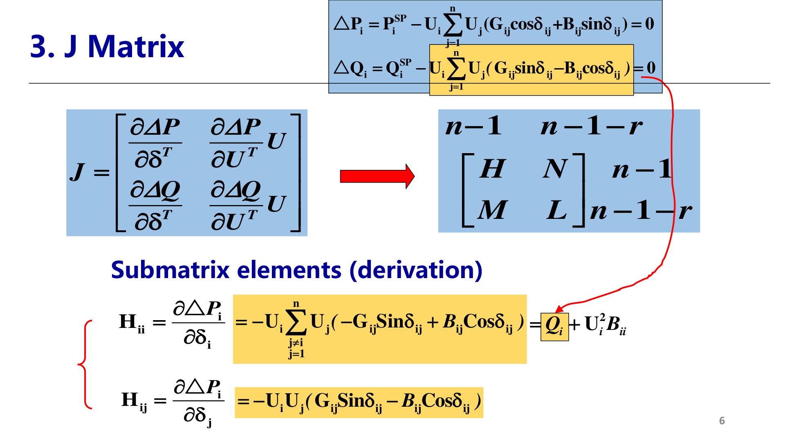

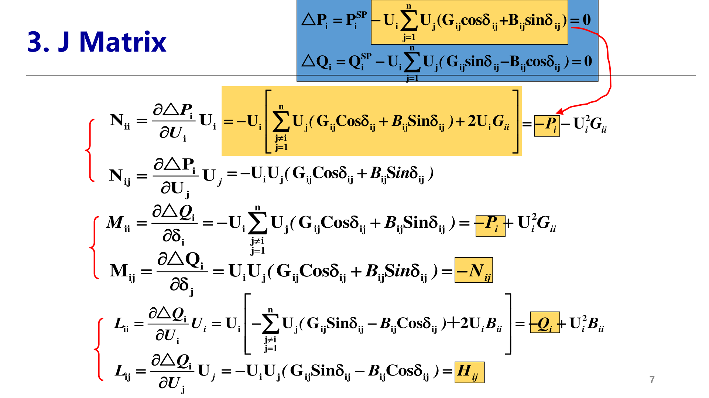

- 在共同存在的非对角位置，$M_{ij}=-N_{ij}$、$L_{ij}=H_{ij}$；**不代表四个完整子阵彼此相等**，它们的维数也可能不同。
- 完整 Jacobian 一般不对称，随每轮电压改变；稀疏结构由网络连接决定。
- 平启动取非平衡节点相角为 0、PQ 电压为 1 pu；PV 幅值使用给定值。
- 实现时解线性方程 $J\Delta x=-f$，无需显式形成 $J^{-1}$。课件写“求逆”是数学表达。

**English:** The polar Jacobian is generally nonsymmetric and state dependent. Solve a linear system rather than explicitly forming its inverse.

## 3. 从 N-R 到 PQ 分解 / From Newton-Raphson to Fast Decoupling (P9–P15)

### 第一步：忽略弱耦合 / Step 1: Neglect Weak Coupling

高压输电网络通常满足 $R\ll X$，正常运行时有功主要随相角变化，无功主要随幅值变化。将弱耦合块 $N,M$ 近似置零：

$$
\Delta\mathbf P\approx-\mathbf H\Delta\boldsymbol\delta,\qquad
\Delta\mathbf Q\approx-\mathbf L(\Delta\mathbf U/\mathbf U)
$$

原来的一个大方程组变成 $P$–$\delta$、$Q$–$U$ 两个较小的方程组，但此时 $H,L$ **仍随电压变化**。这里忽略的是两个交叉子块，不只是 $H,L$ 内的非对角元素。

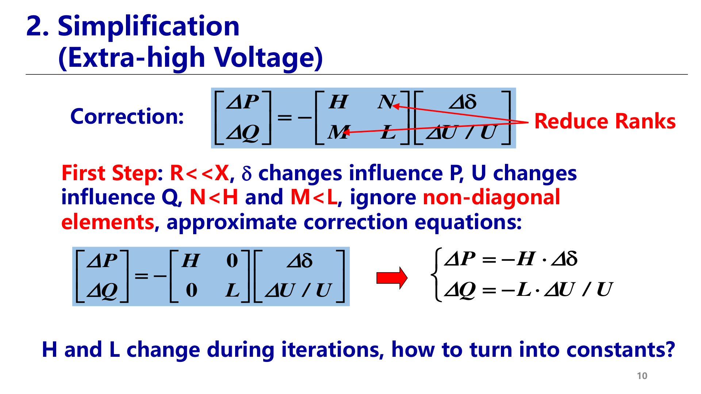

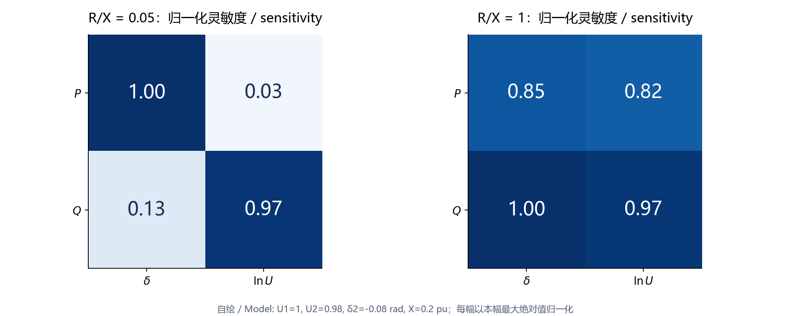

**读图 / Reading the figure**：两图使用同一电压状态，分别除以各自最大灵敏度。$R/X=0.05$ 时交叉项较小；$R/X=1$ 时交叉项已不可忽略。这解释了 PQ 分解为何适合高压输电网，不能直接推广到所有配电网络。颜色表示局部灵敏度，不是算法误差。

### 第二步：非对角元素近似 / Step 2: Off-Diagonal Approximation

对相邻节点取 $\cos\delta_{ij}\approx1$、$G_{ij}\sin\delta_{ij}\ll B_{ij}\cos\delta_{ij}$：

$$
H_{ij}\approx U_iU_jB_{ij},\qquad L_{ij}\approx U_iU_jB_{ij},\qquad i\ne j
$$

这里要求的是**支路两端相角差小**，不是全网所有节点相角都必须接近零。

### 第三步：对角元素近似 / Step 3: Diagonal Approximation

若 $|Q_i|\ll|U_i^2B_{ii}|$，则

$$
H_{ii}=Q_i+U_i^2B_{ii}\approx U_i^2B_{ii},\qquad
L_{ii}=-Q_i+U_i^2B_{ii}\approx U_i^2B_{ii}
$$

**为什么可以这样比较？** $Q_i$ 是节点净无功注入，各支路项会相互抵消；$U_i^2|B_{ii}|$ 更接近该节点所有连接支路的电纳尺度，通常较大。这个近似必须比较绝对值：感性网络的 $B_{ii}$ 常为负。

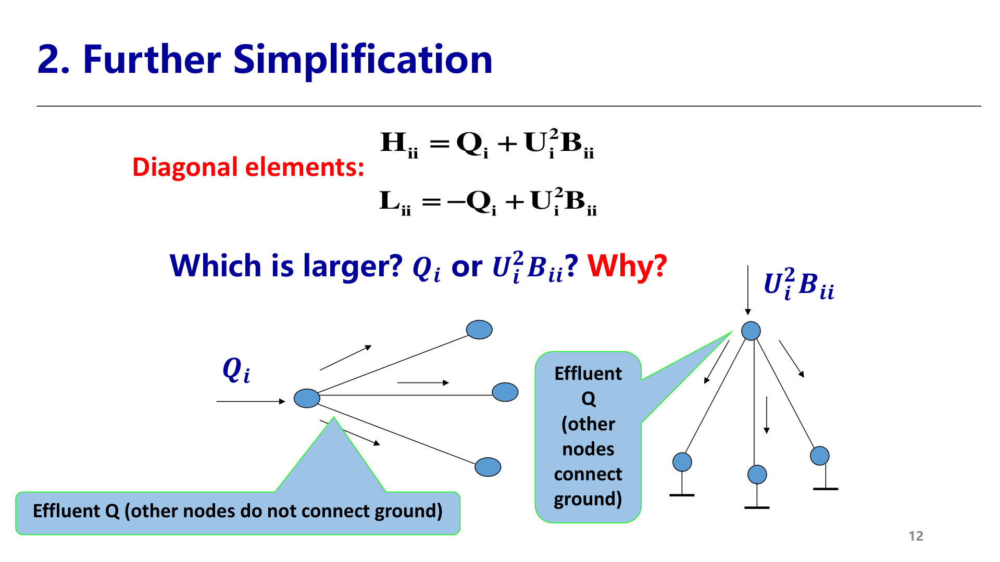

### 从电压因子到常数矩阵 / Constant Matrices

令 $D_U=\operatorname{diag}(U_i)$，在相应节点集合上有

$$
H\approx D_U B' D_U,\qquad L\approx D_{U,PQ}B''D_{U,PQ}
$$

于是

$$
\Delta\mathbf P/\mathbf U\approx-B'D_U\Delta\boldsymbol\delta,\qquad
\Delta\mathbf Q/\mathbf U\approx-B''\Delta\mathbf U
$$

再利用正常运行下 $U_i\approx1$ pu，将有功修正右侧的 $D_U$ 近似省去，得到课件采用的常数系数修正方程：

$$
\boxed{B'\Delta\boldsymbol\delta=-\Delta\mathbf P/\mathbf U},\qquad
\boxed{B''\Delta\mathbf U=-\Delta\mathbf Q/\mathbf U}
$$

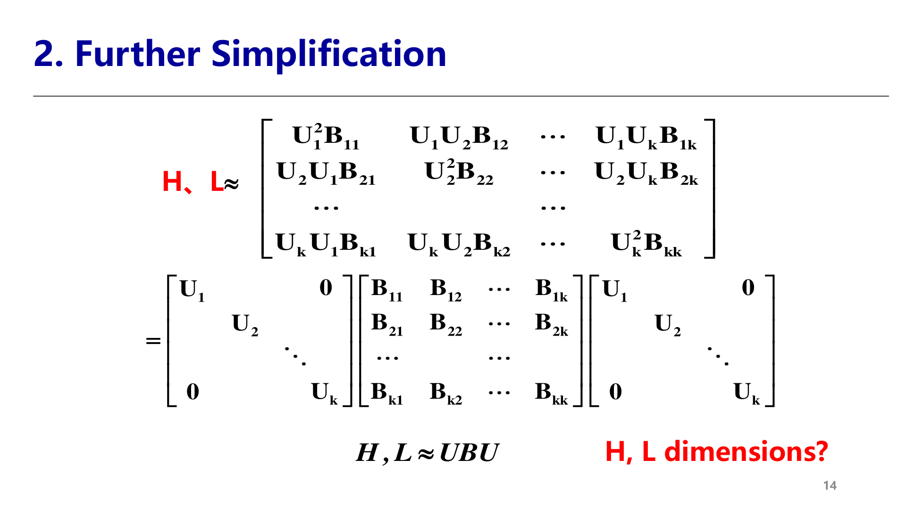

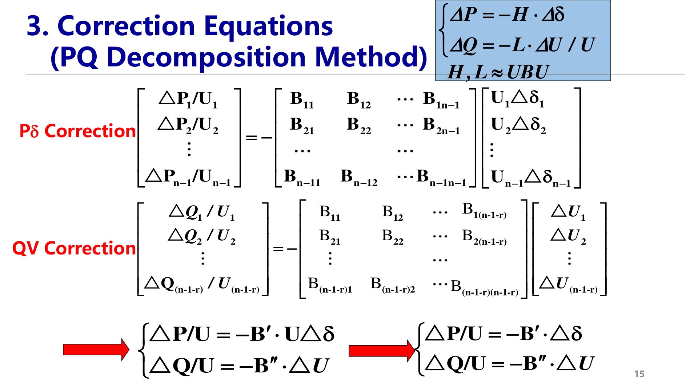

| 矩阵 | 保留的行列 / Retained buses | 维数 |
|---|---|---|
| $B'$ | 所有非平衡节点，包括 PV | $(n-1)\times(n-1)$ |
| $B''$ | 仅 PQ 节点 | $m\times m$ |

在本讲简单模型中，它们由 $\operatorname{Im}(Y)$ 的相应约化矩阵构造。**删去某节点行列时，保留节点的原自电纳仍含与被删节点相连支路的贡献**；不是把相关支路从物理网络中拆掉。更一般实现对并联支路、变比等可采用不同近似，复现时必须说明选用的 $B',B''$。

本页使用 $B_{ii}<0$ 的电纳符号，故方程右侧带负号。有些资料定义正对角矩阵 $\widehat B=-B$，则写成 $\widehat B\Delta x=\Delta S/U$；两种写法等价。

**English:** Decoupling removes weak blocks, while further approximations make the correction matrices constant. Matrix signs depend on how susceptance is defined.

## 4. 迭代流程、精度与适用性 / Iteration, Accuracy and Applicability (P16–P18)

一次交替迭代可以这样执行：

1. 建立 $Y$，确定 PQ/PV/平衡节点；构造并分解 $B',B''$。
2. 用当前电压计算**完整非线性** $P_i(U,\delta),Q_i(U,\delta)$ 和残差。
3. 解 $B'\Delta\delta=-\Delta P/U$，更新非平衡节点相角。
4. 用新相角重新计算 $\Delta Q$，解 $B''\Delta U=-\Delta Q/U$，更新 PQ 幅值。
5. 重新计算完整残差，判断 $\max(|\Delta P|,|\Delta Q|)<\varepsilon$；否则重复。
6. 收敛后计算平衡节点功率、PV 无功、支路功率与损耗，并检查运行约束。

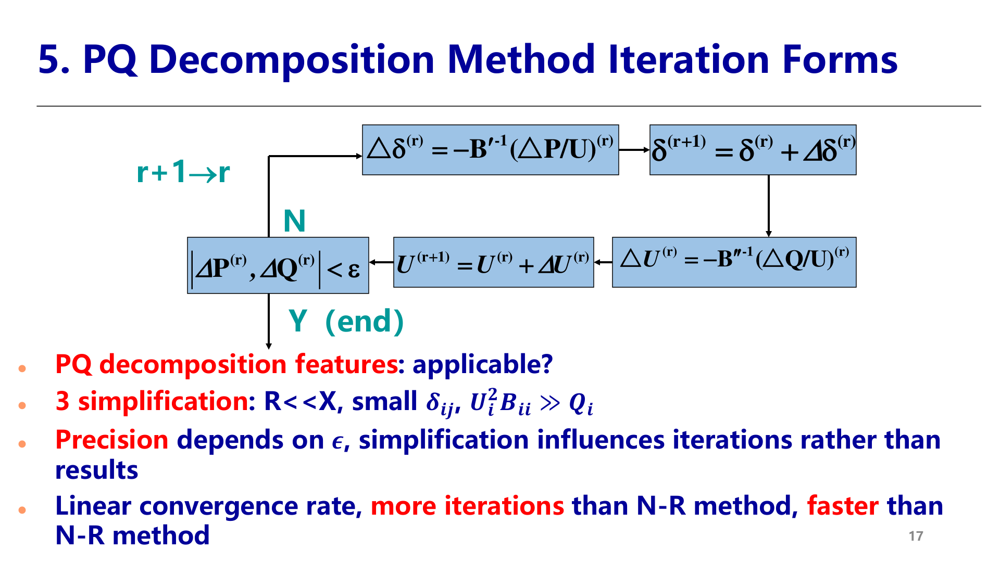

**近似了修正矩阵，为什么仍可能得到准确解？** 因为每轮检查的仍是原始潮流方程 $f(x)=0$。近似决定“下一步往哪里走”，残差决定“是否到达原方程的解”。在确实收敛且满足相同残差容差的前提下，PQ 分解可得到与 N-R 一致的潮流解；不能据此承诺总会收敛到同一分支，或把残差容差等同于电压误差上界。

| 方法 | 每步工作 | 局部收敛特点 | 主要限制 |
|---|---|---|---|
| 完整 N-R | 重算 Jacobian 并求解 | 常规非奇异解附近二阶 | 初值、每步分解成本 |
| PQ 分解 | 重用常数矩阵分解，重算功率残差 | 通常线性，步数可能更多 | 高 $R/X$、大相角差、低电压等削弱近似 |

固定网络、固定节点类型时，矩阵可反复复用；拓扑变化或 PV/PQ 转换后，需要更新对应矩阵和维数。常数矩阵的对称性还要求相应网络模型对称，不能无条件推广到含移相等非对称模型。

**English:** The approximate matrix changes the iteration path. The original nonlinear mismatch remains the convergence test.

## 5. 两节点算例与核算 / Two-Bus Example (P19–P22)

### 节点分类与网络矩阵 / Bus Types and Admittance

课件给定 $\dot S_{D1}=20+j10$、$\dot S_{D2}=19+j10$、$\dot S_{G2}=15+j10$，$\dot U_1=1\angle0$，均按课件统一标幺口径。

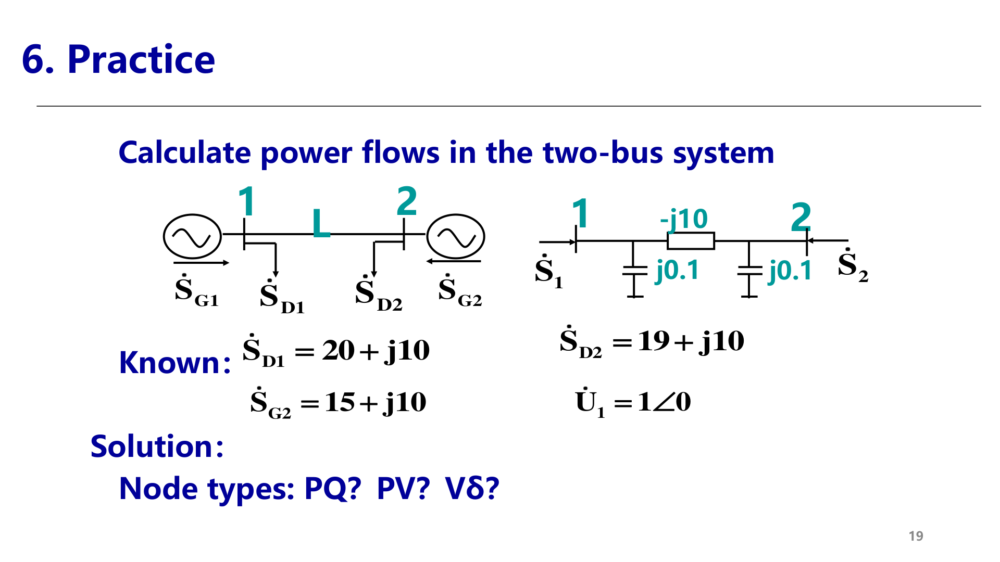

- 节点 1：给定电压幅值、相角，是平衡节点。
- 节点 2：净注入 $\dot S_2=\dot S_{G2}-\dot S_{D2}=-4+j0$，是 **PQ 节点**。有发电机不等于一定是 PV 节点。
- 图中的 $-j10$ 是**串联导纳**，不是阻抗；对应串联电抗 $j0.1$。两端并联导纳各为 $j0.1$。

$$
Y=\begin{bmatrix}-j9.9&j10\\j10&-j9.9\end{bmatrix},\qquad
B'=B''=[-9.9]
$$

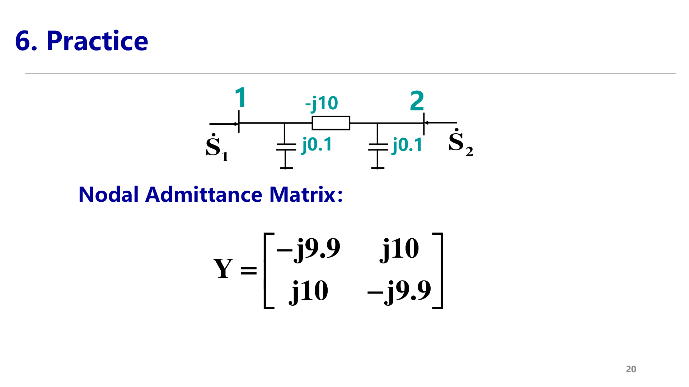

### 解析法 / Analytical Solution

$$
\Delta P_2=-4-10U_2\sin\delta_2=0,\qquad
\Delta Q_2=-9.9U_2^2+10U_2\cos\delta_2=0
$$

所以 $\sin\delta_2=-0.4/U_2$，$\cos\delta_2=0.99U_2$。令 $z=U_2^2$，利用 $\sin^2\delta+\cos^2\delta=1$：

$$
98.01z^2-100z+16=0
$$

两个电压根约为 $0.906427$ 和 $0.445750$ pu。本页平启动算法收敛到高电压分支：

$$
\boxed{U_2=0.90642738,\qquad\delta_2=-26.18640469^\circ}
$$

**存在多个数学根，不表示它们都满足运行约束；静态方程本身也不足以判定动态稳定性。**

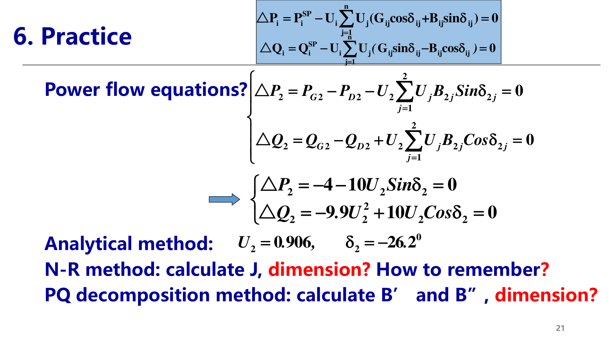

### 平衡节点与损耗 / Slack Injection and Losses

由完整方程核算：

$$
P_1=-10U_2\sin\delta_2=4,\qquad
Q_1=9.9-10U_2\cos\delta_2=1.76605511
$$

$$
P_{G1}=P_1+P_{D1}=24,\qquad Q_{G1}=Q_1+Q_{D1}=11.76605511
$$

线路无电阻，所以 $P_1+P_2=0$；串联电抗及两端充电电纳合计的净无功吸收为 $Q_1+Q_2=1.76605511$。课件 P22 写 $Q_1\approx1.73$，与 P20–P21 的参数、方程不完全一致；本页数值以原方程回代为准。

### 改为 PV 节点会发生什么 / Converting Bus 2 to PV

若保持 $P_2=-4$，把 $U_2$ 控制为 1，同时放开 $Q_{G2}$：

$$
\delta_2=-\arcsin(0.4)=-23.57818^\circ,\qquad
Q_2=9.9-10\cos\delta_2=0.73484861
$$

因此 $Q_{G2}=Q_2+Q_{D2}=10.73484861$，需检查机组能否提供该无功。此时只有一个相角未知量：极坐标 N-R 为 $1\times1$；$B'$ 为 $1\times1$，$B''$ 不再有未知量，**不需要求解无功幅值子系统**。

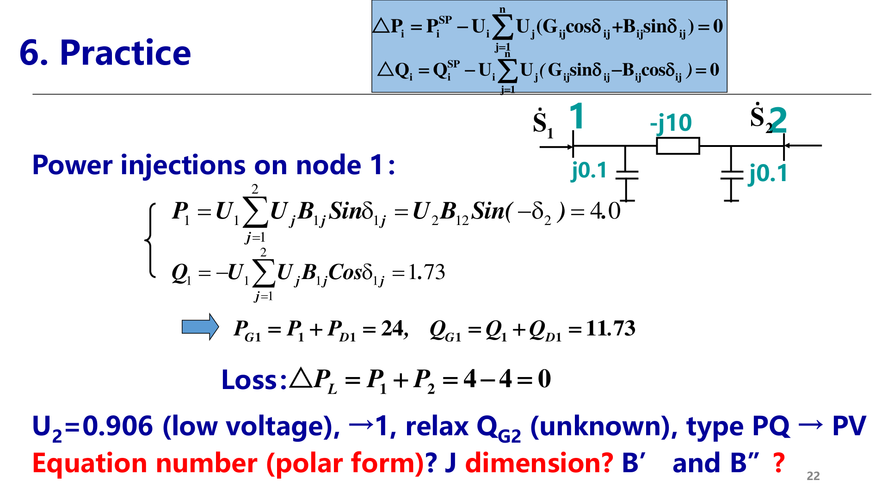

### 自绘：相同解，不同收敛速度 / Same Root, Different Convergence

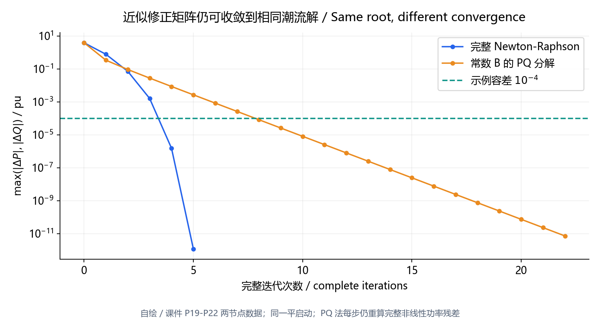

同一初值 $U_2^{(0)}=1,\delta_2^{(0)}=0$，PQ 法取 $B'=B''=-9.9$，每次相角更新后重算无功残差。以残差小于 $10^{-11}$ 为停止条件：完整 N-R 5 次、PQ 分解 22 次，两者均得到上述解。这只是本算例的**迭代次数**比较；小系统不能据此判断运行耗时，PQ 法的优势通常来自大系统中重复利用矩阵分解。

## 6. 四节点课件算例 / Four-Bus Slide Example (P23–P29)

与第 8 讲相同：节点 1、2 为 PQ；节点 3 为 PV，$P_3=0.5,U_3=1.1$；节点 4 平衡，$U_4=1.05\angle0$。因此 $B'$ 为 $3\times3$，$B''$ 为 $2\times2$。

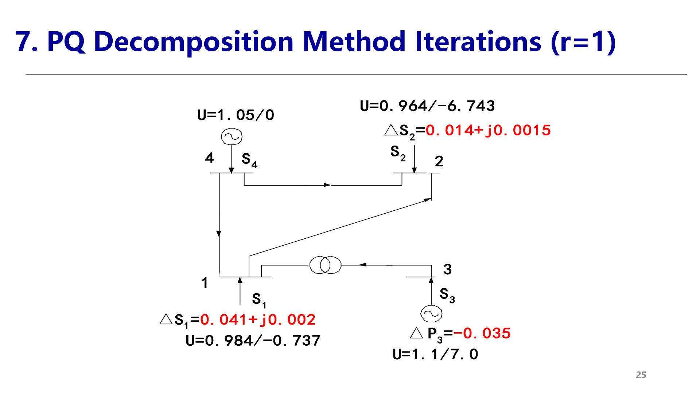

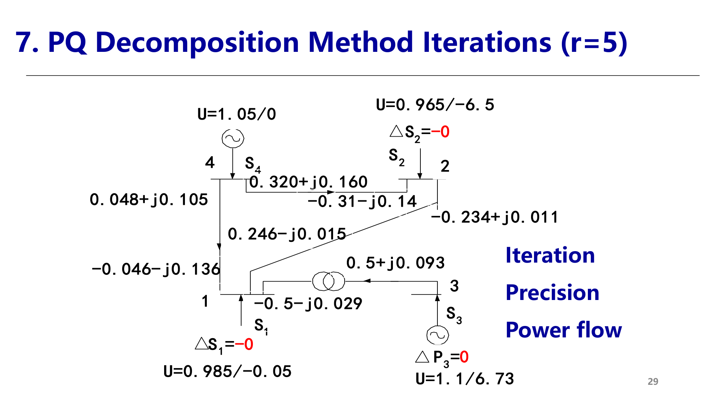

课件给出最终幅值约 $U_1=0.985,U_2=0.965,U_3=1.1$，说明 PV 幅值始终固定、PQ 幅值通过迭代求出。中间页与末页个别相角标注不连贯，图中功率又经过舍入；这里保留原图说明算法流程，精确收敛曲线使用上一节可独立复算的两节点数据。

## 源与范围 / Source and Scope

- 源文件 / Source: `09-EN第三章电力系统潮流分析与计算.pdf`，Chapter 3, Lecture 4。
- 范围 / Scope: P1–P29；正文覆盖 P3–P29 的公式、近似、课堂算例与问题。
- 课件截图 / Original slides: 74–88；每张图的图注均标明原页码，完整映射见 [slide_sources.json](./绘图/slide_sources.json)。
- 自绘 / Supplementary figures: Jacobian 耦合热图、两节点收敛曲线；模型与参数见图下说明。
- 复现 / Reproduction: [generate_figures.py](./绘图/generate_figures.py)，计算结果见 [calculated_results.json](./绘图/calculated_results.json)。运行 `python 绘图/generate_figures.py` 可重绘全部补充图。

相关 / Related: [第8讲 实数潮流方程与求解方法](./第8讲-实数潮流方程与求解方法.md) · [第10讲 无功功率与电压调节](./第10讲-无功功率与电压调节.md)
