Speed: $\omega_m$ (rad/s) $\rightarrow f_m = \frac{\omega_m}{2\pi} \cdot n$ (per min) $\rightarrow n_m = 60 f_m$, $1 \text{ RPM} = \frac{\pi}{30} \text{ rad/s}$

Torque: Torque is counterclockwise!
**$\vec{\tau} = \vec{F} \times \vec{r} = J \cdot \vec{\alpha}$** $\swarrow$ $\vec{\alpha} = \frac{d\vec{\omega}}{dt}$
$\tau = F \cdot r \cdot \sin\theta$

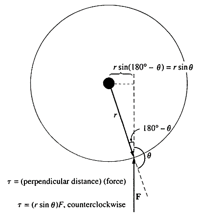

Work: **$W = \int_{\theta_1}^{\theta_2} \tau d\theta = \tau \cdot \theta$**

Power: **$P = \frac{dW}{dt} = \tau \frac{d\theta}{dt} = \tau \cdot \omega$**

watts & horsepower: $1 \text{ hp} = 746 \text{ W}$

The magnetic field:

$\oint_c \vec{H} \cdot d\vec{l} = \int_s \vec{J} \cdot d\vec{a} = I_{net}$   - Ampere's Law

$\oint_s \vec{B} \cdot d\vec{a} = 0$                      - MF's Gausses' Law

$\Rightarrow$ To simplify, we have a 1-D circuit equivalent of MF:
    **Magnetic circuit**

---

## § Simple Magnetic Circuit

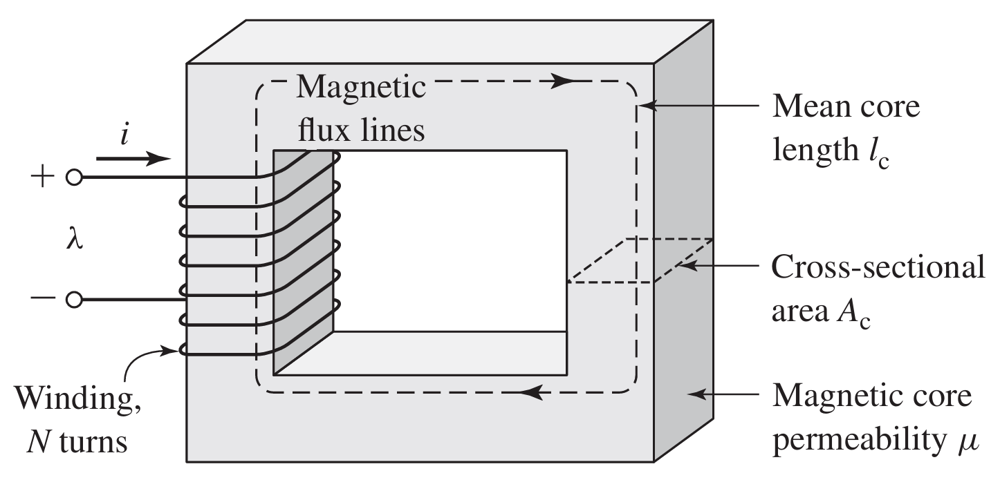

For a really high $\mu$: magnetic flux will be confined to the paths defined by the structure.
Thus, we can use magnetic circuit to simplify this model.

**Details:**

* The source of MF ($I_{net}$), **$\mathscr{F} = N \cdot i$**
  we call $\mathscr{F}$ as magnetomotive force (mmf)
  For multiple windings: $\mathscr{F} = N_1 \cdot i_1 + N_2 \cdot i_2 + \cdots$
* Magnetic flux: $\phi = \int_s \vec{B} \cdot d\vec{a}$ (Wb)
  Simplify as MC: **$\phi_c = B_c \cdot A_c$**
  $\phi_c$: core flux, $B_c$: core flux density
* mmf: According to Ampere's Law:
  $\mathscr{F} = I_{net} = \oint \vec{H} \cdot d\vec{l}$
  For MC: $\vec{H} \approx \vec{H}_c$, $l \approx l_c$, so:
  **$\mathscr{F} = N \cdot i = H_c \cdot l_c$** $\Rightarrow$ **$H_c = \frac{Ni}{l_c}$**
* $\vec{H}$ & $\vec{B}$: $\vec{B} = \mu\vec{H} \Rightarrow B = \mu \frac{Ni}{l_c}$

☆ **Magnetic Circuit V.S. Electric Circuit**

$\phi_c = B_c A_c = \mu \frac{Ni}{l_c} A_c$  	$\sim$	 $I = J \cdot a$

$\mathscr{F} = N \cdot i = H \cdot l$		$\sim$ 	$V = E \cdot l$

$\mathscr{R} = \frac{\mathscr{F}}{\phi_c} = \frac{l_c}{\mu A_c}$		     $\sim$	 $R = \frac{V}{I} = \rho \frac{l}{A}$

Magnetic analogue to Kirchhoff's Law:

Divergence of $\vec{B} = 0$   ($\nabla \cdot \vec{B} = 0$)

Total flux entering one node is 0.

Reluctance of MC:
Series: $\mathscr{R} = \mathscr{R}_1 + \mathscr{R}_2 + \mathscr{R}_3 + \cdots$
Parallel: $\frac{1}{\mathscr{R}} = \frac{1}{\mathscr{R}_1} + \frac{1}{\mathscr{R}_2} + \frac{1}{\mathscr{R}_3} + \cdots$

---

**The errors in MC computation:**

* There is a small fraction of the flux escapes from the core into the air. The flux outside is called **leakage flux**.
* The assumption of $l = l_c$ is not really very good, especially at corners.
* In ferromagnetic materials, the $\mu$ varies with the amount of flux already inside. Thus, the effect is always **nonlinear**.
* Air gap "fringing effect".

---

## § Magnetic Circuit with Air Gap

Provided $g$ is sufficiently small, we can analyze this as two series components.

Ignoring the leakage: $\phi_c = \phi_g = \phi$

$\mathscr{F} = Ni = \oint \vec{H} \cdot d\vec{l}= H_c l_c + H_g g = \frac{B_c}{\mu} l_c + \frac{B_g}{\mu_0} g$

$\Rightarrow$ **$\mathscr{F} = \phi (\frac{l_c}{\mu A_c} + \frac{g}{\mu_0 A_g})$**

$\Rightarrow$ verify the $\mathscr{R}$ series' law:

**$\mathscr{R} = \mathscr{R}_c + \mathscr{R}_g = \frac{l_c}{\mu A_c} + \frac{g}{\mu_0 A_g}$**

As $\mu$ is relatively much higher than $\mu_0$ ($2000 \sim 80000$ times), $\mathscr{R}_g \gg \mathscr{R}_c$

$\mathscr{R} \approx \mathscr{R}_g$, **$\phi \approx Ni \frac{\mu_0 A_g}{g}$**

---

As we mentioned before, $\mu$ in the core will change with flux inside. But with $\phi \approx Ni \frac{\mu_0 A_g}{g}$, its variation won't significantly affect the performance of MC, because the dominant $\mathscr{R}$ is that in air gap.

☆ Fringing effect: why $A_g \neq A_c$?

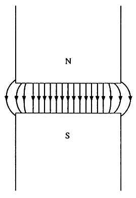

The fringing effect causes $A_g$ to increase, so there is always $A_g > A_c$.
If fringing is neglected, $A_g = A_c$.

---

## § Magnetic behavior of ferromagnetic materials
- Saturation

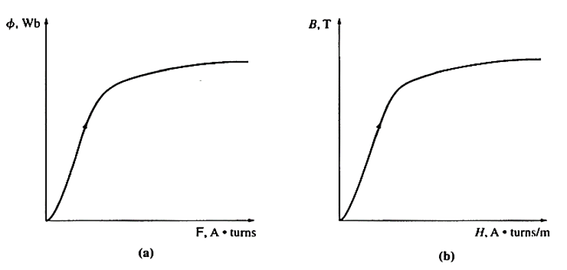

| $\phi = Ni \frac{\mu A}{l}$                 | $B = \mu H$                                 |
| ------------------------------------------- | :------------------------------------------ |
| $\mathscr{F} = Ni \uparrow, \mu \downarrow$ | $H = \frac{Ni}{l} \uparrow, \mu \downarrow$ |

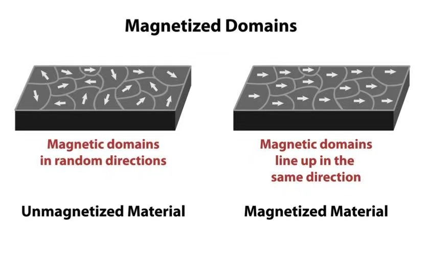

Saturation occurs when all the magnetic domains in a material are all aligned together. When the temperature reaches Curie Point ($T_c$), the domains will be reoriented and $\mu$ will decrease sharply.

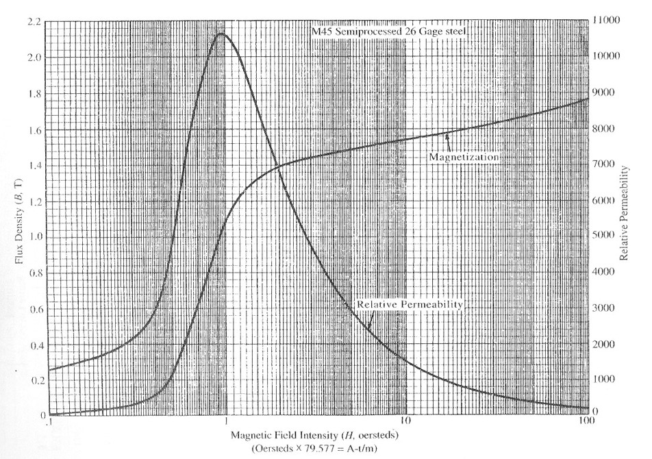

---

At first, $H \uparrow \rightarrow B \uparrow \uparrow, \mu_r \uparrow$;

Then, most of domains lined up, $\mu_r$ saturate as $\mu_{r \max}$;

Finally, $H \uparrow \uparrow \rightarrow B \uparrow, \mu_r \downarrow$, no more domains can contribute to the increase of $B, \mu \rightarrow \mu_0, \mu_r \rightarrow 1$.

**Energy loss in ferromagnetic core**

**Hysteresis Loss**

When a ferromagnetic material is subjected into an alternating MF, $B$ always lags behind $H$, which is called Hysteresis.

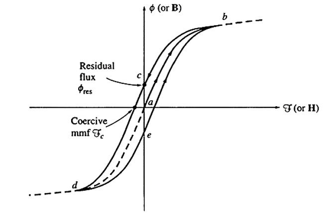

**Root causes:**

1) Friction of domain rotation;
2) Domain wall pinning (impurities, $\dots$);
   These effects above cause the process of magnetization to be irreversible.
   When $H$ removed, some domains stay aligned, creating Remanence.

**The effect of mmf on the loop**

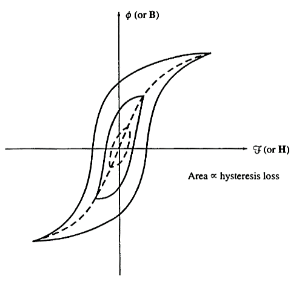

As $\mathscr{F} = Ni$ increasing, the loop grows taller and wider to reach the saturation point. This means hysteresis loss is higher as it equals to the area of the loop.

---

How to calculate Hysteresis Loss?

**$W = A_c l_m \int_{\text{one cycle}} H dB$**

$A_c$: cross-section area

$l_m$: mean magnetic path length

$A_c l_m = \text{Volume of the core}$

The integral is the area of B-H Loop.

Proof: $W = \int v(t)i(t)dt$

Faraday's Law: $v(t) = N \frac{d\Phi}{dt} = N A_c \frac{dB(t)}{dt}$

Ampere's Law: $H(t) l_m = N i(t) = \mathscr{F}$

Thus, $W = A_c l_m \int_{\text{one cycle}} H dB$ is proved.

Then, as for the power:
**$P = f \cdot A_c l_m \int_{\text{one cycle}} H dB$**

---

## § Faraday's law

Induced voltage magnitude and polarity
$$
\begin{cases}
e_i = -\frac{d\phi}{dt} \\
e_{ind} = \sum_{i=1}^{N} e_i
\end{cases}
$$
$N$: turns of wires

$\phi$: flux passing through coils

$\Rightarrow$ **$e_{ind} = -N \frac{d\phi}{dt}$**

Polarity - Lenz's Law

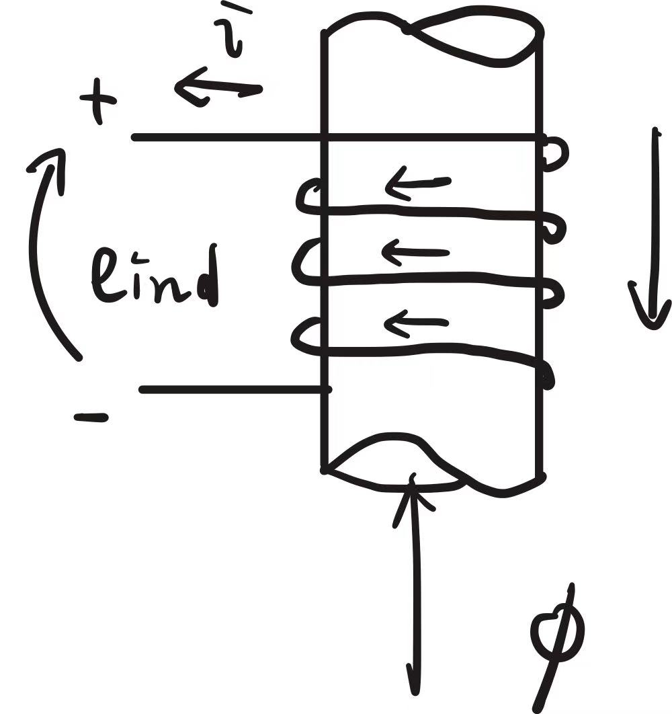

Direction of opposing flux $\phi$ increasing.

---

**Flux and flux linkage**

For $e_{ind} = N \frac{d\phi}{dt} = \frac{d(N\phi)}{dt}$, the term in parentheses is called the flux linkage $\lambda$ of the coil.

Thus:

**$e_{ind} = \frac{d\lambda}{dt}$**, where **$\lambda = \sum_{i=1}^{N} \phi_i$**

Unit of $\lambda$: Wb (or Weber-turns)

Produce an induced force on a wire

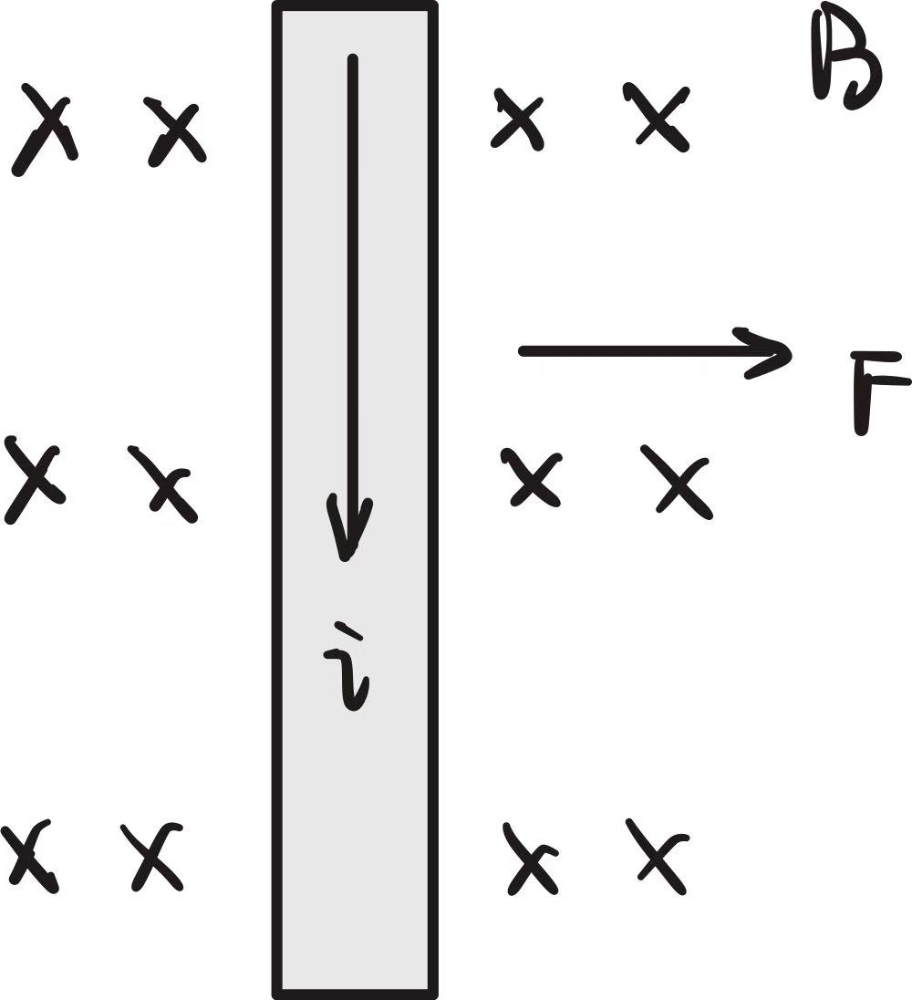

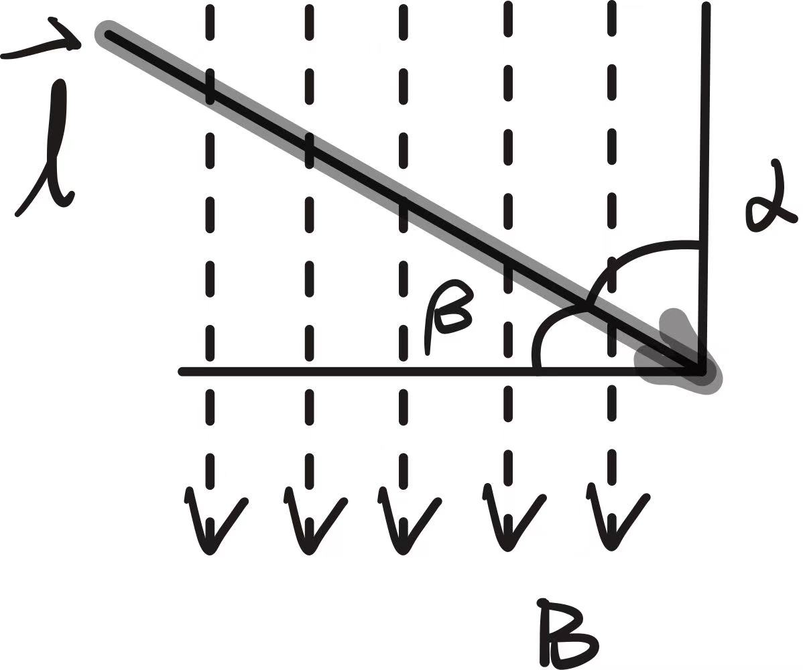

**$\vec{F} = i(\vec{l} \times \vec{B})$**
$F = i l B \sin\alpha$

---

**Flux bunching**

flux flowing in the same direction are the same polarity and repel each other. flux flowing in the opposite direction are of opposite polarity and attract each other.

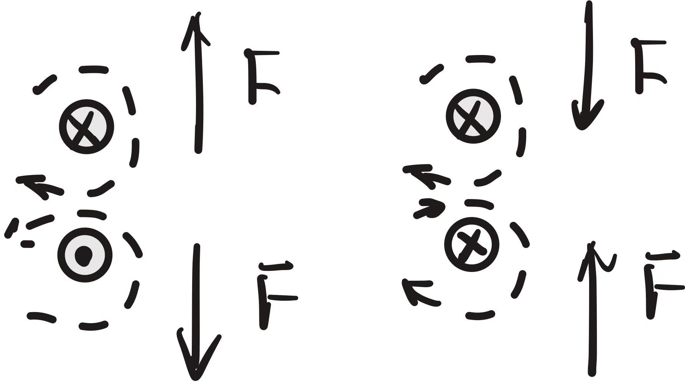

**Flux refuses to bunch!**

Application of flux bunching

Motor Action

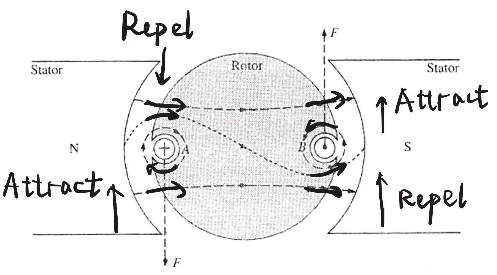

Counterclockwise rotation is generated from flux bunching.

---

## § Torque using a simplified diagram

$d$: distance between the center of the shaft and the center of conductor.

For each coil side:  $F = B i l \cos \beta$ 

(Considering Radial MF)

Torque: $T_D = 2 F d = 2 B i l d \cos\beta$ (N·m)

---

## § The Linear DC machine

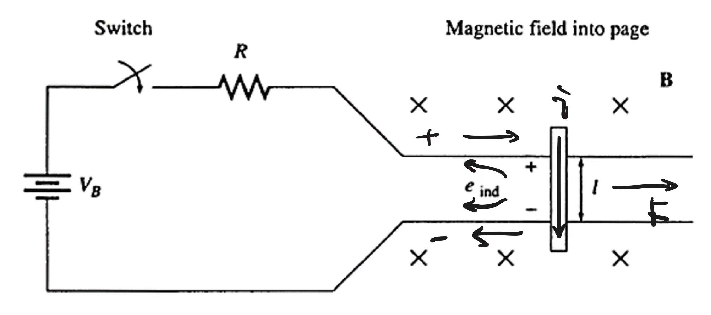

$\vec{F} = i(\vec{l} \times \vec{B})$

The voltage induced on a wire moving in B:

$e_{ind} = (\vec{v} \times \vec{B}) \cdot \vec{l}$

Thus:
$$
\begin{cases}
V_B = e_{ind} + iR = 0 \\
F_{net} = ma
\end{cases}
$$
$i = \frac{V_B - B l v}{R}$, $F = B i l = ma$

$v \uparrow, i \downarrow, a \downarrow, v \rightarrow v_{ss}$

**$v_{ss} = V_B / B l$**

---

**Linear DC motor while a load is applied**

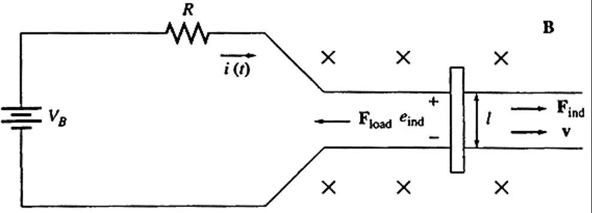

$P_{conv} = e_{ind} \cdot i = F_{ind} v$

A force $F_{load}$ is applied opposite to $\vec{v}$ and $F_{net}$ is negative now.

$v \downarrow$, $e_{ind} = B l v \downarrow$, $i \uparrow$, $F_{ind} \uparrow$

until $F_{ind} = F_{load} = 0$

$\frac{V_B - B l v'_{ss}}{R} B l = F_{load}$

$\Rightarrow$ **$v'_{ss} = \frac{B L V_B - F_{load} R}{B^2 l^2} = v_{ss} - \frac{F R}{B^2 l^2}$**

---

**Sinusoidal current flow from motion**

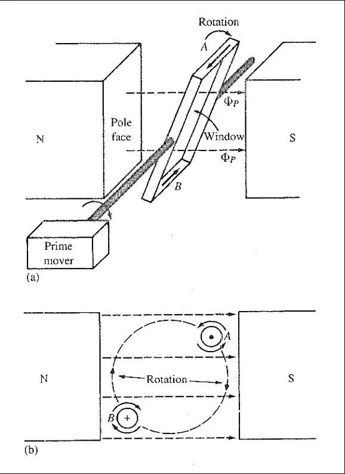
