**Types and construction**

* Core-form:
  consists a simple rectangular laminated piece of steel with the transformers windings wrapped around two sides.

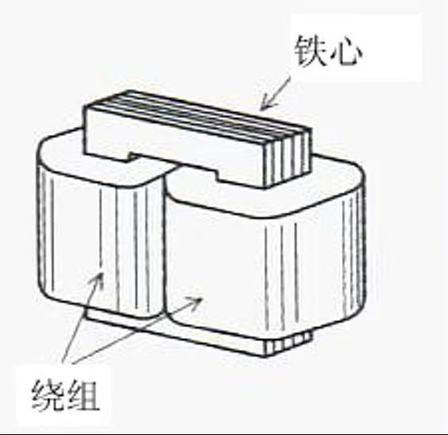

* Shell-form:
  consists three legs laminated core with winding wrapped around the center leg.

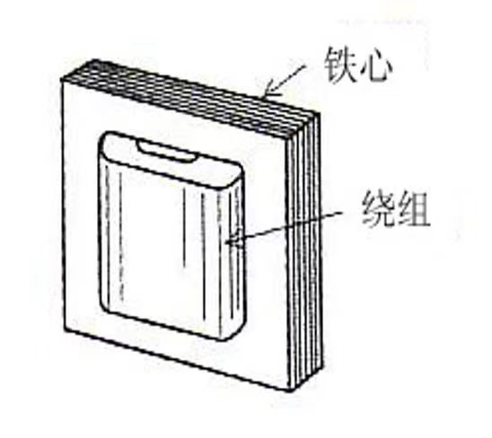

---

* Primary winding or input winding:
  The winding connected to the power source.
* Secondary winding or output winding:
  The winding connected to the loads.

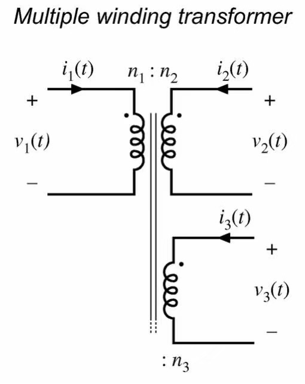

* Core material and eddy current:
  The core is constructed of thin laminations electrically isolated from each other in order to minimize the eddy current.
* Eddy current:

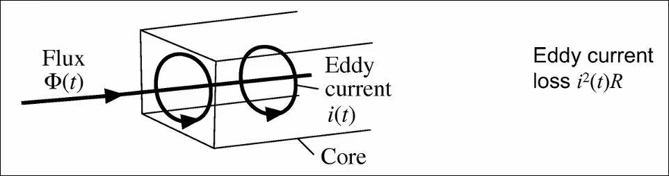

---

## § Ideal Transformer
* **Assumptions**

  **Neglect:** Leakage flux, copper losses, hysteresis losses, eddy-current losses.

* **Characteristics**

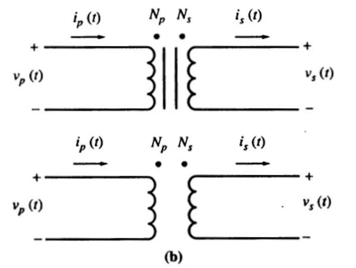

$\frac{v_p(t)}{v_s(t)} = \frac{N_p}{N_s} = a$

Energy balance:

$N_p i_p(t) = N_s i_s(t)$

$\frac{i_p(t)}{i_s(t)} = \frac{N_s}{N_p} = \frac{1}{a}$

Phasor relation:

$\frac{\dot{V}_p}{\dot{V}_s} = a$, $\frac{\dot{I}_p}{\dot{I}_s} = \frac{1}{a}$

The turns ratio $a$ only effects the magnitude not the angle.

---

* **Dot convention**

  If the primary current flows into the dotted end of the primary winding, the secondary current will flow out of the dotted end of the secondary winding.

* **Power**

  $P_{in} = V_p I_p \cos\theta_p$, $P_{out} = V_s I_s \cos\theta_s$
  
  Since the transformer can't change the angles, the primary and secondary windings have the same power factor.
  
  Power, reactive power, apparent power are all the same for input and output.
  
  $P_{in} = P_{out}$, $Q_{in} = Q_{out}$, $S_{in} = S_{out}$

---

* **Impedance transformation**

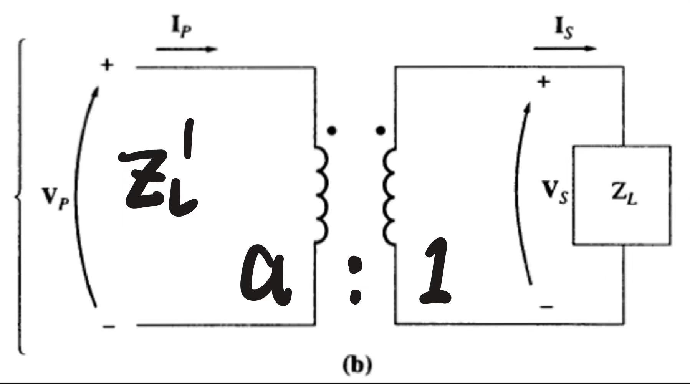

  $\dot{V}_p = a \dot{V}_s$

  $\dot{I}_p = \frac{1}{a} \dot{I}_s$

  $\dot{Z}'_L = \frac{\dot{V}_p}{\dot{I}_p} = a^2 \frac{\dot{V}_s}{\dot{I}_s}$

  $\Rightarrow$ **$\dot{Z}'_L = a^2 Z_L$**

---

**Transformer Quantities**

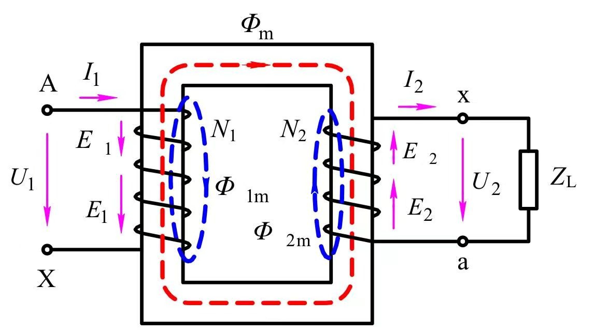

**Reference Direction**

* Current, Voltage, Flux and EMF

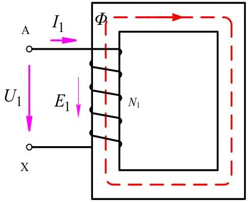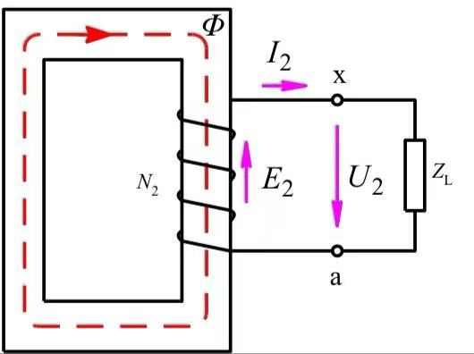

* Current, Flux

* EMF, Mutual Flux

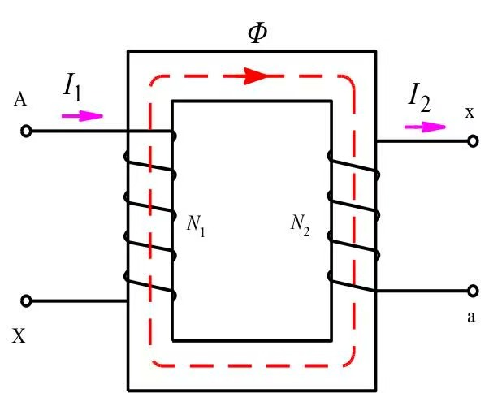

---

## § No load operation of transformers

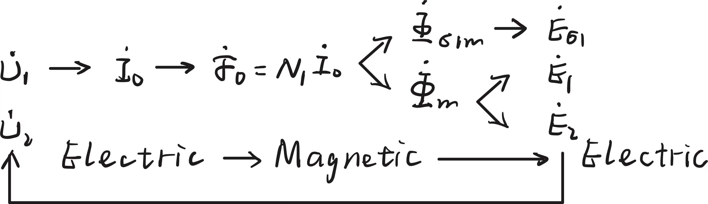

Mutual Magnetic Flux:

$\phi = \Phi_m \sin\omega t$, $\Phi_m$: Wb, $\omega$: rad/s

Induced EMF by Mutual Flux:

$e_1 = -N_1 \frac{d\phi}{dt}$, $e_2 = -N_2 \frac{d\phi}{dt}$

Emf on Primary winding:

$e_1 = -\omega N_1 \Phi_m \cos\omega t = E_{1m} \sin(\omega t - 90^\circ)$

Emf on Secondary winding:

$e_2 = -\omega N_2 \Phi_m \cos\omega t = E_{2m} \sin(\omega t - 90^\circ)$

---

Emf Phasor:

$\dot{E}_1 = -j \frac{1}{\sqrt{2}} \omega N_1 \dot{\Phi}_m = -j \sqrt{2} \pi \omega N_1 \dot{\Phi}_m$

**$\dot{E}_1 = -j 4.44 f N_1 \dot{\Phi}_m$**

Thus,

**$\dot{E}_2 = -j 4.44 f N_2 \dot{\Phi}_m$**

Neglecting leakage and losses:

$\dot{U}_1 = -\dot{E}_1 = j 4.44 f N_1 \dot{\Phi}_m = Z_m \cdot \dot{I}_0$

---

## § Loaded operation of transformers

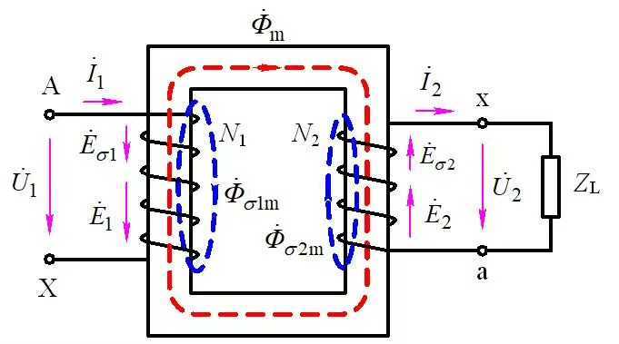

$\dot{E}_1 = -j \frac{1}{\sqrt{2}} \omega N_1 \Phi_m = -j 4.44 f N_1 \Phi_m$

$\dot{E}_2 = -j \frac{1}{\sqrt{2}} \omega N_2 \Phi_m = -j 4.44 f N_2 \Phi_m$

$\frac{\dot{E}_1}{\dot{E}_2} = \frac{N_1}{N_2} = a$

The same as no load operation.

What has changed? Mmf.
No load: $\dot{\mathscr{F}}_0 = N_1 \dot{I}_0 = \dot{\Phi}_m \mathscr{R}_m$
Loaded: $\dot{\mathscr{F}}_1 = N_1 \dot{I}_1$, $\dot{\mathscr{F}}_2 = N_2 \dot{I}_2$
$\dot{\mathscr{F}}_m = \dot{\mathscr{F}}_1 + \dot{\mathscr{F}}_2$

---

Mmf under loaded condition is similar to the Mmf under no load condition.
**$\dot{\mathscr{F}}_m = \dot{\mathscr{F}}_0 = \dot{\Phi}_m \mathscr{R}_m$**
Why?
$\Phi_m$ is determined by $\dot{E}_1$ according to $\dot{E}_1 = -j 4.44 f N_1 \Phi_m$, so $\Phi_m$ stays the same under loaded condition.
Thus, $\dot{\mathscr{F}}_m = \dot{\Phi}_m \mathscr{R}_m = \dot{\mathscr{F}}_0$.
$\Rightarrow \dot{\mathscr{F}}_1 = \dot{\mathscr{F}}_0 + (-\dot{\mathscr{F}}_2)$
$N_1 \dot{I}_1 = N_1 \dot{I}_0 - N_2 \dot{I}_2$
Primary = Source - Secondary
$\Rightarrow$ **$\dot{I}_1 = \dot{I}_0 - \frac{N_2}{N_1}\dot{I}_2 = \dot{I}_0 - \frac{1}{a}\dot{I}_2$**
   Magnetic current $\nearrow$              $\nwarrow$  Load current

---

## § Real Transformers v.s. Ideal Transformers
* Leakage flux  |  * Hysteresis losses
* Copper losses  |  * Eddy-current losses

**Voltage Relation derive from Faraday**

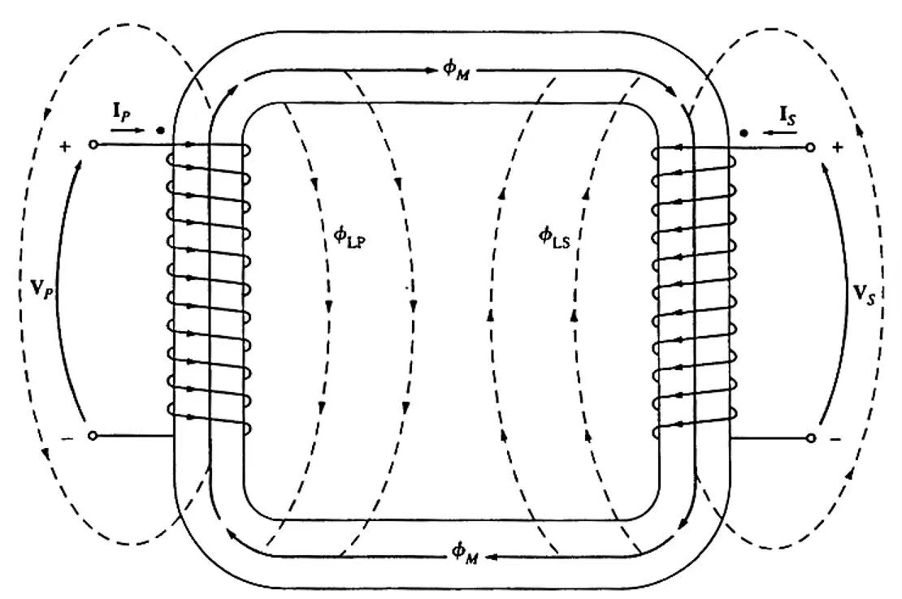

Induced voltage: 		    $\bar{\phi} = \frac{1}{N_p} \int v_p(t)dt$
Primary side flux:                    $\bar{\phi}_p = \phi_M + \phi_{LP}$
flux component linking both sides$\swarrow$            $\searrow$ primary leakage
Secondary side flux: $\bar{\phi}_S = \phi_m + \phi_{LS}$

Induced voltage on primary side:
$v_p(t) = N_p \frac{d\bar{\phi}_p}{dt} = N_p(\frac{d\phi_m}{dt} + \frac{d\phi_{LP}}{dt})$
**$v_p(t) = e_p(t) + e_{Lp}(t)$**

Induced voltage on secondary side:

$v_s(t) = N_s \frac{d\bar{\phi}_S}{dt} = N_s(\frac{d\phi_m}{dt} + \frac{d\phi_{LS}}{dt})$

**$v_s(t) = e_s(t) + e_{Ls}(t)$**

Induced by mutual flux:

Primary voltage from $\bar{\phi}_m$: $e_p(t) = N_p \frac{d\bar{\phi}_m}{dt}$

Secondary voltage from $\bar{\phi}_m$: $e_s(t) = N_s \frac{d\bar{\phi}_m}{dt}$

Notice that: $\frac{e_p(t)}{N_p} = \frac{d\bar{\phi}_m}{dt} = \frac{e_s(t)}{N_s}$

Therefore: $\frac{e_p(t)}{e_s(t)} = \frac{N_p}{N_s} = a$

Since in a well-designed transformer $\phi_m \gg \phi_{Lp}$, $\phi_m \gg \phi_{LS}$, this is approximately correct.

---

**Modeling the leakage flux by leakage inductance**

$e_{Lp}(t) = N_p \frac{d\bar{\phi}_{Lp}}{dt}$, $e_{Ls}(t) = N_s \frac{d\bar{\phi}_{Ls}}{dt}$

$\bar{\phi}_{Lp} = \mathscr{P} N_p i_p$, $\bar{\phi}_{Ls} = \mathscr{P} N_s i_s$

[for every circuit: $Ni = N_L i_L$]

$\mathscr{P} = \frac{1}{\mathscr{R}}$ : permeance of flux path

Thus, $e_{Lp}(t) = N_p^2 \mathscr{P} \frac{di_p}{dt}$

$e_{Ls}(t) = N_s^2 \mathscr{P} \frac{di_s}{dt}$

The constants can be lumped together.

Then let: $L = N^2 \mathscr{P}$

$e_L(t) = L \frac{di}{dt}$

---

## § Theory of operation of real single-phase transformers

**Secondary side open**

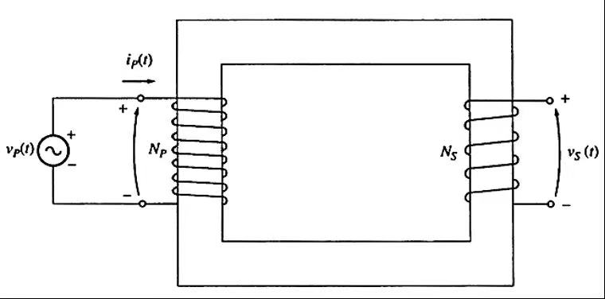

* Secondary side is open circuit.
* Input voltage and current to measure hysteresis curve.
* Flux is proportional to $v_p$ and mmf is proportional to $i_p$.
* $i_p(t) = 0$ for ideal transformer.

---

**Magnetization current in real transformers**

1. The magnetization current $i_m$ is used to generate mutual flux $\phi_M$.
2. While secondary side is opened, the current measured at primary side contains two parts and is called excitation current $i_{ex}$, which includes:

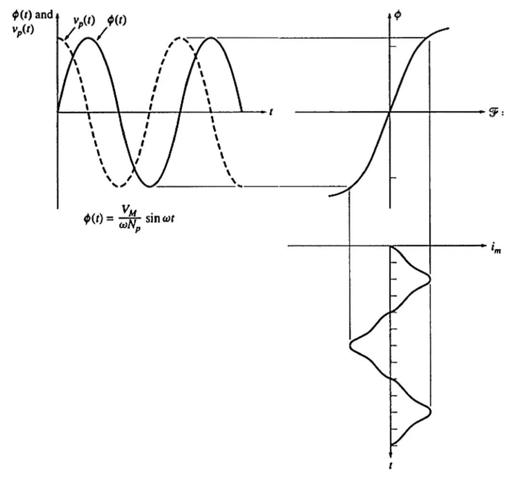

* Magnetization current $i_m$:

  To generate mutual flux.
  
* Core loss current $i_{h+e}$:

  Hysteresis and eddy current.
  
* The magnetization current in the transformer is not sinusoidal.

  The higher-frequency components are due to magnetic saturation. ($i \uparrow \uparrow \Rightarrow \phi \uparrow \rightarrow$)

* The fundamental component of $i_m$ lags the voltage applied to the core by $90^\circ$.

**Core-loss current**

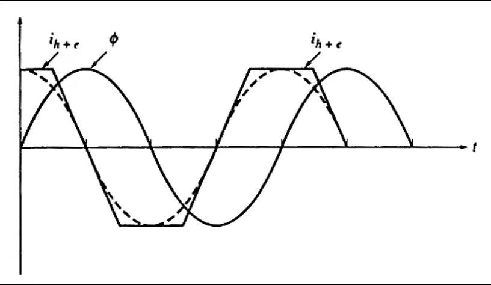

* The core-loss current $i_{h+e}$ is nonlinear because of the nonlinear effects of hysteresis.
* The fundamental component of $i_{h+e}$ is in phase with the voltage applied to the core.

**Excitation current**
We have **$i_{ex} = i_m + i_{h+e}$**, thus:

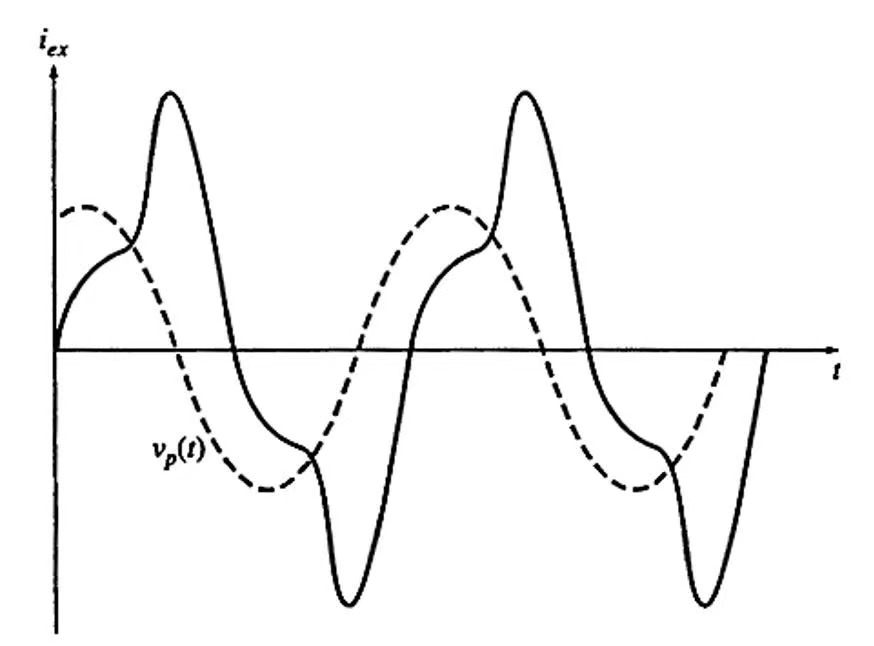

---

## § The equivalent circuit of non-ideal transformers
1> Copper losses. ($I^2R$, heating losses on windings)
2> Eddy current losses. (heating losses in the core)
3> Hysteresis losses.
4> Leakage flux. (self-inductance)

Modeling excitation current & copper losses
* **The hysteresis and eddy current** is in-phase with input voltage.

  $\Rightarrow$ Modeled as a shunt resistor **$R_c$**.
  
* **The magnetization current** is lagging input voltage by $90^\circ$.

  $\Rightarrow$ Modeled as a shunt inductor **$X_m$**.
  
* **The copper loss** can be modeled as series resistor $R_p$ and $R_s$.

---

**The resulting equivalent circuit**

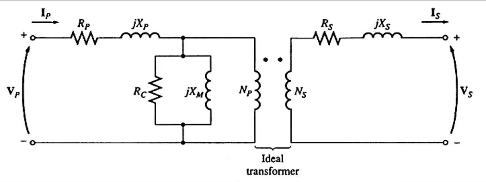

**Impedance transform to primary or secondary side**

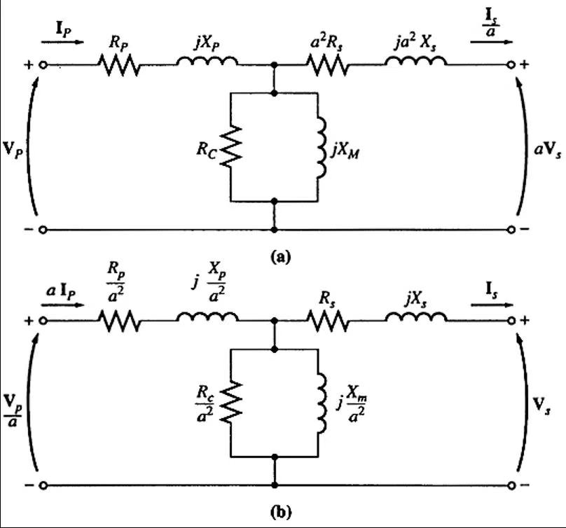

**Approximate equivalent circuit**

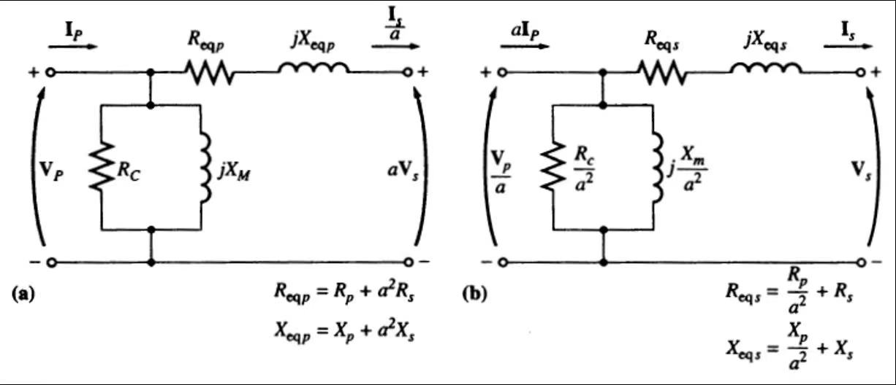

**Neglecting excitation current**

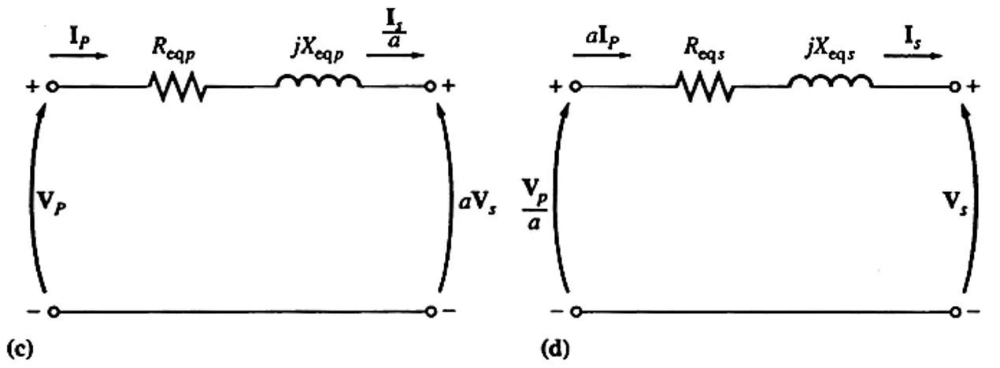

How to measure those parameters?
* **Open circuit test - excitation branch**
* **Short circuit test - series branch**

---

## § Open circuit test

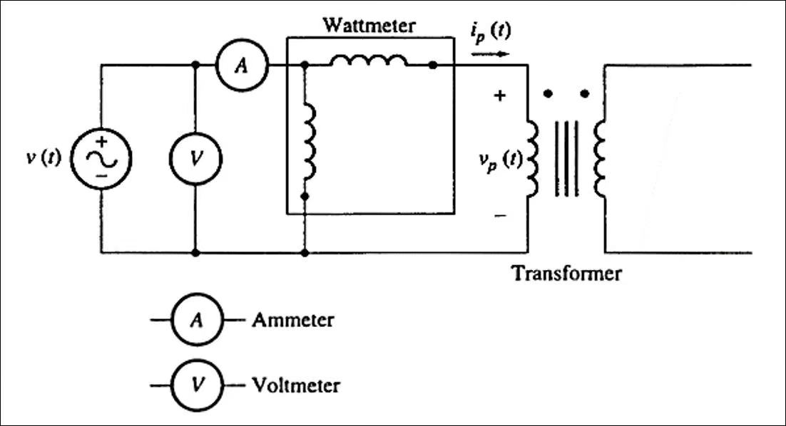

Under the open circuit condition, all the input current flows through the excitation branch.
Thus, we have:
$$
\begin{cases}
Y_E = \frac{I_{oc}}{V_{oc}} \angle -\theta \\
\theta = \cos^{-1}\frac{P_{oc}}{V_{oc} I_{oc}} \\
PF = \cos\theta = \frac{P_{oc}}{V_{oc} I_{oc}}
\end{cases}
$$

$$
Y_E = G_c - j B_M = \frac{1}{R_c} - j\frac{1}{X_M}
$$

---

## § Short circuit test

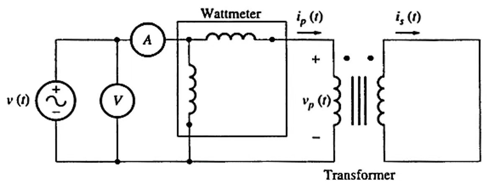

At secondary side short circuit condition, the input voltage must be very low to prevent input large short circuit current.
$$
\begin{cases}
|Z_{SE}| = \frac{V_{sc}}{I_{sc}} \\
Z_{SE} = \frac{V_{sc}}{I_{sc}} \angle \theta^\circ \\
PF = \cos\theta = \frac{P_{sc}}{V_{sc} I_{sc}}
\end{cases}
$$

$$
Z_{SE} = R_{eq} + j X_{eq}= (R_p + a^2 R_s) + j(X_p + a^2 X_s)
$$

---

## § Transformer voltage regulation and efficiency

Because a real transformer has series impedances within it, the load can influence the output voltage.

To conveniently compare transformers in this respect, we defined a quantity called voltage regulation (VR).

It's defined by the equation:

$$VR = \frac{V_{s,nl} - V_{s,fl}}{V_{s,fl}} \times 100\%$$

$V_{s,nl}$: No-load voltage of secondary side

Since at no load, $V_s = V_p / a$, thus:

$$VR = \frac{V_p/a - V_{s,fl}}{V_{s,fl}} \times 100\%$$
---

## § Transformer Phasor Diagram

To obtain the voltage regulation (VR), we use the phasor relation:
$$\frac{\vec{V}_p}{a} = \vec{V}_s + R_{eq}\vec{I}_s + j X_{eq}\vec{I}_s$$

**Phasor diagrams under different load conditions:**

* **Lagging power factor (inductive load):**
  $\vec{I}_s$ lags $\vec{V}_s$. The required primary voltage $\frac{V_p}{a}$ is significantly larger than the secondary terminal voltage $V_s$.
  
  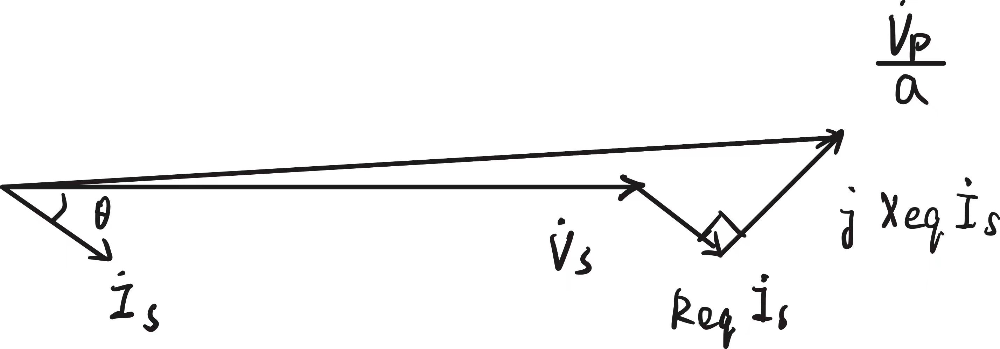

* **Unity power factor (resistive load):**
  $\vec{I}_s$ is in phase with $\vec{V}_s$. The voltage regulation is positive but smaller than the lagging case.
  
  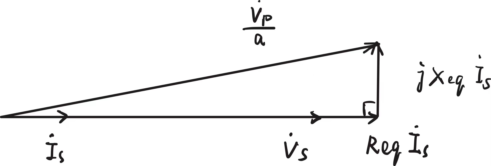
  
* **Leading power factor (capacitive load):**
  $\vec{I}_s$ leads $\vec{V}_s$. The terminal voltage $V_s$ can actually be larger than the referred primary voltage $\frac{V_p}{a}$, resulting in a negative voltage regulation.
  
  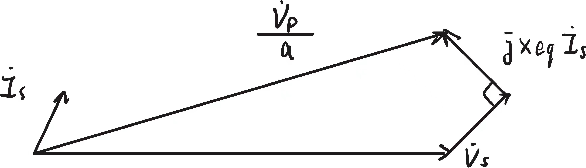
  
* **Approximation:**

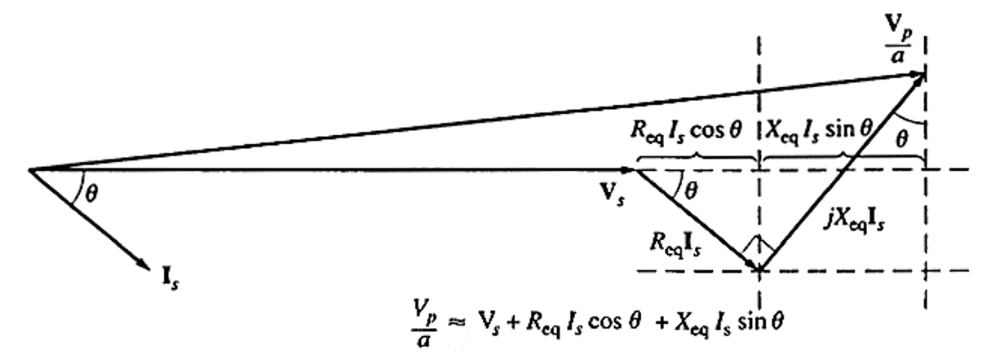

---

## § Transformer Efficiency

The efficiency of a transformer is defined as:
$$\eta = \frac{P_{out}}{P_{in}} \times 100\% = \frac{P_{out}}{P_{out} + P_{loss}} \times 100\%$$

When is the efficiency maximized?

$$\eta = 1 - \frac{\sum P}{P_{2} + \sum P}$$

$$P_2 = U_2 I_2 \cos \varphi_2 \approx U_{2N} I_2 \cos \varphi_2$$

$$= \beta S_N \cos \varphi_2$$

$S_N$ : Apparent Power , $S_N = U_{2N} I_{2N} $$ \beta $: Load Factor ,$ \beta = I_2 / I_{2N} $

$P_{Fe} \approx p_0 \text{ (constance)} $$ P_{cu} = P_k = \frac{I_2^2}{I_{2N}^2} P_{kN} = \beta^2 P_{kN} $

Thus ,

$$\eta = \left( 1 - \frac{P_0 + \beta^2 P_{kN}}{\beta S_N \cos \varphi_2 + P_0 + \beta^2 P_{kN}} \right) \times 100 \%$$

For constant power factor :

$P_0 = \beta_m^2 P_{kN}$ ，$\beta_m = \sqrt{\frac{P_0}{P_{kN}}}$

$\beta = \frac{I_1}{I_{1N}} = \frac{I_2}{I_{2N}}$

For a certain $P_{2N}$

we have:

$$\frac{1}{\eta} = \frac{\beta P_{2N} + P_0 + \beta^2 P_{kN}}{\beta P_{2N}} = 1 + \frac{1}{P_{2N}} \left( \frac{P_0}{\beta} + \beta P_{kN} \right)$$

Therefore , when $\beta = \beta_m$ , $\left( \frac{1}{\eta} \right)_{min} \Rightarrow \eta_{max}$

Efficiency is optimized when copper loss = core loss !

Core loss is constant ($P_{Fe}$), while copper loss varies as $\beta^2 P_{Cu,fl}$.

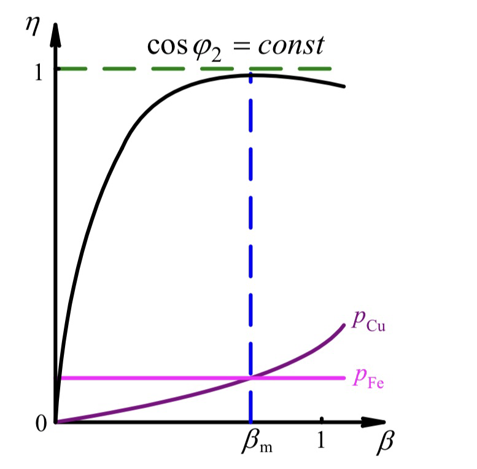

Efficiency is optimized (maximized) when **copper loss equals core loss**:
$$\beta^2 P_{Cu,fl} = P_{Fe}$$

The load factor for maximum efficiency is:
$$\beta_m = \sqrt{\frac{P_{Fe}}{P_{Cu,fl}}}$$

---

## § Transformer Taps and Voltage Regulation

* **Transformer Taps**: Taps are intermediate connection points on the transformer windings used to change the effective turns ratio $a$. When the utility line voltage fluctuates, changing the taps helps maintain a stable output voltage.
* **TCUL (Tap Changing Under Load)**: A specialized transformer capable of changing its tap connections while the power is connected and the transformer is under load.
* **Voltage Regulator**: A TCUL equipped with automatic voltage sensing circuitry that changes taps dynamically to maintain the output voltage at a predefined level.

---

## § The Autotransformer

* **Autotransformer**: A transformer in which the primary and secondary windings share a common physical winding.
  * Allows continuous tuning of the output voltage magnitude.
  * The physical size (and cost) of an autotransformer is smaller than a conventional two-winding transformer of the same power rating.
  * There is **no electrical isolation** between the primary and secondary sides.

**The Step-Up Connection of Autotransformer (AT):**

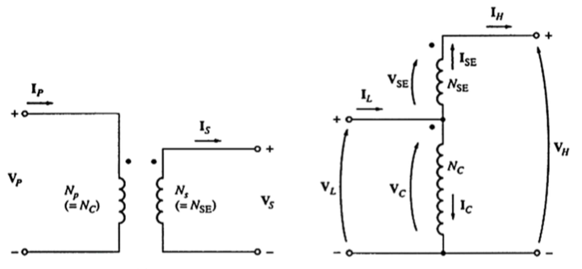

An autotransformer has one continuous winding divided into:
* Common winding with $N_C$ turns.
* Series winding with $N_{SE}$ turns.

---

## § The Step-Down Connection of Autotransformer

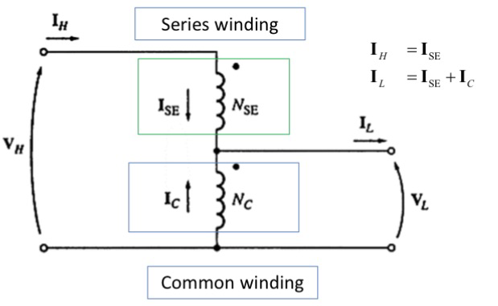

**Voltage and current relations in the windings:**
* Coil voltage and current in $N_C$ and $N_{SE}$ follow the standard transformer relations:
  $$\frac{V_C}{V_{SE}} = \frac{N_C}{N_{SE}}$$
  $$N_C I_C = N_{SE} I_{SE}$$

* **Terminal voltage and current relationships (Step-Down):**
  * Low-voltage side: $V_L = V_C$, $I_L = I_C + I_{SE}$
  * High-voltage side: $V_H = V_C + V_{SE}$, $I_H = I_{SE}$
  
  $$\frac{V_L}{V_H} = \frac{N_C}{N_C + N_{SE}}$$
  $$\frac{I_L}{I_H} = \frac{N_C + N_{SE}}{N_C}$$

---

## § Apparatus Power Rating Advantage of Autotransformer

We define two power ratings:
* **Terminal apparent power rating ($S_{IO}$)**: The apparent power transformed and delivered between terminals.
  $$S_{IO} = V_L I_L = V_H I_H$$
* **Winding apparent power rating ($S_W$)**: The actual physical capacity of the winding/core.
  $$S_W = V_C I_C = V_{SE} I_{SE}$$

The relation between them is:
$$S_W = V_L (I_L - I_H) = S_{IO} \left(1 - \frac{N_C}{N_C + N_{SE}}\right) = S_{IO} \frac{N_{SE}}{N_C + N_{SE}}$$

Therefore:
$$\frac{S_{IO}}{S_W} = \frac{N_C + N_{SE}}{N_{SE}} > 1$$

* **Advantage**: Since $N_C + N_{SE} > N_{SE}$, the terminal capacity $S_{IO}$ is always larger than the physical winding capacity $S_W$. This advantage becomes very large when the primary and secondary voltages are close (i.e., $N_{SE}$ is small). It provides a highly compact and inexpensive way to tie two nearly equal voltages together.

---

## § Review of Three-Phase Power

Three-phase systems have two main connection types: **Wye ($\text{Y}$)** and **Delta ($\Delta$)**.

* **Line voltage ($V_L$)**: The voltage between any two line conductors ($V_{AB}$, $V_{BC}$, $V_{CA}$).

* **Phase voltage ($V_\phi$)**: The voltage across a single phase winding ($V_{AN}$, $V_{BN}$, $V_{CN}$).

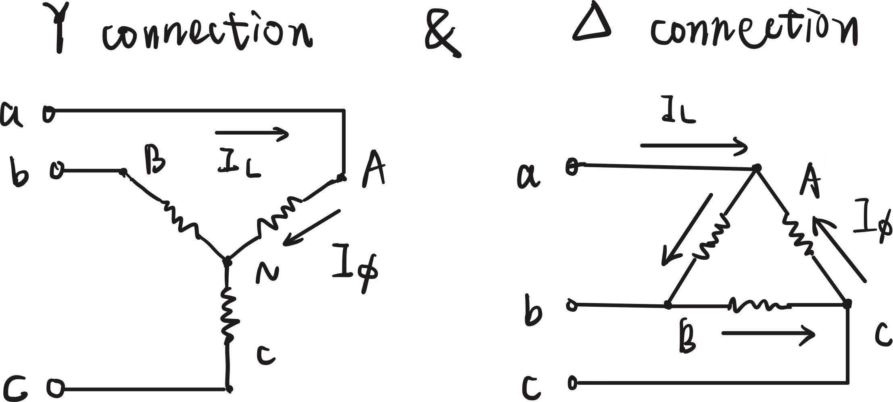

**Wye ($\text{Y}$) connection:**

* Line voltage is $\sqrt{3}$ times phase voltage: $V_L = \sqrt{3} V_\phi$

* Line current equals phase current: $I_L = I_\phi$

* Line voltages lead their corresponding phase voltages by $30^\circ$ (for positive sequence ABC).

  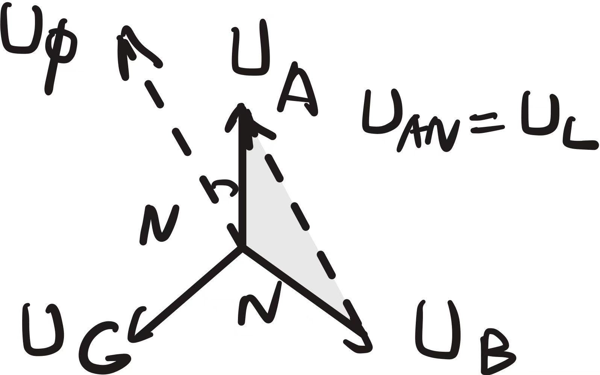

**Delta ($\Delta$) connection:**

* Line voltage equals phase voltage: $V_L = V_\phi$

* Line current is $\sqrt{3}$ times phase current: $I_L = \sqrt{3} I_\phi$

* Line currents lag their corresponding phase currents by $30^\circ$ (for positive sequence ABC).

  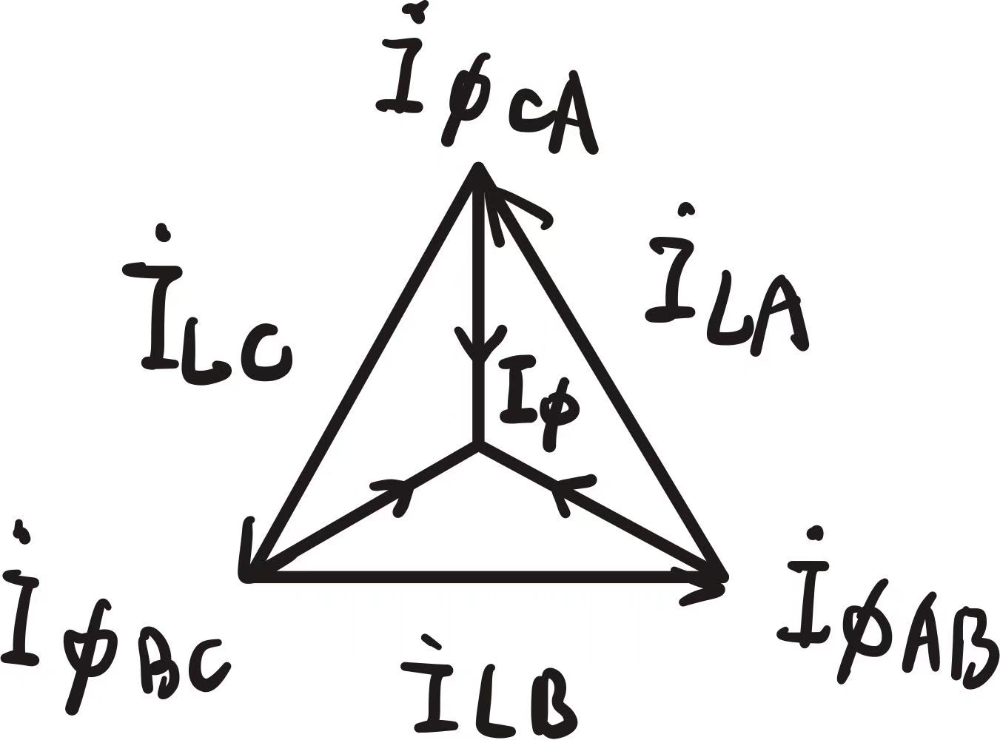

---

## § Three-Phase Power Equations

* **Power on a single phase:**
  $$P_\phi = V_\phi I_\phi \cos\theta$$
* **Total active power ($P$):**
  $$P = 3 P_\phi = 3 V_\phi I_\phi \cos\theta = \sqrt{3} V_L I_L \cos\theta \quad (\text{W})$$
* **Total reactive power ($Q$):**
  $$Q = \sqrt{3} V_L I_L \sin\theta \quad (\text{var})$$
* **Total apparent power ($S$):**
  $$S = \sqrt{3} V_L I_L \quad (\text{VA})$$

* **Phase sequence:**
  * Positive sequence: $A \to B \to C$
  * Negative sequence: $A \to C \to B$

> [!IMPORTANT]
> The turns ratio $a$ applies directly to the **Phase Voltages** of the transformer windings, not blindly to the line voltages.
>
> * **Delta ($\Delta$) connection**: Suitable for low voltage, high current (since $I_L = \sqrt{3} I_\phi$).
> * **Wye ($\text{Y}$) connection**: Suitable for high voltage, low current (since $V_L = \sqrt{3} V_\phi$).

---

## § Three-Phase Transformer Connections

A three-phase transformer bank can be connected in four ways:

### 1) Wye-Wye (Y-Y) Connection

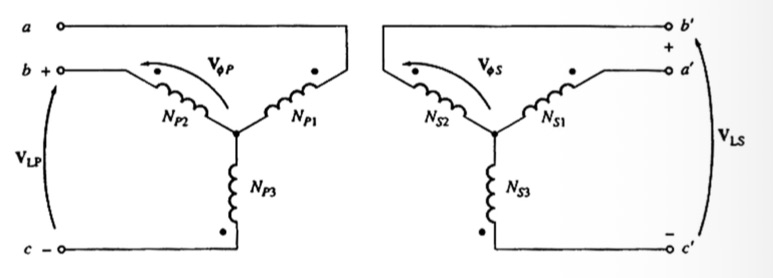

* The line voltage ratio is:
  $$\frac{V_{LP}}{V_{LS}} = \frac{\sqrt{3} V_{\phi P}}{\sqrt{3} V_{\phi S}} = a$$

> [!WARNING]
>  1. If the loads are unbalanced, the neutral point will shift, causing severe unbalance in phase voltages.
>  2. The third-harmonic voltage component can be very large.

> [!IMPORTANT]
> **Why is the third-harmonic voltage large?**
> 
> The third-harmonic magnetizing currents in all three phases are in-phase ($3(\omega t - 120^\circ) = 3\omega t$). Being zero-sequence components, they require a return path to flow. In an ungrounded $\text{Y-Y}$ connection, they cannot flow, distorting the core flux and inducing large third-harmonic voltages.
> 
> 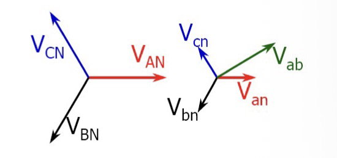

**Solutions:**
1. **Solidly ground the neutral** of the primary winding to the source neutral, providing a path for the third-harmonic currents.
2. **Add a $\Delta$-connected tertiary winding**. The third-harmonic currents circulate inside the closed $\Delta$ loop, suppressing the harmonic voltage.

> [!IMPORTANT]
> **Why $\Delta$ is special?**
> 
> With a Delta connection, we do not need a neutral line to release the third-harmonic current. Its physical loop construction allows third-harmonic currents to circulate and be confined within the loop.

---

### 2) Wye-Delta ($\text{Y-}\Delta$) Connection:

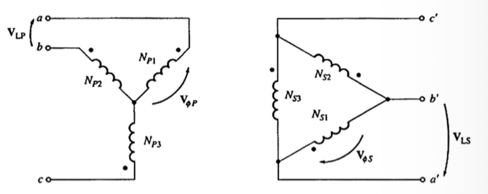

* The line voltage ratio is:
  $$\frac{V_{LP}}{V_{LS}} = \frac{\sqrt{3} V_{\phi P}}{V_{\phi S}} = \sqrt{3} a$$
* There is a $30^\circ$ phase shift between primary and secondary sides. Typically, the secondary line voltage lags the primary line voltage by $30^\circ$.

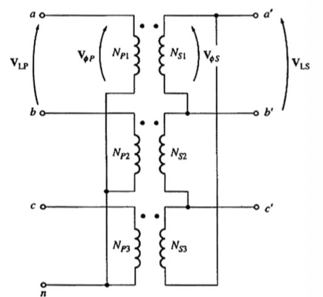

* Because of the closed Delta winding, we do not have third-harmonic components in Wye-Delta.
* In the United States, the standard convention is that the secondary voltage lags the primary voltage by $30^\circ$.

---

### 3) Delta-Wye ($\Delta\text{-Y}$) Connection:

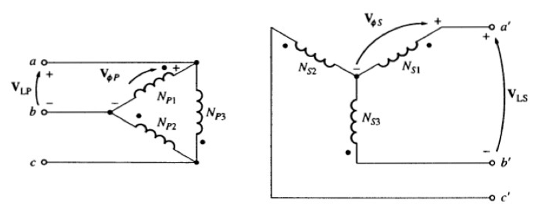

* The line voltage ratio is:
  $$\frac{V_{LP}}{V_{LS}} = \frac{V_{\phi P}}{\sqrt{3} V_{\phi S}} = \frac{a}{\sqrt{3}}$$
  
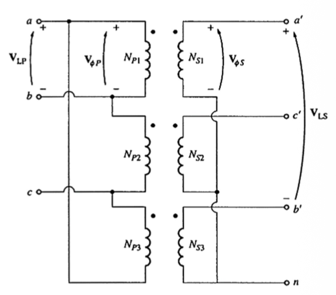

**Delta-Wye Connection Applications**

* **Common Applications:**
  * Widely used for step-down distribution (transforming a 3-phase 3-wire line to a 3-phase 4-wire line, providing a neutral for single-phase loads).
  * Used to isolate the ground of the Wye side from the source ground on the Delta side.
  
> **Summary:**
> -  **$\Delta\text{-Y}$**: Common for **step-down** distribution. 
>    Low-voltage side is grounded Wye (3-phase 4-wire). 
>    High-voltage Delta isolates zero-sequence currents.
> - **$\text{Y-}\Delta$**: Common for **step-up** generation or interconnection.
>    High-voltage side is grounded Wye.
>    Protection & Reference

---

### 4) Delta-Delta ($\Delta\text{-}\Delta$) Connection:

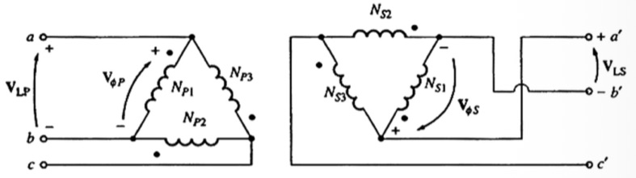

* Line voltage ratio:
  $$\frac{V_{LP}}{V_{LS}} = a$$

> [!Note]
> $\Delta\text{-}\Delta$ Connection is **rarely** used because it does not have a neutral line to provide necessary protection for operation.

---

## § Three-Phase Transformation Using Two Transformers

In emergencies or for low-power applications, three-phase power can be transformed using only two single-phase transformers.

**1) $\text{V-V}$ Connection (Open Delta):**

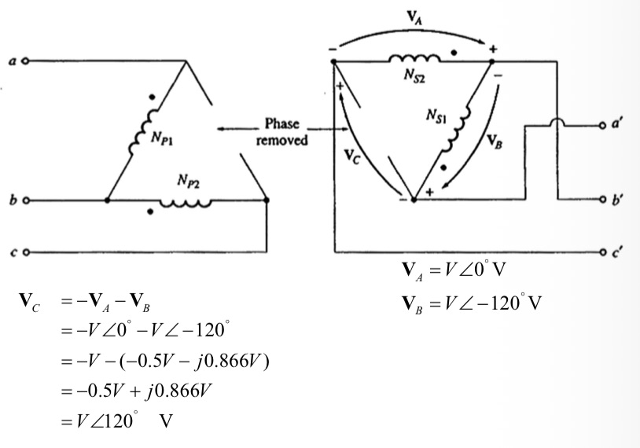

If one transformer in a $\Delta\text{-}\Delta$ bank is removed, the remaining two can still supply a symmetrical three-phase voltage system to the load.

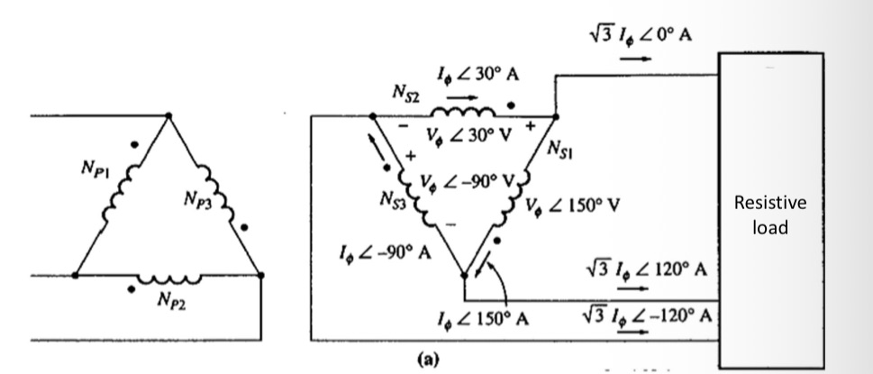

**Power Rating of V-V Connection**

Even if we remove one phase, the terminal line voltages $V_{AB}$, $V_{BC}$, $V_{CA}$ remain symmetrical.

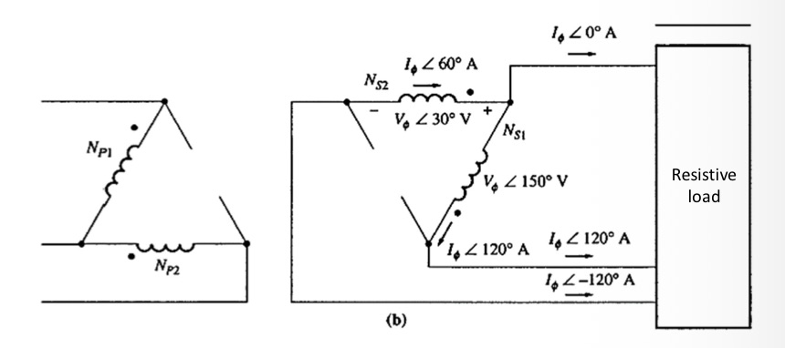

* **Power capacity of $\text{V-V}$ connection:**
  The total active power delivered by two transformers is:
  $$P = \sqrt{3} V_L I_L \cos\theta$$
  Since the line current $I_L$ cannot exceed the rated phase current $I_\phi$ of the individual transformer, the apparent power capacity of the open-delta bank is:
  $$S_{\text{V-V}} = \sqrt{3} V_\phi I_\phi$$
  Comparing to a full $\Delta\text{-}\Delta$ bank ($S_{\Delta\text{-}\Delta} = 3 V_\phi I_\phi$):
  $$\frac{S_{\text{V-V}}}{S_{\Delta\text{-}\Delta}} = \frac{\sqrt{3}}{3} \approx 0.577 \quad (57.7\%)$$
  The bank can only deliver $57.7\%$ of the capacity of a three-transformer bank.
  Compared to the sum of the ratings of the two remaining transformers:
  $$\frac{S_{\text{V-V}}}{2 S_\phi} = \frac{\sqrt{3}}{2} \approx 0.866 \quad (86.6\%)$$
  Therefore, the transformers operate at $86.6\%$ of their combined capacity.

---

## § Open-Delta Phasor Relations

* In the $\text{V-V}$ connection, the phase currents are out of phase with their phase voltages by $30^\circ$.
* **Power delivered by each transformer:**
  $$P_1 = V_\phi I_\phi \cos(30^\circ - \theta)$$
  $$P_2 = V_\phi I_\phi \cos(30^\circ + \theta)$$
  
  * For a unity power factor load ($\theta = 0^\circ$), one transformer operates at a lagging power factor of $0.866$, and the other operates at a leading power factor of $0.866$.

---

## § Open Wye - Open Delta and Scott-T Connections

**2) Open Wye - Open Delta (Open $\text{Y}$ - Open $\Delta$) Connection:**

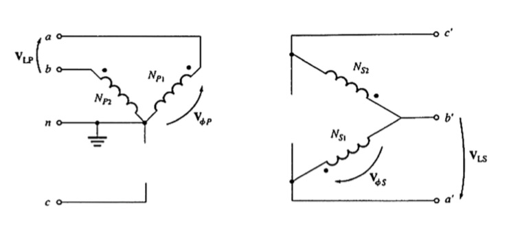

* The primary neutral line must be connected back to the source neutral.
* **Drawback**: A large return current flows through the primary neutral line, which can cause significant unbalance and noise.

**3) Scott-T Connection:**

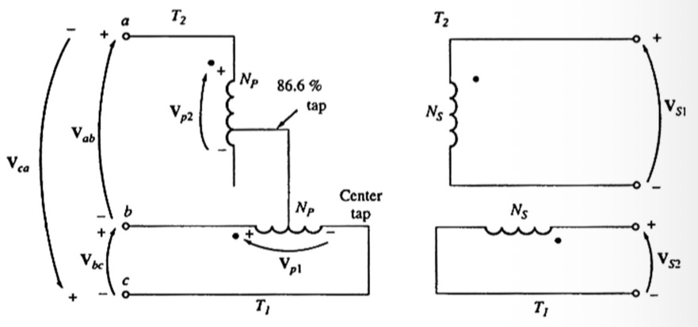

* Used to convert three-phase power into two-phase power (and vice versa).
* Common in electric railroad applications where heavy single-phase locomotive loads are balanced across a three-phase utility supply.

---

## § Scott-T and T-T Connections

The Scott-T connection uses two single-phase transformers:
* A **main transformer** (connected across line BC, with a center tap).
* A **teaser transformer** (connected between phase A and the main transformer center tap, having $86.6\%$ of the turns of the main transformer).

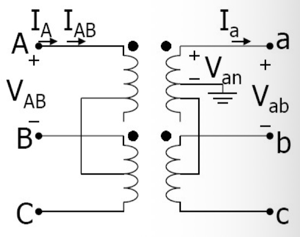

**4) T-T Three-Phase Connection:**
Uses two T-connected transformers to perform 3-phase to 3-phase transformation. It is lighter and cheaper than a standard three-phase transformer bank.

---

## § Transformer Ratings and Related Problems

**1. Voltage Rating:**
* Prevents over-voltage insulation breakdown.
* Prevents core saturation. Since core flux is:
  $$\phi(t) = \frac{1}{N_p} \int v_p(t) dt$$
  If voltage $V_m$ is too high or frequency $f$ is too low, the core will saturate, causing massive magnetizing currents.

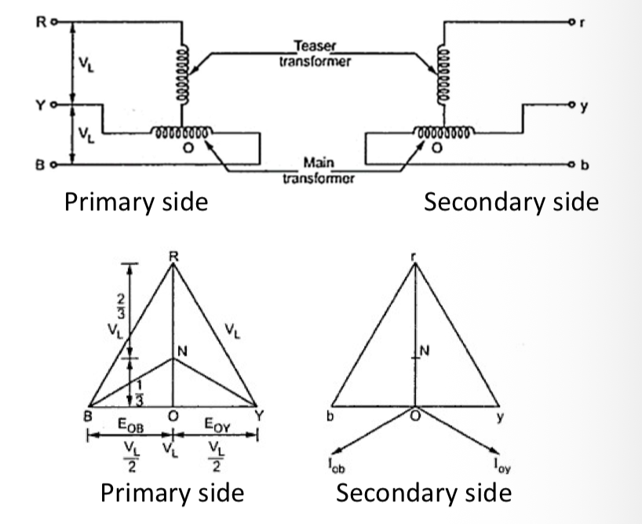

---

## § Frequency Limitation and Inrush Current

**2. Frequency Limitation:**
* A $60\text{ Hz}$ transformer operated on $50\text{ Hz}$ requires the input voltage to be reduced by $20\%$ to prevent saturation.
* A $50\text{ Hz}$ transformer operated on $60\text{ Hz}$ can handle up to $20\%$ higher voltage.

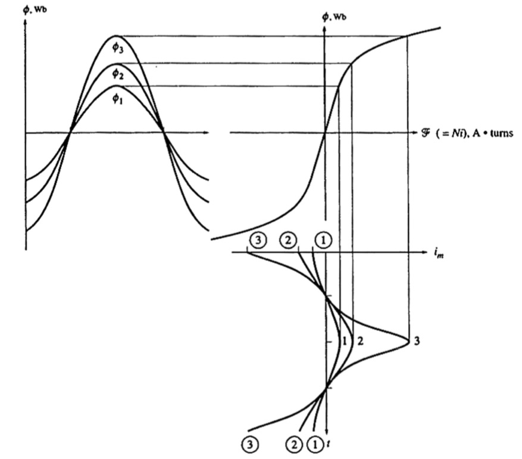

**3. Inrush Current Problem:**

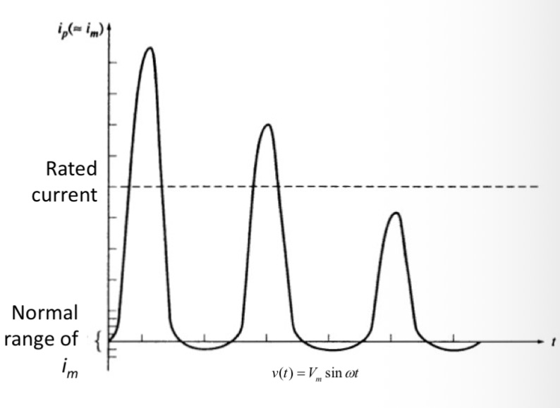

* When first turned on, the transient flux can reach up to $2\phi_{max} + \phi_r$ (due to residual flux). This drives the core deep into saturation, resulting in a large magnetizing current spike (inrush current).

---

## § Parallel Operation of Transformers

**Advantages of parallel operation:**
* Flexible operation facing load changes, improving overall efficiency.
* Cost-effective (easier to replace or maintain smaller units).
* Highly expandable for future capacity planning.

**Ideal parallel operation conditions:**
* No circulating currents under no-load conditions.
* Each unit shares the load in proportion to its power rating.

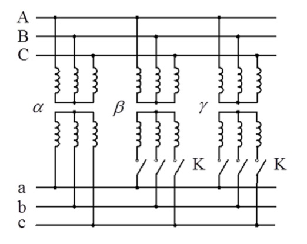

---

## § How to Achieve Parallel Operation

**To achieve ideal parallel operation:**
1. Same voltage rating (turns ratio must be equal; difference should be $< 0.5\%$).
2. Same phase angle shift between primary and secondary (same connection group).
3. Short-circuit impedance (per-unit impedance) should be similar to ensure equal load sharing.

---

## § Load Sharing and Per-Unit System

**Load sharing between parallel units:**

$$\frac{I_A}{I_B} = \frac{Z_B}{Z_A}$$

**The Per-Unit (PU) System:**
$$\text{Per-Unit Value} = \frac{\text{Actual Quantity}}{\text{Base Quantity}}$$

Base value relationships:
* $P_{base} = Q_{base} = S_{base}$
* $V_{base}$ is defined.
* $I_{base} = \frac{S_{base}}{V_{base}}$
* $Z_{base} = \frac{V_{base}^2}{S_{base}}$

---

## § Per-Unit System for Transformers

For transformers:
* The rated apparent power $S_N$ is used as $S_{base}$.
* The rated voltages of the primary and secondary windings are used as $V_{base}$ on their respective sides.
* **Advantage**: The per-unit system **eliminates the turns ratio $a$** from the equivalent circuit! The per-unit impedance remains the same whether calculated from the primary or secondary side:
  $$Z_{pu,p} = Z_{pu,s}$$
