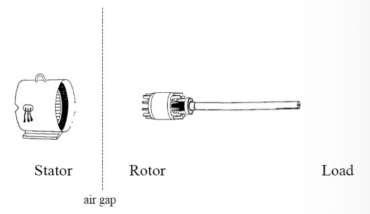
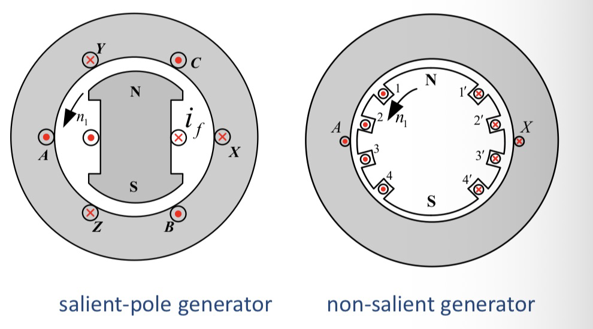
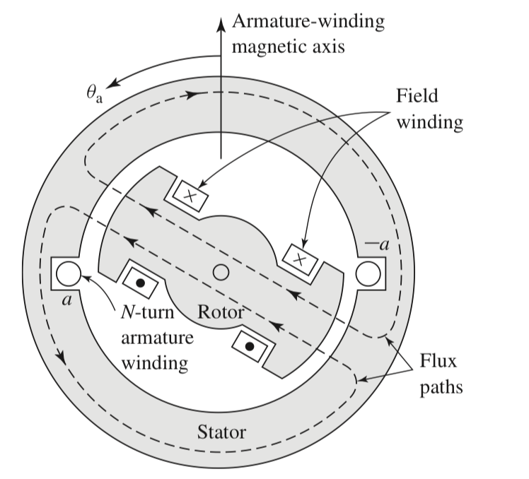
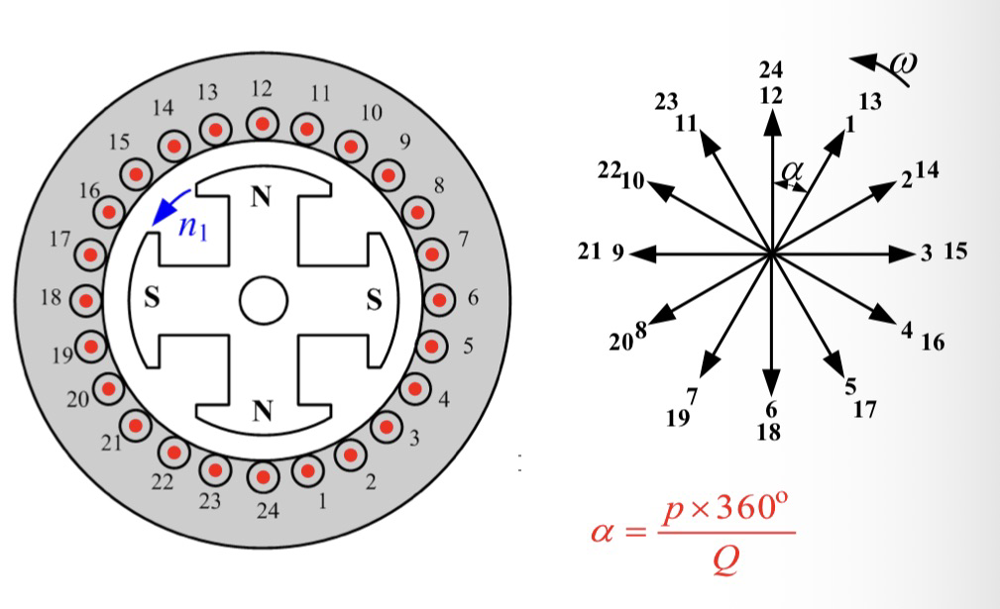
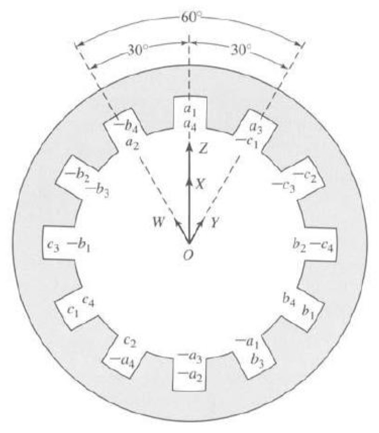

AC machines can be divided into two major classes:
* **Synchronous machines**: The magnetic field is generated by a rotor supplied with DC current (or permanent magnets), and the rotor rotates at synchronous speed.
  
* **Asynchronous (Induction) machines**: The rotor magnetic field is induced by electromagnetic induction from the stator currents. The rotor always rotates slower than the synchronous speed.

---

## § Simple Loop in a Uniform Magnetic Field

To understand AC generators, we analyze a simple rotating loop in a uniform magnetic field:

According to Faraday's law of induced voltage on a moving wire:
$$e_{ind} = (\vec{v} \times \vec{B}) \cdot \vec{l}$$

For the rotating loop of radius $r$ and length $l$ rotating at angular speed $\omega$:

* **Segment ab**: The velocity vector $\vec{v}$ is directed at angle $\theta$ to the $\vec{B}$ field.
  $$e_{ba} = v B l \sin\theta_{ab} \quad (\text{directed into the page})$$
* **Segment cd**:
  $$e_{dc} = v B l \sin\theta_{cd} \quad (\text{directed out of the page})$$
* **Segments bc and ad**: Since the velocity is parallel to the magnetic field along these segments, the induced voltage is zero.
  $$e_{bc} = e_{ad} = 0$$

The total induced voltage around the loop is:
$$e_{ind} = e_{ba} + e_{dc} = 2 v B l \sin\theta$$

Using the relationships $v = r \omega$ and the loop area $A = 2 r l$, we get:
$$e_{ind} = 2 r \omega B l \sin\omega t = A B \omega \sin\omega t$$

Since the maximum flux through the loop is $\Phi_{max} = A B$, the induced voltage can be written as:
$$e_{ind} = \Phi_{max} \omega \sin\omega t$$

---

## § Induced Torque in a Current-Carrying Loop

When the loop carries a current $i$, a magnetic force is exerted on the wire segments:
$$\vec{F} = i (\vec{l} \times \vec{B})$$

The torque on each segment is:
$$\tau = F \cdot r \sin\theta$$

* **Segment ab**:
  $$\tau_{ab} = r i l B \sin\theta_{ab} \quad (\text{clockwise})$$
* **Segment cd**:
  $$\tau_{cd} = r i l B \sin\theta_{cd} \quad (\text{clockwise})$$
* **Segments bc and ad**: Induced torque is zero.
  $$\tau_{bc} = \tau_{ad} = 0$$

The total induced torque is:
$$\tau_{ind} = 2 r i l B \sin\theta$$

This can be alternatively expressed in vector form using the loop's magnetic moment:
$$\vec{\tau}_{ind} = k \vec{B}_R \times \vec{B}_S$$

where $\vec{B}_R$ is the rotor-produced flux density and $\vec{B}_S$ is the stator-produced flux density.

---

## § Rotating Magnetic Field

In real AC machines, instead of a rotating loop in a stationary magnetic field, we have a **rotating magnetic field (RMF)** interacting with stationary windings (stator).

To generate a rotating magnetic field, we place three coils spaced $120^\circ$ electrical degrees apart on the stator and supply them with balanced three-phase currents:
$$i_a(t) = I_m \cos\omega t$$
$$i_b(t) = I_m \cos(\omega t - 120^\circ)$$
$$i_c(t) = I_m \cos(\omega t - 240^\circ)$$

* **Armature winding**: Located on the stator, used to collect electrical power (generator) or supply power (motor).
* **Field winding**: Located on the rotor, supplied with DC current to generate the main magnetic field.

---

## § Induced Voltage on a Three-Phase Stator

Assuming the rotor produces a sinusoidally distributed flux density:
$$B(\theta) = B_m \cos\theta$$

As the rotor rotates at electrical speed $\omega$:
$$B(\theta, t) = B_m \cos(\omega t - \theta)$$

The total induced voltage in an $N_c$-turn stator coil is:
$$e_{ind}(t) = N_c \Phi_{max} \omega \sin\omega t$$

For three coils spaced $120^\circ$ apart, the induced voltages are:
$$e_{aa'}(t) = E_{max} \sin\omega t$$
$$e_{bb'}(t) = E_{max} \sin(\omega t - 120^\circ)$$
$$e_{cc'}(t) = E_{max} \sin(\omega t - 240^\circ)$$

The RMS phase voltage is:
$$E_{rms} = \frac{E_{max}}{\sqrt{2}} = \frac{N_c \Phi_{max} \omega}{\sqrt{2}} = \sqrt{2} \pi f N_c \Phi_{max} \approx 4.44 f N_c \Phi_{max}$$

---

## § Three-Phase Stator Connections and Harmonics

* **Wye (Y) Connection:**
  * Line-to-line voltage is $V_L = \sqrt{3} V_\phi$.
  * The third-harmonic voltages ($3\omega t$, $3(\omega t - 120^\circ) = 3\omega t$) in each phase are in-phase (zero-sequence). Because of this, the third harmonics cancel out in the line-to-line voltage:
    $$e_{AB, 3} = e_{A, 3} - e_{B, 3} = 0$$
  * **Benefit**: Line-to-line voltage contains **no third-harmonic components**.

* **Delta ($\Delta$) Connection:**
  * Line-to-line voltage equals phase voltage ($V_L = V_\phi$).
  * The third-harmonic voltages are in-phase and drive a circulating current around the closed Delta loop.
  * **Benefit**: No third-harmonic voltage exists at the terminals, but third-harmonic current circulates inside the Delta windings.

---

## § Distributed Winding and Breadth Factor

A simple concentrated winding produces a highly non-sinusoidal (square-like) air gap flux density containing significant odd harmonics:
$$B(\theta) = B_{s1} + B_{s3} + B_{s5} + B_{s7} + \dots$$

To make the flux density and induced voltage more sinusoidal, the windings are distributed across multiple slots.

* **Slot-pitch angle ($lpha$)**: The electrical angle between adjacent slots.
  $$\alpha = \frac{p \cdot 360^\circ}{Q} \quad (\text{electrical degrees})$$
* **Slots per pole per phase ($q$)**:
  $$q = \frac{Q}{2pm}$$
  where $Q$ is the total number of slots, $p$ is the pole pairs, and $m$ is the number of phases ($m=3$).

**Breadth Factor ($k_d$ or $k_b$):**
Because the coils in adjacent slots are physically shifted by angle $\alpha$, their induced EMFs are out of phase. The vector sum of these EMFs is smaller than their algebraic sum. We define the breadth factor $k_{d\nu}$ for the $\nu$-th harmonic as:
$$k_{d\nu} = \frac{\sin(q \nu \alpha / 2)}{q \sin(\nu \alpha / 2)}$$

For the fundamental component ($
u = 1$):
$$k_{d1} = \frac{\sin(q \alpha / 2)}{q \sin(\alpha / 2)}$$

---

## § Double-Layer Winding and Pitch Factor

* **Double-layer winding**: Each slot contains two coil sides (one top, one bottom), allowing the use of a **fractional pitch** (chorded winding).
* **Pitch ratio ($y$)**: The ratio of coil pitch to pole pitch ($y = \frac{\text{coil pitch}}{\tau_p} \le 1$). For a full-pitch coil, $y = 1$. For fractional pitch, $y < 1$.

**Pitch Factor ($k_p$):**
For a fractional-pitch coil, the coil sides are not exactly $180^\circ$ electrical apart, reducing the induced EMF. The pitch factor $k_{p\nu}$ for the $\nu$-th harmonic is:
$$k_{p\nu} = \sin\left(\frac{\nu y \pi}{2}\right)$$

* **Harmonic Elimination**: By selecting a specific pitch ratio $y$, we can eliminate or significantly reduce certain harmonics:
  * To eliminate the 5th and 7th harmonics, we choose $y = 5/6 \approx 0.83$.
  * For $y = 5/6$, the fundamental pitch factor is $k_{p1} = \sin(5\pi/12) \approx 0.966$, while the 5th and 7th harmonic pitch factors are reduced to $\sin(25\pi/12) \approx 0.259$ and $\sin(35\pi/12) \approx 0.259$, successfully suppressing these harmonics.

---

## § Combined Winding Factor and Total EMF

The combined effect of distributed winding and fractional pitch is represented by the **winding factor ($k_w$)**:
$$k_{w\nu} = k_{d\nu} \cdot k_{p\nu}$$

The total induced RMS EMF per phase for the fundamental component is:
$$E_1 = \sqrt{2} \pi f N_c k_{w1} \Phi = 4.44 f N_c k_{w1} \Phi$$

where $N_c$ is the total number of series turns per phase:
$$N_c = \frac{2 p q N_K}{a}$$
($N_K$: turns per coil, $a$: number of parallel paths).

For the $\nu$-th harmonic:
$$E_\nu = 4.44 f N_c k_{w\nu} \Phi_\nu$$

---

## § Armature MMF and Fourier Decomposition

When load currents flow through the stator armature windings, they generate an armature magnetomotive force (MMF).

For a single-phase winding carrying a sinusoidal current, the MMF is a pulsating standing wave:
$$f(x, t) = \sum_{\nu=1,3,5,\dots}^{\infty} F_{\nu} \cos(\nu x) \cos(\omega t)$$

where the peak MMF of the $\nu$-th harmonic is:
$$F_{\nu} = \frac{4}{\pi} \frac{N_c k_{w\nu}}{\nu} I_m$$

This pulsating MMF can be decomposed into two counter-rotating fields (Forward and Backward rotating fields):
$$f(x, t) = \frac{1}{2} F_{\nu} \cos(\nu x - \omega t) + \frac{1}{2} F_{\nu} \cos(\nu x + \omega t)$$

---

## § Generation of rotating magnetic field

When balanced three-phase currents flow through three-phase distributed windings, the individual phase MMFs sum up:
$$f_{tot}(x, t) = f_a(x, t) + f_b(x, t) + f_c(x, t)$$

Summing the forward and backward components for all three phases:
* The backward-rotating components cancel each other out to zero.
* The forward-rotating components add up constructively.

The total MMF of the fundamental component is a purely rotating magnetic field of constant magnitude:
$$F_{tot}(x, t) = \frac{3}{2} F_1 \cos(x - \omega t) = \frac{3}{2} \left(\frac{4}{\pi} N_c k_{w1} I_m\right) \cos(x - \omega t)$$

$$F_{tot}(x, t) = 1.35 N_c k_{w1} I_{rms} \cos(x - \omega t)$$

---

## § Speed and Frequency of the Rotating Field

The relationship between the electrical frequency $f_e$ of the stator currents and the mechanical rotational speed $n_m$ (rpm) of the rotating magnetic field is:
$$f_e = \frac{P \cdot n_m}{120} = p \cdot f_m$$

where $P$ is the number of poles ($p = P/2$ is the number of pole pairs), and $n_m$ is the synchronous speed.
$$n_s = \frac{120 f_e}{P}$$

* **Reversing Rotation Direction**: Swap any two of the three stator phase connections (e.g. swap phase B and C). This changes the phase sequence from $A-B-C$ to $A-C-B$, reversing the direction of the rotating magnetic field.

---

## § Space Harmonics in the MMF

For the $\nu$-th harmonic MMF:
* **3rd harmonic**: Since the currents are $120^\circ$ out of phase in time, the sum of third-harmonic MMFs is zero. There is no rotating 3rd-harmonic MMF.
* **5th harmonic**: Decomposing the 5th harmonic shows that it forms a **negative-sequence** rotating field. It rotates in the opposite direction (backward) at $1/5$ of the synchronous speed:
    $$n_5 = -\frac{n_s}{5}$$
* **7th harmonic**: Forms a **positive-sequence** rotating field. It rotates in the same direction (forward) at $1/7$ of the synchronous speed:
    $$n_7 = +\frac{n_s}{7}$$

---

## § Induced Torque and Power Flow

The interaction between the stator-produced magnetic field $\vec{B}_S$ and the rotor-produced magnetic field $\vec{B}_R$ generates an electromagnetic torque:
$$\vec{\tau}_{ind} = k \vec{B}_R \times \vec{B}_S$$

$$\tau_{ind} = k B_R B_S \sin\delta$$

where $\delta$ is the power angle (torque angle) between the two fields.

**Power Flow in AC Machines:**

* **Losses:**
  1. **Stator copper loss (3-phase)**: $P_{SCL} = 3 I_A^2 R_A$
  2. **Rotor copper loss**: $P_{RCL} = I_R^2 R_R$
  3. **Core losses ($P_{core}$)**: Hysteresis and eddy currents in the stator core.
  4. **Mechanical losses**: Friction and windage.
  5. **Stray losses**: Miscellaneous load losses.

* **Power Flow Diagrams:**
  * **Generator:**
    $$P_{in} \text{ (Mechanical)} \to P_{conv} \text{ (Converted)} \to P_{out} \text{ (Electrical)}$$
    $$P_{conv} = \tau_{ind} \omega_m = P_{out} + P_{SCL} + P_{core}$$
    
  * **Motor:**
    $$P_{in} \text{ (Electrical)} \to P_{conv} \text{ (Converted)} \to P_{out} \text{ (Mechanical)}$$
    $$P_{conv} = P_{in} - P_{SCL} - P_{core} = \tau_{ind} \omega_m$$
