## § Synchronous Generator Construction

Synchronous generators (also called alternators) convert mechanical power into three-phase electrical power. Their construction consists of two main parts:
* **Field windings**: Located on the rotor, supplied with DC current to produce the main magnetic field.
* **Armature windings**: Located on the stator, where three-phase AC voltages are induced.

There are two rotor types:
1. **Salient-pole rotor**: Large diameter and short axial length, with poles projecting outward from the rotor core. Used in low-speed applications (such as hydro-turbines).
2. **Non-salient pole (cylindrical) rotor**: Small diameter and long axial length, with field windings embedded in slots. Used in high-speed applications (such as steam or gas turbines).

The speed of rotation of a synchronous generator $n_m$ (in RPM) is directly locked to the electrical frequency $f_e$:
$$f_e = \frac{P n_m}{120}$$

where $P$ is the number of poles.

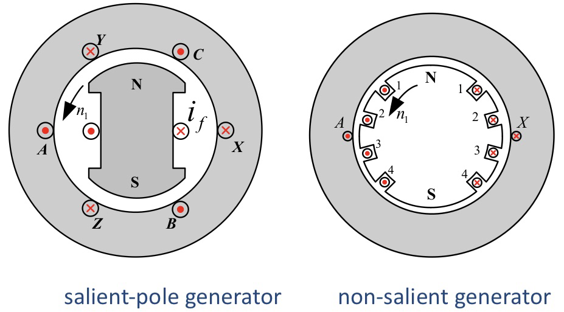

---

## § Armature Reaction

When a synchronous generator operates under no-load conditions, the rotor field current $I_f$ produces a rotor magnetic field $B_0$ (associated with field MMF $F_f$), which rotates at synchronous speed and induces a three-phase voltage in the stator windings.

Under load, three-phase currents flow through the stator windings, producing their own rotating stator magnetic field $B_a$ (associated with armature MMF $F_a$). The distortion of the net air-gap magnetic field by stator currents is called **armature reaction**.

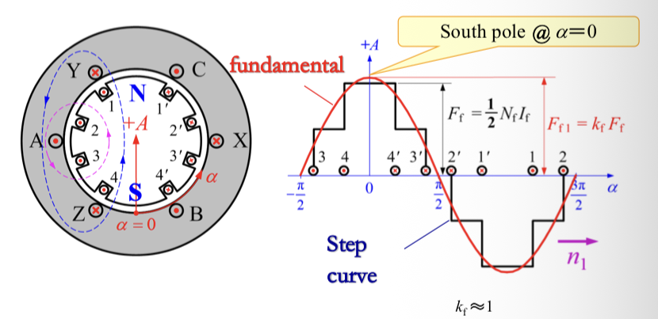
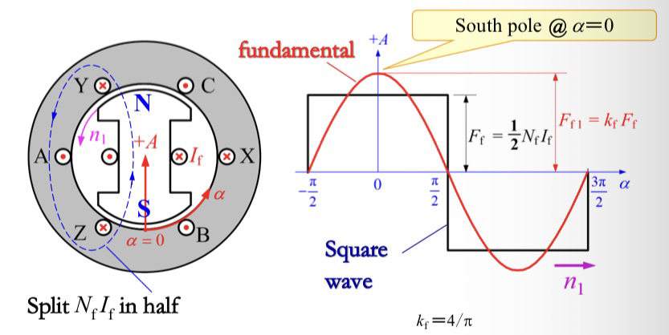

---

## § No-Load Characteristics

On a per-phase basis, the induced no-load EMF $E_0$ is given by:
$$E_0 = \sqrt{2} \pi f_e N_c k_w \Phi_1 = 4.44 f_e N_c k_w \Phi_1$$

where:
* $N_c$: number of series turns per phase
* $k_w$: winding factor ($k_w = k_d k_p$)
* $\Phi_1$: fundamental flux per pole

Since $\Phi_1 \propto F_f \propto I_f$, the induced EMF $E_0$ is proportional to the field current $I_f$ at low values. As the field current increases, the magnetic core begins to saturate, and the curve flattens. This is the **Open-Circuit Characteristic (OCC)**.

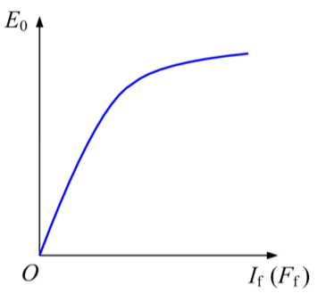

---

## § Equivalent Circuit of a Synchronous Generator

To model the generator electrically under load, we assume linear magnetic conditions (neglecting saturation). Under this assumption, the net air-gap flux density $B_{net}$ is the vector sum of the rotor field $B_f$ and the armature reaction field $B_a$:
$$\vec{B}_{net} = \vec{B}_f + \vec{B}_a$$

Correspondingly, the net induced voltage $\vec{E}_s$ in the stator is:
$$\vec{E}_s = \vec{E}_0 + \vec{E}_a$$

Since the armature reaction field $\vec{B}_a$ is produced by the armature current $\vec{I}$, the induced EMF $\vec{E}_a$ lags the armature current $\vec{I}$ by $90^\circ$. We can represent this relationship using an armature reaction reactance $X_a$:
$$\vec{E}_a = -j \vec{I} X_a$$

Including the stator armature leakage reactance $X_l$ and winding resistance $R_A$, the terminal voltage $\vec{V}_\phi$ is:
$$\vec{V}_\phi = \vec{E}_s - j\vec{I}X_l - \vec{I}R_A = \vec{E}_0 - j\vec{I}X_a - j\vec{I}X_l - \vec{I}R_A$$

We define the total **synchronous reactance** as $X_s = X_a + X_l$. Thus:
$$\vec{E}_0 = \vec{V}_\phi + \vec{I}R_A + j\vec{I}X_s$$

The per-phase equivalent circuit of a synchronous generator consists of:
1. **Rotor field circuit (DC)**: Excitation voltage $V_F$ supplying the field winding $R_F$ and adjustable resistance $R_{adj}$.
2. **Stator armature circuit (AC)**: The internal generated voltage $E_0$ in series with $R_A$ and $jX_s$ supplying the phase terminal voltage $V_\phi$.

---

## § Phasor Diagram and Armature Reaction States

The angle $\psi$ is defined as the phase angle between the stator current $\vec{I}$ and the excitation EMF $\vec{E}_0$. This angle determines the nature of the armature reaction:

1. **Cross-magnetizing armature reaction ($\psi = 0^\circ$)**:
   The stator current $\vec{I}$ is in phase with $\vec{E}_0$. The armature MMF $\vec{F}_a$ lies along the q-axis, perpendicular to the field MMF $\vec{F}_f$ (d-axis). It distorts the field but does not demagnetize or magnetize it.
2. **Demagnetizing armature reaction ($\psi = 90^\circ$)**:
   The stator current $\vec{I}$ lags $\vec{E}_0$ by $90^\circ$ (purely inductive load). The armature MMF $\vec{F}_a$ directly opposes the field MMF $\vec{F}_f$ along the d-axis, reducing the net flux.
3. **Magnetizing armature reaction ($\psi = -90^\circ$)**:
   The stator current $\vec{I}$ leads $\vec{E}_0$ by $90^\circ$ (purely capacitive load). The armature MMF $\vec{F}_a$ aids the field MMF $\vec{F}_f$ along the d-axis, increasing the net flux.

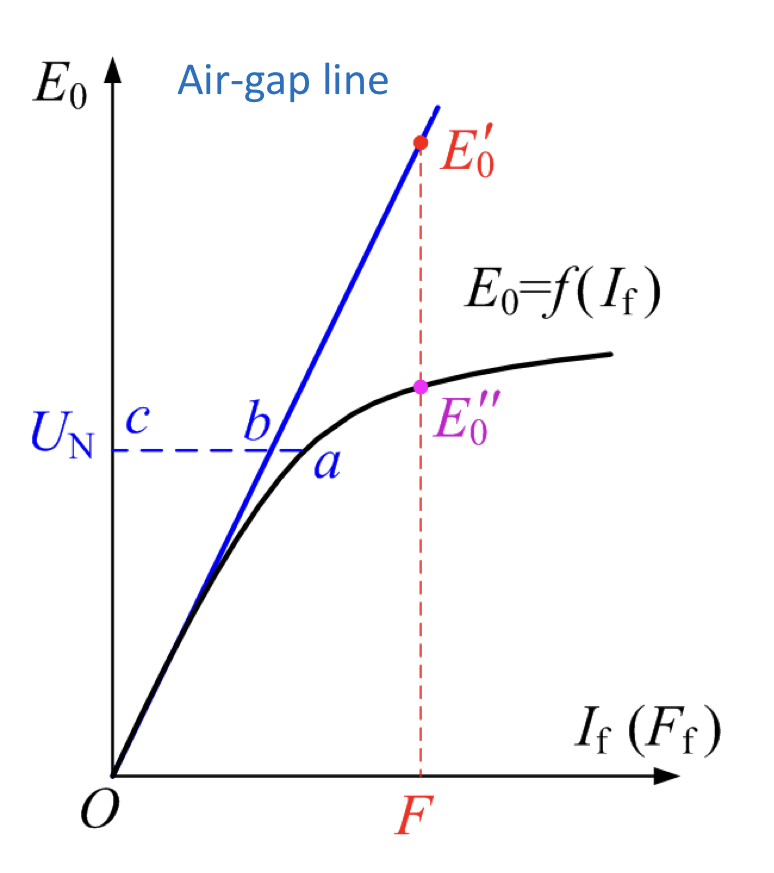
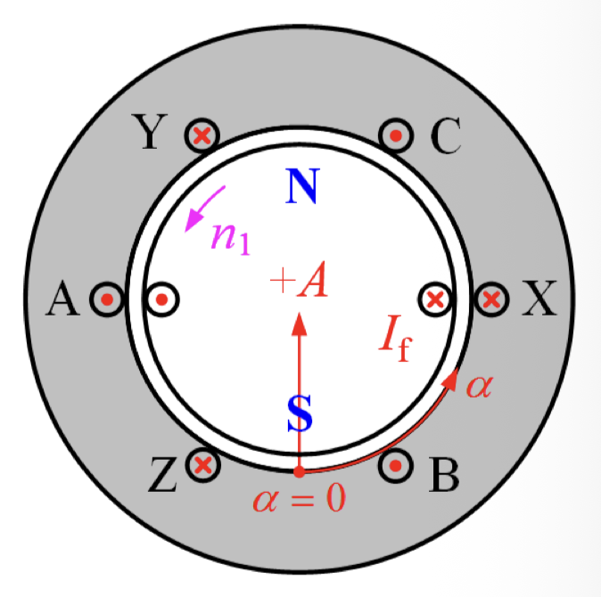
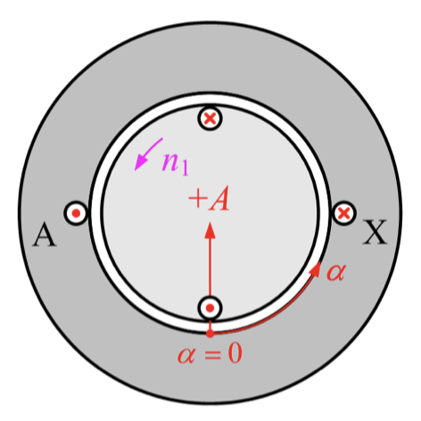

---

## § Salient-Pole Machines and Two-Reaction Theory

In salient-pole machines, the air-gap length is highly non-uniform. The reluctance along the pole axis (**d-axis**) is much smaller than the reluctance along the interpolar axis (**q-axis**). Therefore, the armature reaction cannot be described by a single synchronous reactance $X_s$.

Using **two-reaction theory**, we resolve the armature MMF $\vec{F}_a$ and current $\vec{I}$ into direct-axis (d-axis) and quadrature-axis (q-axis) components:
$$\vec{I} = \vec{I}_d + \vec{I}_q$$
$$I_d = I \sin\psi, \quad I_q = I \cos\psi$$

The corresponding reactances are the d-axis synchronous reactance $X_d$ and q-axis synchronous reactance $X_q$:
$$X_d = X_l + X_{ad}$$
$$X_q = X_l + X_{aq}$$

Since the d-axis reluctance is smaller, the d-axis permeance is higher, meaning:
$$X_{ad} > X_{aq} \implies X_d > X_q$$

The excitation EMF $\vec{E}_0$ is given by:
$$\vec{E}_0 = \vec{V}_\phi + \vec{I}R_A + j\vec{I}_d X_d + j\vec{I}_q X_q$$

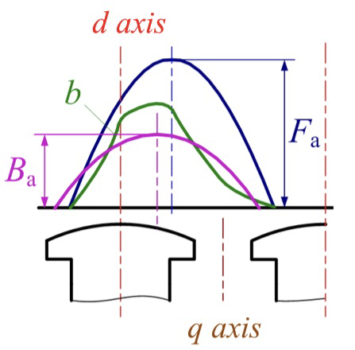
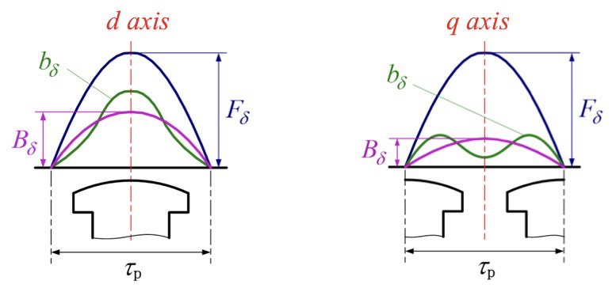

---

## § Phasor Diagram of Salient-Pole Generator

To draw the phasor diagram, we locate the d-axis and q-axis. The power angle $\delta$ is the angle between $\vec{E}_0$ and $\vec{V}_\phi$, and $\psi = \delta + \phi$, where $\phi$ is the power factor angle of the load.

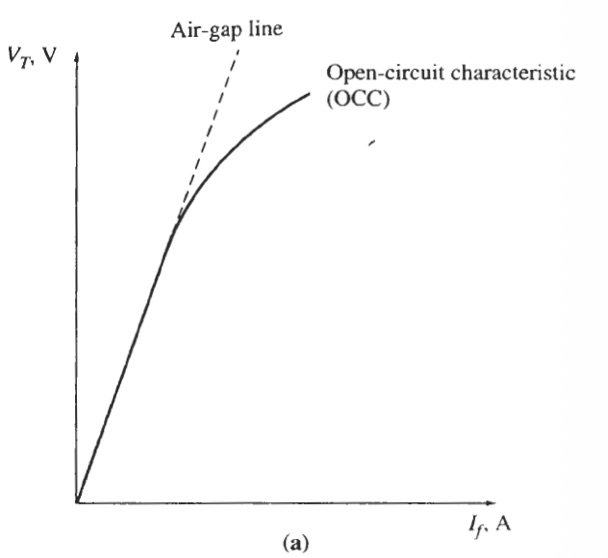

Neglecting the armature resistance $R_A$, the power angle $\delta$ can be calculated from:
$$\tan\delta = \frac{I X_q \cos\phi}{V_\phi + I X_q \sin\phi}$$

Once $\delta$ is found, we decompose the current:
$$I_d = I \sin(\delta + \phi)$$
$$I_q = I \cos(\delta + \phi)$$

The magnitude of the excitation EMF is:
$$E_0 = V_\phi \cos\delta + I_d X_d + I_q R_A$$

---

## § Open-Circuit and Short-Circuit Tests

The parameters $R_A$ and $X_s$ of a synchronous generator can be determined by two tests:

1. **Open-Circuit Test (OCC)**:
   The generator is driven at rated speed with open armature terminals. The field current $I_f$ is varied, and the terminal voltage $V_{oc} = E_0$ is measured.
2. **Short-Circuit Test (SCC)**:
   The armature terminals are short-circuited. The field current $I_f$ is increased from zero, and the armature current $I_{sc} = I_A$ is measured.
   
* **Why the SCC is a straight line**: Under short-circuit, the impedance is dominated by the synchronous reactance ($X_s \gg R_A$). The load is almost purely inductive ($\psi \approx 90^\circ$). The armature reaction is strongly demagnetizing, meaning the net MMF $F_{net} = F_f - F_a$ is very small, keeping the machine far from saturation.

The synchronous impedance $Z_s$ is calculated at a given field current:
$$Z_s = \sqrt{R_A^2 + X_s^2} = \frac{E_0 \text{ (from OCC)}}{I_{sc} \text{ (from SCC)}}$$

Since $X_s \gg R_A$, we have $X_s \approx Z_s$.

The **Short-Circuit Ratio (SCR)** is defined as:
$$\text{SCR} = \frac{I_{f,oc} (V_N)}{I_{f,sc} (I_N)}$$

SCR is the reciprocal of the per-unit synchronous reactance:
$$\text{SCR} = \frac{1}{X_{s,pu}}$$

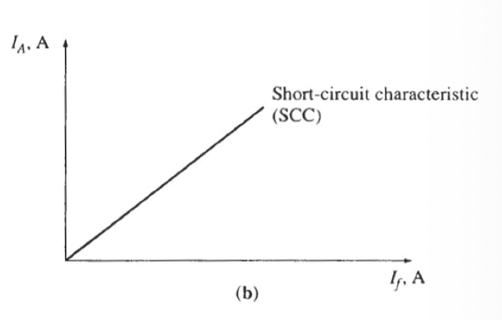
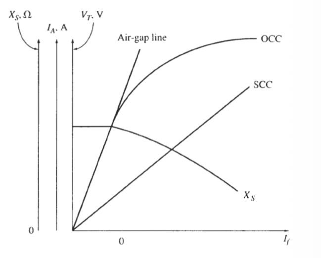

---

## § Slip Test for Measuring Xd and Xq

In salient-pole machines, $X_d$ and $X_q$ are measured using a **slip test**:
1. The field winding is open-circuited ($I_f = 0$).
2. A balanced three-phase voltage at reduced magnitude is applied to the armature windings.
3. The rotor is driven by a prime mover at a speed slightly different from the synchronous speed (a very small slip).

As the stator MMF slowly slips past the rotor poles:
* When the stator MMF aligns with the rotor **d-axis**, the reluctance is minimum, flux is maximum, current is minimum ($I_{min}$), and voltage is maximum ($V_{max}$).
* When the stator MMF aligns with the rotor **q-axis**, the reluctance is maximum, flux is minimum, current is maximum ($I_{max}$), and voltage is minimum ($V_{min}$).

The reactances are calculated as:
$$X_d = \frac{V_{max}}{\sqrt{3} I_{min}}$$
$$X_q = \frac{V_{min}}{\sqrt{3} I_{max}}$$

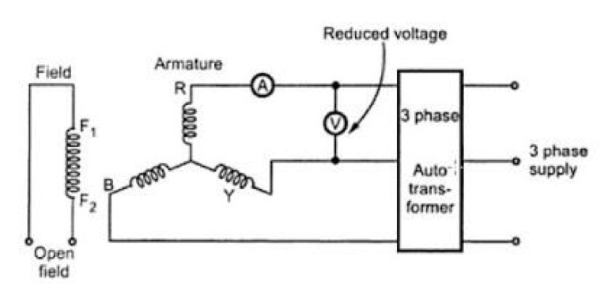
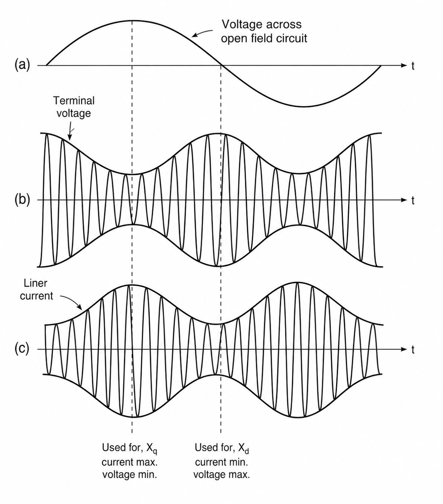

---

## § Zero-Power-Factor Test and Potier Triangle

To determine the leakage reactance $X_l$ and separate it from the armature reaction, a **zero-power-factor (ZPF) test** is conducted:
1. The generator is loaded with an adjustable purely inductive load (power factor $\cos\phi = 0$ lagging).
2. The field current $I_f$ is adjusted while maintaining the armature current at its rated value $I_N$.
3. The terminal voltage $V$ is recorded for various values of $I_f$. This yields the ZPF characteristic.

Using the **Potier Triangle**, we can determine the Potier reactance $X_p$ (which is close to $X_l$) and the demagnetizing armature reaction MMF $F_a$.

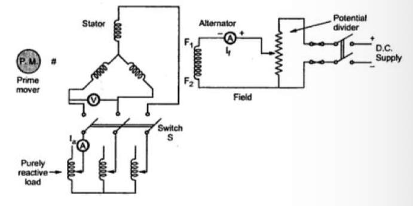
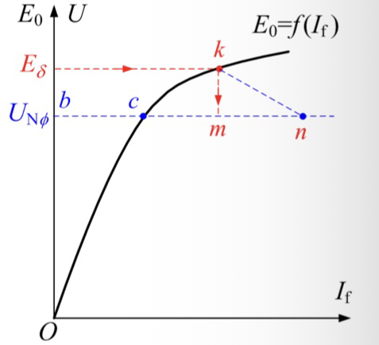
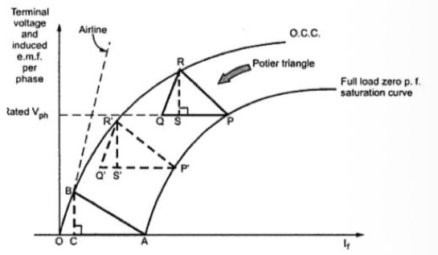

---

## § Voltage Regulation of a Synchronous Generator

Voltage regulation (VR) is the percentage change in terminal voltage when rated load is removed:
$$\text{VR} = \frac{E_0 - V}{V} \times 100\%$$

* **Lagging PF (inductive load)**: $\vec{I}$ lags $\vec{V}_\phi$. The armature reaction is demagnetizing, causing terminal voltage to drop sharply as load increases. VR is positive and large.
* **Unity PF (resistive load)**: $\vec{I}$ is in phase with $\vec{V}_\phi$. Terminal voltage drops slightly. VR is positive and small.
* **Leading PF (capacitive load)**: $\vec{I}$ leads $\vec{V}_\phi$. The armature reaction is magnetizing, causing terminal voltage to rise under load. VR can be negative.

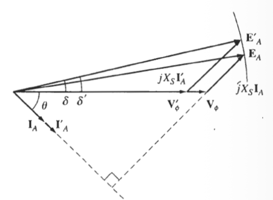
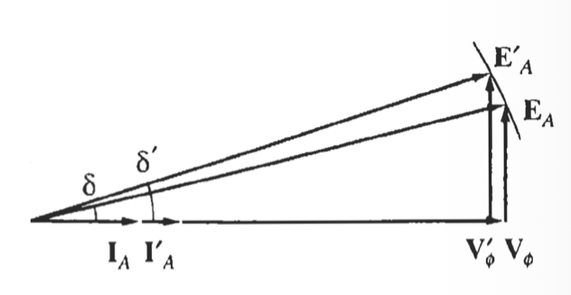
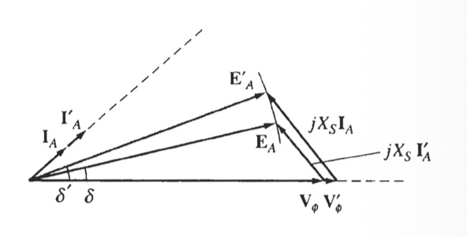

---

## § External and Regulation Characteristics

The relationship between terminal voltage and load current ($V_T$ vs $I_A$) is the **external characteristic**. The relationship between field current and load current ($I_f$ vs $I_A$) required to keep terminal voltage constant is the **regulation characteristic**.

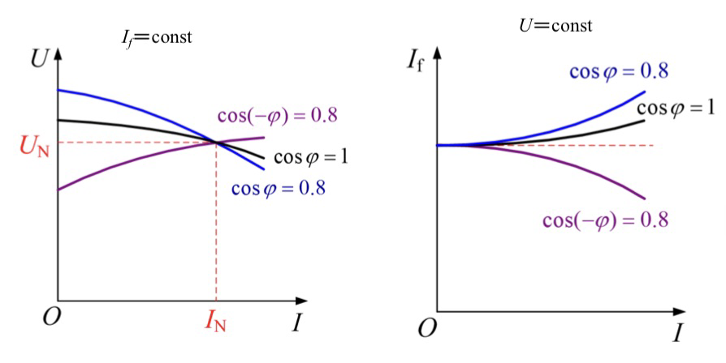
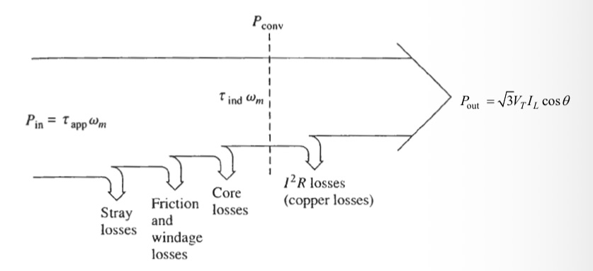

---

## § Power and Torque in a Synchronous Generator

Neglecting the armature resistance $R_A$, the real power output $P$ of a cylindrical rotor generator is:
$$P = \frac{3 V_\phi E_A}{X_s} \sin\delta$$

The induced torque $\tau_{ind}$ is:
$$\tau_{ind} = \frac{P}{\omega_m} = \frac{3 V_\phi E_A}{\omega_m X_s} \sin\delta$$

The power angle $\delta$ is the electrical angle between $\vec{E}_A$ and $\vec{V}_\phi$. The maximum output power occurs at $\delta = 90^\circ$:
$$P_{max} = \frac{3 V_\phi E_A}{X_s}$$

---

## § Power Angle Characteristic of a Salient-Pole Machine

For a salient-pole machine, neglecting $R_A$, the power is:
$$P = \frac{3 V_\phi E_A}{X_d} \sin\delta + \frac{3 V_\phi^2 (X_d - X_q)}{2 X_d X_q} \sin 2\delta$$

The power expression consists of two terms:
1. **Field excitation power**: $\frac{3 V_\phi E_A}{X_d} \sin\delta$ (depends on rotor excitation $E_A$).
2. **Reluctance power**: $\frac{3 V_\phi^2 (X_d - X_q)}{2 X_d X_q} \sin 2\delta$ (independent of excitation; exists because of the unequal inductances $X_d \neq X_q$).

Due to the double-frequency reluctance component ($\sin 2\delta$), the maximum power $P_{max}$ of a salient-pole machine occurs at a power angle $\delta < 90^\circ$.

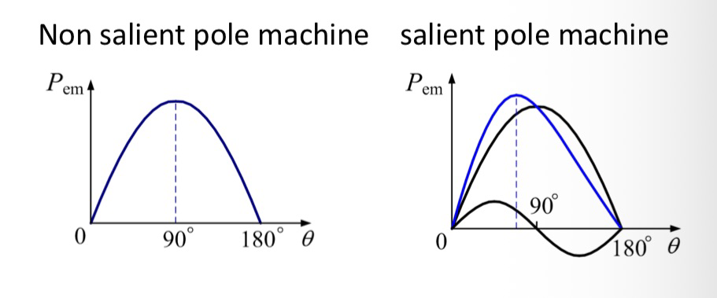

---

## § Frequency-Power Characteristics of a Generator

The mechanical speed of a generator's prime mover is inversely proportional to the load power:
$$\text{SD} = \frac{n_{nl} - n_{fl}}{n_{fl}} \times 100\%$$

The frequency-power relation is modeled as:
$$P = s_p (f_{nl} - f_{sys})$$

where:
* $f_{nl}$: no-load frequency of the generator
* $f_{sys}$: system frequency
* $s_p$: governor slope (kW/Hz)

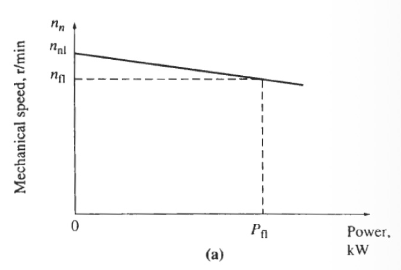
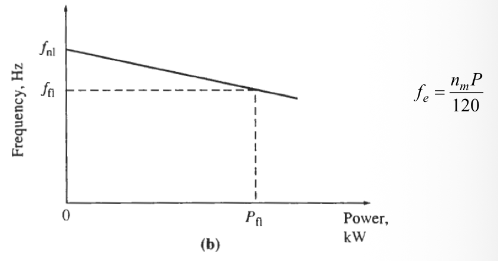

---

## § Reactive Power and V-Curves of a Synchronous Machine

If a generator's active power output $P$ is kept constant:
$$I_A \cos\phi = \text{constant}$$
$$E_A \sin\delta = \text{constant}$$

As the excitation field current $I_f$ is varied:
* **Normal excitation**: $\cos\phi = 1$, the generator produces zero reactive power ($Q = 0$).
* **Overexcitation**: The generator operates at a lagging power factor, supplying reactive power to the grid ($Q > 0$).
* **Underexcitation**: The generator operates at a leading power factor, absorbing reactive power from the grid ($Q < 0$).

The plot of armature current $I_A$ vs field current $I_f$ forms a series of **V-curves**.

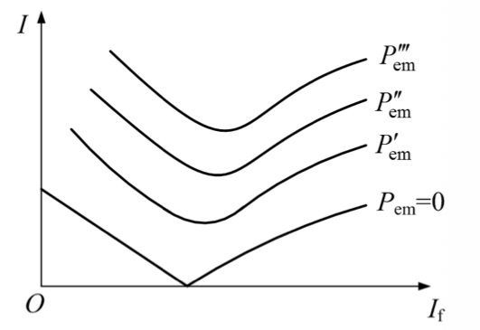
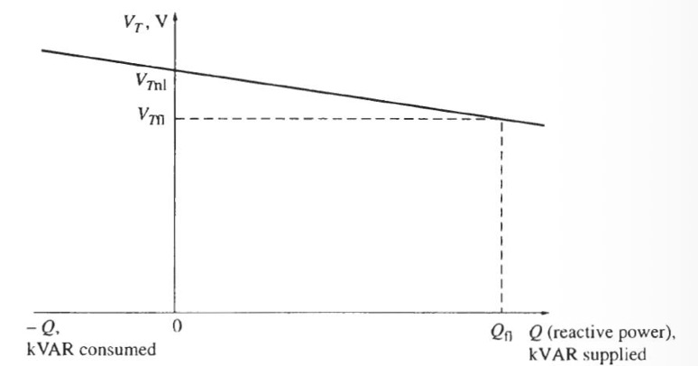

---

## § Parallel Operation of AC Generators

To connect a generator in parallel with an existing system, four conditions must be met:
1. **Voltage magnitudes**: The RMS line voltages of the oncoming generator and the running system must be equal.
2. **Phase sequence**: Both systems must have the same phase sequence (e.g., $a-b-c$).
3. **Phase angles**: The phase angles of the two systems must be identical.
4. **Frequency**: The frequency of the oncoming generator must be slightly higher than the system frequency to prevent it from acting as a motor immediately upon connection.

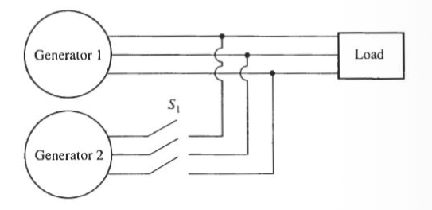

---

## § Parallel Operation with an Infinite Bus

When a generator is connected to an infinite bus:
* The system frequency $f_{sys}$ and terminal voltage $V_T$ are fixed.
* Adjusting the governor shifts the no-load frequency $f_{nl}$, changing the active power output $P$ of the generator:
  $$P_G = s_p (f_{nl} - f_{sys})$$
* Adjusting the field excitation $I_f$ changes the reactive power output $Q$ without affecting active power.

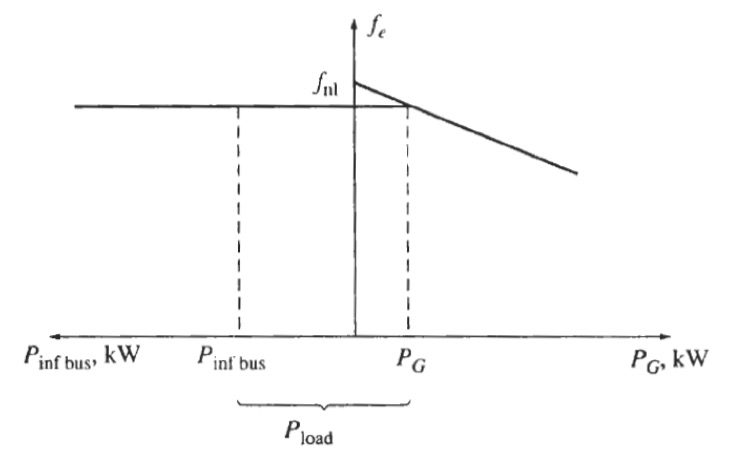
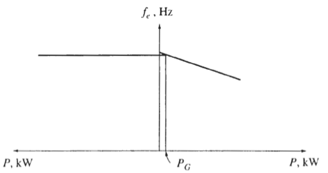
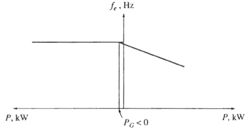
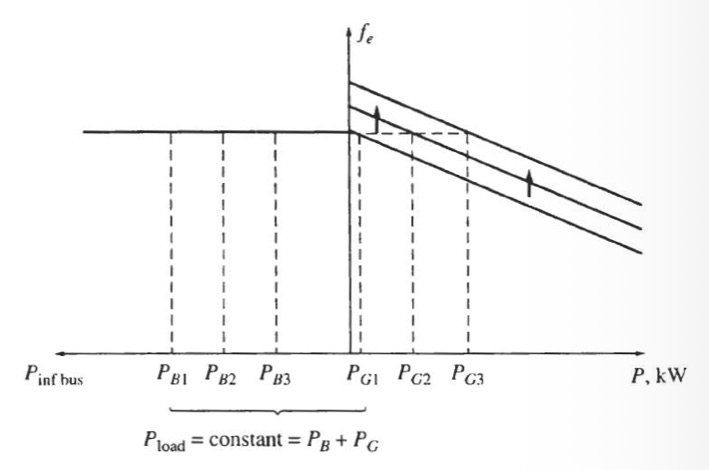
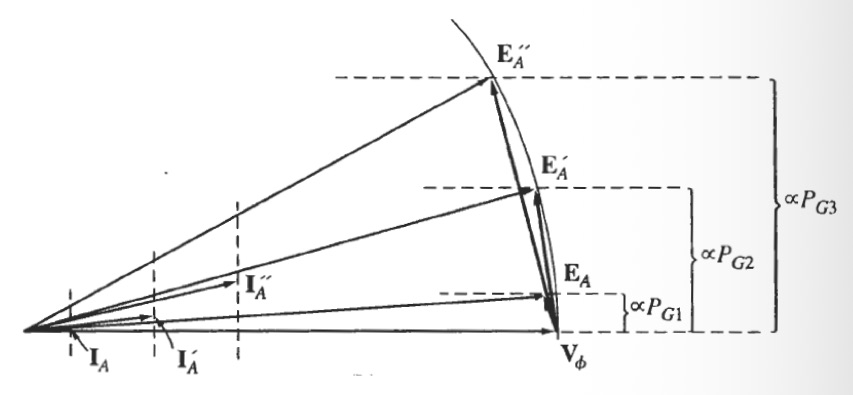

---

## § Power Sharing between Parallel Generators

When two generators of comparable size operate in parallel, the total active and reactive load must be shared between them:
$$P_{load} = P_{G1} + P_{G2}$$
$$Q_{load} = Q_{G1} + Q_{G2}$$

* Adjusting the governor of one generator changes the active power allocation between them and alters the system frequency unless both governors are adjusted in opposite directions.
* Adjusting the excitation of one generator changes the reactive power allocation between them and alters the terminal voltage.

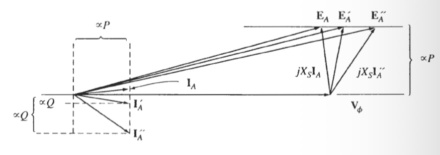
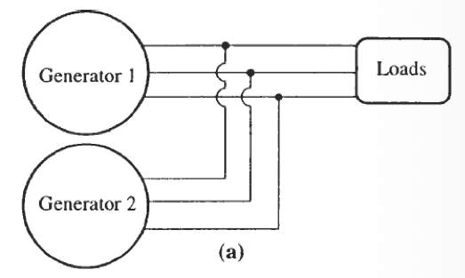
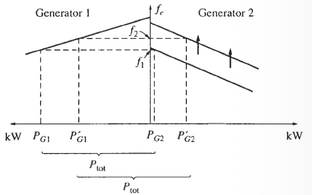
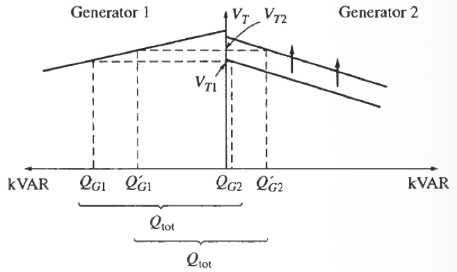

---

## § House Diagram of a Parallel System

House diagrams show the frequency-power and voltage-reactive power relationships of two generators operating in parallel.

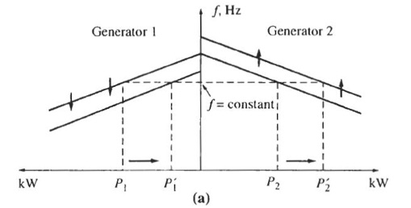
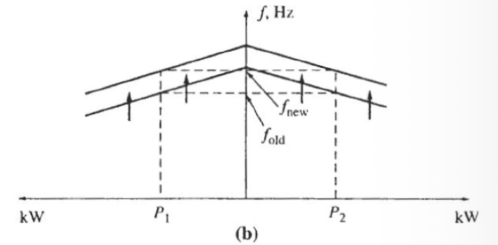

---

## § Synchronous Generator Transients

When a generator is synchronized to a grid, transients occur due to phase and speed differences:
* If the generator speed is slightly faster before connection, a positive torque is induced:
  $$\vec{t}_{ind} = k \vec{B}_R \times \vec{B}_{net}$$
  This torque acts as a mechanical load on the rotor, slowing it down to match the synchronous speed of the power grid.

---

## § Synchronous Generator Ratings

Synchronous machine ratings protect the windings and core from thermal and insulation breakdown:
* **Voltage and Frequency**: Operating at lower frequencies (e.g. 50Hz for a 60Hz machine) requires reducing the rated voltage by the same proportion to prevent magnetic saturation.
* **Apparent Power**: Limited by stator winding heating ($I_A^2 R_A$).
  $$S_{rated} = 3 V_{\phi,rated} I_{A,rated}$$
* **Power Factor**: Limited by field winding heating ($I_f^2 R_f$).

---

## § Generator Capability Curve

The capability curve describes the safe operating limits of a synchronous generator on a P-Q plane:
1. **Stator current limit**: A circle centered at the origin with radius:
   $$S = 3 V_\phi I_{A,max}$$
2. **Rotor current limit**: A circle centered at $(0, -\frac{3 V_\phi^2}{X_s})$ with radius:
   $$\frac{3 V_\phi E_{A,max}}{X_s}$$
3. **Prime-mover power limit**: A vertical line bounding active power output.

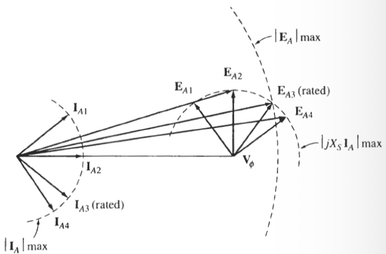
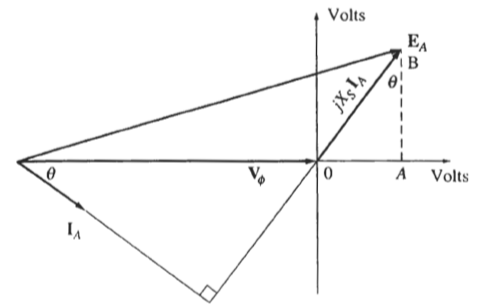
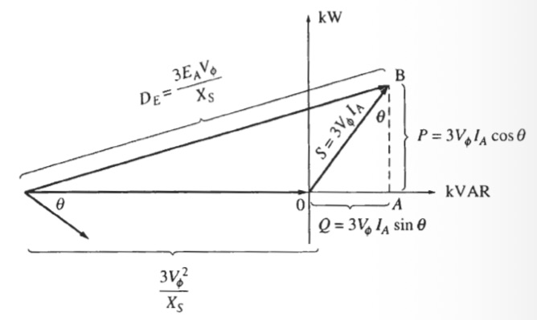

---

## § Synchronous Motor

A synchronous motor has the same physical structure as a generator but converts electrical power to mechanical power. At starting ($n_m = 0$), the average torque is zero because the magnetic field rotates too quickly for the rotor to accelerate.

Methods to start a synchronous motor:
1. **Assisted start**: Use an auxiliary prime mover (pony motor) to accelerate the rotor to synchronous speed before applying excitation.
2. **Variable frequency drive**: Supply power at a low frequency and ramp it up as the motor accelerates.
3. **Amortisseur (damper) windings**: Short-circuited bars in the pole faces act as an induction motor rotor during starting.

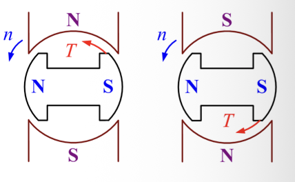
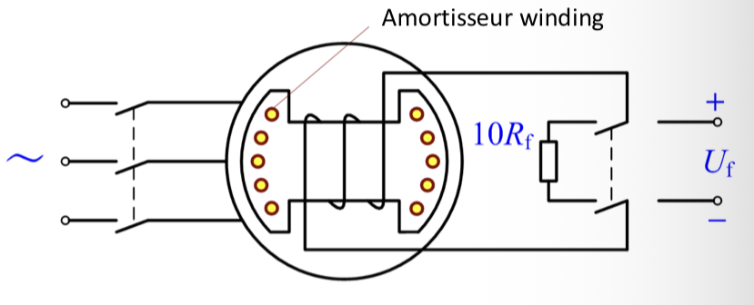
