## § Induction Motor Rotor Construction

Induction motors use a stator that produces a rotating magnetic field and a rotor that relies on electromagnetic induction.
Rotor types:
1. **Squirrel-cage rotor**: Consists of thick conducting bars laid in slots on the rotor core, short-circuited by end rings. It is simple, rugged, and requires no brushes.
2. **Wound rotor**: Features a complete three-phase winding connected to slip rings and brushes. External resistors can be added to control starting current and torque.

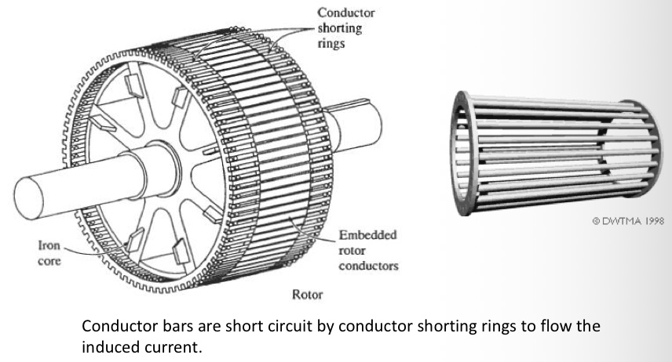
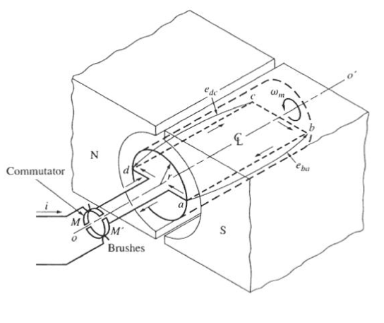

---

## § Squirrel-Cage Rotor Equivalent Phases

The squirrel-cage rotor acts as a multi-phase system:
* Number of phases $m_c$ equals the number of rotor slots.
* Winding factor $k_{dp2} = 1$.
* Stator rotating magnetic field speed:
  $$n_s = \frac{120 f_e}{P}$$

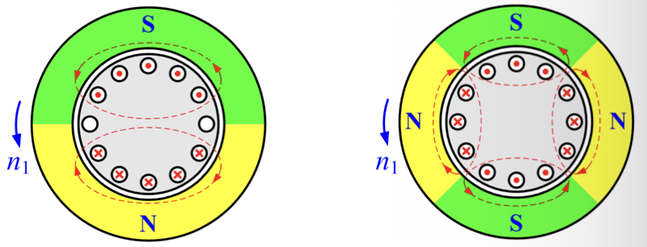

---

## § Principle of Operation

As the stator magnetic field rotates, it cuts the rotor bars and induces a voltage:
$$e_{ind} = (\vec{v} \times \vec{B}) \cdot \vec{l}$$

where $\vec{v}$ is the velocity of the bar relative to the magnetic field.
The induced voltage drives a rotor current. Because of the rotor's leakage inductance, the rotor current lags behind the induced voltage. The interaction of the rotor current with the stator field produces torque:
$$\vec{\tau}_{ind} = k \vec{B}_R \times \vec{B}_S$$

This torque accelerates the rotor in the direction of the rotating field.

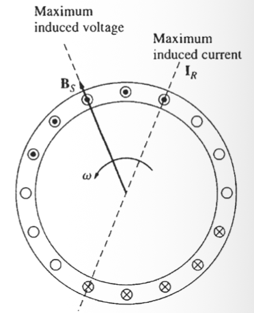
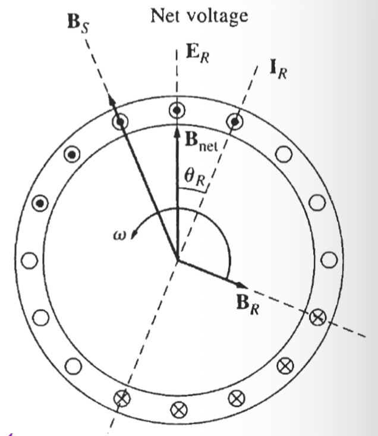

---

## § Slip and Mechanical Speed Relations

To induce voltage, the rotor mechanical speed $n_m$ must be less than the synchronous speed $n_s$. We define the **slip speed** as $n_{slip} = n_s - n_m$ and the **slip** $s$ as:
$$s = \frac{n_s - n_m}{n_s} \times 100\%$$

* At standstill: $s = 1$ ($100\%$).
* At synchronous speed: $s = 0$.

The mechanical speed is:
$$n_m = (1-s) n_s, \quad \omega_m = (1-s) \omega_s$$

Stator frequency $f_e$ and rotor frequency $f_r$ are related by:
$$f_r = s f_e$$

The rotor MMF rotates at synchronous speed $n_s$ relative to the stator:
$$n_{R,stator} = n_r + n_m = s n_s + (1-s) n_s = n_s$$

---

## § Induction Motor Circuit Model under Locked-Rotor Conditions

At standstill ($s=1$), the induction motor acts as a static transformer. The effective turns ratio is:
$$k_e = \frac{N_1 k_{w1}}{N_2 k_{w2}}$$

Stator and rotor voltages are related by $k_e$. The magnetizing current $I_0$ supplies the main flux and accounts for core losses.
$$I_0 = I_a + I_m$$

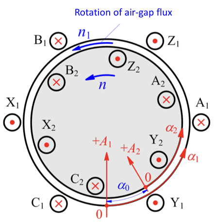

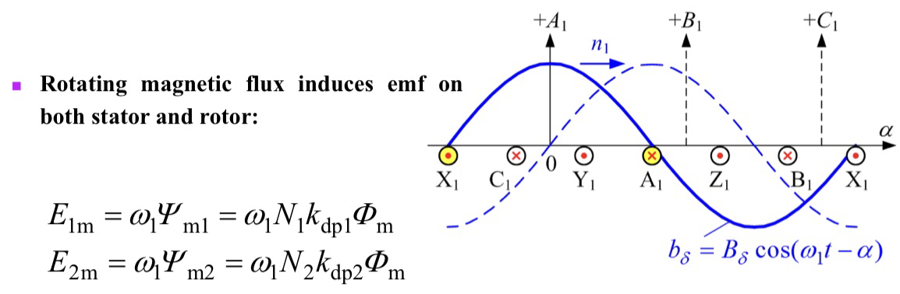

---

## § Equivalent Circuit of an Induction Motor

The per-phase equivalent circuit of an induction motor at standstill is identical to that of a transformer:
$$\vec{V}_1 = \vec{I}_1 R_1 + j\vec{I}_1 X_1 + \vec{E}_1$$
$$\vec{E}_1 = -j\vec{I}_0 X_m$$
$$\vec{E}_2 = \vec{I}_2 R_2 + j\vec{I}_2 X_2$$

where:
* $R_1, X_1$: stator resistance and leakage reactance
* $R_2, X_2$: rotor resistance and leakage reactance
* $X_m$: magnetizing reactance

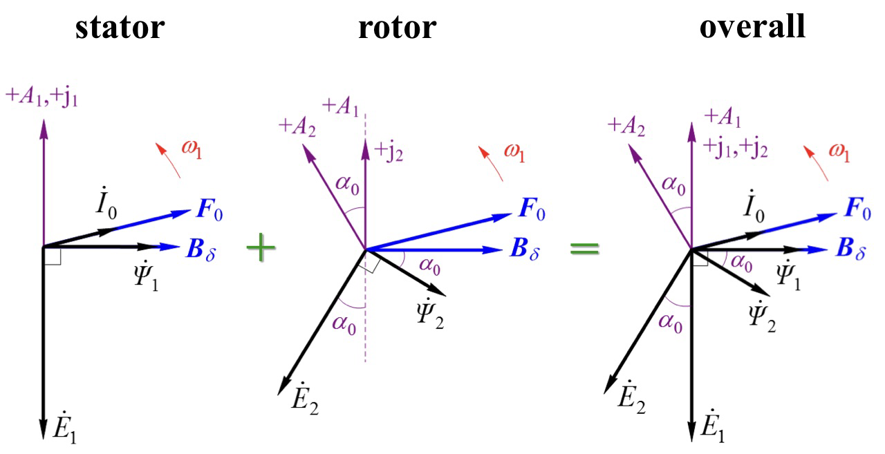
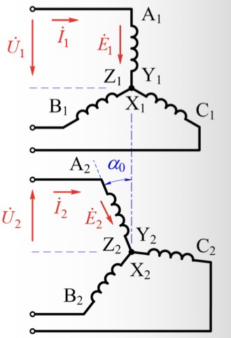

---

## § Secondary to Primary Side Parameter Conversion

Rotor parameters are referred to the stator using the effective turns ratio $k_e$ and current ratio $k_i$:
$$k_e = \frac{N_1 k_{w1}}{N_2 k_{w2}}, \quad k_i = \frac{m_1 N_1 k_{w1}}{m_2 N_2 k_{w2}}$$
$$E_2' = k_e E_2 = E_1$$
$$I_2' = \frac{I_2}{k_i}$$
$$R_2' = k_e k_i R_2$$
$$X_2' = k_e k_i X_2$$

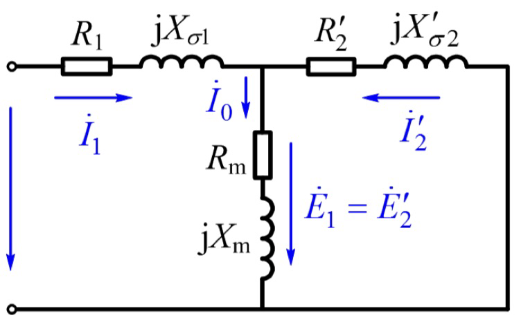

---

## § Equivalent Circuit under Rotating Conditions

When the rotor is rotating at slip $s$:
* The rotor induced EMF is $E_{2s} = s E_2$.
* The rotor leakage reactance is $X_{2s} = s X_2$.
The rotor current is:
$$I_2 = \frac{s E_2}{R_2 + j s X_2} = \frac{E_2}{\frac{R_2}{s} + j X_2}$$

Referring to the stator:
$$I_2' = \frac{E_1}{\frac{R_2'}{s} + j X_2'}$$

The slip-dependent resistance $\frac{R_2'}{s}$ is split into two parts:
$$\frac{R_2'}{s} = R_2' + R_2' \frac{1-s}{s}$$

where:
* $R_2'$: represents rotor copper losses.
* $R_2' \frac{1-s}{s}$: represents converted mechanical power.

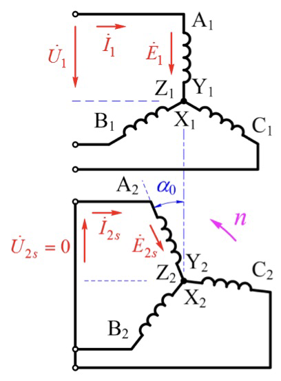
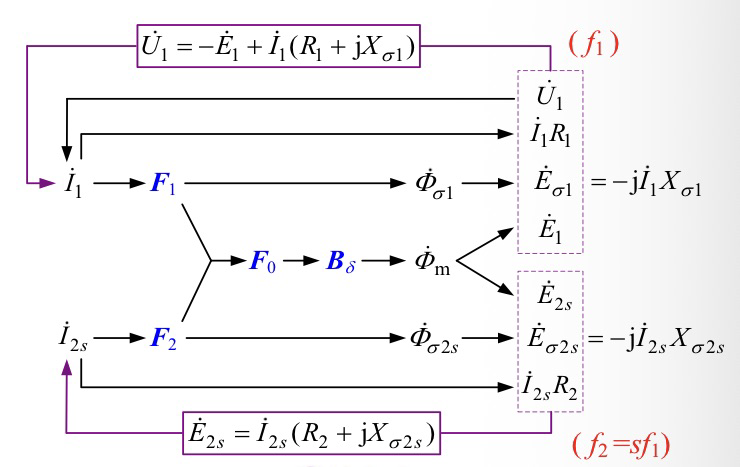
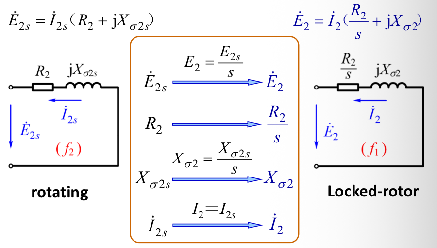
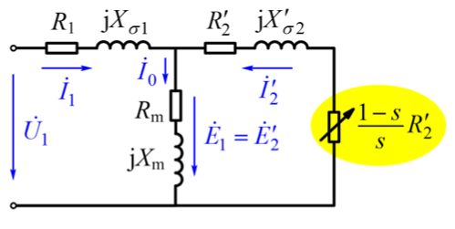
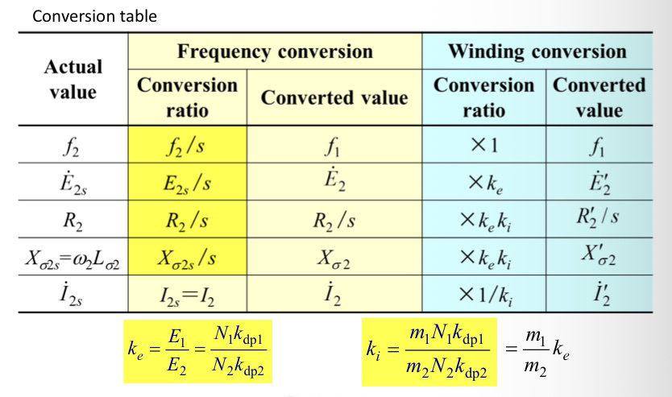

---

## § Determining Circuit Model Parameters

Induction motor parameters are determined using three tests:
1. **DC Test**: Measures stator resistance $R_1$.
2. **No-Load Test**: Motor runs unexcited and unloaded ($s \approx 0$). Input power equals stator copper loss plus rotational losses (core loss + friction/windage).
   $$P_{in} = 3 I_1^2 R_1 + P_{rot}$$
   $$Z_{nl} \approx X_1 + X_m$$
3. **Locked-Rotor Test**: Rotor is locked ($s = 1$). A reduced frequency voltage is applied to determine leakage reactances and rotor resistance.
   $$R_{LR} = R_1 + R_2' = \frac{P_{LR}}{3 I_{LR}^2}$$
   $$X_{LR}' = X_1 + X_2' = \sqrt{Z_{LR}^2 - R_{LR}^2}$$
   Reactance at rated frequency:
   $$X_{LR} = X_{LR}' \frac{f_{rated}}{f_{test}}$$

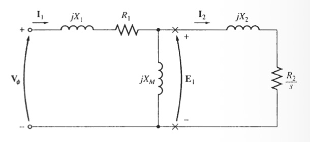
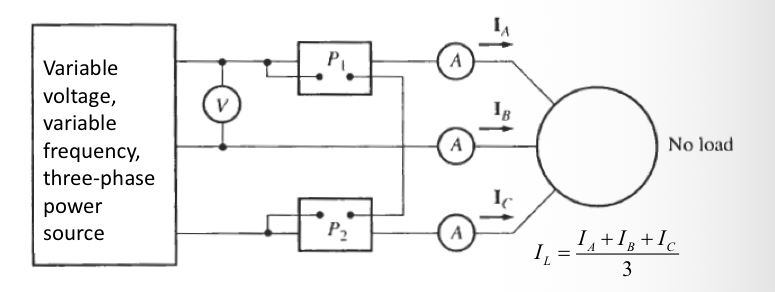
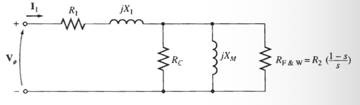
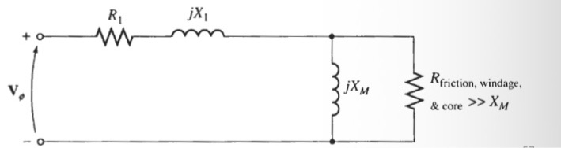
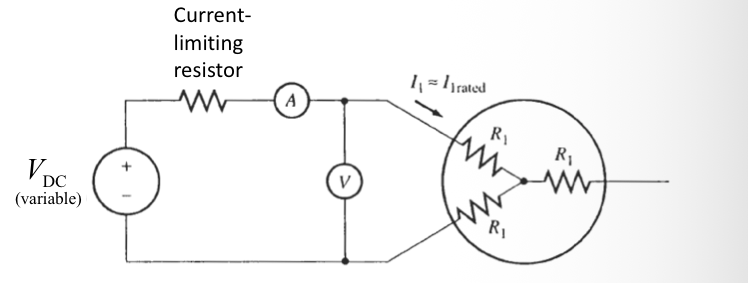
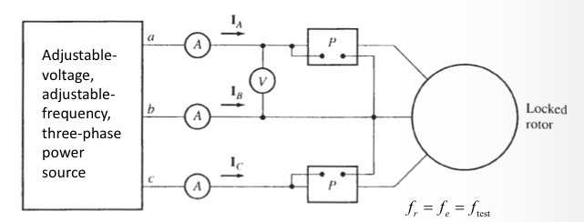
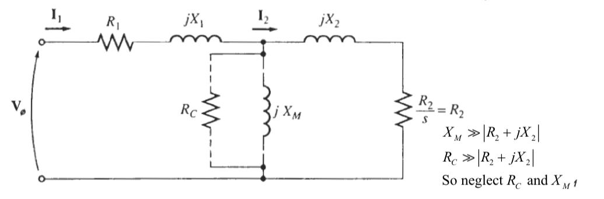
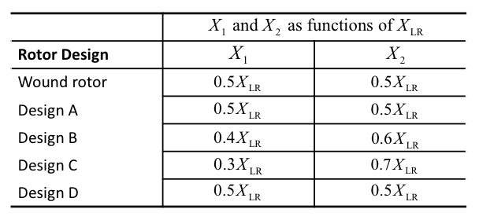

---

## § Power and Torque in Induction Motors

The input power is:
$$P_{in} = \sqrt{3} V_L I_L \cos\theta$$

Stator copper loss and core loss:
$$P_{SCL} = 3 I_1^2 R_1, \quad P_{core} = 3 E_1^2 G_c$$

Air-gap power:
$$P_{AG} = P_{in} - P_{SCL} - P_{core} = 3 I_2'^2 \frac{R_2'}{s}$$

Rotor copper loss:
$$P_{RCL} = 3 I_2'^2 R_2' = s P_{AG}$$

Converted power (mechanical):
$$P_{conv} = P_{AG} - P_{RCL} = 3 I_2'^2 R_2' \frac{1-s}{s} = (1-s) P_{AG}$$

Induced torque:
$$\tau_{ind} = \frac{P_{AG}}{\omega_s}$$

Output power:
$$P_{out} = P_{conv} - P_{F\&W} - P_{misc}$$

The power ratios are:
$$P_{AG} : P_{RCL} : P_{conv} = 1 : s : (1-s)$$

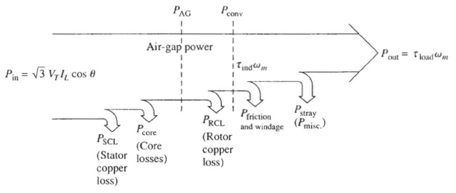

---

## § Torque-Speed Characteristics of an Induction Motor

The induced torque is:
$$\tau_{ind} = k B_R B_S \sin\delta$$

Neglecting stator impedance:
$$\vec{V}_1 \approx \vec{E}_1 \implies B_{net} \approx \text{constant}$$
The torque-speed curve is divided into:
1. **Low-slip region**: $s \to 0$, $R_2/s \gg X_2$, rotor power factor $\approx 1$, torque is linear with slip.
2. **Moderate-slip region**: Rotor reactance $s X_2$ becomes comparable to $R_2$. Torque reaches a maximum (pullout torque).
3. **High-slip region**: $s \to 1$. High current but low torque due to low power factor.

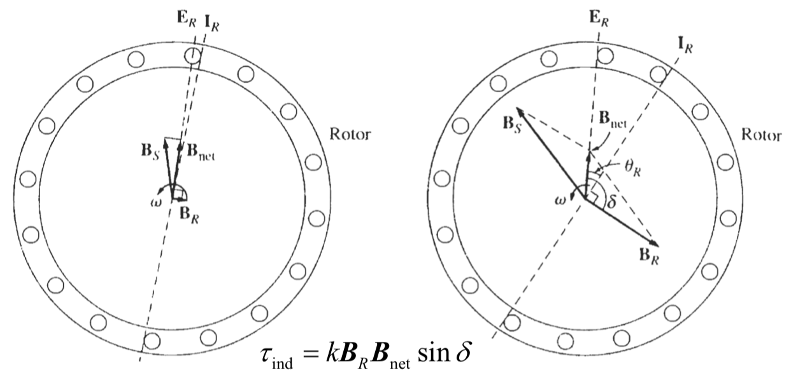
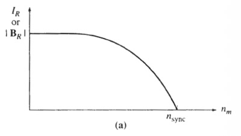
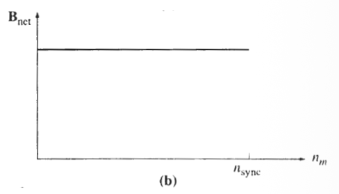
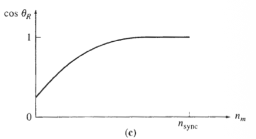
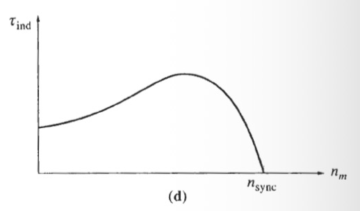

---

## § Derivation of the Torque-Speed Equation

Using Thevenin's theorem at the stator side:
$$\vec{V}_{TH} = \vec{V}_\phi \frac{j X_m}{R_1 + j(X_1 + X_m)} \approx \vec{V}_\phi \frac{X_m}{X_1 + X_m}$$
$$Z_{TH} = R_{TH} + j X_{TH} = \frac{j X_m (R_1 + j X_1)}{R_1 + j(X_1 + X_m)}$$
$$R_{TH} \approx R_1 \left(\frac{X_m}{X_1 + X_m}\right)^2, \quad X_{TH} \approx X_1$$

The rotor current is:
$$I_2' = \frac{V_{TH}}{\sqrt{\left(R_{TH} + \frac{R_2'}{s}\right)^2 + (X_{TH} + X_2')^2}}$$

The induced torque is:
$$\tau_{ind} = \frac{3 V_{TH}^2 \frac{R_2'}{s}}{\omega_s \left[\left(R_{TH} + \frac{R_2'}{s}\right)^2 + (X_{TH} + X_2')^2\right]}$$

---

## § Maximum (Pullout) Torque

By impedance matching, maximum torque occurs at:
$$s_{max} = \frac{R_2'}{\sqrt{R_{TH}^2 + (X_{TH} + X_2')^2}}$$

The maximum torque is:
$$\tau_{max} = \frac{3 V_{TH}^2}{2 \omega_s \left[R_{TH} + \sqrt{R_{TH}^2 + (X_{TH} + X_2')^2}\right]}$$

The maximum torque is independent of rotor resistance $R_2$, but the slip at which it occurs is proportional to $R_2$.

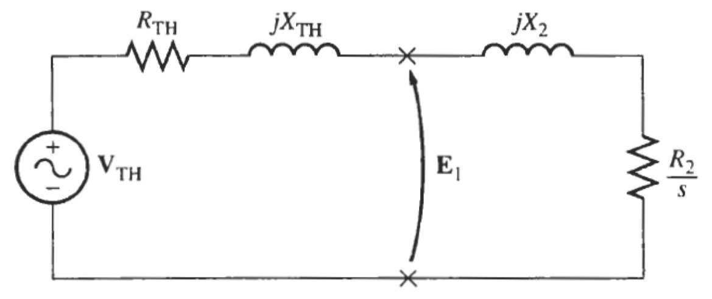
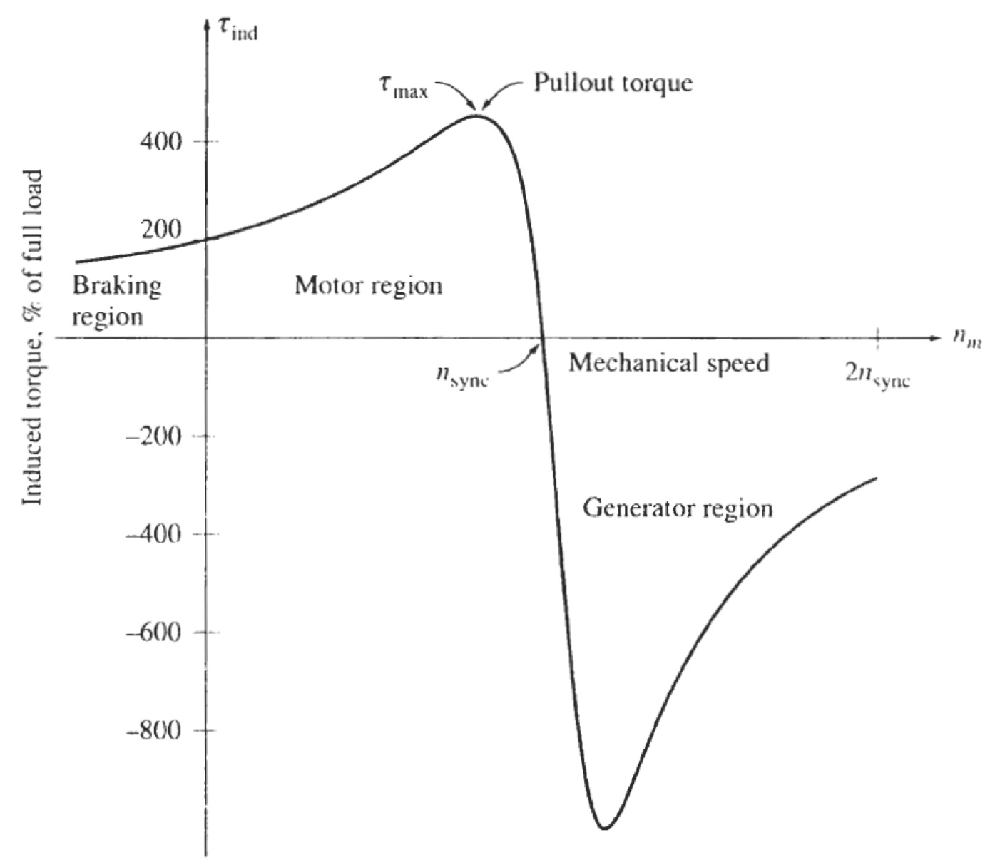
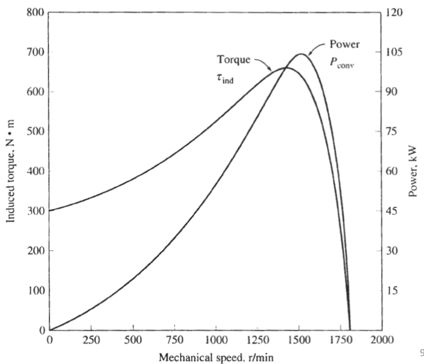
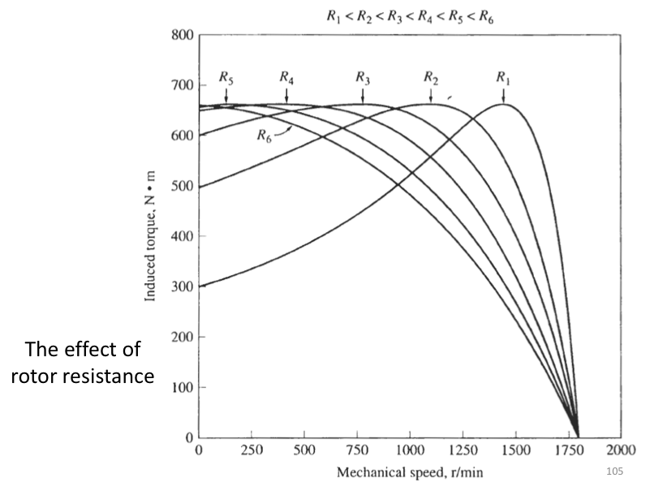

---

## § Control by Rotor Bar Structure and NEMA Classes

Wound-rotor motors can vary $R_2$ using external resistors. For cage rotors, variable rotor resistance is achieved using:
* **Deep rotor bars**: At starting, high rotor frequency (equal to stator frequency) causes current to crowd to the top of the bars (skin effect), increasing resistance. At running, low rotor frequency allows current to distribute evenly, reducing resistance.
* **Double-cage rotor**: Has an outer cage of high resistance/low reactance and an inner cage of low resistance/high reactance.

NEMA Design Classes (A, B, C, D) represent different starting torque and current characteristics.

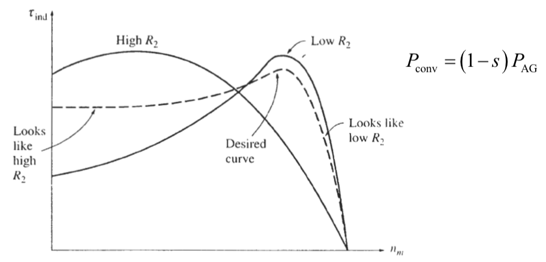
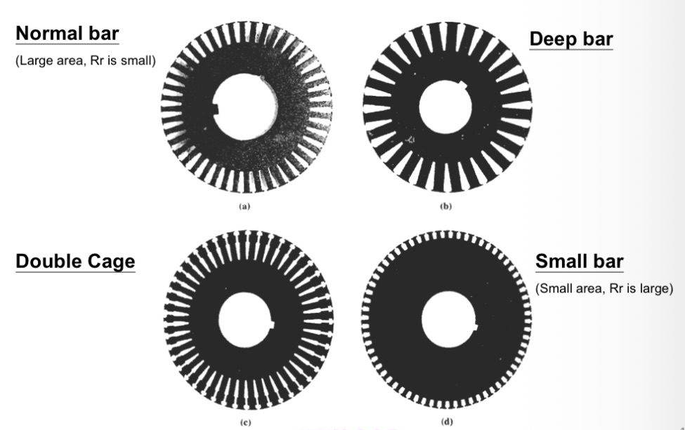
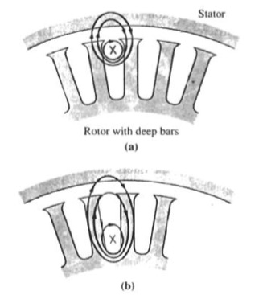
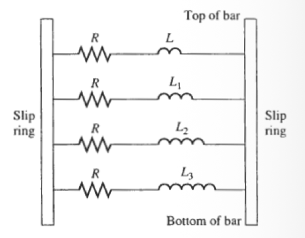
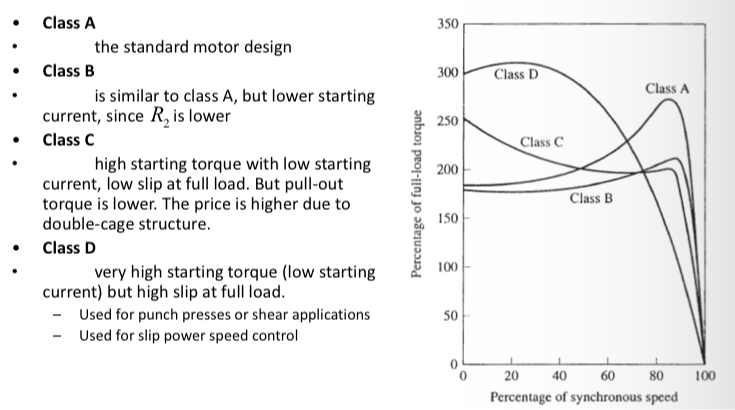

---

## § Speed Control of an Induction Motor

Methods for speed control:
1. **Changing line voltage**: Torque is proportional to $V^2$. High slip operation results in high rotor losses and low efficiency. Limited speed range.
2. **Changing rotor resistance**: Wound-rotor only. Simple but inefficient.
3. **Variable Voltage Variable Frequency (VVVF) control**:
   To prevent saturation, the stator voltage is scaled with frequency ($V \propto f$). Above rated frequency, voltage is constant and torque limit decreases ($\tau \propto 1/f$).

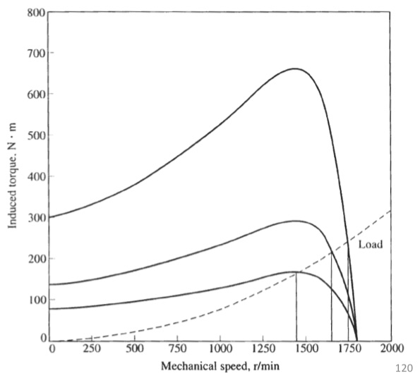
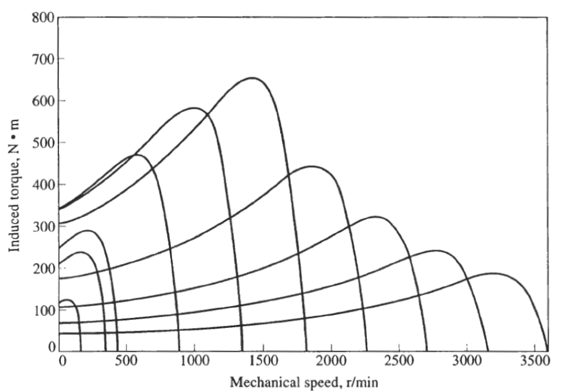

---

## § Starting of Induction Motors

The starting current is very large (5 to 8 times rated) while the starting torque is modest.
Methods to reduce starting current:
* Reduced-voltage starting (using autotransformer or star-delta starter).
* Deep rotor bars / double cage.
* Rotor resistance (wound rotor).

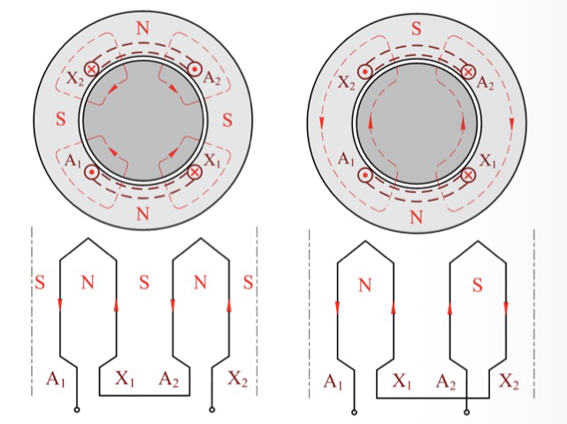
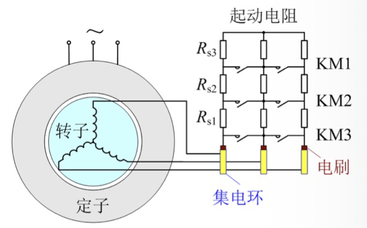
