## § Basic Principles of DC Machines

DC machines rely on a rotating armature winding and a stationary field system.
* Induced EMF:
  $$E_a = K_a \Phi \omega_m$$
* Induced torque:
  $$\tau_{ind} = K_a \Phi I_a$$

where:
* $K_a = \frac{p N_c}{\pi a}$ (machine constant)
* $\Phi$: flux per pole
* $I_a$: armature current
* $\omega_m$: rotor speed (rad/s)

The **commutator** acts as a mechanical rectifier, converting the internal AC voltage of the armature coils to DC at the brushes.

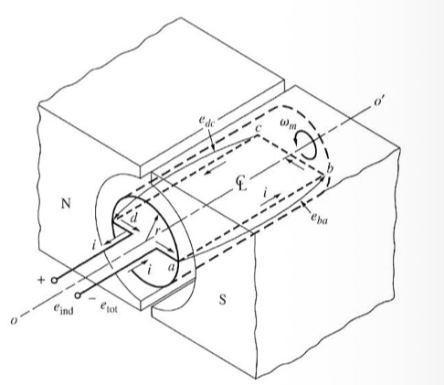
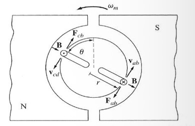
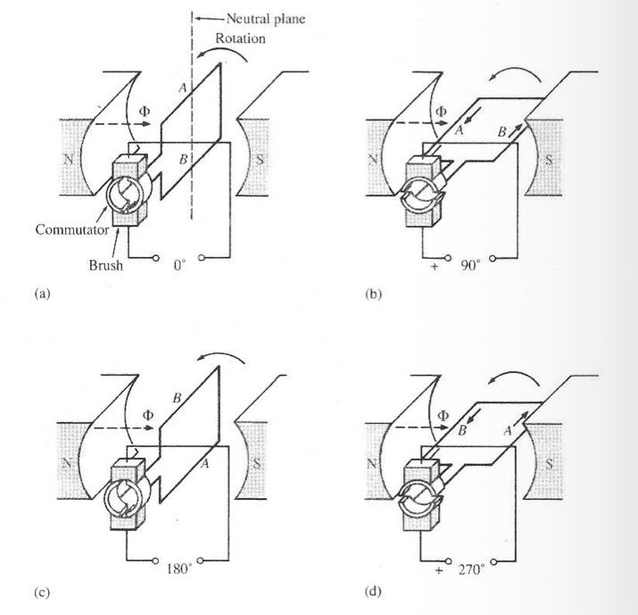

---

## § Voltage Ripple and Commutator Segments

A simple loop generator produces a highly pulsating DC voltage. By adding more coils and commutator segments, the brushes always connect to the coil inducing the highest instantaneous EMF. This reduces the **voltage ripple** (harmonics), producing a smooth DC output.

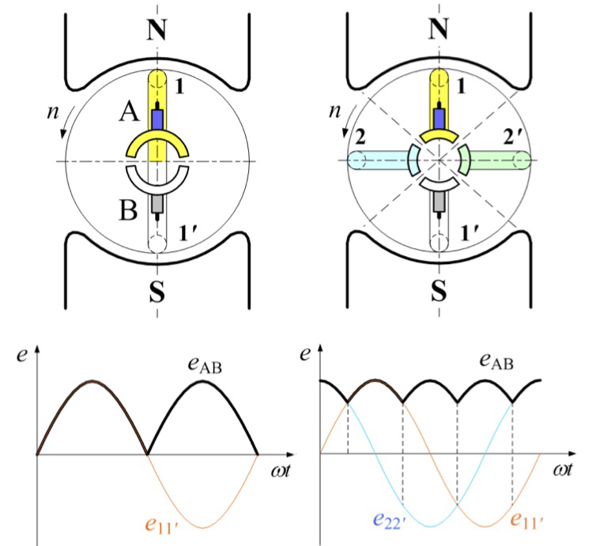
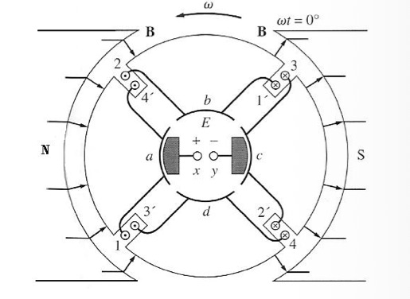

---

## § Armature Windings of DC Machines

DC armature windings are closed-loop windings classified into:
1. **Lap Winding**: The ends of each coil are connected to adjacent commutator segments. The number of parallel paths $a$ equals the number of poles $P$ ($a = P$). Used for high current, low voltage applications.
2. **Wave Winding**: The coil ends are connected to segments spaced far apart. The number of parallel paths is always two ($a = 2$). Used for high voltage, low current applications.

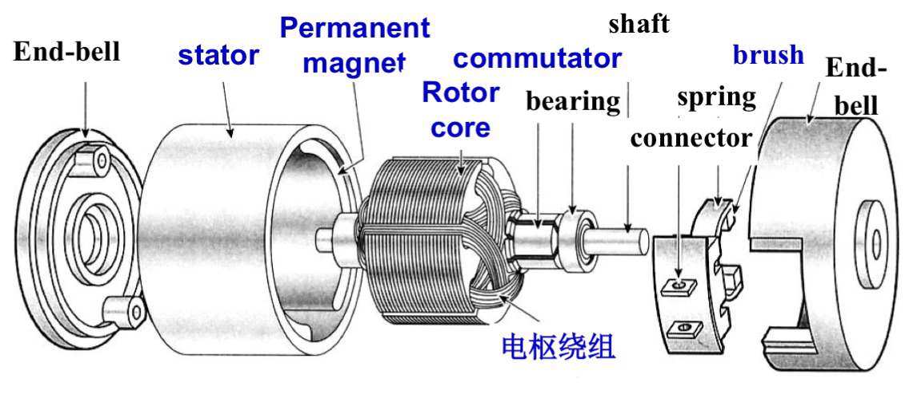
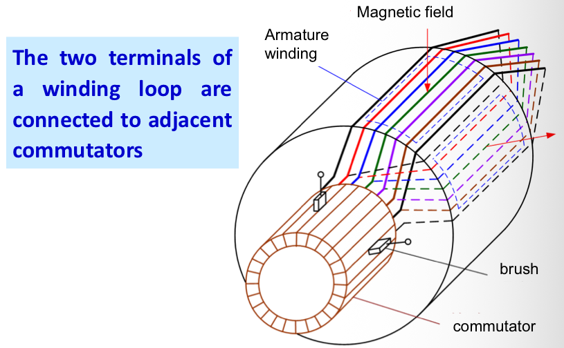
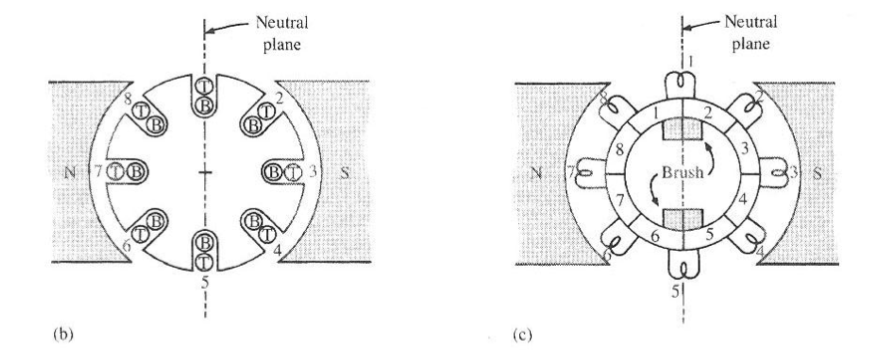
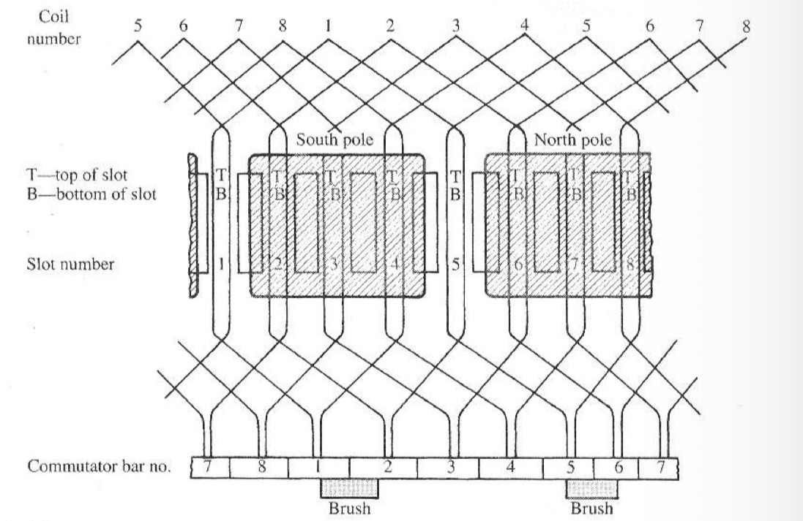
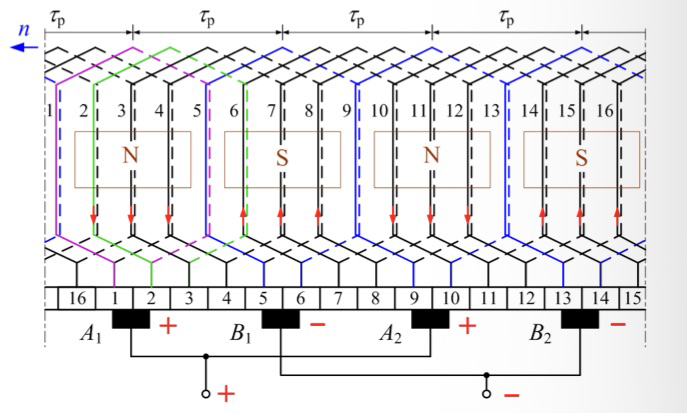

---

## § Problems with Commutation

During commutation, the armature current in a coil must reverse direction. Because of the coil's inductance $L$, a self-induced EMF (reactance voltage) opposes this change:
$$v = L \frac{di}{dt}$$

With short commutation times, this induced voltage is large, causing sparking at the brushes.

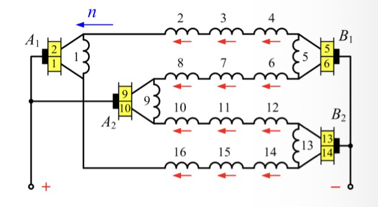
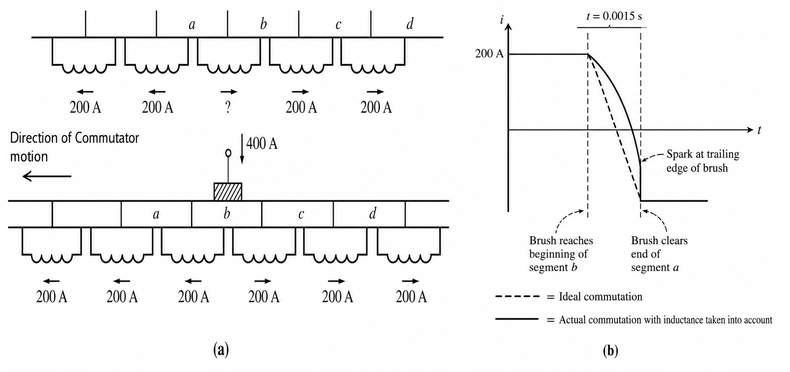

---

## § Solutions to Commutation Problems

1. **Interpoles (commutating poles)**: Small auxiliary poles placed between main poles. They induce a voltage in the short-circuited coil that cancels the reactance voltage and assists commutation.
2. **Compensating windings**: Windings placed in the main pole faces, connected in series with the armature, to cancel the cross-magnetizing armature reaction MMF.

---

## § Armature Reaction in DC Machines

Under no-load, the air-gap flux density $B_0$ is symmetrical, and the **magnetic neutral axis (MNA)** is perpendicular to the main pole axis.

Under load, the armature current generates a cross-magnetizing MMF $F_a$ (along the q-axis). This distorts the net flux density:
1. **Neutral axis shift**: The MNA shifts in the direction of rotation for a generator, and in the opposite direction for a motor.
2. **Flux weakening**: Due to saturation at the pole tips, the net flux per pole decreases, reducing the induced EMF $E_a$.

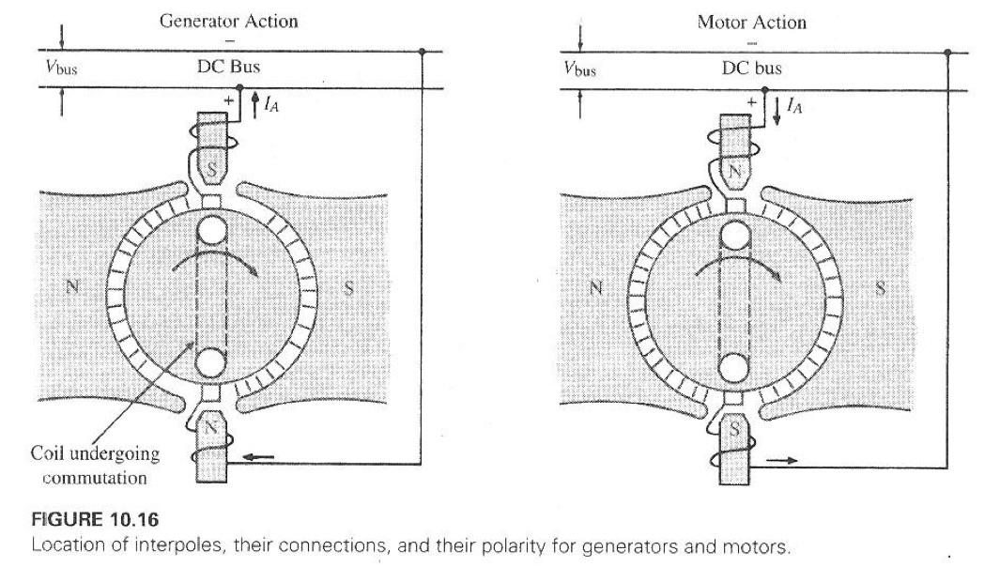
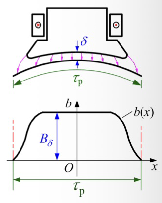
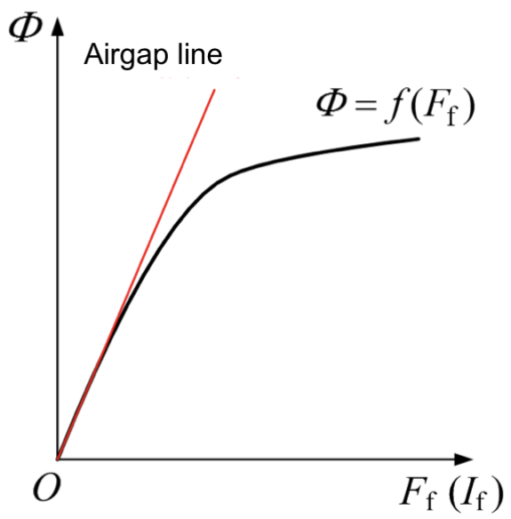
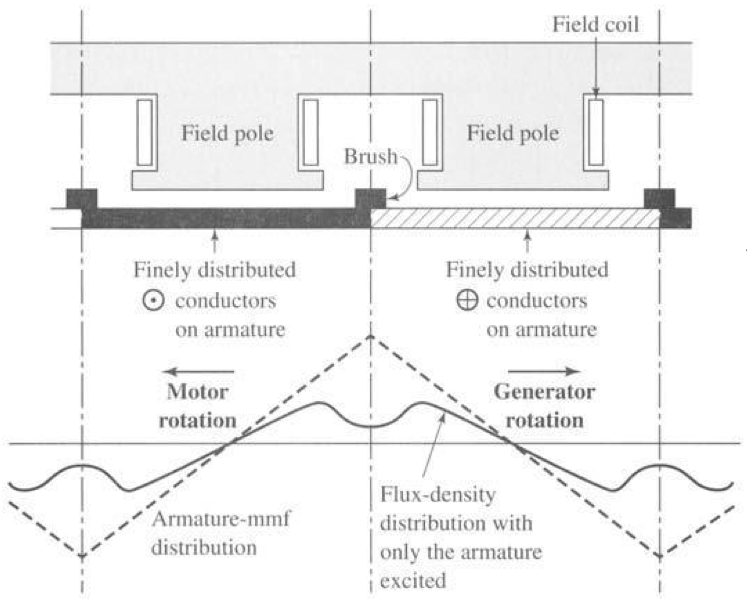
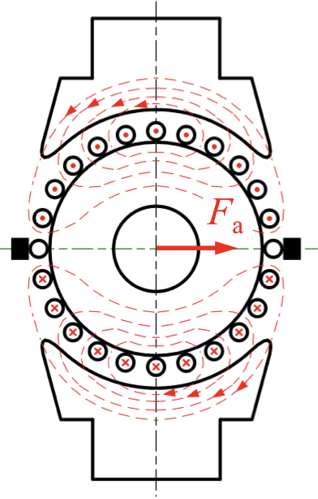
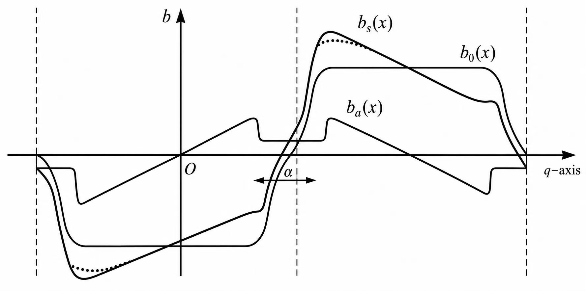

---

## § Equivalent Circuit of a DC Machine

The equivalent circuit consists of:
* Field circuit: $V_f = I_f R_f$
* Armature circuit: $V_t = E_a \pm I_a R_a$ ($-$ for generator, $+$ for motor).
* Converted power: $P_{conv} = E_a I_a = \tau_{ind} \omega_m$.

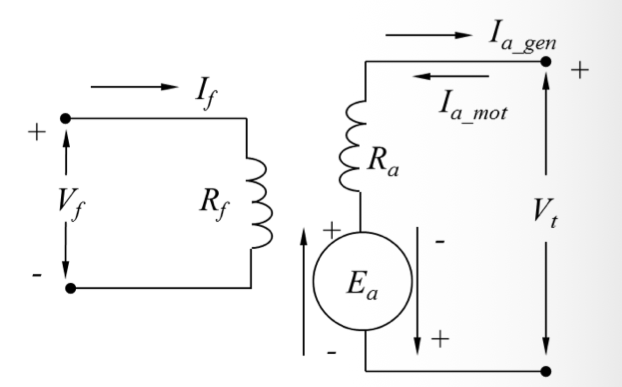

---

## § DC Machine Excitation Types

DC machines are classified by how the field winding is connected:
1. **Separately Excited**: Field winding is supplied by an independent DC source.
2. **Shunt**: Field winding is connected in parallel with the armature.
3. **Series**: Field winding is connected in series with the armature.
4. **Compound**: Has both shunt and series windings (can be cumulatively or differentially compounded).

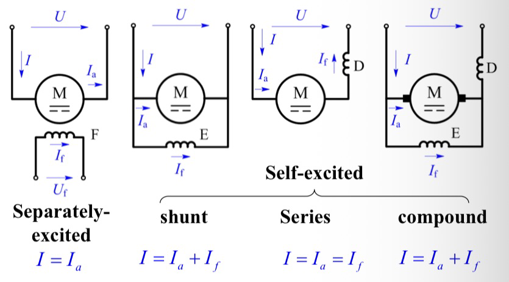
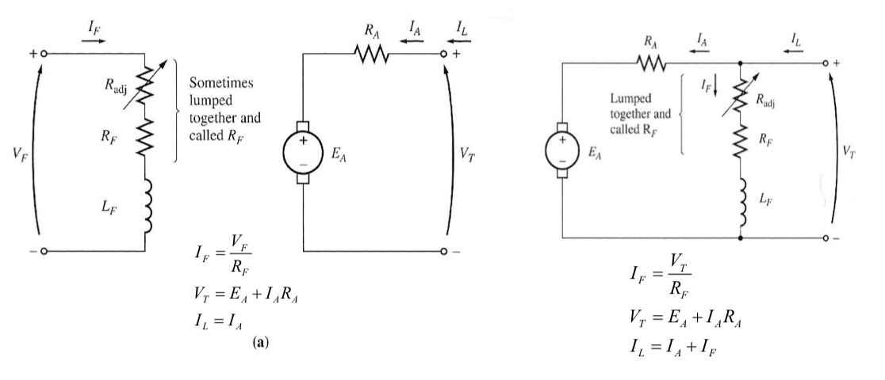
