## 2.1 电流密度

电流强度的定义：单位时间通过某一截面积的净电荷量。
$$ I = \frac{dq}{dt} = \iint_S \vec{J} \cdot d\vec{S} $$
只有对一个面才能定义电流，电流是有向面积分。  
电流密度的定义为：
$$ \vec{J} = \lim_{\Delta S \to 0} \frac{\Delta I}{\Delta S} \vec{n} $$
电流密度是矢量，单位是 $\text{A/m}^2$。  
电流是电流密度的通量：
$$ I = \iint_S \vec{J} \cdot d\vec{S} $$

欧姆定律的微分形式（电流密度与电场强度成正比）：
$$ \vec{J} = \sigma \vec{E} $$
其中 $\sigma$ 为电导率。

由电荷守恒定律得到**恒定电流连续性定理**：  
对于任意闭合面 $S$，流出闭合面的电流等于内部电荷的减少率：
$$ \oint_S \vec{J} \cdot d\vec{S} = -\frac{dq_{in}}{dt} $$
对于恒定电流场，电荷分布不随时间改变，即 $\frac{dq_{in}}{dt} = 0$，所以：
$$ \oint_S \vec{J} \cdot d\vec{S} = 0 \quad \Rightarrow \quad \nabla \cdot \vec{J} = 0 $$

---

## 2.2 恒定电流场的基本方程

$$ \begin{array}{c|c}
\text{微分形式} & \text{积分形式} \\
\hline
\nabla \times \vec{E} = 0 & \oint_l \vec{E} \cdot d\vec{l} = 0 \\
\nabla \cdot \vec{J} = 0 & \oint_S \vec{J} \cdot d\vec{S} = 0
\end{array} $$

联系方程为：$\vec{J} = \sigma \vec{E}$

**电位的引入**：

由于 $\nabla \times \vec{E} = 0$，可以引入标量位 $\varphi$，使 $\vec{E} = -\nabla\varphi$。

代入连续性方程有：
$$ \nabla \cdot (\sigma \vec{E}) = -\nabla \cdot (\sigma \nabla\varphi) = 0 $$
对于线性均匀导体，有 $\sigma = \text{const}$，则：
$$ \nabla^2 \varphi = 0 $$
即电位在导体内部满足拉普拉斯方程。

> [!NOTE]
> **恒定电流场与静电场的区别**：
> * 恒定电流场在导体内部电场不为零，且电位满足拉普拉斯方程 $\nabla^2 \varphi = 0$。
> * 静电场在导体内部电场为零，电位处处相等；其拉普拉斯方程 $\nabla^2 \varphi = 0$ 主要在介质中讨论。

##### 恒定电流场的分界面条件

* **法向边界条件**：
  由 $\nabla \cdot \vec{J} = 0$，穿过界面的电流连续：
  $$ J_{1n} = J_{2n} \quad \Rightarrow \quad \sigma_1 E_{1n} = \sigma_2 E_{2n} $$
  即：
  $$ \sigma_1 \frac{\partial \varphi_1}{\partial n} = \sigma_2 \frac{\partial \varphi_2}{\partial n} $$

* **切向边界条件**：
  由 $\nabla \times \vec{E} = 0$，界面两侧电场切向分量连续：
  $$ E_{1t} = E_{2t} \quad \Rightarrow \quad \frac{J_{1t}}{\sigma_1} = \frac{J_{2t}}{\sigma_2} $$
  电位在分界面上也是连续的：
  $$ \varphi_1 = \varphi_2 $$

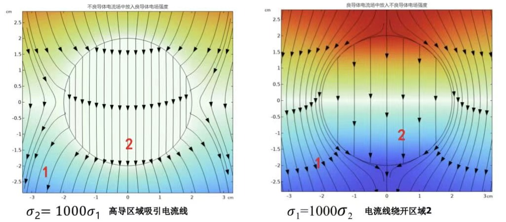

**折射定律：**  
由 $J_{1n} = J_{2n}$ 及 $\frac{J_{1t}}{\sigma_1} = \frac{J_{2t}}{\sigma_2}$，可得：
$$ \frac{\tan\theta_1}{\tan\theta_2} = \frac{J_{1t} / J_{1n}}{J_{2t} / J_{2n}} = \frac{\sigma_1}{\sigma_2} $$
其中 $\theta_1, \theta_2$ 为电流线与法线的夹角。

**静电边界异性**（介质极化与电导率失配产生的自由电荷）：  
如果分界面两侧导体的介电常数与电导率不匹配，分界面上会积累自由面电荷：
$$ \rho_s = D_{2n} - D_{1n} = \varepsilon_2 E_{2n} - \varepsilon_1 E_{1n} = \left( \frac{\varepsilon_2}{\sigma_2} - \frac{\varepsilon_1}{\sigma_1} \right) J_n $$

---

#### 2.3 恒定电流场的边界条件

1. **与理想电介质的分界面（绝缘边界 $S_2$）**：  
   电流无法流入介质中，因此：
   $$ J_n = 0 \quad \Rightarrow \quad \sigma \frac{\partial \varphi}{\partial n} = 0 \quad \Rightarrow \quad \frac{\partial \varphi}{\partial n} = 0 $$
   此为齐次 Neumann 条件。
2. **流入/流出端电极边界 $S_1$**：  
   通常电极由高导电性金属制成（$\sigma \to \infty$），其表面为等位面：
   $$ \varphi = C_i $$
   若已知总输入电流为 $I_s$：
   $$ -\iint_{S_1} \sigma \frac{\partial \varphi}{\partial n} dS = I_s $$

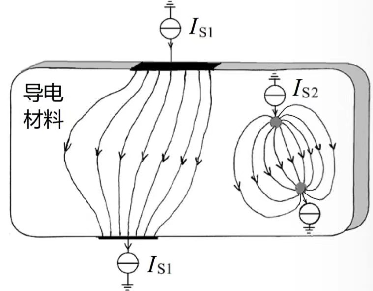

**边界值问题列写：**
* 控制方程：$\nabla^2 \varphi = 0$
* 边界条件：
  $$ \begin{cases} \varphi = C_i & \text{在等位电极面 } S_1 \\ \frac{\partial \varphi}{\partial n} = 0 & \text{在绝缘边界 } S_2 \end{cases} $$

**列写步骤：**
1. 确定未知量 $\varphi(\vec{r})$，并用其表示 $\vec{E} = -\nabla\varphi$ 和 $\vec{J} = -\sigma\nabla\varphi$。
2. 确定边界条件类型：
   * Dirichlet 条件：给定边界电位 $\varphi = C_i$。
   * Neumann 条件：给定边界电流强度 $-\iint_S \sigma \frac{\partial \varphi}{\partial n} dS = I$。
   > [!NOTE]
   > 由于电位需要参考点，电学系统边界上必须至少包含一个 Dirichlet 边界。

**空气侧的边界条件：**  
对于导体与空气的界面，因为空气电导率 $\sigma_0 \approx 0$，所以法向电流 $J_n = 0$。

但空气的介电常数不为零，电场切向分量连续，这意味着导体表面不再是等位面，电流线沿着表面流动。
$$ J_{1n} = 0 \quad \Rightarrow \quad E_{1n} = 0 $$
$$ E_{1t} = E_{2t} \ne 0 $$

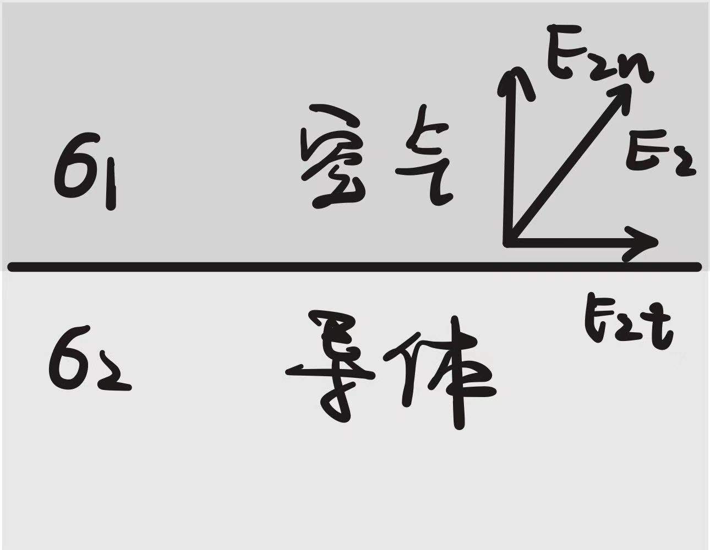

> [!IMPORTANT]
> 恒流场中，导体表面不再是等位面：
> 
> 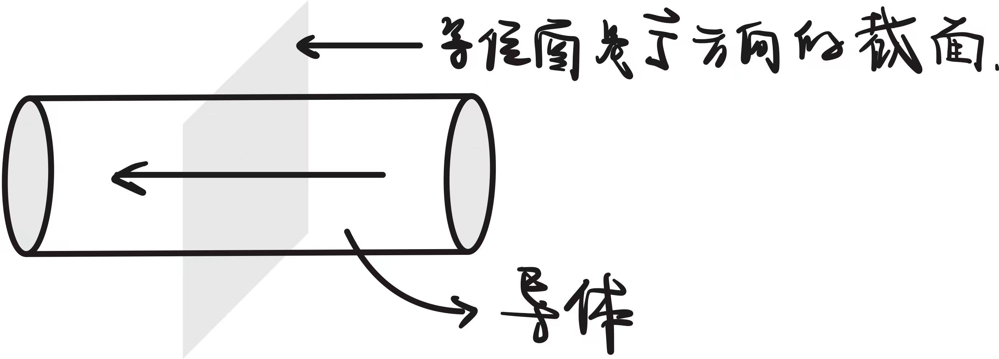

---

#### 2.4 恒定电流场的静电比拟法

恒定电流场（电源外部）与无源静电场的方程具有高度的数学一致性：

$$ \begin{array}{c|c}
\text{恒定电流场 (无源导体区)} & \text{静电场 (无源介质区)} \\
\hline
\nabla \cdot \vec{J} = 0 & \nabla \cdot \vec{D} = 0 \\
\nabla \times \vec{E} = 0 & \nabla \times \vec{E} = 0 \\
\vec{J} = \sigma \vec{E} & \vec{D} = \varepsilon \vec{E} \\
\vec{E} = -\nabla\varphi & \vec{E} = -\nabla\varphi \\
\nabla^2 \varphi = 0 & \nabla^2 \varphi = 0 \\
J_{1n} = J_{2n} & D_{1n} = D_{2n} \\
E_{1t} = E_{2t} & E_{1t} = E_{2t}
\end{array} $$

**比拟相同的条件：**
1. 两种电场的电极形状、尺寸和空间位置完全相同。
2. 对应电极上的电压相同。
3. 空间各区域的介电常数与电导率对应成比例：
   $$ \frac{\sigma_1}{\sigma_2} = \frac{\varepsilon_1}{\varepsilon_2} $$

通过静电比拟法，可以用较易测量的恒定电流场去模拟和测量难以直接测量的静电场。

### 电流场的镜像法

在计算恒定电流场的镜像电荷时，将电介质的电导率对应为静电场中的介电常数。

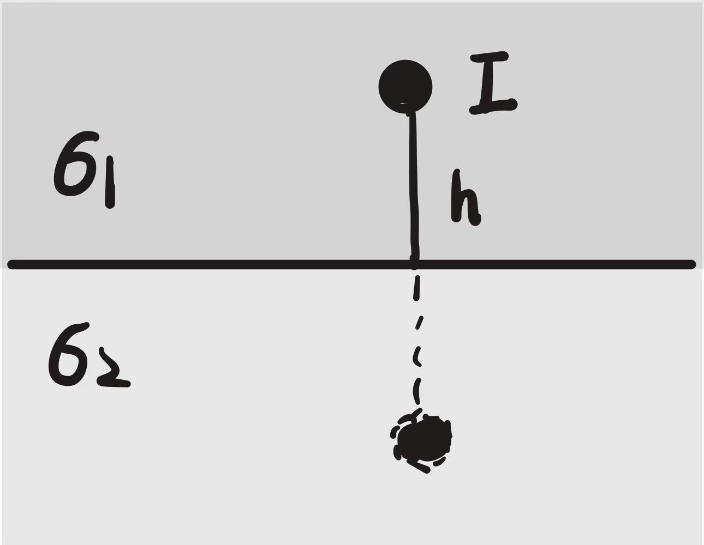

在电导率为 $\sigma_1$ 的区域，镜像电流源为：
$$ I' = \frac{\sigma_1 - \sigma_2}{\sigma_1 + \sigma_2} I $$
在电导率为 $\sigma_2$ 的区域，透射后的等效电流源为：
$$ I'' = \frac{2\sigma_2}{\sigma_1 + \sigma_2} I $$
当 $\sigma_2 = 0$（空气界面）时，$I' = I$，界面上没有法向电流流出。

> [!NOTE]
> 物理世界中没有 $\varepsilon = 0$ 的材料，所以比拟看起来有些反常识，比如静电场中好像没有见过$\vec{E}$在界面上只有切向分量。
>   
> 常见的静电场在导体表面$\vec{E}$垂直于界面，对应的是 $\varepsilon = \infty$ 的情况。  
> 
> 通过比拟，对应的是电流场中 $\sigma_2 = \infty, \sigma_1$ 有限，此时 $\sigma_1$ 相对 $\sigma_2$ 相当于绝缘的，但由于其并非实际上完全绝缘让有电流通过，那么这部分电流将会垂直表面。  
> 
> **这就是后面接地电阻电流场分布的原因。**

---

## 2.5 电导与接地电阻

**电导的定义：**  

在导电媒质中置有两电极，若两电极间加上电压 $U$，流过电极的电流为 $I$，则电极间介质的电导为：
$$ G = \frac{I}{U} $$
电阻为：
$$ R = \frac{1}{G} = \frac{U}{I} $$

**计算方法：**
1. **设电流求电压法**：  
   设电流 $I$，求得 $\vec{J}$，由 $\vec{E} = \frac{\vec{J}}{\sigma}$ 求电场，积分求得 $U = \int \vec{E} \cdot d\vec{l}$。
2. **设电压求电流法**：  
   设电位差 $U$，求出 $\varphi$，得到 $\vec{E} = -\nabla\varphi$，求得 $\vec{J} = \sigma \vec{E}$，最后积分得到 $I = \iint_S \vec{J} \cdot d\vec{S}$。
3. **功耗法**：
   $$ P = I^2 R = \iiint_V \sigma E^2 dV $$
4. **静电比拟法**：  
   利用电导与电容的比拟关系 $\frac{G}{C} = \frac{\sigma}{\varepsilon}$。若已知电容 $C$，可直接求出电导：
   $$ G = \frac{\sigma}{\varepsilon} C $$

**例题**：求图中电极A、B间的电导，片厚度为$h$。

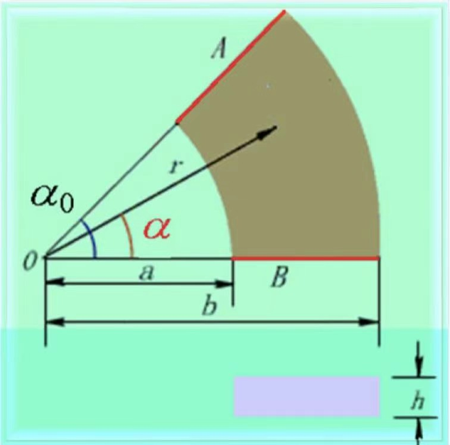

**解**：
使用设电压求电流法。  
控制方程：
$$\begin{cases}
\nabla^2 \varphi(\alpha) = \frac{1}{r^2} \frac{\partial^2 \varphi (\alpha)}{\partial \alpha^2} \\
\\
\varphi (\alpha) \big|_{\alpha = 0} = 0 \\
\\
\varphi (\alpha) \big|_{\alpha = \alpha_0} = U
\end{cases}$$
通解：$\varphi = C_1 \alpha + C_2$  

代入边界条件：$C_1 = \frac{U}{\alpha_0}, \quad C_2 = 0$

则：$\varphi = \frac{U}{\alpha_0} \alpha, \quad \mathbf{E} = -\nabla \varphi = -\frac{U}{r\alpha_0} \mathbf{e_\alpha}$  

##### 接地电阻

为了满足系统安全运行和避雷的要求，需要限制接地极的接地电阻。通常，**接地电阻越小越好**。

接地极的主要作用是，在强大的雷电流或故障电流泄入大地时，限制接地电极的电位抬高，防止产生过高的接触电压和跨步电压。

**1. 深埋球形电极接地电阻**：

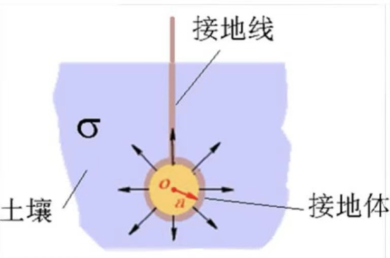

* **方法一：设电流求电压法**
  设流入大地的电流为 $I$，大地电导率为 $\sigma$。由于球电极深埋在地下，电流向四周均匀扩散：
  $$ \vec{J} = \frac{I}{4\pi r^2} \vec{e}_r \quad (r \ge a) $$
  电场强度：
  $$ \vec{E} = \frac{\vec{J}}{\sigma} = \frac{I}{4\pi\sigma r^2} \vec{e}_r $$
  球电极相对于无限远处的电位（即球电极的电压）：
  $$ U = \int_a^\infty E dr = \frac{I}{4\pi\sigma a} $$
  接地电阻：
  $$ R = \frac{U}{I} = \frac{1}{4\pi\sigma a} $$

* **方法二：静电比拟法**
  孤立导体球的静电容为 $C = 4\pi\varepsilon a$。
  利用比拟关系 $R = \frac{\varepsilon}{\sigma C}$，可直接求得：
  $$ R = \frac{\varepsilon}{\sigma (4\pi\varepsilon a)} = \frac{1}{4\pi\sigma a} $$

> [!NOTE]
> 由于土壤电阻率 $\rho = \frac{1}{\sigma}$ 远远大于金属电极的电阻率，更换更贵重金属电极材料对降低接地电阻几乎没有帮助。
>
> **如何减小接地电阻**：
> 1. 增大接地电极的表面积。
> 2. 降低土壤电阻率。

**2. 半球形平地面埋设电极接地电阻**：

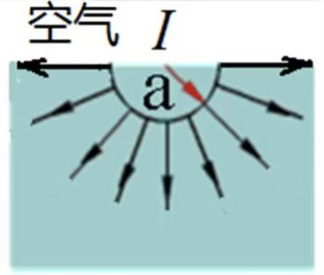

半球电极埋设在地面，由于空气不导电，电流只能向地下半空间扩散。其电流分布相当于深埋球电极的一半：
$$ I = J \cdot 2\pi r^2 \quad \Rightarrow \quad J = \frac{I}{2\pi r^2} $$
因此，其电导为球电极的一半，接地电阻为深埋球电极的两倍：
$$ R = \frac{1}{2\pi\sigma a} $$

**3. 非深埋球形电极的接地电阻（镜像法）**：

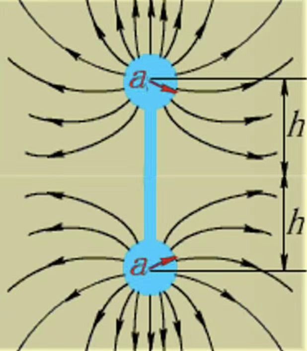

球心距离地面深度为 $h$（且 $h > a$）。利用地面镜像：
$$ U \approx \frac{I}{4\pi\sigma} \left( \frac{1}{a} + \frac{1}{2h - a} \right) $$
接地电阻：
$$ R \approx \frac{1}{4\pi\sigma a} + \frac{1}{4\pi\sigma (2h)} $$
由于地面的边界约束，接地电阻变大了。

##### 跨步电压与接触电压

当故障电流 $I$ 流入半球形接地极泄入大地时，会在地表面产生电位分布。

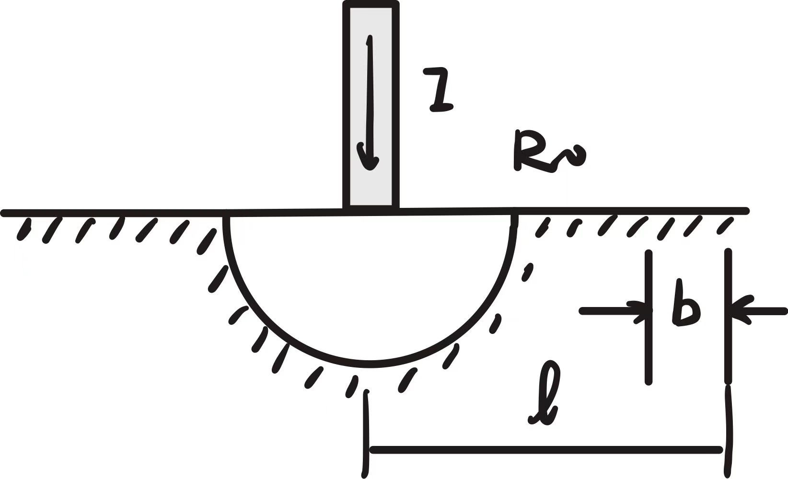

1. **跨步电压 $U_s$**：
   人站在距离接地极中心 $r$ 处，双脚间跨步距离为 $b$（通常取 $b = 0.8\text{ m}$）。双脚间的电压差为：
   $$ \varphi(r) = \frac{I}{2\pi\sigma r} $$
   $$ U_s = \varphi(r) - \varphi(r+b) = \frac{I}{2\pi\sigma} \left( \frac{1}{r} - \frac{1}{r+b} \right) $$
   当人靠近接地极（$r$ 较小）时，跨步电压最大，非常危险。

2. **接触电压 $U_t$**：
   设备外壳接地，人站在距离球心 $l$ 处，手接触外壳。人手脚之间的电压差为：
   $$ U_t = \varphi(a) - \varphi(l) = \frac{I}{2\pi\sigma} \left( \frac{1}{a} - \frac{1}{l} \right) $$

##### 焦耳定律

电路中电阻的功率损耗：
$$ P = U I = I^2 R $$
导电媒质中任意点的损耗功率体密度：
$$ w_d = \vec{E} \cdot \vec{J} = \sigma E^2 \quad (\text{W/m}^3) $$
此为焦耳定律的微分形式。
整个导体的总损耗功率为：
$$ P = \iiint_V \vec{E} \cdot \vec{J} dV $$
代入 $\vec{E} = -\nabla\varphi$：
$$ P = -\iiint_V \nabla\varphi \cdot \vec{J} dV $$
利用恒等式 $\nabla \cdot (\varphi \vec{J}) = \varphi \nabla \cdot \vec{J} + \vec{J} \cdot \nabla\varphi$，由于恒定电流场中 $\nabla \cdot \vec{J} = 0$：
$$ P = -\iiint_V \nabla \cdot (\varphi \vec{J}) dV $$
由高斯散度定理，转换为闭合面积分：
$$ P = -\oint_S \varphi \vec{J} \cdot d\vec{S} $$

**例题**：证明对于一段导线，两端加上电压 $U$，形成电流 $I$，用焦耳热公式证明 $P = U I$。

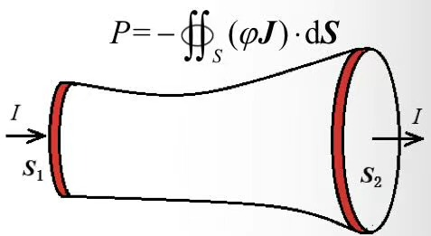

**证明**：
对导体整个表面 $S$ 积分。表面可分为侧面和两端面：
1. 在导体侧面，因为是绝缘的，电流法向分量 $\vec{J} \cdot \vec{n} = 0$，积分为 0。
2. 只有两端电极面 $S_1$ 和 $S_2$ 存在电流流入和流出，且其上电位分别为 $\varphi_1$ 和 $\varphi_2$：
   $$ P = -\iint_{S_1} \varphi_1 \vec{J} \cdot \vec{n}_1 dS_1 - \iint_{S_2} \varphi_2 \vec{J} \cdot \vec{n}_2 dS_2 $$
   设电流流入端面 1（$\vec{J}$ 与法向 $\vec{n}_1$ 相反），流出端面 2（$\vec{J}$ 与法向 $\vec{n}_2$ 相同）：
   $$ \iint_{S_1} \vec{J} \cdot \vec{n}_1 dS_1 = -I , \quad \iint_{S_2} \vec{J} \cdot \vec{n}_2 dS_2 = I $$
   $$ P = - \varphi_1 (-I) - \varphi_2 (I) = (\varphi_1 - \varphi_2) I = U I $$
   得证。

---

##### 恒定电流场与静电场的耦合问题（“有损耗的介质”）

对于实际介质，它既有电导率 $\sigma$ 又有介电常数 $\varepsilon$。这种非理想介质在恒定电压下既有传导电流，又有电偶极矩极化，是典型的耦合场问题。

对于分层不均匀介质，可以等效为电阻 $R$ 与电容 $C$ 并联再串联的电路：
* 电导特性决定电阻 $R$；
* 极化特性决定电容 $C$。

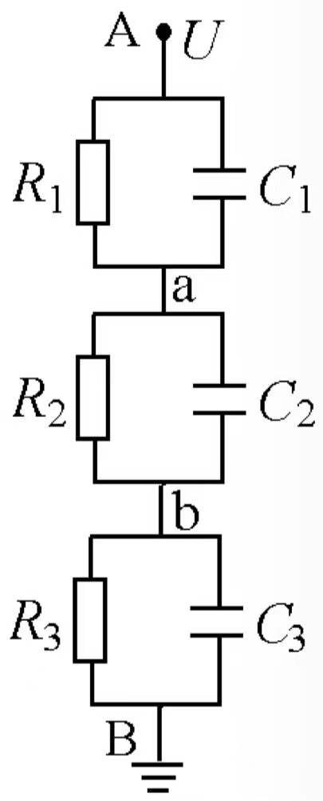

**分析方法**：  

从电位控制方程出发：
1. **已知电流 $I$ 路径**：  
   由面积求出 $\vec{J}$ $\to$ 由 $\vec{J} = \sigma \vec{E}$ 求出 $\vec{E}$ $\to$ 由 $\vec{D} = \varepsilon \vec{E}$ 求出 $\vec{D}$ $\to$ 用高斯定理求界面自由电荷。
2. **已知电压 $U$ 路径**：  
   先假设总电流 $I$ $\to$ 得到 $\vec{J}$ $\to$ 得到 $\vec{E}$ $\to$ 沿路径积分求出 $U$ $\to$ 确定 $I$ 与 $U$ 的关系 $\to$ 进而求出各场量。

> [!TIP]
> **电路视角**：
> 
> 在恒定直流下，电容 $C$ 相当于开路，各处的电压只由电阻 $R$ 决定；电容只影响暂态过程中的电荷积累。
> 
> 只有电容（理想介质）时，交界面上没有自由电荷积累；有电阻时，由于漏电流的存在，交界面上会积累电荷。

交界面积累电荷的求解：
$$ U_1 = I R_1 , \quad U_2 = I R_2 $$
$$ q_{s} = D_{2n} - D_{1n} = \left( \frac{\varepsilon_2}{\sigma_2} - \frac{\varepsilon_1}{\sigma_1} \right) J_n $$
若要交界面无电荷积累，需满足：
$$ \frac{\varepsilon_1}{\sigma_1} = \frac{\varepsilon_2}{\sigma_2} \quad \Rightarrow \quad \tau_1 = \tau_2 $$
其中 $\tau = \frac{\varepsilon}{\sigma}$ 称为电介质的弛豫时间。

**例题**：同轴电缆由两层非理想电介质填充，分别为 $(\sigma_1, \varepsilon_1)$ 和 $(\sigma_2, \varepsilon_2)$，已知内外导体间的单位长度漏电流为 $I_0$。求：电缆内的场强分布以及各界面上的自由电荷密度。

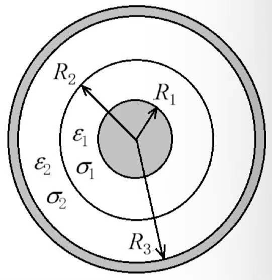

**解**：
已知单位长度漏电流为 $I_0$，由对称性，电流只能沿径向流动：
$$ J_1 = J_2 = \frac{I_0}{2\pi r} $$
两层介质中的电场强度分别为：
$$ E_1 = \frac{J_1}{\sigma_1} = \frac{I_0}{2\pi\sigma_1 r} \quad (a < r < r_0) $$
$$ E_2 = \frac{J_2}{\sigma_2} = \frac{I_0}{2\pi\sigma_2 r} \quad (r_0 < r < b) $$
分界面上的自由电荷由高斯定理决定：
$$ \rho_{s1} = D_{1n} \big|_{r=a} = \varepsilon_1 E_1(a) = \frac{\varepsilon_1 I_0}{2\pi\sigma_1 a} $$
在介质交界面 $r=r_0$ 处：
$$ \rho_{s2} = D_{2n} - D_{1n} \big|_{r=r_0} = \varepsilon_2 E_2(r_0) - \varepsilon_1 E_1(r_0) = \frac{I_0}{2\pi r_0} \left( \frac{\varepsilon_2}{\sigma_2} - \frac{\varepsilon_1}{\sigma_1} \right) $$
在外部导体表面 $r=b$ 处：
$$ \rho_{s3} = -D_{2n} \big|_{r=b} = -\frac{\varepsilon_2 I_0}{2\pi\sigma_2 b} $$
