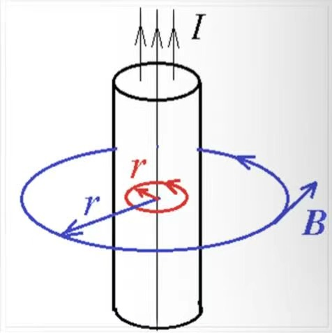
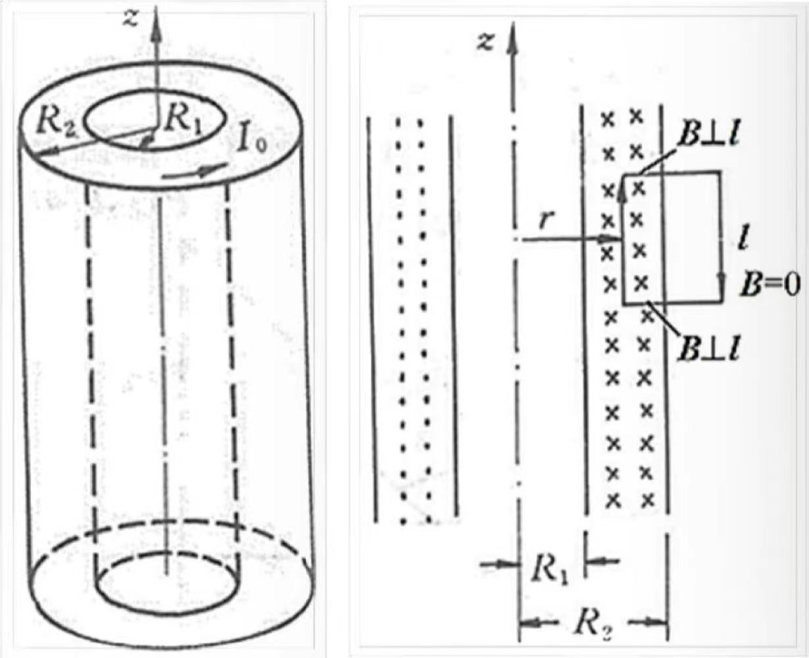
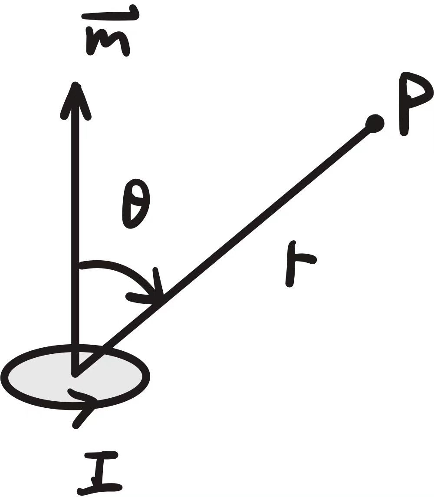
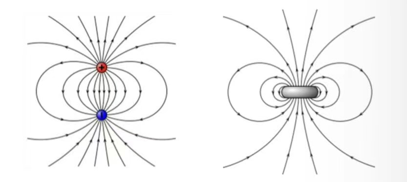
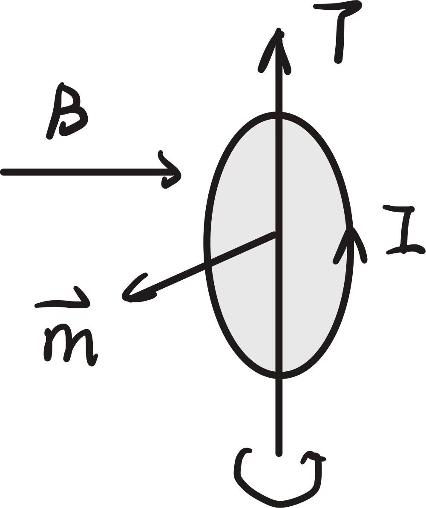
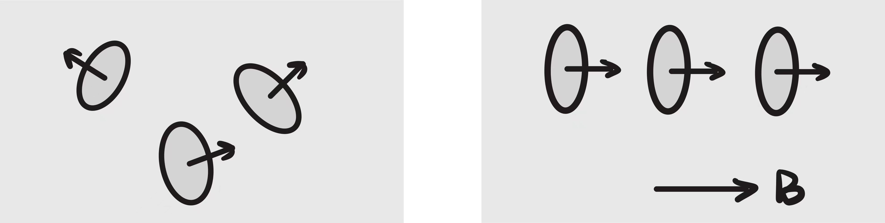
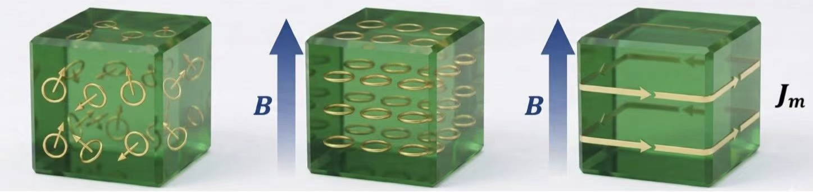
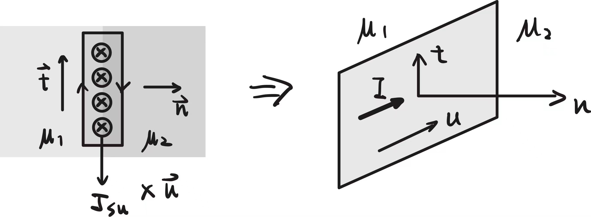
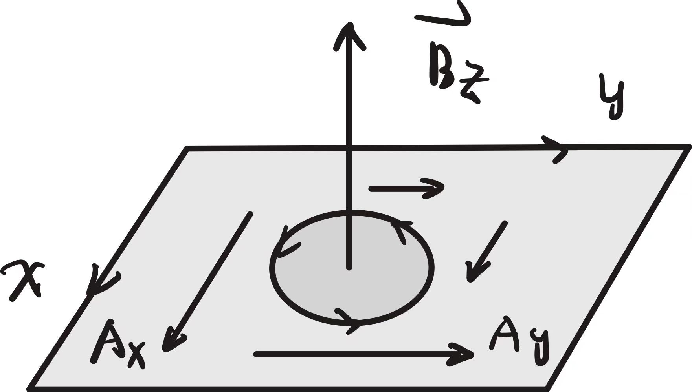
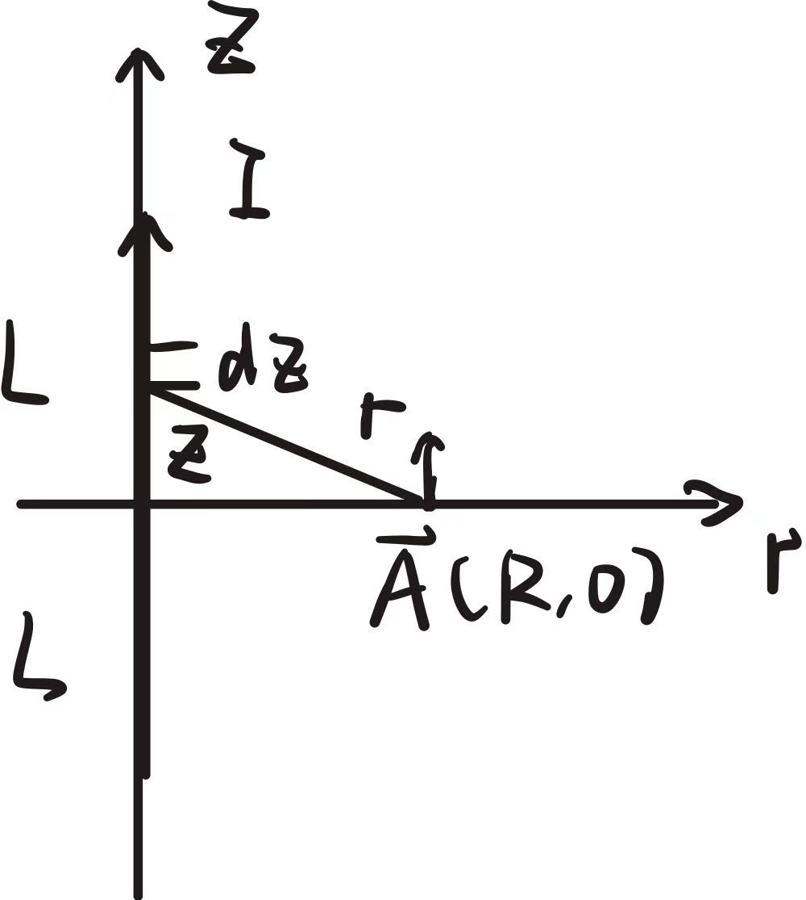

## 3.1 磁感应强度 B 的定义及其在自由空间的解

恒定磁场的源是恒定电流（电流密度 $\vec{J}$），它是矢量源。

空间某点磁感应强度 $\vec{B}$ 的大小定义为在该点的单位电流元 $I d\vec{l}$ 感受到的磁场力：
$$ d\vec{F} = I d\vec{l} \times \vec{B} $$

其方向与所受最大力的方向垂直，遵循右手螺旋关系。

$\vec{B}$ 的量纲为：$\text{Wb/m}^2$ 或特斯拉 ($\text{T}$)。

自由空间中产生恒定磁场的边值问题：
$$ \begin{cases} \nabla \times \vec{B} = \mu_0 \vec{J} \\ \nabla \cdot \vec{B} = 0 \\ \vec{B} \big|_{r \to \infty} = 0 \end{cases} $$
其中真空磁导率为 $\mu_0 = 4\pi \times 10^{-7}\text{ H/m}$。

由上述微分方程在自由空间中的积分通解为：
$$ \vec{B}(\vec{r}) = \frac{\mu_0}{4\pi} \iiint_V \frac{\vec{J}(\vec{r}') \times \vec{R}^\circ}{R^2} dV' $$

其中 $\vec{R} = \vec{r} - \vec{r}'$ 是从源点到场点的距离矢量。
此为**毕奥-萨伐尔定律**。

对于线电流 $I$，磁感应强度公式为：
$$ \vec{B}(\vec{r}) = \frac{\mu_0 I}{4\pi} \oint_l \frac{d\vec{l}' \times \vec{R}^\circ}{R^2} $$

洛伦兹力公式：电流元 $I d\vec{l}$ 受力：
$$ d\vec{F} = I d\vec{l} \times \vec{B} $$

---

## 3.2 自由空间中磁场一般方程的积分形式

**磁通量**：

  $$ \Phi = \iint_S \vec{B} \cdot d\vec{S} \quad (\text{Wb}) $$
  由于 $\nabla \cdot \vec{B} = 0$，应用散度定理，通过任意闭合曲面的总磁通量必为零：
  $$ \oint_S \vec{B} \cdot d\vec{S} = 0 $$
  
  此为**磁通连续性定理**，表明磁场是无散场，不存在“磁单极子”，磁感应线总是闭合的。

**安培环路定理**：

  由斯托克斯公式和 $\nabla \times \vec{B} = \mu_0 \vec{J}$：
  $$ \oint_l \vec{B} \cdot d\vec{l} = \iint_S (\nabla \times \vec{B}) \cdot d\vec{S} = \mu_0 \iint_S \vec{J} \cdot d\vec{S} = \mu_0 I_{net} $$
  条件是恒定电流满足连续性（$\nabla \cdot \vec{J} = 0$）。

安培环路定理表明：磁感应强度 $\vec{B}$ 沿任意闭合路径的线积分，等于该闭合路径所包围并交链的穿过表面的总电流与真空磁导率的乘积。  
环路方向与穿过的电流方向成右手螺旋关系时电流取正号，反之取负号。

磁力线方程：
$$ \vec{B} \times d\vec{l} = 0 $$
磁力线必为闭合曲线，且必定与产生它的电流回路呈交链关系。

**典型应用例题：**

1. **无限长直圆柱导线产生的磁场**：  
   导线半径为 $R$，通有总电流 $I$ 且均匀分布。

   

   * **导线内部（$r < R$）**：
     选半径为 $r$ 的圆形环路：
     $$ B \cdot 2\pi r = \mu_0 I_{in} = \mu_0 I \frac{\pi r^2}{\pi R^2} \quad \Rightarrow \quad B = \frac{\mu_0 I r}{2\pi R^2} $$
   * **导线外部（$r > R$）**：
     选半径为 $r$ 的圆形环路：
     $$ B \cdot 2\pi r = \mu_0 I \quad \Rightarrow \quad B = \frac{\mu_0 I}{2\pi r} $$

2. **无限长螺线管线圈产生的磁场**：  
   单位长度匝数为 $n$，通有电流 $I$。

   

   * **管外磁场（$r > R$）**：
     通过对称性分析，管外磁场为 0，即 $B_{out} = 0$。
   * **管内磁场（$r < R$）**：
     利用矩形环路，其中一条边在管内，另一条在管外，长度为 $l$：
     $$ B_{in} \cdot l = \mu_0 N I = \mu_0 (n l) I \quad \Rightarrow \quad B_{in} = \mu_0 n I $$

3. **无限大载流平板产生的磁场**：  
   单位长度的表面电流密度为 $K$。
   选取对称的矩形环路跨越薄板，长度为 $l$：
   $$ B \cdot l + B \cdot l = \mu_0 K l \quad \Rightarrow \quad B = \frac{1}{2} \mu_0 K $$

---

## 3.3 磁偶极子

小圆环电流可以看作是一个磁偶极子。

定义其磁偶极矩为：
$$ \vec{m} = I \vec{S} = I S \vec{n} $$
其中 $S$ 为圆环面积，$\vec{n}$ 的方向由环流方向按右手螺旋定则确定。

在远场区域（$r \gg R$），磁偶极子产生的磁感应强度为：
$$ \vec{B} = \frac{\mu_0 m}{4\pi r^3} (2\cos\theta \vec{e}_r + \sin\theta \vec{e}_\theta) $$

这与电偶极子在外场中的场分布规律完全一致。因此，天线理论中可以用这两种偶极子分别等效电和磁的辐射源。

把磁偶极子置于均匀外磁场 $\vec{B}$ 中，它所受的合力为零，但会受到一个使其旋转的磁力矩作用，直到其磁偶极矩的方向与外磁场方向一致时为止。

$$ \vec{T} = \vec{m} \times \vec{B} $$

> [!CAUTION]
> 实际上磁偶极子没有“偶”的现象存在，即没有磁单极子，因此磁单极子都用**电流环**来表示。

---

## 3.4 磁介质的磁化与磁场强度 H 的定义

磁介质在外界磁场中会被磁化。介质内部的分子的电子轨道运动和自旋等效为无数的微小分子环流（磁偶极子 $\vec{m}$）。

单位体积内磁偶极矩的矢量和定义为**磁化强度 $\vec{M}$**：
$$ \vec{M} = \lim_{\Delta V \to 0} \frac{\sum \vec{m}}{\Delta V} $$
$\vec{M}$ 的单位是 $\text{A/m}$。

在各向同性线性介质中，磁化强度与磁场强度成正比：
$$ \vec{M} = \chi_m \vec{H} $$
其中 $\chi_m$ 为介质的磁化率。

**等效磁化电流：**

介质的磁化效应可以用宏观的等效磁化电流来代替：
* 体磁化电流密度：
  $$ \vec{J}_m = \nabla \times \vec{M} $$
* 表面磁化电流密度：
  $$ \vec{J}_{ms} = \vec{M} \times \vec{n} $$

基于用磁化电流替代介质的方法，磁感应强度 $\vec{B}$ 的安培环路定理变为：
$$ \nabla \times \vec{B} = \mu_0 (\vec{J} + \vec{J}_m) = \mu_0 (\vec{J} + \nabla \times \vec{M}) $$
$$ \nabla \times \left( \frac{\vec{B}}{\mu_0} - \vec{M} \right) = \vec{J} $$

定义**磁场强度 $\vec{H}$** 为：
$$ \vec{H} = \frac{\vec{B}}{\mu_0} - \vec{M} $$
则磁场强度的安培环路定理化为：
$$ \nabla \times \vec{H} = \vec{J} \quad \Rightarrow \quad \oint_l \vec{H} \cdot d\vec{l} = I_{net} $$
其中 $I_{net}$ 仅为传导电流。

在各向同性线性磁介质中：
$$ \vec{B} = \mu_0 (\vec{H} + \vec{M}) = \mu_0 (1 + \chi_m) \vec{H} = \mu_0 \mu_r \vec{H} = \mu \vec{H} $$
其中 $\mu_r = 1 + \chi_m$ 为相对磁导率，$\mu = \mu_0 \mu_r$ 为介质磁导率（$\text{H/m}$）。

---

## 3.5 基本方程与分界面条件

$$ \begin{cases} \nabla \times \vec{H} = \vec{J} \\ \nabla \cdot \vec{B} = 0 \\ \vec{B} = \mu \vec{H} \end{cases} $$

**分界面条件：**

* **法向分量条件**：
  由 $\nabla \cdot \vec{B} = 0$，穿过交界面的磁感应强度法向分量连续：
  $$ B_{1n} = B_{2n} \quad \Rightarrow \quad \mu_1 H_{1n} = \mu_2 H_{2n} $$

  

* **切向分量条件**：
  由 $\nabla \times \vec{H} = \vec{J}$，若界面上存在传导面电流密度 $\vec{J}_s$，则磁场强度切向分量突变：
  $$ \vec{n} \times (\vec{H}_1 - \vec{H}_2) = \vec{J}_s \quad \Rightarrow \quad H_{1t} - H_{2t} = J_{s} $$
  若界面无传导面电流，则切向分量连续：
  $$ H_{1t} = H_{2t} $$

**折射定律**：
在无面电流的界面上，由 $B_{1n} = B_{2n}$ 及 $H_{1t} = H_{2t}$，可得：
$$ \frac{\tan\theta_1}{\tan\theta_2} = \frac{H_{1t} / H_{1n}}{H_{2t} / H_{2n}} = \frac{\mu_1}{\mu_2} $$

对于铁磁材料（$\mu \to \infty$）与空气的交界面，若铁磁侧的磁感应强度不与界面平行，则在空气侧，磁感应线将几乎垂直于界面射出。

**磁场边值问题控制方程**：
$$ \begin{cases} \nabla \times \vec{H}_k = \vec{J}_k \\ \nabla \cdot \vec{B} = 0 \\ \vec{B}_k = \mu_k \vec{H}_k \end{cases} \quad \in V_k $$
在分界面上代入分界面条件。

---

## 3.6 磁矢量位 A

由于 $\nabla \cdot \vec{B} = 0$，且梯度的旋度恒为零，我们可以将 $\vec{B}$ 表示为另一个矢量函数的旋度：
$$ \vec{B} = \nabla \times \vec{A} $$
其中 $\vec{A}$ 称为磁矢量位。

为了使 $\vec{A}$ 唯一确定，由亥姆霍兹定理，需指定其散度。我们采用库仑规范：
$$ \nabla \cdot \vec{A} = 0 $$

代入 $\nabla \times \vec{B} = \mu \vec{J}$ 中，有：
$$ \nabla \times (\nabla \times \vec{A}) = \nabla(\nabla \cdot \vec{A}) - \nabla^2 \vec{A} = \mu \vec{J} $$
由于 $\nabla \cdot \vec{A} = 0$，所以磁矢量位满足的控制方程为：
$$ \nabla^2 \vec{A} = -\mu \vec{J} $$
此为矢量泊松方程。在直角坐标系下可展开为三个标量泊松方程：
$$ \nabla^2 A_x = -\mu J_x, \quad \nabla^2 A_y = -\mu J_y, \quad \nabla^2 A_z = -\mu J_z $$

在自由空间中，矢量泊松方程的积分解为：
$$ \vec{A}(\vec{r}) = \frac{\mu}{4\pi} \iiint_V \frac{\vec{J}(\vec{r}')}{R} dV' $$
对于线电流回路，有：
$$ \vec{A}(\vec{r}) = \frac{\mu I}{4\pi} \oint_l \frac{d\vec{l}'}{R} $$
磁矢量位 $\vec{A}$ 的方向与产生它的源电流 $\vec{J}$ 同向。

**直观物理图景**：  

可以把电流 $\vec{J}$ 比作水泵，$\vec{A}$ 是水泵排出的水流方向，而 $\vec{B} = \nabla \times \vec{A}$ 是水流剪切运动所引发的局部旋涡。

**利用 $\vec{A}$ 求磁通量**：
$$ \Phi = \iint_S \vec{B} \cdot d\vec{S} = \iint_S (\nabla \times \vec{A}) \cdot d\vec{S} = \oint_l \vec{A} \cdot d\vec{l} $$
即沿回路边界的磁矢量位线积分等于通过该回路所围面积的磁通量。

**例题**：求长为 $L$ 的长直载流导线在线圈中心平面上产生的磁矢量位 $\vec{A}$。

**解**：
设电流沿 $z$ 轴正方向，大小为 $I$. 由对称性，磁矢量位只有 $z$ 分量：
$$ A_z = \frac{\mu_0 I}{4\pi} \int_{-L/2}^{L/2} \frac{dz'}{\sqrt{r^2 + z'^2}} = \frac{\mu_0 I}{4\pi} \ln \left[ \frac{\sqrt{r^2 + L^2/4} + L/2}{\sqrt{r^2 + L^2/4} - L/2} \right] $$
当 $L \gg r$ 时，如果将导线视为无限长：  

在无限长直导线情况下，不能将无限远处取为电位或矢量位参考点，否则积分会发散。我们需要选取距导线距离为 $r_0$ 的位置作为参考点（其上 $A_z = 0$）：
$$ A_z(r) = \frac{\mu_0 I}{2\pi} \ln\frac{r_0}{r} $$

### 磁矢量位 A 的边值问题分界面条件
由于 $\vec{B}$ 在界面法向连续（$B_{1n} = B_{2n}$），且库仑规范下 $\vec{A}$ 的法向和切向分量均连续：
$$ \vec{A}_1 = \vec{A}_2 $$
由于一阶导数在界面上有突变，根据磁场强度切向条件 $\vec{n} \times (\vec{H}_1 - \vec{H}_2) = \vec{J}_s$：
$$ \frac{1}{\mu_1} (\nabla \times \vec{A}_1) \times \vec{n} - \frac{1}{\mu_2} (\nabla \times \vec{A}_2) \times \vec{n} = \vec{J}_s $$

在二维平行平面场中，设电流只有 $z$ 向分量 $\vec{J} = J_z(x,y)\vec{e}_z$，则磁矢量位也只有 $z$ 向分量：
$$ \vec{A} = A_z(x,y) \vec{e}_z $$
此时：
$$ \vec{B} = \nabla \times (A_z \vec{e}_z) = \frac{\partial A_z}{\partial y} \vec{e}_x - \frac{\partial A_z}{\partial x} \vec{e}_y $$
在无传导面电流的交界面上，边界条件简化为：
$$ A_{z1} = A_{z2} $$
$$ \frac{1}{\mu_1} \frac{\partial A_{z1}}{\partial n} = \frac{1}{\mu_2} \frac{\partial A_{z2}}{\partial n} $$

---

## 3.7 磁场镜像法

磁场镜像法与静电场和电流场存在相似的对偶关系：

在求区域 1 的磁场时，引入位于区域 2 的镜像电流：
$$ I' = \frac{\mu_1 - \mu_2}{\mu_1 + \mu_2} I $$
在求区域 2 的磁场时，引入位于区域 1 的透射等效电流：
$$ I'' = \frac{2\mu_2}{\mu_1 + \mu_2} I $$

**对比关系**：
* 静电场：$q' = \frac{\varepsilon_1 - \varepsilon_2}{\varepsilon_1 + \varepsilon_2} q$
* 电流场：$I' = \frac{\sigma_1 - \sigma_2}{\sigma_1 + \sigma_2} I$
* 磁场：$I' = \frac{\mu_1 - \mu_2}{\mu_1 + \mu_2} I$ （注意，当 $\mu_2 > \mu_1$ 时，镜像电流与原电流方向相反）。

### 理想铁磁材料界面情况分析
设区域 1 为空气（$\mu_1 = \mu_0$），区域 2 为高导磁铁磁材料（$\mu_2 \to \infty$）。
* 镜像电流为：
  $$ I' = \lim_{\mu_2 \to \infty} \frac{\mu_0 - \mu_2}{\mu_0 + \mu_2} I = -I $$
  即镜像电流与原电流大小相等，方向相反。

* 此时在空气侧（区域 1），交界面相当于一个磁力线切向连续（即磁场线垂直射入铁磁面）的等效面。
* 在铁磁物质内部（区域 2），磁场强度 $H_{in} \to 0$，但磁感应强度 $\vec{B}$ 并不为零。由于铁磁材料磁导率无限大，磁通在铁磁介质中被放大为原来的两倍并沿着材料内部流动。
* 若长直电流 $I$ 位于铁磁材料内部，对空气侧产生的增强系数为 2。

---

## 3.8 电感

### 自感的定义
线圈的自感 $L$ 定义为线圈自身的磁链 $\Psi$ 与线圈中流过的电流 $I$ 的比值：
$$ L = \frac{\Psi}{I} $$
其单位是亨利 ($\text{H}$)。自感值总是为正。

**磁链的定义**：
通过某截面的磁通量为 $\Phi = \iint \vec{B} \cdot d\vec{S}$。若该磁通量与 $N$ 匝线圈交链，则总磁链为：
$$ \Psi = N \Phi = \sum_{i=1}^N \Phi_i $$
对于分布电流，磁链为：
$$ \Psi = \iiint_V \vec{A} \cdot \vec{J} dV $$

### 自感可分为内自感和外自感
$$ L = L_i + L_o $$
* **内自感 $L_i$**：由穿过导体内部的磁通与部分电流交链所产生的自感。
* **外自感 $L_o$**：由导体外部的磁通与全部电流交链所产生的自感。
> [!NOTE]
> 由于高频下存在趋肤效应，导体内部磁场会减小，因此交流下的内自感会比直流自感略小。

### 自感的计算方法
1. **加电流求磁链法**：设电流 $I$ $\to$ 由安培环路定理求 $\vec{B}$ $\to$ 积分求总磁链 $\Psi$ $\to$ 计算 $L = \frac{\Psi}{I}$。
2. **加电流求磁能法**：设电流 $I$ $\to$ 计算磁场总能量 $W_m = \iiint_V \frac{1}{2} \vec{B} \cdot \vec{H} dV$ $\to$ 由 $W_m = \frac{1}{2} L I^2$ 解出 $L$。

**例题**：计算同轴电缆单位长度的自感。内外导体半径分别为芯线半径 $R_1$，外壳内径 $R_2$ 和外径 $R_3$。

**解**：
设电缆通有电流 $I$。
1. **芯线内部的自感（内自感 $L_i$）**：
   在 $0 < r < R_1$ 区域，由安培环路定理：
   $$ H = \frac{I r}{2\pi R_1^2} \quad \Rightarrow \quad B = \frac{\mu I r}{2\pi R_1^2} $$
   对于半径为 $r$ 处的薄层 $dr$，其交链的电流比例为 $\left(\frac{r}{R_1}\right)^2$（因为电流在横截面均匀分布），对应的单位长度磁链微元为：
   $$ d\Psi_i = B dr \cdot \left(\frac{r}{R_1}\right)^2 = \frac{\mu I r^3}{2\pi R_1^4} dr $$
   积分求得单位长度内自感对应的磁链：
   $$ \Psi_i = \int_0^{R_1} \frac{\mu I r^3}{2\pi R_1^4} dr = \frac{\mu I}{8\pi} $$
   故芯线的单位长度内自感为：
   $$ L_i = \frac{\Psi_i}{I} = \frac{\mu}{8\pi} $$

   > [!TIP]
   > 导体圆柱芯线的内自感与芯线半径 $R_1$ 无关！

3. **内外导体之间区域（外自感 $L_o$）**：
   在 $R_1 < r < R_2$ 区域，磁场全部与总电流 $I$ 交链：
   $$ H = \frac{I}{2\pi r} \quad \Rightarrow \quad B = \frac{\mu_0 I}{2\pi r} $$
   单位长度的外磁链为：
   $$ \Psi_o = \int_{R_1}^{R_2} B dr = \frac{\mu_0 I}{2\pi} \ln\frac{R_2}{R_1} $$
   对应的外自感为：
   $$ L_o = \frac{\mu_0}{2\pi} \ln\frac{R_2}{R_1} $$

4. **外导体壳内部的自感**：
   在 $R_2 < r < R_3$ 区域，外导体内电流反向流动，其自感计算类似。忽略外壳厚度（$R_3 \approx R_2$）时，该部分能量极小可忽略。
   总自感单位长度值为：
   $$ L_0 = L_i + L_o = \frac{\mu}{8\pi} + \frac{\mu_0}{2\pi} \ln\frac{R_2}{R_1} $$

### 平行长直双线单位长自感的近似计算
两平行导线半径为 $R$，轴心距为 $D$，通有等量异号电流 $pm I$。

单位长度的外自感 $L_o$：
* **方法一：设电流求磁通法**
  在两导线之间（距一根导线中心为 $x$ 处），两电流在该点产生的磁场同向叠加：
  $$ H = \frac{I}{2\pi x} + \frac{I}{2\pi(D-x)} \quad \Rightarrow \quad B = \frac{\mu_0 I}{2\pi} \left[ \frac{1}{x} + \frac{1}{D-x} \right] $$
  穿过两导线间的总磁通量（积分范围从 $R$ 到 $D-R$）：
  $$ \Phi_o = \int_R^{D-R} B dx = \frac{\mu_0 I}{\pi} \ln\frac{D-R}{R} $$
  外自感为：
  $$ L_o = \frac{\mu_0}{\pi} \ln\frac{D-R}{R} \approx \frac{\mu_0}{\pi} \ln\frac{D}{R} \quad (D \gg R) $$
  加上两导线的内自感：
  $$ L = L_o + 2 L_i = \frac{\mu_0}{\pi} \ln\frac{D}{R} + \frac{\mu}{4\pi} $$

**互感的定义**：
线圈 1 对线圈 2 的互感定义为，线圈 1 通入电流 $I_1$ 时，在线圈 2 中所产生的互感磁链 $\Psi_{21}$ 与 $I_1$ 的比值：
$$ M_{21} = \frac{\Psi_{21}}{I_1} $$
若不考虑磁饱和（线性介质），有互易性定理：
$$ M_{12} = M_{21} = M $$

### 互感的计算通式（纽曼公式）
$$ M = \frac{\mu}{4\pi} \oint_{l_1} \oint_{l_2} \frac{d\vec{l}_1 \cdot d\vec{l}_2}{R} $$

**例题**：交流电流互感器。设一次导线中通有高频交变电流 $I$，计算二次线圈中的互感磁链。

在一次侧偏心时，对总互感影响并不大。

---

## 3.9 磁场的能量

1. **单个线圈**：
   $$ W_m = \frac{1}{2} L I^2 = \frac{1}{2} \Psi I $$
2. **两个线圈**：
   $$ W_m = \frac{1}{2} L_1 I_1^2 + \frac{1}{2} L_2 I_2^2 \pm M I_1 I_2 $$
3. **$N$ 个线圈系统**：
   $$ W_m = \frac{1}{2} \sum_{i=1}^N \sum_{j=1}^N M_{ij} I_i I_j $$
   其中当 $i=j$ 时，$M_{ii} = L_i$。
4. **用磁场量表示的能量体密度**：
   $$ W_m = \iiint_V w_m dV $$
   $$ w_m = \frac{1}{2} \vec{B} \cdot \vec{H} = \frac{1}{2} \mu H^2 = \frac{B^2}{2\mu} $$
   该公式同样适用于非均匀各向同性介质。
5. **用磁矢量位表示的能量**：
   $$ W_m = \frac{1}{2} \iiint_V \vec{A} \cdot \vec{J} dV $$
   因为电流只在导体中流动，此积分只需在载流导体体积内进行。

---

## 3.10 磁场力

1. **安培力法**：
   $$ \vec{F} = \oint_l I d\vec{l} \times \vec{B}_{bg} $$
   其中 $\vec{B}_{bg}$ 是排除自身电流贡献后的背景磁感应强度。

**例题**：求输电平行板之间单位面积受到的电磁力。

两极板间磁场为 $H = \frac{I}{b}$，磁场大小向外发散。
另一极板受到的电磁力大小为：
$$ F = \frac{1}{2} \mu_0 K^2 S = \frac{\mu_0 I^2 S}{2 b^2} $$
方向为相互排斥，使得回路面积扩大，从而增大系统自感。

2. **虚位移法计算磁场力**：

* **电流恒定系统（外接恒流源，即 $I = \text{const}$）**：  
  在虚位移 $d\vec{g}$ 过程中，电源输入电能：
  $$ dW_{source} = \sum e_k I_k dt = \sum I_k d\Psi_k $$
  由于 $W_m = \frac{1}{2} \sum I_k \Psi_k$ 且电流恒定：
  $$ dW_{source} = 2 dW_m $$
  由能量守恒，电源输入的能量等于磁场能的增加量与机械功之和：
  $$ dW_{source} = dW_m + \vec{F} \cdot d\vec{g} \quad \Rightarrow \quad \vec{F} \cdot d\vec{g} = dW_m $$
  所以：
  $$ \vec{F} = \nabla W_m \big|_{I = \text{const}} $$

* **磁通量恒定系统（孤立无源系统，即 $\Psi = \text{const}$）**：  
  由能量守恒：
  $$ -dW_m = \vec{F} \cdot d\vec{g} $$
  所以：
  $$ \vec{F} = -\nabla W_m \big|_{\Psi = \text{const}} $$

无论是恒流还是恒磁通系统，受力方向总是倾向于使自感 $L$ 增大。两回路的相互作用力为：
$$ \vec{F} = I_1 I_2 \nabla M $$
同名端流入的两个电流，相互作用力使其互感 $M$ 增大（相互吸引）。

**例题**：求电磁铁对衔铁的吸引力。铁芯截面积为 $S$，线圈匝数为 $N$，通有电流 $I$，空气隙宽度为 $l$。

**解**：
机械加工近似认为铁磁材料磁导率无限大（其内 $H_{Fe} \approx 0$）。

由安培环路定理，磁场主要分布在两个空气隙中：
$$ H_0 \cdot 2l = N I \quad \Rightarrow \quad H_0 = \frac{N I}{2l} $$
磁感应强度为 $B = \mu_0 H_0 = \frac{\mu_0 N I}{2l}$。
磁场总能量（仅计空气隙中的能量）：
$$ W_m = 2 \cdot \left( \frac{1}{2} \mu_0 H_0^2 \cdot S l \right) = \frac{\mu_0 N^2 I^2 S}{4l} $$
利用虚位移法，在电流 $I$ 恒定的情况下，衔铁受到的电磁力为：
$$ F = \frac{\partial W_m}{\partial l} \Big|_{I = \text{const}} = -\frac{\mu_0 N^2 I^2 S}{4 l^2} = -\frac{B^2 S}{2\mu_0} $$
负号表示受力方向为使气隙 $l$ 减小的方向（即吸引力）。

对于界面上只有垂直或切向磁场的情形，单位面积的电磁吸引力大小等于磁能体密度：
$$ f_s = w_m = \frac{B^2}{2\mu_0} $$
