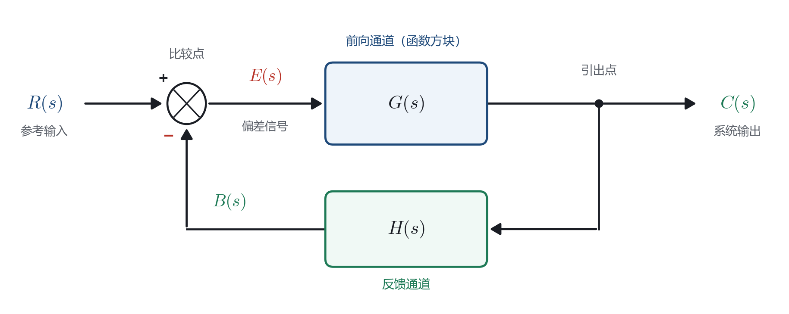

## 1.1 方框图基本组成（Block Diagram）

方框图是描述控制系统信号流向与环节运算关系的图形工具，由三种基本元素构成：

* **函数方块（Function Block）**：内部包含该环节的传递函数（Transfer Function），表示输出与输入之间的复频域代数乘积关系。例如：
  $$C(s) = E(s) G(s)$$
* **比较点 / 相加点（Summing Point）**：用于将**同量纲（same-dimension）**的信号进行相加或相减，如 $E(s) = R(s) - B(s)$。
* **引出点 / 分支点（Take-off / Branch Point）**：将同一信号无损地引出到多条支路，引出后各支路信号与原信号完全相同。

## 1.2 三个核心传递函数（Three Core Transfer Functions）

对于标准负反馈系统，记参考输入为 $R(s)$（Reference）、输出为 $C(s)$（Controlled output）、误差信号为 $E(s)$、主反馈信号为 $B(s)$、前向通道传递函数为 $G(s)$、反馈通道传递函数为 $H(s)$：

1. **开环传递函数（Open-Loop Transfer Function）**：反馈信号与误差信号之比（即从反馈比较点断开后，环绕整个闭环回路一周的传递函数）：
   $$G_0(s) = \frac{B(s)}{E(s)} = G(s)H(s)$$
2. **前向通道传递函数（Feedforward / Forward-Path Transfer Function）**：输出信号与误差信号之比：
   $$\frac{C(s)}{E(s)} = G(s)$$
3. **闭环传递函数（Closed-Loop Transfer Function）**：输出信号与参考输入之比。由 $C(s) = G(s)E(s)$ 且 $E(s) = R(s) - H(s)C(s)$，消去 $E(s)$ 得：
   $$\Phi(s) = \frac{C(s)}{R(s)} = \frac{G(s)}{1 + G(s)H(s)}$$

> [!TIP]
> 若为**正反馈**（$E(s) = R(s) + H(s)C(s)$），闭环传递函数分母中的加号变为减号：$\frac{C(s)}{R(s)} = \frac{G(s)}{1 - G(s)H(s)}$。记忆口诀：**“负反馈分母为加，正反馈分母为减”**。

## 1.3 由线性常微分方程导出传递函数

考虑线性定常（LTI）系统的输入-输出微分方程：

$$y^{(n)}(t) + a_n y^{(n-1)}(t) + \cdots + a_1 y(t) = b_{m+1} u^{(m)}(t) + b_m u^{(m-1)}(t) + \cdots + b_1 u(t)$$

在**零初始条件（Zero Initial Conditions）**下：

$$y(0^-) = \dot{y}(0^-) = \cdots = y^{(n-1)}(0^-) = 0, \qquad u(0^-) = \dot{u}(0^-) = \cdots = u^{(m-1)}(0^-) = 0$$

两边取拉普拉斯变换：

$$\left(s^n + a_n s^{n-1} + \cdots + a_1\right) Y(s) = \left(b_{m+1} s^m + b_m s^{m-1} + \cdots + b_1\right) U(s)$$

得到系统的**传递函数（Transfer Function）**：

$$G(s) = \frac{Y(s)}{U(s)} = \frac{b_{m+1} s^m + b_m s^{m-1} + \cdots + b_1}{s^n + a_n s^{n-1} + \cdots + a_1} \qquad (n \ge m)$$

> [!IMPORTANT]
> **传递函数的三条本质属性**
> 1. **仅适用于线性定常（LTI）系统**，且必须在**零初始条件**下定义；
> 2. 传递函数只取决于系统自身的结构与参数，**与输入信号的形式无关**；
> 3. 任何实际物理系统必须满足因果性与物理可实现性，即分母阶次不低于分子阶次（$n \ge m$，真有理分式 / proper rational function）。
