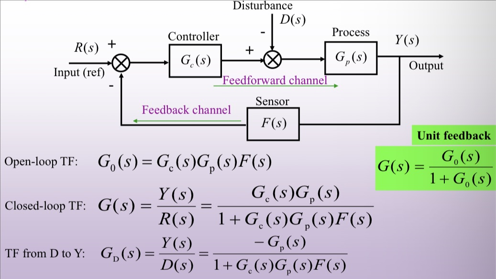
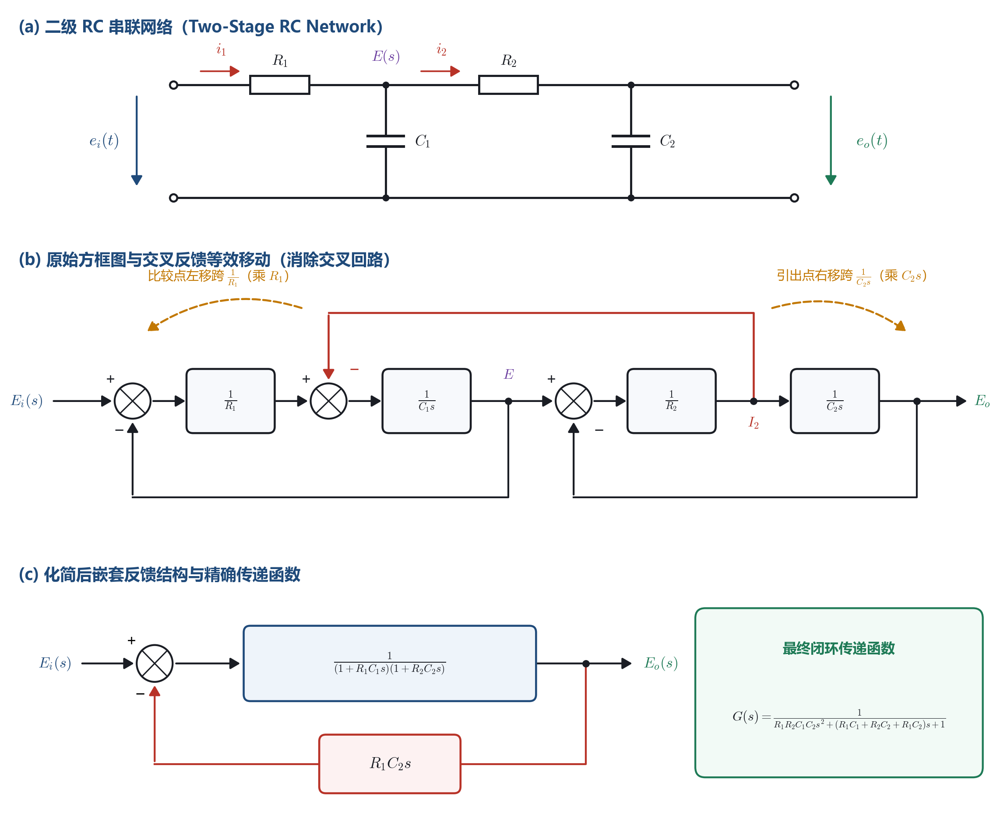
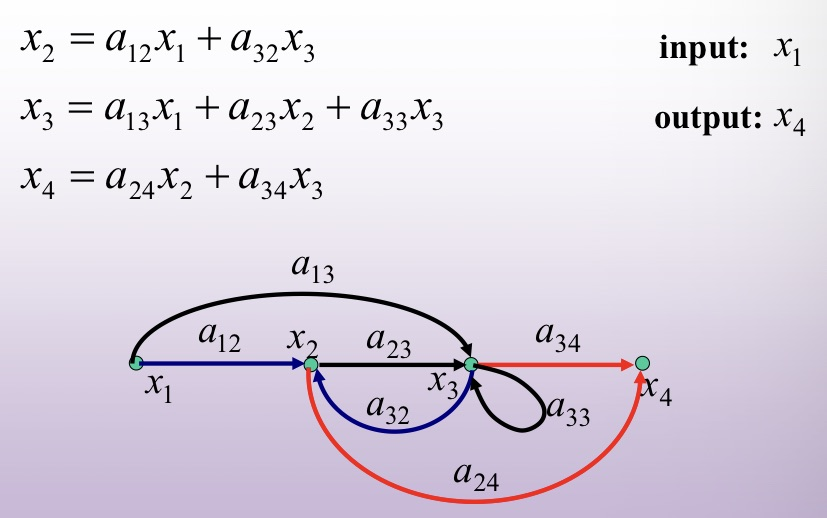
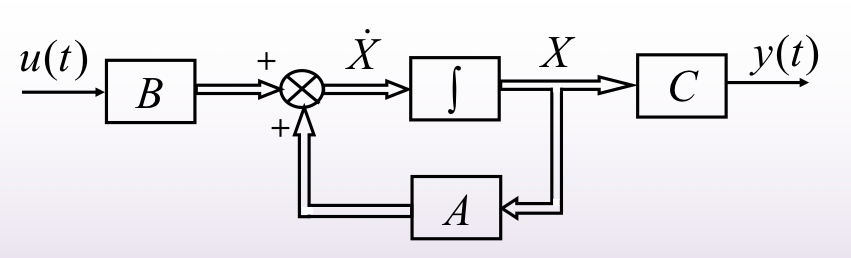
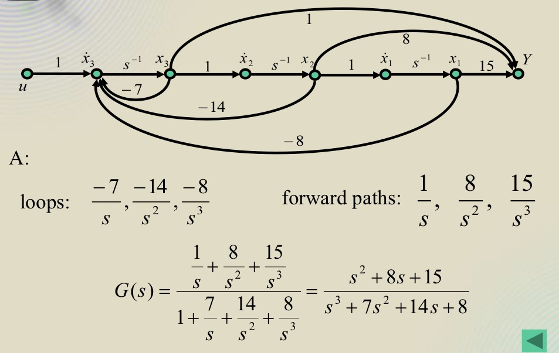

## 2.1 典型闭环系统方框图与等效化简

### 1. 典型带扰动闭环系统（Typical Feedback Control Diagram）

实际工业控制系统中通常包含控制器 $G_c(s)$、被控对象（Process）$G_p(s)$、测量传感器（Sensor）$F(s)$ 以及外部扰动（Disturbance）$D(s)$：

由线性叠加原理，分别令 $D(s)=0$ 与 $R(s)=0$ 可得：

* **开环传递函数**：$G_0(s) = G_c(s) G_p(s) F(s)$
* **参考输入至输出的闭环传递函数**：
  $$G(s) = \frac{Y(s)}{R(s)} = \frac{G_c(s) G_p(s)}{1 + G_c(s) G_p(s) F(s)}$$
  特别地，对于**单位负反馈（Unit Feedback，$F(s) = 1$）**：
  $$G(s) = \frac{G_0(s)}{1 + G_0(s)}$$
* **扰动至输出的传递函数**（图中扰动 $D(s)$ 以负号接入）：
  $$G_D(s) = \frac{Y(s)}{D(s)} = \frac{-G_p(s)}{1 + G_c(s) G_p(s) F(s)}$$

### 2. 方框图的基本连接与等效变换规则

| 变换类型 | 变换前结构 | 等效结果 | 核心依据 |
| :--- | :--- | :--- | :--- |
| **串联（Series）** | $G_1(s) \to G_2(s)$ | $G_1(s) G_2(s)$ | 传递函数直接相乘 |
| **并联（Parallel）** | $G_1(s) \parallel G_2(s)$ 同入同出求和 | $G_1(s) \pm G_2(s)$ | 线性叠加原理 |
| **负反馈（Negative Feedback）** | 前向 $G_1(s)$，反馈 $G_2(s)$（负号） | $\dfrac{G_1(s)}{1 + G_1(s) G_2(s)}$ | $Y = G_1 U - G_1 G_2 Y$ |
| **比较点左移（跨过 $G$）** | $x_1 \to G \to \oplus(\text{加 } x_2) \to x_3$ | $x_1 \to \oplus(\text{加 } \frac{1}{G}x_2) \to G \to x_3$ | $G x_1 + x_2 = G(x_1 + \frac{1}{G} x_2)$ |
| **比较点右移（跨过 $G$）** | $x_1 \to \oplus(\text{加 } x_2) \to G \to x_3$ | $x_1 \to G \to \oplus(\text{加 } G x_2) \to x_3$ | $G(x_1 + x_2) = G x_1 + G x_2$ |
| **引出点左移（跨过 $G$）** | 从 $G$ 输出端引出信号 | 从 $G$ 输入端引出后**串接 $G$** | 保持引出支路信号仍为 $G x$ |
| **引出点右移（跨过 $G$）** | 从 $G$ 输入端引出信号 | 从 $G$ 输出端引出后**串接 $1/G$** | 保持引出支路信号仍为 $x$ |

> [!TIP]
> **移动规则防错铁律（LTI 信号守恒）**：无论移动比较点还是引出点，只需检查**移动前后每一条支路的最终信号表达式是否完全不变**。例如原图中 $x_3 = G x_1 + x_2$，将比较点移到 $G$ 左侧后，$x_2$ 支路必须多经过一次 $G$，因此必须先乘以 $\frac{1}{G}$ 予以抵消。

### 3. 复杂方框图化简算例：二级 RC 串联网络

考虑由 $R_1, C_1, R_2, C_2$ 构成的二级无源 RC 低通网络，设中间节点电压为 $E(s)$，支路电流为 $I_1(s), I_2(s)$：

* 电阻环节：$I_1(s) = \dfrac{E_i(s) - E(s)}{R_1}$，$\quad I_2(s) = \dfrac{E(s) - E_o(s)}{R_2}$
* 电容环节：$E(s) = \dfrac{I_1(s) - I_2(s)}{C_1 s}$，$\quad E_o(s) = \dfrac{I_2(s)}{C_2 s}$

直接连接各元件方框图会出现**交叉反馈回路**（$I_2$ 反馈回 $C_1$ 前的比较点）。利用等效移动消除交叉：

1. 将 $-I_2$ 接入的比较点向**左**移跨过 $\frac{1}{R_1}$，该反馈支路乘以 $R_1$；
2. 将 $I_2$ 的引出点向**右**移跨过 $\frac{1}{C_2 s}$，该反馈支路乘以 $C_2 s$，合并得外环负反馈增益 $R_1 C_2 s$；
3. 两个独立内环各自构成单位负反馈：
   $$\frac{\frac{1}{R_1 C_1 s}}{1 + \frac{1}{R_1 C_1 s}} = \frac{1}{1 + R_1 C_1 s}, \qquad \frac{\frac{1}{R_2 C_2 s}}{1 + \frac{1}{R_2 C_2 s}} = \frac{1}{1 + R_2 C_2 s}$$
4. 化简最外层负反馈回路，得到精确传递函数：
   $$G(s) = \frac{E_o(s)}{E_i(s)} = \frac{\dfrac{1}{(1 + R_1 C_1 s)(1 + R_2 C_2 s)}}{1 + \dfrac{R_1 C_2 s}{(1 + R_1 C_1 s)(1 + R_2 C_2 s)}} = \frac{1}{R_1 R_2 C_1 C_2 s^2 + (R_1 C_1 + R_2 C_2 + R_1 C_2)s + 1}$$

> [!WARNING]
> **负载效应（Loading Effect）**：注意分母一次项系数中多出了交叉项 $R_1 C_2$！这说明两级 RC 网络直接级联时，传递函数**不等于**两个单级 RC 环节的简单乘积 $\frac{1}{(1+R_1 C_1 s)(1+R_2 C_2 s)}$；只有中间加入理想电压跟随器（隔离缓冲）时，该负载耦合项才会消失。

---

## 2.2 信号流图与梅森增益公式（Signal-Flow Graphs & Mason's Formula）

对于任意线性因果代数方程组：

$$y_j = \sum_{k=1}^{N} a_{kj} x_k, \qquad j = 1, 2, \dots, m$$

第 $j$ 个结果变量等于所有指向它的原因变量经各自支路增益传递后的叠加。

* **节点（Nodes）**：代表系统变量（源节点仅出不进、汇节点仅进不出、混合节点有进有出）；
* **支路（Branches）**：带箭头的有向线段，表示变量之间的因果运算关系（支路传输 / 增益 $a_{kj}$）。

### 梅森增益公式（Mason's Gain Formula）

从输入（源）节点到输出（汇）节点的总传递增益为：

$$G = \frac{\sum_{k} G_k \Delta_k}{\Delta}$$

其中各符号含义如下：

| 符号 | 含义 |
| :--- | :--- |
| $G$ | 输入节点到输出节点的总增益（传递函数） |
| $\Delta$ | **流图特征式**：$\Delta = 1 - \sum L_i + \sum L_a L_b - \sum L_\alpha L_\beta L_\gamma + \cdots$ |
| $L_i$ | 第 $i$ 个**单独回路**（individual loop）的增益 |
| $L_a L_b$ | 任意两个**互不接触回路**（nontouching loops，无公共节点）的增益乘积 |
| $L_\alpha L_\beta L_\gamma$ | 任意三个互不接触回路的增益乘积（依此类推，正负交替） |
| $G_k$ | 从输入到输出的第 $k$ 条**前向通路**（forward path，每个节点至多经过一次）的增益 |
| $\Delta_k$ | 第 $k$ 条前向通路的**余子式**：在 $\Delta$ 中去掉所有与第 $k$ 条前向通路相接触的回路后剩余的部分 |

> [!TIP]
> **例题求解（对上图信号流图应用梅森公式求 $G = x_4 / x_1$）**
> * **前向通路（共 4 条）**：
>   1. $x_1 \to x_2 \to x_4$：$G_1 = a_{12} a_{24}$
>   2. $x_1 \to x_2 \to x_3 \to x_4$：$G_2 = a_{12} a_{23} a_{34}$
>   3. $x_1 \to x_3 \to x_4$：$G_3 = a_{13} a_{34}$
>   4. $x_1 \to x_3 \to x_2 \to x_4$：$G_4 = a_{13} a_{32} a_{24}$
> * **单独回路（共 2 个）**：$L_1 = a_{23} a_{32}$（经过 $x_2, x_3$），$L_2 = a_{33}$（$x_3$ 处自环）。两者在 $x_3$ 相交，故无互不接触回路对：
>   $$\Delta = 1 - (a_{23} a_{32} + a_{33})$$
> * **余子式**：通路 1 不经过 $x_3$，与自环 $L_2$ 不接触，故 $\Delta_1 = 1 - a_{33}$；其余三条通路均经过 $x_3$，接触全部回路，故 $\Delta_2 = \Delta_3 = \Delta_4 = 1$。
> * **总增益**：
>   $$\frac{x_4}{x_1} = \frac{a_{12} a_{24}(1 - a_{33}) + a_{12} a_{23} a_{34} + a_{13} a_{34} + a_{13} a_{32} a_{24}}{1 - a_{23} a_{32} - a_{33}}$$

---

## 2.3 状态空间模型（State-Space Models）

### 1. 标准状态空间方程与直接传输项 $Du$

对于单输入单输出（SISO）线性定常系统，状态方程与输出方程为：

$$\begin{cases} \dot{\mathbf{x}} = \mathbf{A}\mathbf{x} + \mathbf{B}u & (\text{状态方程，State Equation}) \\ y = \mathbf{C}\mathbf{x} + Du & (\text{输出方程，Output Equation}) \end{cases}$$

其中状态向量 $\mathbf{x} \in \mathbb{R}^n$，$\mathbf{A} \in \mathbb{R}^{n\times n}$ 为系统矩阵，$\mathbf{B} \in \mathbb{R}^{n\times 1}$ 为输入矩阵，$\mathbf{C} \in \mathbb{R}^{1\times n}$ 为输出矩阵，$D \in \mathbb{R}$ 为直接传输项（Direct Feedthrough）。

* **无 $Du$ 项（$D = 0$）** $\longrightarrow$ **惯性系统（Inertial / Strictly Proper System，$n > m$）**，输出无法对输入突变瞬间响应；
* **含 $Du$ 项（$D \neq 0$）** $\longrightarrow$ **非惯性系统（Non-inertial / Proper System，$n = m$）**，输入信号存在直通输出的通道。

### 2. 非奇异线性变换（相似变换）

引入任意非奇异矩阵 $\mathbf{P} \in \mathbb{R}^{n\times n}$（$\det\mathbf{P} \neq 0$），令坐标变换 $\mathbf{x} = \mathbf{P}\mathbf{x}'$：

$$\begin{cases} \mathbf{P}\dot{\mathbf{x}}' = \mathbf{A}\mathbf{P}\mathbf{x}' + \mathbf{B}u \\ y = \mathbf{C}\mathbf{P}\mathbf{x}' + Du \end{cases} \implies \begin{cases} \dot{\mathbf{x}}' = \mathbf{P}^{-1}\mathbf{A}\mathbf{P}\mathbf{x}' + \mathbf{P}^{-1}\mathbf{B}u \\ y = \mathbf{C}\mathbf{P}\mathbf{x}' + Du \end{cases}$$

记 $\mathbf{A}' = \mathbf{P}^{-1}\mathbf{A}\mathbf{P}$，$\mathbf{B}' = \mathbf{P}^{-1}\mathbf{B}$，$\mathbf{C}' = \mathbf{C}\mathbf{P}$，$D' = D$，则变换后的状态空间描述为：

$$\dot{\mathbf{x}}' = \mathbf{A}'\mathbf{x}' + \mathbf{B}'u, \qquad y = \mathbf{C}'\mathbf{x}' + D'u$$

这表明同一物理系统的**状态空间实现并不唯一**，但矩阵 $\mathbf{A}$ 与 $\mathbf{A}'$ 相似，具有完全相同的特征多项式与特征值。

### 3. 由状态方程求传递函数（From SE to TF）

对 $\dot{\mathbf{x}} = \mathbf{A}\mathbf{x} + \mathbf{B}u,\ y = \mathbf{C}\mathbf{x} + Du$ 取拉普拉斯变换：

$$s\mathbf{X}(s) - \mathbf{x}(0) = \mathbf{A}\mathbf{X}(s) + \mathbf{B}U(s) \implies \mathbf{X}(s) = (s\mathbf{I} - \mathbf{A})^{-1}\left[\mathbf{x}(0) + \mathbf{B}U(s)\right]$$

$$Y(s) = \mathbf{C}(s\mathbf{I} - \mathbf{A})^{-1}\mathbf{x}(0) + \left[\mathbf{C}(s\mathbf{I} - \mathbf{A})^{-1}\mathbf{B} + D\right]U(s)$$

令初始状态 $\mathbf{x}(0) = \mathbf{0}$，得 SISO 系统的传递函数：

$$G(s) = \frac{Y(s)}{U(s)} = \mathbf{C}(s\mathbf{I} - \mathbf{A})^{-1}\mathbf{B} + D = \frac{\mathbf{C}\,\operatorname{adj}(s\mathbf{I} - \mathbf{A})\,\mathbf{B}}{\det(s\mathbf{I} - \mathbf{A})} + D$$

* **多输入多输出（MIMO）系统**：若有 $p$ 个输入（$\mathbf{u} \in \mathbb{R}^p$）与 $q$ 个输出（$\mathbf{y} \in \mathbb{R}^q$），则 $\mathbf{Y}(s) = \mathbf{G}(s)\mathbf{U}(s)$，其中传递函数矩阵 $\mathbf{G}(s) = \mathbf{C}(s\mathbf{I} - \mathbf{A})^{-1}\mathbf{B} + \mathbf{D}$ 为 **$q \times p$ 维矩阵**：
  $$\mathbf{G}(s) = \begin{bmatrix} G_{11}(s) & \cdots & G_{1p}(s) \\ \vdots & \ddots & \vdots \\ G_{q1}(s) & \cdots & G_{qp}(s) \end{bmatrix}_{q \times p}$$

> [!IMPORTANT]
> **传递函数的相似变换不变性（Invariability of TF）**
> 在任意非奇异变换 $\mathbf{x} = \mathbf{P}\mathbf{x}'$ 下，传递函数完全不变：
> $$G'(s) = \mathbf{C}'(s\mathbf{I} - \mathbf{A}')^{-1}\mathbf{B}' + D' = \mathbf{C}\mathbf{P}\left[\mathbf{P}^{-1}(s\mathbf{I} - \mathbf{A})\mathbf{P}\right]^{-1}\mathbf{P}^{-1}\mathbf{B} + D = \mathbf{C}(s\mathbf{I} - \mathbf{A})^{-1}\mathbf{B} + D = G(s)$$

### 4. 由传递函数求状态方程：可控标准型（CCF，From TF to SE）

**Controllability Canonical Form（可控标准型）**通过引入中间变量 $V(s)$ 将传递函数分解为全极点部分与全零点部分：

$$G(s) = \frac{Y(s)}{U(s)} = \frac{Y(s)}{V(s)} \cdot \frac{V(s)}{U(s)}$$

**算例**：已知 $G(s) = \dfrac{Y(s)}{U(s)} = \dfrac{s^2 + 8s + 15}{s^3 + 7s^2 + 14s + 8}$，求其可控标准型状态空间方程。

1. 拆分中间变量 $V(s)$：
   $$\frac{V(s)}{U(s)} = \frac{1}{s^3 + 7s^2 + 14s + 8} \implies \dddot{v} + 7\ddot{v} + 14\dot{v} + 8v = u$$
   $$\frac{Y(s)}{V(s)} = s^2 + 8s + 15 \implies y = \ddot{v} + 8\dot{v} + 15v$$
2. 选取状态变量 $x_1 = v,\ x_2 = \dot{v},\ x_3 = \ddot{v}$，则 $\dot{x}_1 = x_2$，$\dot{x}_2 = x_3$，$\dot{x}_3 = -8x_1 - 14x_2 - 7x_3 + u$。
3. 写成矩阵形式（**注意包含状态方程与输出方程**）：
   $$\begin{bmatrix} \dot{x}_1 \\ \dot{x}_2 \\ \dot{x}_3 \end{bmatrix} = \begin{bmatrix} 0 & 1 & 0 \\ 0 & 0 & 1 \\ -8 & -14 & -7 \end{bmatrix} \begin{bmatrix} x_1 \\ x_2 \\ x_3 \end{bmatrix} + \begin{bmatrix} 0 \\ 0 \\ 1 \end{bmatrix} u, \qquad y = \begin{bmatrix} 15 & 8 & 1 \end{bmatrix} \begin{bmatrix} x_1 \\ x_2 \\ x_3 \end{bmatrix}$$

> [!TIP]
> **CCF 速写规律**：若 $G(s) = \dfrac{b_{n-1}s^{n-1} + \cdots + b_1 s + b_0}{s^n + a_{n-1}s^{n-1} + \cdots + a_1 s + a_0}$（首一分母、严格真分式），则 $\mathbf{A}$ 为友矩阵（超对角线全为 $1$，末行为分母系数的负值按升幂排列 $[-a_0, -a_1, \dots, -a_{n-1}]$），$\mathbf{B} = [0, \dots, 0, 1]^T$，$\mathbf{C} = [b_0, b_1, \dots, b_{n-1}]$。若 $m = n$，先用多项式长除法分离出常数项 $D$ 再对余式写 CCF。

### 5. 状态图与由状态图求传递函数（State Diagram）

**状态图（State Diagram）**是在信号流图基础上引入**积分环节 $s^{-1}$**与**初始状态 $x(t_0)$**的图形表示：

* 微分关系：$\dfrac{dx}{dt} = \dot{x}$
* 积分关系：$x(t) = \displaystyle\int_{t_0}^{t} \dot{x}(\tau)\,d\tau + x(t_0)$
* 拉普拉斯域表达（取 $t_0 = 0^-$，记 $\dot{X}(s) = \mathcal{L}[\dot{x}(t)] = sX(s) - x(0^-)$）：
  $$X(s) = s^{-1}\dot{X}(s) + s^{-1}x(0^-)$$

例如，对于一阶状态方程 $\dot{x} = ax + bu$，积分器左侧节点为 $\dot{X}(s)$（由输入 $u$ 经增益 $b$ 及反馈 $X(s)$ 经增益 $a$ 汇入），经支路 $s^{-1}$ 到达 $X(s)$，同时初始条件 $x(0^-)$ 经支路 $s^{-1}$ 汇入 $X(s)$。

若求传递函数，令全部初始状态 $x_i(0^-) = 0$，直接对状态图应用**梅森增益公式**即可。以上述三阶系统为例：

* 三个回路（均经过 $\dot{x}_3$，彼此接触）：$-\dfrac{7}{s},\ -\dfrac{14}{s^2},\ -\dfrac{8}{s^3}$
* 三条前向通路（均接触全部回路，故 $\Delta_k = 1$）：$\dfrac{1}{s},\ \dfrac{8}{s^2},\ \dfrac{15}{s^3}$
* 传递函数：
  $$G(s) = \frac{\frac{1}{s} + \frac{8}{s^2} + \frac{15}{s^3}}{1 + \frac{7}{s} + \frac{14}{s^2} + \frac{8}{s^3}} = \frac{s^2 + 8s + 15}{s^3 + 7s^2 + 14s + 8}$$
