## 3.1 稳定性定义（Stability Definitions）

### 1. 零输入系统与李雅普诺夫稳定（Lyapunov Stability）

考虑无外部输入的自由（零输入）系统：

$$\dot{\mathbf{x}}(t) = \mathbf{f}(\mathbf{x}(t), t)$$

若存在状态 $\mathbf{x}_e$ 满足 $\mathbf{f}(\mathbf{x}_e, t) \equiv \mathbf{0}$，称 $\mathbf{x}_e$ 为系统的**平衡点（Equilibrium Point）**。

* **李雅普诺夫意义下的稳定（Lyapunov Stability）**：对任意给定的有限轨线界限 $\varepsilon > 0$（及初始时刻 $t_0$），总存在初始扰动范围 $\delta(\varepsilon, t_0) > 0$，使得只要初始状态满足 $\|\mathbf{x}(t_0) - \mathbf{x}_e\| \le \delta$，系统在所有后续时刻 $t \ge t_0$ 的轨线恒保持在 $\varepsilon$ 球内：
  $$\|\mathbf{x}(t) - \mathbf{x}_e\| \le \varepsilon, \qquad \forall\, t \ge t_0$$

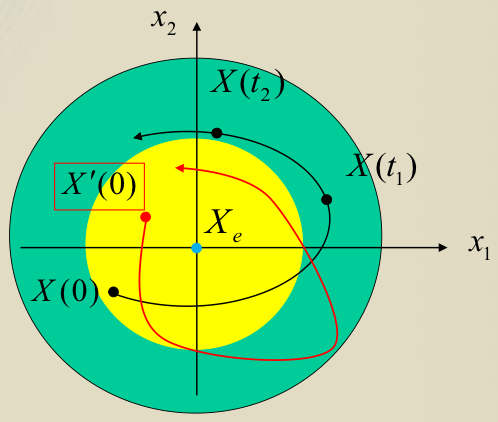

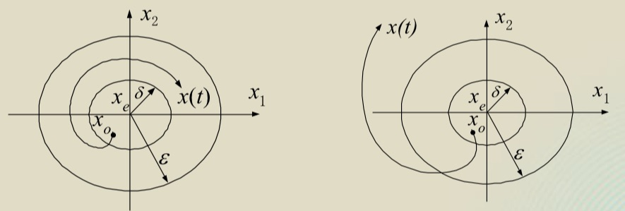

### 2. 渐近稳定（Asymptotic Stability）

若平衡点 $\mathbf{x}_e$ 既满足李雅普诺夫稳定，又对邻域内初始状态满足**收敛性**：

$$\lim_{t \to \infty} \mathbf{x}(t) = \mathbf{x}_e$$

则称系统在该平衡点**渐近稳定**。对于线性定常零输入系统 $\dot{\mathbf{x}}(t) = \mathbf{A}\mathbf{x}(t)$（唯一平衡点为原点 $\mathbf{x}_e = \mathbf{0}$，当 $\det\mathbf{A} \neq 0$）：

$$\mathbf{x}(t) = e^{\mathbf{A}(t - t_0)}\mathbf{x}(t_0)$$

* **充要条件**：系统矩阵 $\mathbf{A}$ 的**所有特征值**（即 $(s\mathbf{I}-\mathbf{A})^{-1}$ 的所有极点）均具有**严格负实部**（$\sigma_i = \operatorname{Re}(\lambda_i) < 0$）。
* （补充：若允许虚轴上存在**单重**特征值 $\sigma_i = 0$ 而其余特征值均在开左半平面，则系统为李雅普诺夫稳定/临界稳定，但不渐近稳定；虚轴上若存在**重根**，响应含 $t e^{j\omega t}$，系统**不稳定**。）

### 3. BIBO 稳定与内外部稳定性辨析

* **BIBO 稳定（Bounded-Input Bounded-Output Stability，外部稳定性）**：对任意有界输入 $|u(t)| \le M_1 < \infty$，系统的零状态输出恒有界 $|y(t)| \le M_2 < \infty$（等价于冲激响应绝对可积 $\int_0^\infty |g(t)|\,dt < \infty$）。
* **有理传递函数 $G(s)$ 的 BIBO 稳定充要条件**：**消去公因式（零极点对消）后**，$G(s)$ 的所有极点均具有严格负实部（$\sigma_i < 0$）。

> [!IMPORTANT]
> **渐近稳定（内部稳定）vs. BIBO 稳定（外部稳定）**
> $$\text{渐近稳定（内部）} \Longrightarrow \text{BIBO 稳定（外部）}, \qquad \text{BIBO 稳定} \not\Longrightarrow \text{渐近稳定}$$
> **原因**：若系统内部存在**不可控或不可观测的不稳定模态**（即右半平面极点在 $G(s) = \mathbf{C}(s\mathbf{I}-\mathbf{A})^{-1}\mathbf{B} + D$ 中恰好被零点对消），从外部输入输出看 $G(s)$ 仍是 BIBO 稳定的，但内部状态变量 $\mathbf{x}(t)$ 实际上随时间发散！**当且仅当系统既可控又可观（最小实现，无零极点对消）时，两者等价。**

---

## 3.2 劳斯-赫尔维茨稳定判据（Routh-Hurwitz Criterion）

设闭环特征方程（将最高次项系数归一化为 $a_0 > 0$）为：

$$F(s) = a_0 s^n + a_1 s^{n-1} + a_2 s^{n-2} + \cdots + a_{n-1} s + a_n = 0$$

* **必要条件（Necessary Condition）**：所有系数 $a_0, a_1, \dots, a_n$ **符号相同**且**无缺项**（即全为正，均不为 $0$）。
  * 对一阶（$n=1$）、二阶（$n=2$）系统，此必要条件同时也是充分条件；
  * 对三阶系统 $a_0 s^3 + a_1 s^2 + a_2 s + a_3 = 0$，充要条件为 $a_i > 0$ 且 $a_1 a_2 > a_0 a_3$。
* **充要条件（Necessary and Sufficient Condition）—— 劳斯表（Routh Tabulation）**：

按降幂将系数交错排入头两行，随后逐行交叉相乘相减计算：

| 行次 | 第 1 列 | 第 2 列 | 第 3 列 | $\cdots$ |
| :---: | :---: | :---: | :---: | :---: |
| $s^n$ | $a_0$ | $a_2$ | $a_4$ | $\cdots$ |
| $s^{n-1}$ | $a_1$ | $a_3$ | $a_5$ | $\cdots$ |
| $s^{n-2}$ | $b_1 = \dfrac{a_1 a_2 - a_0 a_3}{a_1}$ | $b_2 = \dfrac{a_1 a_4 - a_0 a_5}{a_1}$ | $b_3 = \cdots$ | $\cdots$ |
| $s^{n-3}$ | $c_1 = \dfrac{b_1 a_3 - a_1 b_2}{b_1}$ | $c_2 = \dfrac{b_1 a_5 - a_1 b_3}{b_1}$ | $c_3 = \cdots$ | $\cdots$ |
| $\vdots$ | $\vdots$ | $\vdots$ | $\vdots$ | $\vdots$ |
| $s^0$ | $a_n$ | $0$ | $0$ | $0$ |

* **稳定判据**：劳斯表**第一列所有元素同号**（全为正）$\iff$ 特征方程所有根位于开左半平面（系统渐近稳定）。
* **不稳定根个数**：劳斯表第一列元素的**符号变化次数**，严格等于特征方程在**开右半平面（RHP）的根的个数**。

### 两种特殊情况（Special Cases）

> [!CAUTION]
> **一旦劳斯表第一列出现零元素，系统必然不是渐近稳定的！**（至少存在虚轴根或右半平面根。）

1. **情况一：某行第一列元素为零，但该行其余元素不全为零**
   * **处理方法**：用无穷小正数 $\varepsilon \to 0^+$（手写笔记记作 $\delta^+ \to 0$）替代该零元素，继续完成劳斯表，再根据 $\varepsilon \to 0^+$ 时第一列的符号变化次数统计 RHP 根的个数（也可用倒数多项式变换 $s = 1/w$ 规避零元）。
   * **根分布辨析与局限**：若 $\varepsilon^+$ 法给出的符号变化次数为 $0$（表面看似临界稳定），通常暗示存在纯虚根，但**$\varepsilon^+$ 法本身并不可靠，不能单凭此确认临界稳定**（有时需用倒数多项式或因式分解进一步验证）。
2. **情况二：某一行所有元素全为零（全零行）**
   * **物理与代数意义**：说明特征方程存在**关于原点 $(0,0)$ 对称的根**，共有三种可能组合：
     1. 一对实轴对称根：$\pm \sigma$
     2. 一对纯虚根：$\pm j\omega$
     3. 一组四重对称复根：$\pm \sigma \pm j\omega$
   * **处理步骤**：
     1. 利用全零行的**上一行**系数构造**辅助方程（Auxiliary Equation）** $A(s) = 0$（必为偶次多项式，且 $A(s)$ 是原特征多项式 $F(s)$ 的因式！）；
     2. 对 $A(s)$ 求导得 $\dfrac{dA(s)}{ds}$，用其各项系数替换全零行；
     3. 继续完成剩余劳斯表；
     4. 从 $A(s)$ 行往下的符号变化次数，等于 $A(s) = 0$ 在 RHP 的根的个数（对称地也在 LHP 有同等数量的根），$A(s)$ 剩余的根则位于虚轴 $j\omega$ 上。

---

## 3.3 稳态性能与稳态误差（Steady-State Performance & Error）

系统时间响应可分解为瞬态响应与稳态响应两部分：

$$y(t) = y_t(t) + y_{ss}(t), \qquad \text{其中稳定系统满足 } \lim_{t \to \infty} y_t(t) = 0$$

### 1. 典型测试信号（Typical Test Signals）

| 信号类型 | 时域表达式 $r(t)\ (t \ge 0)$ | 拉普拉斯变换 $R(s)$ | 物理含义 |
| :--- | :---: | :---: | :--- |
| **单位阶跃（Step）** | $1(t)$ | $\dfrac{1}{s}$ | 恒定位置给定 |
| **单位斜坡（Ramp）** | $t$ | $\dfrac{1}{s^2}$ | 恒定速度给定 |
| **单位抛物线（Parabolic）** | $\dfrac{1}{2}t^2$ | $\dfrac{1}{s^3}$ | 恒定加速度给定 |

### 2. 稳态误差定义与终值定理计算

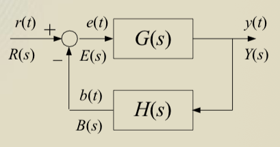

* **按输出定义（跟踪误差）**：$e(t) = y_r(t) - y(t)$（单位反馈时希望输出 $y_r(t) = r(t)$）；
* **按输入定义（偏差信号）**：$e(t) = r(t) - b(t)$，其稳态值为 $e_{ss} = \lim_{t \to \infty} e(t)$。

误差传递函数与拉普拉斯终值定理（Final-Value Theorem）：

$$E(s) = \frac{1}{1 + G(s)H(s)} R(s) = \frac{R(s)}{1 + G_0(s)}, \qquad e_{ss} = \lim_{s \to 0} s E(s) = \lim_{s \to 0} \frac{s R(s)}{1 + G_0(s)}$$

> [!WARNING]
> **终值定理使用前提**：公式 $e_{ss} = \lim_{s\to 0} sE(s)$ **仅当闭环系统稳定**（$sE(s)$ 的全部极点严格位于开左半平面）时才成立！做题时务必**先验稳定性（劳斯判据），再算稳态误差**。

### 3. 系统型别与静态误差系数（System Type & Static Error Constants）

将开环传递函数 $G_0(s) = G(s)H(s)$ 写成尾一标准型（时间常数形式）或首一标准型（零极点形式）：

$$G_0(s) = \frac{K \prod_{i=1}^{m} (T_i s + 1)}{s^r \prod_{j=1}^{\nu} (\tau_j s + 1)} = \frac{K' \prod_{i=1}^{m} (s + z_i)}{s^r \prod_{j=1}^{\nu} (s + p_j)}$$

* **开环增益（Open-Loop Gain）**：$K = \lim_{s \to 0} s^r G_0(s)$（注意区分根轨迹增益 $K'$，两者关系为 $K = K' \frac{\prod z_i}{\prod p_j}$）；
* **系统阶次（System Order）**：$n = r + \nu$；
* **系统型别（Type $r$）**：开环传递函数在**原点 $s = 0$ 处的极点重数 $r$**（即纯积分环节的个数）。

据此定义三个静态误差系数：

1. **位置（阶跃）误差系数**：$K_p = \lim_{s \to 0} G_0(s)$，单位阶跃稳态误差 $e_{ss} = \dfrac{1}{1 + K_p}$；
2. **速度（斜坡）误差系数**：$K_v = \lim_{s \to 0} s G_0(s)$，单位斜坡稳态误差 $e_{ss} = \dfrac{1}{K_v}$；
3. **加速度（抛物线）误差系数**：$K_a = \lim_{s \to 0} s^2 G_0(s)$，单位抛物线稳态误差 $e_{ss} = \dfrac{1}{K_a}$。

| 系统型别（Type $r$） | 单位阶跃 $r(t)=1(t)$ | 单位斜坡 $r(t)=t$ | 单位抛物线 $r(t)=\frac{1}{2}t^2$ |
| :---: | :---: | :---: | :---: |
| **Type 0 ($r=0$)** | $K_p = K,\ e_{ss} = \dfrac{1}{1+K}$ | $K_v = 0,\ e_{ss} = \infty$ | $K_a = 0,\ e_{ss} = \infty$ |
| **Type 1 ($r=1$)** | $K_p = \infty,\ e_{ss} = 0$ | $K_v = K,\ e_{ss} = \dfrac{1}{K}$ | $K_a = 0,\ e_{ss} = \infty$ |
| **Type 2 ($r=2$)** | $K_p = \infty,\ e_{ss} = 0$ | $K_v = \infty,\ e_{ss} = 0$ | $K_a = K,\ e_{ss} = \dfrac{1}{K}$ |
| **Type $\ge 3$ ($r \ge 3$)** | $e_{ss} = 0$ | $e_{ss} = 0$ | $K_a = \infty,\ e_{ss} = 0$ |

### 4. 外部扰动对稳态误差的影响与复合控制（Disturbance Rejection & Composite Control）

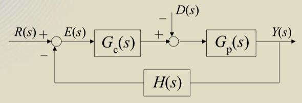

令参考输入 $R(s) = 0$，扰动 $D(s)$ 从控制器 $G_c(s)$ 与对象 $G_p(s)$ 之间以负号进入，则偏差信号为：

$$E(s) = -H(s)Y(s) = \frac{G_p(s) H(s)}{1 + G_c(s) G_p(s) H(s)} D(s) = \frac{G_p(s) H(s)}{1 + G_0(s)} D(s)$$

对于幅值为 $d$ 的阶跃扰动 $D(s) = d/s$，扰动引起的稳态误差为：

$$e_{ss,d} = \lim_{s \to 0} s E(s) = \frac{G_p(0) H(0)}{1 + G_0(0)} d \approx \frac{d}{G_c(0)} \qquad \text{（当 } G_0(0) = G_c(0)G_p(0)H(0) \gg 1\text{）}$$

> [!IMPORTANT]
> **抑制外部扰动稳态误差的两条基本途径**
> 1. **提高扰动作用点之前的前向增益 $G_c(0)$**；
> 2. **在扰动作用点之前（即 $G_c(s)$ 中）加入积分环节 $1/s$**，使 $G_c(0) \to \infty$，从而令 $e_{ss,d} = 0$。（注意：放在扰动点**之后**的 $G_p(s)$ 中的积分环节**无法**消除 $D(s)$ 引起的稳态误差！）

**复合控制（Composite / Feedforward-Feedback Control）**：当扰动 $D(s)$ 可测量时，可引入顺馈补偿通路 $G_d(s)$ 提前抵消扰动，既消除扰动误差又不改变闭环特征方程（不影响系统稳定性）：

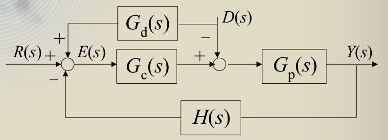

由结构图列写信号流（$R(s)=0$）：前向通道合并后进入 $G_p(s)$ 的信号为 $G_c(s)G_d(s)D(s) - D(s) - G_c(s)H(s)Y(s)$，故：

$$Y(s) = \frac{\left[G_c(s) G_d(s) - 1\right] G_p(s)}{1 + G_c(s) G_p(s) H(s)} D(s)$$

* **全补偿（完全不变性）条件**：令分子中扰动系数恒为零：
  $$G_c(s) G_d(s) - 1 = 0 \implies G_d(s) = \frac{1}{G_c(s)}$$
* **工程实现说明**：若 $G_c(s)$ 严格真，则 $1/G_c(s)$ 含纯微分项难以物理实现，工程中常采用低频近似或静态全补偿 $G_d(0) = 1/G_c(0)$ 以消除稳态扰动误差。

---

## 3.4 灵敏度分析（Sensitivity Analysis）

控制系统参数会因老化、温漂或负载变化而发生摄动。定义闭环传递函数 $T(s)$ 对某子环节（或参数）$G(s)$ 的**相对灵敏度（Relative Sensitivity）**为：

$$S_G^T = \frac{\partial T / T}{\partial G / G} = \frac{\partial \ln T}{\partial \ln G} = \frac{G}{T} \frac{\partial T}{\partial G}$$

对比开环系统 $T_{\text{ol}} = G$ 与标准负反馈闭环系统 $T(s) = \dfrac{G(s)}{1 + G(s)H(s)}$：

| 灵敏度指标 | 解析表达式 | 大环路增益（$\lvert G(j\omega)H(j\omega)\rvert \gg 1$）下的结论 |
| :--- | :---: | :--- |
| **开环对对象 $G$ 的灵敏度** | $S_G^{T_{\text{ol}}} = 1$ | 对象参数变化 $10\%$，输出直接变化 $10\%$，毫无抑制能力 |
| **闭环对对象 $G$ 的灵敏度** | $S_G^T = \dfrac{1}{1 + G(s)H(s)}$ | $\lvert S_G^T\rvert \ll 1$：负反馈极大削弱被控对象参数漂移的影响 |
| **闭环对传感器 $H$ 的灵敏度** | $S_H^T = -\dfrac{G(s)H(s)}{1 + G(s)H(s)}$ | $\lvert S_H^T\rvert \approx 1$：反馈通道误差几乎 **100% 传递到输出** |

> [!TIP]
> **工程设计启示**：负反馈能容忍前向通道（功放、执行器、被控对象）的非线性与参数漂移，但**绝不能容忍反馈传感器的漂移与噪声**——因此高精度控制系统必须把成本优先投入到**高精密、低漂移的反馈测量环节 $H(s)$** 上。

---

## 3.5 瞬态响应分析（Transient Response）

### 1. 动态性能指标（Performance Criteria）

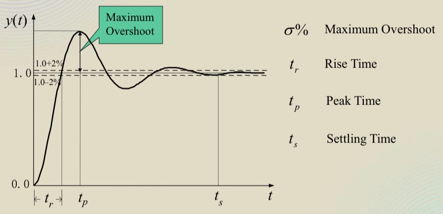

* **最大超调量（Maximum Overshoot）**：$\sigma\% = M_p = \dfrac{y(t_p) - y(\infty)}{y(\infty)} \times 100\%$，衡量相对平稳性；
* **上升时间（Rise Time，$t_r$）**：欠阻尼系统指首次从 $0$ 上升到终值 $y(\infty)$ 的时间（过阻尼系统取 $10\% \to 90\%$）；
* **峰值时间（Peak Time，$t_p$）**：响应到达第一个峰值所需时间；
* **调节时间（Settling Time，$t_s$）**：响应进入并**永久保持**在终值 $\pm 2\%$（或 $\pm 5\%$）误差带内所需的最短时间；
* **延迟时间（Delay Time，$t_d$）**：响应首次达到终值 $50\%$ 的时间。

### 2. 一阶系统（1st-Order System）

$$G(s) = \frac{1}{Ts + 1}, \qquad \text{单实极点：} s = -\frac{1}{T}$$

单位阶跃响应为 $y(t) = 1 - e^{-t/T}\ (t \ge 0)$：

* 无超调（$\sigma\% = 0$），初始斜率 $\dot{y}(0^+) = 1/T$；
* $t = T$ 时达到终值的 $63.2\%$；
* 调节时间：$t_s \approx 3T$（$\pm 5\%$ 误差带）或 $t_s \approx 4T$（$\pm 2\%$ 误差带，精确值 $3.91T$）。极点 $-1/T$ 越靠左（$T$ 越小），响应越快。

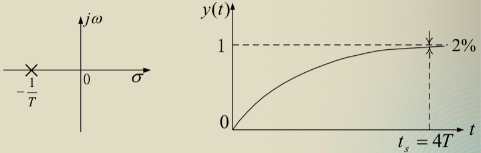

### 3. 二阶系统（2nd-Order System）

标准传递函数形式：

$$G(s) = \frac{\omega_n^2}{s^2 + 2\zeta\omega_n s + \omega_n^2} = \frac{1}{T^2 s^2 + 2\zeta T s + 1}$$

* $\omega_n$：无阻尼自然频率（Natural Undamped Frequency），$T = 1/\omega_n$ 为时间常数；
* $\zeta$：阻尼比（Damping Ratio）。

当 $0 \le \zeta < 1$ 时，特征根为一对共轭复极点：

$$s_{1,2} = -\zeta\omega_n \pm j\omega_n\sqrt{1 - \zeta^2} = -\sigma \pm j\omega_d$$

其中衰减速率 $\sigma = \zeta\omega_n$，阻尼振荡频率 $\omega_d = \omega_n\sqrt{1 - \zeta^2}$，阻尼角 $\theta = \arccos\zeta$（满足 $\cos\theta = \zeta$，$\sin\theta = \sqrt{1 - \zeta^2}$）。

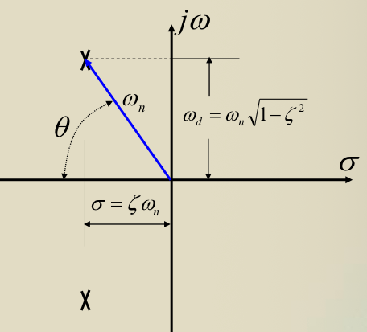

**四种阻尼状态的单位阶跃响应 $y(t)$**：

| 阻尼状态 | $\zeta$ 范围 | 极点分布 | 单位阶跃响应 $y(t)\ (t \ge 0)$ |
| :--- | :---: | :--- | :--- |
| **无阻尼（Undamped）** | $\zeta = 0$ | $\pm j\omega_n$（纯虚轴） | $y(t) = 1 - \cos(\omega_n t)$（等幅振荡） |
| **欠阻尼（Underdamped）** | $0 < \zeta < 1$ | $-\zeta\omega_n \pm j\omega_d$（LHP 共轭复极点） | $y(t) = 1 - \dfrac{1}{\sqrt{1-\zeta^2}} e^{-\zeta\omega_n t}\sin(\omega_d t + \theta)$ |
| **临界阻尼（Critically Damped）** | $\zeta = 1$ | $s_{1,2} = -\omega_n$（负实轴二重极点） | $y(t) = 1 - (1 + \omega_n t)e^{-\omega_n t}$ |
| **过阻尼（Overdamped）** | $\zeta > 1$ | $s_{1,2} = -\zeta\omega_n \pm \omega_n\sqrt{\zeta^2-1}$（两相异负实极点） | $y(t) = 1 + k_1 e^{s_1 t} + k_2 e^{s_2 t}$，其中 $k_1 = \dfrac{s_2}{s_1-s_2},\ k_2 = \dfrac{-s_1}{s_1-s_2}$ |

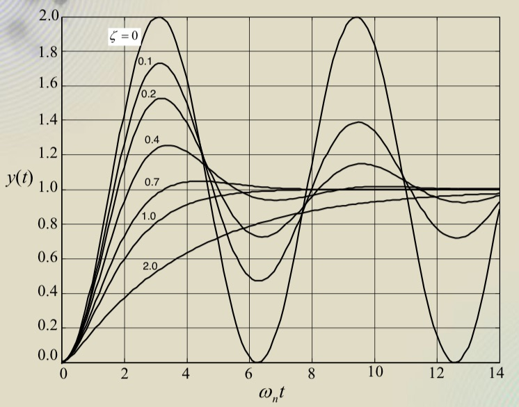

**欠阻尼（$0 < \zeta < 1$）核心定量指标公式**：

$$\sigma\% = e^{-\frac{\pi\zeta}{\sqrt{1-\zeta^2}}} \times 100\%, \qquad t_p = \frac{\pi}{\omega_d} = \frac{\pi}{\omega_n\sqrt{1-\zeta^2}}, \qquad t_r = \frac{\pi - \theta}{\omega_d}, \qquad t_s \approx \begin{cases} \dfrac{4}{\zeta\omega_n} = \dfrac{4}{\sigma} & (\pm 2\%) \\[6pt] \dfrac{3}{\zeta\omega_n} = \dfrac{3}{\sigma} & (\pm 5\%) \end{cases}$$

> [!TIP]
> **工程最佳阻尼区间**：$\sigma\%$ **仅取决于阻尼比 $\zeta$**！工程中通常选取 $\zeta \in [0.4,\ 0.8]$；特别地，$\zeta = \frac{\sqrt{2}}{2} \approx 0.707$ 称为**二阶最佳阻尼比**，此时超调量仅 $\sigma\% \approx 4.3\%$ 且响应迅速。

<ControlSecondOrderLab />

---

## 3.6 根轨迹法（Root Locus Method）

### 1. 基本概念与幅值/相角条件

对于闭环系统 $M(s) = \dfrac{G(s)}{1 + G(s)H(s)} = \dfrac{G(s)}{1 + G_0(s)}$，**根轨迹**是指当开环根轨迹增益 $K'$ 从 $0 \to +\infty$ 连续变化时，闭环特征方程 $1 + G_0(s) = 0$ 的根在 $s$ 平面上描出的轨迹。

将开环传递函数写成零极点形式：

$$G_0(s) = \frac{K' N_0(s)}{D_0(s)} = K' \frac{\prod_{i=1}^{m}(s - z_i)}{\prod_{j=1}^{n}(s - p_j)} = -1 \qquad (K' \ge 0,\ n \ge m)$$

由此导出根轨迹的**充要条件**：

* **幅值条件（Magnitude Condition）**：$|G_0(s)| = 1 \iff K' = \dfrac{\prod_{j=1}^{n}|s - p_j|}{\prod_{i=1}^{m}|s - z_i|}$（用于确定根轨迹上任意一点对应的增益 $K'$）；
* **相角条件（Angle Condition）**：$\angle G_0(s) = \sum_{i=1}^{m}\angle(s - z_i) - \sum_{j=1}^{n}\angle(s - p_j) = (2k + 1)\cdot 180^\circ\ (k \in \mathbb{Z})$（**决定 $s$ 平面上哪些点属于根轨迹的唯一充分必要条件**）。

### 2. 常规（$180^\circ$）根轨迹绘制 8 条核心法则

1. **起点与终点**：根轨迹起于开环极点（$K' = 0 \implies D_0(s) = 0$），终于开环零点（$K' = \infty \implies N_0(s) = 0$）；若 $n > m$，则有 $m$ 条分支终止于有限零点，其余 $n - m$ 条分支沿渐近线趋于无穷远。
2. **分支数**：等于开环极点数 $n$（一般为 $\max(n, m)$）。
3. **渐近线（Asymptotes，当 $n > m$）**：
   * 渐近线与实轴交点（重心 $F$ 或 $\sigma_a$，$p_j, z_i$ 取极零点的**实际坐标**，含负号！）：
     $$\sigma_a = F = \frac{\sum_{j=1}^{n} p_j - \sum_{i=1}^{m} z_i}{n - m}$$
   * 渐近线倾角：
     $$\alpha_k = \frac{(2k + 1) \cdot 180^\circ}{n - m}, \qquad k = 0, 1, \dots, n - m - 1$$
4. **对称性**：特征方程系数全为实数，故根轨迹严格**关于实轴对称**。
5. **实轴上的根轨迹**：实轴上某段属于根轨迹，当且仅当该段**右侧开环实零点与实极点的总数之和为奇数**（共轭复零极点对右侧相角贡献抵消，不影响奇偶性）。
6. **分离点与会合点（Breakaway / Break-in Points）**：根轨迹的重根点满足：
   $$\frac{dK'}{ds} = 0, \qquad K'(s) = -\frac{D_0(s)}{N_0(s)} \quad \left(\text{等价于 } \sum_{j=1}^{n} \frac{1}{d - p_j} = \sum_{i=1}^{m} \frac{1}{d - z_i}\right)$$
   * **算例**：$G_0(s) = \dfrac{K'}{s(s+1)} \implies K' = -(s^2 + s) \implies \dfrac{dK'}{ds} = -(2s + 1) = 0 \implies d = -0.5$（代回得 $K' = 0.25 > 0$，确实位于实轴根轨迹 $[-1, 0]$ 上，为有效分离点）。
7. **出射角与入射角（Angles of Departure & Arrival）**：对开环复极点 $p_k$ 或复零点 $z_k$ 紧邻测试点 $s_1$ 应用相角条件：
   $$\theta_{\text{dep}}(p_k) = 180^\circ + \sum_{i=1}^{m} \angle(p_k - z_i) - \sum_{j \neq k} \angle(p_k - p_j)$$
   $$\theta_{\text{arr}}(z_k) = 180^\circ - \sum_{i \neq k} \angle(z_k - z_i) + \sum_{j=1}^{n} \angle(z_k - p_j)$$

   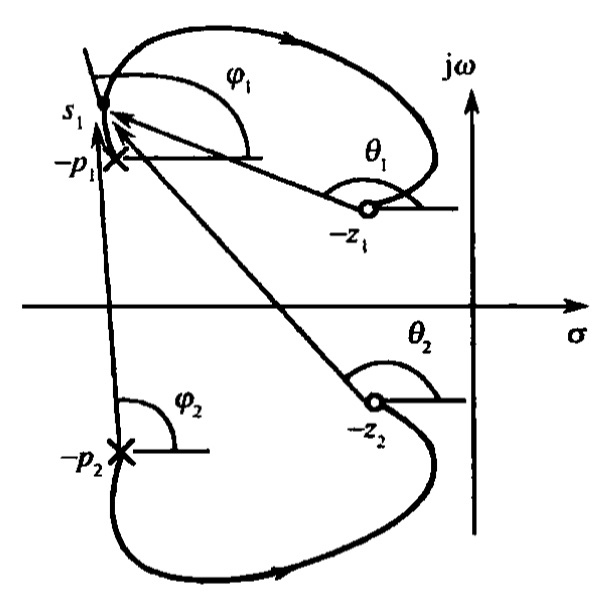

8. **与虚轴的交点（Intersection with Imaginary Axis）**：
   * **方法一（劳斯判据法）**：对含参数 $K'$ 的闭环特征方程 $D_0(s) + K' N_0(s) = 0$ 列劳斯表，令某奇数行首元为零解出临界增益 $K'_{\text{crit}}$，再解其上一行构成的**辅助方程 $A(s) = 0$**，得纯虚根 $s = \pm j\omega_c$；
   * **方法二（直接代入法）**：将 $s = j\omega$ 直接代入 $D_0(j\omega) + K' N_0(j\omega) = 0$，令实部与虚部分别为零联立求解 $\omega_c$ 与 $K'_{\text{crit}}$。
   * *(补充性质：当 $n - m \ge 2$ 时，闭环极点之和恒等于开环极点之和 $\sum s_i = \sum p_j = \text{const}$，故当部分分支向右移动时，其余分支必向左移动。)*

### 3. 附加开环零极点对根轨迹的影响（Parameter Design Using Root Locus）

#### （1）附加开环极点（Adding Poles）

无论附加极点 $-p_3$ 位于原极点外侧还是中间，都会使渐近线倾角减小、重心右移：

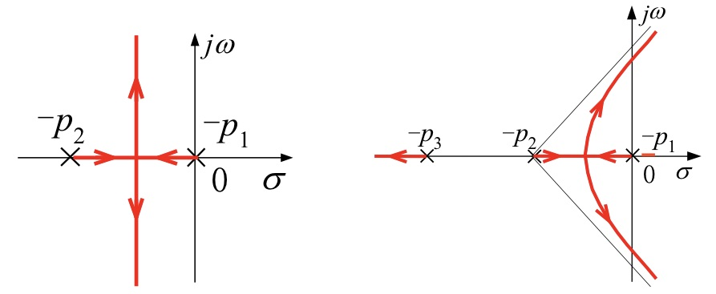

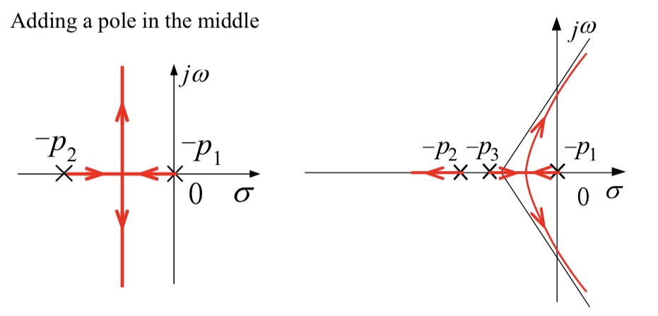

* **核心结论**：附加开环极点会将**根轨迹推向右半平面（RHP）** $\longrightarrow$ 降低系统相对稳定性、减小阻尼、甚至使原本全增益稳定的系统出现失稳临界增益。

#### （2）附加开环零点（Adding Zeros）

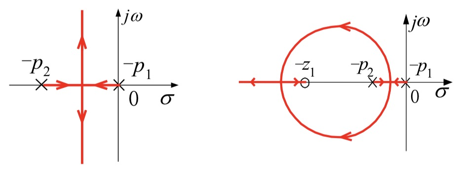

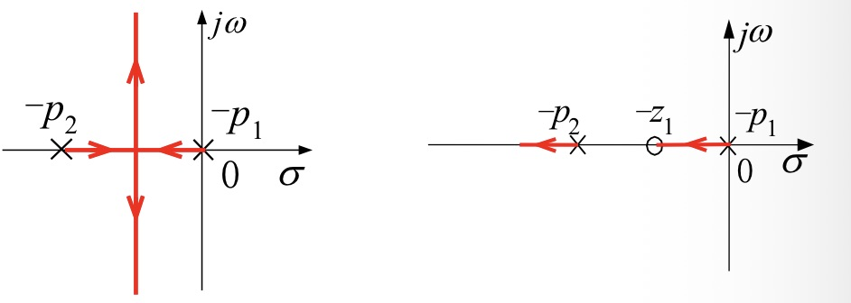

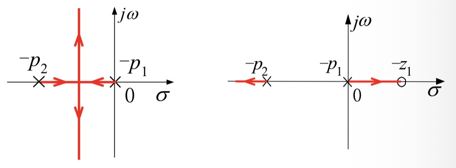

* **核心结论**：附加**左半平面（LHP）开环零点**会将**根轨迹拉向左半平面** $\longrightarrow$ 提高相对稳定性、增大阻尼比、加快瞬态衰减；但若错误地将零点放在**右半平面（RHP，非最小相位零点）**，则会把一条分支直接拉入不稳定区！

#### （3）附加零极点对（Adding Zero-Pole Pairs）

考虑一阶校正器 $G_c(s) = K_c \dfrac{s + z_c}{s + p_c}$（$z_c, p_c > 0$）：

* **$|z_c| < |p_c|$（零点更靠近虚轴）$\longrightarrow$ 超前零极点对（Leading Pair）**：整体效果类似附加零点，将根轨迹**拉向左半平面**改善动态性能，且**不改变趋于无穷远的渐近线条数（$n - m$ 不变）**！

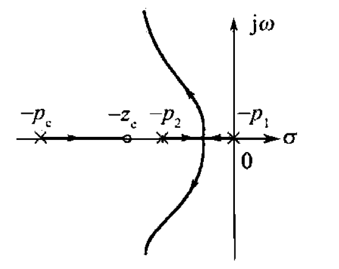

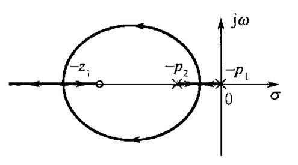

* **$|z_c| > |p_c|$（极点更靠近虚轴）$\longrightarrow$ 滞后零极点对（Lagging Pair）**：一般位置下效果类似附加极点，会使根轨迹略向右偏：

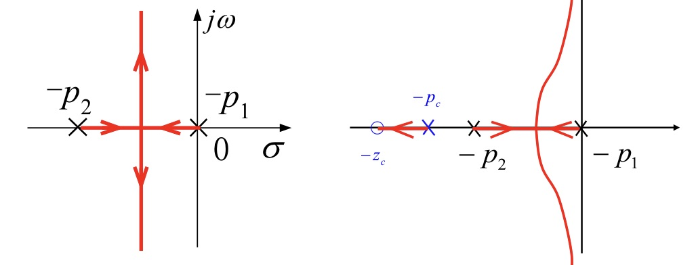

* **紧靠原点的滞后偶极子（Lagging Pair Close to Origin）**：将 $-p_c$ 与 $-z_c$ 同时放置在非常靠近原点处（同时保持比值 $z_c / p_c \gg 1$），其在主导闭环极点处的相角贡献近似为零，因此**主导根轨迹与瞬态响应几乎保持不变**，而系统静态速度误差系数 $K_v$ 被放大 $z_c / p_c$ 倍，**大幅降低稳态误差**！

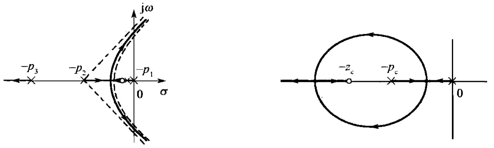

<ControlRootLocusLab />
