## 4.1 频率特性与极坐标图（Frequency Response & Polar Plot）

对一个**稳定**的线性定常系统 $Y(s) = G(s)U(s)$，输入正弦信号 $u(t) = U \sin(\omega_0 t)$（其拉氏变换 $U(s) = \dfrac{U\omega_0}{s^2 + \omega_0^2}$），则其**稳态输出**仍为同频率正弦信号，仅幅值按 $|G(j\omega_0)|$ 缩放、相角按 $\phi = \angle G(j\omega_0)$ 偏移：

$$y_{ss}(t) = U |G(j\omega_0)| \sin(\omega_0 t + \phi), \qquad \phi = \angle G(j\omega_0)$$

系统的**频率特性（Frequency Response）**定义为将 $s = j\omega$ 代入传递函数：

$$G(j\omega) = \left. G(s) \right|_{s = j\omega} = R(\omega) + j X(\omega), \qquad |G(j\omega)|^2 = [R(\omega)]^2 + [X(\omega)]^2$$

### 经典算例：一阶 RC 低通滤波器极坐标图

$$G(s) = \frac{1}{RCs + 1} \implies G(j\omega) = \frac{1}{1 + j(\omega/\omega_1)}, \qquad \omega_1 = \frac{1}{RC}$$

* **幅频与相频**：$|G(j\omega)| = \dfrac{1}{\sqrt{1 + (\omega/\omega_1)^2}}$，$\quad \phi(\omega) = -\arctan\left(\dfrac{\omega}{\omega_1}\right)$；
* **三个特征点**：
  * $\omega = 0$：$|G| = 1,\ \phi = 0^\circ$；
  * $\omega = \omega_1$：$|G| = \dfrac{1}{\sqrt{2}} \approx 0.707$（$-3\,\text{dB}$），$\phi = -45^\circ$；
  * $\omega = \infty$：$|G| = 0,\ \phi = -90^\circ$；
* **半圆几何证明**：分离实虚部 $R(\omega) = \dfrac{1}{1+(\omega/\omega_1)^2}$，$X(\omega) = \dfrac{-\omega/\omega_1}{1+(\omega/\omega_1)^2}$，消去 $\omega/\omega_1$ 得：
  $$\left(R - \frac{1}{2}\right)^2 + X^2 = \left(\frac{1}{2}\right)^2$$
  也可由 $\sqrt{1 - |G(\omega)|^2} = \frac{\omega}{\omega_1}|G(\omega)|$ 及 $\tan\phi = -\frac{\omega}{\omega_1}$ 直接验证。正频率 $\omega \in [0, +\infty)$ 描绘下半圆，负频率 $\omega \in (-\infty, 0]$ 描绘关于实轴对称的上半圆（虚线）。

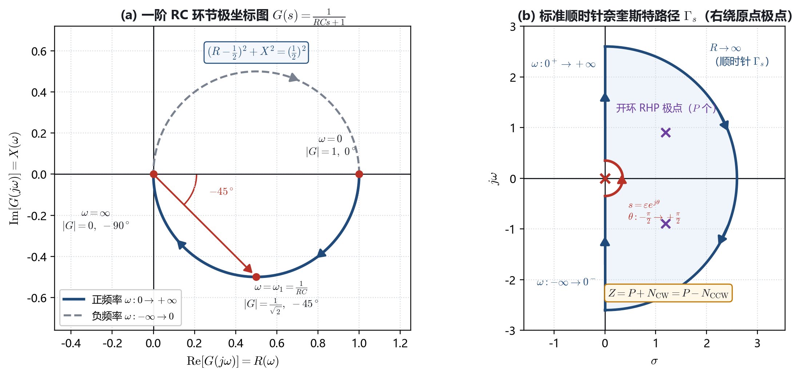

---

## 4.2 奈奎斯特稳定判据（Nyquist Stability Criterion）

### 1. 柯西幅角原理（Cauchy's Principle of Argument）

* **包围（Encircled）**：某点位于闭合曲线内部；
* **包含（Enclosed）**：沿闭合曲线行进方向观察，位于曲线**指定封闭域内**的点（若取逆时针 CCW 为正向，则曲线左侧为包含区域；若取顺时针 CW 绕行右半平面，则曲线右侧为包含区域）。

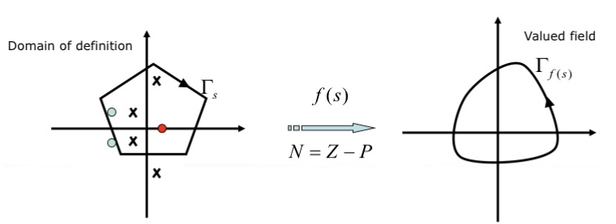

设闭合曲线 $\Gamma_s$ 在 $s$ 平面内**不经过 $f(s)$ 的任何零点或极点**，且内部包含 $f(s)$ 的 $Z$ 个零点与 $P$ 个极点。当 $s$ 沿 $\Gamma_s$ 完整行进一周时，复数向量 $f(s)$ 的净相角变化为 $2\pi N$，其绕原点旋转的净圈数 $N$（**规定与 $\Gamma_s$ 绕行方向一致者为正**）满足：

$$N = Z - P$$

### 2. 奈奎斯特路径与闭环稳定性判据

对于闭环系统 $T(s) = \dfrac{G(s)}{1 + G(s)H(s)} = \dfrac{G(s)}{1 + G_0(s)}$，闭环极点即辅助函数 $f(s) = 1 + G_0(s) = \dfrac{D_c(s)}{D_0(s)}$ 的**零点**；而 $f(s)$ 的极点就是开环传递函数 $G_0(s)$ 的极点！闭环稳定的充要条件为：$f(s) = 1 + G_0(s)$ 在右半平面（$\sigma > 0$）内**无零点**（$Z = 0$）。

为简化作图，平移坐标系令 $f'(s) = f(s) - 1 = G_0(s)$，于是“$f(s)$ 曲线包围原点 $(0, j0)$”等价于“**开环奈奎斯特图 $G_0(s)$ 包围临界点 $(-1, j0)$**”。

取**标准顺时针（CW）奈奎斯特路径 $\Gamma_s$**（见上方图 (b)）：沿虚轴自下而上（$\omega: -\infty \to +\infty$），遇虚轴极点向右绕微小半圆 $s = \varepsilon e^{j\theta}\ (\theta: -\frac{\pi}{2} \to +\frac{\pi}{2})$ 避开，再沿半径 $R \to \infty$ 的右半平面大圆弧顺时针闭合。则：

* $P$：开环传递函数 $G_0(s)$ 位于**开右半平面（$\sigma > 0$）的极点数**；
* $Z$：闭环特征方程 $1 + G_0(s) = 0$ 位于**开右半平面（$\sigma > 0$）的根（不稳定闭环极点）个数**；
* $N_{\text{CW}}$（$= -N_{\text{CCW}}$）：当 $\omega$ 从 $-\infty \to +\infty$ 沿完整奈奎斯特曲线行进时，$G_0(j\omega)$ **顺时针**包围临界点 $(-1, j0)$ 的净圈数（逆时针为负）。

$$Z = P + N_{\text{CW}} = P - N_{\text{CCW}}$$

> [!IMPORTANT]
> **奈奎斯特闭环稳定性充要条件（$Z = 0$）**
> 1. 当 $\omega$ 从 $-\infty$ 增至 $+\infty$ 时，完整的开环奈奎斯特图 $G_0(j\omega)$ 必须**逆时针（CCW）包围 $(-1, j0)$ 点恰好 $P$ 圈**（即 $N_{\text{CCW}} = P$，或 $N_{\text{CW}} = -P$）；
> 2. **特例（开环稳定系统，$P = 0$）**：闭环稳定 $\iff$ 奈奎斯特图**不包围 $(-1, j0)$ 点**（$N = 0$）。

> [!WARNING]
> **路径绕行方向等价性说明（防混淆）**
> 部分教材/课件（例如定义 CCW 为正向）会让 $\Gamma_s$ 沿虚轴**自上而下**（$\omega: +\infty \to -\infty$）逆时针包围右半平面，此时映射曲线上每一段箭头与“$\omega$ 递增”方向恰好**相反**，从而公式写作 $N_{\text{CCW}}(\text{降频}) = Z - P$，稳定条件写作 $N_{\text{CCW}}(\text{降频}) = -P$（即沿降频箭头顺时针 $P$ 圈 $=$ 沿升频箭头逆时针 $P$ 圈！）。**两种规定得到的闭环不稳定极点数 $Z$ 完全相同**；工程画图习惯按频率 $\omega$ 递增（$0 \to +\infty$）标箭头，故强烈建议统一记住：**升频方向下 $Z = P + N_{\text{CW}} = P - N_{\text{CCW}}$**。

### 3. 三阶系统完整判稳算例

已知开环频率特性：

$$G_0(j\omega) = \frac{100}{(j\omega + 1)(0.5j\omega + 1)(0.2j\omega + 1)}$$

* **Step 1（起止点与单调性）**：
  * $\omega = 0$：$G_0(j0) = 100\angle 0^\circ$；
  * $\omega \to \infty$：$G_0(j\infty) = 0\angle -270^\circ$（记住：$j\omega \to +90^\circ$，$-j\omega \to -90^\circ$，三个惯性环节总相滞 $-270^\circ$）；
  * 当 $\omega$ 从 $0 \to \infty$ 时，$|G_0(j\omega)|$ 从 $100$ 单调递减至 $0$。
* **Step 2（求与负实轴的交点）**：将分母展开并有理化：
  $$G_0(j\omega) = \frac{100\left[(1 - 0.8\omega^2) + j(0.1\omega^3 - 1.7\omega)\right]}{(1 + \omega^2)(1 + \frac{1}{4}\omega^2)(1 + \frac{1}{25}\omega^2)}$$
  令虚部为零（$\omega > 0$）：$0.1\omega^3 - 1.7\omega = 0 \implies \omega = \sqrt{17} \approx 4.12\,\text{rad/s}$。代入得实轴交点：
  $$G_0(j\sqrt{17}) = \frac{100(1 - 0.8 \times 17)}{18 \times 5.25 \times 1.68} = -7.94\angle -180^\circ \quad (\text{位于 } (-1, j0) \text{ 左侧！})$$
* **Step 3（判稳）**：

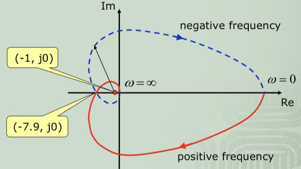

  * 开环极点为 $-1, -2, -5$，均在 LHP $\implies P = 0$；
  * 沿升频方向（正频率实线 + 负频率虚线）完整追踪，曲线共**顺时针包围 $(-1, j0)$ 两圈** $\implies N_{\text{CW}} = 2$；
  * $Z = P + N_{\text{CW}} = 0 + 2 = 2 \implies$ 闭环系统存在 **2 个右半平面极点，不稳定**！

### 4. 含原点极点（$1/s^\nu$）的右绕补圆法则

当开环传递函数含 $\nu$ 个纯积分环节（原点极点 $1/s^\nu$）时，奈奎斯特路径 $\Gamma_s$ 必须向右以半径 $\varepsilon \to 0^+$ 的半圆绕开原点：

$$s = \varepsilon e^{j\theta}, \qquad \theta: -\frac{\pi}{2}\ (\omega = 0^-) \longrightarrow 0 \longrightarrow +\frac{\pi}{2}\ (\omega = 0^+)$$

例如 $G_0(s) = \dfrac{K}{s(s + 1)}$（Type 1，$\nu = 1$）：
* $\omega = 0^+$：$G_0(j0^+) = \infty\angle -90^\circ$；$\omega = \infty$：$G_0(j\infty) = 0\angle -180^\circ$；
* 在微小半圆上：
  $$\lim_{\varepsilon \to 0^+} G_0(\varepsilon e^{j\theta}) = \lim_{\varepsilon \to 0^+} \frac{K}{\varepsilon e^{j\theta}} = \infty \angle (-\theta)$$
  当 $\theta$ 从 $-\frac{\pi}{2} \to 0 \to +\frac{\pi}{2}$ 时，映射曲线以无穷大半径从 $+90^\circ$（$A'$）经 $0^\circ$（$B'$）**顺时针**旋转 $-180^\circ$ 至 $-90^\circ$（$C'$）。曲线不包围 $(-1, j0)$（$N = 0,\ P = 0 \implies Z = 0$），系统对任意 $K > 0$ 恒稳定！

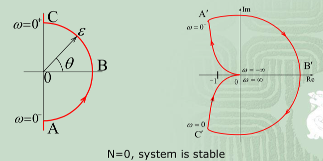

**一般补圆规律（$\nu$ 重原点极点）**：在 $G_0(j\omega)$ 平面中，从 $\omega = 0^-$ 到 $\omega = 0^+$ 需补画半径为 $\infty$、**顺时针（CW）旋转 $\nu \times 180^\circ$** 的大圆弧：

* $\nu = 1$（Type 1）：$\Delta\phi_{0^- \to 0^+} = -180^\circ$（CW 半圆）
* $\nu = 2$（Type 2）：$\Delta\phi_{0^- \to 0^+} = -360^\circ$（CW 整圆）
* $\nu = 3$（Type 3）：$\Delta\phi_{0^- \to 0^+} = -540^\circ$（CW 一圈半）

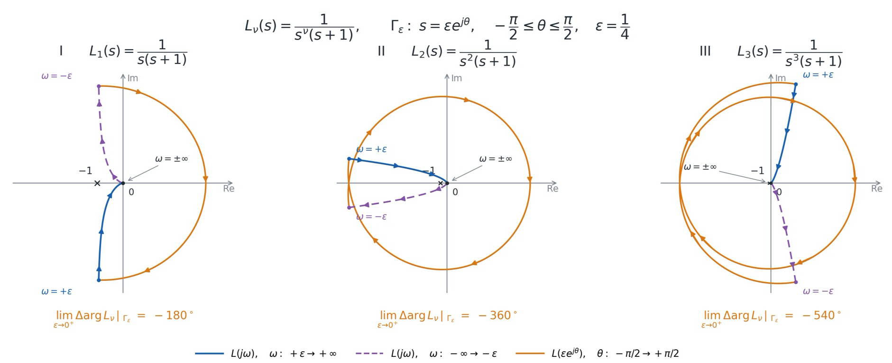

### 5. 映射区域与“左手法则”的适用边界

对于**开环稳定（$P = 0$）的典型最小相位系统**，沿正频率 $\omega: 0^+ \to +\infty$ 方向行进时：

* 若 $(-1, j0)$ 始终位于曲线**左侧**（且闭合大圆弧后不包围 $(-1, j0)$），系统通常**稳定**；
* 若 $(-1, j0)$ 位于曲线**右侧**，系统**往往不稳定**，但该经验法则**并不严格（Not rigorous）**——例如条件稳定系统、$P > 0$ 的开环不稳定系统、或高型别（Type 2/3）系统补圆后可能改变包围圈数，必须回归严格奈奎斯特公式 $Z = P + N_{\text{CW}}$ 判定！

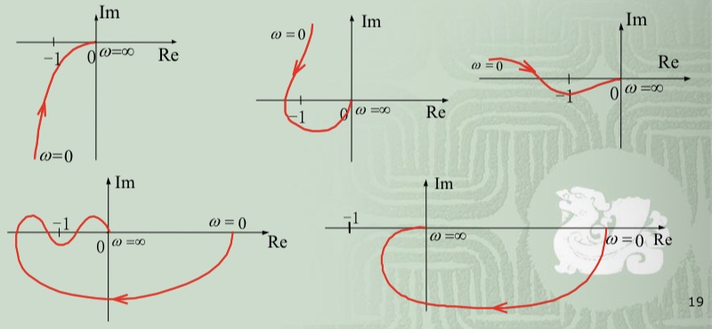

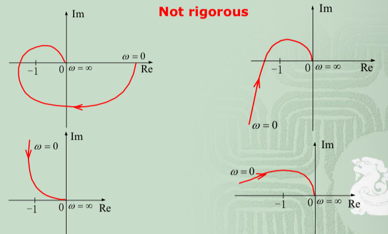

---

## 4.3 伯德图（Bode Plot / 对数频率特性图）

将开环频率特性 $L(j\omega) = K G_0(j\omega) = |L(j\omega)|\angle\phi(\omega)$ 绘制在以**角频率 $\omega\ (\text{rad/s})$ 为对数横坐标**的两张图上：

* **对数幅频图（Magnitude Plot）**：$L(\omega) = M(\omega) = 20\lg|L(j\omega)|$（单位：$\text{dB}$）；
* **对数相频图（Phase Plot）**：$\phi(\omega) = \arg L(j\omega)$（单位：度 $^\circ$）。

取对数最大的优势是**将传递函数各因式的乘除化为幅频与相频的直接加减**：

$$L(\omega) = 20\lg|K| + 20\lg|1 + j\omega T_1| + \cdots, \qquad \phi(\omega) = \angle K + \angle(1 + j\omega T_1) + \cdots$$

### 1. 四大典型环节的伯德图特性

| 环节名称 | 传递函数 $G(s)$ | 对数幅频 $L(\omega)$ 及渐近线 | 相频特性 $\phi(\omega)$ |
| :--- | :---: | :--- | :--- |
| **$1^\circ$ 比例环节（Gain）** | $K$ | $20\lg\lvert K\rvert = \text{const}$（水平直线） | $0^\circ\ (K>0)$；$-180^\circ\ (K<0)$ |
| **$2^\circ$ 积分环节（Integrator）** | $\dfrac{1}{s}$ | $-20\lg\omega$：对数坐标下为**直线**，斜率 **$-20\,\text{dB/dec}$**，过 $(1,\ 0\,\text{dB})$ | 恒为 $-90^\circ$（微分 $s$ 为 $+20\,\text{dB/dec},\ +90^\circ$） |
| **$3^\circ$ 一阶惯性（Inertia）** | $\dfrac{1}{Ts + 1}$ | $-20\lg\sqrt{1+(\omega T)^2}$；转折频率 $\omega_c = \frac{1}{T}$： $\omega < \frac{1}{T} \Rightarrow 0\,\text{dB}$；$\omega > \frac{1}{T} \Rightarrow -20\,\text{dB/dec}$（转折点精确误差 $-3.01\,\text{dB}$） | $-\arctan(\omega T)$： $0.1/T$ 处 $\approx 0^\circ$，$1/T$ 处 $-45^\circ$，$10/T$ 处 $\approx -90^\circ$ |
| **$4^\circ$ 二阶振荡（2nd-Order）** | $\dfrac{\omega_n^2}{s^2+2\zeta\omega_n s+\omega_n^2} = \dfrac{1}{T^2 s^2 + 2\zeta Ts + 1}$ | $-20\lg\sqrt{(1-\omega^2 T^2)^2 + (2\zeta\omega T)^2}$；转折频率 $\omega_n = \frac{1}{T}$： $\omega < \frac{1}{T} \Rightarrow 0\,\text{dB}$；$\omega > \frac{1}{T} \Rightarrow -40\,\text{dB/dec}$； **当 $0 < \zeta < 0.707$ 时，$\zeta \downarrow \implies$ 谐振峰值 $M_r \uparrow$！** | $\phi(\omega) = \begin{cases}-\arctan\frac{2\zeta\omega T}{1-\omega^2 T^2}, & \omega < \omega_n \\ -90^\circ, & \omega = \omega_n \\ -180^\circ - \arctan\frac{2\zeta\omega T}{1-\omega^2 T^2}, & \omega > \omega_n\end{cases}$ （$\zeta=1$ 时精确等于 $-2\arctan(\omega T)$） |

*(补充：一阶微分环节 $Ts + 1$ 与惯性环节镜像相反，$+20\,\text{dB/dec},\ +90^\circ$；纯滞后环节 $e^{-\tau_d s}$ 幅频恒为 $0\,\text{dB}$，相频 $\phi(\omega) = -\omega\tau_d\ (\text{rad})$，只引入随频率线性增长的相位滞后。)*

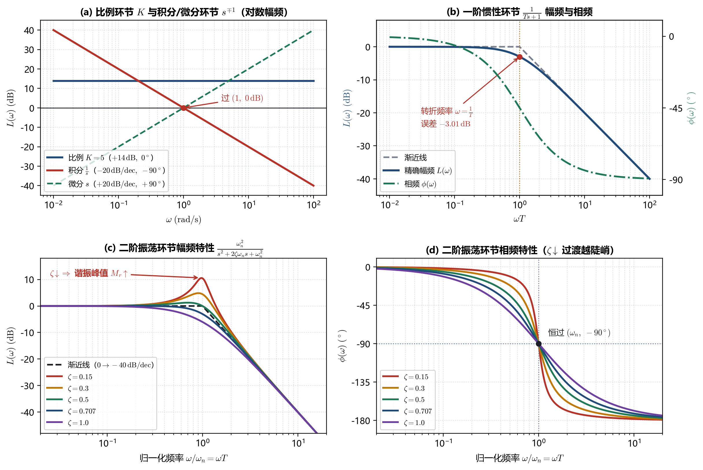

> [!WARNING]
> **二阶振荡环节的谐振峰规律**：仅当 $0 < \zeta < \frac{\sqrt{2}}{2} \approx 0.707$ 时幅频曲线才出现高于 $0\,\text{dB}$ 的谐振峰，谐振频率 $\omega_r = \omega_n\sqrt{1 - 2\zeta^2}$，峰值 $M_r = \dfrac{1}{2\zeta\sqrt{1-\zeta^2}}$，且在转折频率 $\omega = \omega_n$ 处的精确修正值为 $-20\lg(2\zeta)\,\text{dB}$。**阻尼比 $\zeta$ 越小，谐振峰越高，相角在 $\omega_n$ 附近跳变越陡峭！**

### 2. 综合伯德图绘制步骤与完整算例

绘制任意形如 $G(s) = \dfrac{K(1+T_1 s)(1+T_2 s)}{s(1+T_a s)(1 + \frac{2\zeta}{\omega_n}s + \frac{s^2}{\omega_n^2})} e^{-\tau_d s}$ 的伯德图：化为尾一标准型 $\to$ 列出所有转折频率并从小到大排序 $\to$ 由低频渐近线（$K / s^\nu$）出发逐段叠加斜率变化 $\to$ 在转折频率与小阻尼二阶处做曲线修正。

**算例**：绘制 $G(s) = \dfrac{5(0.1s + 1)}{s(0.5s + 1)\left(\frac{1}{2500}s^2 + \frac{0.6}{50}s + 1\right)}$ 的伯德图。

| 组成环节 | 转折频率 $\omega_i\ (\text{rad/s})$ | 斜率贡献 | 相角变化趋势 |
| :--- | :---: | :---: | :--- |
| 增益与积分 $\dfrac{5}{s}$ | 基线（$\omega = 1$ 处 $L = 20\lg 5 \approx 14\,\text{dB}$，$\omega = 0.1$ 处 $34\,\text{dB}$） | $-20\,\text{dB/dec}$ | 恒 $-90^\circ$ |
| 惯性 $\dfrac{1}{0.5s + 1}$ | $\omega_1 = \dfrac{1}{0.5} = 2$ | $-20\,\text{dB/dec}$ $\implies$ 累计 **$-40\,\text{dB/dec}$** | $0^\circ \to -90^\circ$ |
| 一阶微分 $0.1s + 1$ | $\omega_2 = \dfrac{1}{0.1} = 10$ | $+20\,\text{dB/dec}$ $\implies$ 累计 **$-20\,\text{dB/dec}$** | $0^\circ \to +90^\circ$（中频抬升相角） |
| 二阶振荡（$\omega_n = 50,\ \zeta = 0.3$） | $\omega_3 = 50$ | $-40\,\text{dB/dec}$ $\implies$ 累计 **$-60\,\text{dB/dec}$** | $0^\circ \to -180^\circ$（$\omega=50$ 处约 $+4.4\,\text{dB}$ 谐振峰） |

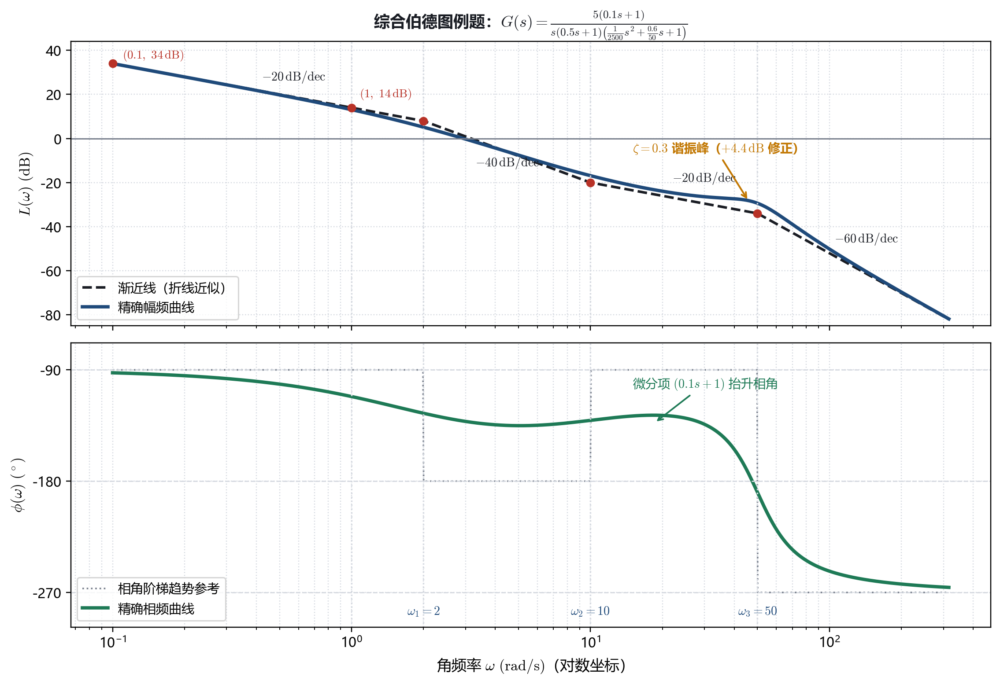

---

## 4.4 最小相位与非最小相位系统（Minimum-Phase & Nonminimum-Phase）

* **定义**：若传递函数 $G(s)$ 在**开右半平面（$\sigma > 0$）内既无极点又无零点**（且不含纯时间滞后 $e^{-\tau s}$），则称其为**最小相位函数（Minimum-Phase Function）**；否则为非最小相位函数。

**对比算例**（设 $T_1 > T_2 > 0$，即 $\frac{1}{T_1} < \frac{1}{T_2}$）：

$$G_1(s) = \frac{T_2 s + 1}{T_1 s + 1}\ (\text{最小相位}), \qquad G_2(s) = \frac{1 - T_2 s}{T_1 s + 1}\ (\text{含 RHP 零点}), \qquad G_3(s) = \frac{T_2 s + 1}{1 - T_1 s}\ (\text{含 RHP 极点})$$

三者的**对数幅频特性 $L(\omega)$ 完全相同**，但相频特性迥异：
* $\Phi_1(\omega) = -\arctan(T_1\omega) + \arctan(T_2\omega)$（高频归零，相角变化绝对值最小）；
* $\Phi_2(\omega) = -\arctan(T_1\omega) - \arctan(T_2\omega) \to -180^\circ$；
* $\Phi_3(\omega) = +\arctan(T_1\omega) + \arctan(T_2\omega) \to +180^\circ$。

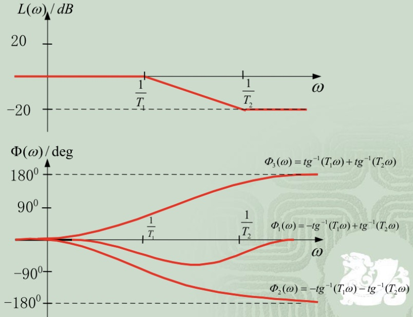

### 最小相位系统的两条核心性质

1. **幅相唯一对应性（Bode Gain-Phase Relation）**：对最小相位系统，幅频特性与相频特性存在唯一确定关系——已知完整 $L(\omega)$ 即可唯一确定 $\phi(\omega)$；
2. **总相角变化规律**：设最小相位函数 $G(s)$ 有 $m$ 个有限零点、$n$ 个极点（其中 $\nu$ 个位于原点 $s = 0$，其余 $n - \nu$ 个为非零极点）：
   * 起始相角（$\omega \to 0^+$）：$\phi(0^+) = -\nu\dfrac{\pi}{2}$；
   * 终止相角（$\omega \to \infty$）：$\phi(\infty) = -(n - m)\dfrac{\pi}{2}$；
   * 扣除原点极点后，随 $\omega: 0^+ \to \infty$ 的净相移为 $\Delta\phi = -(n - \nu - m)\dfrac{\pi}{2}$（特别地，当不含原点极点 $\nu = 0$ 时，$|\Delta\phi| = (n - m)\dfrac{\pi}{2}$）。在所有具有相同幅频特性的系统中，最小相位系统的相角滞后范围最小。

---

## 4.5 相对稳定性与稳定裕度（Gain Margin & Phase Margin）

奈奎斯特曲线不仅判断“是否稳定”，它距离临界点 $(-1, j0)$ 的远近还直接决定了闭环系统的**相对稳定性（阻尼与振荡程度）**：

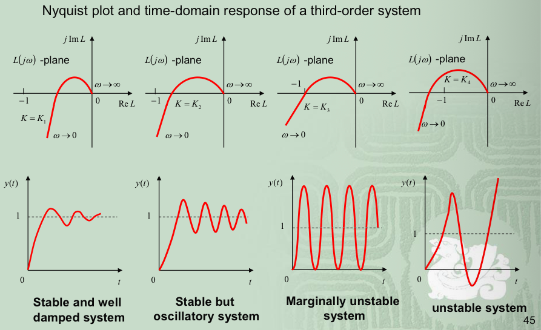

由此定义两个核心频域稳定裕度指标：

1. **幅值裕度 / 增益裕度（Gain Margin，$GM$）**：在**相位穿越频率 $\omega_p$**（满足 $\angle L(j\omega_p) = -180^\circ$）处，系统增益还能放大多少倍才达到临界稳定：
   $$GM = \frac{1}{|L(j\omega_p)|}, \qquad GM_{\text{dB}} = 20\lg\frac{1}{|L(j\omega_p)|} = -20\lg|L(j\omega_p)|\ (\text{dB})$$
   * $|L(j\omega_p)| = 0$（曲线不穿越负实轴）$\implies GM = \infty\,\text{dB}$；
   * $0 < |L(j\omega_p)| < 1 \implies GM > 0\,\text{dB}$；
   * $|L(j\omega_p)| = 1 \implies GM = 0\,\text{dB}$（临界稳定）；
   * $|L(j\omega_p)| > 1 \implies GM < 0\,\text{dB}$。

2. **相角裕度 / 相位裕度（Phase Margin，$PM$）**：在**增益穿越 / 截止频率 $\omega_g$**（满足 $|L(j\omega_g)| = 1$，即 $L(\omega_g) = 0\,\text{dB}$）处，系统还能承受多少额外相位滞后才达到 $-180^\circ$：
   $$PM = 180^\circ + \angle L(j\omega_g)$$

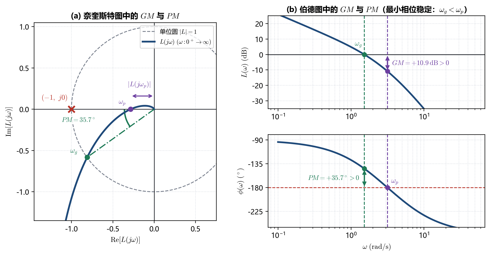

> [!IMPORTANT]
> **伯德图快速读裕度口诀与稳定判据**
> * **$L(\omega_g) = 0\,\text{dB} \implies$ 向下读 $PM$**（相频曲线高出 $-180^\circ$ 线的高度）；
> * **$\phi(\omega_p) = -180^\circ \implies$ 向上读 $GM$**（幅频曲线低于 $0\,\text{dB}$ 线的深度）；
> * **对开环稳定的最小相位系统**（单调穿越）：$GM > 0\,\text{dB}$ 且 $PM > 0^\circ$（等价于 $\omega_g < \omega_p$）$\implies$ 闭环稳定！工程良好动态性能一般要求 **$GM \ge 6\text{–}10\,\text{dB}$，$PM \in [30^\circ,\ 60^\circ]$**。（非最小相位或开环不稳定系统不可盲目套用，须用完整奈奎斯特判据！）

<ControlBodeNyquistLab />
