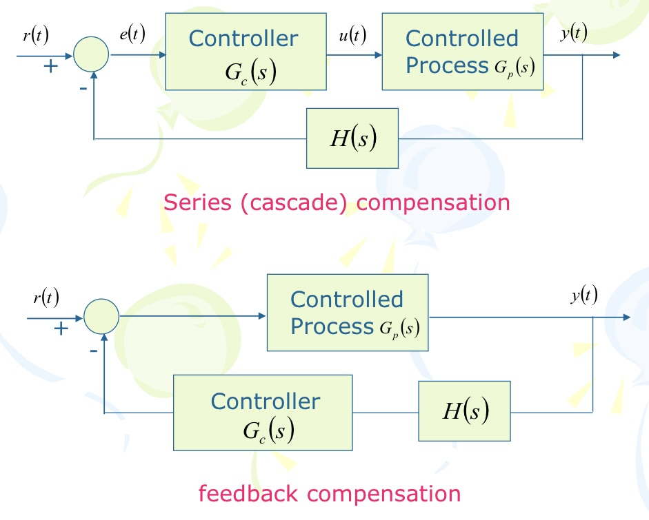
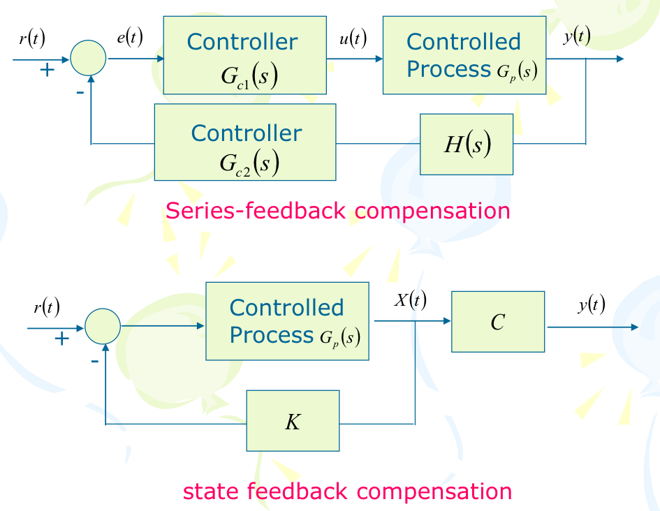
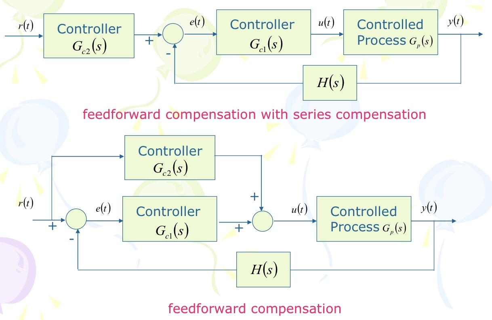
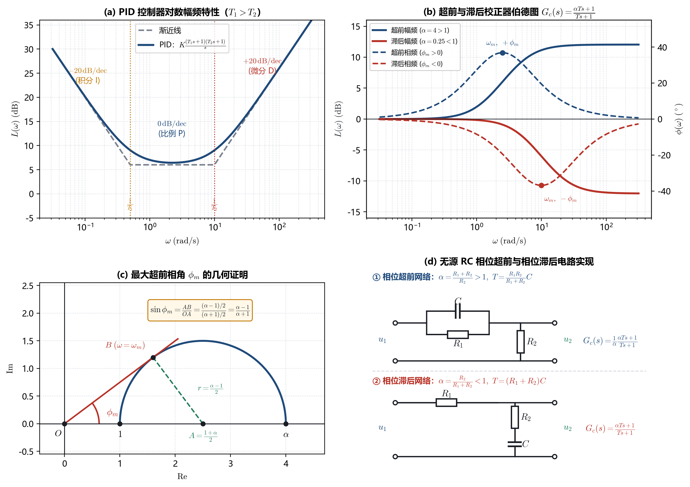

## 5.1 控制器结构配置与二阶目标区（Controller Configurations）

控制系统校正（Compensation）按控制器在回路中的连接方式，可分为六大典型配置：

在经典设计中，常将时域性能指标直接转化为**期望主导二阶闭环极点** $s_{1,2} = -\zeta\omega_n \pm j\omega_n\sqrt{1-\zeta^2} = -\sigma \pm j\omega_d$ 在 $s$ 平面上的允许区域：

* **调节时间（Settling Time）约束**：$t_s \approx \dfrac{4}{\sigma} \le t_{s,\max} \implies$ 极点位于竖直线 $\operatorname{Re}(s) \le -\sigma_{\min}$ 的**左侧**；
* **峰值时间（Peak Time）约束**：$t_p = \dfrac{\pi}{\omega_d} \le t_{p,\max} \implies$ 极点位于水平线 $|\operatorname{Im}(s)| \ge \omega_{d,\min}$ 之外；
* **超调量（Overshoot）约束**：$M_p = e^{-\pi\zeta/\sqrt{1-\zeta^2}} \le M_{p,\max} \implies$ 极点位于阻尼锥角 $|\theta| \le \arccos\zeta_{\min}$ 的**扇形区域内部**。

---

## 5.2 控制系统设计的 8 条基本原则（Fundamental Principles of Design）

1. **闭环共轭复极点 $\to$ 欠阻尼振荡**：闭环传递函数存在共轭复极点 $s_{1,2} = -\sigma \pm j\omega_d$ 时，响应含衰减正弦项 $e^{-\sigma t}\sin(\omega_d t + \phi)$，表现为**欠阻尼（underdamped）**。
2. **全实闭环极点 $\to$ 过阻尼单调衰减**：闭环极点全为负实根 $s = -\sigma_i$ 时，响应为纯指数项 $e^{-\sigma_i t}$ 之和，在无近原点零点影响下表现为**过阻尼（overdamped）**。
3. **闭环零点会引入微分作用并导致超调**：在保持直流增益不变的前提下，若闭环传递函数增加左半平面零点 $-z$（$z > 0$）：
   $$G(s) = G_0(s)\frac{s + z}{z} = G_0(s)\left(1 + \frac{s}{z}\right) \implies y(t) = y_0(t) + \frac{1}{z}\dot{y}_0(t)$$
   由于上升阶段 $\dot{y}_0(t) > 0$，附加微分项会**加快响应速度并增大超调**——**即使原系统是全实极点的过阻尼系统，只要闭环零点足够靠近虚轴，依然会产生明显超调！**（若是右半平面零点 $1 - s/z$，则会减去 $\frac{1}{z}\dot{y}_0(t)$，引发初始反向“下冲 / undershoot”。）
4. **超调量由极点相角 $\theta$ 决定**：在由 $\sigma = \zeta\omega_n$、$\omega_d$、$\omega_n$ 构成的极点直角三角形中，$\omega_d$ 决定振荡频率，$\sigma$ 决定衰减速率，$\zeta = \cos\theta$。**极点与负实轴夹角 $\theta \uparrow \implies \zeta \downarrow \implies$ 超调量 $M_p \uparrow$**。
5. **最靠近虚轴（原点）的极点起主导作用（Dominant Poles）**：模态 $e^{-\sigma t}$ 的衰减时间常数为 $1/\sigma$（调节时间 $t_s \approx 4/\sigma$）。实部 $|\sigma|$ **越大**（越靠左）的极点衰减**越快**、瞬态分量迅速消失；实部 $|\sigma|$ **越小**（越靠近虚轴）的极点衰减**越慢**，因此**主导了整个系统的动态响应**！（工程上若非主导极点距虚轴的距离大于主导极点的 $5$ 倍且附近无零极点对消，可按二阶主导极点近似。）
6. **主导极点越靠左，响应越快、带宽越宽**：主导极点左移（$\sigma \uparrow,\ \omega_n \uparrow$）$\implies$ 调节时间 $t_s \downarrow$，闭环带宽 $\omega_B \uparrow$。
7. **时域指标与频域指标的近似对应关系**：
   * 响应速度与带宽：$t_s \downarrow \longleftrightarrow \omega_B \uparrow$（满足 $\omega_B \cdot t_s \approx \text{const}$）；
   * 谐振峰值与阻尼比：闭环频域谐振峰 $M_r \uparrow \longleftrightarrow \zeta \downarrow$（超调 $M_p \uparrow$）；
   * **阻尼比与稳定裕度（正相关！）**：**$\zeta \uparrow \longleftrightarrow PM \uparrow,\ GM \uparrow$**。对标准二阶系统，当 $\zeta \le 0.6$ 时有极其常用的工程经验公式：
     $$PM \approx 100\,\zeta\ (\text{度})$$
8. **物理与工程成本约束**：将闭环极点推得越靠左，意味着需要更高的控制器增益、更大的带宽与更强的执行器控制能量，导致系统**成本升高、体积增大、执行器易饱和且对高频测量噪声更敏感**，工程设计必须在速度、平稳性、精度与成本之间折中。

---

## 5.3 典型控制器与校正网络（Typical Controllers & Compensators）

### 1. PID 控制器（Proportional-Integral-Derivative）

$$G_c(s) = K_p + K_d s + \frac{K_i}{s} = \frac{K_d s^2 + K_p s + K_i}{s} = \frac{K(T_1 s + 1)(T_2 s + 1)}{s}$$

其中 $K = K_i$，$T_1 + T_2 = K_p / K_i$，$T_1 T_2 = K_d / K_i$；其在原点有一个极点（纯积分），负实轴上有两个零点 $-1/T_1, -1/T_2$（设 $T_1 > T_2$，则转折频率 $\frac{1}{T_1} < \frac{1}{T_2}$）。

* **PI 控制器**：$G_{PI}(s) = K_p + \dfrac{K_i}{s} = \dfrac{K_i(T_1 s + 1)}{s}$，$T_1 = \dfrac{K_p}{K_i}$；
* **PD 控制器**：$G_{PD}(s) = K_p + K_d s = K_p(T_2 s + 1)$，$T_2 = \dfrac{K_d}{K_p}$。

| 控制作用 | 传递函数形式 | 对稳态性能的影响 | 对动态性能与稳定性的影响 | 潜在缺点 |
| :--- | :---: | :--- | :--- | :--- |
| **比例（P）** | $K_p$ | 增大 $K_p$ 可减小稳态误差，但无法彻底消除有差系统的静差 | 加快响应速度 | 过大易导致超调增大甚至失稳 |
| **积分（I）** | $\dfrac{K_i}{s}$ | 提升系统型别 $+1$，**彻底消除阶跃稳态误差** | 引入 $-90^\circ$ 相位滞后，降低相对稳定性、减慢调节 | 易引发积分饱和与振荡 |
| **微分（D）** | $K_d s$ | 对稳态无直接影响 | 提供超前相角，增大阻尼、减小超调、加快响应 | 放大高频噪声（实际需串接高频滤波 $1/(T_f s + 1)$） |
| **PI / PD / PID** | 组合形式 | PI 消静差；PID 兼顾零静差与优良动态 | PD 提阻尼与带宽；PID 低频 $-20$、中频 $0$、高频 $+20\,\text{dB/dec}$ | 参数整定需权衡噪声与带宽 |

### 2. 相位超前与相位滞后校正器（Phase-Lead & Phase-Lag Compensators）

一般一阶零极点校正网络写成：

$$G_c(s) = K \frac{\tau s + 1}{T s + 1} = K' \frac{s + z}{s + p} \qquad \left(z = \frac{1}{\tau},\ p = \frac{1}{T}\right)$$

#### （1）相位超前校正器（Phase-Lead，$\alpha > 1$）

无源 RC 超前网络自带直流衰减 $1/\alpha$，串接补偿放大器 $K_c = \alpha$ 使直流增益归一（$K_c / \alpha = 1$）后：

$$G_c(s) = K_c \frac{1}{\alpha}\frac{\alpha T s + 1}{T s + 1} = \frac{\alpha T s + 1}{T s + 1} \qquad (\alpha > 1)$$

* **零极点位置**：零点 $-\dfrac{1}{\alpha T}$ 比极点 $-\dfrac{1}{T}$ 更靠近虚轴（$|z| < |p|$）；
* **伯德幅频**：$\omega < \frac{1}{\alpha T}$ 为 $0\,\text{dB}$；$\frac{1}{\alpha T} < \omega < \frac{1}{T}$ 以 $+20\,\text{dB/dec}$ 上升；$\omega > \frac{1}{T}$ 稳定在 $+20\lg\alpha\,\text{dB}$；
* **最大超前相角频率（两转折频率的几何中点）**：
  $$\lg\omega_m = \frac{1}{2}\left(\lg\frac{1}{\alpha T} + \lg\frac{1}{T}\right) \implies \omega_m = \frac{1}{T\sqrt{\alpha}}$$
  此时 $|G_c(j\omega_m)| = \sqrt{\alpha}$（幅频抬升 $+10\lg\alpha\,\text{dB}$）；
* **最大超前相角 $\phi_m$（半圆几何证明）**：$G_c(j\omega)$ 极坐标图是以 $A = \left(\frac{1+\alpha}{2},\ 0\right)$ 为圆心、$r = \frac{\alpha - 1}{2}$ 为半径的上半圆，由原点作切线 $OB$ 得：
  $$\sin\phi_m = \frac{\frac{\alpha - 1}{2}}{1 + \frac{\alpha - 1}{2}} = \frac{\alpha - 1}{\alpha + 1} \implies \phi_m = \arcsin\frac{\alpha - 1}{\alpha + 1} > 0$$
* **工程作用**：在截止频率 $\omega_g$ 附近提供正相角（提升 $PM$、减小超调），同时拓宽带宽 $\omega_B$（加快响应）；缺点是高频增益增大 $20\lg\alpha\,\text{dB}$ 会放大噪声，工程中一般取 $\alpha \le 10\text{–}20$（单级最大超前角约 $55^\circ\text{–}65^\circ$）。

#### （2）相位滞后校正器（Phase-Lag，$0 < \alpha < 1$）

无源 RC 滞后网络本身直流增益即为 $1$（无需额外直流增益补偿放大器；若按统一记法写成 $K_c\frac{1}{\alpha}\frac{\alpha Ts+1}{Ts+1}$ 并令 $K_c/\alpha = 1$ 亦得同式）：

$$G_c(s) = \frac{\alpha T s + 1}{T s + 1} \qquad (0 < \alpha < 1)$$

* **零极点位置**：极点 $-\dfrac{1}{T}$ 比零点 $-\dfrac{1}{\alpha T}$ 更靠近虚轴（$|p| < |z|$）；
* **伯德幅频**：$\omega < \frac{1}{T}$ 为 $0\,\text{dB}$；$\frac{1}{T} < \omega < \frac{1}{\alpha T}$ 以 $-20\,\text{dB/dec}$ 衰减；$\omega > \frac{1}{\alpha T}$ 稳定在 $20\lg\alpha\,\text{dB} < 0$；
* **最大滞后频率与相角**：$\omega_m = \dfrac{1}{T\sqrt{\alpha}}$，$\phi_m = \arcsin\dfrac{\alpha - 1}{\alpha + 1} < 0$；
* **工程作用**：**并非利用其滞后相角**，而是将其两转折频率远置于新截止频率左侧（令 $\frac{1}{\alpha T} \le 0.1\omega_g'$，使 $\omega_g'$ 处附加相滞仅约 $-5^\circ$），利用其**高频衰减特性**拉低中高频幅值、降低截止频率 $\omega_g'$，从而在**保持高开环直流增益（小稳态误差）与抑制高频噪声**的前提下大幅提升相角裕度 $PM$（代价是带宽变窄、响应变慢）。

#### （3）无源 RC 硬件电路实现（Physical Implementation）

* **无源相位超前电路**（$R_1 \parallel C$ 与 $R_2$ 分压）：
  $$G_c(s) = \frac{R_2}{\dfrac{R_1}{R_1 C s + 1} + R_2} = \frac{1}{\alpha}\frac{\alpha T s + 1}{T s + 1}, \qquad \alpha = \frac{R_1 + R_2}{R_2} > 1,\quad T = \frac{R_1 R_2}{R_1 + R_2} C$$
* **无源相位滞后电路**（$R_1$ 与 $R_2 + C$ 分压）：
  $$G_c(s) = \frac{R_2 + \frac{1}{Cs}}{R_1 + R_2 + \frac{1}{Cs}} = \frac{R_2 C s + 1}{(R_1 + R_2) C s + 1} = \frac{\alpha T s + 1}{T s + 1}, \qquad \alpha = \frac{R_2}{R_1 + R_2} < 1,\quad T = (R_1 + R_2) C$$

---

## 5.4 控制器设计方法汇总（Controller Design with Time-Domain & Frequency-Domain Methods）

### 1. 时域根轨迹法控制器设计步骤（Time-Domain / Root Locus Design）

给定被控对象 $G_p(s)$ 与性能指标（最大超调量 $M_p$、调节时间 $t_s$、静态误差系数 $K_p / K_v$）：

1. **确定期望闭环主导极点 $s_d$**：
   由 $M_p \to \zeta$ 与 $t_s \approx 4/(\zeta\omega_n) \to \omega_n$，算出目标主导极点 $s_d = -\zeta\omega_n + j\omega_n\sqrt{1-\zeta^2}$。
2. **校验相角欠缺量 $\phi_d$**：
   计算原系统在 $s_d$ 处的相角 $\angle G_p(s_d)$，求所需补偿相角：
   $$\phi_d = 180^\circ - \angle G_p(s_d) \pmod{360^\circ}$$
3. **选择校正器类型并确定零极点**：
   * **情况 A：需要改善动态性能（$\phi_d > 0$，原根轨迹在 $s_d$ 右侧）$\longrightarrow$ 相位超前校正** $G_c(s) = K_c \dfrac{s + z_c}{s + p_c}\ (p_c > z_c > 0)$：
     * 令校正器提供超前角 $\angle(s_d + z_c) - \angle(s_d + p_c) = \phi_d$（常用选法：① **极零对消法**：取 $-z_c$ 对消对象中除原点外的最慢实极点，再由几何角度解出 $-p_c$；② **角平分线法**：使 $p_c / z_c$ 最小化以抑制高频噪声）；
     * 由幅值条件 $|G_c(s_d) G_p(s_d)| = 1$ 解出所需增益 $K_c$。
   * **情况 B：动态响应已满足要求，但稳态误差过大（$K_v$ 不足）$\longrightarrow$ 相位滞后校正** $G_c(s) = \dfrac{s + z_c}{s + p_c}\ (z_c > p_c > 0)$：
     * 确定所需直流增益倍数 $\beta = \dfrac{z_c}{p_c} = \dfrac{K_{v,\text{req}}}{K_{v,\text{orig}}} > 1$；
     * 将 $-p_c, -z_c$ 紧贴原点放置（满足 $z_c \ll |s_d|$），使得 $|\angle(s_d + z_c) - \angle(s_d + p_c)| < 5^\circ$ 且 $\left|\frac{s_d + z_c}{s_d + p_c}\right| \approx 1$，主导极点几乎不动而稳态误差缩小 $\beta$ 倍。
   * **情况 C：动态与稳态指标均不满足 $\longrightarrow$ 超前-滞后综合校正（Lead-Lag）**：
     先设计超前段将根轨迹拉过 $s_d$ 满足 $M_p, t_s$，再串联近原点滞后段将静态误差系数提升至达标。
4. **闭环校验**：检查其余非主导闭环极点与零点是否破坏主导极点假设，并通过阶跃响应仿真核验实际 $M_p, t_s, e_{ss}$。

### 2. 频域伯德图法设计要点速查（Frequency-Domain / Bode Design）

| 校正类型 | 适用场景 | 伯德图设计核心步骤 |
| :--- | :--- | :--- |
| **频域超前校正** ($\alpha > 1$) | 原系统 $PM$ 不足且要求**加快响应 / 提高带宽** | ① 按稳态误差先定开环增益 $K$，算原 $PM_0$； ② 所需超前角 $\phi_m = PM_{\text{req}} - PM_0 + (5^\circ\text{–}12^\circ)$（安全裕量），反解 $\alpha = \dfrac{1 + \sin\phi_m}{1 - \sin\phi_m}$； ③ 找未校正幅频等于 $-10\lg\alpha\,\text{dB}$ 的频率作为新截止频率 $\omega_g' = \omega_m$，令 $T = \dfrac{1}{\omega_m\sqrt{\alpha}}$ 即可！ |
| **频域滞后校正** ($0 < \alpha < 1$) | 原系统高速/稳态增益足够但 $PM$ 不足，允许**降低带宽** | ① 按稳态误差定增益 $K$； ② 在原相频曲线上找到满足 $\phi(\omega_g') = -180^\circ + PM_{\text{req}} + (5^\circ\text{–}10^\circ)$ 的新截止频率 $\omega_g'$； ③ 令高频衰减量 $-20\lg\alpha = L_{\text{orig}}(\omega_g')$ 解出 $\alpha$； ④ 取上转折频率 $\dfrac{1}{\alpha T} = 0.1\omega_g'$，得 $T = \dfrac{10}{\alpha\omega_g'}$。 |

> [!TIP]
> **最终考前速查对照**：
> * 判稳定性：代数法用**劳斯判据**，频域法用**奈奎斯特判据**（$Z = P + N_{\text{CW}}$），参数变化趋势用**根轨迹**；
> * 调稳态误差：靠**提高系统型别（加积分）**、**增大扰动前增益**、**近原点滞后偶极子**或**扰动前馈复合控制**；
> * 调动态响应（超调与速度）：靠**超前校正 / PD 微分**（左拉根轨迹、增 $PM$、提带宽）；既要快又要准，用 **PID** 或 **超前-滞后综合校正**！
